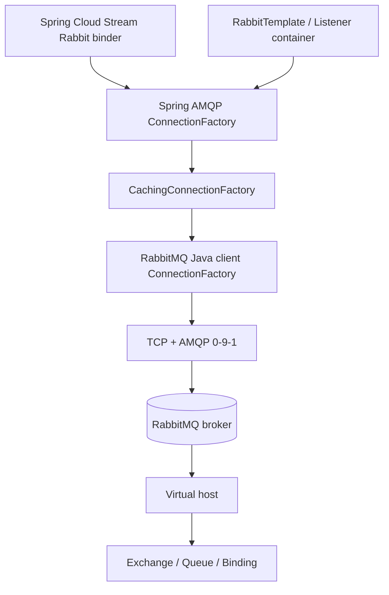

# RabbitMQ Connections, Virtual Hosts, and ConnectionFactory Configuration

The Spring Cloud Stream RabbitMQ binder uses a `ConnectionFactory` to connect an application to the broker. The host, port, username, password, TLS, and virtual host settings determine which broker the application connects to, which resource scope it is permitted to operate on, and how the connection is secured.

By default, the RabbitMQ binder uses the `ConnectionFactory` auto-configured by Spring Boot. Therefore, for a single RabbitMQ broker, most applications only need to declare `spring.rabbitmq.*` in `application.yml`; there is no need to manually create sockets, channels, or a new connection factory. When connecting to multiple brokers or performing deep customization, you can configure separate binders or provide a custom `ConnectionFactory`.

## 1. Where Does ConnectionFactory Fit in the Architecture?

In Spring AMQP, `org.springframework.amqp.rabbit.connection.ConnectionFactory` is the abstraction used by `RabbitTemplate`, listener containers, and the RabbitMQ binder to obtain connections and channels. Spring Boot's default implementation is `CachingConnectionFactory`.

`CachingConnectionFactory` works with the lower-level RabbitMQ Java client factory (`com.rabbitmq.client.ConnectionFactory`). It manages TCP connections to the broker and caches AMQP channels to reduce the overhead of repeatedly creating and destroying channels.



Concepts to distinguish:

| Component | Role |
|---|---|
| Connection | TCP/AMQP connection from the application to the broker. One connection can carry multiple channels. |
| Channel | Logical AMQP channel running inside a connection; publishing, consuming, declaring queues/exchanges, and ACKs happen over channels. |
| Spring AMQP `ConnectionFactory` | Abstraction providing connections to Spring components. |
| `CachingConnectionFactory` | Implementation that manages connections and caches channels. |
| RabbitMQ virtual host | Logical namespace containing exchanges, queues, bindings, policies, and permissions. |
| RabbitMQ binder | Maps Spring Cloud Stream destinations/bindings to exchanges, queues, and consumers on the broker. |

Do not create a new TCP connection for every message. Applications typically use long-lived connections and reuse channels through the factory.

## 2. Basic Connection Configuration with Spring Boot

The RabbitMQ binder defaults to using Spring Boot's `ConnectionFactory`. Connection properties use the `spring.rabbitmq` prefix.

Example configuration in `application.yml`:

```yaml
spring:
  rabbitmq:
    host: ${RABBITMQ_HOST:localhost}
    port: ${RABBITMQ_PORT:5672}
    username: ${RABBITMQ_USERNAME}
    password: ${RABBITMQ_PASSWORD}
    virtual-host: ${RABBITMQ_VHOST:/}
    connection-timeout: 5s
    requested-heartbeat: 30s
```

Meaning of the properties:

| Property | Meaning | Common values |
|---|---|---|
| `host` | Broker hostname or address. | `localhost`, internal DNS, or service hostname. |
| `port` | AMQP port. | `5672` for non-TLS AMQP; `5671` is typically used for AMQP over TLS. |
| `username` | Authentication username. | Dedicated application account. |
| `password` | Account password. | Loaded from a secret store or environment variable. |
| `virtual-host` | Virtual host that the connection will access. | `/` or a name such as `/orders`. |
| `connection-timeout` | Wait time when establishing a connection. | e.g., `5s`. |
| `requested-heartbeat` | Negotiated heartbeat interval to detect dead connections. | e.g., `30s`. |

The values in the example are illustrative only. Do not commit real passwords to Git, do not use the `guest` account remotely in production, and do not use the same broadly privileged account across all applications.

### Using a List of Broker Addresses

When the broker runs as a cluster or has multiple nodes, you can configure `addresses`:

```yaml
spring:
  rabbitmq:
    addresses: ${RABBITMQ_ADDRESSES:rmq-1.internal:5672,rmq-2.internal:5672}
    username: ${RABBITMQ_USERNAME}
    password: ${RABBITMQ_PASSWORD}
    virtual-host: /orders
```

When `addresses` is set, individual `host` and `port` settings are ignored. You can use a list of `host:port` entries or AMQP URIs compatible with client configuration. If a URI uses the `amqps` scheme, TLS is enabled according to the address configuration.

Do not confuse the AMQP address with the RabbitMQ Management HTTP API address. The AMQP port is typically `5672`/`5671`; the management UI typically uses `15672`. The binder requires an AMQP connection and does not use the management port to publish/consume.

## 3. Virtual Hosts as Resource and Permission Boundaries

RabbitMQ is a multi-tenant system. A virtual host (vhost) is an independent logical group of resources. Exchanges, queues, bindings, policies, and user permissions all belong to a specific vhost.

For example, the same exchange name `orders.events` can exist in two different vhosts:

```text
RabbitMQ cluster
├── vhost: /orders
│   ├── exchange: orders.events
│   └── queue: order-projection
└── vhost: /analytics
    ├── exchange: orders.events
    └── queue: order-analytics
```

Two exchanges with the same name are not a shared exchange. A connection operates only within the vhost selected when opening the AMQP connection. To exchange messages between two vhosts, an application or a bridging mechanism such as Shovel must connect to both sides and forward data.

A virtual host provides logical isolation and access control scoping; it is not a separate physical broker and does not replace resource allocation. The vhost name must exist on RabbitMQ before the application connects, unless the deployment platform has a dedicated provisioning workflow.

### Creating a Vhost and Granting Permissions

Example of creating a vhost for the order service and an application account:

```bash
rabbitmqctl add_vhost orders-prod
rabbitmqctl add_user orders-app '<password-from-secret-store>'
rabbitmqctl set_permissions -p orders-prod orders-app '.*' '.*' '.*'
```

The last command grants broad permissions within the vhost for illustration. In production, restrict the regexes to the exchange/queue names the service needs. The three expressions correspond to:

- `configure`: permission to declare, alter, or delete exchanges, queues, and bindings.
- `write`: permission to publish to exchanges.
- `read`: permission to consume/get messages from queues.

If the binder declares topology automatically, the account typically needs `configure` permission on the relevant resources. If topology is pre-provisioned and the application only consumes/publishes, you can narrow permissions and disable unnecessary declaration behavior.

An existing account that has not been granted permissions on a vhost cannot connect to that vhost. Having the right username/password is not enough; RabbitMQ checks the user's permissions on the requested vhost.

### The Default `/` Vhost

RabbitMQ creates the default `/` vhost on a new node. If `spring.rabbitmq.virtual-host` is not configured, the client typically connects to the default vhost. To avoid implicit environment dependencies, explicitly declare the vhost in application configuration.

In YAML, the value `/` should be written as a string:

```yaml
spring:
  rabbitmq:
    virtual-host: "/"
```

A vhost name such as `/orders` or `orders-prod` is a connection configuration value. Do not put the vhost name in `spring.cloud.stream.bindings.<binding>.destination`; `destination` is the binder's logical exchange, whereas the vhost belongs to the broker connection configuration.

## 4. Configuring TLS for AMQP Connections

When RabbitMQ is deployed across untrusted networks or in production environments, TLS should be used to encrypt transport and authenticate server certificates.

Example using a trust store and client certificate:

```yaml
spring:
  rabbitmq:
    host: ${RABBITMQ_HOST}
    port: 5671
    username: ${RABBITMQ_USERNAME}
    password: ${RABBITMQ_PASSWORD}
    virtual-host: /orders
    ssl:
      enabled: true
      trust-store: file:/run/secrets/rabbit-truststore.p12
      trust-store-password: ${RABBITMQ_TRUSTSTORE_PASSWORD}
      trust-store-type: PKCS12
      key-store: file:/run/secrets/rabbit-client.p12
      key-store-password: ${RABBITMQ_KEYSTORE_PASSWORD}
      key-store-type: PKCS12
```

In this example, the trust store contains the CA/certificates used to authenticate the broker. The key store is only needed when the broker requires mutual TLS (mTLS) and the client must present a certificate. If the broker only requires one-way TLS, a client key store is generally unnecessary.

Points to verify:

- The broker certificate has not expired and the hostname in the certificate matches the hostname the application uses to connect.
- The trust store contains the trusted CA that signed the broker certificate.
- If using mTLS, the broker trusts the CA that issued the client certificate and the certificate carries an authorized identity.
- Key store/trust store secrets are not stored in source code or public images.
- The TLS port is open on the broker and network policies allow the application to reach it.

Spring Boot can also enable TLS via `spring.rabbitmq.ssl.enabled` and SSL bundles/trust stores depending on the version. When an address uses the `amqps` scheme, the client can enable SSL automatically from the URI. Do not disable certificate validation or hostname verification just to make a connection work; fix the trust chain or configured hostname instead.

## 5. How Does the RabbitMQ Binder Use ConnectionFactory?

With a single RabbitMQ binder, Spring Cloud Stream uses the `ConnectionFactory` provided by Spring Boot. Bindings specify destinations and groups; the binder uses the connection factory to declare or access the topology on the configured vhost.

Example event-producing function:

```java
import java.util.function.Supplier;

import org.springframework.context.annotation.Bean;
import org.springframework.context.annotation.Configuration;

@Configuration
class OrderEventSource {

    @Bean
    Supplier<OrderCreated> orderCreated() {
        return () -> new OrderCreated("evt-1001", "order-9001");
    }
}

record OrderCreated(String eventId, String orderId) {}
```

Output binding:

```yaml
spring:
  cloud:
    function:
      definition: orderCreated
    stream:
      bindings:
        orderCreated-out-0:
          destination: orders.events
          content-type: application/json
```

With the RabbitMQ binder, a destination is mapped by default to a `TopicExchange`. For each consumer group, the binder creates a queue and binds that queue to the exchange. An anonymous consumer without a group uses an auto-delete queue with a random name. All of these resources are created in the connection factory's vhost.

This explains why a `configure` permission error can appear at application startup: the binder is trying to declare exchanges/queues/bindings, but the user lacks permission on the vhost. If topology is managed externally, the binder can be configured not to auto-declare exchanges or queues as needed, and minimal permissions can be granted to the application.

## 6. Use the Default Spring Boot ConnectionFactory or Create a Custom One?

For a single broker and a single set of credentials, start with `spring.rabbitmq.*` configuration. Spring Boot automatically creates a `CachingConnectionFactory`, and the RabbitMQ binder uses that factory. This keeps configuration centralized and avoids creating duplicate beans.

Only create a custom `ConnectionFactory` when you need fine-grained control that properties cannot satisfy, such as custom client properties, a routing connection factory, or a custom caching strategy.

Example replacing the default factory with a custom `CachingConnectionFactory`:

```java
import org.springframework.amqp.rabbit.connection.CachingConnectionFactory;
import org.springframework.context.annotation.Bean;
import org.springframework.context.annotation.Configuration;

@Configuration
class RabbitConnectionConfiguration {

    @Bean
    CachingConnectionFactory connectionFactory() {
        CachingConnectionFactory factory =
            new CachingConnectionFactory("rabbit.internal");

        factory.setPort(5672);
        factory.setUsername(System.getenv("RABBITMQ_USERNAME"));
        factory.setPassword(System.getenv("RABBITMQ_PASSWORD"));
        factory.setVirtualHost("/orders");
        factory.setChannelCacheSize(50);

        return factory;
    }
}
```

When an application-provided `ConnectionFactory` bean exists, Spring Boot generally backs off and does not create a second default factory. The Rabbit binder uses the bean provided in the application context. Do not declare multiple beans of the same type without clear disambiguation configuration, because the binder may not know which factory to use.

The Java example above illustrates basic connection configuration. If you need TLS, cluster addresses, heartbeats, connection timeouts, or other client properties, prefer Spring Boot-supported properties or fully configure the underlying Rabbit client factory; do not assume all `application.yml` properties automatically apply to a custom-created factory.

## 7. Connection and Channel Caching

Spring AMQP `CachingConnectionFactory` uses a single shared connection proxy across the application by default. Multiple channels are created on that connection and cached after use.

Key characteristics:

- The default channel cache size is 25.
- Cache size is the number of channels that can be retained for reuse; by itself it is not necessarily a hard limit on open channels in use.
- When `channelCheckoutTimeout` is greater than 0, the channel cache size can act as a limit on the number of channels; threads wait for a free channel or time out.
- The cache grows on demand. Increasing cache size can reduce channel creation/destruction overhead under high concurrency.
- Listener containers typically hold a channel for the entire lifetime of the running consumer.
- Channels created manually outside the framework must be closed properly to return resources.

Do not increase the channel cache size simply because the default is 25. Observe open channel counts, channel reuse, consumer concurrency, and channel acquisition wait times. If checkout limiting is enabled, set an appropriate timeout so the application does not wait indefinitely when channels are exhausted.

## 8. Connecting to Multiple Brokers or Multiple Virtual Hosts

An application may need to connect to two different RabbitMQ brokers, or two vhosts on different brokers. A single default `spring.rabbitmq.*` setup describes only one connection factory configuration. With Spring Cloud Stream, you can declare multiple binder configurations, each with its own environment.

Example with two RabbitMQ brokers:

```yaml
spring:
  cloud:
    stream:
      bindings:
        orderEvents-out-0:
          destination: orders.events
          binder: ordersRabbit
        auditEvents-out-0:
          destination: audit.events
          binder: auditRabbit
      binders:
        ordersRabbit:
          type: rabbit
          environment:
            spring:
              rabbitmq:
                host: ${ORDERS_RABBIT_HOST}
                port: 5672
                username: ${ORDERS_RABBIT_USERNAME}
                password: ${ORDERS_RABBIT_PASSWORD}
                virtual-host: /orders
        auditRabbit:
          type: rabbit
          environment:
            spring:
              rabbitmq:
                host: ${AUDIT_RABBIT_HOST}
                port: 5672
                username: ${AUDIT_RABBIT_USERNAME}
                password: ${AUDIT_RABBIT_PASSWORD}
                virtual-host: /audit
```

In this example, `ordersRabbit` and `auditRabbit` are binder configuration names. Each binder has its own `environment`, so each can use a different host, credentials, and virtual host. A binding selects a binder via the `binder` property.

When explicit binder configurations are enabled, Spring Cloud Stream no longer automatically creates the full default binder configuration; you must declare all binders that the application uses. If you only want to add a secondary binder without making it a default candidate, you can set `defaultCandidate: false` on the corresponding binder configuration.

The RabbitMQ binder documentation also notes that when using multiple RabbitMQ binders in the same application, you should exclude `RabbitAutoConfiguration` to prevent the same Spring Boot auto-configuration from being applied across binders. Verify the exact Spring Cloud Stream/Spring Boot version and how binder environments are isolated before deploying.

Example of excluding auto-configuration when an application genuinely has multiple Rabbit binders:

```java
import org.springframework.boot.autoconfigure.SpringBootApplication;
import org.springframework.boot.autoconfigure.amqp.RabbitAutoConfiguration;

@SpringBootApplication(exclude = RabbitAutoConfiguration.class)
public class MessagingApplication {
}
```

Do not use multiple binders merely to switch vhosts if a single broker connection factory suffices. Each binder carries its own resources, connections, and configuration; consider connection count, topology, permissions, and operability.

## 9. Naming Connections for Visibility in RabbitMQ Management

When running many services and replicas, connection names help operators identify which application owns a connection. Spring AMQP provides `ConnectionNameStrategy`; Spring Boot can automatically detect this bean and apply it to the auto-configured `CachingConnectionFactory`.

Example:

```java
import org.springframework.amqp.rabbit.connection.ConnectionNameStrategy;
import org.springframework.amqp.rabbit.connection.SimplePropertyValueConnectionNameStrategy;
import org.springframework.context.annotation.Bean;
import org.springframework.context.annotation.Configuration;

@Configuration
class RabbitConnectionNameConfiguration {

    @Bean
    ConnectionNameStrategy rabbitConnectionNameStrategy() {
        return new SimplePropertyValueConnectionNameStrategy(
            "spring.application.name"
        );
    }
}
```

The connection name appears in the RabbitMQ Management UI if the broker supports client properties. It helps identify connections during investigations, though it is not a security identity and is not necessarily unique.

## 10. ConnectionFactory and Topology Provisioning

A connection factory only establishes connections and provides channels. It does not determine the application's entire topology. The RabbitMQ binder maps Spring Cloud Stream destinations to exchanges and queues according to binding configuration.

With the Rabbit binder defaults:

- Each destination maps to a `TopicExchange`.
- Each consumer group gets a queue bound to the exchange.
- Each consumer instance joins its group's queue.
- Anonymous consumers use an auto-delete queue with a random name.
- The binder can automatically declare exchanges, queues, and bindings if the corresponding options are enabled.

If the platform team manages topology via definitions or IaC, the application can be configured not to auto-declare queues/exchanges. In that case, ensure exchange names, queue names, binding keys, and vhosts match the application configuration. The user only needs read/write permissions matching actual operations; broad `configure` permissions are not strictly required.

Topology errors often appear as `ACCESS_REFUSED` on a channel when the binder declares a queue/exchange, whereas wrong-vhost errors typically cause the connection to be rejected while opening the connection. Distinguishing these two cases speeds up troubleshooting.

## 11. Verifying Connections and Common Troubleshooting

| Symptom | Possible cause | How to check |
|---|---|---|
| `Connection refused` | Broker is down, wrong host/port, firewall or network policy blocking. | Check DNS, TCP reachability to the AMQP port, broker listeners, and network routes. |
| Timeout on startup | Broker unresponsive, wrong endpoint, or timeout too short. | Check address, connection timeout, and broker logs. |
| Authentication failure | Wrong username/password or disabled account. | Verify secrets loaded for the right environment and user status. |
| `ACCESS_REFUSED - access to vhost ... refused` | User lacks permission to access the requested vhost or vhost does not exist. | Check the vhost, `rabbitmqctl list_vhosts`, and user permissions. |
| `ACCESS_REFUSED` when declaring queue/exchange | User can connect but lacks `configure` permission on the resource. | Check permission regexes and the topology the binder is declaring. |
| TLS handshake/certificate error | Untrusted CA, expired certificate, hostname mismatch, or invalid client certificate. | Check trust store, certificate chain, hostname, and TLS settings on both sides. |
| Unstable connections | Heartbeat, network idle timeout, broker resource alarms, or node failover. | Check heartbeat, blocked/unblocked events, broker logs, and network. |
| Channel limit or channel timeout | Application uses too many channels or inappropriate cache/checkout settings. | Monitor channel count, concurrency, cache size, and checkout timeout. |
| Binder creates topology in the wrong place | Vhost in connection factory differs from the vhost viewed in Management UI. | Check `spring.rabbitmq.virtual-host` and vhost in connection details. |

A successful connection shown in the RabbitMQ Management UI does not prove the application is using the right vhost or permissions. Inspect connection details to verify the actual user, vhost, protocol, and client name.

## 12. Testing Connection Configuration

Test at multiple levels:

1. **Configuration check:** verify host, port, username, virtual host, and TLS are loaded from the right environment profile/secrets.
2. **Network check:** verify the application can reach the AMQP port and is not confusing it with the Management HTTP port.
3. **Authentication and permission check:** connect with the target user/vhost and confirm required configure/read/write permissions.
4. **Binder startup check:** start the application and verify the binder creates or accesses the expected exchange/queue in the desired vhost.
5. **Publish/consume check:** send a message via the output binding, receive it through the consumer group, and verify payload/headers.
6. **Error check:** test with an invalid password, wrong vhost, or missing permissions in a test environment to ensure logs clearly indicate the cause.
7. **Reconnect check:** stop the broker in a test environment, restart it, and observe Spring AMQP/binder recovery behavior.
8. **Multi-binder check:** verify each binding uses its intended broker/vhost when the application has multiple Rabbit binders.

The Spring Cloud Stream Test Binder is useful for testing function logic and bindings inside the JVM, but it does not verify TCP, TLS, vhosts, credentials, or permissions of a real RabbitMQ broker. For connection behavior, integration tests using a real broker or Testcontainers RabbitMQ are required.

## 13. Production Deployment Checklist

Before deploying, verify:

- [ ] The application uses the correct AMQP endpoint and port, not the management port.
- [ ] The vhost has been created and you do not assume Spring Boot will create it automatically.
- [ ] The user has been granted appropriate permissions on the correct vhost.
- [ ] Credentials come from a secret store/environment, not source code.
- [ ] TLS is enabled when network security requires it, and certificates/hostnames are validated.
- [ ] `addresses` does not conflict with `host`/`port`; understand that host/port are ignored when addresses is set.
- [ ] The binder uses the intended Spring Boot `ConnectionFactory` or a deliberately configured custom factory.
- [ ] Connection/channel caching fits actual concurrency and load.
- [ ] The connection name is clear enough for visibility in RabbitMQ Management.
- [ ] Topology is either declared by the binder or provisioned via IaC under a consistent process.
- [ ] If using multiple Rabbit binders, each binder has its own environment and auto-configuration is not misapplied.
- [ ] Integration tests exist for connectivity, vhost, permissions, TLS, publish/consume, and reconnect.

Reliable RabbitMQ connectivity starts with choosing the right broker endpoint, account, and virtual host. When the Spring Cloud Stream binder uses the right `ConnectionFactory`, topology is declared in the right vhost, and least-privilege permissions are granted appropriately, applications can connect, publish, and consume consistently across deployment environments.

## References

- [Spring Cloud Stream – RabbitMQ Binder Reference Guide](https://docs.spring.io/spring-cloud-stream/docs/current/reference/html/spring-cloud-stream-binder-rabbit.html)
- [Spring Cloud Stream – Connecting to Multiple Systems](https://docs.spring.io/spring-cloud-stream/reference/spring-cloud-stream/multiple-systems.html)
- [Spring Boot – AMQP Configuration](https://docs.spring.io/spring-boot/3.5/reference/messaging/amqp.html)
- [Spring AMQP – Connection and Resource Management](https://docs.spring.io/spring-amqp/reference/amqp/connections.html)
- [RabbitMQ – Virtual Hosts](https://www.rabbitmq.com/docs/vhosts)
- [RabbitMQ – Authentication, Authorisation and Access Control](https://www.rabbitmq.com/docs/access-control)
