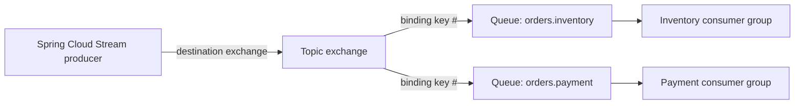

# Using Pre-Existing Exchanges or Queues

By default, the RabbitMQ Binder automatically provisions part of the topology when creating bindings. For a destination, the binder typically creates a `TopicExchange`; for each consumer group, the binder creates a queue and binds it to the exchange. This approach is convenient when the application owns the entire topology. In many enterprise systems, exchanges, queues, and bindings are pre-created by a platform or operations team using Terraform, Ansible, RabbitMQ Management, or a dedicated provisioning workflow.

When connecting to an existing topology, configure the binder to use the exact exchange and queue names without redeclaring or rebinding them. The key properties are `declareExchange`, `bindQueue`, and `queueNameGroupOnly`. For producers, `declareExchange=false` prevents the binder from declaring the exchange; for consumers, combine these properties so the binder uses the existing queue without creating new bindings.

## 1. Default Topology of the RabbitMQ Binder

RabbitMQ has the following core components:

- **Exchange** receives messages from producers and routes them to queues based on exchange type, routing key, and bindings.
- **Queue** stores messages for consumers to receive and process.
- **Binding** links an exchange to a queue, optionally with a routing key or arguments.
- **Routing key** is the value sent by the producer with a message for the exchange to use when routing; its exact meaning depends on the exchange type.

By default, the RabbitMQ Binder maps `destination` to a topic exchange. For a consumer with a group, the binder typically creates a queue of the form `<destination>.<group>` and binds it to the exchange with routing key `#` for non-partitioned destinations. A consumer without a declared group uses an auto-delete anonymous queue with a random name.



For example, a binding with `destination: orders` and `group: inventory` typically results in exchange `orders` and queue `orders.inventory`. If infrastructure has already created a queue named `inventory-orders` and bound it to exchange `orders.events`, the default configuration will not automatically locate that queue. You must specify the exact resource names and disable the corresponding provisioning operations.

## 2. Using Pre-Existing Exchanges and Queues for Consumers

Suppose the platform team has already created:

- Exchange: `orders.events`.
- Queue: `inventory.orders`.
- Bindings from the exchange to the queue with routing keys `order.created` and `order.cancelled`.

The consumer needs to read from the existing queue. The following configuration uses `destination` as the exchange name, `group` as the queue name, and instructs the binder not to declare the queue, not to bind the queue, and not to declare the exchange:

```yaml
spring:
  cloud:
    function:
      definition: receiveOrders
    stream:
      bindings:
        receiveOrders-in-0:
          destination: orders.events
          group: inventory.orders
          content-type: application/json
      rabbit:
        bindings:
          receiveOrders-in-0:
            consumer:
              bind-queue: false
              declare-exchange: false
              queue-name-group-only: true
```

The three Rabbit-specific properties serve distinct roles:

| Property | Effect |
|---|---|
| `bind-queue: false` | Does not declare the queue and does not bind the queue to the exchange; used when infrastructure already created the queue and binding |
| `declare-exchange: false` | Does not declare the target exchange |
| `queue-name-group-only: true` | Uses the `group` value as the queue name; when disabled, the binder defaults to `destination.group` |

With this configuration, the binder looks up queue `inventory.orders` to consume from. Exchange `orders.events` is managed externally and the binding keys already exist. The binder does not add a `#` binding, so the routing keys configured by the platform team are preserved.

This is the configuration for using pre-existing topology per the RabbitMQ Binder guide. The actual queue name must match `group` exactly when `queue-name-group-only` is enabled. Omitting this property causes the binder to look for the default `<destination>.<group>` name, which may result in a non-existent queue name.

### 2.1. Why Disable Both bindQueue and declareExchange?

Disabling `declare-exchange` alone is insufficient if the binder is still allowed to create queues and bindings. Disabling `bind-queue` without disabling `declare-exchange` can still cause the binder to declare the exchange from the destination name. When using externally managed topology, explicitly decide which resources the binder may create:

- Queue and binding already exist: `bind-queue: false`.
- Exchange already exists: `declare-exchange: false`.
- Queue uses the exact group name: `queue-name-group-only: true`.

If the application is permitted to create queues while the exchange already exists, you can keep `bind-queue: true`, disable `declare-exchange`, and configure `binding-routing-key` for the desired binding. If the queue already exists but the binder needs to create the binding, carefully check queue declaration arguments and `configure` permissions before choosing this approach.

## 3. Producer Sending to a Pre-Existing Exchange

A producer only needs to publish to an exchange; downstream queues and bindings are managed by infrastructure. Set `destination` to the exchange name and disable `declare-exchange` in the producer binding:

```yaml
spring:
  cloud:
    function:
      definition: publishOrder
    stream:
      bindings:
        publishOrder-out-0:
          destination: orders.events
          content-type: application/json
      rabbit:
        bindings:
          publishOrder-out-0:
            producer:
              declare-exchange: false
              routing-key: order.created
```

In this example, the producer sends to exchange `orders.events` with fixed routing key `order.created`. The binder does not declare the exchange. The exchange must exist before the application publishes. If the exchange does not exist, the broker may close the channel when the producer publishes; if the exchange exists without a matching binding, messages may not be routed to any queue.

`routing-key` is a static value. If the routing key depends on payload or headers, use `routing-key-expression` with SpEL:

```yaml
spring:
  cloud:
    stream:
      bindings:
        publishOrder-out-0:
          destination: orders.events
      rabbit:
        bindings:
          publishOrder-out-0:
            producer:
              declare-exchange: false
              routing-key-expression: "payload.eventType"
```

The expression must match the actual payload type. If using `Message<?>`, metadata can be read from headers, e.g., `headers['route']`. Do not derive routing keys directly from unvalidated user input; misrouting can send messages to unintended queues or leave them unrouted.

### 3.1. Exchange Type Determines How Routing Keys Are Interpreted

Not all exchanges process routing keys the same way:

| Exchange type | Routing behavior | Example |
|---|---|---|
| `direct` | Routing key must match the binding key exactly | `order.created` matches `order.created` |
| `topic` | Pattern matching with `*` and `#` | `order.*` matches `order.created`; `order.#` matches multiple levels |
| `fanout` | Sends to all bound queues, ignoring the routing key | Broadcast notifications to subscribed queues |
| `headers` | Matches message headers against binding arguments | Uses `x-match` and declared headers |

When an exchange already exists, the binder should not be configured to redeclare it with a different `exchange-type`. `exchange-type` only applies when the binder creates the exchange. Let the team owning the topology confirm the exchange type and binding keys; the producer simply sends routing keys conforming to that contract.

## 4. Distinguishing destination, group, and Queue Names

In Spring Cloud Stream, `destination` and `group` are binding-level properties. The Rabbit Binder maps them to exchange and queue names by default rules, though you can adjust this mapping when using existing resources.

| Property | Example | Role when using pre-existing topology |
|---|---|---|
| `destination` | `orders.events` | Exchange name referenced by the binding |
| `group` | `inventory.orders` | Queue name when `queue-name-group-only: true` |
| `binding-routing-key` | `order.created` | Routing key used to bind the queue if the binder is allowed to bind |
| `routing-key` | `order.created` | Routing key the producer sends to the exchange |

`binding-routing-key` and `routing-key` are not the same. The former controls the binding from exchange to queue; the latter controls the routing key of messages sent by the producer. When `bind-queue=false`, the binder does not create bindings, so `binding-routing-key` is not used to alter existing bindings. When the producer publishes, `routing-key` must still match the binding configured by infrastructure.

## 5. What If You Only Want to Use an Existing Exchange While Letting the Binder Declare Queues?

Auto-provisioning can be controlled per resource. For example, the exchange already exists, but you want the binder to create and bind a new queue:

```yaml
spring:
  cloud:
    stream:
      bindings:
        receiveOrders-in-0:
          destination: orders.events
          group: inventory
      rabbit:
        bindings:
          receiveOrders-in-0:
            consumer:
              declare-exchange: false
              bind-queue: true
              binding-routing-key: order.created
```

In this case, the binder does not declare the exchange, yet still creates a queue according to naming rules and binds it with the configured routing key. The queue is created with the default name `<destination>.<group>` unless `queue-name-group-only` is enabled. If an existing queue must be used, do not use this configuration because `bind-queue: true` allows the binder to declare the queue and binding.

Conversely, if you want the binder to create both the exchange and queue using a non-default exchange type or routing key, set `exchange-type` and `binding-routing-key`. That approach fits when the application owns the topology; it is not how to connect read-only to a pre-provisioned topology.

## 6. Producers with `requiredGroups` and Queue Provisioning

A producer binding can declare `required-groups` to instruct the binder to create queues/bindings for known consumer groups even before consumers are deployed. This is useful when ensuring queues exist before the producer starts emitting messages.

Example:

```yaml
spring:
  cloud:
    stream:
      bindings:
        publishOrder-out-0:
          destination: orders.events
          producer:
            required-groups:
              - inventory
              - payment
```

If infrastructure has already created queues and bindings for these groups, avoid accidentally instructing the binder to re-provision the topology. The Rabbit producer has a `bind-queue` property that applies to `required-groups`; set it to `false` when queues and bindings are pre-created. Check the queue naming rules and how your binder version handles required groups, especially when queues have custom names.

For consumers using `queue-name-group-only`, the queue name comes directly from `group`. Ensure producer provisioning and consumer bindings reference the exact same queue. Do not assume custom queue names are automatically inferred from a `required-group` without checking provisioning configuration.

## 7. Queue Arguments and Platform-Managed Topology

Queues can be created with attributes that affect behavior and resilience:

- **Durable:** the queue survives broker restarts according to storage settings.
- **Exclusive:** only the connection that created the queue may use it; generally unsuitable for queues shared across multiple instances.
- **Auto-delete:** the queue can be deleted when the last consumer stops using it.
- **Queue type:** classic or quorum; determines storage and replication behavior.
- **TTL and max length:** limits message lifetime or message count/bytes.
- **Dead-letter exchange:** routes dead-lettered messages elsewhere.
- **Single active consumer:** only one consumer is active at a time according to broker semantics.

When the binder does not declare the queue, it is not responsible for altering these arguments. The platform team must ensure the queue is configured appropriately for the workload. If the binder attempts to declare a queue with the same name but different arguments from the existing queue, RabbitMQ may return `PRECONDITION_FAILED` due to incompatible declarations. Avoid this error by establishing clear topology ownership and disabling binder provisioning when queues are pre-created.

A consumer application should not independently dictate queue type, durability, or DLX for a platform-managed queue. Such changes should go through a topology migration process to avoid deleting queues and losing backlog.

## 8. RabbitMQ Access Permissions

RabbitMQ enforces permissions by virtual host and resource name. When using an existing topology, grant permissions matching the operations the application actually performs:

| Operation | Typical permission required |
|---|---|
| Consume from an existing queue | `read` on the queue |
| Publish to an existing exchange | `write` on the exchange |
| Declare exchange/queue | `configure` on the corresponding resource |
| Create binding | `write` on the exchange and `read` on the queue |
| View/manage topology via Management API | Separate Management API permissions, distinct from AMQP runtime permissions |

If `bind-queue=false` and `declare-exchange=false`, the application does not ask the binder to create queues, bindings, or exchanges. However, the user still needs permission to consume from the queue or publish to the exchange. Skipping topology declaration does not eliminate authentication or authorization requirements.

Verify the virtual host, username, TLS, resource permissions, and regex scope. Do not use an administrator account at runtime if only consume/publish is required. Scope permissions to specific exchange/queue names and environments.

## 9. Handling Startup and Topology Errors

When using external resources, startup can fail if a queue does not exist, the group name is wrong, the exchange was deleted, or the user lacks permissions. The Rabbit Binder has a `missingQueuesFatal` consumer property controlling whether a missing queue is treated as a fatal error; the default is typically `true`. Do not disable this property merely to hide provisioning mistakes if the queue must exist before the application runs.

Common errors:

| Symptom | Possible cause | Resolution |
|---|---|---|
| Consumer cannot find queue | Wrong `group`, missing `queue-name-group-only`, or queue not yet provisioned | Compare the actual queue name with binding config |
| Broker reports `NOT_FOUND` or closes channel | Target exchange does not exist during publish/consume | Check `destination` and topology on the right vhost |
| `PRECONDITION_FAILED` on declare | Binder declares exchange/queue with type or arguments differing from existing resources | Disable corresponding provisioning or align topology through governance |
| Messages do not reach queue | Producer routing key does not match binding key or exchange type differs from expectation | Check exchange type, routing key, and live bindings |
| Consumer receives unwanted messages | Queue was bound with an overly broad pattern or `#` | Adjust the binding key where topology is owned |
| Access refused | Missing `read`, `write`, or `configure` permission in the vhost | Grant least-privilege permissions matching runtime operations |
| Queue is deleted when app stops | Queue was created as anonymous/auto-delete or topology is non-durable | Use a stable group and have the platform provision a durable queue as required |

Read the root cause from Spring AMQP and RabbitMQ broker logs. Topology errors usually appear during binding initialization or publishing; routing errors may not fail publishing if the exchange exists without a matching queue. Enable publisher returns/confirms when the application needs to detect unroutable messages.

## 10. Publisher Confirms and Unroutable Messages

`declare-exchange: false` only disables exchange declaration; it does not confirm that a message reached a queue. RabbitMQ can accept a publish to an exchange yet fail to route the message if no binding matches. If the application must detect this case, configure publisher confirms and publisher returns on the connection factory, along with appropriate error handling.

Example Spring Boot configuration:

```yaml
spring:
  rabbitmq:
    publisher-confirm-type: correlated
    publisher-returns: true
  cloud:
    stream:
      bindings:
        publishOrder-out-0:
          destination: orders.events
          producer:
            error-channel-enabled: true
      rabbit:
        bindings:
          publishOrder-out-0:
            producer:
              declare-exchange: false
              use-confirm-header: true
```

`publisher-confirm-type: correlated` enables receiving publisher confirms with correlation data; `publisher-returns: true` enables receiving returned messages when unroutable under the corresponding template/binder mandatory configuration. `use-confirm-header` is one mechanism for receiving publish outcomes in the Rabbit Binder. Do not configure both `use-confirm-header` and `confirm-ack-channel` simultaneously; they are mutually exclusive alternatives in supported versions.

A publisher confirm indicates the broker processed the publish according to confirm semantics. A returned message indicates the message could not be routed to any queue. A confirm does not mean a consumer has received or completed business processing. For critical flows, combine publish outcomes with application-level outbox/idempotency patterns.

## 11. Testing Pre-Existing Topology

Do not only verify that the application starts up. Integration tests against RabbitMQ should verify the binder uses the intended exchange/queue and creates no unintended resources:

1. Create the exchange with the exact name and type.
2. Create the queue with the exact name, durability, and arguments.
3. Create the binding with the required routing keys.
4. Start the consumer with `bind-queue=false`, `declare-exchange=false`, and `queue-name-group-only=true`.
5. Verify the consumer receives messages published to the exchange with matching routing keys.
6. Send a message with a non-matching routing key and verify return/confirm behavior as configured.
7. Start the application with a user lacking `configure` permission but having `read` permission; verify the consumer can still use the existing topology.
8. Test with a wrong queue name or deleted queue in a test environment to confirm startup/health reports a clear error.
9. Verify application shutdown does not delete the platform-managed durable queue.

The Test Binder can verify function logic and message mapping at the Spring Cloud Stream layer, but it does not simulate real exchanges, queues, bindings, vhost permissions, routing, and publisher returns. These requirements must be tested against real RabbitMQ or an equivalent test container.

## 12. Platform Team Coordination Workflow

Before configuring the application, obtain a clear topology contract:

| Required information | Example |
|---|---|
| Virtual host | `/orders-prod` |
| Exchange name/type | `orders.events` / `topic` |
| Queue name | `inventory.orders` |
| Binding key | `order.created`, `order.cancelled` |
| Durability/queue type | Durable quorum queue |
| DLX/DLQ | `orders.dlx` / `inventory.orders.dlq` |
| Message contract | JSON schema version 2 |
| Runtime principal | `inventory-consumer` with `read` on the queue |
| Ownership | Platform team owns topology; application team owns consumer code |

Place these names and rules in environment-specific configuration rather than hardcoding them in source code. Changes to queue/exchange type, binding keys, or DLX require compatibility and rollout plans. If renaming a queue, account for existing backlog, running consumers, and cutover timing.

## 13. Pre-Deployment Checklist

- [ ] `destination` matches the pre-provisioned exchange name.
- [ ] `group` matches the queue name when using `queue-name-group-only: true`.
- [ ] Consumer sets `bind-queue: false` when the queue and binding already exist.
- [ ] Consumer sets `declare-exchange: false` when the exchange is managed by infrastructure.
- [ ] Producer sets `declare-exchange: false` when publishing to a pre-existing exchange.
- [ ] Producer routing key matches the exchange type and existing binding keys.
- [ ] `required-groups` is not inadvertently configured to let the binder create unplanned queues/bindings.
- [ ] Queue arguments, durability, queue type, TTL, and DLX are confirmed with the owning team.
- [ ] Runtime user has `read` or `write` on the right resources; unnecessary administrator privileges are not granted.
- [ ] Publisher confirms/returns are enabled if publish failures or unroutable messages must be detected.
- [ ] Integration tests exist against real RabbitMQ for startup, routing, permissions, and shutdown.
- [ ] Environment-specific configurations are managed through appropriate secret/config stores.

When exchanges or queues are provisioned externally, the Spring Cloud Stream RabbitMQ Binder can use them without creating new topology. On the consumer side, `bind-queue=false`, `declare-exchange=false`, and `queue-name-group-only=true` configure the binder to consume from a queue named after the group. On the producer side, `declare-exchange=false` allows publishing to an existing exchange; routing keys must match the infrastructure-managed bindings. Verifying topology, permissions, and publisher confirms/returns prevents startup failures and silently unrouted messages.

## References

- [Spring Cloud Stream RabbitMQ Binder — Using Existing Queues/Exchanges](https://docs.spring.io/spring-cloud-stream/reference/rabbit/rabbit_overview/rabbitmq-binder.html)
- [Spring Cloud Stream RabbitMQ Binder Reference Guide](https://docs.spring.io/spring-cloud-stream/docs/current/reference/html/spring-cloud-stream-binder-rabbit.html)
- [RabbitMQ — Exchanges and Routing](https://www.rabbitmq.com/tutorials/amqp-concepts)
