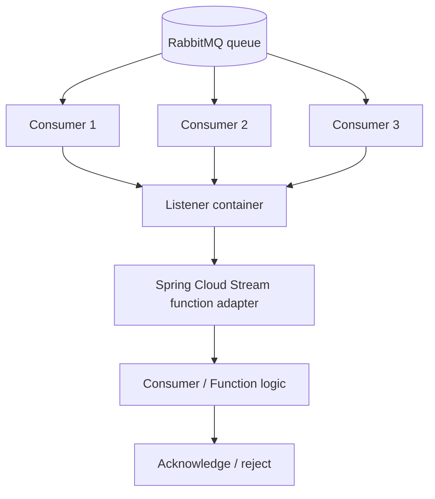
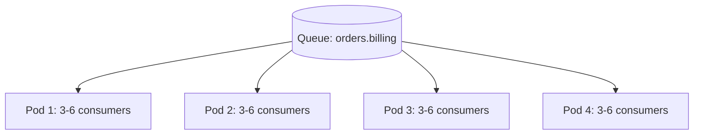
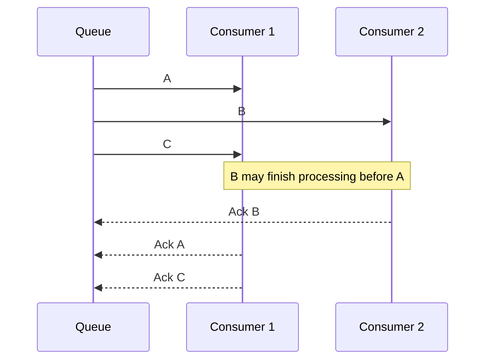

# Listener Container, Concurrency, and Prefetch

## 1. Role of the Listener Container

In Spring Cloud Stream, the RabbitMQ binder connects an input binding to a RabbitMQ queue. The binder creates and configures a listener container to receive messages, convert them into Spring `Message` objects, invoke the appropriate `Supplier`/`Function`/`Consumer` adapter, and coordinate acknowledgment after processing.

The listener container manages the consumers running inside the application. It is responsible for receiving messages from RabbitMQ, invoking listeners, handling errors, acknowledging or rejecting messages, and managing the consumer lifecycle when the application starts, stops, or loses connectivity.

Three concepts are often tuned together but solve different problems:

- **Concurrency:** the number of concurrent consumers reading from the queue, determining listener parallelism.
- **Maximum concurrency:** the upper bound to which the container can scale up consumers when load increases, if the container mechanism supports dynamic scaling.
- **Prefetch:** the number of unacknowledged messages the broker can deliver in advance to a consumer, determining how much in-flight work a consumer holds.

Concurrency controls how many workers process messages; prefetch controls how many unacknowledged messages each worker can hold. Increasing one parameter cannot substitute for tuning the other.



The diagram shows a single binding with multiple consumers reading from a queue. Each consumer can hold a number of unacknowledged messages up to prefetch; the container coordinates invoking application logic and completing delivery.

## 2. Relationship Among Application Instances, Groups, and Concurrency

With the Rabbit binder, a consumer binding with a group typically corresponds to a durable queue for that group. Multiple application instances sharing the same destination and group compete for messages from the shared queue. Inside each instance, the listener container can create multiple concurrent consumers.

Example:

- There are 4 replicas of `billing-service`.
- Each replica configures `concurrency=3`.
- Each replica has at least 3 consumers reading from the `billing-service` group's queue.
- Total active consumers is approximately 4 × 3 = 12.

If `maxConcurrency=6`, each instance can scale up to 6 consumers depending on the container's scaling conditions. The maximum total consumers when all 4 replicas scale to the ceiling is 4 × 6 = 24.



Consumers in the same group share the workload. If another service uses a different group name, the binder creates a separate queue bound to the corresponding destination/exchange; that queue receives an independent stream of messages and has its own listener container.

The actual total consumer count also depends on running replicas, container state, resource limits, and scaling mechanisms. Do not multiply replica count by concurrency and assume guaranteed throughput; this only represents the number of consumers able to participate in receiving messages.

## 3. Configuring Concurrency for the Rabbit Binder

Example application processing order events:

```java
import java.util.function.Consumer;
import org.springframework.context.annotation.Bean;
import org.springframework.context.annotation.Configuration;

record OrderCreated(String orderId, long totalCents) {}

@Configuration
class OrderFunctions {

    @Bean
    Consumer<OrderCreated> processOrder(OrderService orderService) {
        return event -> orderService.reserve(event);
    }
}
```

Binding configuration:

```yaml
spring:
  cloud:
    function:
      definition: processOrder
    stream:
      bindings:
        processOrder-in-0:
          destination: orders
          group: billing-service
      rabbit:
        bindings:
          processOrder-in-0:
            consumer:
              concurrency: 3
              maxConcurrency: 6
              prefetch: 20
              acknowledgeMode: AUTO
```

In this example:

- `concurrency: 3` sets the initial number of consumers for the listener container.
- `maxConcurrency: 6` sets the maximum number of consumers when the container scales concurrency up.
- `prefetch: 20` allows each consumer up to roughly 20 unacknowledged deliveries under the applied QoS.
- `acknowledgeMode: AUTO` instructs the container to acknowledge when the listener completes successfully; failures are routed through error handling per configuration.

These are Rabbit-binder-specific properties under `spring.cloud.stream.rabbit.bindings.<bindingName>.consumer`. Check the configuration metadata of your Spring Cloud Stream Rabbit binder version, as property names and container capabilities can vary by version.

## 4. How Do concurrency and maxConcurrency Differ?

`concurrency` is the initial or minimum number of consumers the container launches according to binder configuration. `maxConcurrency` is the upper limit when the container supports dynamic consumer scaling.

For example, with `concurrency=2` and `maxConcurrency=8`:

- Under low load, the container may run with 2 consumers.
- When message backlog grows and scaling conditions are met, the container can add consumers.
- When load drops for long enough, the container can scale down consumers, though not below the minimum.
- The container does not necessarily jump to 8 as soon as a single message arrives; scaling depends on the listener container's algorithms and triggers.

If dynamic scaling is unnecessary, set `concurrency` to an appropriate level and do not declare `maxConcurrency` higher than needed. If `maxConcurrency` is set, explicitly identify the downstream resource limits that the maximum number of consumers could hit.

### When to Increase Concurrency?

Increasing concurrency helps when messages are independent, processing can run in parallel, and downstream dependencies can handle the load. For instance, each event updates a different order and the database has enough connections to handle concurrent queries.

Do not increase concurrency if:

- Every message updates the same row or same aggregate and strict ordering is required.
- The database connection pool is smaller than the number of concurrent tasks.
- External APIs have low rate limits.
- Each message consumes significant CPU or memory.
- The queue has business ordering dependent on a single consumer.

## 5. What Is Prefetch?

RabbitMQ prefetch limits how many messages the broker delivers to a consumer that the consumer has not yet acknowledged. With per-consumer QoS typically used in listener containers, prefetch applies to each individual consumer.

Example `prefetch=10`:

1. The consumer receives up to roughly 10 unacknowledged messages.
2. When it processes and acks a message, a new delivery slot opens.
3. The broker can deliver the next message to that consumer.
4. If the consumer is slow, already-delivered messages remain unacknowledged and are not redistributed to another consumer merely because the other consumer is idle.

Prefetch is not the number of messages processed concurrently in code. A consumer may receive multiple messages in advance while the listener container still invokes processing according to its own mechanism. With a standard synchronous listener, one consumer processes one callback at a time; prefetch acts as an unacknowledged delivery buffer.

### A Prefetch Value of 0

In RabbitMQ, a prefetch of `0` means no limit on unacknowledged messages under that QoS setting. It does not mean "receive no messages." An unbounded value can cause a single consumer to hoard deliveries, increase memory usage, and hurt fair distribution.

For applications requiring load control, choose a finite prefetch based on processing time, message size, and downstream capacity.

## 6. Estimating In-Flight Messages in Consumers

With per-consumer QoS prefetch, a simple estimate of maximum unacknowledged deliveries is:

\[
N_{unacked} \approx N_{consumers} \times prefetch
\]

For a deployment with 4 replicas, each running 3 consumers and `prefetch=20`:

\[
4 \times 3 \times 20 = 240
\]

The system can have around 240 delivered-but-unacknowledged messages on that queue when every consumer fills its prefetch. If the container scales up to 6 consumers per replica, the estimate rises to:

\[
4 \times 6 \times 20 = 480
\]

This estimate assumes per-consumer QoS and all consumers reaching the limit. Global QoS settings, batching, multiple queues, multiple groups, and binder implementation details can make actual numbers differ.

If the average payload is 100 KB, 480 messages represent roughly 48 MB of payloads before counting protocol overhead, Java objects, headers, and in-memory copies. Therefore, raising concurrency and prefetch simultaneously can grow heap usage rapidly.

## 7. Choosing Prefetch Based on Processing Time

Low prefetch provides more flexible message distribution and limits how many messages sit in each consumer. High prefetch reduces time spent waiting on the broker for the next message and can improve throughput when processing is fast and consistent.

| Workload characteristic | Prefetch guidance |
|---|---|
| Large messages, slow processing | Start low to limit memory and unacked counts |
| Small messages, fast processing | Can increase gradually to reduce delivery idle gaps |
| Highly variable processing times | Keep moderate to avoid fast/slow consumers holding skewed backlogs |
| Fair distribution across many consumers | Low or moderate prefetch |
| Rate-limited downstream dependencies | Finite prefetch paired with appropriate concurrency |
| Consumer can only process sequentially | Avoid overly high prefetch since many messages will queue inside one consumer |

There is no single universal number. Measure throughput, p95/p99 processing time, queue depth, unacked count, and memory during load testing.

## 8. How Prefetch Affects Message Distribution

RabbitMQ distributes messages across consumers subscribed to a queue. When prefetch is large, the broker can push many messages ahead to consumer A. If A slows down while consumer B is idle, messages already delivered to A remain unacked and are generally not shifted by the broker to B.

Example:

- Consumer A has prefetch 50 and receives 50 messages.
- Consumer B has prefetch 50 but initially receives only a few messages.
- A hits a slow task and holds many unacknowledged messages.
- B finishes quickly but cannot pull away messages already delivered to A.

Lowering prefetch gives the broker opportunities to dispatch new messages to idle consumers. However, setting prefetch too low can leave consumers waiting continuously for deliveries and hurt throughput when network round trips are non-trivial.

## 9. Concurrency and Processing Order

A RabbitMQ queue can have multiple consumers. With multiple consumers, the broker dispatches messages to different consumers; start and completion times can vary.

Suppose a queue receives `A`, `B`, `C` in order:



Thus, multiple consumers can cause completion order to differ from enqueue order. Redelivery, requeue, and prefetch can also affect observed ordering. If business logic demands strict ordering, consider a single consumer per queue, appropriate prefetch, and synchronous processing; or partition logically by key so each entity group maintains its own order.

Even with a single consumer, if a callback hands tasks off to an asynchronous thread pool and returns early, side effects can complete out of order. Order preservation must be maintained end-to-end from the broker through the processing code.

## 10. Acknowledge Mode and Prefetch

Prefetch bounds the number of unacknowledged deliveries, so acknowledgment mode directly affects when the broker can send new messages.

The Rabbit binder supports Spring AMQP acknowledgment modes:

| Mode | General behavior | Relationship with prefetch |
|---|---|---|
| `AUTO` | Container acks when listener succeeds; exceptions follow error handler/requeue policy | Message stays unacked while the listener executes |
| `MANUAL` | Application must acknowledge or reject/nack explicitly | Message occupies a prefetch slot until the application acknowledges |
| `NONE` | Broker considers messages acknowledged immediately upon delivery under no-ack semantics | No unacked window for prefetch to constrain in the usual way; risk of message loss if consumer stops |

In Spring AMQP, `AUTO` means container-managed acknowledgment, not broker auto-ack. `NONE` is what corresponds to the broker not waiting for consumer acks. This is a common point of confusion when reading configurations.

If using `MANUAL` and code forgets to ack/nack, messages can stay unacked until the channel/connection closes, at which point the broker may requeue and redeliver them. A low prefetch limits how many messages get stuck, but it does not replace proper acknowledgment handling.

## 11. Retries and DLQs Under High Concurrency

When a listener throws an exception, the binder/container applies retries and reject/requeue/DLQ policies. During synchronous retries, that consumer can be tied up and unable to accept new messages. If many consumers hit errors simultaneously, the queue's entire processing capacity can drop.

Example Rabbit binder configuration with DLQ:

```yaml
spring:
  cloud:
    stream:
      bindings:
        processOrder-in-0:
          destination: orders
          group: billing-service
          consumer:
            max-attempts: 3
      rabbit:
        bindings:
          processOrder-in-0:
            consumer:
              autoBindDlq: true
              republishToDlq: true
              prefetch: 10
              concurrency: 2
              maxConcurrency: 4
```

`max-attempts` is a common Spring Cloud Stream consumer property; `autoBindDlq`, `republishToDlq`, `prefetch`, `concurrency`, and `maxConcurrency` are Rabbit binder properties. Verify topology and exchange/queue declaration permissions in your broker environment.

Do not raise concurrency to mask a bad message stuck in retries. Separate transient errors from data errors, bound retries, route unprocessable messages to a DLQ, and monitor redeliveries.

## 12. Aligning Concurrency with Database Connection Pools

Each consumer can execute a business task concurrently. If the function queries a database, total consumers can generate substantial concurrent query load.

Example:

- 5 replicas.
- `maxConcurrency=8` per replica.
- Up to 40 consumers.
- Each replica's database connection pool has only 10 connections.

Despite having 40 consumers, each instance can grant at most 10 connections to database work. Remaining listeners wait on the pool, stretching processing times, holding messages unacked, and tying up prefetch slots.

Align these limits together:

- Total consumers across replica count and concurrency.
- Database connection pool size.
- Concurrency limits of HTTP clients or external APIs.
- CPU and heap per instance.
- Prefetch and payload sizes.
- Average and p95/p99 processing times.

If a downstream dependency is the bottleneck, increasing concurrency only increases waiting queues and unacked counts. Optimize the work or throttle consumers to match downstream capacity.

## 13. Example Initial Sizing Calculation

Suppose an order-event queue has these characteristics:

- 3 application replicas.
- Average message payload of 8 KB.
- p95 processing time around 150 ms.
- Database sustains around 12 concurrent operations for this workload.
- Each instance allocates at most 4 database pool connections for this function.

An initial test configuration could be:

```yaml
spring:
  cloud:
    stream:
      rabbit:
        bindings:
          processOrder-in-0:
            consumer:
              concurrency: 2
              maxConcurrency: 4
              prefetch: 8
```

At minimum concurrency, total consumers are 3 × 2 = 6. If all replicas scale to maximum, total consumers are 3 × 4 = 12, matching the database's target concurrency budget. With prefetch 8, maximum unacked deliveries under the per-consumer estimate are 12 × 8 = 96 when all consumers reach peak capacity.

This is only a starting configuration for load testing. Observe connection pools, unacked counts, queue depth, and latency to tune further. If processing slows or payload size grows, lower prefetch; if consumers sit idle waiting on the broker while downstream has headroom, increase incrementally.

## 14. Dynamic Scaling of the Listener Container

When using `concurrency` and `maxConcurrency`, the listener container can scale consumers up and down based on load signals. This mechanism differs from Pod autoscaling:

- Container concurrency scales consumers within one JVM.
- Kubernetes/HPA or the deployment platform scales the number of application instances.
- Both can act together on the total consumer count for a queue.

If containers scale to maximum on every replica at the same time HPA scales up replicas, total consumers can exceed database or broker limits. Calculate the worst case:

\[
N_{total,max} = N_{replicas,max} \times concurrency_{max}
\]

Compare that against connection pools, rate limits, and queue limits. If dynamic scaling is not needed, setting a fixed `concurrency` is more predictable.

## 15. Prefetch and Large Messages

Prefetch counts messages, not total bytes. With the same `prefetch=20`, a queue might deliver 20 messages of a few KB or 20 messages of several MB. The latter consumes dramatically more memory.

When messages are large:

- Lower prefetch to cap the amount of payload held in consumers.
- Enforce message size limits at producers/brokers per system policy.
- Avoid keeping extra payload copies in internal caches or queues.
- Consider storing large files/objects in object storage and sending only metadata/references via RabbitMQ.
- Monitor heap, garbage collection, and container memory.

High prefetch combined with high concurrency can cause an application to buffer large volumes of messages before finishing them. If a process is killed, unacked messages are requeued, triggering a redelivery burst to surviving consumers.

## 16. Checking Active Concurrency and Prefetch

You can inspect queue state via the RabbitMQ Management UI or CLI:

```bash
rabbitmqctl list_queues name messages_ready messages_unacknowledged consumers
```

Common fields:

- `messages_ready`: messages waiting to be delivered.
- `messages_unacknowledged`: messages delivered but not yet acknowledged.
- `consumers`: number of consumers registered on the queue.

To inspect connections/channels and consumer tags, use `rabbitmqctl list_consumers`, `list_channels`, or the Management API appropriate for your version. These commands require administrative privileges and should run in authorized environments.

When observing:

- `consumers` lower than expected: check replica counts, container startup, group settings, and queue registration errors.
- `messages_unacknowledged` close to `consumers × prefetch`: consumers are saturating delivery slots; check processing times and downstream services.
- `messages_ready` climbing steadily while unacked is low: there may be too few consumers or consumers are not receiving messages.
- High unacked counts with low consumer throughput: processing may be slow, blocked, or prefetch may be too large.

Queue stats are point-in-time snapshots. Combine time-series metrics with application logs to identify trends.

## 17. Load Testing and Step-by-Step Tuning

Do not change concurrency and prefetch simultaneously if you want to know which setting improved results. Follow a structured process:

1. Start with `concurrency=1`, `maxConcurrency=1`, and a small prefetch.
2. Measure throughput, p95/p99 latency, queue depth, and unacked counts.
3. Raise concurrency to 2, then 4 if downstream has capacity.
4. Hold concurrency steady and increment prefetch step-by-step to see if broker wait time drops.
5. Test with small and large messages to evaluate memory footprint.
6. Simulate processing failures and redeliveries to observe unacked counts.
7. Stop ramping when the database pool, CPU, heap, or broker hits limits.
8. Pick a configuration that stays stable at expected peak load with headroom for incidents.

Measure successful throughput, not just delivered message count. A setup that pulls many messages only to hold them unacked or time out downstream is not an improvement.

## 18. Testing Failures and Shutdown

Integration tests against real RabbitMQ verify container and QoS behavior:

- Stop an application instance while messages are unacked and observe redelivery.
- Scale replicas up/down to verify total consumer counts.
- Increase load to observe whether the container scales from `concurrency` to `maxConcurrency`.
- Slow down a downstream service to observe how prefetch affects unacked counts.
- Throw exceptions in the listener to verify retries, requeue, and DLQ.
- Stop and restart the broker to verify reconnection and consumer recovery.
- Test graceful shutdown while the container is actively processing messages.

During a controlled shutdown, the container should stop accepting new messages and either finish or allow the broker to redeliver unacknowledged deliveries as configured. If listeners take too long to finish, set an appropriate shutdown timeout and ensure side effects are idempotent.

## 19. Failure-Prone Configurations

| Configuration/issue | Potential consequence | Mitigation |
|---|---|---|
| Prefetch too high | Many unacked messages, high memory, uneven distribution | Lower prefetch and re-measure |
| Concurrency too high | Database/API overload, rising timeouts and retries | Cap according to downstream capacity |
| High `maxConcurrency` across all replicas | Total consumers exceed expectations during autoscaling | Calculate worst-case using maximum replicas |
| Prefetch set to 0 | No QoS bound on unacknowledged deliveries | Use a finite value for controlled workloads |
| `acknowledgeMode: NONE` | Messages are acked by broker immediately on delivery, risking loss if process dies | Use AUTO/MANUAL when acknowledged processing is required |
| Forgotten manual ack | Messages remain unacked and may redeliver when the channel closes | Ensure every code path acks/rejects properly |
| Many consumers despite queue-wide ordering needs | Completion order is no longer guaranteed | Reduce consumers or partition logically by key |

## 20. Workflow for Choosing Listener Container, Concurrency, and Prefetch

1. Identify the queue and group the binding reads from.
2. Determine the maximum number of application instances that can run concurrently.
3. Choose initial concurrency based on independent tasks and downstream capacity.
4. Set `maxConcurrency` only when dynamic container scaling is needed and worst-case consumer counts are accounted for.
5. Choose a finite prefetch based on message size, processing time, and memory budget.
6. Choose an acknowledgment mode matching delivery guarantees.
7. Verify retries, requeue, and DLQs so failing messages do not tie up consumers indefinitely.
8. Load test and observe ready/unacked/consumer counts, latency, and resources.
9. Test shutdown, reconnect, redelivery, and scale up/down against real RabbitMQ.
10. Document settings and configure alerts for backlog, unacked counts, and processing errors.

The listener container is where the Rabbit binder coordinates consumers and acknowledgments. Concurrency determines how many messages can be processed in parallel; `maxConcurrency` caps consumer growth; prefetch limits how many unacknowledged deliveries each consumer holds. Choosing these three parameters alongside replica count, ack mode, and database/API capacity helps RabbitMQ distribute load steadily, avoid buffering excessive messages in memory, and preserve resilience when consumers fail.
