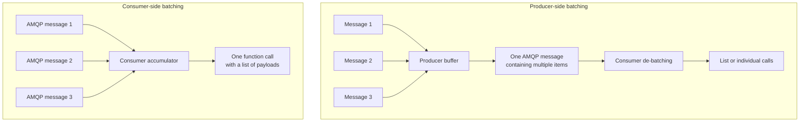

# Batch Receiving, Batch Sending, and Message Size Limits

The RabbitMQ binder supports grouping multiple messages when producing or consuming. Both approaches are commonly referred to as batching, yet they differ in where batches are formed, message shape on the broker, configuration, and redelivery scope.

- **Producer-side batching:** the producer buffers multiple messages and sends them inside a single AMQP message containing multiple entries.
- **Consumer-side batching:** the broker still delivers individual messages independently; the listener container accumulates multiple deliveries and invokes the function once with a list of payloads.
- **Size limits:** a producer batch is one physical message, so total batch size must stay within broker limits. A consumer batch is an in-application list, so consumer memory must also be controlled.

This lesson covers both batching styles in the Spring Cloud Stream Rabbit binder, producer/consumer configuration, message sizes, latency, acknowledgments, redelivery, and testing.

## 1. Why Is Batching Needed?

When an application sends or receives many small messages, the per-publish/per-dispatch overhead can take up a large share compared to payload processing time. Batching groups multiple items to reduce call count, cut protocol overhead, and enable group processing.

For example, a service receives 500 inventory events per second. Batching 50 events per batch can reduce publish calls from around 500 down to around 10 per second when traffic is steady.

Batching helps when:

- Messages are small and arrive in high volume.
- Queries or I/O operations can be reduced through group processing.
- The application can tolerate extra waiting time to assemble a batch.
- Batch size remains within broker, memory, and processing time limits.

Larger batches can increase throughput, yet they also increase latency, memory usage, single-invocation processing time, and failure blast radius. Therefore, choosing batch size must balance both throughput and SLAs.

## 2. Two Batching Styles in the RabbitMQ Binder

| Batching style | Who batches? | What does the broker receive/deliver? | What does the function receive? |
|---|---|---|---|
| Producer-created batch | Producer | One AMQP message containing multiple sub-messages | De-batched into individual calls by default; can receive a list |
| Consumer-side batch | Listener container | Multiple independent AMQP messages | One call with a list of converted payloads |



Producer batching alters the physical message on the wire. Consumer batching only groups multiple separate deliveries into an in-application list. Do not assume the two approaches share identical acknowledgment or redelivery semantics.

## 3. Producer-Side Batching

The Spring Cloud Stream Rabbit binder uses Spring AMQP's batching strategy. When batching is enabled, the producer buffers messages; a batch is emitted when it reaches the target count, hits the buffer limit, or times out.

Producer properties:

| Property | Meaning | Default per binder docs |
|---|---|---:|
| batching-enabled | Enables producer-side batching | false |
| batch-size | Target number of messages in a batch | 100 |
| batch-buffer-limit | Batch buffer size limit; can flush a batch early | 10000 |
| batch-timeout | Wait time before flushing a partial batch | 5000 ms |

Java documentation typically writes these names in camelCase (`batchingEnabled`, `batchSize`, `batchBufferLimit`, `batchTimeout`). In YAML, kebab-case can be used thanks to Spring Boot relaxed binding.

### Producer Configuration

Example function emitting inventory events:

```java
@Bean
Supplier<InventoryChanged> publishInventory(InventorySource source) {
    return source::next;
}
```

Rabbit producer configuration:

```yaml
spring:
  cloud:
    function:
      definition: publishInventory
    stream:
      bindings:
        publishInventory-out-0:
          destination: inventory.events
      rabbit:
        bindings:
          publishInventory-out-0:
            producer:
              batching-enabled: true
              batch-size: 50
              batch-buffer-limit: 1048576
              batch-timeout: 1000
```

In this example:

- `batching-enabled` turns on producer batching.
- `batch-size` targets grouping up to 50 messages.
- `batch-buffer-limit` caps the buffer/batch size per the strategy.
- `batch-timeout` flushes a batch with fewer than 50 items after roughly one second without additional messages.

These values are illustrative. Verify defaults and behavior for your Spring Cloud Stream/Spring AMQP version.

### When Is a Batch Flushed?

A batch can be sent when:

1. `batch-size` messages have been accumulated.
2. Size reaches `batch-buffer-limit`, triggering an early partial flush.
3. `batch-timeout` expires with no new activity adding to the batch.

The timeout prevents a batch from waiting indefinitely during low traffic. In return, the first message may wait up to nearly the timeout if subsequent messages arrive slowly.

### The Producer Buffer Lives in Memory

An unsent batch sits in producer memory. If the process crashes before the batch is flushed, buffered messages can be lost. Producer batching does not create a durable queue on the application side.

If publish confirmation is needed, configure publisher confirms/returns appropriately and treat a publish as succeeded only after receiving confirmation. Publisher confirms do not replace verifying routing to the right queue or business transactions.

## 4. Structure of a Producer-Created Batch

Spring AMQP `SimpleBatchingStrategy` constructs a batch by prepending a 4-byte binary length field before each sub-message. The `springBatchFormat` header with value `lengthHeader4` tells the listener container how to unpack the batch.

Conceptual layout:

```text
AMQP message body
+----------------------+----------------------+
| length (4 bytes)     | payload message 1    |
+----------------------+----------------------+
| length (4 bytes)     | payload message 2    |
+----------------------+----------------------+
| length (4 bytes)     | payload message 3    |
+----------------------+----------------------+
```

This is a Spring AMQP batch format, not a universal batch format automatically understood by every AMQP client. Non-Spring consumers must support this format to decode batches properly.

The default batching strategy supports grouping messages for the same exchange/routing key. Do not assume messages destined for different targets or routing keys can be freely mixed in one batch.

## 5. Consumer Receiving a Producer-Created Batch

By default, the listener container automatically de-batches producer-created batches and dispatches each sub-message as an individual listener invocation. Starting in Spring Cloud Stream 3.0, you can ask the binder to present a producer-created batch as a list via `consumer.batch-mode`.

Function accepting a list:

```java
@Bean
Consumer<List<InventoryChanged>> processInventoryBatch(
        InventoryService service) {

    return events -> service.applyBatch(events);
}
```

Configuration:

```yaml
spring:
  cloud:
    function:
      definition: processInventoryBatch
    stream:
      bindings:
        processInventoryBatch-in-0:
          destination: inventory.events
          group: inventory-projection
          consumer:
            batch-mode: true
```

`batch-mode=true` indicates the function expects a list. If the producer sends individual messages and the consumer has not enabled consumer-side batching, do not expect the binder to group them into a list solely because `batch-mode` is enabled.

### Errors in a Producer-Created Batch

A producer-created batch is one physical message on the broker. When the listener de-batches it, multiple sub-messages become logical items. If one item fails and the physical message is rejected, the entire batch can be rejected/redelivered. Items that succeeded earlier in that batch may be redelivered together with the batch.

Therefore:

- Use a distinct event ID per item to enforce idempotency.
- Do not assume each item has an independent broker acknowledgment.
- If per-item error handling is needed, persist per-item state durably.
- Test redelivery against a real broker to confirm batch redelivery scope.

## 6. Consumer-Side Batching

Consumer-side batching does not require the producer to send batches. RabbitMQ still receives and delivers each message separately. The listener container accumulates deliveries and invokes the function once with a list of converted payloads.

The Spring Cloud Stream Rabbit binder has supported this mode since version 3.1. Combine these properties:

- `spring.cloud.stream.bindings.<binding>.consumer.batch-mode=true`
- `spring.cloud.stream.rabbit.bindings.<binding>.consumer.enable-batching=true`
- `batch-size` and `receive-timeout` on the Rabbit consumer binding.

Example:

```yaml
spring:
  cloud:
    function:
      definition: processInventoryBatch
    stream:
      bindings:
        processInventoryBatch-in-0:
          destination: inventory.events
          group: inventory-projection
          consumer:
            batch-mode: true
      rabbit:
        bindings:
          processInventoryBatch-in-0:
            consumer:
              enable-batching: true
              batch-size: 20
              receive-timeout: 250
              container-type: simple
```

Function:

```java
@Bean
Consumer<List<InventoryChanged>> processInventoryBatch(
        InventoryService service) {

    return events -> {
        if (events.isEmpty()) {
            return;
        }
        service.applyBatch(events);
    };
}
```

The container attempts to gather up to 20 messages. Once 20 are collected, the batch is passed to the function. If `receive-timeout` expires before reaching the target count, a smaller partial batch is delivered. For instance, if 7 messages arrive within the wait window, the function can receive a 7-element list.

Consumer-side batching is only supported with `container-type=simple`, which is the default container. If selecting another container type, check the binder documentation before enabling this feature.

### Role of Each Property

| Property | Configuration layer | Effect |
|---|---|---|
| consumer.batch-mode | Core Spring Cloud Stream | Allows the function to receive a list |
| consumer.enable-batching | Rabbit binder | Instructs the listener container to accumulate deliveries |
| consumer.batch-size | Rabbit binder | Target number of messages in the batch |
| consumer.receive-timeout | Rabbit binder | Accumulation wait window; expiration can dispatch a partial batch |

Enabling `batch-mode` alone is not enough to aggregate independent messages. Enabling `enable-batching` alone is also insufficient if the core binding is not configured to pass a list to the function.

## 7. Reading Per-Item Headers

When a function receives a list of payloads, metadata for each message can differ. For example, inventory events share the same payload type yet carry different `tenantId`, `correlationId`, or `eventVersion` values.

To read per-item headers, the function can accept `Message<List<?>>`. With consumer-side batching, the binder places the corresponding list of header maps in the `AmqpInboundChannelAdapter.CONSOLIDATED_HEADERS` header.

Example:

```java
@Bean
Consumer<Message<List<InventoryChanged>>> processInventoryBatch(
        InventoryService service) {

    return message -> {
        List<InventoryChanged> events = message.getPayload();

        @SuppressWarnings("unchecked")
        List<Map<String, Object>> headers =
                (List<Map<String, Object>>) message.getHeaders()
                        .get(AmqpInboundChannelAdapter.CONSOLIDATED_HEADERS);

        for (int i = 0; i < events.size(); i++) {
            InventoryChanged event = events.get(i);
            Map<String, Object> eventHeaders = headers.get(i);

            service.apply(
                    event,
                    (String) eventHeaders.get("correlationId")
            );
        }
    };
}
```

The headers list shares the same ordering as the payload list. The header map at index `i` belongs to the payload at index `i`. Guard against missing headers and avoid unsafe casts without type checks.

## 8. Distinguishing Batch Properties

Property names look similar but belong to opposite directions of batching:

| Property | Scope | Meaning |
|---|---|---|
| Producer batch-size | Rabbit producer | Target number of messages in one published batch |
| Producer batch-buffer-limit | Rabbit producer | Batch buffer size limit |
| Producer batch-timeout | Rabbit producer | Wait time before flushing a partial batch |
| Consumer batch-size | Rabbit consumer | Target number of deliveries in the list |
| Consumer receive-timeout | Rabbit consumer | Wait time for accumulating a batch |

Producers and consumers can use different batch sizes. Do not assume a 50-item producer batch will always reach the function as an exact 50-item list; the result depends on de-batching, consumer mode, and how the container accumulates deliveries.

## 9. RabbitMQ Message Size Limits

An AMQP message consists of a body and properties/headers. During producer batching, multiple sub-messages are packed into the body of one physical message. Therefore, the total batch size must stay within broker limits.

RabbitMQ uses `max_message_size` to cap message size. RabbitMQ 4.4 documentation specifies a default of **16 MiB** and a maximum supported value of **512 MiB**. Administrators can configure this limit; verify your cluster's actual version and configuration before designing batches.

Example broker-side configuration in `rabbitmq.conf`:

```ini
max_message_size = 16777216
```

This value equals 16 MiB. It is a server-side setting, not a Spring Cloud Stream binder property. When increasing this limit, evaluate memory, disk, network, and processing capacity across the entire cluster.

### frame_max Is Not max_message_size

RabbitMQ also has `frame_max`. In RabbitMQ 4.4 documentation, the default is **131072 bytes (128 KiB)**. This is the size limit of a single protocol frame, not the total size limit of an entire AMQP message. Large messages can span multiple frames.

Do not treat `frame_max` as a payload limit. To control message size, look at `max_message_size`, batch size, and producer/consumer memory limits.

### Size Example

Suppose each serialized message has an average payload of 256 KiB:

| Item count | Estimated total payload |
|---:|---:|
| 20 | 5 MiB |
| 40 | 10 MiB |
| 80 | 20 MiB |

Actual wire size also includes the 4-byte length field per item, headers, properties, and serialization overhead. If the cluster limit is 16 MiB, an 80-item batch in this example can exceed the limit even though each individual message is much smaller.

Measure serialized sizes using p95/p99 percentiles and leave headroom for metadata. Do not pick a batch size based solely on item count.

With consumer-side batching, messages are still delivered individually by the broker. Thus, each physical message must stay below `max_message_size`; the combined size of the accumulated list in the container is a consumer memory and processing-time concern rather than a new AMQP message on the broker.

## 10. Oversized Single Messages

`batch-buffer-limit` bounds the size of an assembled batch; it does not replace RabbitMQ's message size limit. The Spring AMQP batching strategy also notes that the buffer limit does not split an oversized single message.

For example, an event carrying a 20 MiB file can exceed a 16 MiB `max_message_size` even when producer batching is off. Reducing `batch-size` to 1 does not shrink an individual payload.

Ways to handle large payloads:

- Store files/blobs in object storage and send only the URI, object key, checksum, and metadata through RabbitMQ.
- Split payloads into chunks with an ID, sequence number, and total chunk count; let the consumer reassemble and verify checksums.
- Compress data if the payload is compressible and consumers support it.
- Drop redundant fields or data retrievable from another source.
- Adjust `max_message_size` only when genuinely necessary and the cluster has sufficient memory, disk, network, and processing capacity.

Do not raise broker limits just to mask an event design embedding huge binary blobs. Large messages increase storage, replication, network, memory, and redelivery costs.

## 11. Compression and Batching

The Rabbit producer has a `compress` property to compress outgoing data. Compression can cut transfer and storage size when payloads have repetitive structure, but it consumes CPU and not every format compresses well.

Measure before/after size, CPU spent on compression/decompression, publish latency, and compression ratio on real payloads. Do not rely blindly on compression to bypass limits. Already-compressed data such as JPEG or ZIP generally shrinks very little.

Batching reduces publish call count; compression reduces byte count for compressible data. The two mechanisms address different kinds of overhead.

## 12. Latency, Throughput, and Batch Size

Large batches generally lower per-item overhead while increasing wait time to fill a batch. Small batches flush sooner yet generate more publish calls.

| Workload | Illustrative batch size | Illustrative timeout | Goal |
|---|---:|---:|---|
| High, steady | 100 | 200 ms | Reduce publish call count |
| Moderate | 50 | 500 ms | Balance throughput and latency |
| Low, bursty | 20 | 1000 ms | Flush partial batches on timeout |
| Near real-time | 5 | 50 ms | Keep wait latency low |

These are examples for experimentation, not fixed recommendations.

Metrics to measure: sub-messages per batch, serialized batch size, accumulation wait time, publish rate, publisher confirm latency, actual consumer batch size, function processing duration, queue depth, unacked count, redelivery rate, CPU, heap, GC, and network throughput.

If throughput rises while p99 latency breaches SLA, lower `batch-size` or `batch-timeout`. If overhead remains high, consider increasing batch size within size bounds.

## 13. Acknowledgments, Errors, and Redelivery

Batching changes the delivery scope you must observe.

### Producer-Created Batch

A producer-created batch is one physical message. When the listener de-batches it, multiple sub-messages become logical items. If one item fails and the physical message is rejected, the entire batch can be rejected/redelivered. Items that already succeeded may be delivered again.

Use a unique event ID per item and protect side effects with idempotency. Do not assume each item in a producer-created batch has an independent broker acknowledgment.

### Consumer-Side Batch

A consumer-side batch consists of multiple independent physical messages. However, the listener container may manage acknowledgments per batch or according to transaction configuration. If the function throws an exception, understand which deliveries the binder/container will reject or requeue and whether previously processed messages can be redelivered.

Verify acknowledge mode, transactions, prefetch, retries, and DLQ settings in the Rabbit binder. Batching does not automatically create an atomic business transaction across all items in the list.

### All-or-Nothing vs. Partial Success

With a 20-event batch, suppose 18 events are valid and 2 contain bad data:

- **All-or-nothing:** one failing item fails the whole batch. Simpler, yet requires idempotency for items that already succeeded.
- **Partial success:** process items individually, persist successful outcomes, and route failed items separately to a quarantine/DLQ. More complex; acknowledge the messages only after per-item outcomes are durably persisted.

Never catch exceptions and swallow errors without recording failed items. Doing so can acknowledge messages while part of the business work remains incomplete.

## 14. Prefetch, Concurrency, and Memory

Batch size is not the only limit on how many messages sit in the application:

- **Prefetch:** number of unacknowledged deliveries the broker can send to a consumer.
- **Concurrency:** number of consumers/listeners running in parallel.
- **Batch size:** target number of deliveries in the function's input list or messages grouped at the producer.
- **Receive timeout:** wait window for gathering a consumer-side batch.

If prefetch is too large, many messages sit unacked and consume memory. If too small, consumers wait repeatedly on the broker and fail to fill batches. Verify actual container/binder behavior rather than assuming prefetch scales up automatically with batch size.

Rough memory estimate for consumer-side batching:

Memory ≈ concurrency × batchSize × averagePayloadSize × objectOverhead

Example with 4 consumers, batch-size 100, average payload 64 KiB:

4 × 100 × 64 KiB ≈ 25 MiB

That covers raw payloads only. Java objects, headers, converters, buffers, and in-flight batches raise real memory consumption higher. Use heap profiling and realistic loads to choose limits.

## 15. Size Safeguards When Publishing

A safe producer should:

1. Serialize the payload with the actual converter.
2. Measure serialized byte length.
3. Reject or divert single payloads exceeding the application threshold.
4. Buffer messages until hitting `batch-size` or `batch-buffer-limit`.
5. Flush batches with headroom below `max_message_size`.
6. Monitor publisher confirms and returned messages.
7. Emit metrics for batch size, batch bytes, and publish failures.

You can set an application threshold below the broker limit. For example, if the cluster caps messages at 16 MiB, the application might cap batches at 12 MiB to leave room for metadata and payload variance. Headroom should be grounded in measured sizes.

If a producer sends a batch exceeding the limit, the broker may reject the publish or close the channel/connection depending on protocol and version. Handle publish errors rather than merely logging and assuming delivery succeeded.

## 16. Testing Producer Batching

Producer tests should verify both item counts and batch sizes:

- Enable batching and send exactly `batch-size` messages; verify the batch is emitted.
- Send fewer than `batch-size`; wait for `batch-timeout` and verify a partial batch is emitted.
- Send payloads large enough to hit `batch-buffer-limit`; verify early batch emission.
- Send a single message larger than the buffer limit; verify behavior and broker limits.
- Send messages to different routing keys/exchanges; verify batching scope.
- Stop the process while messages sit in the buffer; verify the application does not treat in-memory buffers as durable storage.
- Enable publisher confirms; verify publishes are broker-confirmed and returned messages are handled.

Use real RabbitMQ or Testcontainers to test message limits, publisher confirms, and topology. The Test Binder does not fully simulate broker limits.

## 17. Testing Consumer Batching

Consumer-side batching tests should verify:

- Both `batch-mode=true` and `enable-batching=true` are enabled.
- The function receives a list of payloads with the expected type.
- Reaching `batch-size` invokes the function with the expected count.
- Expiring `receive-timeout` delivers a partial batch.
- Low traffic does not stall messages indefinitely.
- `container-type=simple` is used.
- Headers align by index when the function receives `Message<List<?>>`.
- Exceptions trigger redelivery/rejection per policy.
- Acknowledgments, retries, and DLQs do not drop messages.
- Concurrency and prefetch keep heap usage within budget.

Test with p50, p95, and p99 payload sizes, not just uniformly small messages.

## 18. Troubleshooting Batching Issues

| Symptom | What to check |
|---|---|
| Producer still sends messages one by one | `batching-enabled`, Rabbit producer prefix, and timeout |
| Producer holds messages too long | High `batch-size`, large timeout, or low traffic |
| Batch flushes before reaching target count | `batch-buffer-limit` was hit |
| Function receives individual payloads instead of a list | `consumer.batch-mode` and the batch format sent |
| Consumer does not group independent messages | `enable-batching`, `batch-mode`, `batch-size`, `receive-timeout` |
| Consumer-side batching does not activate | `container-type` must be `simple` |
| Function receives small batches | `receive-timeout` expired or traffic is low |
| Large messages rejected by broker | `max_message_size`, batch size, and single-payload size |
| Consumer heap spikes sharply | `batch-size`, concurrency, prefetch, and object overhead |
| Single error causes entire batch redelivery | Producer-created batch, reject/ack mode, and idempotency |
| Headers mismatch payloads | `Message<List<?>>` and `CONSOLIDATED_HEADERS` |

When investigating, record serialized byte sizes rather than pre-serialization Java object sizes alone. JSON, Avro, Protobuf, headers, and encodings can produce wire sizes different from heap object sizes.

## 19. Workflow for Choosing Batch Sizes

1. Measure throughput and p50/p95/p99 payload sizes.
2. Define producer and consumer latency targets.
3. Start with a small producer `batch-size`, such as 20 or 50.
4. Set `batch-timeout` to align with SLAs.
5. Keep `batch-buffer-limit` below the broker's message limit.
6. Enable consumer-side batching separately if the function benefits from list processing.
7. Estimate memory using `batch-size × concurrency × payload`.
8. Check prefetch, acknowledgments, and transactions.
9. Load test with large payloads and traffic bursts.
10. Monitor publisher confirms, queue depth, unacked counts, latency, and heap.
11. Tune batch size incrementally.
12. Test redelivery and idempotency before broad rollout.

Do not enable both producer batching and consumer-side batching simply because both can boost throughput. Two layers of batching can nest batches, raise memory usage, and obscure redelivery boundaries. Combine them only for a specific, tested need.

## 20. Deployment Checklist

- Decided explicitly between producer-created batches and consumer-side batches.
- Producer batching is enabled only where buffer memory and assembly latency are acceptable.
- Producer properties are placed on the correct Rabbit binding.
- `consumer.batch-mode=true` is enabled when the function expects a list.
- Consumer-side batching enables both core `batch-mode` and Rabbit `enable-batching`.
- Consumer-side batching uses `container-type=simple`.
- `batch-size` and `receive-timeout` fit traffic patterns and SLAs.
- Understood that a producer batch is one physical AMQP message.
- Verified `springBatchFormat` and de-batching compatibility.
- Checked `max_message_size` on the RabbitMQ cluster.
- Distinguished `frame_max` from total message size limits.
- Calculated batch size after serialization with headroom.
- Handled oversized single payloads separately; buffer limits do not split payloads.
- Measured prefetch, concurrency, and memory together.
- Function is idempotent when batches can be redelivered.
- Defined partial-success vs. all-or-nothing policy.
- Verified publisher confirms/returns when publish guarantees are required.
- Integration tests verify timeouts, message limits, errors, and redelivery.
- Dashboards track batch count, batch bytes, latency, queue depth, unacked counts, and publish failures.

Producer batching and consumer-side batching help the Rabbit binder process high volumes more efficiently, but each mechanism has distinct semantics. Producer batching packs multiple messages into one AMQP message; consumer-side batching gathers independent deliveries into an application-side list. Choose the right style, bound serialized sizes, distinguish `max_message_size` from `frame_max`, and test acknowledgments/redelivery to maximize throughput while preserving correctness.

## References

- [Spring Cloud Stream Rabbit Binder — Receiving Batched Messages](https://docs.spring.io/spring-cloud-stream/reference/rabbit/rabbit_overview/receiving-batch.html)
- [Spring Cloud Stream Rabbit Binder — Producer Properties](https://docs.spring.io/spring-cloud-stream/reference/rabbit/rabbit_overview/prod-props.html)
- [Spring AMQP — Sending Messages and Batching](https://docs.spring.io/spring-amqp/reference/amqp/sending-messages.html)
- [Spring AMQP — SimpleBatchingStrategy API](https://docs.spring.io/spring-amqp/docs/3.2.x/api/org/springframework/amqp/rabbit/batch/SimpleBatchingStrategy.html)
- [RabbitMQ 4.4 — Configurable Limits](https://www.rabbitmq.com/docs/limits)
