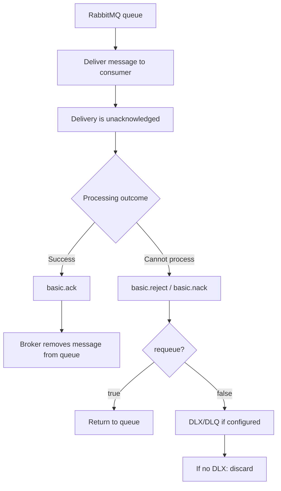

# Distinguishing ack, nack, reject, and requeue

RabbitMQ delivers messages to consumers via deliveries. After receiving a message, the consumer must report the processing outcome to the broker: completed, unable to process, or needs to be returned to the queue to try again. In AMQP 0-9-1, the primary operations are `basic.ack`, `basic.reject`, and RabbitMQ's extension `basic.nack`. The `requeue` parameter determines whether a rejected message is redelivered or routed through a dead-letter exchange (DLX).

The four terms are often mentioned together, but they are not at the same level:

- **ack** is a positive acknowledgement: the consumer has finished processing the delivery.
- **reject** declines a single delivery.
- **nack** is a negative acknowledgement; RabbitMQ extended this operation so multiple deliveries can be declined at once.
- **requeue** is the option to return a declined delivery back to the queue. It is a parameter of reject/nack, not an independent acknowledgement type.

In the Spring Cloud Stream Rabbit binder, `acknowledgeMode`, retry, `requeueRejected`, and DLQ configuration determine how exceptions from a function translate into broker behavior. Understanding these boundaries prevents message loss, redelivery loops, and repeated side effects.

## 1. Lifecycle of a Delivery

RabbitMQ retains a message in the queue until an appropriate delivery outcome occurs. With manual acknowledgement, the broker marks the delivery as unacknowledged after sending it to the consumer. The consumer processes it and sends an ack, reject, or nack.



In protocol auto-ack mode, the broker considers the message acknowledged immediately upon sending it to the consumer; it does not wait for processing to finish. In manual ack mode, the message is removed from the queue only after the broker receives the corresponding acknowledgement.

A production consumer typically needs manual acknowledgement or a container-managed mode that acknowledges after the handler completes, rather than auto-acking immediately on delivery.

## 2. ack — Confirming Successful Processing

`basic.ack` is a positive acknowledgement. The consumer sends an ack to notify the broker that the delivery has been processed and the broker can remove the message from the queue.

Example with the RabbitMQ Java client:

```java
channel.basicAck(deliveryTag, false);
```

Two parameters:

- `deliveryTag`: the delivery identifier assigned by the channel.
- `multiple`: if `false`, acknowledges only the delivery with the specified tag; if `true`, acknowledges all unacked deliveries on the same channel with a tag less than or equal to that tag.

An ack should be sent after the side effects that must be preserved have completed. For example, if a consumer updates a database, finish the database transaction before acking. If you ack first and the process crashes before committing the database transaction, the message is already gone from the queue while the business change has not been recorded.

### Ack Does Not Mean Exactly-Once Processing

Acknowledgement confirms delivery status to the broker. It does not create an atomic transaction between RabbitMQ and a database or external API. If the database commits successfully but the connection drops before the broker receives the ack, the message can be redelivered.

Therefore, the handler still needs idempotency via an event ID, unique constraint, or inbox pattern. Ack helps control delivery; it does not eliminate duplicate deliveries in every scenario.

### Consumer Ack Differs from Publisher Confirm

RabbitMQ also sends `basic.ack` to publishers when confirm mode is enabled. Both cases share the same method name, but differ in direction and purpose:

- **Consumer acknowledgement:** the consumer sends an ack to the broker to confirm a delivery was processed.
- **Publisher confirm:** the broker sends an ack to the publisher to confirm the broker accepted the publish according to the target queue's semantics.

A publisher confirm does not prove a consumer processed the message. Nor does a consumer ack prove the publisher received a confirm. If guarantees are needed at both ends, both the producer and consumer must implement their respective mechanisms.

## 3. reject — Declining a Single Delivery

`basic.reject` is a negative acknowledgement for **a single delivery**. The consumer informs the broker that this message could not be processed successfully.

Example:

```java
channel.basicReject(deliveryTag, false);
```

The second parameter is `requeue`:

- `true`: returns the message to the queue so it can be redelivered.
- `false`: does not requeue; RabbitMQ routes the message to the DLX if the queue has a dead-letter exchange, otherwise it discards the message.

`basic.reject` has no `multiple` parameter; it acts on only one delivery tag. It is the right choice when declining a specific message, such as a payload that violates the schema contract or unprocessable data.

### Reject Does Not Automatically Create a DLQ

`requeue=false` does not guarantee the message will be saved to a DLQ. The broker dead-letters the message only when the queue has a DLX and matching routing. Without a dead-letter configuration, the message is discarded.

Therefore, before relying on reject to quarantine data, verify that the queue has a DLX, routing key, and DLQ that actually work.

## 4. nack — Declining One or More Deliveries

`basic.nack` is a RabbitMQ extension to AMQP 0-9-1. It takes the parameters:

```java
channel.basicNack(deliveryTag, multiple, requeue);
```

- `deliveryTag`: the reference delivery tag.
- `multiple`: selects a single delivery or multiple unacknowledged deliveries.
- `requeue`: returns the nacked deliveries to the queue or dead-letters/drops them.

Example of nacking a single delivery and requesting requeue:

```java
channel.basicNack(deliveryTag, false, true);
```

Example of nacking all unacked deliveries on the channel up to the current tag:

```java
channel.basicNack(deliveryTag, true, false);
```

When `multiple=true`, RabbitMQ applies the operation to every unacknowledged delivery with a tag less than or equal to the passed tag on the **same channel**. This is a bulk operation, so use caution during concurrent processing.

### Key Differences Between reject and nack

| Feature | basic.reject | basic.nack |
|---|---|---|
| Meaning | Declines a single delivery | Declines one or more deliveries |
| Has `multiple` parameter? | No | Yes |
| Has `requeue`? | Yes | Yes |
| `requeue=false` | DLX if configured, otherwise discard | DLX if configured, otherwise discard |
| Best suited for | Error decision for one message | Handling failure for one message or a batch of deliveries |

For quorum queues, RabbitMQ now also distinguishes poison-message semantics: `basic.reject` signals that processing the delivery failed and increments the delivery-count; `basic.nack` signals that the consumer did not process the delivery without incrementing the delivery-count. Therefore, only `basic.reject` counts toward a quorum queue's delivery limit. Verify the semantics for your RabbitMQ version and queue type.

## 5. requeue — Returning a Message to the Queue

Requeue is the `requeue=true` option when sending reject/nack. RabbitMQ places the unprocessed delivery back in the queue so the same consumer or another consumer can receive it again.

Example:

```java
channel.basicReject(deliveryTag, true);
```

Requeue is useful when the failure is transient and another attempt is likely to succeed, such as when a consumer encounters a temporarily unreachable dependency or needs to yield the message to another consumer.

However, requeue is not the same as retry with backoff. The message may become ready for redelivery almost immediately. If every consumer hits the same error and continuously requeues, the system enters a hot loop.

### Message Position After Requeue

RabbitMQ tries to place the message back at its original position in the queue if possible. When multiple consumers are receiving and acknowledging other deliveries, a requeued message may end up near the head of the queue. Thus, you should not assume requeue strictly preserves per-consumer observed ordering.

After requeue, the message may be redelivered to the previous consumer or to a different one. The `redelivered` property indicates the broker has delivered the message at least once before; it does not report the exact attempt count.

## 6. requeue=false: Dead-Letter or Discard

When a consumer sends reject/nack with `requeue=false`, RabbitMQ does not return the message to the original queue:

- If the queue has a DLX, the broker publishes the message to the dead-letter exchange according to the dead-letter routing configuration.
- If there is no DLX, the message is discarded.
- The destination queue and routing key depend on the DLX, dead-letter routing key, and existing topology.

This is the usual choice for messages that cannot be resolved by immediate retry, such as malformed schema payloads or data contract violations.

Do not use `requeue=false` assuming "RabbitMQ will keep the message somewhere automatically." To preserve failed messages, configure a DLX/DLQ and verify routing, publish permissions, durability, and retention on the destination queue.

## 7. Delivery Tag and the multiple Flag

Each delivery on a channel receives an incrementing delivery tag. The tag is meaningful only on the channel that received that delivery.

Important rules:

- Ack/reject/nack must use the exact channel that received the message.
- Do not use a delivery tag from one channel on another channel.
- Do not acknowledge the same delivery tag twice.
- When a channel closes, unacked deliveries on that channel are requeued by the broker.
- `multiple=true` affects all earlier unacked deliveries on the same channel, not just the messages whose business processing you intended to mark done.

For example, suppose a channel has unacknowledged delivery tags 10, 11, 12, and 13. The call:

```java
channel.basicAck(12, true);
```

will ack tags 10, 11, and 12. Tag 13 remains unacked.

If messages are processed asynchronously and tag 10 has not finished while tag 12 has, calling `multiple=true` for tag 12 will accidentally ack tag 10. Only use batch ack/nack when completion order and the set of unacknowledged deliveries are strictly managed.

## 8. The Three Acknowledgement Modes in Spring AMQP

Spring AMQP provides three acknowledgement modes:

| Mode | Who acknowledges? | Behavior |
|---|---|---|
| `NONE` | No ack sent | RabbitMQ considers the message acknowledged immediately upon sending to the consumer; commonly called auto-ack |
| `AUTO` | Listener container | Container acks when the listener finishes normally; exceptions go through error handling |
| `MANUAL` | Application | Listener must call basicAck/basicNack/basicReject |

Spring's `AUTO` is not the same as the protocol's `NONE`. In `AUTO`, the container waits for the listener's result before deciding to ack or reject. In `NONE`, the broker does not wait for the consumer to confirm completion.

For the Spring Cloud Stream Rabbit binder, `acknowledgeMode` defaults to `AUTO`.

## 9. Configuring Acknowledge Mode in the Spring Cloud Stream Rabbit Binder

This property is configured on the Rabbit consumer binding:

```yaml
spring:
  cloud:
    function:
      definition: processOrder
    stream:
      bindings:
        processOrder-in-0:
          destination: orders.events
          group: order-worker
      rabbit:
        bindings:
          processOrder-in-0:
            consumer:
              acknowledge-mode: AUTO
              requeue-rejected: false
```

In this example:

- `processOrder-in-0` is the input binding.
- `destination` specifies the destination used by the binder.
- `group` identifies the consumer group queue.
- `acknowledge-mode: AUTO` lets the listener container acknowledge when the function completes normally.
- `requeue-rejected: false` instructs failed deliveries not to automatically requeue when this property applies.

You can set `acknowledge-mode: MANUAL` when the application genuinely needs control over ack/nack. Only choose `NONE` when you accept the risk of messages being considered received even if the consumer has not finished processing them.

### Shared Configuration

The Rabbit binder allows setting consumer defaults across multiple bindings using the prefix:

```yaml
spring:
  cloud:
    stream:
      rabbit:
        default:
          acknowledge-mode: AUTO
          requeue-rejected: false
```

Binding-specific settings override the shared defaults. When investigating a binding, inspect both the binding-specific properties and defaults to determine the effective value.

## 10. AUTO Mode: Container Decides Based on Function Outcome

With `acknowledge-mode: AUTO`, the function does not call Channel ack directly. The listener container observes the processing outcome:

- Function completes normally: container acks the delivery.
- Function throws an exception: the exception enters the binder and container error handling/retry flow.
- After retries fail, the binder/container decides whether to reject, requeue, or route to a DLQ based on configuration.

Example function:

```java
@Bean
Consumer<OrderCreated> processOrder(OrderService service) {
    return event -> service.handle(event);
}
```

This is the simplest approach for most applications. Business logic simply returns normally once processing is complete; on failure, it throws an appropriate exception so the error handler decides the next step.

Do not catch an exception, only log it, and return normally if the message was not processed. In AUTO mode, returning normally causes the container to assume the listener succeeded and ack the message.

## 11. MANUAL Mode: Application Explicitly Calls ack/nack/reject

In manual mode, the application needs the delivery tag and the channel that received the message. Spring AMQP provides the `AmqpHeaders.CHANNEL` and `AmqpHeaders.DELIVERY_TAG` headers to access them from the message.

Example illustrating a function receiving a Spring Message:

```java
@Bean
Consumer<Message<OrderCreated>> processOrderManual(OrderService service) {
    return message -> {
        Channel channel = message.getHeaders()
                .get(AmqpHeaders.CHANNEL, Channel.class);
        Long deliveryTag = message.getHeaders()
                .get(AmqpHeaders.DELIVERY_TAG, Long.class);

        if (channel == null || deliveryTag == null) {
            throw new IllegalStateException(
                    "Missing RabbitMQ channel or delivery tag");
        }

        try {
            service.handle(message.getPayload());
            ack(channel, deliveryTag);
        }
        catch (InvalidOrderException ex) {
            reject(channel, deliveryTag);
        }
        catch (TemporaryDependencyException ex) {
            nackAndRequeue(channel, deliveryTag);
        }
    };
}

private static void ack(Channel channel, long tag) {
    try {
        channel.basicAck(tag, false);
    }
    catch (IOException ex) {
        throw new UncheckedIOException(ex);
    }
}

private static void reject(Channel channel, long tag) {
    try {
        channel.basicReject(tag, false);
    }
    catch (IOException ex) {
        throw new UncheckedIOException(ex);
    }
}

private static void nackAndRequeue(Channel channel, long tag) {
    try {
        channel.basicNack(tag, false, true);
    }
    catch (IOException ex) {
        throw new UncheckedIOException(ex);
    }
}
```

The binding must be configured with `acknowledge-mode: MANUAL`. Example classification:

- Processing succeeds: `basicAck`.
- Permanently invalid data: `basicReject(..., false)` to dead-letter/drop according to topology.
- Transient error: `basicNack(..., false, true)` to requeue.

This example demonstrates how to access the channel and delivery tag; in a real application, ensure every code branch makes a delivery disposition decision. If the code throws an exception before ack/nack, the delivery remains unacknowledged and may be requeued when the channel closes. Never call ack twice for the same tag.

### Manual Ack and Asynchronous Processing

Do not retain the channel and use it arbitrarily across multiple threads. A channel scopes delivery tags per channel, and ack operations must align with the listener lifecycle. If dispatching work to an executor, explicitly design delivery ownership, completion state, shutdown, and ack timing; use a bounded queue and never ack before work is durably persisted.

## 12. Exceptions That Control Requeue in Spring AMQP

In AUTO mode, exceptions from the listener are passed to the error handler. Certain exceptions allow controlling requeue behavior:

| Exception | Meaning |
|---|---|
| `AmqpRejectAndDontRequeueException` | Reject without requeuing; the DLX can receive the message if the queue is configured |
| `ImmediateRequeueAmqpException` | Request immediate requeue |
| `ImmediateAcknowledgeAmqpException` | Acknowledge the message and skip the DLQ per binder/framework behavior |

Example of rejecting a message without requeuing:

```java
throw new AmqpRejectAndDontRequeueException(
        "Order payload cannot be processed");
```

Example of requesting a requeue:

```java
throw new ImmediateRequeueAmqpException(
        "Inventory service is temporarily unavailable");
```

Use these control exceptions only after understanding the binding's retry and DLQ behavior. For example, `ImmediateAcknowledgeAmqpException` can remove the message from the processing flow without sending it to the DLQ; do not use it as a generic "ignore error" mechanism.

## 13. Rabbit Binder Retry, requeueRejected, and DLQ

The Rabbit binder can retry messages in-process before deciding the final outcome. The core property `maxAttempts` controls the number of attempts. With retry enabled, the listener container thread may be held during backoff intervals; this can affect throughput and ordering for a consumer.

Example retry and DLQ configuration:

```yaml
spring:
  cloud:
    function:
      definition: processOrder
    stream:
      bindings:
        processOrder-in-0:
          destination: orders.events
          group: order-worker
          consumer:
            max-attempts: 3
            back-off-initial-interval: 1000
            back-off-multiplier: 2.0
            back-off-max-interval: 10000
      rabbit:
        bindings:
          processOrder-in-0:
            consumer:
              auto-bind-dlq: true
              republish-to-dlq: true
              requeue-rejected: false
```

Meaning:

- The binder retries up to 3 times according to the retry policy.
- Backoff starts at 1 second, multiplies by 2, and caps at 10 seconds.
- `auto-bind-dlq: true` tells the binder to declare the DLX/DLQ and associated bindings.
- `republish-to-dlq: true` tells the binder to publish failed messages to the DLQ, adding error metadata such as the exception message/stack trace.
- `requeue-rejected: false` prevents failed messages from looping back to the queue indefinitely on the normal reject path.

Binder DLQs require an explicit consumer group. The DLQ name and routing are generated by the binder based on configuration; inspect the actual topology instead of guessing queue names.

### requeueRejected=true Can Create a Loop

If retry is disabled or exhausted and `requeueRejected=true` while republish-to-DLQ is off, the message may be requeued continuously. This is only appropriate when the error is truly transient and there is a mechanism controlling attempt count or wait time.

For persistent errors, use retry with backoff, a TTL-based DLQ for scheduled retries, or a parking-lot queue. Immediate requeue provides no backoff.

## 14. Dead-Lettering Is Not the Same as Requeue

Two distinct behaviors:

| Criterion | Requeue | Dead-letter |
|---|---|---|
| Target queue | Original queue | Queue routed via DLX |
| Meaning | Attempt redelivery | Move message out of the main flow |
| When to use | Transient error, likely to succeed next time | Permanent error or retries exhausted |
| Risk | Redelivery loop, hot queue | DLQ fills up or has no consumer processing it |
| Replay | Message returns to queue automatically | Requires replay procedure or TTL/DLX re-routing |

A DLQ does not fix messages automatically. It simply isolates failed messages for investigation, data correction, or controlled replay. You need alerts on message count and message age in the DLQ.

RabbitMQ adds an `x-death` header when a message is dead-lettered. This header records queue/reason/count details and can help track dead-letter cycles. Do not use continuous requeuing in place of a bounded retry strategy.

## 15. Quorum Queue Delivery Limit and Poison Messages

Quorum queues support a delivery limit to prevent poison messages from being redelivered forever. When a message exceeds the delivery limit, RabbitMQ dead-letters or drops it according to the queue configuration.

In modern RabbitMQ, distinguish:

- `basic.reject` indicates message processing failed and increments the delivery-count.
- `basic.nack` indicates the consumer did not process the delivery, without incrementing delivery-count under quorum queue poison-message semantics.
- Only reject counts toward a quorum queue's delivery limit.

Therefore, if you rely on a delivery limit to stop poison messages, the choice between reject and nack matters. Check your RabbitMQ version, queue type, and configured delivery-limit; do not assume all queues/classic queues share the same semantics.

## 16. Redelivery, Ordering, and Idempotency

A message can be redelivered when:

- The consumer sends reject/nack with `requeue=true`.
- The consumer channel or connection closes while deliveries are unacked.
- The consumer process crashes before the ack reaches the broker.
- Binder retry/recovery requests redelivery.
- Broker failover causes the consumer to lose its channel and reconnect.

RabbitMQ provides a `redelivered` flag to indicate the delivery was previously sent. This flag is not an attempt counter and does not replace an event ID.

Example using an event ID to prevent duplicate processing:

```java
@Transactional
public void handle(OrderCreated event) {
    if (processedEventRepository.existsById(event.eventId())) {
        return;
    }

    orderRepository.create(event);
    processedEventRepository.save(event.eventId());
}
```

If both operations use the same database, persist the business state and the processed event record in the same transaction. If side effects happen in an external service, use an idempotency key or inbox/outbox with reconciliation.

Do not rely on the `redelivered` flag to skip a message; the first delivery might have failed before creating side effects, or created side effects while the ack failed, so redeliveries must be handled safely.

## 17. Prefetch and Unacknowledged Message Count

Prefetch limits how many unacknowledged deliveries RabbitMQ can send to a consumer/channel. When prefetch is high, a consumer can hold many in-flight messages. If the consumer is slow or hangs, unacked counts rise, and when the channel closes, many messages may be requeued together.

Points to consider:

- Low prefetch limits in-flight messages and memory usage, but can reduce throughput.
- High prefetch can increase throughput, but increases unacked counts and the blast radius of redelivery on consumer failure.
- With manual ack, each delivery must be acked/nacked exactly once.
- If using `multiple=true`, you must guarantee all lower delivery tags have finished processing.
- For heavy workloads, combine moderate prefetch, suitable concurrency, and downstream timeouts.

Do not choose prefetch solely based on consumer count. Measure processing time, memory, queue depth, and redeliveries under realistic load.

## 18. Classifying Errors to Choose ack/nack/reject

| Error category | Example | Typically appropriate action |
|---|---|---|
| Processing succeeds | Database transaction committed | ack |
| Transient error | HTTP timeout, database temporarily unavailable | Retry with backoff; then requeue or DLQ per policy |
| Invalid data | Malformed JSON schema, missing required field | reject/nack with requeue=false to DLQ or quarantine |
| Configuration error | Wrong credentials, missing queue/exchange | Stop/alert and fix config; avoid endlessly requeuing individual messages |
| Poison message | Same message repeatedly fails | Bound retries, DLQ/parking lot |
| Unable to persist error state | DLQ publish fails or quarantine database errors | Do not ack as if saved; choose message-preserving recovery |

It is vital to distinguish "cannot process this message" from "cannot process it right now." The former usually requires isolation; the latter can be retried, but must be bounded.

## 19. Testing Acknowledgement and Redelivery

Unit tests for functions are insufficient to verify whether the broker actually acked, requeued, or dead-lettered properly. You need integration tests with a real RabbitMQ instance or Testcontainers.

Scenarios:

1. **AUTO success:** function finishes normally; verify the message is acked and queue depth decreases.
2. **AUTO exception:** function throws an exception; verify the binder retries the expected number of times and executes the final behavior.
3. **MANUAL ack:** function calls basicAck; verify the message leaves the queue.
4. **MANUAL reject:** call basicReject with requeue=false; verify the message reaches the DLQ if a DLX is configured.
5. **MANUAL nack requeue:** call basicNack with requeue=true; verify the message is redelivered.
6. **Nack multiple:** multiple unacked deliveries exist; verify the exact set of tags affected.
7. **Channel close:** close the channel with unacked deliveries; verify the broker requeues them.
8. **Double ack:** verify the channel reports a protocol error for an invalid delivery tag.
9. **Redelivery:** verify the `redelivered` flag and side-effect idempotency.
10. **DLQ unavailable:** force DLQ publish/routing to fail; verify the message is not acked as though isolated successfully.
11. **Requeue loop:** trigger a persistent failure; verify alerts, retry bounds, and no uncontrolled loop.
12. **Quorum delivery limit:** test reject/nack on a quorum queue and observe delivery-count/delivery-limit per broker version.

Use finite timeouts, dedicated queues per test, and clean up topology afterward. Observe ready, unacked, redelivered, and DLQ depth; merely asserting the function was invoked is not enough.

## 20. Pre-Deployment Checklist

- Distinguished ack, reject, nack, and the requeue parameter.
- Selected the right acknowledge mode: AUTO, MANUAL, or NONE.
- Understood that container AUTO differs from protocol NONE/auto-ack.
- If MANUAL, every processing branch has an explicit ack/nack/reject.
- Delivery tags are acknowledged on the exact channel that received the message.
- Never ack twice or use a delivery tag on another channel.
- Only use `multiple=true` when all prior delivery tags are complete.
- `requeue-rejected` is configured in line with the retry/DLQ policy.
- Immediate requeue is used only for recoverable errors.
- Retry limits and backoff are set; no hot loops.
- DLX/DLQ are declared and routing has been tested.
- Understood behavior without a DLX: rejecting without requeue can discard messages.
- Checked `x-death` and delivery limits if using dead-letter/quorum queues.
- Handler is idempotent to withstand redelivery.
- Durable side effects complete before acking.
- Prefetch/concurrency match processing time and memory limits.
- Integration tests verify ack, nack, reject, requeue, channel close, and DLQ.
- Dashboards monitor ready, unacked, redelivered, retry, and DLQ depth.

Ack, reject, and nack report the delivery processing result; requeue determines whether a declined message returns to the queue. In the Spring Cloud Stream Rabbit binder, choose the acknowledge mode and retry/DLQ settings according to error types. With AUTO, let the container acknowledge after the function finishes; with MANUAL, manage delivery tags accurately on the right channel. Always combine idempotency, retry limits, and integration testing so messages are neither lost nor trigger unintended duplicate side effects.

## References

- [RabbitMQ — Consumer Acknowledgements and Publisher Confirms](https://www.rabbitmq.com/docs/confirms)
- [RabbitMQ — Negative Acknowledgements](https://www.rabbitmq.com/docs/nack)
- [RabbitMQ — Broker Semantics](https://www.rabbitmq.com/docs/semantics)
- [Spring Cloud Stream — RabbitMQ Binder Reference Guide](https://docs.spring.io/spring-cloud-stream/docs/current/reference/html/spring-cloud-stream-binder-rabbit.html)
- [Spring AMQP — Message Listener Container Configuration](https://docs.spring.io/spring-amqp/reference/amqp/containerAttributes.html)
- [Spring AMQP — Handling Exceptions](https://docs.spring.io/spring-amqp/reference/amqp/receiving-messages/async-consumer.html)
