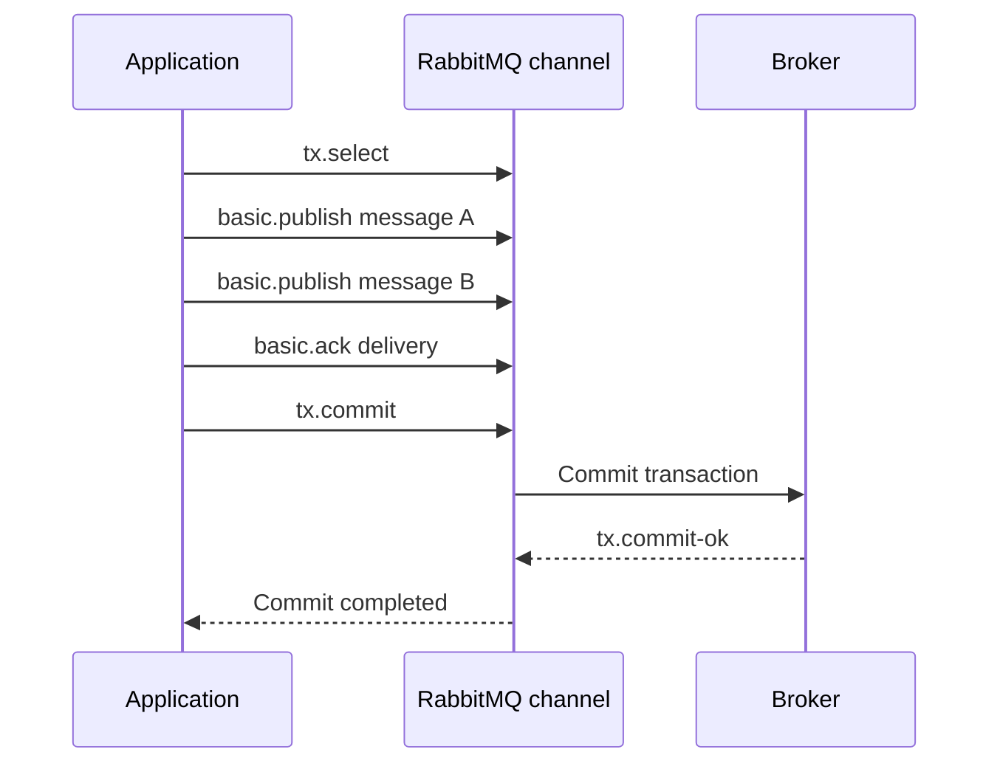
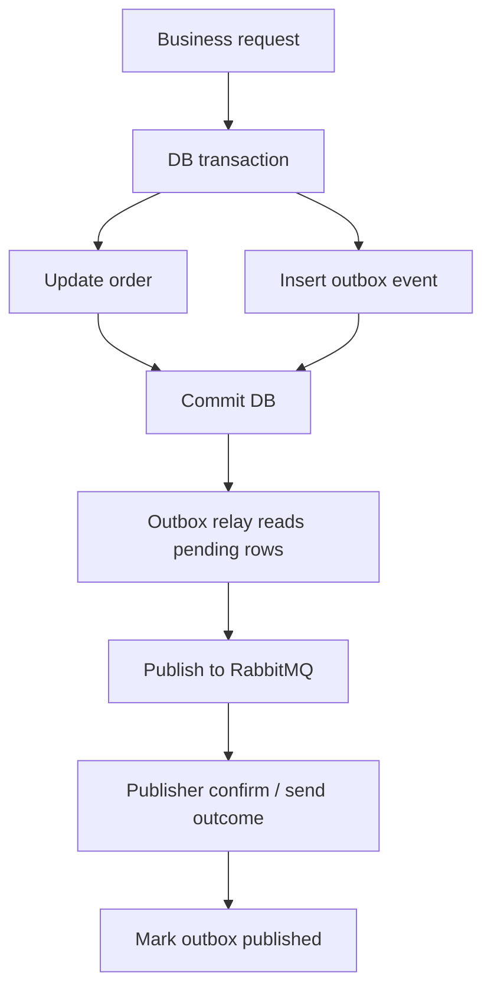

# AMQP Transactions and Limitations When Coordinating with Databases

## Objectives

A Spring Cloud Stream application may receive a message from RabbitMQ, update a database, and then publish another message. These operations may appear inside the same Java method, yet they belong to two separate state-management systems. RabbitMQ manages its own messages, queues, and acknowledgments; the database manages its own rows and transactions.

RabbitMQ **AMQP transactions** can group operations on a single channel, such as publishing messages and acknowledging deliveries, into one commit or rollback unit. **Database transactions** protect changes within a database transaction. The two transactions do not automatically merge into a single atomic transaction just because the application invokes them sequentially or places them under the same `@Transactional` annotation.

This lesson explains AMQP 0-9-1 transactions, how Spring AMQP and the RabbitMQ binder enable transactional mode, differences between transactions and publisher confirms, failure windows when coordinating with a database, and outbox/inbox patterns for safe handling.

After this lesson, you will be able to:

- Explain `tx.select`, `tx.commit`, and `tx.rollback` in AMQP 0-9-1.
- Identify transaction scope on a RabbitMQ channel.
- Distinguish AMQP transactions, publisher confirms, and consumer acknowledgments.
- Configure transactional channels in Spring AMQP or the RabbitMQ binder.
- Understand why a database transaction does not automatically include RabbitMQ publishes/acks.
- Recognize scenarios where the database commits but the message is not published, or a message is acked before the database commits.
- Use transactional outbox and inbox/idempotency to recover from failures.
- Design and test failure windows between a database and RabbitMQ.

## 1. What Is an AMQP Transaction?

AMQP 0-9-1 defines a transactional mode for a channel. The client selects this mode with `tx.select`; thereafter, publish and acknowledgment operations on that channel are buffered in the transaction until the client sends `tx.commit` or `tx.rollback`.

Three basic operations:

| Operation | Meaning |
|---|---|
| `tx.select` | Switches the channel into transactional mode |
| `tx.commit` | Commits pending transactional operations on the channel |
| `tx.rollback` | Rolls back pending transactional operations on the channel |

In RabbitMQ, a transaction is bound to **a single channel**. It is not a connection-wide transaction, does not span all channels on a connection, and does not span a database or another broker.

An AMQP transaction can be used to:

- Publish one or more messages and commit them together.
- Acknowledge one or more deliveries inside a transaction.
- Combine publish and acknowledgment operations on the same channel in one transaction, such as consume-transform-publish.
- Roll back uncommitted publishes and allow unacknowledged deliveries to be redelivered according to broker semantics.

Overview flow:



If the client calls `tx.rollback` instead of commit, uncommitted publishes are not retained as successfully published messages; unacknowledged deliveries can be redelivered. Applications must test specific behavior when combining transactions with requeue, dead-lettering, and the consumer lifecycle.

### A Transaction Is Not a Java Code Block

A Java method can call many RabbitMQ APIs, yet only operations that actually execute on the channel in transaction mode belong to that AMQP transaction. If an operation uses a different channel or a different connection, it does not automatically participate.

Similarly, calling a database service while a Rabbit channel is in a transaction does not enlist the database transaction. The transaction manager must manage the respective resource; an AMQP channel cannot roll back committed SQL statements.

## 2. Scope and Limitations of RabbitMQ Transactions

AMQP transactions have a narrow, well-defined scope:

- Bound to the channel that selected transactional mode.
- Covers only AMQP operations participating on that channel.
- Commit/rollback is handled by the broker per the AMQP protocol.
- Does not provide atomic commit with JDBC, JPA, file systems, HTTP APIs, or Kafka.
- Does not create global business ordering across multiple queues or consumers.
- Does not eliminate redeliveries or duplicates across all failure windows.

If an application opens two channels A and B, a transaction on A does not automatically commit or roll back operations on B. If an application sends messages to two exchanges on the same broker over the same transactional channel, those publishes can share the transaction; however, routing still depends on exchanges, bindings, routing keys, and topology. A transaction commit will not fix a wrong routing key or guarantee a matching queue exists if a message is unroutable.

A RabbitMQ transaction is also not an XA distributed transaction. You cannot bring a database connection into the same AMQP transaction merely by adding an annotation or running on the same thread.

## 3. Publish and Acknowledgment in One Transaction

A useful use case is a consumer receiving an input message, transforming it, and emitting an output message. If the consumer acknowledgment and output publish run on the same transactional channel, the application can commit both AMQP operations together:

- When the transaction commits, the output publish and input acknowledgment are committed under the channel's transaction.
- When the transaction rolls back, the uncommitted output publish is discarded and the unacknowledged input delivery can be redelivered.

This is useful for a consume-transform-publish step contained strictly within RabbitMQ. However, you must verify whether the Spring container/binder actually uses the same transactional channel for input acknowledgment and output publish. If output goes over a different channel, it does not share the same transaction merely because code calls both inside one handler.

Conceptual example:

```text
Receive delivery on channel C
    -> tx.select already enabled for C
    -> process message
    -> publish output on channel C
    -> acknowledge input delivery on channel C
    -> tx.commit on C
```

Do not infer from this conceptual example that every `StreamBridge.send()` call inside a listener shares the delivery's channel. Binder configuration, transaction manager, connection factory, and send path determine the actual channel used.

### What Happens When the Process Stops?

If the process stops before the transaction commits, the broker can roll back/close the channel and unacknowledged deliveries become eligible for redelivery. Uncommitted publishes must not be considered completed. If the broker processed the commit but the response was lost on the network, the client cannot tell for sure whether the transaction committed; blind retries can create application-level duplicates. Use stable event IDs and idempotency for operations that may be retried.

## 4. Transactions in Spring AMQP

Spring AMQP provides abstractions for working with transactional channels. Two key concepts:

- `channelTransacted`: instructs RabbitMQ operations to use a channel in transactional mode.
- `RabbitTransactionManager`: a local transaction manager managing RabbitMQ resources via a `ConnectionFactory`.

With `RabbitTemplate`, you can enable channel transactions:

```java
@Bean
RabbitTemplate transactionalRabbitTemplate(
        ConnectionFactory connectionFactory) {

    RabbitTemplate template = new RabbitTemplate(connectionFactory);
    template.setChannelTransacted(true);
    return template;
}
```

When using a `RabbitTransactionManager`, channel-transacted `RabbitTemplate` operations can participate in the RabbitMQ transaction bound to the current thread:

```java
@Bean
RabbitTransactionManager rabbitTransactionManager(
        ConnectionFactory connectionFactory) {
    return new RabbitTransactionManager(connectionFactory);
}
```

Example of a service performing only RabbitMQ operations:

```java
@Service
public class OrderEventPublisher {

    private final RabbitTemplate rabbitTemplate;

    public OrderEventPublisher(RabbitTemplate rabbitTemplate) {
        this.rabbitTemplate = rabbitTemplate;
    }

    @Transactional(transactionManager = "rabbitTransactionManager")
    public void publish(OrderCreated event) {
        rabbitTemplate.convertAndSend(
                "orders",
                "orders.created",
                event
        );
    }
}
```

When the RabbitMQ transaction manager governs the method, commit or rollback controls the corresponding RabbitMQ transaction. This remains a local RabbitMQ transaction; if the method also updates a database via another transaction manager, the database does not automatically become part of this transaction.

The transaction manager bean name in the example must match your application configuration. If multiple transaction managers exist, specify the manager or qualifier explicitly to prevent annotations from picking the wrong resource.

### Listener Container

With the Spring AMQP listener container, `channelTransacted` allows acknowledgments to participate in the channel transaction. If the listener throws an exception, the container can roll back the transaction and the delivery is handled according to rollback/requeue/error handling configuration.

```java
@Bean
SimpleRabbitListenerContainerFactory transactionalListenerFactory(
        ConnectionFactory connectionFactory) {

    SimpleRabbitListenerContainerFactory factory =
            new SimpleRabbitListenerContainerFactory();

    factory.setConnectionFactory(connectionFactory);
    factory.setChannelTransacted(true);
    factory.setDefaultRequeueRejected(false);

    return factory;
}
```

The example above illustrates a factory for a Spring AMQP listener. `defaultRequeueRejected` sets the policy for rejected messages when the listener fails; combine it with appropriate retry/DLQ settings. Never enable unbounded requeuing for poison messages.

## 5. Configuring Transactions in the Spring Cloud Stream RabbitMQ Binder

The RabbitMQ binder provides a `transacted` property for consumer and producer bindings. Configuration lives under the Rabbit binder namespace for the specific binding:

Consumer:

```yaml
spring:
  cloud:
    function:
      definition: processOrders
    stream:
      bindings:
        processOrders-in-0:
          destination: orders
          group: inventory-service
      rabbit:
        bindings:
          processOrders-in-0:
            consumer:
              transacted: true
```

Producer:

```yaml
spring:
  cloud:
    stream:
      bindings:
        orders-out-0:
          destination: orders.processed
      rabbit:
        bindings:
          orders-out-0:
            producer:
              transacted: true
```

These properties tell the binder to use transactional mode for the respective binding. They do not guarantee that all input/output bindings in the application share one channel or one transaction. In particular, setting `transacted: true` separately on a consumer binding and a producer binding does not automatically ensure output publish and input ack share a single AMQP transaction. You must verify how your running binder version integrates channels, containers, and transaction managers.

When a transaction spanning consume and publish is required, check the Rabbit binder documentation, effective configuration, and integration tests. Do not assume two bindings share a transactional channel simply because they use the same destination or the same `ConnectionFactory`.

### Combining with a Database Transaction Manager

Spring AMQP can synchronize channel-transacted operations with an external transaction manager via transaction synchronization. This can order the Rabbit channel commit relative to the primary transaction. However, it is still not a distributed atomic commit.

A failure window still exists: the database has committed, yet the process or broker fails before the Rabbit transaction finishes committing. Applications need the ability to replay messages from a durable record such as an outbox rather than assuming both resources committed simultaneously.

## 6. AMQP Transactions Differ from Publisher Confirms

Publisher confirms are a mechanism where the broker confirms publish outcomes to the producer. The producer knows the broker confirmed the message, rather than merely knowing the send call wrote to the client buffer or socket.

AMQP transactions and publisher confirms are two distinct mechanisms:

| Criterion | AMQP transaction | Publisher confirms |
|---|---|---|
| Purpose | Commit/roll back a group of channel operations | Confirm the broker processed the publish |
| Scope | Transaction on a single channel | Publish outcomes of messages/sequences on a channel |
| Roll back a publish group | Yes, via tx.rollback before commit | No rollback operation for broker-confirmed publishes |
| Combining with consumer ack | Can put ack and publish in the same channel transaction | Confirms only confirm publishes; consumer ack is separate |
| Performance | Transaction commits carry significant synchronous overhead | Typically better suited for high publish throughput |
| Database atomicity | No | No |

RabbitMQ does not allow publisher confirm mode and transaction mode simultaneously on the same channel. Choose the mechanism that fits the producer's requirements; never configure both on one channel expecting them to complement each other.

For most producers needing publish reliability, publisher confirms are usually preferable to AMQP transactions because multiple publishes can be handled asynchronously while tracking confirms. Yet confirms do not mean a consumer processed the message, nor do they prove the database committed.

If an exchange has no matching binding, the broker may still confirm processing the publish while no queue receives the message, depending on publish flags and configuration. Use mandatory publish/return handling if the application needs to detect unroutable messages; publisher confirms and returned messages are two signals that must be inspected together.

## 7. Queue Durability and Message Persistence Remain Separate Requirements

Transactions do not replace durability. For a message to survive a broker restart, verify separately:

- Whether the queue/exchange topology is declared durable.
- Whether messages are published with persistent delivery mode.
- Whether the queue type and replication policy (e.g., quorum queue) meet requirements.
- Whether publisher confirm or transaction commit succeeded.
- Whether broker storage and cluster are operated properly.

A durable queue does not automatically make all messages persistent. A persistent message also does not guarantee routing to a queue if bindings are wrong. A transaction commit does not fix topology or retention settings.

With the RabbitMQ binder, verify `durableSubscription`, delivery mode, and queue arguments for your binder version. If topology is infrastructure-managed, ensure exchanges, queues, bindings, and DLQs are provisioned before applications publish or consume.

## 8. Why Does a Database Transaction Not Automatically Include RabbitMQ?

Suppose a service saves an order to the database and then publishes `OrderCreated`:

```java
@Service
public class OrderService {

    private final OrderRepository orderRepository;
    private final RabbitTemplate rabbitTemplate;

    @Transactional
    public void createOrder(Order order) {
        orderRepository.save(order);

        rabbitTemplate.convertAndSend(
                "orders",
                "orders.created",
                OrderCreated.from(order)
        );
    }
}
```

If the transaction manager governing the method is the database transaction manager, `orderRepository.save()` participates in the database transaction. The `RabbitTemplate` call does not automatically become a JDBC operation. If `RabbitTemplate` does not use channel transactions, the publish can be sent independently; if a channel transaction is synchronized with the database transaction, a gap between the two commits still remains.

Similarly, if the method is governed by `RabbitTransactionManager`, the Rabbit channel can commit/roll back, but database operations do not automatically join the RabbitMQ transaction.

### Two Fundamental Failure Windows

**Database commits, but Rabbit publish fails:**

1. Database saves the order and commits.
2. Application publishes the message, but the broker does not receive it or the RabbitMQ transaction rolls back.
3. The order exists, yet consumers never receive `OrderCreated`.

Result: database state changed, but the event is missing.

**Rabbit publish commits, but database rolls back:**

1. RabbitMQ receives and commits `OrderCreated`.
2. Database transaction rolls back due to an error.
3. Consumers receive an event for an order that does not exist or was never committed.

Result: the event does not reflect database state.

| Failure window | Database | RabbitMQ | Consequence |
|---|---|---|---|
| DB commits, publish fails | Committed | No message | Missing event |
| Publish commits, DB rolls back | Rolled back | Message routed/committed | Phantom event |
| Both commit, response lost | Committed | Committed | Caller retry may create duplicate |
| Process dies between the two commits | One resource committed | Other resource uncommitted | Divergent state |
| Broker receives message, app dies before recording result | Depends on DB transaction | Message may have committed | Retry may publish duplicate |

A single annotation cannot eliminate these intermediate states. You must design a durable source of truth to recover reliably.

## 9. Transactional Outbox for Producers

The transactional outbox solves the producer-side failure window by writing business state changes and the event record in the same database transaction. A separate relay reads the outbox and publishes messages to RabbitMQ.

Flow:



Illustrative schema:

```sql
CREATE TABLE outbox_event (
    event_id VARCHAR(120) PRIMARY KEY,
    aggregate_id VARCHAR(120) NOT NULL,
    event_type VARCHAR(160) NOT NULL,
    payload JSON NOT NULL,
    created_at TIMESTAMP NOT NULL,
    published_at TIMESTAMP NULL
);
```

The business service only writes to the database:

```java
@Transactional
public void createOrder(Order order) {
    orderRepository.save(order);

    OrderCreated event = OrderCreated.from(order);
    outboxRepository.insert(
            event.eventId(),
            order.id(),
            "order.created",
            serialize(event),
            clock.instant()
    );
}
```

Because the order and outbox row share the same DB transaction, both commit or roll back together. If RabbitMQ is temporarily unavailable, the outbox row remains and the relay can retry later.

### The Relay Must Mark Published Only After a Publish Outcome

The relay can use `RabbitTemplate`, Spring Integration, or a dedicated publisher component. Logical sequence:

```text
Claim a batch of unpublished outbox rows
    -> Publish message with original event_id
    -> Wait for publisher confirm/return outcome per policy
    -> If publish succeeds and routes as expected: mark published
    -> If publish fails: keep pending and retry with backoff
```

Do not mark an outbox row published merely because a send API call returned without the necessary broker confirmation. When using publisher confirms, handle positive confirms, negative confirms, and returned messages when mandatory routing is enabled.

### Outbox Can Still Publish Duplicates

Suppose RabbitMQ received and confirmed the message, but the relay crashed before updating `published_at`. Upon restart, the relay sees the row still pending and resends it. Thus, an outbox typically provides at-least-once delivery, not end-to-end exactly-once automatically.

To tolerate duplicates:

- Preserve the same event ID across all retries.
- Consumers record processed event IDs in an inbox with a unique constraint.
- Consumer inbox record and business changes commit in the same DB transaction.
- Monitor outbox row age, retry counts, and publish failures.
- Establish procedures for stuck rows or incompatible payloads.

### Polling Relay vs. CDC

| Relay approach | Characteristics | Considerations |
|---|---|---|
| Polling | Queries pending rows in batches | Row claiming/locking, polling interval, batch size, cleanup |
| CDC | Reads database change log and forwards outbox records to broker | Connectors, log retention, schema routing, and operations |

Whether using polling or CDC, stable event IDs and consumer idempotency remain essential.

## 10. Inbox/Idempotency for Consumers Writing to a Database

On the consumer side, a RabbitMQ delivery and a database transaction are also two separate resources. A common scenario:

1. Consumer receives a message.
2. Database updates succeed and commit.
3. Process dies before sending the acknowledgment.
4. RabbitMQ redelivers the message because the delivery was unacked.
5. Side effects may occur a second time.

The inbox pattern eliminates duplicate effects. Create a table:

```sql
CREATE TABLE inbox_event (
    event_id VARCHAR(120) PRIMARY KEY,
    received_at TIMESTAMP NOT NULL
);
```

The consumer processes within the same database transaction:

```java
@Transactional
public void handle(OrderCreated event) {
    boolean firstDelivery = inboxRepository.insertIfAbsent(
            event.eventId(),
            clock.instant()
    );

    if (!firstDelivery) {
        return;
    }

    inventoryService.reserve(event.orderId());
}
```

If the event ID already exists, the side effect was already committed in an earlier transaction; the duplicate delivery can return without reprocessing. If the transaction rolls back, both the inbox insert and business update roll back, so a redelivered message can be processed again.

`insertIfAbsent` must rely on a unique constraint or atomic database operation. An unprotected `SELECT`-then-`INSERT` pattern can race when two consumers process the same event concurrently.

### Acknowledgment Timing

For consumers writing to a database, a recoverable order is typically:

1. Receive message.
2. Write inbox record and business updates inside the DB transaction.
3. Commit DB.
4. Ack message via container/binder mechanism.

If the process dies after step 3 but before step 4, the message may be redelivered; the inbox catches the duplicate. If ack happens before DB commit and the database rolls back, the message is gone from the queue and business state can be lost. Rabbit binder/listener container acknowledgement settings must align with the actual transaction boundary.

Do not enable auto-ack if the application must wait for the database commit before acknowledging. Verify `acknowledgeMode`, `transacted`, error handling, and retry settings for your binder version.

## 11. Combining Database Transactions and Rabbit Channel Transactions

Spring AMQP supports coordinating a channel-transacted session with an external transaction manager via transaction synchronization. In certain configurations, the Rabbit operation commits after the primary transaction finishes; if the primary transaction rolls back, the channel transaction can roll back via synchronization.

This helps prevent publishing when a database transaction rolls back on normal failure paths. However, it still does not provide a distributed atomic commit. A gap still exists after the database commits and before the Rabbit channel commits. If the broker or process fails in that window, the database may have committed while the publish never completed.

Therefore:

- Do not call transaction synchronization XA or two-phase commit.
- Do not assume a database rollback can always undo an independently committed RabbitMQ publish.
- Do not assume a Rabbit transaction commit always succeeds after a database commit.
- If losing events is unacceptable, use an outbox for a durable record of what must be published.
- If consumers have database side effects, use inbox/idempotency to survive redeliveries.

`ChainedTransactionManager` or ordering multiple local transaction managers also does not turn two resources into a true distributed transaction. If coordinating multiple managers, understand commit order and failure behavior, and provide reconciliation/recovery.

## 12. When to Use AMQP Transactions vs. Publisher Confirms

Choose the mechanism based on requirements:

| Requirement | Mechanism to consider | Limitations |
|---|---|---|
| Group multiple publishes on one channel into commit/rollback | AMQP transaction | Single-channel scope, high commit overhead |
| Consume-transform-publish on same channel and same broker | Channel transaction | Must verify input ack and output publish share the same channel |
| Confirm broker processed the publish | Publisher confirms | Does not confirm consumer processed it |
| Emit events after DB commit without losing events | Transactional outbox + publisher confirms | May send duplicates; consumer must be idempotent |
| Consumer updates DB then acks | DB transaction + inbox/idempotency | DB and ack are not jointly atomic; redeliveries must be handled |
| Need distributed transaction across systems | Distributed transaction coordinator if all resources support it | Complex; a standalone RabbitMQ transaction is not XA |

In many applications, publisher confirms paired with an outbox provide cleaner operations than using AMQP transactions for every publish. AMQP transactions fit when you need atomicity across a group of AMQP operations on the same channel, but are not a general-purpose tool for coordinating databases.

## 13. Testing AMQP Transactions

Service unit tests only verify business logic; they do not prove RabbitMQ committed or rolled back channel operations. You need tests against a real broker or a production-equivalent RabbitMQ test environment.

### Testing Commit

- Open a channel transaction.
- Publish one or more messages.
- Commit.
- Verify messages are routed to the expected queues.
- Verify consumers receive messages after commit.
- If the transaction includes an acknowledgment, verify the input delivery is not redelivered after commit.

### Testing Rollback

- Open a channel transaction.
- Publish a message.
- Roll back or trigger an exception before commit.
- Verify uncommitted messages do not appear as successfully published.
- For unacked input deliveries, verify messages can be redelivered per configuration.
- Check that retry/DLQ does not create unintended loops.

### Testing DB and RabbitMQ

Inject failures at key points:

1. DB rolls back before Rabbit publish.
2. DB commits, then process stops before Rabbit commit.
3. Rabbit publish commits, then response is lost.
4. Consumer DB commits, then process stops before ack.
5. Outbox relay publishes successfully, then stops before marking the row.
6. Duplicate message is redelivered to the consumer.

Observe database state, outbox/inbox tables, queue depth, message redelivery, and publish outcomes simultaneously. Checking only exceptions or logs is insufficient to prove correctness.

### Testing Publisher Confirms

If using confirms instead of transactions:

- Verify positive confirms when the broker accepts publishes.
- Handle negative confirms or timeouts.
- Use mandatory publish/return handling to detect unroutable messages.
- Verify the relay does not mark outbox rows published before receiving a valid outcome.
- Simulate lost confirms to verify duplicate handling during retries.

The Test Binder checks Spring Cloud Stream wiring, but does not simulate RabbitMQ channel transactions, publisher confirms, queue durability, or redeliveries. Broker integration tests are required for these guarantees.

## 14. Operations and Observability

Monitor relevant metrics:

| Metric | Meaning |
|---|---|
| Transaction commit/rollback rate | Number of AMQP transactions committed or rolled back |
| Publish confirm latency | Time to receive confirm from broker |
| Negative confirm/return count | Failed publishes or unroutable messages |
| Queue ready/unacked count | Backlog and messages currently held by consumers |
| Redelivery rate | Frequency of message redeliveries |
| Consumer processing latency | Processing duration before ack |
| Outbox pending count/age | Events waiting to publish and age of oldest pending row |
| Inbox duplicate count | Duplicate deliveries deduplicated |
| Connection/channel errors | Connection drops, closed channels, or aborted transactions |

Outbox tables need indexes on status and timestamp, bounded batch sizes, a row-claiming strategy, and cleanup/archival. Do not delete pending rows merely because they are old. Rising queue backlogs and redeliveries can stem from consumer errors, slow dependencies, incomplete acks, or requeue policies; correlate logs and metrics.

Logs should include event ID, exchange, routing key, queue/group, transaction outcome, and correlation ID. Do not log credentials or full sensitive payloads.

## 15. Common Pitfalls

| Symptom | Possible cause | Resolution |
|---|---|---|
| DB rolls back, yet message still exists | Publish was outside DB transaction or committed independently | Use outbox and clarify transaction manager |
| DB commits, yet no message exists | Publish/AMQP transaction failed after DB commit | Write outbox in the same DB transaction |
| Consumer processes duplicates | DB committed, but ack did not reach broker | Inbox/unique event ID and idempotent handler |
| Assuming two transacted bindings share one channel | Each binding/container has its own channel | Verify actual channel and transaction integration |
| Slow transaction commits | AMQP transactions carry synchronous overhead | Consider publisher confirms or suitable batching |
| Message misses queue despite confirmed publish | No matching binding/routing key | Use mandatory returns and check topology |
| Durable queue loses messages on restart | Message not persistent or publish unconfirmed | Check delivery mode, queue type, and confirms |
| Poison message requeues forever | Unbounded requeue policy | Retry with backoff, DLQ, and error classification |
| Consumer acks before DB commit | Auto-ack or wrong transaction boundary | Fix ack mode and test crash windows |

## 16. Designing a RabbitMQ + Database Flow

Before implementing, answer:

1. Which publishes/acks on the same channel must an AMQP transaction cover?
2. Does the producer need atomic grouped publishes, or just confirmation that the broker accepted the message?
3. Do exchanges, queues, and messages have appropriate durability/persistence?
4. Which database transaction manager governs the business logic?
5. Is there a gap between DB commit and Rabbit commit?
6. Can the outbox be written inside the same database transaction?
7. Does the consumer have an inbox/event ID to prevent duplicates?
8. Does ack happen strictly after DB commit?
9. Are retries, requeues, and DLQs bounded?
10. Have integration tests simulated process crashes and lost confirm/ack responses?

For critical business flows, document the transaction diagram and failure windows in operational runbooks. Specify the source of truth, event ID, replay procedure, outbox/DLQ ownership, and alert metrics.

## Conclusion

RabbitMQ AMQP transactions group publishes and acknowledgments on the same channel via `tx.select`, `tx.commit`, and `tx.rollback`. Spring AMQP and the RabbitMQ binder can enable channel/binding transactions, yet their scope remains limited to RabbitMQ resources participating in that transaction. Publisher confirms are a separate publish confirmation mechanism and are usually better suited for high-throughput producers; the two modes cannot be used simultaneously on the same channel.

Database transactions do not automatically enlist RabbitMQ channels, and Rabbit transactions cannot roll back a committed database. When consistency between database state and events is required, use a transactional outbox on the producer; on the consumer, use inbox/idempotency and ack only after database changes commit. Test real failure windows to prove messages are not silently lost and duplicates do not produce repeated side effects.