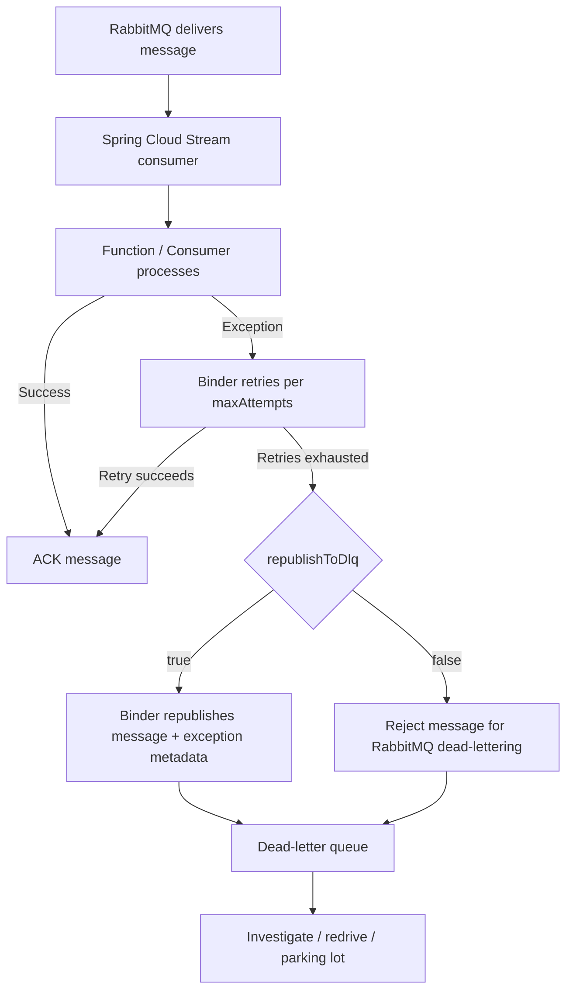

# republishToDlq and Exception Metadata

When a Spring Cloud Stream RabbitMQ consumer fails to process a message, the binder can retry, reject the message, or route it to a dead-letter queue (DLQ). If relying solely on RabbitMQ's native dead-lettering, the original message is retained and the broker attaches an `x-death` header, yet details about the application-level exception are generally missing.

The `republishToDlq` property lets the RabbitMQ binder **republish failed messages to the DLQ** instead of simply rejecting them for the broker to forward. During republishing, the binder attaches error metadata such as the exception message, stack trace, and original exchange/routing key information. As a result, operators can see where a message failed, why it failed, and redrive it in a controlled manner.

`autoBindDlq` and `republishToDlq` solve two different problems: `autoBindDlq` tells the binder to declare the DLX/DLQ and routing; `republishToDlq` controls how the binder moves failed messages to the DLQ and what metadata gets attached. Enabling republish without proper DLQ/routing does not automatically create an error storage destination.

## 1. Failure Handling Flow in a Consumer

Suppose function `processOrder` receives messages from queue `orders.commands.order-handler`. When processing throws an exception, the binder retries according to configuration. If all retry attempts fail and a DLQ is configured, the message enters the dead-letter flow.

Imperative consumer example:

```java
import java.util.function.Consumer;

import org.springframework.context.annotation.Bean;
import org.springframework.context.annotation.Configuration;

@Configuration
class OrderConsumer {

    @Bean
    Consumer<OrderCreated> processOrder(OrderService orderService) {
        return event -> orderService.process(event);
    }
}
```

If `orderService.process(...)` throws an exception out of the consumer, the binder receives the failure to apply retry and recovery. Do not catch exceptions and merely log them if your goal is for the binder to route failed messages to the DLQ.



When `republishToDlq=true`, the binder uses a recoverer to resend the message to the dead-letter exchange/queue. When `false`, the binder rejects the message and RabbitMQ performs dead-letter routing according to queue settings. Both paths require valid DLQ topology to retain failed messages in a DLQ.

## 2. Configuring autoBindDlq and republishToDlq

Example configuration for binding `processOrder-in-0`:

```yaml
spring:
  cloud:
    function:
      definition: processOrder
    stream:
      bindings:
        processOrder-in-0:
          destination: orders.commands
          group: order-handler
          consumer:
            max-attempts: 3
            back-off-initial-interval: 1000
            back-off-multiplier: 2.0
            back-off-max-interval: 10000
      rabbit:
        bindings:
          processOrder-in-0:
            consumer:
              auto-bind-dlq: true
              republish-to-dlq: true
              requeue-rejected: false
              republish-delivery-mode: PERSISTENT
              frame-max-headroom: 20000
```

Rabbit-specific properties reside under `spring.cloud.stream.rabbit.bindings.<binding-name>.consumer`:

| Property | Meaning |
|---|---|
| `auto-bind-dlq` | Automatically declares the DLQ, dead-letter exchange, and required bindings. Defaults to `false`. |
| `republish-to-dlq` | Binder republishes failed messages and attaches exception metadata. |
| `requeue-rejected` | When retry is disabled or republish is not used, controls whether rejected messages return to the queue. Defaults to `false`. |
| `republish-delivery-mode` | Delivery mode of republished messages. Defaults to `PERSISTENT`. |
| `frame-max-headroom` | Number of bytes reserved for other headers when sizing the stack trace. Defaults to `20000`. |

`max-attempts` and the backoff properties are generic Spring Cloud Stream consumer properties, not inside the Rabbit-specific namespace. The example above allows up to three binder retry attempts; if still failing, the message goes to the DLQ with error metadata.

### Defaults Across Versions

The RabbitMQ binder 4.0.5 documentation notes that `republishToDlq` defaults to `true`; older versions documented a default of `false`. `autoBindDlq` still defaults to `false`, so a DLQ is not declared automatically by `republishToDlq` alone. Explicitly set both properties in production configuration rather than relying on version-dependent defaults.

## 3. What Components Does autoBindDlq Create?

With destination `orders.commands` and group `order-handler`, the Rabbit binder by default creates the destination exchange and a consumer queue named from the destination/group. When `auto-bind-dlq` is enabled, the binder additionally creates the dead-letter exchange (DLX), the DLQ, and the routing between them.

With a named consumer group, the primary queue typically follows `<prefix><destination>.<group>`, and the DLQ is usually named after that queue with a `.dlq` suffix unless `deadLetterQueueName` overrides it. Illustrative example:

```text
orders.commands                 (destination exchange)
    |
    +---- orders.commands.order-handler  (consumer queue)
                  |
                  | message rejected/dead-lettered
                  v
               DLX
                  |
                  v
orders.commands.order-handler.dlq
```

Actual exchange, queue, and routing key names depend on binder settings such as `prefix`, `deadLetterExchange`, `deadLetterQueueName`, and `deadLetterRoutingKey`. If topology is managed externally via RabbitMQ definitions or IaC, declare the matching DLX, DLQ, and bindings rather than having the binder recreate them.

A stable consumer group is essential for a durable queue and a group-bound DLQ. Anonymous consumers without a group typically use random auto-delete queues, which are unsuitable for DLQ workflows that must retain failed messages long-term.

## 4. Differences Between republishToDlq=true and false

Both modes can route failed messages to a DLQ, but their execution paths and metadata differ.

| Characteristic | `republishToDlq=false` | `republishToDlq=true` |
|---|---|---|
| Transfer mechanism | Binder rejects message; RabbitMQ dead-letters via queue/DLX. | Binder republishes message to DLQ. |
| Payload | Preserves original message. | Preserves original message payload when republishing. |
| Application error metadata | Binder does not automatically attach exception message/stack trace. | Attaches exception metadata, including message and stack trace. |
| Broker metadata | RabbitMQ adds `x-death` describing the dead-letter event. | Binder adds original exchange/routing key headers; may lack the same `x-death` produced by broker rejection. |
| Delivery mode | Per original message and broker settings. | Per `republish-delivery-mode`, defaulting to `PERSISTENT`. |
| Retry dependency | Can combine with binder retry before rejecting. | Can republish immediately after one attempt if `max-attempts=1`. |

`x-death` is a RabbitMQ-managed header added when the broker dead-letters a message. Exception headers such as `x-exception-message` and `x-exception-stacktrace` are added by the binder/recoverer when republishing. Do not treat these two header sets as the same metadata or assume they always appear together.

## 5. Common Exception Metadata

When `republishToDlq=true`, messages in the DLQ can contain the following headers:

| Header | Contents | Purpose |
|---|---|---|
| `x-exception-message` | Message of the final failing exception. | Quickly identify causes such as validation failures or timeouts. |
| `x-exception-stacktrace` | Stack trace of the final exception/cause, possibly truncated. | Pinpoint the class, method, and location where the error occurred. |
| `x-original-exchange` | Original exchange that received the message. | Identify where the message was published before entering the DLQ. |
| `x-original-routingKey` | Original routing key. | Support redriving back to the right routing key. |
| `x-death` | Dead-letter details recorded by RabbitMQ when passing through broker dead-lettering. | Count dead-letter cycles and inspect related queue/reason/exchange. |

Header names are technical metadata, not a stable business schema. When reading headers, handle missing headers, unexpected data types, or truncated stack traces. Never make code depend on header ordering or exact stack trace formatting as a fixed API.

### Exception Message Reflects the Final Error After Retries

When the binder retries multiple times, exception metadata reflects the failure captured at the end of the retry cycle, not a complete log of every exception across all attempts. If you need per-attempt history, record separate logs/metrics with `eventId`, attempt number, and correlation ID.

Do not rely solely on `x-exception-message` as an error classification key. Exception messages can change across library versions, contain input data, or include environment details. Classify errors using application-controlled exception types or error codes, and use stack traces for detailed investigation.

## 6. Example: Reading Metadata from a DLQ

An operations component can read messages from the DLQ using `@RabbitListener` and extract exception headers for recording or surfacing in an error-handling console.

```java
import java.util.Map;

import org.springframework.amqp.core.Message;
import org.springframework.amqp.core.MessageProperties;
import org.springframework.amqp.rabbit.annotation.RabbitListener;
import org.springframework.stereotype.Component;

@Component
class OrderDlqInspector {

    @RabbitListener(queues = "orders.commands.order-handler.dlq")
    void inspect(Message failedMessage) {
        MessageProperties properties = failedMessage.getMessageProperties();
        Map<String, Object> headers = properties.getHeaders();

        Object exceptionMessage = headers.get("x-exception-message");
        Object stackTrace = headers.get("x-exception-stacktrace");
        Object originalExchange = headers.get("x-original-exchange");
        Object originalRoutingKey = headers.get("x-original-routingKey");

        // Store sanitized metadata in the error investigation system.
        // Do not write sensitive payloads or full stack traces to public logs.
        // Must persist durably before returning if the audit record must be preserved.
        recordFailure(
            exceptionMessage,
            stackTrace,
            originalExchange,
            originalRoutingKey
        );
    }

    private void recordFailure(
            Object exceptionMessage,
            Object stackTrace,
            Object originalExchange,
            Object originalRoutingKey) {
        // Replace with the application's real persistence/observability service.
    }
}
```

This example reads raw messages at the Spring AMQP layer. `recordFailure(...)` is the integration point to implement with a real persistence/observability service. With automatic ACK, the listener normally acknowledges the message when the method returns normally; therefore, if persisting the audit record fails, let the exception propagate so the message is not acknowledged as if saved successfully. Configure the listener to read strictly from the target DLQ and define an explicit ACK policy.

## 7. Stack Traces Can Be Truncated by frame_max

RabbitMQ limits AMQP frame size via `frame_max`. When the binder inserts a stack trace into headers, the combined size of the stack trace plus other headers must fit within the frame limit. Stack traces can grow very large, especially with deeply nested causes or many stack frames.

`frameMaxHeadroom` specifies how many bytes the binder reserves for other headers when sizing the stack trace. The current Rabbit binder default is `20000` bytes. If the stack trace plus headroom exceeds the frame limit, the binder truncates the stack trace and logs a WARN message.

Example lowering headroom if the environment needs fewer bytes reserved for other headers:

```yaml
spring:
  cloud:
    stream:
      rabbit:
        bindings:
          processOrder-in-0:
            consumer:
              frame-max-headroom: 12000
```

Do not arbitrarily set headroom too low. Check broker `frame_max`, payload/header sizes, actual stack traces, and WARN logs. Alternatively, keep stack traces concise by catching exceptions at the right boundary and throwing concise domain exceptions instead of wrapping excessively long cause chains.

A truncated stack trace does not mean the message payload is truncated. This limit applies only to header metadata; the original payload is handled separately.

## 8. republishDeliveryMode and DLQ Message Durability

`republishDeliveryMode` sets the delivery mode of messages republished by the binder. The current default is `PERSISTENT`.

```yaml
spring:
  cloud:
    stream:
      rabbit:
        bindings:
          processOrder-in-0:
            consumer:
              republish-delivery-mode: PERSISTENT
```

Persistent delivery mode aligns messages with durable queues and survival across broker restarts. However, setting persistent delivery mode alone does not guarantee the entire DLQ path is durable. You must also inspect queue durability, broker storage, replication/quorum policies, publisher confirms/returns, and how the binder handles DLQ publish failures.

## 9. Retry, requeueRejected, and Failing Message Loops

Binder retry and RabbitMQ requeue are two distinct mechanisms:

- `max-attempts` controls how many times the binder tries invoking the handler before recovering.
- `back-off-*` controls the wait intervals between binder retry attempts.
- `requeue-rejected` controls whether the broker returns rejected messages back to the queue when retry is disabled or republish is not used.
- `republish-to-dlq` instructs the binder to republish failed messages to the DLQ with metadata.

If `max-attempts=1`, binder retry is disabled. With `auto-bind-dlq=true`, `requeue-rejected=false` (the default) lets rejected messages be dead-lettered by the broker to the DLQ. Setting `requeue-rejected=true` when republish is not used can continuously return failing messages to the queue and loop endlessly.

Example configuration that tries once and routes failures:

```yaml
spring:
  cloud:
    stream:
      bindings:
        processOrder-in-0:
          consumer:
            max-attempts: 1
      rabbit:
        bindings:
          processOrder-in-0:
            consumer:
              auto-bind-dlq: true
              republish-to-dlq: true
              requeue-rejected: false
```

With `republish-to-dlq=true`, the binder can republish after a single attempt; enabling multiple retries is not mandatory. For transient errors, configure retries and backoff before moving messages to the DLQ. For deterministic data errors such as malformed schemas, repeated retries rarely fix the root cause.

### ImmediateAcknowledgeAmqpException Is a Special Case

If a listener throws `ImmediateAcknowledgeAmqpException`, the Rabbit binder skips the DLQ and discards the message. Per current binder documentation, this holds true whether `republishToDlq` is enabled or disabled. Use this exception only when the business logic intentionally decides to drop the message and proper audit/tracking is already recorded.

## 10. Transacted Consumers and Publisher Confirms When Republishing

Since Rabbit binder 3.1.2, if a consumer is marked `transacted`, publishing the message to the DLQ can participate in the consumer's transaction. If the DLQ publish fails, such as when the user lacks publish permission on the dead-letter exchange, the transaction can roll back.

If the `ConnectionFactory` is configured with publisher confirms or returns, DLQ publishing can await confirmation and check for returned messages. Upon receiving a negative acknowledgement or returned message, the binder throws `AmqpRejectAndDontRequeueException` so RabbitMQ performs dead-lettering as in the `republishToDlq=false` case.

This reduces the risk of acknowledging the original message when DLQ forwarding fails. However, you must configure and test the exact versions of the Spring Cloud Stream Rabbit binder, Spring AMQP, and RabbitMQ client. Never assume publisher confirms are active simply because `republishToDlq=true`.

## 11. DLQs for Partitioned Destinations

For partitioned destinations, the Rabbit binder uses a shared DLQ across partitions. When `republishToDlq=false`, RabbitMQ attaches `x-death` containing the dead-lettered queue/exchange/routing key. DLQ consumers must inspect that metadata to identify the originating queue.

When `republishToDlq=true`, the binder attaches headers containing the original exchange and original routing key. This helps redrive messages back to the exact exchange/routing key instead of guessing the partition from the DLQ name.

Example header constants in the Spring AMQP recoverer:

```java
import org.springframework.amqp.rabbit.retry.RepublishMessageRecoverer;

String originalExchangeHeader = RepublishMessageRecoverer.X_ORIGINAL_EXCHANGE;
String originalRoutingKeyHeader = RepublishMessageRecoverer.X_ORIGINAL_ROUTING_KEY;
```

Do not assume a separate DLQ exists per partition. When handling partitioned destinations, use the original exchange/routing key or corresponding `x-death` metadata to determine where the message originated.

## 12. Bounded Redrive from DLQ and Parking Lots

The Spring Cloud Stream Rabbit binder does not provide a single built-in mechanism to consume from a DLQ and automatically return messages to the original queue. Applications can use `@RabbitListener`, `RabbitTemplate`, or a Spring Integration flow to process the DLQ.

A redrive workflow should:

1. Read event ID, original exchange/routing key, exception message, and attempt count.
2. Classify whether the error is recoverable or a permanent data/business error.
3. Fix the root cause before redriving, such as restoring a downstream dependency or correcting data via an approved procedure.
4. Increment an application-managed retry counter, such as `x-retries`.
5. If below the threshold, republish to the original exchange/routing key or a retry exchange with TTL/delay.
6. If above the threshold, move the message to a parking-lot queue for operator review.
7. Rely on a stable event ID and idempotent consumers to tolerate redelivered messages.

Pseudocode example:

```java
if (retryCount < MAX_REDRIVES && isTransientFailure(failure)) {
    publishToOriginalRoute(originalExchange, originalRoutingKey, message,
        retryCount + 1);
} else {
    publishToParkingLot(message, failureCategory);
}
```

Never redrive infinitely. If the error is an invalid schema, missing required fields, or business rule violation, resending the same payload only generates extra load and repeated failures. Establish a parking lot, alerting, and a controlled fix/replay process.

## 13. Securing Exception Metadata

Exception messages and stack traces are invaluable for operations, yet they can also leak sensitive data:

- SQL statements, table names, or query parameters.
- Internal URLs, hostnames, file paths, or service names.
- Tokens, credentials, or request details accidentally embedded in exceptions.
- User data included in error messages.

DLQs are often accessed by multiple operations, support, and analytics teams. Therefore:

- Restrict DLQ read permissions following the principle of least privilege.
- Do not dump full payloads/stack traces into public logs.
- Sanitize exception messages before constructing errors if they risk exposing secrets.
- Configure DLQ retention and deletion policies appropriate for sensitive data.
- Encrypt connections and storage according to environment standards.
- Log event ID, correlation ID, and error category for lookup rather than placing sensitive payloads in metric labels.

Do not disable exception metadata solely out of data-exposure fears without an alternative investigation path. You can preserve exception type, error code, and sanitized messages while restricting access to stack traces.

## 14. Testing republishToDlq

The Spring Cloud Stream Test Binder does not fully simulate DLX/DLQ, AMQP rejects, publisher confirms, or Rabbit binder-generated headers. You need integration tests with a real RabbitMQ broker or Testcontainers RabbitMQ to verify behavior.

Cases to test:

| Case | What to verify |
|---|---|
| Handler succeeds | Message is ACKed; no message enters DLQ. |
| Handler fails, retry succeeds | Message does not enter DLQ; business side effects occur only as designed. |
| Retries exhausted with `republishToDlq=true` | DLQ receives payload and exception metadata. |
| `republishToDlq=false` | Broker dead-letters message and adds `x-death`; do not assume stack trace exists. |
| `max-attempts=1` | Message routes per requeue/DLX config right after the single attempt. |
| `requeue-rejected=true` | Verify continuous redelivery risk and appropriate alerts. |
| Stack trace exceeds frame limit | WARN logged and stack trace truncated; payload remains intact. |
| Original exchange/routing key | Headers indicate exact original route, especially for partitioned destinations. |
| DLQ publish fails | Verify transaction/confirm/return and original message state. |
| ImmediateAcknowledgeAmqpException | Message is discarded and DLQ bypassed per binder semantics. |
| Redrive exceeds threshold | Message moves to parking lot without infinite looping. |

When inspecting DLQ messages, verify payload, delivery mode, exception headers, original route, `x-death` if present, and retry counts. Never merely assert a queue has one message while ignoring metadata and redrive capability.

## 15. Observing and Operating DLQs

Monitor these metrics:

- Message count in the DLQ and age of the oldest message.
- Rate of messages entering the DLQ by destination/group.
- Average retry attempts and terminal failure rate.
- Exception classification by error category; avoid free-form exception messages as metric tags.
- Redriven message count, redrive attempts, and messages moved to the parking lot.
- DLQ publish errors, negative confirms, returned messages, and permission errors.
- Alerts on truncated stack traces or headers exceeding frame limits.

Logs should include destination, group, event ID, correlation ID, and exception type. Never put high-cardinality event IDs into metric tags; use logs or traces to look up individual messages. Maintain a DLQ dashboard and a runbook defining who may redrive, who may purge, and exit criteria for closing a recovery task.

## 16. Common Pitfalls

1. **Enabling `republish-to-dlq` while forgetting `auto-bind-dlq`.** Without proper DLX/DLQ/routing, failed messages have nowhere to be stored.
2. **Assuming `republishToDlq` always defaults to false or true.** Defaults vary across versions; declare it explicitly.
3. **Confusing `x-death` with `x-exception-stacktrace`.** `x-death` is added by RabbitMQ dead-lettering; stack trace is added by the binder during republish.
4. **Setting `requeue-rejected=true` without bounds.** Messages can return to the queue and fail repeatedly in a loop.
5. **Assuming `republishToDlq` requires multiple retries.** The binder can republish after one attempt if `max-attempts=1`.
6. **Ignoring truncated stack traces.** Check `frame-max-headroom`, broker `frame_max`, and WARN logs.
7. **Using exception messages as stable error codes.** Messages can change or contain sensitive data.
8. **Unbounded redrive.** Permanent errors can create a DLQ → main queue → DLQ loop.
9. **Not checking original routing keys.** Partitioned messages may be republished to the wrong route.
10. **Testing only with the Test Binder.** RabbitMQ integration tests are required for dead-letter and republish behavior.
11. **Assuming the DLQ drains itself.** Applications must build dedicated consumption, investigation, and redrive workflows.

## 17. Implementation Workflow

1. Identify the input binding, destination, and consumer group needing a DLQ.
2. Enable `auto-bind-dlq` or provision DLX/DLQ via infrastructure topology management.
3. Explicitly set `republish-to-dlq` based on binder version and metadata requirements.
4. Choose `max-attempts` and backoff suited to transient failures.
5. Set `requeue-rejected` intentionally; avoid unbounded requeuing.
6. Verify `republish-delivery-mode` and DLQ durability.
7. Set `frame-max-headroom` to fit actual frame limits and headers.
8. Secure exception metadata and DLQ access permissions.
9. Test exception headers, original routes, DLQ publish failures, and redrives.
10. Set up dashboards, alerts, parking lots, and runbooks for failed messages.

`republishToDlq` turns a failed message into an investigable record: the original payload travels alongside exception metadata and routing details. Combined with properly declared DLQs, bounded retries, header sizing, security controls, and a redrive workflow, Spring Cloud Stream applications can handle RabbitMQ failures transparently without creating message loops or losing root-cause visibility.

## References

- [Spring Cloud Stream RabbitMQ Binder – Dead-Letter Queue and republishToDlq](https://docs.spring.io/spring-cloud-stream/docs/current/reference/html/spring-cloud-stream-binder-rabbit.html)
- [Spring Cloud Stream RabbitMQ Binder – Consumer Properties](https://docs.spring.io/spring-cloud-stream/docs/current/reference/html/spring-cloud-stream-binder-rabbit.html#rabbit-consumer-properties)
- [Spring AMQP – Exception Handling and RepublishMessageRecoverer](https://docs.spring.io/spring-amqp/reference/amqp/resilience-recovering-from-errors-and-broker-failures.html)
- [RabbitMQ – Dead Letter Exchanges](https://www.rabbitmq.com/docs/dlx)