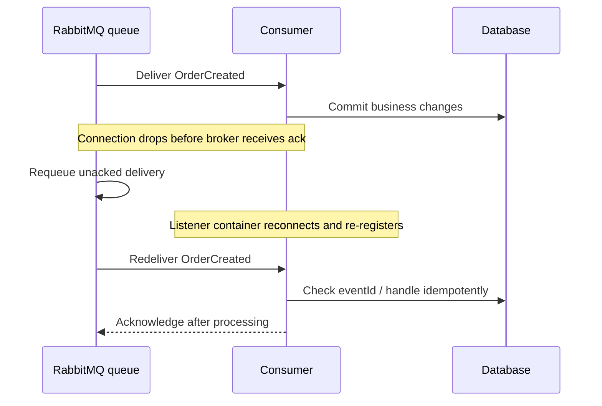

# Handling Disconnects, Consumer Recovery, and Redelivery Limits

A RabbitMQ consumer can lose its connection due to broker restarts, failures on the queue-owning node, network interruptions, firewalls closing idle connections, or abrupt application shutdowns. When an AMQP connection closes, all channels on that connection close as well. Messages already delivered to the consumer but not yet acknowledged are returned to the queue by RabbitMQ so they can be delivered to another consumer or to the recovered consumer.

The Spring Cloud Stream RabbitMQ Binder works with Spring AMQP to create connections, declare exchanges/queues/bindings, and register consumers. Once connectivity recovers, the listener container can reconnect and resume receiving messages. However, unacknowledged messages may appear again. Therefore, connection recovery and redelivery handling must be designed alongside idempotency, bounded retries, and dead-letter queues (DLQ).

## 1. What Happens When a Consumer Loses Its Connection?

Suppose a consumer receives an `OrderCreated` event, updates the database, and prepares to acknowledge. If the connection drops before the broker receives the acknowledgement, RabbitMQ cannot know for certain that business processing completed. Unacked messages are returned to a deliverable state.

Typical sequence:



Points to remember:

- Closing a TCP connection closes all AMQP channels on that connection.
- Unacknowledged deliveries are automatically requeued when a channel or connection closes.
- The broker needs time to detect that a client is no longer active; heartbeats help detect dead connections earlier.
- A consumer may redeliver a message whose business work succeeded before the ack was sent.
- Redelivery is normal behavior in an at-least-once model, not necessarily a broker bug.

Consequently, never assume a handler is invoked exactly once per event. Consumers must be able to process the same event multiple times without creating duplicate side effects.

## 2. Distinguishing Connection Recovery from Business Retry

These two mechanisms address two different failure types:

| Mechanism | Purpose | Example |
|---|---|---|
| Connection recovery | Restore connections, channels, and consumer registrations after infrastructure failures | Broker restart, TCP reset, node disconnect |
| Listener retry | Re-invoke the handler when processing a message fails | Database timeout, inventory service temporary error |
| Broker redelivery | Redeliver unacked or rejected/requeued deliveries | Process crash mid-processing, channel closed |
| DLQ | Quarantine messages after retries exhaust or rejection without requeue | Invalid payload schema, non-recoverable business error |

`recoveryInterval` controls the wait interval between listener container attempts to restart a consumer after a non-fatal error. It is not the wait time between message retries, nor does it replace Spring AMQP's connection recovery mechanism.

Conversely, `max-attempts` and backoff properties on the consumer binding control handler retries in Spring Cloud Stream. If retries exhaust and the message is rejected without requeue, the broker can dead-letter the message if the queue has an appropriate DLX.

Do not use connection recovery to handle business errors, or continuous requeuing to wait for the broker to recover. When the broker disconnects, the listener container recovers the connection; when the handler fails, apply retry/DLQ policies.

## 3. How the RabbitMQ Binder Maps Destinations to Exchanges and Queues

By default, the RabbitMQ Binder maps each destination to a `TopicExchange`. For a named consumer group, the binder creates a queue and binds it to the exchange. Instances belonging to the same group share consumption from the group's queue.

Example function:

```java
@Bean
Consumer<OrderCreated> reserveInventory(InventoryService inventory) {
    return event -> inventory.reserve(event);
}
```

Binding configuration:

```yaml
spring:
  cloud:
    function:
      definition: reserveInventory
    stream:
      bindings:
        reserveInventory-in-0:
          destination: orders.created
          group: inventory-service
          content-type: application/json
```

With destination `orders.created` and group `inventory-service`, the queue is typically named `orders.created.inventory-service` (possibly with a prefix or custom naming settings). Service instances in the same group compete to receive messages from this queue.

A consumer that omits `group` is an anonymous consumer. The binder uses a randomly named, auto-delete queue. That queue can be deleted when the consumer disconnects, making it unsuitable when backlogs must survive application pauses. For production consumers that must resume after restarts, declare a stable group and durable queue.

## 4. Configuring Connections and Heartbeats

By default, the RabbitMQ Binder uses Spring Boot's `ConnectionFactory`, so `spring.rabbitmq.*` properties can configure addresses, authentication, and connection behavior.

Example environment-driven configuration:

```yaml
spring:
  rabbitmq:
    addresses: ${RABBITMQ_ADDRESSES:localhost:5672}
    username: ${RABBITMQ_USERNAME:app}
    password: ${RABBITMQ_PASSWORD}
    virtual-host: ${RABBITMQ_VHOST:/}
    requested-heartbeat: 30s
    connection-timeout: 5s
```

In production, supply addresses, usernames, and passwords via environment variables or a secret manager. Never commit real credentials to a repository. For a RabbitMQ cluster, `addresses` can list nodes reachable by the client. Ensure broker-advertised endpoints are also reachable from the application's network.

Heartbeats help both sides detect unresponsive connections, including hung TCP connections or network devices closing idle sockets. A value that is too low can falsely mark connections dead during brief slowdowns; a value that is too high delays failure detection. Choose heartbeat intervals based on network stability and recovery requirements.

`connection-timeout` bounds initial connection establishment. It does not replace heartbeats and does not govern handler retry durations.

Spring AMQP uses `CachingConnectionFactory` to manage connections and channels. When the broker or network recovers, the framework can recreate connections/channels and `RabbitAdmin` redeclares managed exchanges, queues, and bindings. The listener container then restarts consumers. Spring AMQP has its own recovery mechanism; do not layer an extra application-level recovery loop without clearly defining each layer's role.

## 5. Configuring Recovery and Queue Declaration

RabbitMQ consumer properties live under `spring.cloud.stream.rabbit.bindings.<bindingName>.consumer`. Several properties relate to recovery:

| Property | Meaning |
|---|---|
| `recovery-interval` | Interval between attempts to restart the consumer after non-fatal errors; defaults to 5,000 ms |
| `missing-queues-fatal` | Determines whether missing queues cause the listener container to stop in a fatal state; defaults to `false` |
| `queue-declaration-retries` | Number of attempts to declare/consume a missing queue; applies when `missing-queues-fatal=true` |
| `failed-declaration-retry-interval` | Interval between attempts when a queue is missing |
| `prefetch` | Number of unacked deliveries the broker can dispatch ahead to a consumer |
| `max-concurrency` | Maximum consumers the container can spawn on supported container types |

Example:

```yaml
spring:
  cloud:
    stream:
      bindings:
        reserveInventory-in-0:
          destination: orders.created
          group: inventory-service
      rabbit:
        bindings:
          reserveInventory-in-0:
            consumer:
              recovery-interval: 5000
              missing-queues-fatal: false
              prefetch: 20
              max-concurrency: 4
```

When `missing-queues-fatal=false`, the listener container keeps trying to consume from the queue rather than shutting down the application just because a queue is temporarily missing. This helps in clusters or when queues are provisioned by another deployment pipeline. However, the application may sit idle without consuming messages for a period; rely on logs and metrics to detect it.

If `missing-queues-fatal=true` is set, you can use `queue-declaration-retries` to cap attempts before treating the error as fatal. Match the policy to whether queues are created by the binder or by operations/infrastructure teams.

These properties depend on container type and Rabbit binder version. For instance, certain concurrency properties do not apply to `direct` or `stream` containers. Always check the documentation for your exact dependency version.

## 6. Consumer Acknowledgement Controls Redelivery

RabbitMQ needs to know when a delivery has finished processing. The Spring Cloud Stream Rabbit binder provides `acknowledge-mode`, which defaults to `AUTO`.

In Spring AMQP, `AUTO` means the listener container acknowledges automatically after the listener finishes normally. If the listener throws an exception, the container applies error policies, retries, and reject/requeue accordingly. This is not AMQP fire-and-forget auto-ack mode.

Common modes:

| Mode | Behavior | Notes |
|---|---|---|
| `AUTO` | Container acks after listener completes successfully | Standard choice for Spring Cloud Stream |
| `MANUAL` | Application explicitly acks/nacks deliveries | Must manage delivery tags and channels properly |
| `NONE` | Broker considers message delivered immediately on send | Higher potential throughput, but risks losing messages on consumer failure |

Example keeping container-managed AUTO mode:

```yaml
spring:
  cloud:
    stream:
      rabbit:
        bindings:
          reserveInventory-in-0:
            consumer:
              acknowledge-mode: AUTO
```

With AUTO mode, return normally only after processing is complete. If the business service fails, let the exception propagate out of the listener so the binder applies retry/error policies. Never catch and ignore exceptions if the message was not genuinely processed.

When using MANUAL, delivery tags are meaningful only on the channel that received the message. Acknowledging on a different channel or acking the same delivery tag multiple times can trigger protocol errors and close the channel. Use manual ack only when explicitly required and tested on your running binder version.

## 7. What Happens to Unacked Messages on Connection Loss?

RabbitMQ automatically requeues unacked deliveries when a channel or connection closes. This covers TCP connection drops, consumer process crashes, and channels closed due to protocol errors.

Example:

1. Consumer receives `OrderCreated`.
2. Service updates inventory successfully.
3. Process is killed before the listener container sends the ack.
4. RabbitMQ sees the channel close and returns the message to the queue.
5. Another consumer instance receives the message again.

On redelivery, RabbitMQ marks the delivery as `redelivered`. The `redelivered` flag only indicates the message may have been delivered previously; it is not an accurate attempt counter and does not indicate how far prior business execution got.

There is a window that acks alone cannot eliminate: the database committed, yet the ack never reached the broker. Messages can be redelivered even when side effects already succeeded. Therefore, consumers must be idempotent.

## 8. Designing Idempotent Handlers

Each business event should carry a stable ID, such as `eventId`. The consumer records processed IDs in the same transaction as business state changes.

```java
@Service
public class InventoryService {

    private final ProcessedEventRepository processedEvents;
    private final InventoryRepository inventory;

    public InventoryService(
            ProcessedEventRepository processedEvents,
            InventoryRepository inventory) {
        this.processedEvents = processedEvents;
        this.inventory = inventory;
    }

    @Transactional
    public void reserve(OrderCreated event) {
        if (processedEvents.existsById(event.eventId())) {
            return;
        }

        inventory.reserve(
            event.orderId(),
            event.items()
        );

        processedEvents.save(
            new ProcessedEvent(event.eventId())
        );
    }
}
```

This example assumes inventory updates and the `ProcessedEvent` record share the same database transaction. The processed events table needs a unique constraint on `eventId`. If two consumers can process the same event concurrently, handle unique-constraint conflicts; checking existence before inserting alone does not eliminate race conditions.

If the handler calls external services outside the database, use an idempotency key supported by that service or persist workflow state for safe resumption. A local transaction cannot guarantee exactly-once across RabbitMQ and an external system.

## 9. Limiting Prefetch and Concurrency

`prefetch` determines how many messages the broker can deliver ahead before the consumer acknowledges held deliveries. High values can increase throughput, yet also increase the number of unacked messages. When a consumer dies, many messages are requeued together and can trigger a large redelivery spike.

Example configuration:

```yaml
spring:
  cloud:
    stream:
      bindings:
        reserveInventory-in-0:
          consumer:
            concurrency: 2
      rabbit:
        bindings:
          reserveInventory-in-0:
            consumer:
              prefetch: 20
              max-concurrency: 4
```

`concurrency` is a generic Spring Cloud Stream consumer property; `max-concurrency` is a Rabbit binder property on supported containers. Actual configuration must verify maximum consumer counts and container type.

Choose prefetch according to processing duration, message size, and memory. For slow handlers or costly side effects, low prefetch limits unacked messages and reduces how many messages get redelivered together. Prefetch that is too low can hurt throughput because consumers frequently wait on the broker.

Increasing concurrency does not automatically scale processing capacity if database connection pools, downstream services, or queue topology are the bottleneck. Measure throughput, latency, unacked counts, and consumer capacity before tuning.

## 10. Retries in the Spring Cloud Stream Rabbit Binder

Binder-level retry allows re-invoking the listener before deciding to reject or dead-letter a message. Generic properties reside on the consumer binding:

```yaml
spring:
  cloud:
    function:
      definition: reserveInventory
    stream:
      bindings:
        reserveInventory-in-0:
          destination: orders.created
          group: inventory-service
          consumer:
            max-attempts: 4
            back-off-initial-interval: 1000
            back-off-max-interval: 10000
            back-off-multiplier: 2.0
```

`max-attempts` includes the initial attempt. With a value of 4, the listener is invoked at most four times at this retry layer. Increasing backoff relieves pressure while downstream dependencies are failing.

Classify errors before retrying:

- Timeouts or transient network glitches: retry with backoff.
- Temporary database unavailability: bounded retries.
- Invalid schema payloads or missing required fields: do not retry repeatedly.
- Authentication or permission errors: alert on configuration/infrastructure and stop retrying quickly.
- Unrecoverable business errors: route to DLQ or a dedicated business workflow.

Never configure infinite retries in the application. Handler retries and broker redeliveries are two distinct layers; if both loop without bounds, messages can bounce endlessly.

## 11. Why Can requeueRejected=true Create a Loop?

The Rabbit binder has the `requeue-rejected` property. It determines whether failed deliveries are requeued when retry is disabled or when `republish-to-dlq=false`.

When `requeue-rejected=true`, rejected messages return to the queue and get redelivered. If the error is invalid data or a deterministic bug, consumers receive the same message and fail forever. This causes a redelivery loop, spikes CPU/logs, delays valid messages, and builds backlogs.

For permanent errors, usually keep `requeue-rejected=false` and use a DLQ. For transient errors, prefer bounded retries with backoff in the binder or a delayed retry mechanism.

Example avoiding infinite requeuing:

```yaml
spring:
  cloud:
    stream:
      bindings:
        reserveInventory-in-0:
          destination: orders.created
          group: inventory-service
          consumer:
            max-attempts: 4
      rabbit:
        bindings:
          reserveInventory-in-0:
            consumer:
              requeue-rejected: false
              auto-bind-dlq: true
              republish-to-dlq: true
```

When retries are disabled (`max-attempts: 1`), `requeue-rejected=false` is especially important so failed messages are dead-lettered rather than requeued. Do not enable requeue merely to "wait for the broker to get healthy"; connection recovery is the responsibility of the listener container and connection factory.

## 12. Creating a DLQ and Republishing Failed Messages

The Rabbit binder can automatically declare a dead-letter exchange (DLX), dead-letter queue (DLQ), and routing infrastructure via `auto-bind-dlq`. By default, the DLQ name is usually the destination plus `.dlq`, customizable via `dead-letter-queue-name`.

When `republish-to-dlq=true`, the binder publishes failed messages to the DLQ with diagnostic metadata such as the exception message and stack trace in headers. This is helpful when you need the final failure cause without digging through consumer logs.

Complete example:

```yaml
spring:
  cloud:
    stream:
      bindings:
        reserveInventory-in-0:
          destination: orders.created
          group: inventory-service
          consumer:
            max-attempts: 4
            back-off-initial-interval: 1000
            back-off-max-interval: 10000
            back-off-multiplier: 2.0
      rabbit:
        bindings:
          reserveInventory-in-0:
            consumer:
              auto-bind-dlq: true
              dead-letter-queue-name: orders.created.inventory-service.dlq
              republish-to-dlq: true
              requeue-rejected: false
```

Ensure:

- The consumer has a stable group so the binder creates a durable queue.
- The application has permissions to declare exchanges/queues/bindings if the binder auto-provisions.
- The producer has permission to publish to the DLX/DLQ.
- The DLQ has suitable retention, TTL, and capacity limits.
- Exception headers do not exceed broker frame limits; long stack traces may be truncated.
- Republished messages use an appropriate delivery mode; current binder documentation notes persistent mode by default when republishing.

A version-specific check: the default value of `republish-to-dlq` has changed across release lines. Declare it explicitly instead of relying on defaults.

Spring Cloud Stream does not provide a single built-in consumer to read DLQs and return messages to the main queue. Build an operational procedure or dedicated DLQ processing flow with filtering, auditing, and rate-controlled replay.

## 13. Broker-Side DLQ vs. Binder Republish

There are two common ways to route failed messages to a DLQ:

**Broker-side dead-lettering**: the consumer rejects the message without requeuing; RabbitMQ uses the queue's DLX and routing key to forward the message. Transfer follows broker mechanics.

**Binder republish**: the binder publishes the message to the DLQ and attaches exception metadata. This puts stack traces/exception messages in headers, but requires the binder's producer to have publish permissions and appropriate serializer/header configuration.

When a consumer is configured with `transacted=true`, since Rabbit binder 3.1.2, publishing to the DLQ can participate in the transaction. If the connection factory enables publisher confirms or returns, the binder can wait for confirmation and check whether the message was returned. If the publish is negative-acked or returned, the binder rejects without requeuing so the broker handles dead-lettering per configuration.

Do not confuse publisher confirms with consumer acknowledgements. Publisher confirms indicate the broker accepted a publish to an exchange/queue per confirmation semantics; consumer acknowledgements confirm a delivery was processed. These are two independent signals.

## 14. Limiting Redelivery with Quorum Queues

Classic queues and quorum queues behave differently regarding replication and poison-message handling.

Quorum queues are durable queues replicated via Raft. They suit critical data requiring high availability and replication. Since RabbitMQ 4.0, quorum queues have a default delivery limit of 20. When failed deliveries exceed the limit, the message is dropped or dead-lettered if the queue has a DLX.

The Rabbit binder can declare a quorum queue and set the delivery limit:

```yaml
spring:
  cloud:
    stream:
      bindings:
        reserveInventory-in-0:
          destination: orders.created
          group: inventory-service
      rabbit:
        bindings:
          reserveInventory-in-0:
            consumer:
              quorum:
                enabled: true
                delivery-limit: 10
              auto-bind-dlq: true
              republish-to-dlq: true
              requeue-rejected: false
```

`quorum.delivery-limit` applies only when `quorum.enabled=true`. Verify your Rabbit binder version supports this property and your broker supports quorum queues. Queues previously created with another type cannot change type merely by updating config; switching queue types typically requires separate migration/provisioning.

Quorum queues provide an `x-delivery-count` header tracking failed delivery attempts. Starting in RabbitMQ 4.3, `x-acquired-count` was added to count how many times a message was handed to a consumer, while delivery limits remain based on `delivery-count`.

### Important Difference Between RabbitMQ 4.2 and 4.3

Before RabbitMQ 4.3, `basic.nack` with `requeue=true` counted toward the delivery limit. Starting in RabbitMQ 4.3, `basic.nack` requeue no longer increments `delivery-count`; it only increments the acquired count. `basic.reject` still counts as a failed delivery and increments `delivery-count`.

Therefore, applications using `basic.nack(requeue=true)` cannot rely on a quorum queue's delivery limit to break every loop. If you rely on delivery limits to stop poison messages, use matching reject semantics and configure a DLX so messages are not unintentionally dropped. Verify the actual behavior of your Rabbit binder/Spring AMQP version because how exceptions map to reject/nack depends on configuration.

Do not disable the delivery limit with `x-delivery-limit=-1` just to preserve legacy behavior. On RabbitMQ 4.0+, the default limit is 20 for quorum queues; pick a sensible limit and always configure a dead-letter destination if messages must not be lost.

## 15. Delayed Retry and Broker-Side Backoff

Immediate continuous retries can overload consumers and brokers. RabbitMQ 4.3 supports native delayed retries for quorum queues, using delivery count to compute linear wait times up to a configurable cap. This is a broker-side feature; verify broker version and queue/policy settings.

Without native delayed retries, you can implement retries via DLX/TTL and intermediate queues:

1. Failed messages are dead-lettered to a retry queue.
2. The retry queue has a TTL.
3. When TTL expires, the DLX routes the message back to the main exchange/queue.
4. A retry count header or application metadata is incremented to bound attempts.
5. Once the limit is exceeded, the message moves to a parking lot / terminal DLQ.

Never create a circular TTL/DLX topology without a retry counter and a terminal limit. A message can cycle forever without durable retry state.

## 16. Application Shutdown and Graceful Shutdown

During controlled application shutdown, the listener container should stop accepting new deliveries and wait for in-flight messages to finish within the shutdown timeout. If the process is killed or a node loses power, unacked deliveries are requeued once RabbitMQ detects the closed connection/channel.

To reduce risk:

- Set timeouts on database and HTTP clients inside handlers.
- Choose a shutdown timeout larger than normal processing time yet compatible with your orchestrator.
- Never ack before critical side effects have been persisted.
- Keep prefetch reasonable so too many messages are not held unacked.
- Design idempotent handlers because messages may be redelivered.
- Monitor the gap between consumer stop and a new consumer attaching to the queue.
- Verify consumer tags, channels, and connections are re-established after recovery.

Graceful shutdown does not completely eliminate redelivery. If business work succeeded before the ack reached the broker, the message can still be redelivered. Idempotency remains mandatory.

## 17. Clusters, Queue Durability, and Node Recovery

A RabbitMQ cluster distributes metadata for exchanges, queue definitions, and bindings across nodes. However, not all queue types replicate message contents.

- **Non-replicated classic queues**: if the queue-owning node is lost, availability and data depend on queue type, version, and topology; never assume classic queues are HA by default.
- **Quorum queues**: data is replicated across members via Raft. When the leader fails, a follower can be elected as the new leader; during leader election, deliveries may pause briefly.
- **Durable queues**: queue definitions survive broker restarts.
- **Persistent messages**: broker persists messages according to durability policies.
- **Publisher confirms**: confirm to the publisher that the broker accepted the message per queue semantics.

For critical messages, choose a queue type matching HA requirements, use publisher confirms and persistent delivery, and use manual/container-managed acknowledgements on consumers. A standalone durable queue does not create replication.

For quorum queues, all messages are persisted durably per the queue's model. Quorum queues require a majority of members online to continue writes and acks. When quorum is lost, the queue cannot serve writes or confirmations until quorum is restored.

## 18. Monitoring Connection Recovery and Redelivery

Do not watch Spring Boot process status alone. Observe the application, broker, and queues together.

| Metric | What to detect |
|---|---|
| Connection/channel count | Leaked connections or continuous reconnect churn |
| Consumer count | Listeners failing to re-register after recovery |
| Queue ready messages | Backlog growing while consumers are offline |
| Queue unacked messages | Slow consumers or deliveries held too long |
| Redelivered rate | Messages being redelivered repeatedly |
| DLQ depth and oldest message age | Accumulating business errors or poison messages |
| Connection blocked / resource alarm | Broker out of memory or disk |
| Consumer capacity | Whether consumers keep up with publish rate |
| Recovery attempts and recovery latency | Prolonged disconnects or continuous reconnects |

Use the RabbitMQ Management UI, Prometheus metrics, or existing monitoring tools. Application logs should include event ID, destination, group, and correlation ID for tracing. Never log passwords, tokens, or full sensitive payloads.

If using health checks, distinguish readiness from liveness. Temporary broker disconnects should typically mark the application unready for new business traffic depending on architecture, yet liveness should not endlessly restart processes if the listener container already handles connection recovery.

## 19. Testing Disconnects and Redelivery

The Test Binder validates functions and bindings in memory, but does not fully simulate TCP disconnects, channel closures, broker restarts, queue leader elections, or redeliveries. Those behaviors require integration tests with real RabbitMQ, such as via Testcontainers.

Test scenarios:

1. Start RabbitMQ and the consumer application with a named group.
2. Publish a message and verify the handler succeeds.
3. Simulate a slow message in flight, then close the channel or stop the consumer before acking.
4. Verify the unacked message is requeued and redelivered.
5. Restart the application and verify the consumer re-registers on the queue.
6. Have the handler commit to the database but simulate disconnect before ack; verify event ID prevents duplicate side effects.
7. Stop and restart the broker; measure recovery time and verify consumption resumes.
8. Create a missing queue or permission mismatch to test `missing-queues-fatal`, queue declaration retries, and alerts.
9. Make the handler fail until `max-attempts` exhausts; verify the message moves to the DLQ.
10. Test `requeue-rejected=true` and confirm loop risks in a bounded test environment.
11. For quorum queues, verify delivery limit, DLX, and exact RabbitMQ version behavior.
12. Replay from DLQ after fixing the error and verify idempotency.

For quorum queues, also test node failures and leader elections in a multi-node environment. Never check only that the Spring Boot process stayed alive; verify queues still hold messages, consumers re-registered, and business side effects did not duplicate.

## 20. Common Pitfalls

| Symptom | Possible cause | Resolution |
|---|---|---|
| Consumer stops receiving messages after reconnect | Listener container failed to reconnect, queue missing, or wrong ACL | Check connection, recovery interval, queue declaration, and permissions |
| Messages processed multiple times | Connection dropped before ack reached broker | Use event IDs and idempotent handlers |
| Poison message loops continuously | `requeue-rejected=true` or unbounded retries | Cap retries, set requeue false, and configure DLQ |
| DLQ receives no messages | `auto-bind-dlq` disabled, wrong DLX/queue, or missing publish ACL | Verify topology and ACLs |
| Queue disappears when app stops | Consumer uses an anonymous auto-delete queue | Declare a named group and durable queue |
| Consumer reconnects repeatedly | Heartbeat too low, unstable network, or broker resource alarm | Check heartbeats, network, and broker metrics |
| Many unacked messages on restart | High prefetch or slow handler | Lower prefetch, optimize handler and timeouts |
| Quorum delivery limit does not stop requeue loop | RabbitMQ 4.3 does not increment delivery-count on `basic.nack(requeue=true)` | Verify reject/nack semantics, use DLX and delayed retry |
| Messages lost after exceeding delivery limit | Quorum queue has no DLX | Configure dead-letter destination before enabling delivery limits |
| Missing queue produces unclear app behavior | `missingQueuesFatal=false` keeps container retrying | Monitor logs/metrics or configure fatal/retries per goal |

## 21. Production Checklist

- Use a named consumer group for a stable queue whose backlog persists while consumers are offline.
- Configure `spring.rabbitmq.addresses`, credentials, virtual host, and heartbeats per environment.
- Understand connection recovery and business retries are two distinct mechanisms.
- Choose appropriate `recovery-interval`, `missing-queues-fatal`, and queue declaration retries.
- Use container-managed `AUTO` acknowledgement mode, or `MANUAL` when explicitly required.
- Ack only after business work is complete per contract.
- Design idempotent handlers using event IDs and proper transactions.
- Bound `max-attempts` and backoff; never requeue poison messages forever.
- Enable DLQ/DLX, verify publish permissions, retention, and replay procedures.
- Choose classic or quorum queues based on HA and replication requirements.
- If using quorum queues, configure delivery limits and DLX; check RabbitMQ 4.0/4.3 nack/reject differences.
- Tune prefetch/concurrency according to throughput and processing duration.
- Monitor ready, unacked, redelivered, DLQ depth, connections, and consumer counts.
- Test broker restarts, connection loss, unacked redeliveries, and replay against real RabbitMQ.

## 22. References

- [Spring Cloud Stream RabbitMQ Binder Reference](https://docs.spring.io/spring-cloud-stream-binder-rabbit/docs/current/reference/html/spring-cloud-stream-binder-rabbit-aggregate.html), binder properties, consumer recovery, retry, and DLQ sections.
- [RabbitMQ Consumer Acknowledgements and Publisher Confirms](https://www.rabbitmq.com/docs/confirms), requeuing unacked deliveries when channels/connections close.
- [RabbitMQ Reliability Guide](https://www.rabbitmq.com/docs/reliability), connection failures, heartbeats, acknowledgements, and replicated queues.
- [RabbitMQ Quorum Queues](https://www.rabbitmq.com/docs/quorum-queues), delivery limits, poison-message handling, and RabbitMQ 4.0/4.3 differences.
- [Spring AMQP Reference](https://docs.spring.io/spring-amqp/reference/), listener containers, connection factories, and acknowledgement behavior.

RabbitMQ automatically returns unacked deliveries to the queue when a connection or channel closes, while the Spring Cloud Stream Rabbit binder handles reconnecting and re-registering consumers per configuration. Redelivery is part of at-least-once delivery; handlers must be idempotent. Combining connection recovery, bounded retries, DLQs, sensible prefetch, and RabbitMQ-version-appropriate delivery limits enables consumers to recover from incidents without getting stuck in error loops.