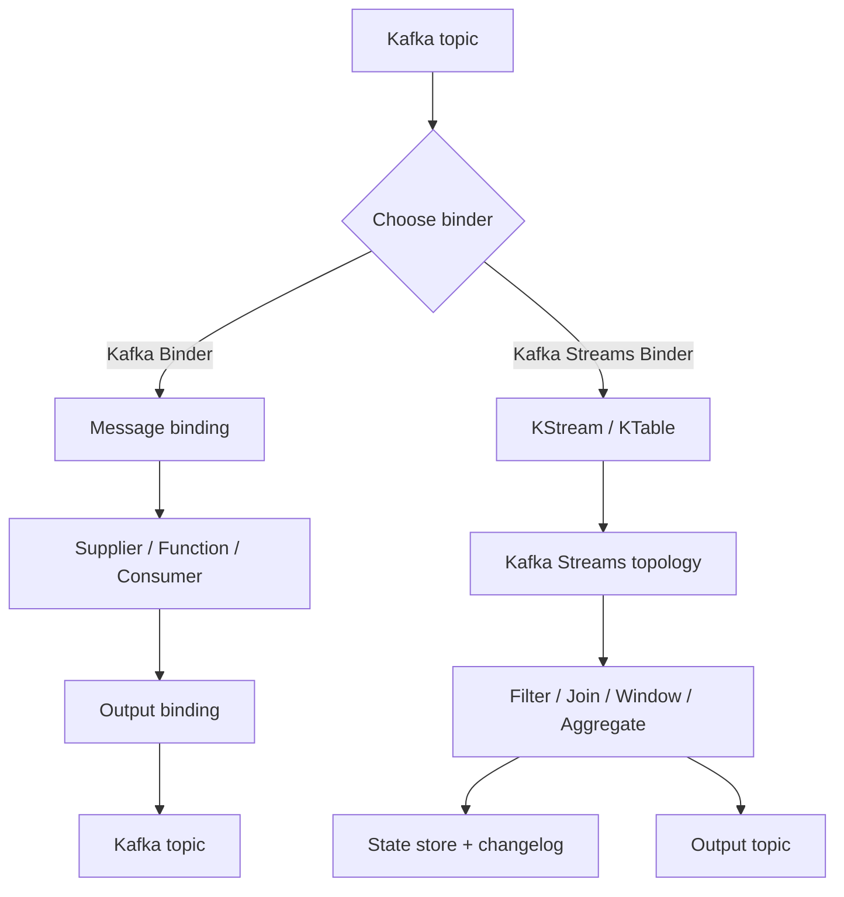

# When to Choose Kafka Streams Binder Over Kafka Binder

Spring Cloud Stream provides two binders for Kafka with different goals. The **Kafka Binder** connects `Supplier`, `Function`, and `Consumer` functions to Kafka topics like a messaging system: the application receives a message, executes business logic, and emits the next message. The **Kafka Streams Binder** integrates the Kafka Streams library to build stream processing topologies: filtering, transforming, joining, windowing, aggregating, and maintaining per-partition state.

If an application mainly receives an event and calls a service or emits another event, the Kafka Binder is usually simpler and more appropriate. If the business logic requires continuous computation across multiple events, joining a stream with a table, aggregating over time windows, or maintaining recoverable state, the Kafka Streams Binder is the natural choice. The core difference lies in the processing model and state management, not just the dependency name.

## 1. Two Binders Solve Two Different Problems

The Kafka Binder uses the standard message-binding model of Spring Cloud Stream. An input binding converts a message from a topic into a payload; the function processes it; the output binding publishes the result. The application can use Kafka consumer groups, partitions, retries, DLQs, and producer properties via binder configuration.

The Kafka Streams Binder uses the Kafka Streams API as its processing runtime. Functions accept types such as `KStream`, `KTable`, or `GlobalKTable` and return the corresponding topology. Kafka Streams manages tasks per partition, state stores, changelog topics, repartition topics, windowing, and join/aggregate operations.



| Criterion | Kafka Binder | Kafka Streams Binder |
|---|---|---|
| Primary abstraction | Messages and bindings | Kafka Streams topology |
| Common function types | `Supplier<T>`, `Function<T,R>`, `Consumer<T>`, reactive types | `Function<KStream<K,V>, KStream<K2,V2>>`, `KTable`, `GlobalKTable`, and multi-input functions |
| Stateless processing | Yes | Yes |
| Stream/table joins and windowed aggregation | Implemented by the application or another library | Directly supported by the DSL and runtime |
| State store with changelog for recovery | Not a core capability of the binder | A native capability of Kafka Streams |
| Kafka coupling | Kafka binder, though the function/message model is more general | Tightly coupled to Kafka Streams and Kafka topics |
| Best suited for | Event-driven messaging and per-message processing | Continuous, stateful stream processing and time-based analytics |

## 2. When the Kafka Binder Is Enough

The Kafka Binder is suitable when the processing flow consists mainly of independent message steps or each event is routed through a business service:

- Receiving `OrderCreated`, validating the data, and emitting `OrderValidated`.
- Receiving `PaymentRequested`, calling a payment service, and emitting the result.
- Reading an event, writing to a database within a transaction, and acknowledging the offset.
- Transforming payloads, modifying headers, routing, or publishing to another topic.
- Using consumer groups and partitions to distribute load across instances.
- Using retry/DLQ to isolate unprocessable messages.

Typical function example:

```java
@Bean
Function<OrderCreated, OrderValidated> validateOrder(OrderValidator validator) {
    return validator::validate;
}
```

Corresponding binding:

```yaml
spring:
  cloud:
    function:
      definition: validateOrder
    stream:
      bindings:
        validateOrder-in-0:
          destination: orders.created
          group: order-validation
          content-type: application/json
        validateOrder-out-0:
          destination: orders.validated
          content-type: application/json
```

Each message is converted into `OrderCreated`, processed by the function, and the result is sent to `orders.validated`. If the logic does not need to inspect multiple records together or maintain state by key/window, using the Kafka Binder keeps both code and operations simpler.

You do not need Kafka Streams merely because an application has multiple topics, needs concurrency, or uses Kafka partitions. The Kafka Binder also supports consumer groups, partitioning, concurrency, and producer/consumer configuration. Kafka Streams brings value when the application needs stream-processing operators along with topology-managed state.

## 3. When the Kafka Streams Binder Delivers Clear Benefits

Choose the Kafka Streams Binder when business requirements fall into one or more of the following categories:

1. **Joining event streams:** correlating `OrderCreated` with `PaymentCompleted` or `ShipmentDispatched` by key and time.
2. **Stream-table joins:** enriching events with reference data represented as a `KTable` or `GlobalKTable`.
3. **Windowed aggregation:** counting orders in 5-minute windows, summing transactions per hour, or detecting threshold anomalies over a window.
4. **Stateful processing:** maintaining running totals, balances, session states, or per-key aggregation results.
5. **Event-time processing:** handling event timestamps, grace periods, and late-arriving records.
6. **Recoverable state:** using changelog-backed state stores to rebuild state after task migration or application restart.
7. **Multi-step topologies:** expressing a Kafka-native pipeline of filter, map, group, join, aggregate, and sink operations in a single graph.

For example, a sales system needs to count orders per customer and continuously emit updated order totals. This is a stateful aggregation problem: each event updates the accumulated result per key. Maintaining a `Map<CustomerId, Count>` manually inside a Kafka Binder bean would require handling cross-instance synchronization, partitioning, restart recovery, and changelog persistence yourself. Kafka Streams already provides a state store model suited for this class of problem.

## 4. The KStream, KTable, and GlobalKTable Model

The Kafka Streams DSL provides key abstractions:

| Type | Meaning | Example Data |
|---|---|---|
| `KStream<K,V>` | A sequence of event records; each record is an independent occurrence | `OrderCreated`, `PaymentCompleted` |
| `KTable<K,V>` | A table updated from a changelog by key; a newer record can replace the current value for that key | Latest order status by `orderId` |
| `GlobalKTable<K,V>` | A table materialized on every instance rather than partitioned across tasks like a regular KTable | Country code lookup table or small catalog needing global lookup |

`KStream` fits event streams. `KTable` fits representing the latest state per key. `GlobalKTable` simplifies global lookups, but every instance must maintain a full copy of the data, making it unsuitable for large tables or very frequent updates.

Certain join operations require co-partitioning: both inputs must have compatible partition counts and partitioning strategies so that the same key is processed by the same task. If keys or partitioning are incompatible, a repartition is required before joining. `GlobalKTable` uses a different join mechanism because the table is replicated on every instance, at the cost of resource consumption proportional to table size.

## 5. Configuring Dependencies and Functions with Kafka Streams Binder

The application requires the Kafka Streams Binder dependency, whose version is managed by Spring Cloud Stream via the Spring Cloud BOM:

```xml
<dependency>
    <groupId>org.springframework.cloud</groupId>
    <artifactId>spring-cloud-stream-binder-kafka-streams</artifactId>
</dependency>
```

In an application using only the Kafka Streams Binder, this dependency replaces the regular Kafka Binder. Do not casually add both binders to the classpath without explicit binder selection configuration; when multiple binders are present, you must specify which binding uses which binder.

Stream transformation function example:

```java
@Bean
Function<KStream<String, OrderCreated>, KStream<String, OrderAccepted>> acceptOrders() {
    return orders -> orders
            .filter((orderId, order) -> order.total().signum() > 0)
            .mapValues(order -> new OrderAccepted(
                    order.eventId(), order.orderId(), order.total()));
}
```

Function and binding declarations:

```yaml
spring:
  cloud:
    function:
      definition: acceptOrders
    stream:
      bindings:
        acceptOrders-in-0:
          destination: orders.created
        acceptOrders-out-0:
          destination: orders.accepted
    kafka:
      streams:
        binder:
          configuration:
            application.id: order-acceptance-streams
```

`application.id` is the identity of the Kafka Streams application. It is used as the consumer group identity and as the prefix for certain internal topics. Instances of the same application must share the same ID to coordinate tasks; an independent application or a separate replay pipeline typically needs a different ID. Do not change the ID on every deployment if the goal is to continue with the existing state and progress.

The binding names derived from the function are `acceptOrders-in-0` and `acceptOrders-out-0`. When a function has multiple inputs or outputs, the index suffix and binding rules must match the function signature. Check the topology initialization logs to confirm that the right function is discovered and the right topics are connected.

## 6. Stateful Aggregation Example

Suppose we need to count orders per customer. With Kafka Streams, we can group events by customer ID and maintain the count in a state store:

```java
@Bean
Function<KStream<String, OrderCreated>, KStream<String, Long>> countOrdersByCustomer() {
    return orders -> orders
            .selectKey((orderId, order) -> order.customerId())
            .groupByKey()
            .count(Materialized.as("orders-by-customer"))
            .toStream();
}
```

This is a DSL illustration; key/value Serde configuration must match the actual data types. `selectKey` changes the key to the customer ID. `groupByKey` groups by the new key; if changing the key alters partition assignment, Kafka Streams may require an internal repartition topic. `count` updates the per-key count and materializes the result in a state store named `orders-by-customer`. `toStream()` turns the `KTable` updates into an output stream.

The output consists of count update records, not just a single record when the application finishes. Each new customer event can emit a new count value. If a downstream consumer needs the current snapshot, it must handle per-key update semantics.

### 6.1. State Stores and Changelogs

A state store can be persisted locally on an instance for fast access. At the same time, Kafka Streams uses a changelog topic to record state changes. When a task moves to another instance or local state is lost, the runtime can restore the store by reading the changelog.

Therefore, a state store is not simply an in-RAM cache. It is part of the topology and must be operated alongside internal topics:

- Ensure brokers have sufficient replication and disk capacity for changelog/repartition topics.
- Use a stable `application.id` for the same logical application.
- Configure a local state directory with adequate disk space and write permissions.
- Monitor restore time, task migration, and rebalances.
- Keep schemas/Serdes compatible when changing state stores or topologies.

## 7. Windowing and Event Time

Kafka Streams supports windows to group events over time. For example, counting orders in each 5-minute window. It is essential to distinguish event time (the event's timestamp) from processing time (when the application processes it). Data may arrive late or out of order due to network issues, retries, or producer replays.

Key concepts:

- **Tumbling window:** fixed-size, non-overlapping windows.
- **Hopping window:** windows with a defined size and advance interval that may overlap.
- **Sliding window:** windows determined by the timestamp difference between records.
- **Session window:** groups activity separated by periods of inactivity, well suited for session modeling.
- **Grace period:** the duration during which late-arriving records are still accepted after a window has ended according to its timestamp.

Windowed aggregation creates state per key and window. Retention and grace periods must be chosen to match the lateness characteristics of the data. If the grace period is too short, late events may be dropped or fail to update results according to topology policy. If retention is too long, state stores and changelogs can grow significantly in size.

## 8. Serdes and Schemas Are Part of the Topology

Kafka Streams needs to know how to serialize and deserialize keys and values across inputs, repartitions, state stores, and outputs. An incorrect Serde can prevent the topology from starting or cause errors when reading records or writing to internal topics.

An example of per-binding Serde configuration using Kafka Streams Binder `keySerde` and `valueSerde` properties:

```yaml
spring:
  cloud:
    stream:
      kafka:
        streams:
          bindings:
            acceptOrders-in-0:
              consumer:
                keySerde: org.apache.kafka.common.serialization.Serdes$StringSerde
                valueSerde: com.example.OrderCreatedSerde
            acceptOrders-out-0:
              producer:
                keySerde: org.apache.kafka.common.serialization.Serdes$StringSerde
                valueSerde: com.example.OrderAcceptedSerde
```

Serde class names must exist on the classpath and have constructors/registrations compatible with the binder version. With JSON, Avro, or Protobuf, use consistent Serde and schema strategies across producers, the topology, and consumers. When changing schemas, check input topics, output topics, repartition topics, and changelog/state stores.

Do not assume `content-type: application/json` automatically resolves every Serde in the Kafka Streams DSL. Spring Cloud Stream's message conversion and Kafka Streams Serdes are two distinct layers; configuration must remain consistent with the `KStream<K,V>` types declared by the topology.

## 9. Scaling and Operating Topologies

Kafka Streams creates tasks based on the partition count of input topics. `num.stream.threads` controls the number of stream threads within an instance, while the number of instances determines the total worker capacity that can participate. Total useful parallelism is bounded by the number of tasks/partitions that can be created.

Example configuration:

```yaml
spring:
  cloud:
    stream:
      kafka:
        streams:
          binder:
            configuration:
              application.id: order-acceptance-streams
              num.stream.threads: 2
              replication.factor: 3
```

Two stream threads per instance does not mean the application always processes exactly two partitions; the task count depends on the topology and partition counts. The replication factor applies to internal topics created by Kafka Streams and must match the broker count. Consult the documentation for your specific version before deploying production configurations.

When scaling instances or modifying topologies, Kafka Streams may rebalance tasks and restore state. Tasks with large state can take time to recover. Standby replicas can be considered when reducing task failover time is important, at the cost of additional resources and replication traffic.

Do not arbitrarily increase partition counts after a system is running steadily. Changing partitions can map keys to different partitions, affecting ordering and state partitioning. Plan migrations carefully, verify repartition topics, and ensure state is restored under the new topology.

## 10. Processing Guarantees and the Exactly-Once Boundary

Kafka Streams supports processing guarantees. With at-least-once configuration, records may be reprocessed after a failure. With `exactly_once_v2` on supported versions, Kafka Streams uses transactions to coordinate offset commits, output topic writes, and state/changelog updates within the boundary of the Kafka Streams application.

Example:

```yaml
spring:
  cloud:
    stream:
      kafka:
        streams:
          binder:
            configuration:
              processing.guarantee: exactly_once_v2
```

Exactly-once in Kafka Streams does not automatically cover side effects outside Kafka, such as writing to an independent database, calling a REST API, sending emails, or processing payments. If a topology calls external services or functions perform side effects outside Kafka transactions, idempotency, outbox/inbox patterns, or appropriate workflows are still necessary. Check broker version requirements, transaction settings, ACLs, and throughput impact when enabling EOS, as transactions carry operational overhead.

## 11. Testing the Kafka Streams Binder

Testing should be split into topology logic and broker integration:

- **Topology unit tests:** use `TopologyTestDriver` to feed records into virtual input topics and verify outputs, state stores, windows, and joins without a running broker.
- **Serde tests:** verify key/value serialization and deserialization, including older and newer schemas.
- **Binder integration tests:** verify that function bindings, destinations, Serdes, and Kafka Streams Binder configurations are loaded properly.
- **Broker integration tests:** verify application ID, internal topics, partition assignment, rebalances, state restoration, and processing guarantees.
- **Failure tests:** stop an instance during processing, restart it, and verify that state is restored and outputs are not duplicated within the chosen guarantee.
- **Load tests:** measure lag, throughput, state store size, restore time, CPU, disk, and network usage.

Spring Cloud Stream's Test Binder can help test certain binding interactions, but it does not replace `TopologyTestDriver` for DSL logic or a real Kafka broker for transactions, changelogs, and rebalances. Each type of test validates a different layer of behavior.

## 12. Common Selection and Implementation Mistakes

| Symptom or Decision | Cause | Resolution |
|---|---|---|
| Using Kafka Streams for a very simple independent map | Selecting a stateful runtime despite having no state/topology needs | Use the Kafka Binder if you only need to receive, transform, and emit messages |
| Using Kafka Binder while manually managing a `Map` state in a bean | State is not safely shared or recovered across instances | Use a Kafka Streams state store or an appropriate external datastore |
| Function is not discovered | `spring.cloud.function.definition` or binding names do not match | Verify the function bean, signature, and binding names |
| Deserialization error on topology startup or execution | Serde does not match actual key/value types | Configure Serdes for each binding and any required internal topics |
| Join fails to match records with the same key | Two inputs are not co-partitioned or use different Serdes/keys | Repartition and align key/partitioning strategies |
| Slow state restoration | Large changelog, large state store, or slow broker/network | Measure restore time, review retention, and consider standby replicas |
| Adding instances does not increase throughput | Low input partition/task count or downstream bottleneck | Check task count, partitions, and stream threads |
| Changing `application.id` causes the app to re-read data | Kafka Streams treats it as a new logical application | Keep the ID stable to continue state/offsets; use a new ID intentionally for independent replay |
| EOS is enabled but database side effects still duplicate | Exactly-once only covers Kafka Streams transactions | Use idempotency or transaction/outbox patterns for external systems |

## 13. Binder Decision Process

1. Document the input data, output data, and required processing steps.
2. Determine whether the function processes individual messages or needs to inspect multiple records by key/time.
3. If joins, windowing, aggregation, or recoverable state stores are needed, evaluate the Kafka Streams Binder.
4. If the workflow only consumes, calls services, writes to a database, and publishes events, start with the Kafka Binder.
5. Assess Kafka coupling: if you need the option to switch to RabbitMQ/Pulsar via message abstractions, avoid introducing the Kafka Streams API into business functions.
6. Evaluate Serdes/schemas, partitioning, application ID, internal topics, state size, and restore time.
7. Identify processing guarantees and side effects outside Kafka.
8. Test the topology, binder, and broker at the appropriate layers before deployment.

## 14. Pre-Deployment Checklist

- [ ] The problem genuinely requires joins, windowing, aggregations, or per-key state stores.
- [ ] If processing independent messages one by one, the regular Kafka Binder was considered.
- [ ] The `spring-cloud-stream-binder-kafka-streams` dependency is compatible with the Spring Cloud BOM.
- [ ] The function signature uses `KStream`, `KTable`, or `GlobalKTable` appropriately.
- [ ] `spring.cloud.function.definition` and binding names match the function.
- [ ] `application.id` is stable and unique across independent logical applications.
- [ ] Key/value Serdes and schemas are compatible across input, output, and internal topics.
- [ ] Joins have compatible keys and partitioning; repartitions are accounted for.
- [ ] Window, grace period, and retention align with event time and late events.
- [ ] State stores, changelogs, replication factor, and local state directories have sufficient resources.
- [ ] `processing.guarantee` is appropriate and not mistakenly assumed to cover external side effects.
- [ ] Tested with `TopologyTestDriver` and Kafka integration tests.
- [ ] Monitoring covers task assignment, rebalances, consumer lag, restore time, state size, and Serde errors.

The Kafka Binder is designed for messaging: receiving and publishing messages through bindings so the application can process each event individually. The Kafka Streams Binder is designed for stream processing: continuous topologies that can join, window, aggregate, and maintain state stores recovered via changelogs. Choose Kafka Streams only when those capabilities solve a concrete requirement; when you do, operate the application ID, Serdes, partitions, internal topics, state restoration, and processing guarantees as integral parts of the application.

## References

- [Spring Cloud Stream Kafka Streams Binder Reference](https://docs.spring.io/spring-cloud-stream/reference/kafka/kafka-streams-binder/)
- [Spring Cloud Stream Kafka Binder Reference](https://docs.spring.io/spring-cloud-stream/reference/kafka/kafka-binder/)
- [Apache Kafka Streams Developer Guide](https://kafka.apache.org/documentation/streams/)
