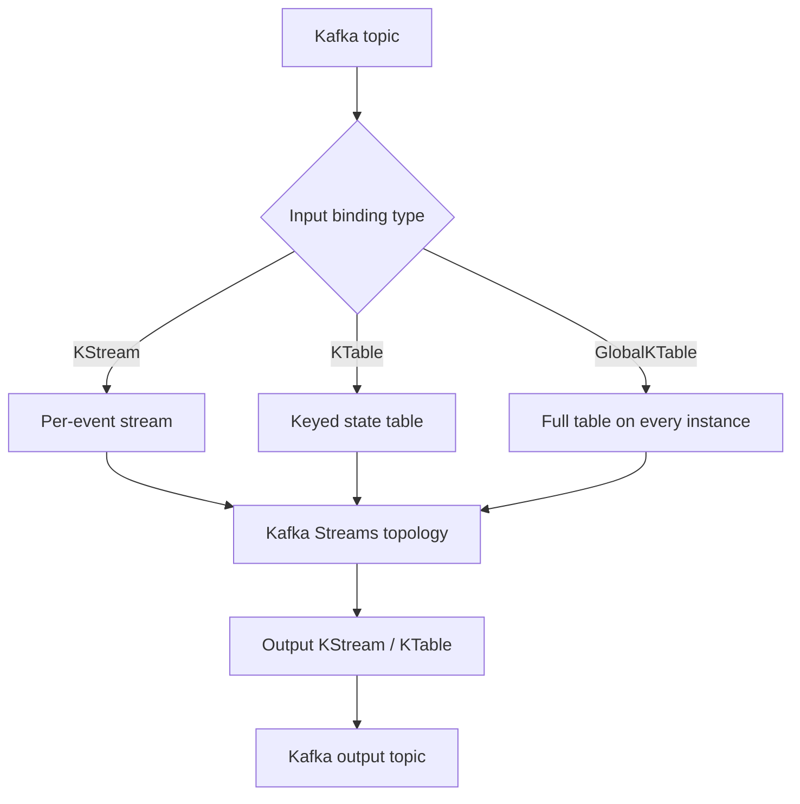
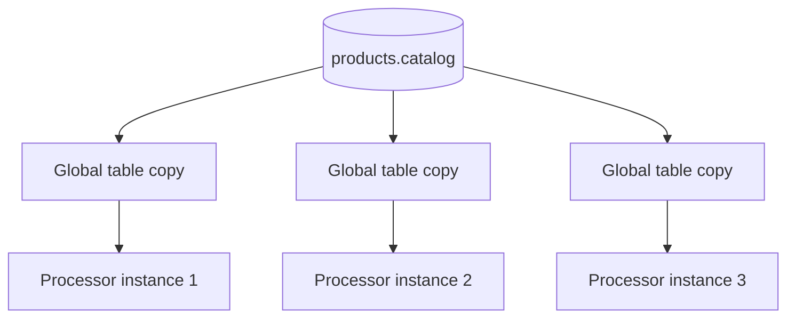

# Bindings for KStream, KTable, and GlobalKTable

## 1. How Does the Kafka Streams Binder Receive Data?

The Spring Cloud Stream Kafka Streams binder connects Kafka topics to the Kafka Streams DSL. Unlike the standard Kafka message-channel binder, functions in the Kafka Streams binder directly accept Kafka Streams types such as `KStream`, `KTable`, and `GlobalKTable`.

All three types represent data read from Kafka, but they carry different processing semantics:

- **`KStream<K, V>`** is an event stream. Each record is an independent event processed as it arrives.
- **`KTable<K, V>`** is a state table built from keyed updates. For each key, the latest value represents the current state.
- **`GlobalKTable<K, V>`** is a state table fully replicated to every instance of the Kafka Streams application, well suited for small-to-medium reference lookups.

The parameter types in the function signature determine which binding type the binder creates. Therefore, choosing `KStream`, `KTable`, or `GlobalKTable` is a decision about data semantics and state distribution, not merely a change in Java type.



The Kafka Streams binder supports `KStream`, `KTable`, and `GlobalKTable` on inputs. On outputs, the binder supports `KStream` and `KTable`; `GlobalKTable` is an input type for global data lookups, not a typical output binding type.

## 2. KStream: One Record Is One Event

`KStream<K, V>` represents records read from a topic in per-partition order. Each record has a key and a value. A key may appear multiple times with different values; all those occurrences are events in the stream.

For example, the `orders.events` topic contains:

| Key (`orderId`) | Value | Meaning |
|---|---|---|
| `ORD-101` | `OrderCreated` | Order is created |
| `ORD-205` | `OrderCreated` | Another order is created |
| `ORD-101` | `PaymentAuthorized` | Payment for ORD-101 is authorized |
| `ORD-101` | `OrderShipped` | ORD-101 is handed off for shipping |

A `KStream` consumer sees all four records. When you need to count events, filter, transform, join, or aggregate over time, `KStream` is the right starting point.

### Single-Input Function

Example of a function receiving a click stream and emitting records after normalizing keys and values:

```java
import java.util.function.Function;
import org.apache.kafka.streams.KeyValue;
import org.apache.kafka.streams.kstream.KStream;
import org.springframework.context.annotation.Bean;
import org.springframework.context.annotation.Configuration;

@Configuration
class ClickFunctions {

    @Bean
    Function<KStream<String, String>, KStream<String, String>> normalizeClicks() {
        return clicks -> clicks
            .filter((userId, event) -> userId != null && event != null)
            .map((userId, event) -> new KeyValue<>(
                userId.trim(), event.trim().toLowerCase()
            ));
    }
}
```

The binder creates two default bindings:

- `normalizeClicks-in-0`: `KStream` input.
- `normalizeClicks-out-0`: `KStream` output.

Destination configuration:

```yaml
spring:
  cloud:
    function:
      definition: normalizeClicks
    stream:
      bindings:
        normalizeClicks-in-0:
          destination: clicks.raw
        normalizeClicks-out-0:
          destination: clicks.normalized
```

If you only need to read and perform side effects without emitting output, you can use `Consumer<KStream<K, V>>`. For processors with both input and output, use `Function<KStream<K, V>, KStream<K2, V2>>`.

Note: changing a key via `map` does not automatically move the record to a new partition. If the new key will be used in stateful operations such as `groupByKey`, use `selectKey`/`groupBy` and ensure repartitioning occurs when needed. A record's key and its current physical partition are two distinct concepts.

## 3. KTable: Representing Latest State per Key

`KTable<K, V>` interprets keyed records as updates to a table. When a new record arrives for an existing key, the new value replaces the previous state for that key.

For example, the `users.regions` topic contains the following records:

| Offset | Key (`userId`) | Value (`region`) | State After Record |
|---:|---|---|---|
| 0 | `U-1` | `north` | `U-1 → north` |
| 1 | `U-2` | `south` | `U-1 → north`, `U-2 → south` |
| 2 | `U-1` | `central` | `U-1 → central`, `U-2 → south` |

`KStream` sees all three events. `KTable` represents the final state:

```text
U-1 -> central
U-2 -> south
```

This is the core difference: `KStream` preserves the meaning of each emission; `KTable` maintains the latest state per key.

### Tombstones Delete Keys from a KTable

In Kafka, a record with a non-null key and a `null` value is commonly called a tombstone. When a `KTable` receives a tombstone, the corresponding key is removed from the table's state. For example:

```text
U-1 -> null
```

After the tombstone, the `KTable` no longer holds a current value for `U-1`. This is the state-deletion mechanism in changelogs, distinct from a JSON payload with a `deleted=true` field that the application must interpret manually.

### Input Topics for KTable

A topic used as a `KTable` changelog needs stable keys and consistent serialization. Compacted topics are usually a good fit for state-representing data because Kafka can retain the latest value per key under compaction policies. However, compaction does not happen instantaneously, and you should not assume older versions disappear immediately.

If the full table must be rebuilt, ensure the topic retains enough data to restore state. Time-based retention policies can lose required updates if not designed appropriately.

## 4. GlobalKTable: Full Copy on Every Instance

`GlobalKTable<K, V>` also represents the latest state per key, but differs from `KTable` in how data is distributed. Every Kafka Streams instance reads all partitions of the source topic and maintains a full local copy of the table.

For example, `products.catalog` contains a few thousand products. Every order-processing instance needs to look up product details by `productId`. `GlobalKTable` lets every instance look up any product without needing to partition the table alongside the stream.



Instances converge on the same reference data once updates are consumed and applied. Because every instance reads the entire topic, `GlobalKTable` can consume significantly more network, disk, and memory as instance count or table size grows.

### When to Use GlobalKTable?

It is suitable when the lookup table is moderate in size, needs to be accessible from every stream partition, and changes at a rate manageable for synchronization. Examples:

- Country or currency code lookup tables.
- Moderate-sized product catalogs.
- Tenant configuration tables needed on every processor instance.
- ID-to-metadata mapping tables used during event enrichment.

Do not use `GlobalKTable` for tables with hundreds of millions of records if each instance lacks the resources to store and update the full dataset. In such cases, a partitioned `KTable`, an external cache-backed lookup, or another lookup architecture may be more appropriate.

## 5. Binding Names Derived from Function Signatures

The Kafka Streams binder uses the function bean name and parameter positions to generate binding names. For a function bean named `process`:

| Function Signature | Default Bindings |
|---|---|
| `Consumer<KStream<K,V>>` | `process-in-0` |
| `Function<KStream<K,V>, KStream<K2,V2>>` | `process-in-0`, `process-out-0` |
| `BiFunction<KStream<K,V1>, KTable<K,V2>, KStream<K,V3>>` | `process-in-0`, `process-in-1`, `process-out-0` |
| `BiConsumer<KStream<K,V1>, KTable<K,V2>>` | `process-in-0`, `process-in-1` |

Parameter position determines the binding index:

- The first parameter of `BiFunction` is bound as input index `0`.
- The second parameter is bound as input index `1`.
- The Java type of each parameter tells the binder whether that input is a `KStream`, `KTable`, or `GlobalKTable`.

For example, `BiFunction<KStream<String, Order>, GlobalKTable<String, Product>, KStream<String, EnrichedOrder>>` creates `enrichOrder-in-0` for the orders topic and `enrichOrder-in-1` for the products topic.

Do not invent guessed binding names such as `orders-input` without declaring an alias. Use the generated default names or configure explicit overrides.

## 6. Binding Multiple Inputs with BiFunction

A common use case is joining a click event stream with a user region table. The `clicks.events` topic contains new clicks; the `users.regions` topic holds the latest region state for each user.

```java
import java.util.function.BiFunction;
import org.apache.kafka.streams.kstream.KStream;
import org.apache.kafka.streams.kstream.KTable;
import org.springframework.context.annotation.Bean;
import org.springframework.context.annotation.Configuration;

record RegionWithClicks(String region, Long clicks) {}

@Configuration
class RegionFunctions {

    @Bean
    BiFunction<KStream<String, Long>, KTable<String, String>,
            KStream<String, RegionWithClicks>> enrichClicks() {
        return (clicks, userRegions) -> clicks.leftJoin(
            userRegions,
            (count, region) -> new RegionWithClicks(
                region == null ? "UNKNOWN" : region,
                count
            )
        );
    }
}
```

Configuring two inputs and one output:

```yaml
spring:
  cloud:
    function:
      definition: enrichClicks
    stream:
      bindings:
        enrichClicks-in-0:
          destination: clicks.events
        enrichClicks-in-1:
          destination: users.regions
        enrichClicks-out-0:
          destination: clicks.enriched
      kafka:
        streams:
          bindings:
            enrichClicks-in-1:
              consumer:
                materializedAs: user-regions-store
```

The first input is a `KStream`, the second input is a `KTable`, and the output is a `KStream`. `materializedAs` names the state store for the incoming `KTable` so it can be identified and accessed when needed.

### Semantics of KStream-KTable Joins

For every incoming click event, Kafka Streams looks up the current value for `userId` in the `KTable` and emits an enriched result. When a user's region changes in the `KTable`, previously emitted click events are not automatically re-emitted just because the table updated. This join is triggered by records arriving on the `KStream` side.

If results must be recomputed whenever either side changes, consider a `KTable`-`KTable` join or another topology matching the required update semantics.

## 7. Partitioning Requirements for KTable Joins

Standard `KStream`-`KTable` joins require both sides to share the same key and be compatibly partitioned so that records with the same key are processed by the same task. In practice, this usually means:

- Both `KStream` and `KTable` use the same key type and serialization strategy.
- The topics are compatibly partitioned, typically with the same partition count.
- Producers route identical keys to identical partitions using matching partitioning strategies.
- Partitioning is not altered arbitrarily between the two sources.

If the two topics are not co-partitioned, Kafka Streams may reject the topology or the join will not produce expected results. Verify partition counts and key distribution during deployment.

`KTable` is a partitioned table, so each task holds only the portion of state belonging to the partitions it owns. That is why key-based joins require compatibly partitioned sources.

## 8. KStream-GlobalKTable Joins for Lookups Without Co-Partitioning

`GlobalKTable` is ideal when a stream needs to look up a full table by a key derived from the record. Unlike `KTable` joins, the `GlobalKTable` join API takes an additional `KeyValueMapper` function to extract the lookup key from the stream record.

For example, an order contains `productId`; the product table is keyed by `productId`:

```java
import java.util.function.Function;
import org.apache.kafka.streams.kstream.GlobalKTable;
import org.apache.kafka.streams.kstream.KStream;
import org.springframework.context.annotation.Bean;
import org.springframework.context.annotation.Configuration;

record Order(String orderId, String productId, int quantity) {}
record Product(String productId, String name, long unitPrice) {}
record EnrichedOrder(String orderId, String productName, int quantity,
                     long unitPrice) {}

@Configuration
class ProductEnrichmentFunctions {

    @Bean
    Function<KStream<String, Order>,
            Function<GlobalKTable<String, Product>, KStream<String, EnrichedOrder>>>
    enrichOrders() {
        return orders -> products -> orders.leftJoin(
            products,
            (orderId, order) -> order.productId(),
            (order, product) -> product == null
                ? new EnrichedOrder(order.orderId(), "UNKNOWN", order.quantity(), 0)
                : new EnrichedOrder(order.orderId(), product.name(),
                    order.quantity(), product.unitPrice())
        );
    }
}
```

A function with two inputs can be written as a curried function: the first input is a `KStream`, and the second input is a `GlobalKTable`. The binder creates:

- `enrichOrders-in-0` for the orders topic.
- `enrichOrders-in-1` for the products topic.
- `enrichOrders-out-0` for the result topic.

Because the `GlobalKTable` is replicated to every instance, the stream can look up `productId` without requiring the `KTable` and `KStream` to be co-partitioned. In return, every instance must read and maintain the entire product table.

## 9. KTable-KTable Joins

When both inputs are state tables and the output must reflect changes from either side, a `KTable`-`KTable` join is appropriate.

For example, `orders.by-customer` stores order state keyed by `customerId`, while `customers.profile` stores customer details under the same key. Whenever either the order summary or customer profile changes, the join emits a corresponding update.

```java
import java.util.function.BiFunction;
import org.apache.kafka.streams.kstream.KTable;
import org.springframework.context.annotation.Bean;

record Customer(String name, String tier) {}
record OrderSummary(long orderCount, long totalCents) {}
record CustomerSummary(String customerName, String tier,
                       long orderCount, long totalCents) {}

@Bean
BiFunction<KTable<String, OrderSummary>, KTable<String, Customer>,
        KTable<String, CustomerSummary>> customerSummary() {
    return (orders, customers) -> orders.join(
        customers,
        (orderSummary, customer) -> new CustomerSummary(
            customer.name(), customer.tier(),
            orderSummary.orderCount(), orderSummary.totalCents()
        )
    );
}
```

This join requires both `KTable`s to have compatible keys and be co-partitioned. If results should be retained when one side is missing a key, use `leftJoin` or `outerJoin` in accordance with business semantics and the Kafka Streams API.

## 10. How Do KTable and GlobalKTable Differ?

| Criterion | KTable | GlobalKTable |
|---|---|---|
| State | Keyed table, partitioned across tasks | Full replica on every instance |
| Data distribution | Each task processes its assigned partitions | Every instance reads all partitions of the topic |
| Common joins | `KStream`-`KTable`, `KTable`-`KTable` | `KStream`-`GlobalKTable` |
| Co-partitioning | Required for key-based joins | Not required for lookup joins |
| Resource usage | Divided across partitions/tasks | Every instance must hold the entire dataset |
| Best suited for | Large tables that can be partitioned by key | Small/medium lookup tables needed on every instance |

Do not pick `GlobalKTable` solely to avoid co-partitioning. If the table is very large, the cost of reading the entire topic and holding full copies on every instance can outweigh the benefits. A partitioned `KTable` is usually better suited for large datasets.

## 11. Materializing a KTable into a Named State Store

Kafka Streams normally creates state stores when the DSL uses stateful operations such as `aggregate`, `count`, `reduce`, or `join`. For an incoming `KTable`, you can name the state store using the `materializedAs` consumer binding property:

```yaml
spring:
  cloud:
    stream:
      kafka:
        streams:
          bindings:
            enrichClicks-in-1:
              consumer:
                materializedAs: user-regions-store
```

Naming the store is helpful when accessing local state via Interactive Queries or integrating with the Processor API. State stores can typically be recovered from changelogs/replay according to Kafka Streams configuration.

In the example above, `materializedAs` applies to an incoming `KTable`. Do not assume the same property names a `GlobalKTable` store. Global state stores have their own registration and management mechanisms in Kafka Streams.

### State Stores and Source Data

A state store is local state maintained by Kafka Streams to execute the topology. It does not replace the source topic. If local state is lost, Kafka Streams must restore it from the changelog or replay source data as configured.

Use stable store names, avoid duplicate names within the same topology, and consider compatibility before renaming. Renaming a state store can cause the application to create fresh state and rebuild its data.

## 12. Serdes for KStream, KTable, and GlobalKTable

Kafka stores raw bytes; Kafka Streams requires a `Serde` to serialize and deserialize keys and values when reading and writing. In the Kafka Streams binder, keys are serialized/deserialized using native Kafka Serdes. Values can be inferred by the binder from Java types, Serde beans, or configuration.

Standard types such as `String`, `Long`, `Integer`, `UUID`, and `byte[]` have built-in Serdes. For domain types like `Order`, `Customer`, or `Product`, the binder may infer a JSON Serde where applicable; when using Avro, Protobuf, or custom types, configure Serdes explicitly.

Example configuring Serdes per input:

```yaml
spring:
  cloud:
    stream:
      kafka:
        streams:
          bindings:
            enrichOrders-in-0:
              consumer:
                keySerde: org.apache.kafka.common.serialization.Serdes$StringSerde
                valueSerde: com.example.serde.OrderSerde
            enrichOrders-in-1:
              consumer:
                keySerde: org.apache.kafka.common.serialization.Serdes$StringSerde
                valueSerde: com.example.serde.ProductSerde
            enrichOrders-out-0:
              producer:
                keySerde: org.apache.kafka.common.serialization.Serdes$StringSerde
                valueSerde: com.example.serde.EnrichedOrderSerde
```

Class names in the example should be replaced with your application's actual Serdes. Consumer/producer Serde properties sit under the `spring.cloud.stream.kafka.streams.bindings.<binding-name>` namespace, unlike the regular Kafka binder configuration.

### Configuring Default Serdes at the Binder Level

When multiple bindings share the same Serde, you can declare default key/value Serdes in Kafka Streams configuration:

```yaml
spring:
  cloud:
    stream:
      kafka:
        streams:
          binder:
            configuration:
              default.key.serde: org.apache.kafka.common.serialization.Serdes$StringSerde
              default.value.serde: org.apache.kafka.common.serialization.Serdes$StringSerde
```

This is a binder-level configuration and can affect multiple processors in the same application. If a specific binding needs a different type, declare the Serde on that binding to make the data contract explicit.

### Native Decoding and Message Conversion

The Kafka Streams binder typically relies on native Kafka Serdes for inputs and outputs. If you want Spring Cloud Stream's message conversion instead of native decoding/encoding, you must disable native decoding/encoding on each respective binding. Do not mix both mechanisms without clearly defining where payloads are deserialized, as doing so can cause double conversion or type errors.

## 13. application.id and Binding Types

Kafka Streams uses `application.id` to identify a Streams application and manage its consumer group, progress, and state directory. Instances of the same logical topology normally share the same application ID to divide partitions and recover state. Independent topologies require distinct application IDs.

Binder-level configuration example:

```yaml
spring:
  cloud:
    stream:
      kafka:
        streams:
          binder:
            applicationId: order-enrichment-app
```

If a Spring Cloud Stream application declares multiple Kafka Streams functions, each processor needs an appropriate application ID. You can set the ID per function or per input binding using properties supported by the Kafka Streams binder. Do not share one ID across independent topologies if they need separate progress tracking and state stores.

Changing the application ID typically creates a new logical consumer group. The application may start reading from `startOffset` when the new group has no offsets yet and rebuild state stores from source topics. This is not a harmless rename; account for replay, retention, and duplicate side effects.

## 14. Activating Functions and Configuring Multiple Bindings

If an application defines multiple function beans, only the functions listed in `spring.cloud.function.definition` are activated under the functional binding model.

```yaml
spring:
  cloud:
    function:
      definition: normalizeClicks;enrichOrders
```

Bindings are created per function name:

- `normalizeClicks-in-0`, `normalizeClicks-out-0`.
- `enrichOrders-in-0`, `enrichOrders-in-1`, `enrichOrders-out-0`.

If you want to map default binding names to domain-specific names, you can use the `spring.cloud.stream.function.bindings.<default-binding-name>` alias mechanism and then configure destinations on those aliases. Keep mappings explicit to avoid confusing function bean names, binding names, and Kafka topics.

## 15. KTable and GlobalKTable Bindings Differ from Regular Consumers

The Kafka Streams binder does not pass individual records to a `Consumer<Message<T>>` function like the regular message-channel binder. Instead, it constructs a Kafka Streams topology and passes a `KStream`/`KTable`/`GlobalKTable` object to the function. The function defines the topology's operations; Kafka Streams executes that topology as records arrive.

This shapes how code is written:

- Do not call `subscribe()` or manually instantiate consumers inside the function.
- Do not attempt to iterate over the entire `KStream` when the function runs; the function declares a topology rather than processing an existing in-memory batch.
- Use DSL operators such as `map`, `filter`, `join`, `groupBy`, `aggregate`, and `toStream` to express transformations.
- Use `foreach` for terminal side effects where appropriate, while accounting for retries and transactions.
- Let the binder manage the lifecycle and bindings of the Kafka Streams application.

For example, `input.filter(...).mapValues(...)` constructs a topology. It does not immediately execute over all records in the topic when Spring creates the bean.

## 16. Common Mistakes When Choosing Binding Types

| Symptom | Possible Cause | Resolution |
|---|---|---|
| Join yields no matches or topology fails | Using a `KTable` join with incompatible keys/partitioning | Check keys, Serdes, partition counts, and partitioners |
| Table does not reflect new updates | Topic lacks stable keys or uses wrong Serde | Inspect record keys, tombstones, and deserialization |
| `KTable` keeps stale value after delete | Producer emits `deleted=true` instead of a tombstone per expected semantics | Define the deletion contract; emit tombstones when keys should be removed from the `KTable` |
| Every instance consumes excessively large dataset | Using `GlobalKTable` for a huge table | Consider a partitioned `KTable` or another lookup architecture |
| State store not found | Store was not materialized or name mismatches | Check `materializedAs` and the topology |
| Deserialization exception | Serde does not match schema/Java type | Declare the proper Serde at the binding or binder level |
| Binding not created | Function bean is not activated or binding name is wrong | Check `spring.cloud.function.definition` and bean names |
| Unintended full data replay | Changed `application.id` or group state | Verify ID, offsets, and retention before deploying |

## 17. Testing Bindings and Topologies

Tests should verify both input data types and the semantics of each table/stream:

1. Verify `function.definition` activates the intended function.
2. Confirm binding names and destinations for every input and output.
3. Send multiple records with the same key into `KStream` and verify every event is processed.
4. Send multiple updates for the same key into `KTable` and verify the latest value is used.
5. Send a tombstone and verify the key is deleted from `KTable` state.
6. Test `KStream`-`KTable` joins with matching keys and missing keys.
7. Test `KStream`-`GlobalKTable` joins with correctly mapped lookup keys.
8. Run multiple instances to confirm `GlobalKTable` is loaded on every instance while `KTable` is partitioned across the topology.
9. Test Serdes with realistic payloads, including malformed schemas.
10. Restart the application and verify state stores and offsets recover under the `application.id`.

Spring Cloud Stream's test binder or Kafka Streams' topology test utilities can help verify logic. For behaviors involving partition assignment, state restoration, broker Serdes, and `application.id`, run integration tests against real Kafka or an equivalent test environment.

## 18. Process for Choosing KStream, KTable, or GlobalKTable

1. If every record is an event to be processed, choose `KStream`.
2. If each key represents the latest state and the table can be partitioned, choose `KTable`.
3. If every processor instance needs to look up the full small/medium table, consider `GlobalKTable`.
4. Define keys, Serdes, and partitioning before writing joins.
5. Use `Function`, `Consumer`, `BiFunction`, or curried function signatures to declare inputs and outputs.
6. Configure destinations for each binding name generated by the binder.
7. Set a stable `application.id` for each logical topology.
8. Configure `materializedAs` when an incoming `KTable` requires a named state store.
9. Verify native Serdes or message conversion on each binding.
10. Test updates, tombstones, joins, state restoration, and multi-instance execution.

`KStream`, `KTable`, and `GlobalKTable` represent three distinct views of Kafka data: event streams, partitioned state, and globally replicated state. The Spring Cloud Stream Kafka Streams binder infers binding types from function signatures, derives binding names from input/output positions, and connects them to topics. Choosing the right abstraction, key, Serde, and application ID enables topologies to join data accurately, maintain state stores, and scale across instances without manually managing Kafka consumers at the application layer.

## References

- [Spring Cloud Stream Kafka Streams Binder — Programming Model](https://docs.spring.io/spring-cloud-stream/reference/kafka/kafka-streams-binder/programming-model.html)
- [Spring Cloud Stream Kafka Streams Binder — Configuration Options](https://docs.spring.io/spring-cloud-stream/reference/kafka/kafka-streams-binder/configuration-options.html)
- [Spring Cloud Stream Kafka Streams Binder — Record Serialization and Deserialization](https://docs.spring.io/spring-cloud-stream/reference/kafka/kafka-streams-binder/record-serialization-and-deserialization.html)
- [Spring Cloud Stream Kafka Streams Binder — State Store](https://docs.spring.io/spring-cloud-stream/reference/kafka/kafka-streams-binder/state-store.html)
