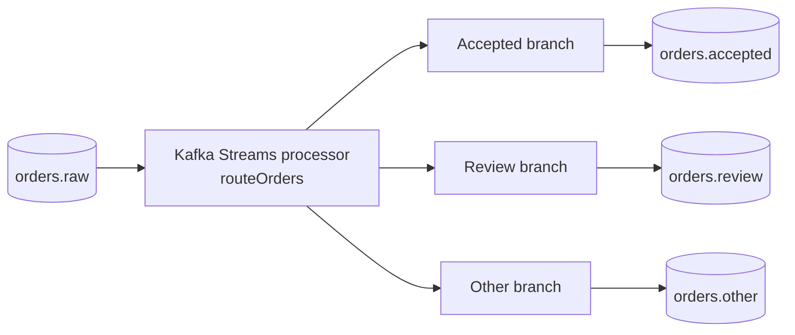

# Multiple Outputs with KStream[] and Data Branching

A Kafka Streams processor can read a topic, apply processing logic, and write results to multiple topics. In the Spring Cloud Stream Kafka Streams binder, the functional model supports this by returning a `KStream[]` array from a function bean. The binder creates multiple output bindings based on the array's element count; each element is wired to an output binding according to its index in the array.

This feature is commonly called **branching**. At the Kafka Streams layer, `split().branch(...)` routes records according to predicates. Each record is sent to the first branch whose predicate matches; if no branch matches, the record goes to the default branch or is dropped from all branches if `noDefaultBranch()` is used.

Branching must be distinguished from broadcasting. Branching selects one branch based on the first matching condition. Broadcasting creates multiple processing streams from the same stream so a single record can pass through multiple processing paths. This lesson covers returning `KStream[]`, output binding mapping, record routing, topic/Serde configuration, and topology testing.

## 1. Why Does a Processor Need Multiple Outputs?

An event stream may contain multiple data categories or multiple business outcomes. Instead of deploying a separate application for each routing rule, a processor can read one input stream, classify records, and write each group to the appropriate topic.

For example, an order system receives events from the `orders.raw` topic:

- Valid orders are routed to `orders.accepted`.
- Orders requiring staff inspection are routed to `orders.review`.
- Orders matching neither group are routed to `orders.other`.



Each output topic can serve an independent downstream consumer group. For example, the fulfillment service reads accepted orders, operations reads review orders, and a data audit pipeline reads other orders.

Multiple output bindings make it explicit where data flows in the topology. Each topic remains an independent Kafka resource with its own partitions, retention, ACLs, and consumer groups.

## 2. KStream[] as the Multi-Output Function Contract

In the functional programming model, a single-input, single-output function typically looks like:

```java
@Bean
Function<KStream<String, OrderEvent>, KStream<String, OrderEvent>> process() {
    return input -> input.filter((key, event) -> event.isValid());
}
```

The binder creates one default input binding and one default output binding:

- `process-in-0`: input `KStream`.
- `process-out-0`: output `KStream`.

When the function needs multiple outputs, the return type becomes an array:

```java
@Bean
Function<KStream<String, OrderEvent>, KStream<?, ?>[]> routeOrders() {
    return input -> {
        KStream<String, OrderEvent> accepted = input.filter(
                (key, event) -> event.isAccepted());

        KStream<String, OrderEvent> review = input.filter(
                (key, event) -> event.requiresReview());

        return new KStream<?, ?>[] { accepted, review };
    };
}
```

The binder detects a two-element array and creates two output bindings:

- `routeOrders-out-0`
- `routeOrders-out-1`

If the function returns three elements, the binder creates `routeOrders-out-0`, `routeOrders-out-1`, and `routeOrders-out-2`.

This is a topology contract, not an array of messages returned per event. The function declares continuous processing streams; each array element is an output stream of the topology.

### Element Count and Order Must Be Stable

The number of outputs is determined from the array structure returned when the binder builds the topology. Therefore:

- Always return the same number of output streams.
- Keep the element order consistent across restarts.
- Never return an array whose length varies depending on payloads.
- Never misplace a stream into another output binding's position.

Array position is part of the configuration contract. If you swap two streams without swapping their destinations, data will flow to the wrong business topic.

## 3. Automatically Generated Output Binding Names

For a function bean named `routeOrders`, the binder follows this convention:

| Array Index | Default Output Binding |
|---:|---|
| 0 | `routeOrders-out-0` |
| 1 | `routeOrders-out-1` |
| 2 | `routeOrders-out-2` |
| 3 | `routeOrders-out-3` |

The function bean name forms the prefix of the binding name. The `out` suffix denotes output, and the index denotes the element's position in the array.

The binding name is a logical name used for Spring Cloud Stream configuration. The topic name is specified separately via the `destination` property. Consequently, a topic does not need to share the same name as its binding.

## 4. Branching with split() and branch()

The Kafka Streams DSL provides `KStream.split()` to begin building branches. Each call to `branch(predicate, Branched.as(name))` adds a routing condition.

Example:

```java
Map<String, KStream<String, OrderEvent>> branches = input
        .split(Named.as("orders-"))
        .branch(
                (key, event) -> event.isAccepted(),
                Branched.as("accepted"))
        .branch(
                (key, event) -> event.requiresReview(),
                Branched.as("review"))
        .defaultBranch(Branched.as("other"));
```

In this example:

- `Named.as("orders-")` sets the prefix for branch names.
- `Branched.as("accepted")` sets the suffix for the accepted branch.
- `Branched.as("review")` sets the suffix for the review branch.
- `defaultBranch(...)` captures records matching none of the preceding predicates.

The resulting map keys are `orders-accepted`, `orders-review`, and `orders-other`.

You can call `split()` without a prefix if processor naming is unnecessary. When retrieving branches by name, clear prefixes and suffixes improve readability and prevent mix-ups.

### Predicates Are Evaluated in Order

Kafka Streams evaluates predicates in declaration order. A record is routed to the **first branch** whose predicate returns `true`; subsequent predicates are not evaluated to send that record to additional branches.

For example:

1. A record satisfying `isAccepted` enters the accepted branch.
2. If not accepted, a record satisfying `requiresReview` enters the review branch.
3. If neither condition matches, the record enters the default branch.

Thus, if two conditions could both be true, declaration order determines which branch receives the record. Design predicates to be unambiguous or order them by business priority.

## 5. Complete Example: Routing Orders into Three Topics

Suppose the domain defines these types:

```java
public enum OrderStatus {
    ACCEPTED,
    REVIEW,
    OTHER
}

public record OrderEvent(
        String orderId,
        OrderStatus status,
        long occurredAt
) {
    public boolean isAccepted() {
        return status == OrderStatus.ACCEPTED;
    }

    public boolean requiresReview() {
        return status == OrderStatus.REVIEW;
    }
}
```

The function builds three branches:

```java
import java.util.Map;
import java.util.function.Function;

import org.apache.kafka.streams.kstream.Branched;
import org.apache.kafka.streams.kstream.KStream;
import org.apache.kafka.streams.kstream.Named;
import org.springframework.context.annotation.Bean;

@Bean
Function<KStream<String, OrderEvent>, KStream<?, ?>[]> routeOrders() {
    return input -> {
        Map<String, KStream<String, OrderEvent>> branches = input
                .split(Named.as("orders-"))
                .branch(
                        (key, event) -> event != null && event.isAccepted(),
                        Branched.as("accepted"))
                .branch(
                        (key, event) -> event != null && event.requiresReview(),
                        Branched.as("review"))
                .defaultBranch(Branched.as("other"));

        return new KStream<?, ?>[] {
                branches.get("orders-accepted"),
                branches.get("orders-review"),
                branches.get("orders-other")
        };
    };
}
```

The returned array has a fixed order:

| Index | Stream | Output Binding |
|---:|---|---|
| 0 | `orders-accepted` | `routeOrders-out-0` |
| 1 | `orders-review` | `routeOrders-out-1` |
| 2 | `orders-other` | `routeOrders-out-2` |

Here `defaultBranch` retains records that do not match the two primary conditions. Checking `event != null` also avoids invoking methods on tombstones/null values. If the system needs custom tombstone handling, add an explicit predicate or branch for that case.

### Why Fetch Streams by Name Instead of Relying on values()?

The binder documentation also illustrates returning streams via:

```java
return branches.values().toArray(new KStream[0]);
```

This is concise when you accept the map order produced during branching. In applications requiring an explicit output contract, fetching each branch by key and placing it into the array in a defined order makes the mapping between branches and output bindings immediately clear to readers.

Never reorder array elements while leaving destination configuration unchanged; accepted orders would be sent to the review topic and vice versa.

## 6. Configuring Destinations per Output

Once binding names are established, configure each output's destination in `application.yml`:

```yaml
spring:
  cloud:
    function:
      definition: routeOrders
    stream:
      bindings:
        routeOrders-in-0:
          destination: orders.raw
        routeOrders-out-0:
          destination: orders.accepted
        routeOrders-out-1:
          destination: orders.review
        routeOrders-out-2:
          destination: orders.other
      kafka:
        streams:
          binder:
            application-id: order-router-v1
            brokers: localhost:9092
```

Reading the configuration:

- `routeOrders-in-0` reads the `orders.raw` topic.
- `routeOrders-out-0` writes the accepted stream to `orders.accepted`.
- `routeOrders-out-1` writes the review stream to `orders.review`.
- `routeOrders-out-2` writes the other stream to `orders.other`.
- `application-id` is the Kafka Streams application identity; it governs the processor's consumer group, offsets, and state recovery.

If there is only one Kafka Streams processor, you can configure the application ID at the binder level or use `spring.application.name` per the binder guide. If multiple processors exist in the same application, assign each processor/function its own application ID so they maintain independent state and consumption progress.

Topics must exist or be created according to the environment's permissions and provisioning mechanism. Verify partition counts, replication factors, retention, and ACLs for the input topic and every output topic.

## 7. Output Serdes: Per-Branch Configuration

The Kafka Streams binder needs to know how to serialize keys and values for each output stream. The binder attempts to infer Serdes from data types:

- Common Kafka types such as `String`, `Integer`, `Long`, `Double`, `Float`, `byte[]`, and `UUID` can use their corresponding built-in Serdes.
- The binder can use Spring Kafka's `JsonSerde` for suitable object types.
- If inference is unavailable or specific formats like Avro/Protobuf are required, declare Serdes explicitly.

When branching produces multiple outputs, each output can carry a different data type. When explicit configuration is needed, specify Serdes on each output binding:

```yaml
spring:
  cloud:
    stream:
      kafka:
        streams:
          bindings:
            routeOrders-out-0:
              producer:
                key-serde: com.example.kafka.StringKeySerde
                value-serde: com.example.kafka.AcceptedOrderSerde
            routeOrders-out-1:
              producer:
                key-serde: com.example.kafka.StringKeySerde
                value-serde: com.example.kafka.ReviewOrderSerde
            routeOrders-out-2:
              producer:
                key-serde: com.example.kafka.StringKeySerde
                value-serde: com.example.kafka.OtherOrderSerde
```

The classes in this example are application-provided Serdes and must implement `org.apache.kafka.common.serialization.Serde`. The property names in Java APIs are typically `keySerde` and `valueSerde`; YAML supports kebab-case.

You can use shared `spring.cloud.stream.kafka.streams.default.producer.*` properties if all outputs share identical requirements. When branches have different value types, per-binding configuration prevents applying the wrong serializer.

### Native Encoding and Message Conversion

The Kafka Streams binder uses native encoding for outputs by default. In this mode, Kafka Serdes handle record serialization. If you want Spring Cloud Stream's message conversion instead, disable native encoding on each relevant output binding and declare the appropriate content type/converter.

Do not mix serialization mechanisms without an explicit contract. Downstream consumers must use deserializers compatible with each topic.

## 8. Branching Is First-Match, Not Broadcast

This is the most important distinction when designing multiple outputs.

With `split().branch(...)`:

- Predicates are evaluated sequentially.
- A record enters the first matching branch.
- Unmatched records enter the default branch if one is defined.
- Without a default branch, unmatched records are excluded from all output branches.

In other words, a record is not automatically copied to every matching branch. This is exclusive conditional routing.

### When Is Broadcast Needed?

If every record needs to go to multiple outputs, build multiple processing streams from the same `KStream` rather than using first-match `split`.

For example, every order must go to an audit topic, while accepted orders also go to a fulfillment topic:

```java
@Bean
Function<KStream<String, OrderEvent>, KStream<?, ?>[]> publishOrders(
        AuditMapper auditMapper) {

    return input -> {
        KStream<String, OrderEvent> accepted =
                input.filter((key, event) ->
                        event != null && event.isAccepted());

        KStream<String, OrderAudit> audit =
                input.mapValues(auditMapper::toAudit);

        return new KStream<?, ?>[] { accepted, audit };
    };
}
```

In this example, the `audit` stream is built from the entire input; the `accepted` stream keeps only accepted orders. An accepted record can reach both outputs. This is fan-out/broadcast via multiple downstream operators, not first-match branching.

Kafka Streams does not provide a `split` operator that routes the same record into multiple predicate branches. If conditional multicast is needed, derive separate streams via independent `filter` operations from the same input or use operators aligned with your business logic.

| Requirement | Implementation Approach |
|---|---|
| Each record goes to only one topic by priority order | `split().branch(...)` |
| Unmatched records go to a fallback topic | `defaultBranch(...)` |
| Unmatched records are dropped | `noDefaultBranch()` |
| Every record goes to audit, and some also go to a business topic | Create multiple downstream streams from the same input |
| A record may enter multiple topics based on independent predicates | Create multiple independent streams/filters instead of first-match `split` |

## 9. defaultBranch and noDefaultBranch

When using branching, decide explicitly how to handle records that match no predicate.

### With a Default Branch

```java
Map<String, KStream<String, OrderEvent>> branches = input
        .split(Named.as("orders-"))
        .branch(isAccepted, Branched.as("accepted"))
        .branch(isReview, Branched.as("review"))
        .defaultBranch(Branched.as("other"));
```

This yields three streams: `accepted`, `review`, and `other`. The returned array must have three elements, and the binder creates three output bindings.

### Without a Default Branch

```java
Map<String, KStream<String, OrderEvent>> branches = input
        .split(Named.as("orders-"))
        .branch(isAccepted, Branched.as("accepted"))
        .branch(isReview, Branched.as("review"))
        .noDefaultBranch();
```

This yields only two streams. Records matching neither predicate enter no output in this topology.

With `noDefaultBranch()`, the array has only two elements and the binder creates two output bindings. There is no third output binding for unmatched records.

### Unmatched Does Not Automatically Mean DLQ

A default branch is a business routing decision. It is not an automatic dead-letter queue and carries no exception metadata by default.

If records fail to match due to invalid data, define an explicit quarantine/rejected branch, or use dedicated error handling when genuine exceptions occur. Never use `noDefaultBranch()` assuming discarded records are saved to a DLQ.

## 10. Branch Before or After Transforming?

Where `split()` is called determines what data the predicates inspect.

### Branching Directly from Input

```java
Map<String, KStream<String, OrderEvent>> branches = input
        .split(Named.as("orders-"))
        .branch((key, event) -> event.total() >= 1_000_000,
                Branched.as("high-value"))
        .defaultBranch(Branched.as("standard"));
```

Predicates inspect the original `OrderEvent`.

### Transforming Before Branching

```java
KStream<String, OrderSummary> summaries = input
        .filter((key, event) -> event != null)
        .mapValues(event -> new OrderSummary(
                event.orderId(),
                event.total(),
                event.status()));

Map<String, KStream<String, OrderSummary>> branches = summaries
        .split(Named.as("summary-"))
        .branch((key, summary) -> summary.total() >= 1_000_000,
                Branched.as("high-value"))
        .defaultBranch(Branched.as("standard"));
```

Here predicates inspect `OrderSummary` rather than the full `OrderEvent`. This is useful when normalizing data or computing derived attributes before routing.

### Branching After Aggregation

You can perform aggregation, windowing, or joins before branching. Output branches then carry aggregated results rather than individual raw input records.

For example, windowed word count produces a `WordCount` stream, which can then be branched by language or occurrence threshold. Remember that state stores, repartition topics, and aggregation Serdes remain the topology's responsibility; `KStream[]` merely defines multiple outputs for the final result.

## 11. Using KStream[] with KTable and Other Functions

The Kafka Streams binder supports `KStream` and `KTable` as single outputs. When a function returns a `KTable`, the binder converts it to a `KStream` to write to the output topic. For multiple outputs, the contract is expressed as a `KStream` array.

Two-input function example:

```java
BiFunction<KStream<String, OrderEvent>,
           KTable<String, CustomerProfile>,
           KStream<?, ?>[]> enrichAndRoute()
```

The function can join an order stream with a customer profile `KTable`, then branch the result into multiple output `KStream`s. With two inputs, the default input bindings are `enrichAndRoute-in-0` and `enrichAndRoute-in-1`; outputs are indexed `enrichAndRoute-out-0`, `out-1` matching the array.

For more than two inputs, the Kafka Streams binder supports curried functions. However, avoid overly complex function signatures when the processor can be split into smaller, easier-to-operate components.

## 12. Composition Limits with KStream[]

The Kafka Streams binder supports linear topology composition such as `foo|bar`. However, a function returning a `KStream[]` array for branching can only appear as the final component in a composition chain.

Conceptually valid examples:

- `normalize|routeOrders`: `normalize` returns a single `KStream`, and `routeOrders` produces multiple outputs at the end.
- `enrich|routeOrders`: `enrich` returns a `KStream`, and `routeOrders` branches at the end.

Never place a function returning `KStream[]` in the middle of a chain expecting a subsequent function to receive that array as a single `KStream`. If post-branch processing is needed, apply transformations within each branch before returning the array or split into separate processors/topics.

## 13. Keys, Partitions, and Ordering per Output

Each output binding writes to a separate topic. A record's key determines its destination partition via the Serde/partitioner used by Kafka Streams.

When branches preserve the key, records sharing the same key continue to route consistently to corresponding partitions in each output topic. If `map` changes the key, verify the new key and Serde before writing.

Key principles:

- Preserve the aggregate key if downstream consumers rely on per-order/per-customer ordering.
- Set the key explicitly before outputting if a branch transforms the data model.
- Configure key Serdes compatibly between producers and consumers.
- Never assume partition 2 of the `accepted` topic correlates fixed-wise with partition 2 of the `review` topic.
- If a custom partitioner is needed, the Kafka Streams binder supports configuring outbound partitioners per output binding.

Each output topic has independent partition counts and consumer groups. Do not assume output topics share the same partition count or ordering semantics.

## 14. Errors, Unmatched Records, and Reliability

Branching only decides which stream a record enters. It does not replace exception handling, deserialization failure handling, or retries.

| Scenario | Required Behavior |
|---|---|
| Predicate matches a branch | Record enters the corresponding stream |
| No predicate matches, default branch exists | Record enters the default stream |
| No predicate matches, `noDefaultBranch` used | Record enters none of the output branches |
| Predicate throws an exception | Topology handles errors via Kafka Streams/application mechanisms |
| Deserialization fails before a `KStream` record exists | Use the Kafka Streams binder's deserialization exception handler |
| Output topic/Serde misconfigured | Processor may fail to start or fail during serialization/publishing |

If unmatched records require investigation, create an explicit quarantine branch and attach a reason code. If downstream errors require retries, design a retry topic or separate handling mechanism; never use a default branch as a substitute for retries.

When using multiple outputs in one topology, verify processing guarantees, transactions, and behavior when one output fails. Do not assume multiple output topics automatically form a business-level atomic transaction in the way your application expects; configure Kafka Streams processing guarantees and test against a real broker.

## 15. Testing Branching with TopologyTestDriver

`TopologyTestDriver` lets you test a Kafka Streams topology without running a broker. You can create input topics, pipe records in, and read output topics to verify predicates and branch contents.

Cases to test:

1. Accepted records appear only on the `accepted` output.
2. Review records appear only on the `review` output.
3. Records matching no predicate go to the default output.
4. With `noDefaultBranch`, unmatched records do not appear on any branch output.
5. Records matching multiple predicates enter the first matching predicate's branch.
6. Nulls/tombstones are handled according to designed rules.
7. Keys and values after transformations are preserved or updated accurately.
8. Output streams carry the expected data types and Serdes.

Pseudo-test:

```java
inputTopic.pipeInput("order-1", acceptedOrder);
inputTopic.pipeInput("order-2", reviewOrder);
inputTopic.pipeInput("order-3", unknownOrder);

assertThat(acceptedOutput.readValue()).isEqualTo(acceptedOrder);
assertThat(reviewOutput.readValue()).isEqualTo(reviewOrder);
assertThat(otherOutput.readValue()).isEqualTo(unknownOrder);
```

This is a pseudo-test illustrating the idea; topic names and helpers depend on your specific topology test. Tests should also assert keys, timestamps, and headers if they matter downstream.

## 16. Integration Testing with the Spring Cloud Stream Kafka Streams Binder

`TopologyTestDriver` tests DSL logic but does not verify all Spring Cloud Stream bindings. Add integration tests with real Kafka or Testcontainers to check:

- The function bean is activated via `spring.cloud.function.definition`.
- The input binding points to the intended topic.
- The number of output bindings matches the array length.
- `routeOrders-out-0`, `out-1`, and `out-2` map to the right destinations.
- Each output's Serdes work with real data types.
- Output topics can be created or already exist.
- Downstream consumers read records and keys accurately.
- Restarting the processor restores application state/offsets under the application ID.
- Errors when an output fails to serialize are detected and observable.

Use isolated topics per test, unique event IDs, bounded timeouts, and clean up resources afterward. Do not verify only that the function bean initializes; read records from every output topic to confirm the mapping.

## 17. Operational Observability for Multiple Outputs

A multi-output processor needs metrics per branch/topic:

- Input record count.
- Record count routed into each branch.
- Unmatched/default record count.
- Output publish rate per topic.
- Serialization errors per output binding.
- Consumer lag across downstream groups.
- Processing latency and commit/transaction errors.
- Record drop rate under `noDefaultBranch` policies.

You can increment metric counters inside predicates or before/after branching, but avoid external side effects during predicate evaluation. Use `peek` for controlled observability logging/metrics; do not mutate data inside callbacks.

Logs should include event ID, key, branch name, output topic, and correlation ID if available. Avoid logging sensitive payloads.

## 18. Common Configuration Mistakes

| Symptom | Possible Cause |
|---|---|
| Binder creates only one output binding | Function still declares a single `KStream` return type |
| Topic receives the wrong event type | Returned `KStream` array order does not match output bindings |
| Unmatched records disappear | `noDefaultBranch` used without a quarantine branch |
| Record enters only one branch despite matching multiple predicates | `split`/`branch` uses first-match semantics |
| Broadcast intended, but only one output receives the record | Used branching instead of creating multiple independent downstream streams |
| Function composition fails | `KStream[]` output is not at the end of the composition chain |
| Serialization error on one topic | Serde does not match key/value types of that output binding |
| Output topic never appears | Wrong destination, missing permissions, or topic not provisioned |
| Downstream cannot read values | Producer Serde and consumer deserializer are incompatible |
| Only one branch ever receives data | First predicate is too broad and captures records before later predicates |

When troubleshooting, check in order: function return type, array length and element order, default binding names, destinations, Serdes, and unit test results for each predicate.

## 19. Multi-Output Design Process

1. Identify the record groups that need routing.
2. Decide whether each record belongs to strictly one group or may go to multiple outputs.
3. If first-match, order predicates by business priority.
4. Decide between a default branch and `noDefaultBranch`.
5. Name branches clearly.
6. Construct the `KStream` array in the agreed output order.
7. Map each output binding to its specific destination.
8. Verify per-output Serdes if data types differ.
9. Define key and partition semantics for each topic.
10. Test predicates with `TopologyTestDriver`.
11. Test binder/topics/Serdes against a real broker.
12. Monitor per-branch record counts and output lag after deployment.

## 20. Pre-Deployment Checklist

- Function bean is declared as a `Function` accepting `KStream` and returning `KStream[]`.
- Array length is fixed and matches the number of output bindings.
- Array order is documented and never altered unintentionally.
- Binding names follow `<function>-out-<index>`.
- Every output binding has the right destination.
- Predicates are ordered by priority.
- `defaultBranch` or `noDefaultBranch` is explicitly chosen.
- Unmatched records are not dropped unintentionally.
- First-match branching is clearly distinguished from broadcast/multicast.
- If broadcasting is needed, multiple downstream streams are derived from the same `KStream`.
- Branch names and output indices are traceable.
- Serdes on each output are compatible with actual keys/values.
- Keys preserve aggregate semantics where ordering is required.
- Any function returning `KStream[]` is placed last if composition is used.
- Predicates, default branch, unmatched records, and first-match behavior are tested.
- Integration tests verify binding-to-topic mappings and read records from each output.
- Metrics track record counts, output rates, lag, and serialization errors.

The Spring Cloud Stream Kafka Streams binder uses `KStream[]` to represent multiple output bindings in the functional model. The binder creates output bindings according to the array's element count and positions. Kafka Streams `split().branch()` performs first-match routing; a default branch retains unmatched records, while `noDefaultBranch` excludes them from branch outputs. When designing, clearly distinguish branching from broadcast, keep output mappings stable, configure appropriate Serdes, and test every destination topic.

## References

- [Spring Cloud Stream 5.0.4 — Kafka Streams Binder: Programming Model](https://docs.spring.io/spring-cloud-stream/reference/kafka/kafka-streams-binder/programming-model.html)
- [Spring Cloud Stream 5.0.4 — Kafka Streams Binder: Configuration Options](https://docs.spring.io/spring-cloud-stream/reference/kafka/kafka-streams-binder/configuration-options.html)
- [Apache Kafka — Streams DSL: Branching and Routing](https://kafka.apache.org/documentation/streams/developer-guide/dsl-api/)
- [Apache Kafka — KStream API](https://kafka.apache.org/43/javadoc/org/apache/kafka/streams/kstream/KStream.html)
