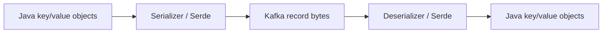

# Distinguishing Native Serdes from Framework Conversion

## Objectives

Kafka stores record keys and values as raw bytes. When an application reads or writes data, those bytes must be converted into Java types that code can handle, and vice versa. In Spring Cloud Stream, two mechanisms are easily confused:

- **Framework conversion (`MessageConverter`):** Spring Cloud Stream uses message payloads, headers, and content types to convert data between application types.
- **Kafka Streams Native Serde:** Kafka Streams uses `Serde` (Serializer + Deserializer) to encode and decode keys and values at Kafka boundaries and in DSL operations that materialize or repartition data.

The Kafka Streams binder relies on Kafka Streams' Serde mechanism. This is an important distinction from the message conversion commonly seen in imperative or functional bindings of the Kafka message binder. Setting only `content-type: application/json` without an appropriate Serde can still leave a Kafka Streams application unable to decode records or writing a wire format different from what consumers expect.

This lesson explains the boundary between these two mechanisms, how to configure default and per-binding Serdes, how to build typed Serdes for POJOs, how to supply Serdes in the Kafka Streams DSL, and how to test wire formats.

After this lesson, you will be able to:

- Distinguish `MessageConverter` from Kafka Streams `Serde`.
- Explain why Kafka Streams requires Serdes for both keys and values.
- Configure default key/value Serdes at the binder level.
- Configure separate `keySerde`/`valueSerde` settings for input and output bindings.
- Create typed Serdes for POJOs using Spring Kafka's `JsonSerde` or custom Serdes.
- Choose Serdes for grouping, joining, repartitioning, and state store operations.
- Align wire formats between producers and consumers.
- Test serialization/deserialization and handle data errors.

## 1. Why Must Data Be Converted?

A Kafka record consists of a key, a value, and metadata/headers. Brokers store keys and values as bytes; the broker does not know whether a byte array represents an `OrderCreated` object, JSON, Avro, or a plain string.

For example, a record might contain:

- Key: string `order-42`, encoded as UTF-8 bytes.
- Value: an `OrderCreated` object, encoded as JSON bytes.
- Headers: event type, trace ID, or schema metadata.

When a producer writes a record, application data must be serialized. When a consumer reads a record, bytes must be deserialized back into the data types used by the application.



If producer and consumer use incompatible formats, the consumer can encounter deserialization errors, read corrupted data, or fail to interpret records. Serializers and deserializers are therefore part of the integration contract between applications.

## 2. Spring Cloud Stream's MessageConverter

In the standard Spring Cloud Stream model, the framework operates on Spring `Message` objects. A message carries a payload and headers; the content type helps the framework select how to convert the payload.

Example of an output binding sending a POJO as JSON:

```java
public record OrderCreated(
        String eventId,
        String orderId,
        long totalAmount
) {}

@Bean
Supplier<OrderCreated> orderEvents(OrderEventSource source) {
    return source::next;
}
```

Configuration:

```yaml
spring:
  cloud:
    function:
      definition: orderEvents
    stream:
      bindings:
        orderEvents-out-0:
          destination: orders.created
          content-type: application/json
```

With a `MessageConverter`-driven binding path, the framework can convert the `OrderCreated` payload to JSON according to the content type. Consumers use corresponding conversion to receive the typed payload.

`MessageConverter` operates at the Spring Messaging layer:

- Accepts payload and headers.
- Uses content type to select a converter.
- Converts between objects and their target representations.
- Participates in conversion before/after the binder depending on binder type and configuration.

Content type describes content format at the framework layer. It does not by itself define a system's entire wire protocol and does not replace the serializers/deserializers required by the Kafka Streams DSL.

## 3. What Is a Kafka Streams Serde?

`Serde<T>` is a Kafka Streams abstraction combining two components:

- `Serializer<T>`: converts a Java object into a byte array for writing to Kafka.
- `Deserializer<T>`: converts a byte array read from Kafka into a Java object.

Kafka Streams needs to know the Serdes for keys and values because the topology processes typed data:

```java
KStream<String, OrderCreated>
```

Here the key is `String` and the value is `OrderCreated`. Kafka Streams needs a Serde for the `String` key and a Serde for the `OrderCreated` value when reading data; when writing output, it also needs appropriate Serdes.

Built-in Kafka Serdes include:

| Data Type | Common Serde |
|---|---|
| `String` | `Serdes.String()` |
| `Long` | `Serdes.Long()` |
| `Integer` | `Serdes.Integer()` |
| `byte[]` | `Serdes.ByteArray()` |
| `UUID` | Custom Serde or an appropriate library |
| POJO/record | JSON, Avro, Protobuf, or custom Serde |

Kafka Streams uses Serdes in many places:

- Reading keys/values from source topics.
- Writing keys/values to sink topics.
- Grouping and repartitioning.
- Joining streams and tables.
- Aggregating and materializing state stores.
- Writing changelog topics for state stores.

Consequently, Serdes are not solely external producer/consumer settings. They also govern internal data produced by Kafka Streams inside the topology.

## 4. Differences Between MessageConverter and Serde

| Criterion | MessageConverter | Kafka Streams Serde |
|---|---|---|
| Abstraction | Spring `Message`, payload, and headers | Kafka key/value |
| Goal | Convert payloads according to content type | Serialize/deserialize objects to/from bytes |
| Primary config | Content type and converter | Key/value Serde |
| Scope | Spring Messaging layer and binder conversion | Kafka Streams sources, sinks, and DSL |
| Data type | Spring `Message` payload | Typed key/value in `KStream`/`KTable` |
| Metadata | Can leverage Spring headers | Processes record keys/values; Kafka headers are separate metadata |
| Example | POJO to JSON via converter | `Serde<OrderCreated>` producing JSON bytes |
| Typical scenario | Regular Function/Consumer bindings | Kafka Streams topologies |

Both mechanisms can produce or read JSON bytes, but they are not the same API and do not automatically substitute for one another.

A `MessageConverter` may understand `content-type: application/json`, whereas a Serde must be specified for the key/value types processed by Kafka Streams. If a topology expects `KStream<String, OrderCreated>`, configure a Serde capable of deserializing values into `OrderCreated`; setting content type alone does not supply complete Serdes to Kafka Streams.

## 5. How the Kafka Streams Binder Uses Serdes

The Kafka Streams binder connects function beans using `KStream`, `KTable`, or `GlobalKTable` to input/output bindings. Reading and writing topology records relies on Kafka Streams Serdes.

Example function:

```java
@Bean
Function<KStream<String, OrderCreated>,
         KStream<String, OrderCreated>> normalizeOrders() {
    return orders -> orders.mapValues(order ->
            new OrderCreated(
                    order.eventId(),
                    order.orderId().trim(),
                    order.totalAmount()
            )
    );
}
```

Input and output bindings:

```yaml
spring:
  cloud:
    function:
      definition: normalizeOrders
    stream:
      bindings:
        normalizeOrders-in-0:
          destination: orders.created
        normalizeOrders-out-0:
          destination: orders.normalized
```

The function signature declares Java-level key/value types, yet Kafka still stores raw bytes. The binder needs appropriate Serdes to decode inputs and encode outputs.

With the Kafka Streams binder, do not assume regular content-type conversion will automatically handle all topology keys and values. Configure Serdes for actual data formats and test with topics carrying production wire formats.

## 6. Configuring Default Serdes at the Binder Level

You can declare default key/value Serdes in the Kafka Streams binder configuration. These defaults are used when a binding or topology operation does not specify a dedicated Serde and the binder version allows inheriting defaults.

Example for `String` data:

```yaml
spring:
  cloud:
    stream:
      kafka:
        streams:
          binder:
            configuration:
              default.key.serde: org.apache.kafka.common.serialization.Serdes$StringSerde
              default.value.serde: org.apache.kafka.common.serialization.Serdes$StringSerde
```

These two settings are Kafka Streams properties:

- `default.key.serde` is the default Serde for keys.
- `default.value.serde` is the default Serde for values.

`String` defaults are only appropriate when record bytes actually represent UTF-8 strings. If values are JSON objects, Avro, or Protobuf, using `StringSerde` can cause code to receive a raw string instead of a POJO or break expected decoding.

Do not pick a single global POJO Serde across all bindings if topics have distinct schemas. Configure per-binding Serdes so each topic maintains an explicit data contract.

## 7. Configuring Dedicated Serdes for Input Bindings

The Kafka Streams binder lets you specify `keySerde` and `valueSerde` on consumer bindings. Example of an input with `String` keys and JSON `OrderCreated` values:

```yaml
spring:
  cloud:
    function:
      definition: normalizeOrders
    stream:
      bindings:
        normalizeOrders-in-0:
          destination: orders.created
      kafka:
        streams:
          bindings:
            normalizeOrders-in-0:
              consumer:
                keySerde: org.apache.kafka.common.serialization.Serdes$StringSerde
                valueSerde: orderCreatedSerde
```

In this example, `orderCreatedSerde` is the name of a `Serde<OrderCreated>` bean registered in the Spring context. Referencing Serde beans by name or class must follow the capabilities of your Kafka Streams binder version; if your version requires a different declaration style, use the mechanism supported by that binder's documentation.

Bean example:

```java
@Bean
Serde<OrderCreated> orderCreatedSerde() {
    return new JsonSerde<>(OrderCreated.class).noTypeInfo();
}
```

Spring Kafka's `JsonSerde` pairs a JSON serializer and deserializer. Specifying the target type deserializes JSON into `OrderCreated`. `noTypeInfo()` disables adding Spring Kafka's proprietary type information headers during serialization; use it only when consumers determine target types via contract/configuration rather than relying on type headers.

When receiving messages from untrusted sources, configure deserializers safely and restrict allowed types. Never broaden trusted packages indiscriminately just to silence deserialization errors.

## 8. Configuring Dedicated Serdes for Output Bindings

Output bindings also need Serdes to serialize keys and values before writing to a topic.

```yaml
spring:
  cloud:
    stream:
      bindings:
        normalizeOrders-out-0:
          destination: orders.normalized
      kafka:
        streams:
          bindings:
            normalizeOrders-out-0:
              producer:
                keySerde: org.apache.kafka.common.serialization.Serdes$StringSerde
                valueSerde: orderCreatedSerde
```

This example uses `String` keys and JSON values. The output Serde must be compatible with consumers of `orders.normalized`.

If the output value type differs from the input type, use a Serde matching the output type. Never reuse `orderCreatedSerde` for an `OrderSummary` type simply because both are JSON-encoded; their target types and schemas may differ.

### Input and Output Serdes Must Align on Wire Format

| Binding | Key | Value | Serde |
|---|---|---|---|
| `normalizeOrders-in-0` | String | `OrderCreated` JSON | `StringSerde` + `OrderCreated` `JsonSerde` |
| `normalizeOrders-out-0` | String | `OrderCreated` JSON | `StringSerde` + `OrderCreated` `JsonSerde` |
| `summarizeOrders-out-0` | String | `OrderSummary` JSON | `StringSerde` + `OrderSummary` `JsonSerde` |

Java class names do not have to match identically between producer and consumer, but bytes must conform to the same wire contract. If a producer writes Avro, a consumer cannot read it with `JsonSerde` merely because both objects share similar fields.

## 9. Building Custom Serdes for POJOs

For custom types, you can build a Serde from a compatible serializer and deserializer. Example using Spring Kafka `JsonSerializer`/`JsonDeserializer`:

```java
@Bean
Serde<OrderCreated> orderCreatedSerde() {
    JsonSerializer<OrderCreated> serializer =
            new JsonSerializer<>();

    JsonDeserializer<OrderCreated> deserializer =
            new JsonDeserializer<>(OrderCreated.class);

    deserializer.addTrustedPackages("com.example.orders");

    return Serdes.serdeFrom(serializer, deserializer);
}
```

In real applications, configure `ObjectMapper`, type headers, and trusted packages according to your contract and security policy. Never trust overly broad packages just to deserialize payloads arriving from the broker.

A custom Serde may implement `Serde<T>` directly or be built via `Serdes.serdeFrom(serializer, deserializer)`. Ensure:

- Serializer and deserializer use the same wire format.
- Target types are explicit.
- Null keys/values are handled according to desired semantics.
- Serializer/deserializer configurations are passed completely.
- Resources are closed along the Kafka Streams lifecycle.
- Versions and schemas remain compatible across producers and consumers.

When using Avro or Protobuf, choose the corresponding schema-registry-integrated Serde. The Serde must know how to register/fetch schemas, encode payloads, and decode bytes by schema ID/version. Adding only a schema registry URL to YAML without selecting the right Serde is not enough to enable Avro or Protobuf.

## 10. Serdes in Kafka Streams DSL Operations

Serdes are required across multiple DSL operators. Several operators take Serdes directly or through materialization configuration.

### Grouping

When grouping a stream by a new key, Kafka Streams may create a repartition topic. Serdes are needed for the new key and value:

```java
KGroupedStream<String, OrderCreated> grouped =
        orders.groupByKey(
                Grouped.with(
                        Serdes.String(),
                        orderCreatedSerde
                )
        );
```

In this example, the key and value Serdes determine the bytes written to and read from the repartition topic if the topology triggers repartitioning. If Serdes are incompatible, errors may surface only when the topology actually executes a repartition.

### Materialized State Stores

When aggregating and persisting state stores, Kafka Streams needs Serdes for the key and aggregated value:

```java
KTable<String, Long> orderCounts = orders
        .groupByKey(Grouped.with(Serdes.String(), orderCreatedSerde))
        .count(
                Materialized
                        .<String, Long, KeyValueStore<Bytes, byte[]>>as("order-counts")
                        .withKeySerde(Serdes.String())
                        .withValueSerde(Serdes.Long())
        );
```

A state store has a changelog topic for state recovery. The state store's Serdes govern changelog data and restoration after restarts. Do not arbitrarily change a state store's Serde or schema while the application already holds materialized state.

### Joins

Stream/table joins require compatible Serdes for keys, values, and intermediate state. Example:

```java
KStream<String, OrderWithCustomer> enriched =
        orders.join(
                customers,
                (order, customer) ->
                        new OrderWithCustomer(order, customer),
                Joined.with(
                        Serdes.String(),
                        orderCreatedSerde,
                        customerSerde
                )
        );
```

This example illustrates supplying Serdes for the key, left value, and right value. Exact join signatures vary by stream/table type and Kafka Streams version; check the overload matching your actual topology.

Do not configure Serdes only on input/output bindings while overlooking repartitions, joins, or state stores. Internal Serde failures may surface only after the topology runs for a while or when new data triggers a specific branch.

## 11. Key Serde and Value Serde Play Different Roles

Kafka keys normally govern partition routing when producers use the default partitioner. Values carry business payloads. Both parts can use completely different formats.

Example:

- Key is string `order-42` so events for the same order route to the same partition.
- Value is JSON `OrderCreated`.
- Headers carry trace IDs or technical metadata.

Configuring separate `keySerde` and `valueSerde`:

```yaml
spring:
  cloud:
    stream:
      kafka:
        streams:
          bindings:
            normalizeOrders-in-0:
              consumer:
                keySerde: org.apache.kafka.common.serialization.Serdes$StringSerde
                valueSerde: orderCreatedSerde
```

If the producer sends a `String` key while the consumer uses `LongSerde`, key deserialization fails or produces unexpected keys. If key bytes are inconsistent, partitioning will no longer align with business keys.

Do not put sensitive secrets into keys simply because keys drive partitioning. Keys can be inspected by admin tools, logs, or other consumers.

## 12. Content Type and Headers Do Not Replace Serdes

In Spring Cloud Stream, content types and message headers are useful for bindings using framework conversion. However, the Kafka Streams DSL needs Serdes to know how to convert key/value bytes.

The following configuration is insufficient to define a POJO Serde for Kafka Streams:

```yaml
spring:
  cloud:
    stream:
      bindings:
        normalizeOrders-in-0:
          destination: orders.created
          content-type: application/json
```

Setting content type does not specify `keySerde`/`valueSerde` for the topology. Declare Serdes on the binding or in default configuration and verify they are used for the required sources and sinks.

Also distinguish:

- Kafka record headers are Kafka-layer metadata.
- Spring `Message` headers are Spring Messaging-layer metadata.
- Content type describes payload format.
- Serde is the actual mechanism encoding and decoding key/value bytes.

A serializer may attach a type header, but that header is not a schema registry and does not replace a data contract. Polyglot consumers should generally rely on published schemas/wire formats rather than a producer's Java class names.

## 13. Differences from use-native-encoding in the Kafka Message Binder

In the regular Kafka message binder, producers can enable `use-native-encoding` to use Kafka client serializers instead of `MessageConverter`; consumers can enable `use-native-decoding` to use native deserializers.

The Kafka Streams binder is a different programming model. A Kafka Streams topology uses Serdes as its core mechanism for keys, values, and DSL operators. Do not mechanically copy `use-native-encoding`/`use-native-decoding` settings from the regular Kafka binder assuming they replace `keySerde`/`valueSerde` in the Kafka Streams binder.

| Model | Mechanism to Understand |
|---|---|
| Spring Cloud Stream Kafka message binder | `MessageConverter` or Kafka client serializer/deserializer via native encoding/decoding |
| Spring Cloud Stream Kafka Streams binder | Kafka Streams Serdes for topology keys and values |
| Pure Kafka Streams DSL | Serdes passed to sources, sinks, grouping, joins, and state stores |

If an application uses both regular bindings and the Kafka Streams binder, check each binder's configuration namespace carefully. Similarly named properties do not necessarily share identical semantics.

## 14. Choosing Serdes by Wire Format

| Wire Format | Appropriate Serde/Serializer | Notes |
|---|---|---|
| String/UTF-8 | `StringSerde` | Ensure producers emit text with consistent encoding |
| Byte array | `ByteArraySerde` | Application manages bytes and schemas directly |
| JSON | `JsonSerde` or custom Jackson Serde | Lock down field names, data types, and versions |
| Avro | Schema-registry-integrated Avro Serde | Manage schema IDs and compatibility |
| Protobuf | Protobuf Serde | Manage message descriptors and schema evolution |
| Long/Integer | `Serdes.Long`/`Integer` | Numeric width and byte layout must match |

JSON is easy to inspect, yet still requires explicit rules for schemas, optional fields, timestamps, decimals, and compatibility. Avro/Protobuf provide stricter schema contracts but require registry or descriptor management.

Never change the wire format of a topic consumed by multiple clients without a migration plan. Common options include versioned topics, schema compatibility rules, dual-read/dual-write transitions, or consumers supporting multiple versions.

## 15. Testing Serdes

Test both serialization and deserialization paths.

### Round-Trip Test

```java
@Test
void orderSerdeShouldRoundTrip() {
    Serde<OrderCreated> serde =
            new JsonSerde<>(OrderCreated.class).noTypeInfo();

    OrderCreated original =
            new OrderCreated("evt-1", "order-42", 12500L);

    byte[] bytes = serde.serializer()
            .serialize("orders.created", original);

    OrderCreated restored = serde.deserializer()
            .deserialize("orders.created", bytes);

    assertEquals(original, restored);
}
```

Round-trip tests verify an object encodes and decodes back to an equivalent value. Add tests for `null`, optional fields, historical records, schema versions, and malformed payloads.

### Binding and Topology Testing

- Input keys/values deserialize into the expected types.
- Output keys/values serialize per the wire contract.
- Binding-specific Serdes are selected instead of unintended defaults.
- Grouping/repartitioning uses the right Serdes for new keys/values.
- Joins use compatible Serdes on both sides.
- State stores and changelog topics restore cleanly after restarts.
- Deserialization exceptions are handled according to configured policy.

### Integration Testing with Kafka

Use a test Kafka broker or Testcontainers to verify:

1. Sending records with key/value bytes matching the wire format.
2. Starting the Kafka Streams binder topology.
3. Confirming the function receives the intended data types.
4. Checking the output topic contains bytes readable by downstream consumers.
5. Restarting the application and verifying state store restoration.
6. Sending invalid payloads and verifying the deserialization error handler.
7. Checking schema compatibility when producer and consumer run different versions.

The Test Binder is helpful for Spring Cloud Stream wiring but does not replace Kafka broker integration tests for verifying Serdes, repartition topics, changelogs, and state restoration.

## 16. Common Mistakes

| Symptom | Possible Cause | Resolution |
|---|---|---|
| Kafka Streams fails to deserialize POJO | Only content type was set without configuring Serdes | Declare `valueSerde` with the proper type |
| String key reads as bytes or throws type error | Producer and consumer use different key Serdes | Align key wire format and Serdes |
| Input reads fine, but output consumer fails | Output binding uses a Serde violating the contract | Configure an appropriate producer `valueSerde` |
| Grouping/repartition fails despite readable source | DSL operator lacks a Serde or uses the wrong one | Supply Serdes in `Grouped`/`Consumed`/`Produced` |
| State store restoration fails | State store or changelog Serde/schema changed incompatibly | Plan schema evolution and state migrations carefully |
| `JsonSerde` produces wrong target type | Missing target type or unsuitable type mapping | Use a typed Serde and configure deserializers explicitly |
| Polyglot consumers fail on type headers | Wire contract depends on producer Java class metadata | Define independent JSON/Avro/Protobuf schemas |
| Runtime error surfaces only during join | One side of the join has an incompatible Serde | Test both inputs and join Serdes |
| Data corrupts after changing serializer | Producer changed wire format before older consumers upgraded | Version topics/schemas and roll out migrations |

## 17. Serde Selection and Configuration Process

Before deploying a Kafka Streams topology:

1. List key/value types for every input and output binding.
2. Identify each topic's wire format and schema version.
3. Choose matching `keySerde` and `valueSerde`.
4. Set binder-level default Serdes only when bindings truly share a common format.
5. Set dedicated Serdes on bindings with distinct schemas or data types.
6. Provide Serdes for grouping, repartitioning, joins, and state stores where required by the DSL.
7. Verify serializers, deserializers, and type headers.
8. Confirm polyglot producers/consumers agree on the same wire contract.
9. Write round-trip tests and Kafka integration tests.
10. Monitor deserialization errors, schema registry failures, and state restoration.

When changing Serdes on a topic or state store, evaluate historical data still sitting in retention or changelogs. A new application version may decode new records while failing on older records if the wire format changed incompatibly.

## Conclusion

Spring Cloud Stream's `MessageConverter` converts Spring `Message` payloads based on content types and converters. The Kafka Streams binder uses Kafka Streams Serdes to serialize and deserialize topology keys and values. Both mechanisms address different boundaries; content type does not replace `keySerde`/`valueSerde`.

Configure default or per-binding Serdes, choose separate Serdes for keys and values, and supply Serdes for grouping, joins, repartitioning, and state stores when required. Producers and consumers must agree on wire formats and schemas. Test round-trips, output bytes, deserialization errors, and state restoration against Kafka to ensure the topology handles both new and persisted data accurately.
