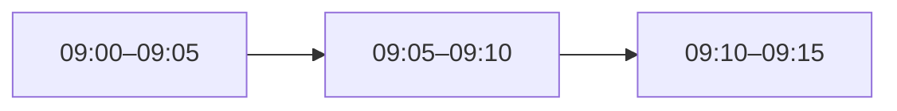
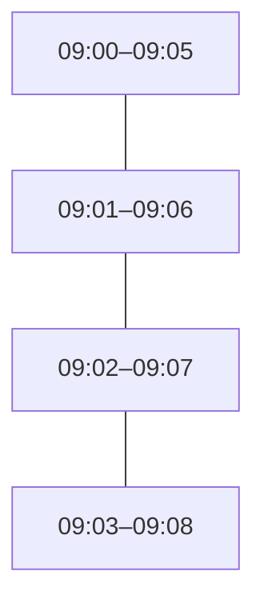
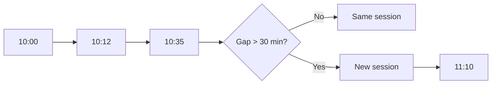

# Tumbling, Hopping, Sliding, and Session Windows

In stateful stream processing, an aggregation often does not apply to the entire history, but rather to a scoped range of data. A window defines which records belong to the same group based on time or periods of inactivity. Kafka Streams provides four common window types: tumbling, hopping, sliding, and session.

Choosing the right window affects result semantics, latency, how much state must be stored, and how late events are handled. For example, reporting order counts per 5-minute interval typically uses a tumbling window; computing total transactions over the last 5 minutes updated every minute uses a hopping window; detecting two events from the same account at most 5 minutes apart uses a sliding window; and grouping actions into a session until the user is inactive for 30 minutes uses a session window.

## 1. What Problem Do Windows Solve?

A Kafka topic is a continuous stream of records. Calling only `groupByKey().count()` yields a cumulative total per key rather than splitting naturally by hour, day, or session. Windows add a time scope to the key so the same key can have multiple independent results across different intervals.

For example, given purchase events for customer `cust-42`:

| Event Time | Amount |
|---|---:|
| 09:01 | 100,000 |
| 09:03 | 250,000 |
| 09:07 | 80,000 |
| 09:11 | 120,000 |

If you need total amount per 5-minute interval, you must define window boundaries clearly and decide how records right on boundaries are handled. If you need totals over the last 5 minutes updated every minute, windows must overlap. If you need to group bursts of activity, boundaries must depend on gaps without events rather than a fixed schedule.

Kafka Streams performs windowed aggregation by key. Results are typically stored in a state store and can be emitted as a `KTable<Windowed<K>, V>` or converted into a stream via `toStream()`. Each result is identified by the key together with window metadata, not solely by the original key.

## 2. Distinguishing Event Time, Processing Time, and Stream Time

Before choosing a window type, determine which timestamp drives the windows:

- **Event time:** when the event actually occurred according to a timestamp inside the record or metadata supplied by the producer.
- **Processing time:** when the application processes the record. It is influenced by load, network, retries, and backlogs.
- **Stream time:** Kafka Streams' notion of time, advancing based on the timestamps of processed records within a task. Windows close according to stream time progression, not simply the wall clock.

Kafka Streams uses the timestamp attached to a record, via a timestamp extractor, to evaluate windows. If a producer emits an event at 09:01 but the record only reaches the consumer at 09:12, event time can still be 09:01. If timestamps are not set properly, aggregated results can fall into the wrong window even when the consumer processes the message successfully.

Example of an event with a timestamp:

```java
ProducerRecord<String, OrderCreated> record = new ProducerRecord<>(
        "orders.created", order.customerId(), order);
record.headers().add("event-time", Long.toString(order.occurredAt().toEpochMilli())
        .getBytes(StandardCharsets.UTF_8));
```

In practice, use the Kafka record timestamp or a consistently configured `TimestampExtractor`, rather than merely adding a header and assuming Kafka Streams automatically reads that header. If the business timestamp resides inside the payload, the extractor can read the payload after deserialization per your Serde design; if the producer already sets the timestamp directly on the record, the default extractor can use that value.

Example custom extractor:

```java
public final class OrderTimestampExtractor implements TimestampExtractor {
    @Override
    public long extract(ConsumerRecord<Object, Object> record, long partitionTime) {
        if (record.value() instanceof OrderCreated order) {
            return order.occurredAt().toEpochMilli();
        }
        return record.timestamp();
    }
}
```

When using an extractor, guard against null timestamps, wrong units (seconds vs. milliseconds), timestamps far in the future, or unusually old timestamps. A bad timestamp can cause stream time to jump forward and close many windows prematurely; an overly old timestamp can cause records to be treated as late.

## 3. Tumbling Window: Fixed, Non-Overlapping Windows

A tumbling window divides time into fixed-length, contiguous intervals. Every timestamp belongs to exactly one window. For example, 5-minute windows might be 09:00–09:05, 09:05–09:10, 09:10–09:15.



The windows are consecutive with no overlapping regions.

Example counting orders per customer in every 5-minute interval:

```java
@Bean
Function<KStream<String, OrderCreated>, KStream<String, Long>> countOrdersEveryFiveMinutes() {
    return orders -> orders
            .groupByKey()
            .windowedBy(TimeWindows.ofSizeAndGrace(
                    Duration.ofMinutes(5), Duration.ofMinutes(1)))
            .count(Materialized.as("orders-per-customer-5m"))
            .toStream()
            .map((windowedKey, count) ->
                    KeyValue.pair(windowedKey.key(), count));
}
```

`ofSizeAndGrace` creates a window with a 5-minute size and a 1-minute grace period. For a tumbling window, do not call `advanceBy` or set the advance interval equal to the window size. In this example, the KTable result is converted to a KStream; the code simplifies the key for illustration, whereas real systems should typically retain `windowedKey.window().start()` and `end()` in the output payload to distinguish results for the same customer.

Tumbling windows fit fixed-bucket reporting: revenue per 5 minutes, orders per hour, errors per day. They are straightforward to reconcile and never count one record into multiple buckets.

## 4. Hopping Window: Fixed Windows with an Advance Step

A hopping window has a fixed size but opens at a configured advance interval. If the advance step is smaller than the size, windows overlap. If the advance step equals the size, behavior matches tumbling. For example, a 5-minute window with a 1-minute advance creates intervals 09:00–09:05, 09:01–09:06, 09:02–09:07...



Each window spans 5 minutes; a new window starts every minute, so intervals overlap.

Example counting orders over the last 5 minutes, updated every minute:

```java
@Bean
Function<KStream<String, OrderCreated>, KStream<Windowed<String>, Long>>
countOrdersInHoppingWindows() {
    return orders -> orders
            .groupByKey()
            .windowedBy(TimeWindows.ofSizeAndGrace(
                            Duration.ofMinutes(5), Duration.ofMinutes(1))
                    .advanceBy(Duration.ofMinutes(1)))
            .count(Materialized.as("orders-hopping-5m-1m"))
            .toStream();
}
```

A single event can belong to multiple hopping windows. With a 5-minute size and 1-minute advance, one record can update up to 5 active window results. This increases state updates and output volume compared to tumbling windows.

Hopping windows suit dashboards or alerts requiring frequent updates over a fixed lookback window, such as transaction counts over the last 5 minutes refreshed every minute. Define how downstream consumers handle updates for the same window and avoid interpreting every output as an unrelated new total.

## 5. Sliding Window: Relationships by Distance Between Events

Sliding windows form windows based on the timestamp distance between records, rather than fixed calendar boundaries like tumbling/hopping. For a given key, two events can belong to the same window if their timestamps fall within the configured time difference. Windows can start/end at record timestamps and can overlap per event.

For example, detecting transactions on the same account occurring within 2 minutes of each other to compute sums or spot suspicious behavior. There is no need to split time into 09:00, 09:02, 09:04 ticks; window membership is formed directly around record timestamps.

```java
@Bean
Function<KStream<String, PaymentEvent>, KStream<Windowed<String>, Long>>
countPaymentsInSlidingWindows() {
    return payments -> payments
            .groupByKey()
            .windowedBy(SlidingWindows.ofTimeDifferenceAndGrace(
                    Duration.ofMinutes(2), Duration.ofSeconds(30)))
            .count(Materialized.as("payments-sliding-2m"))
            .toStream();
}
```

`ofTimeDifferenceAndGrace` sets the maximum time distance between records in a window and the grace period for late events. Sliding window APIs and exact semantics depend on the Kafka Streams version; use the overload matching the release managed by your Spring Cloud BOM.

Sliding windows are useful when business semantics depend on proximity between events: two logins close together, consecutive actions, or bursts of transactions within a short span relative to each event. They can create more windows and incur higher computation costs than tumbling/hopping; benchmark with realistic key counts and event densities.

## 6. Session Window: Grouping Events by Inactivity Gap

Session windows do not have a fixed length. Events with the same key belong to one session as long as the quiet gap between them does not exceed the inactivity gap. When a new event arrives within the gap, the session can extend or two earlier sessions can merge.

For example, a customer's shopping session ends when they have no activity for 30 minutes. If the customer acts at 10:00, 10:12, and 10:35, with a 30-minute inactivity gap, those events can belong to the same session because consecutive intervals are under 30 minutes. If the next event arrives at 11:10, it starts a new session because the gap from 10:35 exceeds 30 minutes.



Example summing purchase amounts per customer session:

```java
@Bean
Function<KStream<String, PurchaseEvent>, KStream<Windowed<String>, BigDecimal>>
sumPurchasesBySession() {
    return purchases -> purchases
            .groupByKey()
            .windowedBy(SessionWindows.ofInactivityGapAndGrace(
                    Duration.ofMinutes(30), Duration.ofMinutes(2)))
            .aggregate(
                    () -> BigDecimal.ZERO,
                    (customerId, event, total) -> total.add(event.amount()),
                    (customerId, left, right) -> left.add(right),
                    Materialized.as("purchase-session-total"))
            .toStream();
}
```

The `aggregate` function takes two combining functions: updating the aggregate when a new event arrives in a session, and merging two aggregates when two sessions get bridged by an event arriving between them. Therefore, session windows require a merge function whose semantics match the aggregation. For total amounts, adding the two sums makes sense; for complex state structures, define the merge logic carefully.

Session windows fit user sessions, device sessions, bursts of consecutive actions, or activities with natural idle breaks. Predicting state count and duration is harder than with fixed windows; bound retention and monitor abnormally long sessions.

## 7. Comparison Table of the Four Window Types

| Window Type | How Boundaries Are Defined | Overlapping? | Business Example |
|---|---|---|---|
| Tumbling | Fixed size, advance equals size | No | Revenue every 5 minutes |
| Hopping | Fixed size and separate advance step | Yes if advance is smaller than size | 5-minute transaction total updated every minute |
| Sliding | Timestamp distance between records | Multiple event-driven windows possible | Detecting multiple transactions close together |
| Session | Inactivity gap between same-key events | Sessions can extend or merge | App usage session ending after 30 minutes of silence |

Choose the window according to the business question:

- "How many events occurred in each fixed bucket?" → Tumbling.
- "Over the last N minutes, updated every M minutes?" → Hopping.
- "Which events occur close together within an event-relative time span?" → Sliding.
- "When does a sequence of activity end after the user stops emitting events?" → Session.

## 8. Grace Period and Late-Arriving Events

In distributed systems, events may reach Kafka later than when they occurred. Producers can retry, networks can drop temporarily, consumers can hit backlogs, or one partition can progress unevenly. If a window closed the instant timestamps crossed the end time, late-arriving events could never update the result.

The grace period defines the extra interval during which Kafka Streams still accepts late records for a window. For example, a 5-minute tumbling window with a 1-minute grace period allows an event whose timestamp falls in the window to be accepted during the grace window after the window ends in stream time.

Key points to remember:

- Grace does not extend the window's duration; it extends how long late events are accepted.
- A window is only considered closed when stream time passes end time plus grace according to that window type's semantics.
- Too short a grace period loses updates when events arrive late.
- Too long a grace period forces state to be retained longer and delays final results.
- Grace is not a wall-clock timeout; without new records, stream time may not advance.

For instance, a 09:00–09:05 window with a 1-minute grace can still accept an event timestamped 09:04:30 arriving after several records with higher timestamps, provided stream time has not yet crossed the window's closing threshold under Kafka Streams rules. Once stream time passes the closing threshold, the event may be excluded from the aggregation and counted as a late record.

## 9. Retention and State Stores

Windowed aggregations must store state for each key and each window. Retention dictates how long old state is kept. For windowed stores, retention must be large enough to cover window size plus grace period; configuring larger values increases local state disk usage and changelog topic size.

Factors affecting storage footprint:

- Number of unique keys per partition.
- Size of values stored in the state store.
- Number of open windows per key.
- Overlap factor of hopping/sliding windows.
- Length of grace and retention.
- Partition count and replication factor of the changelog topic.

Hopping windows with heavy overlap can store many results for the same key. Sliding windows can create numerous event-driven window boundaries. Session windows retain state for open sessions and can merge state. Thus, do not estimate solely from input record count; estimate active keys and concurrent windows.

Example materializing a tumbling window with explicit retention:

```java
Materialized<String, Long, WindowStore<Bytes, byte[]>> store =
        Materialized.<String, Long, WindowStore<Bytes, byte[]>>as("orders-count-5m")
                .withRetention(Duration.ofHours(2));

KTable<Windowed<String>, Long> counts = orders
        .groupByKey()
        .windowedBy(TimeWindows.ofSizeAndGrace(
                Duration.ofMinutes(5), Duration.ofMinutes(1)))
        .count(store);
```

This is a Kafka Streams DSL API example; exact imports and generic parameters may need adjustment for the Kafka Streams version used by your binder. The 2-hour retention is illustrative—it must exceed window plus grace and match the application's query/recovery needs.

## 10. Emit Continuous Updates or Only Final Results?

Windowed aggregations normally emit updates whenever new events arrive. If a dashboard wants to show live running totals, that behavior is appropriate. If downstream wants only one final result after the window closes, Kafka Streams provides `Suppressed.untilWindowCloses(...)` to buffer intermediate updates and emit only the final window result.

Conceptual suppression example:

```java
KTable<Windowed<String>, Long> counts = orders
        .groupByKey()
        .windowedBy(TimeWindows.ofSizeAndGrace(
                Duration.ofMinutes(5), Duration.ofMinutes(1)))
        .count(Materialized.as("orders-final-count"));

KTable<Windowed<String>, Long> finalCounts = counts.suppress(
        Suppressed.untilWindowCloses(
                Suppressed.BufferConfig.maxBytes(10_000_000L).shutDownWhenFull()));
```

Suppression buffers must be bounded. Using an unbounded buffer can cause out-of-memory errors if windows close slowly or key counts grow. For bounded buffers, choose the overflow policy carefully: shut down the application to preserve strict semantics or emit early where policy permits. Do not use suppression if downstream needs every intermediate update.

## 11. Connecting Windows with the Spring Cloud Stream Kafka Streams Binder

The Kafka Streams Binder lets you declare functions taking a `KStream` and returning a `KStream`. The binder manages topology creation, input/output binding wiring, and the Kafka Streams runtime lifecycle.

Example tumbling-window function counting orders per customer:

```java
@Bean
Function<KStream<String, OrderCreated>, KStream<Windowed<String>, Long>>
countOrdersByCustomerWindow() {
    return orders -> orders
            .groupByKey()
            .windowedBy(TimeWindows.ofSizeAndGrace(
                    Duration.ofMinutes(5), Duration.ofMinutes(1)))
            .count(Materialized.as("orders-customer-5m"))
            .toStream();
}
```

Function configuration:

```yaml
spring:
  cloud:
    function:
      definition: countOrdersByCustomerWindow
    stream:
      bindings:
        countOrdersByCustomerWindow-in-0:
          destination: orders.created
        countOrdersByCustomerWindow-out-0:
          destination: orders.counted.5m
    kafka:
      streams:
        binder:
          configuration:
            application.id: order-window-aggregator
```

When the output key is `Windowed<String>`, configure an appropriate Serde for the windowed key and value at the output. Do not rely on a String Serde by default for `Windowed<K>`; the Kafka Streams Binder may support windowed Serdes via configuration or require explicit Serde declarations depending on version. Output payloads should include window start/end and the aggregated value so downstream consumers can interpret them cleanly.

`application.id` must remain stable across instances of the same logical application. Changing the ID can make Kafka Streams create a new consumer group/internal topics and reprocess data under fresh state; it is not a safe way to change window size without a migration.

## 12. Testing Window Semantics

Do not test only the final total. Tests must prove which window a record lands in, whether late events are accepted or dropped, and that sessions merge properly.

`TopologyTestDriver` supports piping records with explicit timestamps into input topics to test windows. A test suite should cover:

- Records right before, right on, and right after a tumbling window boundary.
- Records in a hopping window appearing across multiple windows per size/advance.
- Two records inside vs. outside a sliding time difference.
- A session extending when an event arrives within the inactivity gap.
- Two sessions merging when an arriving event bridges the gap between them.
- Late events within grace being accepted.
- Late events past grace being dropped per Kafka Streams semantics.
- Timestamp extractors handling timestamps, timezones, and millisecond units accurately.
- Retention and suppression not dropping final results outside policy.
- State restart/restore yielding the same result as before stopping under the chosen processing guarantee.

Simple tests should set timestamps explicitly rather than relying on test execution wall-clock time:

```java
inputTopic.pipeInput(
        "cust-42", orderAt0901, Instant.parse("2026-11-24T09:01:00Z"));
inputTopic.pipeInput(
        "cust-42", orderAt0903, Instant.parse("2026-11-24T09:03:00Z"));
```

`TopologyTestDriver` helper APIs vary across Kafka Streams versions; the snippet illustrates setting timestamps explicitly. In real tests, use `TestInputTopic`/`TestRecord` from your dependency version and read `TestOutputTopic` to verify `Windowed` keys, window boundaries, and values.

## 13. Common Errors

| Symptom | Possible Cause | Resolution |
|---|---|---|
| Aggregations land in the wrong bucket | Using processing timestamp instead of event timestamp or faulty timestamp extractor | Check record timestamps, extractor, and epoch units |
| Late events do not update results | Grace period too short or stream time passed closing threshold | Measure real lateness and pick an appropriate grace period |
| Hopping results appear counted more times than expected | One record belongs to multiple overlapping windows | Verify size/advance and output semantics |
| Sessions split into multiple sessions | Inactivity gap too short or skewed timestamps | Adjust gap and inspect event times |
| Session merges yield unexpected results | Merge aggregator does not combine state properly | Write an associative merge function and test bridging two sessions |
| State store grows rapidly | Too many keys/windows, high overlap, or long retention | Reduce cardinality/overlap, set retention, and monitor state |
| Final results never appear | Window has not closed in stream time or suppression buffer has not flushed | Check stream time, grace, and suppression semantics |
| Application runs out of memory with suppression | Unbounded buffer or high key/window volume | Use bounded buffers with an explicit overflow policy |
| Window key hard to deserialize at output | Serde does not support `Windowed<K>` or schema mismatch | Configure windowed Serdes and test the output topic |

## 14. Choosing a Window Based on Business Requirements

Before implementing, answer these questions:

1. Are results needed per fixed calendar bucket or per sequence of activity?
2. Can one event belong to multiple windows or only one?
3. Do timestamps come from the producer, payload, or consumer processing time?
4. How late do events typically arrive at p95/p99?
5. Do results need continuous updates or only final results?
6. What are the expected unique key count and concurrent window count?
7. Do downstream consumers understand `Windowed<K>` and repeated updates for the same window?
8. How long must state be retained and how does it recover after restarts?

| Goal | Typical Choice |
|---|---|
| Non-overlapping per-minute/hour/day reports | Tumbling |
| Rolling metrics updated periodically | Hopping |
| Detecting events close together by timestamp | Sliding |
| Grouping activity until sufficient idle silence | Session |

Do not choose session windows merely because the name sounds like "user session"; if business requirements call for fixed time-slot reporting, tumbling/hopping are usually clearer and easier to reconcile. Likewise, do not use hopping when downstream expects every event to be counted in exactly one bucket.

## 15. Pre-Deployment Checklist

- [ ] Choose window type by business semantics: tumbling, hopping, sliding, or session.
- [ ] Identify event timestamps and configure an accurate timestamp extractor.
- [ ] Understand differences among event time, processing time, and stream time.
- [ ] Select appropriate size, advance, or inactivity gap.
- [ ] Choose grace based on real event lateness and accept the state/latency trade-off.
- [ ] Set retention long enough for window, grace, and query/recovery needs.
- [ ] Estimate cardinality, overlap, and state store/changelog size.
- [ ] For session windows, ensure merge aggregator logic combines state properly.
- [ ] Decide between continuous updates or final-only output; bound suppression buffers.
- [ ] Configure proper Serdes for keys, values, and `Windowed<K>` outputs.
- [ ] Test time boundaries, late events, session merges, and restarts with TopologyTestDriver/Kafka.
- [ ] Monitor late-record drops, state size, restore time, lag, and suppression buffers.

Tumbling suits fixed non-overlapping buckets; hopping creates fixed potentially overlapping buckets updated on a step; sliding groups records by the timestamp distance between them; session groups activity until a sufficiently long quiet gap occurs. In Kafka Streams, windows advance by record timestamps and stream time, while grace governs how much lateness is tolerated. Picking the right window type, retention, and emission strategy keeps aggregations semantically clear, state bounded, and recovery safe in production.

## References

- [Apache Kafka Streams — Windowing](https://kafka.apache.org/documentation/streams/developer-guide/dsl-api.html#windowing)
- [Apache Kafka Streams — Time Concepts and Timestamp Extractors](https://kafka.apache.org/documentation/streams/developer-guide/config-streams.html)
- [Spring Cloud Stream Kafka Streams Binder Reference](https://docs.spring.io/spring-cloud-stream/reference/kafka/kafka-streams-binder/)
