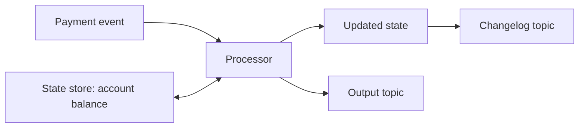
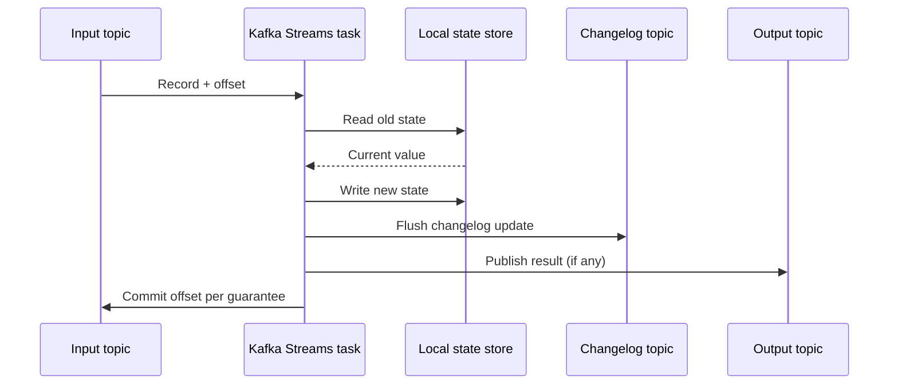
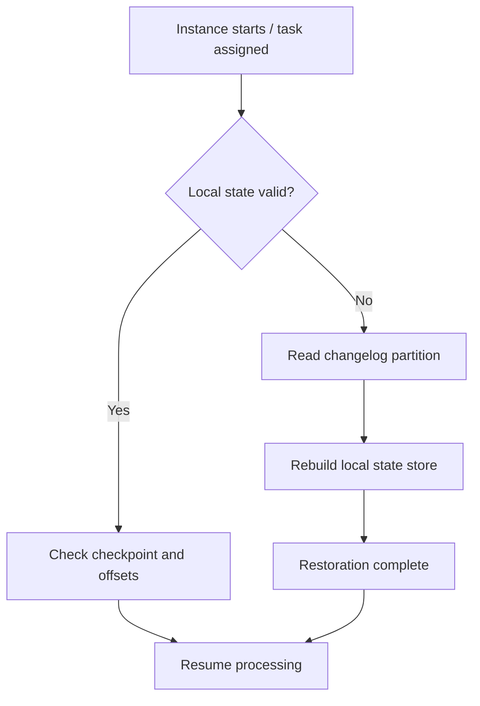

# Changelogs, Record Caching, and State Restoration

Kafka Streams can maintain state across records, such as total balance per account, order count per customer, or windowed aggregation totals. State is typically kept in a local state store for fast access. To prevent losing state when a process or host fails, Kafka Streams writes store mutations to a changelog topic on Kafka. When a task moves to another instance or local state becomes unusable, the runtime can rebuild the store by reading the changelog.

Caching batches multiple state updates together before writing to the store and emitting changelog/output records. It reduces I/O and intermediate records, yet also affects when updates become visible downstream. You need a clear understanding of all three layers: local state stores, durable changelogs on Kafka, and caching for batching. They work together to balance throughput, recoverability, and latency.

## 1. Why Does Stream Processing Need State?

A stateless transformation only inspects the current record. For instance, `mapValues` turns `OrderCreated` into `OrderAccepted` without knowing anything about prior records. Stateful processing must remember previously seen data to compute the next result.

For example, given payment events:

| Event | Account | Amount | Balance After Processing |
|---|---|---:|---:|
| `p-01` | `acc-7` | +500,000 | 500,000 |
| `p-02` | `acc-7` | -120,000 | 380,000 |
| `p-03` | `acc-7` | +80,000 | 460,000 |

To compute the new balance, the topology needs the previous balance of `acc-7`. Kafka Streams keeps this value in a state store partitioned by task/partition. When a new record arrives, the processor reads old state, computes new state, and updates the store.



A state store can be a key-value store, window store, or session store. `count`, `aggregate`, `reduce`, joins, and windowed aggregations generally require state. Stores can be queried locally, though the slice of data visible on a given instance depends on the partitions/tasks assigned to that instance.

## 2. Local State Stores and Changelog Topics

For persistent state stores, Kafka Streams commonly uses RocksDB as its local storage engine. Keeping data on local disk enables fast reads and writes without querying Kafka on every operation. However, local disk can be lost when a pod is replaced, a volume is wiped, or a task moves to another instance.

Kafka Streams creates a changelog topic to record state store mutations. Each update can be written as a record carrying the corresponding key/value. For key-value stores, changelogs typically use log compaction to keep the latest state for each key and support recovery. For window stores, cleanup configuration can combine compaction and retention/delete so expired data is removed according to the window lifecycle.

Changelog names are typically constructed from `application.id`, store name, and the `-changelog` suffix, for example:

```text
customer-balance-stream-account-balances-changelog
```

Exact names depend on topology structure, store name, and Kafka Streams version. A changelog is an internal topic managed by Kafka Streams; external business applications should not write directly to it.

| Component | Storage Location | Role |
|---|---|---|
| Local state store | Instance disk, typically RocksDB | Provides fast state access inside the running task |
| Changelog topic | Kafka broker | Stores state changes for recovery after failures or task migrations |
| Record cache | Kafka Streams process memory | Batches/coalesces updates before flushing to store and forwarding |
| Output topic | Kafka broker | Emits business results to downstream consumers |

The local store is the task's working copy. The changelog is the Kafka source used to reconstruct state when local state cannot be reused. Never treat the local state directory as the sole backup of business data.

## 3. How Are Changelogs Written and Used for Recovery?

For a persistent store with logging enabled, the general flow is:

1. Task receives a record from an input partition.
2. Processor reads current state from the local store.
3. Processor computes the new value and updates the store.
4. Changes flow through Kafka Streams' cache/flush path.
5. Upon flush, Kafka Streams writes a changelog record capturing the state mutation.
6. If the topology emits output, output records are sent to the output topic.
7. When a task needs recovery, the runtime reads the corresponding changelog partition and rebuilds the local store.

With `processing.guarantee=exactly_once_v2`, Kafka Streams coordinates writing outputs, changelogs, and committing input offsets within Kafka transactions under Kafka Streams semantics. With at-least-once, records may be reprocessed after a crash; state updates and outputs must be designed to match the active guarantee.



This diagram illustrates the conceptual sequence; caching, batching, and transactions may coalesce physical operations. Do not assume every single input record immediately emits exactly one changelog record or one output record.

### 3.1. Why Are Changelogs Typically Compacted?

For a key-value store, recovery aims to reconstruct the latest value per key. If key `acc-7` changes 100 times, the changelog may contain many versions for that key. Log compaction lets the broker retain only the latest version per key once compaction runs, reducing storage and restore read volume.

Compaction runs asynchronously. Do not assume older records vanish the instant a new record is written. For window/session stores, state lifecycles also involve time; retention and cleanup policies must match the store type and Kafka Streams version.

### 3.2. Disabling Changelogs Can Sacrifice Recoverability

Kafka Streams lets certain stores disable logging via topology configuration, such as `Materialized.withLoggingDisabled()`. Only use this when state can be fully reconstructed from another source or losing state does not break business correctness.

If logging is disabled and local state is lost, Kafka Streams has no changelog to restore the store. Tasks may have to restart from inputs under a reset strategy or the application may emit incorrect results without a full replay. Never disable changelogs solely to save broker storage without evaluating recovery implications.

## 4. Stateful Topology Example in the Kafka Streams Binder

Suppose we need to track cumulative balance per account. The input record key is `accountId`; the value is a transaction with a delta amount.

```java
@Bean
Function<KStream<String, PaymentEvent>, KStream<String, BigDecimal>> accountBalances() {
    return payments -> payments
            .groupByKey()
            .aggregate(
                    () -> BigDecimal.ZERO,
                    (accountId, payment, balance) -> balance.add(payment.amount()),
                    Materialized.as("account-balances"))
            .toStream();
}
```

`Materialized.as("account-balances")` gives a stable name to the state store. Kafka Streams uses the store name in the topology and typically uses it to name the changelog topic. Renaming the store can make the runtime treat it as a brand-new store, creating a new changelog and requiring state to be rebuilt from inputs; therefore, avoid renaming it casually during minor refactors.

Function and Kafka Streams Binder configuration:

```yaml
spring:
  cloud:
    function:
      definition: accountBalances
    stream:
      bindings:
        accountBalances-in-0:
          destination: payments.posted
        accountBalances-out-0:
          destination: accounts.balance-updates
    kafka:
      streams:
        binder:
          configuration:
            application.id: customer-balance-stream
            state.dir: /var/lib/customer-balance-stream
            replication.factor: 3
```

`application.id` identifies the logical Kafka Streams application, consumer group, and namespace for internal topics. Instances belonging to the same application must share the same ID to divide tasks and continue using the same state. `state.dir` sets where local state lives; each instance needs its own writable directory with adequate disk space. `replication.factor` controls the replication factor of internal topics created by Kafka Streams and must fit broker counts and cluster policies.

Never change `application.id` just to "refresh" a production application without a migration plan. A new ID creates a new logical application with separate offsets and internal topics; prior state will not carry over automatically.

## 5. How Does the Record Cache Work?

Kafka Streams includes a cache at the record/state store layer. When multiple records update the same key within a short interval, the cache can hold the latest value and coalesce updates prior to flushing. For example, if an account receives 100 consecutive transactions, the state store still needs to reflect the latest balance, yet downstream does not necessarily need all 100 intermediate updates when the topology uses KTable semantics and caching permits coalescing.

Caching can help:

- Reduce writes to RocksDB.
- Reduce emitted changelog records when multiple updates for the same key are coalesced.
- Reduce intermediate updates sent downstream in compatible topologies.
- Improve batching efficiency and reduce I/O under heavy traffic.

Caching also brings trade-offs:

- Updates may not appear immediately in changelogs or downstream until flushed.
- Larger caches consume more process memory.
- When the cache fills up, entries must flush; traffic across widely scattered keys can yield low coalescing efficiency.
- The cache does not replace changelogs, is not a durable store, and is not an idempotency mechanism.

Kafka Streams' record cache is not synonymous with application caches like Redis or Caffeine. Never keep business decisions solely in the record cache; the cache can vanish on process shutdown and data must recover from the store/changelog.

## 6. Cache Configuration and Flush Timing

Kafka Streams exposes configuration to cap cache size and govern commit/flush cycles. Cache configuration names and scopes have evolved across Kafka Streams generations; many versions use `cache.max.bytes.buffering`, while newer versions may offer finer-grained state store cache settings. Use the exact property supported by the Kafka client version brought in by your Spring Cloud BOM.

Illustrative example passing Kafka Streams configuration through the binder:

```yaml
spring:
  cloud:
    stream:
      kafka:
        streams:
          binder:
            configuration:
              cache.max.bytes.buffering: 10485760
              commit.interval.ms: 1000
```

In versions supporting these properties:

- `cache.max.bytes.buffering` sets the record cache memory budget for the Kafka Streams application; `10485760` equals 10 MiB.
- `commit.interval.ms` sets the maximum interval between commits/flushes according to the processing guarantee and runtime semantics.

Do not treat `commit.interval.ms` as a strict timer guaranteeing every output emits at that exact millisecond interval. Caches can flush early when hitting capacity limits; commits can be influenced by transactions, polling, processing, and task state. With exactly-once enabled, commit defaults and overhead differ from at-least-once; measure on your target version.

### 6.1. Large Cache vs. Small Cache?

| Cache | Typical Effect | Suitable When |
|---|---|---|
| Small | Flushes more frequently, fresher downstream updates, higher I/O | Lower update latency is needed and active keys are few |
| Large | Better opportunity to coalesce same-key updates, lower I/O and changelog traffic | High throughput, repeatedly updated keys, and available RAM budget |
| Disabled / 0 (as version supports) | Limits coalescing, flushes updates more frequently | Need visibility into every individual change or debugging, after weighing costs |

Size the cache based on workload rather than guesswork. If every record hits a distinct key, a large cache burns RAM with little coalescing. If a handful of hot keys update constantly, caching can dramatically cut flush volume.

## 7. Restoring State After Restarts

When an instance restarts, Kafka Streams checks local state and metadata to decide whether the store can be reused or must be restored. If local state is valid and the task remains compatible, the runtime can resume from existing state. If state is missing, corrupted, or the task moved to another instance, the runtime reads the changelog partition to rebuild state.



Restore duration depends on:

- Size of the changelog remaining to read after compaction.
- Number of assigned stores and partitions.
- Network, broker, disk, and CPU speeds.
- Serde and RocksDB write overhead.
- Cache, batching, and restore consumer settings.
- Number of instances restoring concurrently and current Kafka cluster load.

A large store can leave tasks unready to serve traffic while restoring. In production design, measure restore time and define SLAs for restarts and node replacements.

## 8. Standby Replicas to Reduce Recovery Time

Kafka Streams supports standby tasks: another instance maintains a near-up-to-date state replica by tailing the changelog, without actively processing inputs as the active task does. When the active task is lost, a standby replica can be promoted to active with far less data left to restore.

You can configure `num.standby.replicas` in Kafka Streams:

```yaml
spring:
  cloud:
    stream:
      kafka:
        streams:
          binder:
            configuration:
              num.standby.replicas: 1
```

A value of `1` requests one standby replica per task when enough eligible instances exist. This does not guarantee every task always has a ready standby in all situations: instance count, task assignment, and topology determine standby placement. With only one instance running, there is no second instance to hold an independent standby.

Standby replicas cut failover restore time at a cost:

- Extra disk usage for local state on standby instances.
- Increased network traffic from standbys consuming changelogs.
- Increased CPU and memory to maintain state.
- Requires enough instances and partitions for reasonable active/standby distribution.

Do not confuse standby replicas with the changelog topic's replication factor. Replication factor protects log durability on brokers; standby replicas maintain warm local state on another Kafka Streams instance. The two mechanisms complement each other.

## 9. State Restoration and Topology Changes

A changelog can only restore state if the new topology understands previously written data. Changing store names, key/value Serdes, schemas, or partitioning can cause restoration to fail or produce incompatible state.

Before making changes:

- Keep store names stable if existing state must continue to be used.
- Verify Serdes can read historical changelog records.
- Evaluate key or partition count changes because they alter state partitioning.
- Decide whether state migration is needed or whether to deploy a new application with a fresh `application.id`.
- Retain changelogs and internal topics long enough to support rollback/restore policies.
- Test upgrades against populated state from the prior version, not just fresh runs on empty topics.

If all state must be rebuilt from inputs, perform a reset/replay using supported Kafka Streams procedures and plan output topic handling. Never manually delete changelogs or local state while the application is running; doing so can leave tasks unrecoverable or yield corrupt results.

## 10. Window Stores, Retention, and Changelogs

For windowed aggregations, state is stored by key and window. A single key can have multiple coexisting windows. Window store retention controls how long window data remains queryable and preserved; grace period governs how long late events are accepted. Changelogs for window stores must use appropriate cleanup configurations to restore active windows without growing without bound.

Example materializing a window store:

```java
KTable<Windowed<String>, Long> orderCounts = orders
        .groupByKey()
        .windowedBy(TimeWindows.ofSizeAndGrace(
                Duration.ofMinutes(5), Duration.ofMinutes(1)))
        .count(Materialized.as("orders-per-customer-5m"));
```

When deploying, evaluate:

- Window size, grace, and retention.
- Key cardinality and concurrent open windows.
- Value size and update rate.
- Changelog partition count and replication factor.
- Compaction/retention policies on internal topics created by Kafka Streams.
- Local state directory capacity and restore duration.

Do not manually override cleanup policies on changelog topics as if they were ordinary business topics. Kafka Streams creates and manages internal topic configurations based on store type; manual edits can break recovery semantics.

## 11. Querying State Stores and Locality Boundaries

Kafka Streams allows querying state stores via Interactive Queries. However, an instance holds only the state of tasks/partitions assigned to it, plus global state if the topology uses a `GlobalKTable`/global store. Querying an arbitrary key may require locating the instance holding that key's partition.

When exposing a state read API:

- Use key/partition metadata to route requests to the instance hosting the active task.
- Decide whether the API serves active or standby data and its freshness expectations.
- Handle cases where tasks are currently restoring or rebalancing.
- Never assume every instance holds the entire partitioned state.
- Do not use Interactive Queries as a replacement for a transactional database when ad hoc queries, arbitrary joins, or multi-application writes are required.

Changelogs support state recovery; they do not automatically provide a distributed query API for the whole application. Your service/API layer must route requests and handle errors when the key-owning instance is unavailable.

## 12. Troubleshooting Common Issues

| Symptom | Possible Cause | Resolution |
|---|---|---|
| Restart loses state | Store disabled changelog, changelog was deleted, or `application.id` changed | Check internal topics, logging, and ID; restore/replay per plan |
| Startup takes a long time | Large changelog or task must restore many partitions | Check restore metrics, broker/disk/network speed, and consider standby replicas |
| Restore fails with deserialization error | Current Serde or schema cannot read older changelog entries | Maintain schema/Serde compatibility or perform controlled state migration |
| Internal topic cannot be created | Missing create/describe/write permissions or replication factor exceeds cluster capacity | Check ACLs, broker count, and replication factor |
| Local disk grows continuously | High state cardinality/retention or store not cleaned up | Inspect stores, window retention, `state.dir`, and volume capacity |
| Downstream receives fewer updates than expected | Cache coalesces multiple same-key updates before forwarding | Review cache and commit interval; decide if downstream needs snapshots or every event |
| Downstream sees delayed updates | Cache has not flushed yet or long commit/transaction interval | Measure latency and tune cache/commit per SLA |
| Increasing cache causes OOM | Cache budget too large relative to heap and stream thread count | Reduce cache, inspect heap and state store memory |
| Failover still restores slowly | No eligible standby or standby lags behind changelog | Check instance count, standby assignment, and restore lag |
| Renaming store leaves state empty | Runtime creates a new store/changelog | Keep names stable or execute an intentional migration/replay |

## 13. Monitoring Changelogs, Caches, and Restoration

Monitor both the Kafka Streams runtime and brokers:

- Restore rate, total restored records, restore latency, and time tasks spend in restoring state.
- Changelog topic throughput, partition count, replication health, and consumer lag of restore/standby tasks.
- State store size, disk usage under `state.dir`, and growth rate.
- Cache size, flush counts, coalescing/update ratio, and commit latency from client-version metrics.
- Task assignment, active/standby task counts, rebalances, and task migrations.
- Input lag, processing latency, output rate, and Serde errors.

Exact metric and JMX names depend on the Kafka Streams version. Enable appropriate exporters/metrics and tag by `application.id`, client ID, thread, task, and store. Alert when restoration drags on, standby lag climbs, disks near capacity, or changelog partitions lose ISR.

## 14. Testing State Recovery

Topology unit tests alone cannot prove changelogs are created and restored properly on a broker. Split your testing:

1. **TopologyTestDriver:** verify aggregations, state stores, and results across input record sequences.
2. **Kafka integration test:** start the application with a fixed `application.id`, send records, and verify state/outputs.
3. **Restart test:** cleanly stop the application, restart with the same ID and same state directory, and verify seamless continuation.
4. **Local state loss test:** use a fresh state directory or wipe local state while stopped in test, restart, and verify restoration from the changelog.
5. **Task migration test:** run multiple instances, stop one instance, and verify tasks migrate and state restores.
6. **Standby test:** enable `num.standby.replicas`, watch standbys catch up, fail over, and measure readiness time.
7. **Schema upgrade test:** write state using the prior version, deploy the new version, and confirm Serdes read historical changelog records.
8. **Cache test:** send multiple updates for the same key, verifying final results and when downstream receives updates under cache/commit settings.

Only wipe local state inside isolated test directories while the process is stopped. Never delete state/changelogs in production to "test recovery".

## 15. Pre-Deployment Checklist

- [ ] State stores have stable names and logging/changelogs are enabled where recovery is needed.
- [ ] `application.id` is consistent across instances of the same logical application.
- [ ] Internal changelog/repartition topics have proper ACLs, replication factor, and storage capacity.
- [ ] `state.dir` is a writable local directory with sufficient disk and is never improperly shared across instances.
- [ ] Cache is sized according to workload, RAM, and latency requirements.
- [ ] Team understands cache update coalescing and flush/commit timing.
- [ ] Record cache is not confused with a business cache or durable changelog.
- [ ] Changelogs are only disabled when state is rebuildable and local state loss is acceptable.
- [ ] `num.standby.replicas` is evaluated alongside instance count and resource costs.
- [ ] Window stores have suitable retention/grace and cleanup policies are not altered arbitrarily.
- [ ] Serdes/schemas remain compatible with older changelog records across upgrades.
- [ ] Restarts, local state loss, task migrations, standby failovers, and cache flushes are tested.
- [ ] Restore times, changelog health, state sizes, disk, cache, and task assignments are monitored.

Local state stores keep Kafka Streams fast; changelog topics persist mutations to rebuild state if local data is lost or tasks migrate. Record caching batches updates to reduce I/O and can coalesce intermediate mutations, trading off flush latency and observable output counts. Keep `application.id`, store names, Serdes, and internal topics compatible; measure restore times and consider standby replicas to meet recovery objectives. These are the core operational decisions for any stateful topology in the Spring Cloud Stream Kafka Streams Binder.

## References

- [Apache Kafka Streams — State Stores](https://kafka.apache.org/documentation/streams/developer-guide/processor-api.html#state-stores)
- [Apache Kafka Streams — Configuration](https://kafka.apache.org/documentation/streams/developer-guide/config-streams.html)
- [Apache Kafka Streams — Fault Tolerance and Standby Replicas](https://kafka.apache.org/documentation/streams/architecture.html)
- [Spring Cloud Stream Kafka Streams Binder Reference](https://docs.spring.io/spring-cloud-stream/reference/kafka/kafka-streams-binder/)
