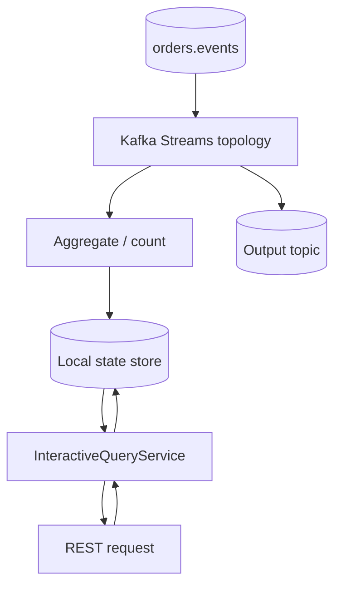
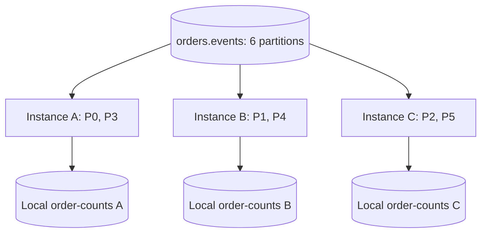
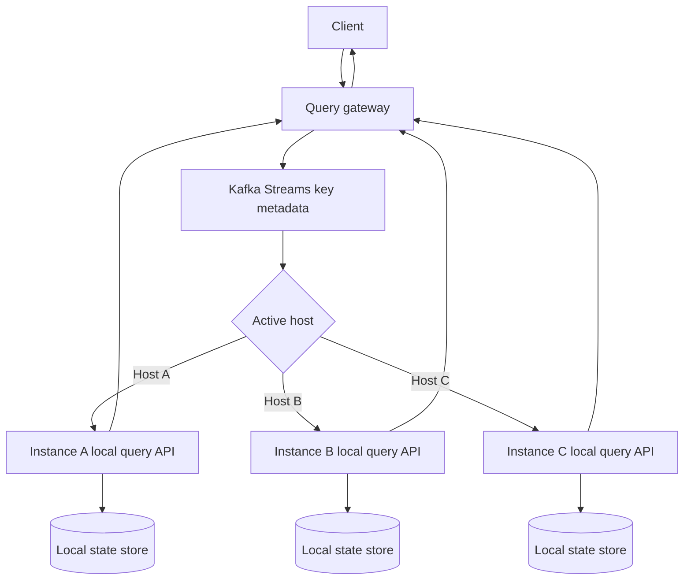

# InteractiveQueryService and Local State Query Limitations

## 1. What Are Interactive Queries Used For?

Kafka Streams does not just transform records and write results to topics. Operations like `count`, `aggregate`, `reduce`, joins, or windowed aggregations also maintain state inside state stores. An application can read that state directly to answer queries in near real time without waiting for another consumer to copy results into a separate database.

The Spring Cloud Stream Kafka Streams binder provides `InteractiveQueryService` to access state stores managed by Kafka Streams. From a store, an application can look up values by key, scan a key range, or query across a time window depending on the store type.

For example, suppose a topology counts orders per customer. Each `OrderCreated` event updates the `order-counts` state store. A REST endpoint can look up the current order count for a `customerId` via `InteractiveQueryService`.



Interactive Queries read the state maintained by Kafka Streams. They are useful for dashboards, fast lookup APIs, per-key state inspection, or serving a local projection. Understand partitioning boundaries and consistency guarantees before treating these results as a global data source.

## 2. Creating a Named State Store in the Topology

To query a store, the topology must materialize a store with a stable name. For key-based counting, you can use `groupByKey().count(Materialized.as(...))`:

```java
import java.util.function.Function;
import org.apache.kafka.streams.kstream.KStream;
import org.apache.kafka.streams.kstream.Materialized;
import org.springframework.context.annotation.Bean;
import org.springframework.context.annotation.Configuration;

record OrderCreated(String customerId, String orderId) {}

@Configuration
class OrderCountFunctions {

    @Bean
    Function<KStream<String, OrderCreated>, KStream<String, Long>> countOrders() {
        return orders -> orders
            .groupByKey()
            .count(Materialized.as("order-counts"))
            .toStream();
    }
}
```

In this example, the `KStream` key is `customerId`; each record increments the count for that key. `Materialized.as("order-counts")` names the state store so the application can query it. The resulting `KTable` is converted to a `KStream` to emit updates to the output topic.

Ensure producers write `customerId` into the Kafka record key. A `customerId` field inside the payload does not automatically become the key. If the key is not set appropriately, re-key before `groupByKey`, e.g., `selectKey((oldKey, order) -> order.customerId())`; changing keys may require repartitioning before aggregation.

Function bindings:

```yaml
spring:
  cloud:
    function:
      definition: countOrders
    stream:
      bindings:
        countOrders-in-0:
          destination: orders.events
        countOrders-out-0:
          destination: orders.counts
      kafka:
        streams:
          binder:
            applicationId: order-counts-app
```

`applicationId` identifies the logical Kafka Streams application. Instances of the same topology share the same application ID to divide partitions and restore state. Changing the application ID can make the application create a separate consumer group and state, reprocessing data per offset policy.

## 3. Retrieving a State Store via InteractiveQueryService

The Kafka Streams binder provides an `InteractiveQueryService` bean. You can inject this service into a component and request a store by name and store type:

```java
import org.apache.kafka.streams.state.QueryableStoreTypes;
import org.apache.kafka.streams.state.ReadOnlyKeyValueStore;
import org.springframework.cloud.stream.binder.kafka.streams.InteractiveQueryService;
import org.springframework.stereotype.Service;

@Service
class OrderCountQueries {

    private final InteractiveQueryService interactiveQueryService;

    OrderCountQueries(InteractiveQueryService interactiveQueryService) {
        this.interactiveQueryService = interactiveQueryService;
    }

    Long countForCustomer(String customerId) {
        ReadOnlyKeyValueStore<String, Long> store =
            interactiveQueryService.getQueryableStore(
                "order-counts",
                QueryableStoreTypes.keyValueStore()
            );

        return store.get(customerId);
    }
}
```

`getQueryableStore` returns a read-only view of the store named `order-counts`. `QueryableStoreTypes.keyValueStore()` declares the store type to query. If the store name does not exist in the topology or the store is not yet ready, the call can fail; handle startup and restoration states instead of assuming the store is always available.

`ReadOnlyKeyValueStore` is a read-only API. Never use Interactive Queries to mutate a state store. State must be updated through the Kafka Streams topology so changelogs, offsets, and recovery remain consistent.

## 4. Building a REST API to Query State

A controller can expose an endpoint reading order counts per customer:

```java
import org.springframework.http.ResponseEntity;
import org.springframework.web.bind.annotation.GetMapping;
import org.springframework.web.bind.annotation.PathVariable;
import org.springframework.web.bind.annotation.RestController;

record CustomerOrderCount(String customerId, Long count) {}

@RestController
class OrderCountController {

    private final OrderCountQueries queries;

    OrderCountController(OrderCountQueries queries) {
        this.queries = queries;
    }

    @GetMapping("/local/customers/{customerId}/order-count")
    ResponseEntity<CustomerOrderCount> count(@PathVariable String customerId) {
        Long count = queries.countForCustomer(customerId);
        if (count == null) {
            return ResponseEntity.notFound().build();
        }
        return ResponseEntity.ok(new CustomerOrderCount(customerId, count));
    }
}
```

This endpoint responds from the local state store of whichever instance receives the HTTP request. If the key belongs to a partition owned by a different instance, querying on the current instance will not find the key. Never interpret `null` from a local store as proof that the key does not exist anywhere in the application.

In a multi-instance deployment, identify the instance owning the key's partition and route the request there, or use a dedicated datastore serving global queries.

## 5. A Local State Store Holds Only a Subset of Data

For a partitioned KTable or state store, Kafka Streams splits partitions across tasks. Each instance holds only the tasks/partitions assigned to it. Therefore, a local state store typically contains only a fraction of the topology's full key space.

Example of a 6-partition topic with 3 application instances:



This diagram illustrates just one possible assignment. Kafka can redistribute partitions whenever instances change, rebalance, or the topology updates. Never hardcode partition-to-instance mappings in code.

When a REST request hits Instance A, `InteractiveQueryService` accesses A's store. If `customerId` hashes to a partition residing on B, A does not have that state in its local store. To query any key across the whole application, route to B or use a read model aggregated elsewhere.

One exception to remember is `GlobalKTable`: Kafka Streams maintains a full replica of a `GlobalKTable` on every instance, so the local global store can look up any key in the table once restoration finishes. Even so, this does not make local stores across instances a globally consistent distributed snapshot; individual instances may still update at slightly different times and still require readiness checks.

## 6. Distinguishing "Key Does Not Exist" from "Key Is Not on This Instance"

This is a critical limitation of local queries:

- `store.get(key)` returning `null` may mean the key has never appeared or was deleted in the local store.
- Yet in a multi-instance application, the key may belong to a partition currently owned by another instance.
- During a rebalance, stores may be temporarily unavailable or ownership may be shifting.

Accordingly, local endpoints should clearly advertise their scope, such as `/local/...`, or only be called after a request router directs traffic to the right host. A global API must distinguish `NOT_FOUND` from `NOT_LOCAL`/`NOT_READY` if the system manages routing itself.

Do not return `404 Not Found` from an arbitrary instance and present it as a global answer. If you want a simple client API, build a routing gateway/service so clients do not need to understand partition ownership.

## 7. Locating the Host Owning a Key

Kafka Streams provides metadata to identify which host holds the active task for a key in a state store. Distributed Interactive Queries typically follow these steps:

1. Identify the key and the serializer used to partition the key.
2. Fetch state store metadata for that key.
3. Identify the active host owning the partition.
4. If the active host is the current instance, query the local store.
5. If the active host is another instance, forward the request to that host's endpoint.
6. If no valid host exists or the topology is rebalancing, return a transient status and retry later.

Kafka Streams provides key-based metadata APIs, such as `queryMetadataForKey(storeName, key, keySerializer)` on `KafkaStreams`, to identify the active host and partition. The serializer must match how the key is serialized/partitioned in the topology. The Spring Cloud Stream Kafka Streams binder provides `InteractiveQueryService` to query stores; how metadata/hosts are resolved and integrated with service discovery depends on your binder version and deployment architecture.

### Configuring application.server

For instances to advertise an address for Interactive Queries, configure Kafka Streams `application.server` with a host and port reachable from other instances:

```yaml
server:
  port: 8080
spring:
  cloud:
    stream:
      kafka:
        streams:
          binder:
            configuration:
              application.server: ${QUERY_HOST}:${server.port}
```

`QUERY_HOST` must be the network address of that specific instance, not a shared load-balancer service pointing randomly at replicas. Each instance must advertise its own distinct endpoint. On Kubernetes, this can be the Pod IP or per-Pod DNS via a headless Service, depending on your routing design.

`application.server` only publishes endpoint metadata; it does not create a gateway, secure HTTP endpoints, or guarantee service discovery resolves the host. Your application needs a mechanism to call the active host and enforce access control.

## 8. Distributed Query Routing Example

A common architecture consists of a query gateway and Kafka Streams instances:



The gateway is responsible for finding the host owning the key and forwarding the request to that host. If metadata shows the key lives on the current host, the gateway can invoke the local service or query directly if in-process. If ownership shifts due to a rebalance, the gateway must refresh metadata and retry routing within bounded limits.

Do not route by sending requests to a standard load-balanced Kubernetes Service and hoping the request lands on the right Pod. An ordinary load balancer does not know which key belongs to which partition. You need host-metadata-based discovery or a partition-aware router.

## 9. Queryable State Store Types

Kafka Streams provides multiple store types, each with a corresponding read-only query API:

| Store Type | Read API | Use Case |
|---|---|---|
| Key-value | `ReadOnlyKeyValueStore<K,V>` | Looking up current state by key, range, or all keys |
| Window | `ReadOnlyWindowStore<K,V>` | Looking up values by key and time range |
| Session | `ReadOnlySessionStore<K,V>` | Looking up sessions by key or session range |

Example acquiring a key-value store:

```java
ReadOnlyKeyValueStore<String, Long> store =
    interactiveQueryService.getQueryableStore(
        "order-counts",
        QueryableStoreTypes.keyValueStore()
    );
```

For a window store, use `QueryableStoreTypes.windowStore()` and `ReadOnlyWindowStore`. For a session store, use `QueryableStoreTypes.sessionStore()` and `ReadOnlySessionStore`. Generic types must match the keys/values and Serdes configured in the topology.

## 10. Querying a Key-Value Store

`ReadOnlyKeyValueStore` supports common operations:

- `get(key)`: reads the current value for a single key.
- `range(from, to)`: reads a range of keys.
- `all()`: iterates over keys in the local store.
- `approximateNumEntries()`: returns an estimated entry count.

Example reading a key range:

```java
import org.apache.kafka.streams.KeyValue;
import org.apache.kafka.streams.state.KeyValueIterator;
import org.apache.kafka.streams.state.ReadOnlyKeyValueStore;

void logCustomerCounts(ReadOnlyKeyValueStore<String, Long> store,
                       String fromCustomerId,
                       String toCustomerId) {
    try (KeyValueIterator<String, Long> entries =
             store.range(fromCustomerId, toCustomerId)) {
        while (entries.hasNext()) {
            KeyValue<String, Long> entry = entries.next();
            System.out.printf("%s -> %d%n", entry.key, entry.value);
        }
    }
}
```

Always close iterators after use to release resources. `range` and `all` only scan data resident on the current instance; they do not call out to other instances automatically. Scanning an entire large store can consume heavy CPU and I/O and should not be exposed as a synchronous endpoint on large tables.

## 11. Querying a Window Store

Windowed aggregations store multiple values per key and time window. For example, counting orders per customer in 5-minute windows. The query API takes a key and a time range:

```java
import java.time.Instant;
import org.apache.kafka.streams.state.ReadOnlyWindowStore;
import org.apache.kafka.streams.state.WindowStoreIterator;

void readCounts(ReadOnlyWindowStore<String, Long> store,
                String customerId,
                Instant from,
                Instant to) {
    try (WindowStoreIterator<Long> values =
             store.fetch(customerId, from.toEpochMilli(), to.toEpochMilli())) {
        while (values.hasNext()) {
            var entry = values.next();
            System.out.printf("windowEnd=%d count=%d%n",
                entry.key, entry.value);
        }
    }
}
```

This example illustrates fetching a key across a time interval. Align queries with the topology's window retention and window semantics. Data older than retention may no longer exist in the store; queries cannot recover purged data.

## 12. Querying a Session Store

Session windows group events by key based on inactivity gaps. `ReadOnlySessionStore` lets you look up sessions by key or key range depending on the API. Results may return multiple sessions for the same key.

When designing an endpoint, decide:

- Whether to return all sessions or only the most recent session.
- How to bound the query time window.
- How to paginate or cap result counts.
- How to handle sessions merging when a new event bridges two active intervals.
- How to communicate that results can still change if late events arrive within the grace period.

Do not treat a session store like a table with a single value per key. Its data model and query semantics differ from a key-value store.

## 13. Store Not Ready and InvalidStateStoreException

During startup, Kafka Streams must build the topology, join the consumer group, receive partition assignments, and restore state stores. Before those steps complete, queries can hit `InvalidStateStoreException` or errors indicating the store is unavailable.

Similar situations occur when:

- An instance just started and is restoring state.
- Partitions are moving during a rebalance.
- The store is closed or the topology is shutting down/reconfiguring.
- The store name does not exist or was never materialized.
- The query requests the wrong store type.

Never catch the exception and return `null` as if the key does not exist. Distinguish an unready store from a missing key.

An endpoint can return `503 Service Unavailable` or a retryable status while the store is recovering. If retrying, use bounded attempts and backoff; never loop indefinitely on a request thread.

## 14. Rebalances Change Partition Host Ownership

Kafka Streams assigns tasks via partition assignment. When an instance joins or leaves the application, partitions can be reassigned. The corresponding state store may close on the old host, restore on the new host, and become queryable only after restoration finishes.

This creates transitional windows:

- Stale metadata still points to the pre-rebalance host.
- The old host is no longer the active owner of the key.
- The new host has not finished restoring state yet.
- Requests arriving during handoff can fail transiently.

Your router must handle stale hosts, refresh metadata, and retry. Local endpoints should report that the store is not ready rather than returning incomplete data as an authoritative answer.

## 15. Interactive Queries Are Not a Global Snapshot

Each instance updates local state at its own processing pace and partition assignment. When querying multiple keys across multiple instances, reads occur at slightly different points in time.

Consequently, a distributed API aggregating results across multiple hosts does not inherently observe a consistent snapshot at a single offset or instant. During a query, one host may already have processed a new event while another host has not yet processed its corresponding event.

If business logic demands a global consistent snapshot, design an explicit snapshot/version protocol or materialize data into a query datastore supporting those semantics. Interactive Queries suit near-real-time local state access, not cross-partition transactional reads.

## 16. Latency, Event Time, and Late Data

A state store reflects records already processed by the topology, not necessarily every record published by producers. Consumer lag, restoration, rebalances, or processing errors can make state trail behind the log end offset.

With windowed aggregations, event time and grace periods also affect results:

- Late events arriving within the grace period can update window results.
- Events arriving after the window closes may be dropped or routed per policy.
- Retention governs how long window state remains stored.
- A query executed while data is arriving may observe intermediate results.

APIs should expose timestamps/versions or last-updated times if clients need to judge data freshness. Never promise "strictly up-to-the-millisecond" results while the topology still experiences lag.

## 17. Securing Interactive Query Endpoints

State stores can contain customer data, transactions, or operational records. Query endpoints require the same security controls as business APIs:

- Authenticate callers and authorize access by tenant/key.
- Do not let clients arbitrarily query any key without authorization checks.
- Cap range scan bounds and maximum returned entries.
- Set timeouts on queries and remote host calls.
- Never leak raw internal state or sensitive metadata.
- Log query IDs, appropriately masked keys, target hosts, and error outcomes.
- Advertise `application.server` only on an appropriate internal network.

Never expose Interactive Queries ports directly to the public internet. If using a gateway, the gateway must enforce authorization before routing to the key-owning instance.

## 18. When to Use a Database Instead of Interactive Queries?

Interactive Queries fit well when data already lives in Kafka Streams state stores and near-real-time lookups within the topology's scope suffice. A dedicated database/read model may be better when:

- You need global queries, ad-hoc joins, or multi-dimensional filtering.
- You need APIs with pagination, secondary indexes, and explicit read transactions.
- You need long-term history or archival reporting.
- You do not want clients or gateways tied to host metadata and rebalances.
- You need read SLAs decoupled from Kafka Streams instance lifecycle states.

You can use Kafka Streams to update an external read model via an output topic or connector. In that setup, the database serves global queries while state stores remain useful for local stream processing.

## 19. Testing InteractiveQueryService

Tests should cover both populated stores and unready states:

1. Start the topology and verify the store materializes under the expected name.
2. Publish events with known keys and wait for the topology to process them.
3. Query keys via `InteractiveQueryService` and verify values.
4. Query a non-existent key and verify `null` is handled properly.
5. Query key ranges and verify iterators are closed after use.
6. Test window/session stores with valid time intervals.
7. Call endpoints before the store is ready and verify retryable status handling.
8. Run multiple instances to verify a local store is never mistaken for the full key space.
9. Test routing to the active host and handling stale metadata during rebalances.
10. Restart an instance and verify state restoration completes before marking queries ready.

Topology tests can verify stateful operations. Testing host metadata, partition ownership, and remote routing requires integration tests with multiple Kafka Streams instances.

## 20. Checklist for Designing State Query APIs

1. Identify the state store to query and give it a stable name using `Materialized.as` or binder configuration.
2. Pick the store type: key-value, window, or session.
3. Use `InteractiveQueryService` to obtain a read-only handle of the right store type.
4. Decide whether the API is local-only or application-wide.
5. If application-wide, fetch metadata by key and route to the active host.
6. Configure a distinct `application.server` per instance and integrate service discovery.
7. Distinguish non-existent keys, non-local keys, unready stores, and rebalancing hosts.
8. Bound ranges, timeouts, access permissions, and response sizes.
9. Monitor store restoration, query latency, routing failures, and consumer lag.
10. Choose a separate database/read model if global queries or consistent snapshots are required.

`InteractiveQueryService` helps Spring Cloud Stream applications read state stores maintained by Kafka Streams. However, direct queries see only the instance's local state; in multi-replica applications, a key may live on another host and ownership can shift during rebalances. Materialize named stores, choose the right store type, check readiness, and use metadata plus routing when distributed queries are required. Interactive Queries provide near-real-time access to streaming state, not a global database or a cross-partition consistent snapshot.

## References

- [Spring Cloud Stream Kafka Streams Binder — Interactive Queries](https://docs.spring.io/spring-cloud-stream/reference/kafka/kafka-streams-binder/interactive-queries.html)
- [Spring Cloud Stream Kafka Streams Binder — State Store](https://docs.spring.io/spring-cloud-stream/reference/kafka/kafka-streams-binder/state-store.html)
- [Apache Kafka Streams — Interactive Queries](https://kafka.apache.org/documentation/streams/developer-guide/interactive-queries/)
