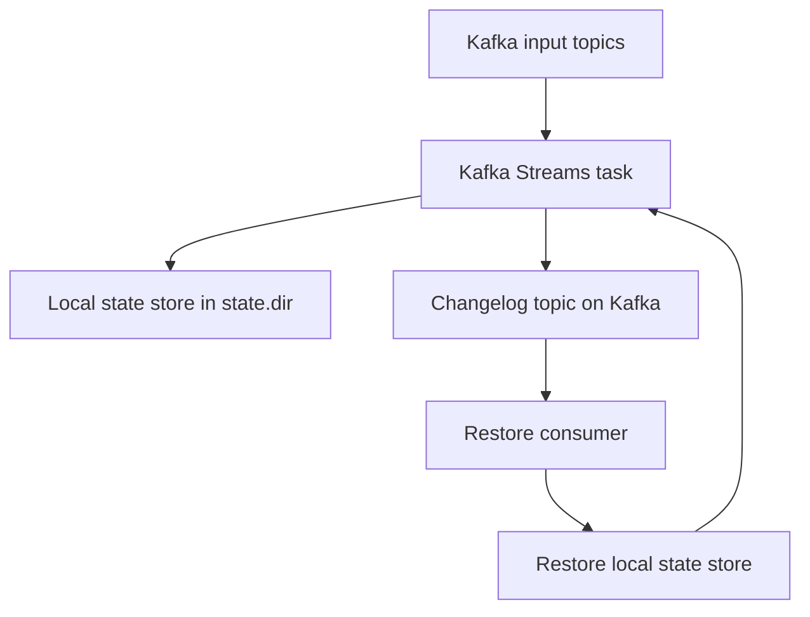

# State Directory, Disk Capacity, and Recovery Time

Kafka Streams maintains local state to perform stateful operations such as `count`, `aggregate`, joins, and windowing. This state is typically stored in a state store on the instance's disk and backed up by a changelog topic on Kafka when logging is enabled on the state store. Consequently, when a pod restarts or a task migrates to another instance, Kafka Streams can restore state by reading the changelog and rebuilding the local state store.

In Spring Cloud Stream, the Kafka Streams binder creates and manages the `KafkaStreams` instance for processor functions. The `state.dir` property specifies where state stores reside on the machine running the application. Choosing the right directory, provisioning sufficient disk capacity, and measuring restore time help the application recover after restarts/rebalances without causing prolonged disruption or filling up the disk.

This lesson focuses on operating Kafka Streams state stores: configuring `state.dir` through the binder, distinguishing local state from broker changelogs, estimating capacity, understanding cold/warm restores, using standby/warmup replicas, and observing restoration progress.

## 1. Where Do State Stores Live and What Do They Contain?

Stateful operations in Kafka Streams create state stores. For example:

- `count()` stores current counts per key.
- `aggregate()` stores accumulated values per key.
- Windowed aggregation stores state per key and time window.
- Stream/table joins may need to retain data to match later-arriving records.

For persistent state stores, Kafka Streams typically uses RocksDB to store data locally. Each Kafka Streams application instance has a subdirectory under `state.dir`; inside are per-task state store data, checkpoints, and metadata required for recovery.

Two storage locations must be distinguished:

| Storage Location | Role | When an Instance Loses Data |
| --- | --- | --- |
| `state.dir` on the application host | Local state copy for fast processing; may contain RocksDB files, checkpoints, and metadata | Kafka Streams rebuilds state from the changelog if the store has logging enabled and the changelog retains sufficient data |
| Changelog topic on Kafka | Record of state changes used by Kafka Streams to restore the store | Must be protected by replication, retention/compaction, ACLs, and Kafka cluster capacity |

The local state store is not the sole source of truth for the system. It is a working copy that can be restored from the changelog. However, the changelog must not be treated as a backup that can be deleted or altered arbitrarily: if the required changelog data is lost, Kafka Streams may be unable to recover current state.



The changelog topic records state store mutations. When a task needs recovery, Kafka Streams reads the relevant records from the changelog to reconstruct state on a new or restarted instance.

## 2. state.dir and Default Path

`state.dir` is the Kafka Streams configuration that specifies the directory for local state stores. If left unconfigured, Kafka Streams uses the JVM temporary directory (`java.io.tmpdir`); the actual path may vary by operating system, container image, and runtime environment.

Do not rely on the default temporary directory in production when you need control over disk capacity, disk performance, and retention policies. Specify a mount point whose capacity and performance have been evaluated.

For example, an application running on Linux might use:

```text
/var/lib/order-streams/state
```

Kafka Streams automatically creates a subdirectory structure for the application ID and state stores/tasks. Do not manually create state files inside or modify contents managed by Kafka Streams.

### Path Must Be Unique per Instance Sharing a Filesystem

If multiple Kafka Streams instances access the same filesystem, each instance must have its own `state.dir`. Never allow two Kafka Streams processes to write to the same state directory. Sharing a path can cause file conflicts, RocksDB lock errors, checkpoint corruption, and broken recovery.

If each pod/container has its own filesystem or dedicated volume, using the same configured path value can be safe because each instance sees a separate physical directory. If multiple instances mount a shared filesystem, provide a distinct path per instance, such as by pod name or instance ID.

## 3. Configuring state.dir in the Spring Cloud Stream Kafka Streams Binder

The Kafka Streams binder supports passing `StreamsConfig` properties via `configuration`. For an application with a single processor, you can configure it at the binder level:

```yaml
spring:
  cloud:
    function:
      definition: aggregateOrders
    stream:
      kafka:
        streams:
          binder:
            configuration:
              state.dir: ${KAFKA_STREAMS_STATE_DIR:/var/lib/order-streams/state}
              num.standby.replicas: 1
              acceptable.recovery.lag: 10000
```

Binder-level `configuration` applies to all Kafka Streams processors managed by the binder. When an application has multiple processor functions and each needs separate settings, configure per bean name:

```yaml
spring:
  cloud:
    function:
      definition: aggregateOrders;aggregatePayments
    stream:
      kafka:
        streams:
          binder:
            functions:
              aggregateOrders:
                configuration:
                  state.dir: ${ORDERS_STATE_DIR:/var/lib/order-streams/orders}
                  num.standby.replicas: 1
              aggregatePayments:
                configuration:
                  state.dir: ${PAYMENTS_STATE_DIR:/var/lib/order-streams/payments}
                  num.standby.replicas: 0
```

`functions.<function-bean-name>.configuration` applies only to the functional processor with that name. This is useful when processors have different state stores, application IDs, or recovery policies. If multiple instances share a filesystem, environment variable values must be provisioned uniquely per instance rather than pointing to the same physical directory.

### Note on Configuration Namespace

`state.dir` is a Kafka Streams property, so place it under `spring.cloud.stream.kafka.streams.binder.configuration` or `functions.<function-bean-name>.configuration`. Do not confuse it with `spring.cloud.stream.kafka.binder.configuration` of the regular Kafka message binder. The two binders have different configuration namespaces and purposes.

## 4. Choosing Local Disk, Ephemeral Volume, or Persistent Volume

Storage choices directly affect recovery speed:

| Storage Type | Advantages | Trade-offs |
| --- | --- | --- |
| Local SSD/NVMe | Low latency, high read/write throughput, well-suited for RocksDB | State can be lost if the node/pod is replaced; requires restoring from Kafka |
| Container ephemeral volume | Easy to deploy, isolated per pod | New pods usually start with empty state and must restore a large amount of data |
| Dedicated persistent volume per instance | Can preserve local state across restarts/pod reschedules when appropriate | Requires managing attach/detach, zone alignment, permissions, capacity, and separate paths |
| Shared network filesystem | Can simplify mounting across multiple hosts | Unstable latency and I/O can slow down RocksDB; multiple instances must never share the same state path |

With Kafka Streams, the changelog is the state recovery mechanism. Persistent volumes help reuse local state and reduce the amount of changelog data read on instance restart, but they do not replace changelogs or Kafka replication.

A common pattern in Kubernetes is mounting a fast dedicated volume per pod at `/var/lib/order-streams/state`. If using `emptyDir`, account for restore time when a new pod is created. If using a PVC, ensure the volume attaches to the right pod and multiple replicas never write to the same state directory.

Do not choose a persistent volume solely to "back up state." The changelog topic is the recovery source used by Kafka Streams. Protect both broker-side changelogs and local storage, and test complete local volume loss scenarios.

## 5. Estimating Disk Capacity

Required disk space is not merely the input payload size. A state store can hold aggregated data, indexes, metadata, logs, and temporary files during RocksDB compaction.

An initial estimation formula:

```text
Required capacity
  >= active state stores on the instance
   + standby state stores on the instance
   + extra headroom during RocksDB compaction/restore
   + checkpoints, metadata, and operational files
   + reserve headroom
```

Components to measure:

- **Active state:** total state store size of active tasks assigned to the instance.
- **Standby state:** state copies of standby tasks held on that instance.
- **Compaction overhead:** RocksDB may require extra space when writing new SST files before deleting old ones.
- **Restore overhead:** during restoration, data is written into RocksDB and may trigger compaction or temporary files.
- **Metadata/checkpoints:** files managed by Kafka Streams and RocksDB.
- **Growth/headroom:** key cardinality growth, window retention duration, partition count, and traffic growth.

### Capacity Calculation Example

Suppose an instance is measured at peak load:

| Component | Assumed Size |
| --- | ---: |
| Active state store | 48 GiB |
| Standby state store | 24 GiB |
| Compaction and restore overhead | 12 GiB |
| Metadata and operational files | 2 GiB |
| Growth reserve and headroom | 14 GiB |
| **Illustrative Total** | **100 GiB** |

This is only an illustrative calculation, not a universal sizing rule. Measure RocksDB size after the topology has processed representative data, then check at peak load and during compaction/restoration. Changelog size on the broker does not necessarily match local state store size due to differences in encoding, compaction, tombstones, and how RocksDB stores indexes.

### Do Not Monitor Disk Percentage Alone

Also track:

- Free bytes on the filesystem containing `state.dir`.
- Free inodes if the filesystem has inode limits.
- Daily/weekly storage growth rate.
- Disk I/O latency, throughput, and I/O wait time.
- Size per state store/task if collectible.
- RocksDB compaction frequency and state store write errors.

A full disk can prevent RocksDB from writing state, fail tasks, or prevent the application from completing restoration. Set alerts ahead of exhaustion thresholds and plan volume expansion.

## 6. Local State Size Differs from Changelog Size on Kafka

Local state stores live on the instance's disk. Changelog topics live on Kafka brokers and can be replicated across brokers according to the replication factor. Both parts must be sized separately:

| Component | Size Based On | What to Protect |
| --- | --- | --- |
| Local state store | Active/standby task count, RocksDB size, compaction, restore, and growth | Filesystem, latency, throughput, inodes, and headroom |
| Changelog topic | State mutation rate, key cardinality, compaction/retention, replication factor, and replica count | Broker disk, replication, retention/cleanup policy, and ACLs |

Never delete a changelog topic to free local disk space. If deleted or if retention is shortened improperly, an instance that loses local state may no longer have enough data to recover.

For critical state stores, do not disable changelog logging just to save broker disk unless an alternative state reconstruction mechanism has been designed and tested. `withLoggingDisabled()` changes the recoverability of the store.

## 7. How Does Kafka Streams Restore State?

When a task initializes or migrates to another instance, Kafka Streams checks the local state store and checkpoint:

1. If no local state store exists, Kafka Streams reads the changelog from the earliest needed position to rebuild state up to the current offset.
2. If the local state store exists and the checkpoint is valid, Kafka Streams resumes reading the changelog from the checkpointed offset instead of rebuilding everything.
3. Once state reaches the required position, the task can resume processing according to topology assignment and state.

That is why restarting on the same node with intact local state is usually faster than launching a new instance on an empty volume. If local state is deleted or unusable, recovery time depends on how much changelog data must be read and how fast the store can be rebuilt.

### Cold Restore and Warm Restore

| Scenario | Recovery Work | Typical Consequence |
| --- | --- | --- |
| Warm restore | Local state is intact; reads only the changelog portion after the checkpoint | Typically faster with lower broker load |
| Cold restore | Local state is empty or unusable; reads extensive changelog data to rebuild | Can be prolonged, increasing broker/network/disk I/O and delaying tasks |
| Restore from standby | Another instance has maintained a standby copy close to active state | Can substantially reduce data needing restoration on failover |

Kafka Streams requires accurate state before active tasks resume processing. Do not skip restoration just to turn health checks green sooner; if the application accepts business traffic before state is ready, results can be wrong.

## 8. Factors Determining Recovery Time

Restore duration depends on more than just byte count in the changelog. Key factors include:

- **Amount of data to read:** records and bytes missing compared to the checkpoint/local state.
- **Broker throughput:** speed of reading the changelog topic and serving concurrent restore consumers.
- **Network:** bandwidth, latency, and broker proximity relative to the instance.
- **Disk throughput:** RocksDB write, flush, and compaction speeds on `state.dir`.
- **CPU:** decoding keys/values, applying changelog records, and RocksDB processing.
- **Parallelism:** number of tasks/partitions restoring concurrently and resource contention.
- **Cluster condition:** rebalances, broker load, replication lag, and competing workloads.
- **Serdes and state structure:** large records, schema conversions, or custom restore logic can slow progress.

A rough estimate:

```text
Restore time
  ≈ changelog data to read / effective restore throughput
    + initialization, rebalance, and state transition time
```

Effective throughput is bounded by the slowest bottleneck among broker fetch, network, CPU/deserialization, and local disk writes. This is an estimation model; restoring many partitions in parallel can cause throughput to vary with load.

### Estimation Example

If an instance needs to restore 60 GiB of changelog data and sustained effective throughput is measured at 100 MiB/s:

```text
60 GiB = 61,440 MiB
61,440 MiB / 100 MiB/s = 614.4 seconds
614.4 seconds ≈ 10.2 minutes
```

Actual duration also includes startup, task assignment, RocksDB compaction, and I/O contention. Use measurements from a production-like environment rather than theoretical disk or network throughput.

## 9. Standby Replicas Help Reduce Failover Time

`num.standby.replicas` specifies the number of standby copies per task that Kafka Streams attempts to maintain. A standby is a local state store copy on another instance, updated from the changelog while the active task processes data.

Example configuration:

```yaml
spring:
  cloud:
    stream:
      kafka:
        streams:
          binder:
            functions:
              aggregateOrders:
                configuration:
                  num.standby.replicas: 1
```

When the active instance encounters an issue, Kafka Streams can migrate the task to the instance holding the standby. Because the standby is already close to caught up with the changelog, the remaining restoration gap is usually much smaller than a cold restore.

### Cost of Standby

- Requires extra local storage to hold state copies.
- Increases changelog read traffic and CPU/disk usage on standby instances.
- Requires enough instances to distribute active and standby tasks.
- If `n` standby replicas are enabled for a task, at least `n + 1` participating Kafka Streams instances are needed to place active and standby copies on separate instances.

Kafka Streams defaults to `num.standby.replicas = 0`. Increasing it to `1` generally lowers failover latency for stateful tasks, but it is not free. Size disk and broker traffic for the actual replica count.

Standby replicas are application-layer state copies. They differ from the Kafka changelog topic's replication factor: the replication factor protects data on brokers, whereas standby replicas keep pre-built state on processing instances.

## 10. Warmup Replicas and acceptable.recovery.lag

Kafka Streams can spin up warmup tasks to restore state in the background before migrating an active task to a target instance. This keeps the task running on the old instance serving traffic while the new instance catches up on the changelog.

Two related settings:

- `max.warmup.replicas`: limits how many warmup replicas are created concurrently for task recovery.
- `acceptable.recovery.lag`: the lag threshold in number of offsets at which a warmup task is considered close enough to current state to take over active assignment during rebalancing.

`acceptable.recovery.lag` is not a duration in seconds, nor does it mean the task has finished restoring. Once assigned active, Kafka Streams must still restore the remaining changelog gap before processing. Choose the threshold based on actual restore speed and acceptable system disruption time.

Example:

```yaml
spring:
  cloud:
    stream:
      kafka:
        streams:
          binder:
            functions:
              aggregateOrders:
                configuration:
                  num.standby.replicas: 1
                  acceptable.recovery.lag: 5000
                  max.warmup.replicas: 2
```

This is an illustrative configuration. `max.warmup.replicas` and probing rebalances can affect changelog traffic and the number of concurrently restoring tasks. Do not set warmup counts too high if brokers or disks lack capacity to serve multiple concurrent restore streams.

## 11. Observing Restore Progress with StateRestoreListener

Kafka Streams provides `StateRestoreListener` to monitor state store restoration progress:

- `onRestoreStart`: notifies that a task/store started restoring, along with starting and ending offsets.
- `onBatchRestored`: notifies after each batch of records is restored.
- `onRestoreEnd`: notifies when restoration finishes and reports total records restored.
- `onRestoreSuspended`: in supported versions, notifies that restoration was suspended because the task left the instance.

With the Spring Cloud Stream Kafka Streams binder, you can customize `StreamsBuilderFactoryBean` before Kafka Streams starts and register the listener:

```java
import org.apache.kafka.common.TopicPartition;
import org.apache.kafka.streams.processor.StateRestoreListener;
import org.springframework.context.annotation.Bean;
import org.springframework.kafka.config.StreamsBuilderFactoryBeanConfigurer;
import org.slf4j.Logger;
import org.slf4j.LoggerFactory;

public class StreamsRestoreConfiguration {

    private static final Logger log =
            LoggerFactory.getLogger(StreamsRestoreConfiguration.class);

    @Bean
    public StreamsBuilderFactoryBeanConfigurer restoreListenerConfigurer() {
        return factoryBean -> factoryBean.setKafkaStreamsCustomizer(
                kafkaStreams -> kafkaStreams.setGlobalStateRestoreListener(
                        new StateRestoreListener() {
                            @Override
                            public void onRestoreStart(
                                    TopicPartition partition,
                                    String storeName,
                                    long startingOffset,
                                    long endingOffset) {
                                log.info(
                                        "State restore started: store={}, partition={}, from={}, to={}",
                                        storeName, partition,
                                        startingOffset, endingOffset);
                            }

                            @Override
                            public void onBatchRestored(
                                    TopicPartition partition,
                                    String storeName,
                                    long batchEndOffset,
                                    long numRestored) {
                                log.debug(
                                        "State restore batch: store={}, partition={}, endOffset={}, records={}",
                                        storeName, partition,
                                        batchEndOffset, numRestored);
                            }

                            @Override
                            public void onRestoreEnd(
                                    TopicPartition partition,
                                    String storeName,
                                    long totalRestored) {
                                log.info(
                                        "State restore completed: store={}, partition={}, records={}",
                                        storeName, partition, totalRestored);
                            }
                        }));
    }
}
```

This is an example of observing restoration for one processor. If the application has multiple `StreamsBuilderFactoryBean` instances, filter by application ID in `StreamsBuilderFactoryBeanConfigurer` to attach the listener to the right processor. The listener is shared across stream threads; keep callbacks lightweight and thread-safe, and avoid slow database/API calls inside `onBatchRestored`, because heavy callbacks slow down restoration.

`StateRestoreListener` tracks active state restoration. Standby tasks are updated continuously from the changelog and have a separate listener, `StandbyUpdateListener`, in supported Kafka versions. Do not use `StateRestoreListener` to infer complete standby update progress.

## 12. Measuring Restore Lag and Recovery Time

To know whether an instance is ready, observe both offsets and state:

1. Record `startingOffset` and `endingOffset` when restoration starts.
2. Track `batchEndOffset` and record count per batch.
3. Measure elapsed time from `onRestoreStart` to `onRestoreEnd` per store/partition.
4. Cross-check against changelog partition lag and task state.
5. Record the timestamp when the processor transitions to `RUNNING` or the corresponding ready state.

Do not treat `endingOffset - startingOffset` as the exact record count in all cases: offsets can have gaps from compaction, tombstones, or internal records. It is useful for estimating the offset span to catch up, whereas `totalRestored` reflects the record count reported as restored by the callback.

Specific metrics and metric names may vary by Kafka Streams version. Combine callbacks with Kafka Streams metrics, broker metrics, and OS metrics rather than relying on a single consumer lag number.

## 13. Startup, Readiness, and Applications with Large State Stores

If a state store is very large, processor startup may take longer than Spring Boot context startup. If health probes only check the HTTP server, Kubernetes may see the application as running even though Kafka Streams has not finished restoring.

The Spring Cloud Stream Kafka Streams binder lets you control when processors start via `StreamsBuilderFactoryManager`. You can disable auto-startup of the Kafka Streams factory bean with:

```yaml
spring:
  kafka:
    streams:
      auto-startup: false
```

The application can then explicitly start processors via `StreamsBuilderFactoryManager` once required components are ready. Conceptual example:

```java
import org.springframework.boot.ApplicationRunner;
import org.springframework.context.annotation.Bean;
import org.springframework.cloud.stream.binder.kafka.streams.StreamsBuilderFactoryManager;

@Bean
ApplicationRunner startKafkaStreams(StreamsBuilderFactoryManager manager) {
    return args -> manager.start();
}
```

Verify package APIs against the binder version in use. Calling `start()` starts the processor; application readiness should still be based on Kafka Streams state and completion of required state store restoration, not merely on `start()` having been called.

Separating web server startup and processor startup can keep liveness probes from repeatedly restarting an application restoring large state. However, do not mark the processor ready before required tasks are ready to receive data.

## 14. Managing Cleanup and Topology Changes

Kafka Streams manages task state directories and can remove stale state after tasks have migrated. `state.cleanup.delay.ms` defines the wait time before deleting state directories no longer updated after migration; the default in Kafka 4.2 is 10 minutes.

Never manually delete a state directory currently used by a `KafkaStreams` instance. If state must be deleted to force a cold restore, stop the right processor/instance first, verify the application ID and state path, and then follow a tested runbook.

Changes that can force Kafka Streams to rebuild state:

- Deleting the local state directory.
- Changing the application ID, causing the app to use a different group/changelog namespace.
- Renaming a state store or changing the topology in a way that creates a new store/changelog.
- Moving an instance to a node/volume without local checkpoints.
- Losing the changelog or changing retention/compaction so insufficient recovery data remains.

Keep the application ID and state store names stable across compatible deployments. If a change is unavoidable, treat it as a migration: estimate data to replay, restore duration, broker capacity, and acceptable downtime.

## 15. Runbook When the State Directory Is Full or Corrupted

When an instance reports RocksDB write errors, `No space left on device`, or state restoration failures, proceed in order:

1. Identify the exact affected pod/instance, application ID, `state.dir`, and state store.
2. Check filesystem capacity, inodes, I/O latency, and RocksDB/Kafka Streams logs.
3. Verify the changelog topic still exists, has sufficient retention/compaction, and has proper broker ACLs.
4. If volume expansion is needed, follow your platform's storage procedure and verify the filesystem recognizes the new capacity.
5. If local state corruption is suspected, gracefully stop the processor/instance before isolating or deleting that instance's local state directory.
6. Restart and observe restore progress from the changelog.
7. Verify state stores finish restoring, the processor transitions to ready state, and consumer lag decreases as expected.
8. Record restored data volume, recovery time, and root cause to update your capacity plan.

Never delete the changelog topic to work around a local disk error. Never delete a state directory currently in use by a running process. If the changelog no longer has enough data, stop destructive actions and build a recovery plan from upstream business data sources or dedicated snapshots.

## 16. Testing Recovery Time

Both warm restore and cold restore should be tested in a production-like environment:

| Scenario | Test Method | What to Verify |
| --- | --- | --- |
| Warm restart | Perform a controlled stop and restart on the same volume | Restore reads only changelog records after checkpoint and finishes within SLA |
| Cold start | Use an empty state volume in an isolated test environment | State is rebuilt from changelog and output results are accurate |
| Pod/node replacement | Launch a new instance on another node | Tasks are assigned, restored, and return to RUNNING properly |
| Standby failover | Stop the instance holding active tasks when standby is enabled | Standby instance is promoted and disruption stays within target |
| Disk near full | Constrain disk space in a test environment | Alerts fire before stores fail to write; runbook handles it properly |
| Concurrent multi-task restore | Increase partition/task count in a test environment | Brokers, network, and local disk do not suffer prolonged overload |
| Changelog unavailable | Use a test environment with controlled ACL or topic errors | Application reports clear errors and does not falsely mark processor ready |

Do not test cold restore by deleting state or changelogs in production. Use a separate application ID and test topics so real business state is unaffected.

## 17. Key Metrics to Monitor

| Category | Metrics | Meaning |
| --- | --- | --- |
| Disk | Free bytes, inodes, disk usage by state path | Detect risk of disk exhaustion |
| Disk I/O | Read/write throughput, latency, I/O wait | Detect local storage slowing down RocksDB/restoration |
| State | Store size, active/standby task count, RocksDB compaction | Track growth and local state overhead |
| Restore | Restore start/end, records restored, offset range, restore duration | Measure cold/warm restore duration |
| Kafka | Changelog lag, broker fetch throughput, replication health | Verify recovery data source is available and fast enough |
| Runtime | KafkaStreams state, rebalances, task migration, processor readiness | Know whether the app has recovered and is ready to process |
| SLA | Elapsed time from restart/failover until processor ready | Compare against service recovery objectives |

Set alerts based on growth trends and SLAs. For instance, alert when free space drops below an operational threshold, restore duration exceeds limits, or tasks repeatedly re-restore due to rebalances. Do not watch CPU alone: an application with low CPU can still be bottlenecked on broker fetch or disk I/O.

## 18. Common Issues and Troubleshooting

| Symptom | Possible Cause | Resolution |
| --- | --- | --- |
| Every restart restores full state | `state.dir` is on ephemeral storage or local state is not preserved | Provision an appropriate local state path; evaluate persistent volumes if reducing cold restores is needed |
| Two instances report state store/lock errors | Sharing one `state.dir` on a filesystem | Provide a separate path per instance |
| Disk full even though input topic is modest | State stores, indexes, standbys, compaction, and temporary files increase usage | Measure actual store size, account for standby and compaction overhead, expand volume |
| Prolonged restore despite healthy brokers | Slow local disk, heavy CPU/Serdes, or too many concurrent restoring tasks | Measure throughput per layer, optimize storage, and limit warmup concurrency |
| Task disruption when scaling instances | New instance has not caught up on state | Use standby/warmup replicas and tune `acceptable.recovery.lag` to workload |
| Old state deleted after migration | Cleanup or manual action targeted the wrong directory | Check `state.cleanup.delay.ms` and never delete active state directories |
| Processor ready before state restore finishes | Readiness only checks web server or ApplicationContext | Tie readiness to Kafka Streams state and completed restoration |
| Restore fails after changing application ID | App uses a new changelog namespace or needs rebuild | Treat application ID changes as migrations and estimate full restore |
| State unrecoverable after deleting local files | Changelog topic missing, deleted, or insufficient retention | Verify changelog durability/retention and upstream snapshot sources |

## 19. Production Deployment Checklist

Before releasing a Kafka Streams processor with state stores:

- Configure `state.dir` explicitly rather than relying unexpectedly on default `java.io.tmpdir`.
- Ensure every instance sharing a filesystem has a dedicated state path.
- Choose local SSDs or volumes with latency/throughput suited for RocksDB.
- Measure state stores under representative load and account for active, standby, compaction, restore, growth, and headroom.
- Protect changelog topics with appropriate replication, retention/compaction, and ACLs.
- Keep application IDs and store names stable across compatible deployments.
- Choose `num.standby.replicas` based on failover SLA and capacity.
- Set `acceptable.recovery.lag` based on offset catch-up and actual restore speed.
- Monitor restore listeners, Kafka Streams state, and local disk metrics.
- Decouple processor readiness from web server liveness when large state needs restore time.
- Test warm restore, cold restore, failover, disk pressure, and rebalances.
- Maintain a runbook for disk full/state corruption without accidentally deleting changelogs or active state.

## References

- [Apache Kafka 4.2 — Kafka Streams Configs (`state.dir`, `num.standby.replicas`, `acceptable.recovery.lag`)](https://kafka.apache.org/42/configuration/kafka-streams-configs/)
- [Apache Kafka 4.2 — Running Streams Applications and State Restoration](https://kafka.apache.org/42/streams/developer-guide/running-app/)
- [Apache Kafka — Configuring a Streams Application](https://kafka.apache.org/42/streams/developer-guide/config-streams/)
- [Apache Kafka — StateRestoreListener API](https://kafka.apache.org/44/javadoc/org/apache/kafka/streams/processor/StateRestoreListener.html)
- [Spring Cloud Stream 5.0.4 — Kafka Streams Binder Configuration Options](https://docs.spring.io/spring-cloud-stream/reference/kafka/kafka-streams-binder/configuration-options.html)
- [Spring Cloud Stream 5.0.4 — State Store](https://docs.spring.io/spring-cloud-stream/reference/kafka/kafka-streams-binder/state-store.html)
- [Spring Cloud Stream 5.0.4 — StreamsBuilderFactoryBean Configurer](https://docs.spring.io/spring-cloud-stream/reference/kafka/kafka-streams-binder/streamsbuilderfactorybean-customizer.html)
- [Spring Cloud Stream — Manually Starting Kafka Streams Processors](https://docs.spring.io/spring-cloud-stream/reference/kafka/kafka-streams-binder/manually-starting-processors.html)

Default values and APIs may change across Kafka Streams, Spring Kafka, and Spring Cloud Stream release trains. Verify your project's actual configuration before applying examples.

## Conclusion

`state.dir` stores Kafka Streams' local state; the changelog topic on Kafka holds the data needed to recreate state when local stores are lost or tasks migrate. Provide a dedicated path for each instance sharing a filesystem, size disks for active/standby stores plus compaction and restore overhead, and measure restore time with realistic data. Standby/warmup replicas can shorten failover time but require additional storage, broker traffic, and instance capacity. During operations, monitor disk usage, changelog lag, restore listeners, and processor readiness; never delete active state directories or changelog topics arbitrarily.
