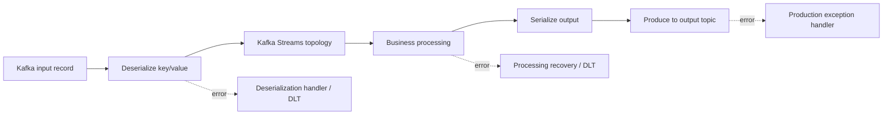

# Handling Deserialization, Processing, and Production Exceptions

A Kafka Streams topology receives records from Kafka, deserializes keys/values, executes transformations, and writes results to topics or state stores. Errors can arise at each stage: input data fails to deserialize, business logic throws an exception, or the producer fails to write output. Because these three error categories occur at different boundaries, each requires an appropriate handling mechanism.

The Spring Cloud Stream Kafka Streams Binder integrates deserialization handlers and DLQ support for input records. For errors in application logic, the binder provides `RecordRecoverableProcessor` and `DltAwareProcessor`, and creates a `RetryTemplate` per input binding to retry critical business calls. For output write errors, you can configure Kafka Streams `ProductionExceptionHandler` via `StreamsBuilderFactoryBeanCustomizer`. Classifying errors accurately before choosing an action keeps the topology running safely without silently dropping data.

## 1. Identifying Which Stage Failed

A record passes through key stages:



| Error Type | Examples | Handling Component |
|---|---|---|
| Deserialization | Malformed JSON/Avro schema, invalid bytes, incompatible Serde | Kafka Streams Binder `DeserializationExceptionHandler` |
| Processing | Unexpected null, validation failure, database/REST call throwing an exception | Application logic, `RecordRecoverableProcessor`, `DltAwareProcessor`, `RetryTemplate`, or `ProcessingExceptionHandler` |
| Production | Output record too large, serialization failure, broker rejects write | `ProductionExceptionHandler` |
| Thread/runtime error | Uncaught exception, fatal stream thread error, or state restoration error | Kafka Streams uncaught exception handler, lifecycle listener, and operations |

Do not use `sendToDlq` as a catch-all for every error. The deserialization handler only handles records that fail to decode on input. It does not automatically catch exceptions thrown inside `mapValues`, `process`, or business services. Likewise, `ProductionExceptionHandler` handles failures when writing records to the broker, not input deserialization errors.

## 2. Deserialization Happens Before Business Logic

Kafka Streams needs a `Serde` to convert keys/values from bytes into Java types. The Kafka Streams Binder normally uses native Serdes at input/output boundaries. The binder can infer Serdes from `KStream` generic types, declared `Serde` beans, or common types such as `String`, `Long`, `UUID`, and `byte[]`. If it cannot infer them, you must declare Serdes explicitly.

Example function receiving order events:

```java
@Bean
Function<KStream<String, OrderCreated>,
         KStream<String, OrderCreated>> validateOrders() {

    return input -> input
        .filter((key, event) -> event != null)
        .mapValues(this::normalize);
}
```

If the value in Kafka cannot be decoded into `OrderCreated`, Kafka Streams cannot pass a valid `OrderCreated` object into the topology. Consequently, `normalize()` or `filter()` will not even be invoked. The error must be handled at the deserialization layer.

Common causes:

- Producer and consumer use incompatible schemas.
- Producer renames a field or changes its type before the consumer supports it.
- Consumer selects the wrong `Serde` or serializer/deserializer class.
- Payload is truncated, corrupted, or uses the wrong encoding.
- Topic contains multiple event types while the consumer only supports one type.
- Native decoding and Spring Cloud Stream message conversion are configured inconsistently.

Before choosing to skip records or route them to a DLQ, inspect the schema contract, versioning, Serde, and how the producer emits records. If data is valid under an older schema, adding reader compatibility may be better than discarding messages.

## 3. Configuring the Right Serde for Input Bindings

You can declare Serdes per input binding:

```yaml
spring:
  cloud:
    function:
      definition: validateOrders
    stream:
      bindings:
        validateOrders-in-0:
          destination: orders.created
      kafka:
        streams:
          bindings:
            validateOrders-in-0:
              consumer:
                keySerde: org.apache.kafka.common.serialization.Serdes$StringSerde
                valueSerde: com.example.kafka.OrderCreatedSerde
```

When you need default Serdes for the binder, you can use `spring.cloud.stream.kafka.streams.binder.configuration.default.key.serde` and `default.value.serde`. Per-binding configuration lets one input use a specific schema or data type without affecting other inputs.

In the Kafka Streams Binder, native decoding is enabled by default. If you want Spring Cloud Stream to convert payloads via message converters, you must disable native decoding on the corresponding input binding:

```yaml
spring:
  cloud:
    stream:
      bindings:
        validateOrders-in-0:
          consumer:
            nativeDecoding: false
          contentType: application/json
```

Only disable native decoding when the producer and converter share a compatible contract. If continuing to use native Serdes, configure the correct key/value Serdes and do not rely on `contentType` to fix a misconfigured Serde.

Keys are always decoded using native Serdes in the Kafka Streams Binder model. When there are multiple inputs, configure Serdes and decoding for each binding individually; one input using Avro does not mean other inputs use the same Serde.

## 4. Choosing a Deserialization Policy: Fail, Continue, or DLQ

Kafka Streams has two built-in handlers:

- `LogAndFailExceptionHandler`: logs the error and fails stream processing. This is Kafka Streams' default.
- `LogAndContinueExceptionHandler`: logs the error and skips the bad record to process the next record.

The Kafka Streams Binder adds the option to send bad records to a Dead Letter Topic (DLT) via `sendToDlq`.

| Policy | Behavior | When Appropriate |
|---|---|---|
| `logAndFail` | Logs the error and stops processing per handler | Bad data must be investigated before continuing |
| `logAndContinue` | Logs and skips the undecodable record | Dropping bad records from computation is acceptable |
| `sendToDlq` | Sends the undecodable record to a DLT | Bad data needs to be isolated and reprocessed later |
| `skipAndContinue` | Skips the bad record in supported per-binding configuration | A specific input is allowed to continue past poison records |

Example enabling DLT at the binder level:

```yaml
spring:
  cloud:
    stream:
      kafka:
        streams:
          binder:
            deserializationExceptionHandler: sendToDlq
```

Binder-level configuration applies to all processors/inputs in that Kafka Streams application. If the application has multiple functions or multiple input bindings with different requirements, use per-binding configuration to narrow the scope.

Example sending errors from the orders input to a DLT while allowing the customer lookup input to skip bad records:

```yaml
spring:
  cloud:
    function:
      definition: enrichOrders
    stream:
      kafka:
        streams:
          bindings:
            enrichOrders-in-0:
              consumer:
                deserializationExceptionHandler: sendToDlq
                dlqName: orders-deserialization-dlt
            enrichOrders-in-1:
              consumer:
                deserializationExceptionHandler: skipAndContinue
```

The `spring.cloud.stream.kafka.streams.bindings.<binding>.consumer.deserializationExceptionHandler` setting takes precedence over the binder-level choice. Use the binding names generated by the function, such as `enrichOrders-in-0` and `enrichOrders-in-1`.

**Skipping records is a business decision.** When using `logAndContinue` or `skipAndContinue`, the failed record is not processed by the topology. If that record represents a financial transaction, order state change, or audit event, skipping it can produce incomplete state. In such cases, prefer failing to halt and investigate, or routing the record to a DLT/quarantine.

## 5. Configuring the DLT and Routing Failed Records

When selecting `sendToDlq`, you can specify a DLT name per input binding with `dlqName`. If omitted, the binder generates a default name in the form:

```text
error.<input-topic-name>.<application-id>
```

Example:

```yaml
spring:
  cloud:
    stream:
      kafka:
        streams:
          bindings:
            enrichOrders-in-0:
              consumer:
                deserializationExceptionHandler: sendToDlq
                dlqName: orders.created.deserialization-dlt
```

By default, the binder sends failed records to the same partition index as the original record. Thus, the DLT needs at least as many partitions as the source topic if you want to preserve default partition mapping. Using the same partition helps correlate data and preserve key-based partitioning, though it does not inherently guarantee business ordering between the main topic and the DLT.

If `dlqPartitions` is configured as `1` and the binder's `minPartitionCount` is also `1`, the binder can use partition 0 without a custom bean. If either value is greater than `1`, you must provide a `DlqPartitionFunction`, even when the DLT partition count equals the source partition count.

You can customize partitioning via a `DlqPartitionFunction` bean:

```java
import org.springframework.cloud.stream.binder.kafka.streams.DlqPartitionFunction;
import org.springframework.context.annotation.Bean;
import org.springframework.context.annotation.Configuration;

@Configuration
public class StreamsDlqConfiguration {

    @Bean
    DlqPartitionFunction dlqPartitionFunction() {
        return (group, record, exception) -> 0;
    }
}
```

This example routes all failed records to partition 0. Only one `DlqPartitionFunction` bean may exist in the application context. When using a custom partition strategy, ensure the target topic has the corresponding partition.

If you need to select a DLT based on source topic, tenant, or error type, you can declare a `DlqDestinationResolver`:

```java
import org.springframework.cloud.stream.binder.kafka.streams.DlqDestinationResolver;
import org.springframework.context.annotation.Bean;

@Bean
DlqDestinationResolver dlqDestinationResolver() {
    return (record, exception) -> {
        if ("orders.created".equals(record.topic())) {
            return "orders-deserialization-dlt";
        }
        return "other-deserialization-dlt";
    };
}
```

When using a dynamic resolver, the binder cannot infer all DLT names to auto-provision them. The application/infrastructure must pre-create target topics and configure partitions, replication, retention, and ACLs. If a resolver bean exists, it takes precedence over static DLT names.

## 6. Is Routing Failed Records to a DLT Safe?

An undecodable record has no converted Java object. You need to preserve the original data and sufficient metadata for investigation:

- Source topic, partition, and offset.
- Original timestamp and key.
- Raw undecoded payload bytes if provided by the handler mechanism.
- Serde name or schema version in use.
- Exception class and error details.
- Application ID, binding, and processing timestamp.
- Correlation/event ID if metadata is still readable.

The DLT must have appropriate access controls and retention. Payloads may contain sensitive data; do not grant broader read permissions on the DLT than on the source topic without justification. Avoid logging full payloads or credentials.

Do not replay failed records back into the main topic before fixing the root cause. If the producer schema remains incompatible, records will keep failing and bouncing back to the DLT. Replay procedures must verify that schemas, Serdes, and consumer versions have been fixed.

## 7. Processing Errors: Exceptions from Application Logic

The deserialization handler does not intervene when exceptions are thrown inside business code. Example:

```java
@Bean
Function<KStream<String, OrderCreated>,
         KStream<String, OrderSummary>> summarizeOrders() {

    return orders -> orders.mapValues(event -> {
        if (event.total() == null) {
            throw new IllegalArgumentException("total is required");
        }

        return OrderSummary.from(event);
    });
}
```

If `event.total()` is null, the exception occurs during record processing. Setting `deserializationExceptionHandler: sendToDlq` does not catch this exception because the record was already deserialized successfully.

Kafka Streams provides `ProcessingExceptionHandler` in supported versions. This handler decides `FAIL` or `CONTINUE` for exceptions during record processing. The default handler is `LogAndFailProcessingExceptionHandler`; `LogAndContinueProcessingExceptionHandler` logs and skips the failed record. This is a separate mechanism from the deserialization handler and does not automatically send records to a DLT.

In the Kafka Streams Binder, the explicit way to handle application errors per record is to use `RecordRecoverableProcessor` or `DltAwareProcessor`.

## 8. Using DltAwareProcessor to Route Business Errors to a DLT

`DltAwareProcessor` is a `RecordRecoverableProcessor` implementation provided by the Kafka Streams Binder. It wraps single-record processing logic; if the logic throws an exception, the processor sends the failed record to the specified DLT via `DltPublishingContext`.

Example function that only processes records without emitting an output stream:

```java
import org.apache.kafka.streams.kstream.KStream;
import org.springframework.cloud.stream.binder.kafka.streams.DltAwareProcessor;
import org.springframework.cloud.stream.binder.kafka.streams.DltPublishingContext;
import org.springframework.context.annotation.Bean;

import java.util.function.Consumer;

@Bean
Consumer<KStream<String, OrderCreated>> processOrders(
        DltPublishingContext dltPublishingContext,
        OrderService orderService) {

    return input -> input.process(() ->
        new DltAwareProcessor<>(
            record -> {
                OrderCreated event = record.value();

                if (event.total() == null || event.total().signum() < 0) {
                    throw new InvalidOrderException(
                        "Invalid total for order " + event.orderId()
                    );
                }

                orderService.apply(event);
                return null;
            },
            "orders-processing-dlt",
            dltPublishingContext
        )
    );
}
```

This example focuses on the processing and recovery boundary. `DltPublishingContext` is auto-configured by the binder and provides publishing infrastructure. The handler function receives a record and runs business logic; if it throws an exception, `DltAwareProcessor` sends that record to the DLT.

Use an explicit DLT topic name, create the topic before deployment, and grant publish permissions to the application. If the DLT key is of type `String`, configure the key serializer for the DLT output binding:

```yaml
spring:
  cloud:
    stream:
      kafka:
        bindings:
          orders-processing-dlt:
            producer:
              configuration:
                key.serializer: org.apache.kafka.common.serialization.StringSerializer
```

`DltAwareProcessor` uses `StreamBridge` and the regular Kafka binder to publish to the DLT. The value is converted to bytes using Spring Cloud Stream's mechanism, whereas keys are not automatically converted in the same way. If the key is not `byte[]`, configure the corresponding serializer. Do not assume DLT publishing uses the same Serde as Kafka Streams binder output bindings.

## 9. RecordRecoverableProcessor with Custom Recovery

If you do not want to send failed records to a DLT, you can use `RecordRecoverableProcessor` directly. Its constructor accepts a record-processing function and a `BiConsumer` recoverer receiving both the record and the exception.

```java
import org.springframework.cloud.stream.binder.kafka.streams.RecordRecoverableProcessor;

@Bean
Consumer<KStream<String, OrderCreated>> processOrders(
        OrderService orderService,
        ErrorAuditService auditService) {

    return input -> input.process(() ->
        new RecordRecoverableProcessor<>(
            record -> {
                orderService.apply(record.value());
                return null;
            },
            (record, exception) -> {
                auditService.recordFailure(
                    record.key(),
                    record.value(),
                    exception
                );
            }
        )
    );
}
```

This example records failures into an audit service and lets the topology continue. If the recoverer only logs and moves on, the record will not be reprocessed automatically. Retain sufficient metadata for later investigation or recovery.

Never swallow exceptions when business semantics require guaranteed processing. The recoverer must take explicit action: DLT, quarantine, durable error status persistence, or halting the pipeline. If the audit service can also fail, define a policy for failures on the recovery path itself; otherwise, the secondary exception can crash the stream thread.

## 10. Retrying Critical Business Calls

A processor may call a database or REST service while handling a record. Transient network errors may resolve after a brief wait. The Kafka Streams Binder creates a `RetryTemplate` per input binding so applications can retry critical logic.

For a function named `process`, the default input binding is `process-in-0` and its RetryTemplate bean is named `process-in-0-RetryTemplate`. With multiple input bindings, each input gets its own RetryTemplate.

Example injecting the template by qualifier:

```java
import org.springframework.beans.factory.annotation.Qualifier;
import org.springframework.context.annotation.Lazy;
import org.springframework.retry.support.RetryTemplate;

@Bean
Consumer<KStream<String, OrderCreated>> process(
        @Lazy @Qualifier("process-in-0-RetryTemplate")
        RetryTemplate retryTemplate,
        PaymentClient paymentClient) {

    return input -> input.foreach((key, event) ->
        retryTemplate.execute(context -> {
            paymentClient.authorize(event);
            return null;
        })
    );
}
```

This example retries an external call. Configure a bounded retry policy, backoff, and HTTP client timeouts. `RetryTemplate` does not make external operations idempotent on its own; if a request reached the remote service but the response was lost, the next attempt can cause duplicate side effects. Pass an idempotency key such as `eventId` when invoking services.

You can provide a custom `RetryTemplate` bean via `@StreamRetryTemplate` or specify the template name via the consumer binding's `retryTemplateName` property. When retries are exhausted, the last exception is rethrown by default and can stop the processor. To continue gracefully instead, supply a `RecoveryCallback` with concrete action:

```java
retryTemplate.execute(
    context -> {
        paymentClient.authorize(event);
        return null;
    },
    context -> {
        auditService.markAuthorizationFailed(event.eventId());
        return null;
    }
);
```

A recovery callback should not simply return null if business state has not been recorded. If choosing to continue, persist an error status or route to a quarantine flow so events are never silently lost.

## 11. Bounding Retries and Avoiding Long Stream Thread Blocks

Synchronous retries block the processing thread for the entire wait duration. If retries run many times or use long backoffs, the stream thread slows down processing of other records, increases lag, and risks breaching task progress limits.

When designing retries:

- Only retry transient, recoverable errors such as timeouts or temporary network glitches.
- Do not retry schema errors, invalid data, or persistent authorization failures.
- Set per-attempt timeouts on external calls.
- Bound total retry attempts and total retry elapsed time.
- Use appropriate exponential or fixed backoff.
- Keep the event ID stable across all retry attempts.
- Use idempotency keys for APIs that trigger side effects.
- Route messages to a DLT/quarantine once retries are exhausted.
- Monitor processing duration, retry counts, and consumer lag.

Do not stack unbounded retries across the HTTP client, business service, and `RetryTemplate`. The actual attempt count can multiply rapidly. Define a single overall retry budget.

If a long wait is required, do not sleep the stream thread for minutes. Consider offloading work to a workflow or delayed retry topic, while ensuring input offsets and processing state are not committed before work is durably persisted.

## 12. Kafka Streams ProcessingExceptionHandler

In supported versions, Kafka Streams provides `ProcessingExceptionHandler` to decide how to handle exceptions raised during record processing:

- `FAIL`: stops stream processing per handler.
- `CONTINUE`: skips the offending record and continues.

Built-in implementations include `LogAndFailProcessingExceptionHandler` and `LogAndContinueProcessingExceptionHandler`. The default is fail. This is a topology progression decision, not a retry mechanism with backoff or an automatic DLT.

Example custom handler declared in Kafka Streams configuration:

```java
import org.apache.kafka.streams.errors.ErrorHandlerContext;
import org.apache.kafka.streams.errors.ProcessingExceptionHandler;
import org.apache.kafka.streams.errors.ProcessingExceptionHandler.Response;
import org.apache.kafka.streams.processor.api.Record;
import java.util.Map;

public final class SelectiveProcessingExceptionHandler
        implements ProcessingExceptionHandler {

    @Override
    public Response handleError(
            ErrorHandlerContext context,
            Record<?, ?> record,
            Exception exception) {

        if (exception instanceof InvalidOrderException) {
            return Response.resume();
        }

        return Response.fail();
    }

    @Override
    public void configure(Map<String, ?> configs) {
    }
}
```

Configuration via the Kafka Streams Binder:

```yaml
spring:
  cloud:
    stream:
      kafka:
        streams:
          binder:
            configuration:
              processing.exception.handler: com.example.SelectiveProcessingExceptionHandler
```

This handler skips business errors classified as unrecoverable and stops the topology on unexpected errors. When choosing `CONTINUE`, the record is neither reprocessed nor automatically sent to a DLT. If you need to retain failed records, use `DltAwareProcessor` or a recovery path that publishes/quarantines before deciding to continue.

In Kafka Streams 4.4, `ProcessingExceptionHandler.Response` also allows returning `Response.resume(List<ProducerRecord<byte[], byte[]>>)` or `Response.fail(List<ProducerRecord<byte[], byte[]>>)` with records to send to a DLT. This is a Kafka Streams API; the application still constructs DLT records, selects serializers, and provisions appropriate topics. On older versions, the API may use the deprecated `ProcessingHandlerResponse` enum; check the Javadoc for your exact Kafka client version.

`ProcessingExceptionHandler` and `RecordRecoverableProcessor` are not complete substitutes for one another. The Kafka Streams handler operates at the runtime level to decide FAIL/CONTINUE; processor-level recovery lets the application control individual records and actions when specific logic fails.

Some Kafka versions provide separate configuration to apply processing handlers to global stores/KTables. Default behavior and property names vary by version; consult the Kafka Streams documentation matching your dependency before relying on the handler for global state.

## 13. Production Exceptions: Errors When Writing Output

After the topology processes a record, Kafka Streams must serialize and send the output record to Kafka. Errors can occur when:

- The record exceeds broker/topic size limits.
- The serializer cannot handle the output data type or payload.
- Brokers are temporarily unavailable or reject writes.
- Replication/ISR policies are not satisfied for acknowledgement.
- ACLs disallow writing to the topic.
- The output topic does not exist or metadata is not ready.

Kafka Streams uses `ProductionExceptionHandler` to handle errors when the producer sends records. The default handler is `DefaultProductionExceptionHandler`, which fails on production errors.

In Kafka versions supporting the newer response API, a production handler can return:

| Response | Behavior |
|---|---|
| `FAIL` | Instructs Kafka Streams to stop processing |
| `CONTINUE` | Skips the failed output record and continues |
| `RETRY` | Retries sending when the exception is a `RetriableException` |

If `RETRY` is returned for a non-retriable exception, Kafka Streams treats it as `FAIL`. Do not use `CONTINUE` for critical output errors if dropping a record causes business data loss.

In Kafka Streams 4.4, `ProductionExceptionHandler` also includes a dedicated `handleSerializationError(...)` method. To customize output serialization error handling, override this method; otherwise, the default behavior remains fail. Serializer errors usually reflect incompatible configuration or data, so retrying rarely resolves the root cause.

Example handler that only retries recoverable broker errors:

```java
import org.apache.kafka.common.errors.RetriableException;
import org.apache.kafka.clients.producer.ProducerRecord;
import org.apache.kafka.streams.errors.ErrorHandlerContext;
import org.apache.kafka.streams.errors.ProductionExceptionHandler;
import org.apache.kafka.streams.errors.ProductionExceptionHandler.Response;
import java.util.Map;

public final class SelectiveProductionExceptionHandler
        implements ProductionExceptionHandler {

    @Override
    public Response handleError(
            ErrorHandlerContext context,
            ProducerRecord<byte[], byte[]> record,
            Exception exception) {

        if (exception instanceof RetriableException) {
            return Response.retry();
        }

        return Response.fail();
    }

    @Override
    public void configure(Map<String, ?> configs) {
    }
}
```

Enum/API names may differ between older and newer Kafka client lines. Verify against the actual Kafka Streams version in your BOM before compiling. On older versions offering only FAIL/CONTINUE, do not assume `RETRY` exists.

## 14. Registering ProductionExceptionHandler via a Binder Customizer

The Kafka Streams Binder does not expose a dedicated binder-level DLT property for production exceptions like it does for deserialization. You can register the handler using Spring for Apache Kafka's `StreamsBuilderFactoryBeanCustomizer`.

```java
import org.apache.kafka.streams.StreamsConfig;
import org.springframework.kafka.config.StreamsBuilderFactoryBeanCustomizer;

@Bean
StreamsBuilderFactoryBeanCustomizer productionHandlerCustomizer() {
    return factoryBean -> factoryBean.getStreamsConfiguration().put(
        StreamsConfig.PRODUCTION_EXCEPTION_HANDLER_CLASS_CONFIG,
        SelectiveProductionExceptionHandler.class
    );
}
```

The customizer is invoked by the binder before the factory bean starts Kafka Streams. With multiple processors in the same application, each processor has its own `StreamsBuilderFactoryBean`. You can inspect `application.id` in the streams configuration to apply the handler only to the desired processor.

To scope the handler to one specific processor, replace the general customizer above with the following application-ID-filtered variant:

```java
@Bean
StreamsBuilderFactoryBeanCustomizer productionHandlerCustomizer() {
    return factoryBean -> {
        String applicationId = factoryBean.getStreamsConfiguration()
            .getProperty(StreamsConfig.APPLICATION_ID_CONFIG);

        if ("orders-enricher".equals(applicationId)) {
            factoryBean.getStreamsConfiguration().put(
                StreamsConfig.PRODUCTION_EXCEPTION_HANDLER_CLASS_CONFIG,
                SelectiveProductionExceptionHandler.class
            );
        }
    };
}
```

Declare only one `StreamsBuilderFactoryBeanCustomizer` bean for the entire application as required by the binder contract. If multiple customizations are needed, combine them inside the same customizer and branch by application ID. On some older versions, config key/constant names had a `default.` prefix; use the property name documented for your current Kafka client version.

Avoid writing a handler that returns `CONTINUE` for every error. A skipped output record can leave downstream systems missing events even though the input was treated as processed. For critical data, failing fast and recovering infrastructure is usually safer than silently dropping output.

## 15. Monitoring KafkaStreams State and Uncaught Exceptions

Beyond the three record-level handlers, monitor runtime state as well. `StreamsBuilderFactoryBeanCustomizer` can attach a state listener to record `KafkaStreams` state transitions:

```java
import org.springframework.kafka.config.StreamsBuilderFactoryBeanCustomizer;

@Bean
StreamsBuilderFactoryBeanCustomizer streamsStateListener() {
    return factoryBean -> factoryBean.setStateListener(
        (newState, oldState) ->
            log.info(
                "Kafka Streams state changed: {} -> {}",
                oldState,
                newState
            )
    );
}
```

The state listener helps detect when a processor transitions to `RUNNING`, `REBALANCING`, `ERROR`, or other states depending on the API version. It does not replace exception handlers; it only observes lifecycle transitions.

If the application already declares a `StreamsBuilderFactoryBeanCustomizer` for a production handler, merge `setStateListener` into that same bean. The binder only supports one customizer bean of this type in the application context; do not declare a second bean just to add a state listener.

You can use `KafkaStreamsCustomizer` to configure an uncaught exception handler on the `KafkaStreams` instance. This handler is for exceptions not handled at the record-level layers and can decide to replace the thread or stop the client/application depending on API version. Do not use the uncaught handler as a substitute for deserialization/processing/production handlers.

Alert when:

- Kafka Streams transitions to `ERROR` or stops unexpectedly.
- Stream threads are repeatedly replaced.
- Consumer lag rises continuously.
- State store restoration stalls or fails to complete.
- New records arrive in the DLT or DLT publishing fails.
- Production exceptions increase.
- Dependency service retries exceed thresholds.

## 16. Exactly-Once Does Not Cover Every Side Effect

Kafka Streams can be configured with `processing.guarantee=exactly_once_v2` to coordinate input offsets, Kafka outputs, and state store changelogs inside Kafka transactions. This prevents certain duplicates or inconsistencies within Kafka boundaries.

However, exactly-once does not automatically cover:

- Writes to external databases outside Kafka.
- Calling REST APIs or sending emails.
- Side effects in services not participating in Kafka transactions.
- Publishing to a DLT over an independent send path if that path is outside the corresponding transaction.
- Records already skipped by a `CONTINUE` handler.

If you process a record and update a database, and then the process crashes before the offset commits, the record may be re-read. Use an idempotency key or transactional outbox at the database boundary. If a DLT is part of a critical recovery flow, explicitly inspect the transaction and producer used to publish to the DLT.

## 17. Replay and Failed Record Recovery Workflow

A DLT is a quarantine for bad data, not a queue for infinite automatic replay. Before replaying:

1. Identify the failed record by topic, partition, offset, and event ID.
2. Inspect the exception, schema version, Serde, and metadata.
3. Classify the error as schema, data, business, infrastructure, or output failure.
4. Fix the producer/consumer or data through an audited procedure.
5. Verify the updated processor can decode and process the record.
6. Check prior side effects and idempotency.
7. Replay a small batch first before increasing rate.
8. Monitor DLT depth, new errors, consumer lag, and business outcomes.

If the DLT holds undecoded records, the replay tool must either preserve raw payload bytes or intentionally transform them under the new schema. Never deserialize with a guessed schema and replay altered data without an audit trail.

## 18. Testing All Three Error Categories

Unit tests and `TopologyTestDriver` are suitable for testing topology logic, business validation, and recovery branches in code. However, integration tests with a real Kafka broker are needed to verify Serdes, DLQs, producer exceptions, and offset/transaction semantics.

| Scenario | What to Verify |
|---|---|
| Input has invalid bytes | Deserialization handler fails/continues/sends to DLQ as configured |
| Legacy schema version | Serde supports compatibility or record is routed to DLT |
| DLT topic missing / lacks ACLs | Application detects DLT publish failure rather than silently dropping records |
| Processing function throws exception | Correct recovery path runs; business code exceptions are distinguished from deserialization |
| External service timeout | Bounded retries, backoff, and idempotency work properly |
| Invalid business record | DLT or quarantine receives record and metadata |
| Output exceeds size limit | `ProductionExceptionHandler` enforces FAIL/CONTINUE/RETRY properly |
| Broker disconnects during produce | Kafka client retries and production handler act per policy |
| Multiple input bindings | Per-binding handlers take effect on the right inputs |
| DLT replay | Reprocessed records do not cause duplicate side effects |

For deserialization, publish malformed raw bytes to the topic using a low-level Kafka producer to ensure the error occurs before topology logic. For production failures, use dedicated topics/ACLs/size limits in an isolated integration environment to trigger controlled failures. Do not simulate these scenarios solely with mock functions.

## 19. Production Observability and Alerting

Separating metrics by layer helps pinpoint root causes:

| Metric/Log | Meaning |
|---|---|
| Deserialization exception count | Producer/consumer schema or Serde incompatibility |
| DLT publish count and failures | Volume of isolated records and health of the DLT send path |
| Processing exception count by class | Validation, code, or dependency service errors |
| Retry attempts and retry exhaustion | Flaky downstream dependency or misconfigured retry policy |
| Production exceptions by type | Serializer, record size, ACLs, or broker issues |
| Stream thread state and uncaught exceptions | Unstable runtime or halted tasks |
| Consumer lag per partition | Slow topology processing or active recovery |
| State restore duration | Time taken to rebuild state stores after restart/rebalance |
| Output throughput and error rate | Health of writing results to output topics |

Logs should include application ID, input binding, topic, partition, offset, event ID, and exception class. Never log credentials, tokens, or full sensitive payloads. For DLTs, track record count and age of the oldest record so backlogs do not pile up unnoticed.

## 20. Common Configuration Mistakes

| Symptom | Cause | Resolution |
|---|---|---|
| `sendToDlq` does not catch exceptions in `mapValues` | That is a processing error, not deserialization | Use `DltAwareProcessor` or appropriate recovery |
| Failed records skipped with no DLT | `logAndContinue` or `skipAndContinue` is active | Switch to `sendToDlq` if records must be retained |
| DLT publish fails | Topic not provisioned, invalid ACLs, or invalid partition | Pre-create DLT and verify permissions and partitions |
| Per-binding handler has no effect | Wrong binding name or wrong config prefix | Verify function definition and input binding name |
| Processing exception stops stream | No application-level recovery or handler defaults to fail | Classify errors and use processor recovery |
| Retries drive up consumer lag | Long backoff or prolonged synchronous external calls | Bound retries, set timeouts, and offload long workflows |
| DLT key serializer error | `DltAwareProcessor` publishes keys via the regular Kafka binder | Configure key serializer on the DLT binding |
| Production handler `CONTINUE` causes missing output | Failed output records are skipped | Use `FAIL` or `RETRY` for appropriate errors |
| Custom handler not applied to right processor | Customizer applied app-wide or wrong application ID | Filter `StreamsBuilderFactoryBean` by application ID |
| Exactly-once still creates DB duplicates | Database is outside Kafka transactions | Use idempotency or transactional outbox |

## 21. Pre-Deployment Checklist

- Identify whether errors occur at deserialization, processing, production, or runtime.
- Choose Serdes/native decoding compatible with producer schemas.
- Explicitly decide fail, continue, or `sendToDlq` for each input binding.
- Use per-binding deserialization handlers when inputs have different requirements.
- Pre-provision DLTs, partitions, replication, retention, and ACLs before running.
- Use `DlqDestinationResolver` only when target topics are pre-managed.
- Use `DltAwareProcessor` or `RecordRecoverableProcessor` for business logic errors.
- Retry external calls with bounded attempts, backoff, timeouts, and idempotency.
- Configure `ProcessingExceptionHandler` per Kafka version when runtime FAIL/CONTINUE is needed.
- Configure `ProductionExceptionHandler` separately for output write errors.
- Do not skip critical output with `CONTINUE` without recovery.
- Monitor stream states, threads, lag, DLT, and production exceptions.
- Test raw deserialization errors, business failures, DLT failures, and producer failures against real Kafka.
- Design audited replay procedures with duplicate side-effect protection.
- Verify exactly-once applies only within Kafka; handle databases and external services separately.

## 22. References

- [Spring Cloud Stream Kafka Streams Binder — Error Handling](https://docs.spring.io/spring-cloud-stream/reference/kafka/kafka-streams-binder/error-handling.html), deserialization handlers, DLQ, processing recovery, and DltAwareProcessor.
- [Spring Cloud Stream Kafka Streams Binder — Retrying Critical Business Logic](https://docs.spring.io/spring-cloud-stream-binder-kafka/docs/current/reference/html/kafka-streams.html), per-input-binding RetryTemplate and recovery callbacks.
- [Spring Cloud Stream Kafka Streams Binder — StreamsBuilderFactoryBean Customizer](https://docs.spring.io/spring-cloud-stream-binder-kafka/docs/current/reference/html/kafka-streams.html), lifecycle customization and production exception handlers.
- [Apache Kafka Streams — Configuring a Streams Application](https://kafka.apache.org/44/streams/developer-guide/config-streams/), deserialization, processing, and production exception handlers.
- [Apache Kafka Streams — Configuration Reference](https://kafka.apache.org/44/configuration/kafka-streams-configs/), `processing.exception.handler`, `production.exception.handler`, and processing guarantees.
- [Spring for Apache Kafka — Kafka Streams Support](https://docs.spring.io/spring-kafka/reference/streams.html), StreamsBuilderFactoryBean, lifecycle, and recovery integration.

Kafka Streams error handling requires separating input decoding errors, business logic errors, and output write errors. The Kafka Streams Binder provides deserialization handlers with DLT support; `DltAwareProcessor` and `RecordRecoverableProcessor` handle exceptions in application code; `RetryTemplate` fits recoverable service calls; and `ProductionExceptionHandler` governs how to react when output writes fail. When fail/continue/retry policies are chosen per error class, DLTs are writable, retries are bounded, and replays are idempotent, the topology recovers cleanly without silently dropping critical events.
