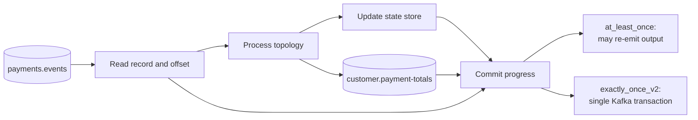
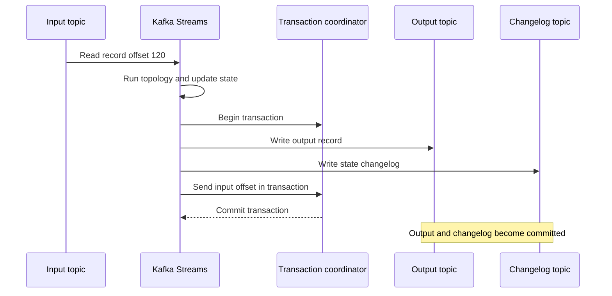

# processing.guarantee and Guarantees in Kafka Streams Topologies

A Kafka Streams topology typically reads records from input topics, updates state stores, and writes results to output topics. If the application stops mid-way, these three operations must be coordinated to avoid losing results or producing duplicate records. The `processing.guarantee` property determines the processing guarantee level that Kafka Streams applies to that cycle.

The two main options in modern Kafka are:

- `at_least_once`: the default. If the application fails after writing output but before saving the offset, the record can be reprocessed and output may appear duplicated.
- `exactly_once_v2`: uses Kafka transactions to atomically commit input offsets, output records, and state store changelogs. `read_committed` consumers only see committed results.

With the Spring Cloud Stream Kafka Streams binder, you can set `processing.guarantee` via Kafka Streams configuration at the function or binder level. The exactly-once guarantee only covers data inside Kafka transactions; it does not automatically include database updates, REST API calls, sending emails, or side effects in external systems.

## 1. Why Does a Topology Need a Processing Guarantee?

Suppose a processor reads payment events from `payments.events`, updates per-customer totals in a state store, and emits results to `customer.payment-totals`.

One processing pass has three outcomes to keep consistent:

1. Input offset: the position of the record the processor has processed.
2. State: the updated total in the state store and changelog topic.
3. Output: the new total record written to the output topic.

If only a subset is persisted, after a restart the topology can land in one of two situations:

- The offset advanced while output/state was not saved: the record is skipped and the result is lost.
- Output/state was written while the offset did not advance: the record is re-read and the result may be written again.

`processing.guarantee` defines how Kafka Streams coordinates these operations during commits and recovery.



State stores can be stored locally on the application host. Kafka Streams uses changelog topics to reconstruct state when tasks migrate to another instance or local state needs recovery. Exactly-once transactions include changelog records written to Kafka alongside output and offsets.

## 2. What Is at_least_once?

`at_least_once` means input records are processed until progress is confirmed, though under certain failure scenarios the same record may be processed multiple times. This is Kafka Streams' default mode and does not require transactions for each commit cycle.

Example function counting total payments by key:

```java
@Bean
Function<KStream<String, PaymentEvent>, KStream<String, Long>> paymentTotals() {
    return payments -> payments
            .groupByKey()
            .count(Materialized.as("payment-totals"))
            .toStream();
}
```

Suppose a record for customer C42 increases the total from 100 to 150. The topology writes the new state changelog and output 150. If output is written successfully but the application stops before the input offset is committed, on restart that record can be read again. Output 150 may be emitted a second time.

### Failure Scenario with at-least-once

1. Consumer reads record at offset 120.
2. Function processes the record and produces output.
3. Output is written to the result topic.
4. Application stops before offset 120 is committed.
5. A new instance takes over the task and re-reads offset 120.
6. Processing logic runs again; output may be duplicated.

At-least-once prioritizes never skipping uncommitted records, at the cost that downstream consumers must tolerate potential duplicates.

This mode is often sufficient when downstream is idempotent by event ID, duplicates do not cause business discrepancies, or results can be recomputed and reconciled. Never assume a function is invoked strictly once per record.

## 3. What Is exactly_once_v2?

`exactly_once_v2` is Kafka Streams' modern exactly-once processing mechanism. Kafka combines transactional producers, idempotent producers, and offset commits inside transactions to ensure a processing cycle is published atomically.

When a transaction commits successfully, the following take effect together:

- Processed input offsets.
- Records written to output topics.
- Changelog records reflecting state store updates.
- Internal task-related progress.

If a transaction aborts, output/changelog records belonging to that transaction are hidden from `read_committed` consumers and input offsets are not committed as part of that transaction. When the task recovers, the record may be reprocessed, but only committed results are exposed.

Kafka Streams does not guarantee that code executes strictly once at the CPU level. When a transaction aborts, a function or processor can run again. What is guaranteed is that committed results in Kafka are not duplicated by aborted attempts.

### Transaction Illustration



If the application fails before commit, the unfinished transaction is aborted or recovered by the coordinator per transaction state. `read_committed` consumers ignore records from aborted transactions.

## 4. What Does Exactly-Once Cover?

Kafka Streams' exactly-once scope lies within Kafka:

| Component | at_least_once | exactly_once_v2 |
|---|---|---|
| Reading records from input topic | May re-read after failure | May re-read internally after abort |
| Committing input offset | Per commit interval | Included inside Kafka transaction |
| Writing output topic | Duplicates may appear | Visible only if transaction commits |
| Updating state store | May be replayed on recovery | Changelog updates committed with output and offset |
| Repartition/changelog topics | May see repeated writes on retry | In-transaction writes commit/abort together |
| External database | Not covered | Not covered |
| REST API, email, external payments | Not covered | Not covered |

A Kafka transaction cannot automatically commit a JDBC transaction or an HTTP request. If a topology calls an external system inside a callback, that side effect can happen before the Kafka transaction aborts. When the record is reprocessed, the external side effect may be repeated.

### Local State Stores and Changelogs

Kafka Streams can use RocksDB or in-memory stores for local state. The state store serves fast processing, while the changelog topic provides the data source for recovery.

In exactly-once mode, changelog records are written in the same transaction as output and offsets. After a failure, Kafka Streams recovers state from committed changelogs. Local state is not an independent transactional database outside Kafka's guarantees.

If logging is disabled on a state store or a store not managed by Kafka Streams in the standard way is used, evaluate its recoverability and guarantee scope separately. Do not assume all data on local disk is automatically covered by transactions.

## 5. Distinguishing Exactly-Once, Idempotent Producer, and read_committed

These three mechanisms are related but solve different problems.

| Mechanism | What Does It Protect? | What Does It Not Automatically Protect? |
|---|---|---|
| Idempotent producer | Duplicates from producer retries within a producer session/sequence | Does not tie input offsets to output transactions |
| Kafka transactions | Writing across multiple partitions/topics and offsets in one transaction | Does not cover external databases/APIs |
| `read_committed` consumer | Reads only records from committed transactions | Does not turn a regular consumer into an exactly-once processor |

An idempotent producer prevents certain duplicates caused by retrying produce requests. However, if an application reads input, writes output, and crashes before committing offsets, producer idempotence alone does not know which offset that output corresponded to. Kafka Streams exactly-once combines transactional producers with offset commits to solve this problem.

Downstream consumers must set `isolation.level=read_committed` if they only want to observe committed records. Consumers in `read_uncommitted` mode can see records from uncommitted or aborted transactions.

## 6. Configuring processing.guarantee in the Kafka Streams Binder

The Kafka Streams binder accepts `StreamsConfig` properties through binder configuration. For functional processors, you can configure each function individually via:

`spring.cloud.stream.kafka.streams.binder.functions.<function-name>.configuration`

This is appropriate when an application has multiple processors with different requirements. Binder-level `configuration` applies to all processors managed by the binder.

Example for a function named `paymentTotals`:

```yaml
spring:
  cloud:
    function:
      definition: paymentTotals
    stream:
      bindings:
        paymentTotals-in-0:
          destination: payments.events
        paymentTotals-out-0:
          destination: customer.payment-totals
      kafka:
        streams:
          binder:
            brokers: kafka-1:9092,kafka-2:9092,kafka-3:9092
            functions:
              paymentTotals:
                applicationId: payment-totals-v1
                configuration:
                  processing.guarantee: exactly_once_v2
                  commit.interval.ms: 100
                  replication.factor: 3
```

In this example:

- `paymentTotals` is the function bean name.
- `applicationId` is the stable identity of the Kafka Streams application.
- `processing.guarantee: exactly_once_v2` enables exactly-once-v2 for this processor.
- `commit.interval.ms` sets the commit interval in milliseconds; when EOS is enabled, Kafka Streams defaults to 100 ms unless overridden.
- `brokers` is the broker list for the Kafka Streams binder.

### Binder-Wide Configuration

If the application has only one processor or all processors require the same guarantee, you can set it at the binder level:

```yaml
spring:
  cloud:
    stream:
      kafka:
        streams:
          binder:
            configuration:
              processing.guarantee: exactly_once_v2
```

Binder-level configuration applies to all processors. When multiple functions exist, prefer function-specific configuration to avoid unintentionally changing another processor's guarantee.

### Do Not Confuse the Regular Kafka Binder with the Kafka Streams Binder

These two prefixes belong to two different binders:

| Binder | Prefix |
|---|---|
| Kafka message-channel binder | `spring.cloud.stream.kafka.binder.*` |
| Kafka Streams binder | `spring.cloud.stream.kafka.streams.binder.*` |

`processing.guarantee` is a Kafka Streams `StreamsConfig` property. Placing it under the regular Kafka message-channel binder prefix does not configure exactly-once for a Kafka Streams topology.

## 7. Valid Values and Version Compatibility

In modern Kafka, the two main values are:

- `at_least_once`: default.
- `exactly_once_v2`: exactly-once version 2.

Legacy values `exactly_once` and `exactly_once_beta` are deprecated in newer Kafka versions. Do not use them for new systems.

`exactly_once_v2` requires Kafka brokers version **2.5 or higher**. Kafka Streams 2.6 introduced EOS v2, and starting with Kafka 3.0, the first EOS version was deprecated. Verify compatibility across your Spring Cloud Stream binder version, Kafka Streams client, and brokers before deploying.

Do not check broker version alone. The Kafka Streams dependency in your application must also support EOS v2 and match the Spring Cloud Stream release train in use.

## 8. Broker and Replication Requirements

Exactly-once relies on Kafka transactions. The transaction coordinator stores transaction state in the internal `__transaction_state` topic. If the transaction state topic lacks sufficient replication or in-sync replicas, transaction recoverability degrades.

Kafka production recommendations:

- Transaction state topic with replication factor 3.
- `transaction.state.log.min.isr=2`.
- `__consumer_offsets` topic with appropriate replication.
- Kafka Streams changelog/repartition topics with appropriate replication factor.
- User input/output topics with replication and min ISR matching durability needs.
- Broker replicas distributed across independent nodes/racks or failure domains.

Kafka Streams recommends replication factor 3 and `min.insync.replicas=2` for involved topics, including transaction state, consumer offsets, internal topics, and user topics. With a replication factor below 3, EOS can still technically run, but fault tolerance drops significantly.

### Broker Configuration Example

This is broker-side configuration in `server.properties`, not `application.yml`:

```properties
transaction.state.log.replication.factor=3
transaction.state.log.min.isr=2
offsets.topic.replication.factor=3
min.insync.replicas=2
```

These values are examples for a production cluster with at least three brokers. Kafka Streams internal topics also depend on `StreamsConfig`'s `replication.factor` and existing topic configurations.

### Single-Broker Development Environment

For testing on a single broker, you can lower broker transaction settings to 1:

```properties
transaction.state.log.replication.factor=1
transaction.state.log.min.isr=1
offsets.topic.replication.factor=1
default.replication.factor=1
min.insync.replicas=1
```

This is strictly for local/dev use. A single broker has no broker fault tolerance and does not represent production cluster durability. If internal topics were previously created with a different replication factor, changing defaults does not automatically alter existing topics.

## 9. Internal Topics and State Recovery

Kafka Streams can create internal topics for:

- State store changelogs.
- Repartitioning when keys change or data redistribution is needed.
- Metadata and progress needed by the processor.

These topics are named based on `application.id` and processor/store names. They form part of the topology recovery mechanism.

When an instance fails:

1. The Kafka group coordinator assigns tasks to surviving instances.
2. The new instance determines the changelog and committed offsets.
3. Local state stores are restored from committed changelogs if needed.
4. Tasks resume from committed progress.
5. Prior uncommitted transactions are not exposed to `read_committed` consumers.

If a state store must recover from a large changelog, recovery time can increase. Standby replicas can maintain near-current state copies on other instances, at the cost of extra resources and network traffic.

`num.standby.replicas` does not replace `processing.guarantee`. It reduces state restoration time when tasks migrate across instances.

## 10. commit.interval.ms and Transaction Timeout

`commit.interval.ms` sets how often Kafka Streams commits processing progress. For `at_least_once`, the modern default is typically 30 seconds. When exactly-once is enabled, the default changes to 100 ms.

| Guarantee | Default commit.interval.ms |
|---|---:|
| at_least_once | 30000 ms |
| exactly_once_v2 | 100 ms |

Committing more frequently reduces the amount of work replayed after failures and lowers result publication latency. In return, transaction frequency increases and brokers incur higher overhead.

Kafka Streams also sets `transaction.timeout.ms` to 10 seconds by default when exactly-once is enabled. Transactions must complete before timeout; if exceeded, the broker may abort the transaction and fence the producer.

If a processing cycle takes longer, you can increase transaction timeout via producer-prefixed `StreamsConfig`, provided it satisfies:

- Not lower than `commit.interval.ms`.
- Not exceeding `transaction.max.timeout.ms` allowed by the broker.
- Aligned with actual processing duration and failure detection goals.
- Not set overly high merely to mask a hung processor.

A large transaction timeout delays fencing zombie producers and can make `read_committed` consumers wait longer behind uncommitted data. Measure p99 processing cycles before tuning.

## 11. Failure Scenarios: What Happens When the Application Fails?

### Failure Before Transaction Begins

The record was read, but no transaction has written results yet. When the task recovers, the record is re-read from the latest committed offset. No output transaction needs rollback.

### Failure After Writing Output but Before Commit

With `at_least_once`, output may have been written while the offset was not committed; the record is re-read and output may be duplicated.

With `exactly_once_v2`, output sits inside an uncommitted transaction. When the transaction aborts, `read_committed` consumers do not see that output. Offsets and changelogs are also not committed as part of that transaction. The record is reprocessed.

### Failure After Transaction Commit

Offsets, output, and changelogs committed atomically. When another instance recovers, it continues from the committed offset. `read_committed` consumers see the committed output; there is no need to regenerate output from the prior transaction.

### Zombie Producer or Old Instance Returning

Kafka transactions use producer ID and epoch to fence stale producers. If a new instance owns the same task and receives a higher producer epoch, the old producer can no longer commit transactions using its outdated epoch.

This is a critical part of how EOS tolerates restarts, rebalances, and lingering old instances after network glitches.

## 12. Downstream Consumers Must Use read_committed

When Kafka Streams writes output in transactions, consumers in `read_uncommitted` mode can see uncommitted or aborted records. To process only committed output, downstream consumers need:

```properties
isolation.level=read_committed
```

For a Kafka Streams application running with exactly-once, Kafka Streams automatically configures its internal consumers to use `read_committed`. However, standalone consumers outside the topology must be configured explicitly.

Example of a Spring Kafka service reading the output topic:

```java
@Bean
ConsumerFactory<String, PaymentTotal> paymentTotalConsumerFactory() {
    Map<String, Object> props = new HashMap<>();
    props.put(ConsumerConfig.BOOTSTRAP_SERVERS_CONFIG, "kafka:9092");
    props.put(ConsumerConfig.GROUP_ID_CONFIG, "payment-reporting");
    props.put(ConsumerConfig.ISOLATION_LEVEL_CONFIG, "read_committed");

    return new DefaultKafkaConsumerFactory<>(props);
}
```

`read_committed` only exposes data belonging to committed transactions. It does not automatically give a downstream service exactly-once side effects when updating a database; that service still needs its own transactions/idempotency.

## 13. Exactly-Once Does Not Cover Databases or REST APIs

This is the single most important constraint when designing a topology.

Suppose a processor invokes an API with side effects:

```java
input.foreach((key, event) -> paymentGateway.charge(event));
```

If the charge API succeeds but the Kafka transaction later aborts, the record is reprocessed and the API may be called again. Kafka cannot roll back a payment already accepted by an external system.

The following side effects are outside Kafka transactions:

- Database writes via JDBC/JPA.
- REST/gRPC calls.
- Sending emails or SMS.
- Writing files or object storage.
- Calling payment gateways.
- Updating caches or other systems not participating in Kafka transactions.

### Solutions for External Side Effects

**Idempotency key:** send a stable event ID to the external service. The service detects duplicate requests and returns the previous outcome instead of executing again.

**Inbox pattern:** the consumer persists processed event IDs alongside business changes inside one database transaction. The event ID column has a unique constraint to prevent duplicate processing.

**Transactional outbox:** the application writes business changes and an outbox record inside the same database transaction; a separate publisher emits outbox records to Kafka.

**Saga/compensation:** for multi-system workflows, track workflow state and trigger compensating actions when a later step fails.

Never invoke side-effecting APIs directly in a topology callback and rely on `exactly_once_v2` to claim the business action happens strictly once.

## 14. Idempotency Is Still Essential

Even when Kafka Streams uses exactly-once, idempotency remains valuable at external boundaries, in downstream consumers, and during manual data replays.

Example processed-events table:

```sql
CREATE TABLE processed_events (
    event_id VARCHAR(100) PRIMARY KEY,
    processed_at TIMESTAMP NOT NULL
);
```

Inside a database transaction:

```java
@Transactional
public void apply(PaymentEvent event) {
    if (processedEventRepository.existsById(event.eventId())) {
        return;
    }

    accountRepository.applyPayment(event);
    processedEventRepository.save(
            new ProcessedEvent(event.eventId(), Instant.now()));
}
```

In production implementations, avoid check-then-insert alone if multiple threads can process the same event concurrently. A unique constraint or insert-if-absent operation within the same transaction is the ultimate guard against duplicates.

Idempotency keys must remain stable across retries and replays. Never use the current timestamp or a newly generated random UUID per processing attempt as a deduplication key.

## 15. Exactly-Once and Multiple Output Topics

A topology can write to multiple output topics in the same processing cycle. When exactly-once is enabled, output records and input offsets in the transaction can commit together.

For example, a processor writing:

- `payments.accepted`
- `payments.audit`
- `customer.balances`

If the transaction commits, records in the transaction become committed. If the transaction aborts, `read_committed` consumers do not see those records.

This is helpful when multiple outputs must stay mutually consistent. However, separate consumers reading each topic independently may observe updates at different wall-clock times due to polling schedules and network latency; transactions guarantee atomic commit visibility of data, not simultaneous dashboard refreshes across independent consumers.

## 16. processing.guarantee Does Not Handle Every Kind of Error

`processing.guarantee` controls the atomicity of Kafka commits. It does not decide whether errors inside the topology are skipped, retried, or sent to a DLQ.

| Configuration/Mechanism | Responsibility |
|---|---|
| `processing.guarantee` | At-least-once or exactly-once for the Kafka processing cycle |
| `processing.exception.handler` | How exceptions during record processing are handled |
| `deserializationExceptionHandler` | How input deserialization errors are handled |
| Producer exception handler | How to react when writing output fails |
| Business logic retry | Retrying recoverable business operations |
| DLQ/retry topic | Isolating or routing failed records |

If an exception handler chooses to continue and skip a failed record, exactly-once does not mean that record was processed successfully. The guarantee only applies to transactions and progress committed by the topology.

For any record raising an exception, decide explicitly: fail the topology to fix data, skip with logging/metrics, or route to a DLQ. Do not treat `processing.guarantee` as an error-handling policy.

## 17. Output Durability and application.id

When EOS is enabled, Kafka Streams automatically configures producers to use idempotence and internal consumers to use `read_committed`. Do not override these properties arbitrarily without understanding the impact.

Output durability still depends on the broker:

- Topic replication factor.
- `min.insync.replicas`.
- `acks`.
- Broker availability and transaction coordinator.
- Topic retention and disk capacity.

With Kafka Streams EOS, producers use `acks=all` and transactional acknowledgements. Configuring `replication.factor=3` for changelog/repartition topics combined with `min.insync.replicas=2` ensures writes are acknowledged only when enough replicas are in sync. If a user topic has only one replica, losing that broker can lose committed data. Exactly-once does not replace replication.

`application.id` is the logical identity of a Kafka Streams application. It serves as the consumer group ID, the prefix for internal topics, and the application's state store namespace.

Rules:

- Replicas of the same processor must share the same application ID.
- Independent processors need separate application IDs.
- The application ID must remain stable across normal restarts and deployments.
- Changing the application ID creates a new consumer group and new internal topics; the app may re-read input per offset reset policy instead of resuming prior progress.
- Never change the application ID just to restart a processor.

Function-specific example:

```yaml
spring:
  cloud:
    stream:
      kafka:
        streams:
          binder:
            functions:
              paymentTotals:
                applicationId: payment-totals-v1
                configuration:
                  processing.guarantee: exactly_once_v2
```

When deploying multiple instances, all instances must receive the same application ID and guarantee configuration. Never generate random application IDs from hostnames or pod names.

## 18. Testing Processing Guarantees

Topology unit tests check transformation logic, but do not prove broker transaction commits/aborts. Combine multiple testing layers.

### TopologyTestDriver

Use `TopologyTestDriver` to verify input records yield expected outputs, state stores update accurately, windows/joins/aggregations preserve logic, and output keys/timestamps match expectations.

`TopologyTestDriver` is great for DSL logic, but does not fully simulate the transaction coordinator, broker failover, or consumer isolation levels.

### Integration Tests with Kafka

Use a real Kafka broker or Testcontainers to test:

1. `processing.guarantee=exactly_once_v2` is applied by the binder.
2. Processor writes outputs and changelogs inside transactions.
3. A `read_committed` consumer only sees committed records.
4. Restarting the processor after a transaction commits.
5. Stopping the processor mid-cycle before commit.
6. Verifying uncommitted records are reprocessed without creating duplicate committed output.
7. Verifying state stores recover from changelogs.
8. Checking multi-topic outputs commit/abort consistently.
9. Testing transaction timeouts and producer fencing.

A valuable test is creating a processor with a controlled pause point: read input and produce output, block before commit, stop the process, restart with the same application ID, and read output with a `read_committed` consumer. Verify only one committed result exists for the input event.

Do not merely count how many times the function was invoked. Exactly-once allows a previous attempt to abort and the record to be reprocessed; what must be verified is the count of committed results observed by a `read_committed` consumer.

## 19. Monitoring and Troubleshooting

Track the following signals:

- Transaction commit rate and abort rate.
- Transaction coordinator errors.
- Producer fencing or transaction timeouts.
- Commit latency and processing latency.
- Consumer lag per input partition.
- State restoration duration and changelog lag.
- Rebalances/task migrations.
- Output topic replication health and under-replicated partitions.
- Input, output, and state update record counts.
- Duplicate event IDs detected downstream.

| Symptom | Causes to Investigate |
|---|---|
| Processor fails to start with `exactly_once_v2` | Broker older than 2.5, under-replicated transaction topic, or missing ACLs |
| Frequent transaction aborts | Processing cycle exceeds timeout, broker issues, or producer fenced |
| Downstream consumer sees uncommitted records | Consumer uses `read_uncommitted` |
| Duplicate output in `at_least_once` | Output committed before offset, then record replayed |
| Database side effects repeat despite EOS enabled | Side effect lies outside Kafka transactions |
| Slow state restoration | Large changelog, insufficient standby replicas, or slow broker/network |
| Transaction timeout under heavy load | Commit interval/transaction timeout misaligned with processing cycle |
| EOS works in dev but weakens on broker loss | Replication factor or min ISR lower than production recommendations |

Do not watch processed record counts alone. Cross-check input offsets, committed outputs, state restoration, and transaction metrics to catch guarantee violations.

## 20. Guarantee Selection Workflow

| Requirement | Choice |
|---|---|
| Duplicates tolerable and downstream is idempotent | `at_least_once` |
| Want atomic commit of offsets + Kafka outputs + state stores | `exactly_once_v2` |
| External database/API side effects exist | Combine EOS with outbox/inbox or idempotency |
| Single local broker for developers | `at_least_once` or test EOS with reduced broker transaction settings; do not treat as production HA |
| Multiple processors in the same application | Configure guarantee per function if processors have different requirements |

Deployment workflow:

1. Identify input sources, output topics, and state stores.
2. List external side effects outside Kafka.
3. Choose `at_least_once` or `exactly_once_v2` based on duplicate tolerance.
4. Check broker version and Kafka Streams client version.
5. Set `processing.guarantee` in the right Kafka Streams binder namespace.
6. Set a stable application ID per processor.
7. Verify replication factor and min ISR for transaction/internal/user topics.
8. Verify transaction timeout and commit interval.
9. Set downstream consumers to `read_committed` when reading only committed output.
10. Design idempotency/outbox for external systems outside Kafka.
11. Integration-test crashes before commit, aborts, restarts, and state restoration.
12. Monitor transactions, lag, and duplicates after rollout.

## 21. Pre-Deployment Checklist

- Understood default `at_least_once` and how duplicates arise on crash.
- Understood `exactly_once_v2` uses Kafka transactions to commit offsets, outputs, and changelogs together.
- Do not confuse exactly-once committed results with strictly-once function execution.
- Verified brokers support EOS v2 (2.5+).
- Used the correct Kafka Streams binder prefix.
- Intentionally chose binder-level vs. function-specific configuration.
- Set a stable application ID identical across replicas.
- Transaction state topic has replication factor 3 and min ISR 2 per production recommendations.
- Consumer offsets, changelog/repartition, and user topics have appropriate replication factor (typically 3) and min ISR 2.
- `StreamsConfig` `replication.factor` matches internal topic policies.
- Verified ACLs for transactional producers and internal topics.
- Downstream consumers use `read_committed` if only committed output is accepted.
- Understood `commit.interval.ms` and `transaction.timeout.ms`.
- Did not raise transaction timeout excessively or beyond broker maximums.
- Separated external side effects outside Kafka with idempotency/outbox/inbox.
- Tested crashes before commit, restarts after commit, and state restoration.
- Monitored transaction aborts, fencing, lag, and changelog recovery.
- Reviewed error handlers separately; do not treat `processing.guarantee` as a retry/DLQ policy.

`processing.guarantee` is the foundation of Kafka Streams topology guarantees. `at_least_once` allows reprocessing records and can produce duplicates when an app fails between output and offset commits. `exactly_once_v2` uses Kafka transactions to atomically commit input offsets, output records, and state changelogs. For this guarantee to hold meaningfully in production, you need proper broker replication, stable application IDs, `read_committed` downstream consumers, and dedicated idempotency or outbox/inbox patterns for external side effects.

## References

- [Apache Kafka 4.4 — Processing Guarantees](https://kafka.apache.org/44/streams/core-concepts/#processing-guarantees)
- [Apache Kafka 4.4 — Configuring a Streams Application](https://kafka.apache.org/44/streams/developer-guide/config-streams/)
- [Apache Kafka 4.4 — Kafka Streams Configs](https://kafka.apache.org/44/configuration/kafka-streams-configs/)
- [Spring Cloud Stream — Kafka Streams Binder Configuration Options](https://docs.spring.io/spring-cloud-stream/reference/kafka/kafka-streams-binder/configuration-options.html)
- [Spring Cloud Stream — Kafka Streams Binder Reference Guide](https://docs.spring.io/spring-cloud-stream-binder-kafka/docs/current/reference/html/kafka-streams.html)
