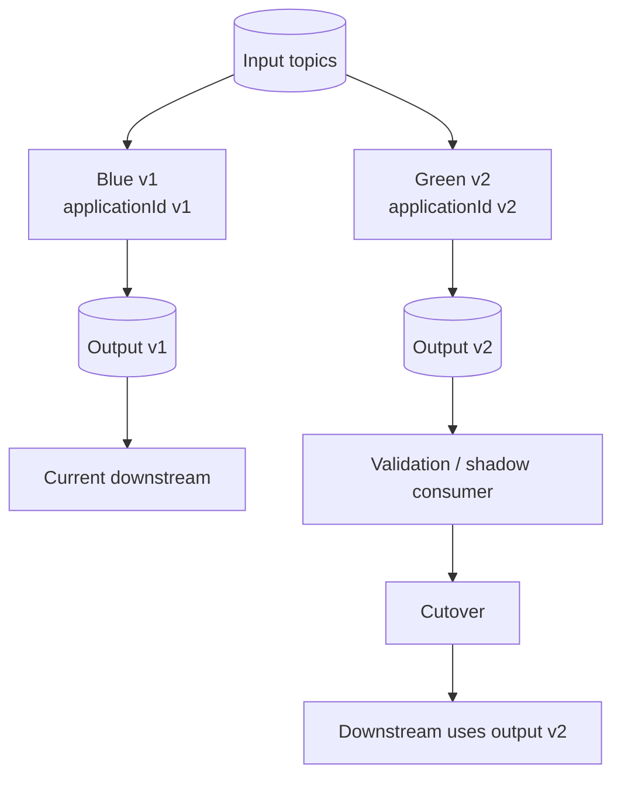

# Changing applicationId, Resetting Applications, and Safe Topology Upgrades

## Objectives

Kafka Streams tracks consumption progress, task assignments, state stores, and internal topics by the application's identity. In the Spring Cloud Stream Kafka Streams binder, the `applicationId` property identifies the logical application running the topology. It simultaneously participates in the consumer group and the naming rules for internal topics such as changelog and repartition topics.

When changing topology code, changing state store schemas, changing keys, or wanting to reprocess data from the beginning, you must choose the right strategy. **Changing `applicationId`**, **resetting an existing application**, and **upgrading a topology while preserving state** are three distinct operations. Confusing them can unintentionally create a new consumer group, reprocess all data, emit duplicate outputs, or lose the ability to restore state.

This lesson explains how to manage the Kafka Streams lifecycle in production: keeping `applicationId` stable when continuing existing state, creating a new `applicationId` when an independent logical application is needed, performing controlled resets with Kafka Streams tooling, and upgrading topologies in a rollback-safe way.

After this lesson, you will be able to:

- Explain the role of `applicationId` for consumer groups and internal topics.
- Distinguish changing `applicationId` from resetting an existing application.
- Understand the impact of `auto.offset.reset` when a new `applicationId` has no committed offsets.
- Use the Kafka Streams application reset tool following a safe procedure.
- Identify topology changes that preserve state versus changes requiring a rebuild.
- Choose between in-place upgrades and blue-green deployments using a new `applicationId`.
- Manage state directories, changelogs, repartition topics, and output topics.
- Test replay, duplicates, state restoration, and cutover before deployment.

## 1. applicationId Is the Identity of a Kafka Streams Application

Kafka Streams uses the application ID to identify a logical stream processing application. In the Spring Cloud Stream Kafka Streams binder, you can configure the application ID at the binder level:

    spring:
      cloud:
        function:
          definition: enrichOrders
        stream:
          bindings:
            enrichOrders-in-0:
              destination: orders.created
            enrichOrders-out-0:
              destination: orders.enriched
          kafka:
            streams:
              binder:
                applicationId: orders-enricher-prod-v1
                configuration:
                  auto.offset.reset: earliest
                  state.dir: /var/lib/kafka-streams

In this example:

- `enrichOrders` is the function building the Kafka Streams topology.
- `orders.created` is the input topic.
- `orders.enriched` is the output topic.
- `orders-enricher-prod-v1` is the `applicationId` of the logical application.
- `auto.offset.reset` defines where reading begins when the group has no valid committed offset.
- `state.dir` is the local directory storing Kafka Streams state on the instance.

The application ID serves several roles:

1. It acts as the consumer group ID for the Kafka Streams application.
2. It serves as the prefix for internal topics created by Kafka Streams, such as changelog and repartition topics.
3. It binds together task assignments, consumption progress, and state recovery.
4. It lets Kafka Streams distinguish independent applications even when they read the same input topics.

The application ID is not the function name, output binding name, or Kubernetes pod name. Choose a stable, meaningful value that is unique across logical applications that must run independently.

### Replicas of the Same Application Share One applicationId

If a topology runs three replicas to share tasks, all three replicas must use the same `applicationId`:

    orders-enricher instance 1 -> orders-enricher-prod-v1
    orders-enricher instance 2 -> orders-enricher-prod-v1
    orders-enricher instance 3 -> orders-enricher-prod-v1

Kafka Streams treats them as members of the same logical application and distributes tasks across instances. Never append a pod ID or random UUID to each replica's `applicationId`; doing so creates separate independent applications/consumer groups, each potentially reading the entire input.

If you need two independent topologies reading the same topic, they must have different `applicationId` values. Each application maintains its own offsets, state stores, and internal topics.

## 2. applicationId Ties to Consumer Groups and Internal Topics

`applicationId` affects multiple runtime components:

| Component | Relationship with `applicationId` |
|---|---|
| Consumer group | `applicationId` identifies the group managing input offsets and task membership |
| Changelog topic | Internal topic names typically include `applicationId` and the store name |
| Repartition topic | Internal topic names typically include `applicationId` and node/repartition identity |
| Task assignment | Instances sharing an `applicationId` share the topology's tasks |
| State restoration | Tasks restore local state from changelogs belonging to the application |
| Local state | Kafka Streams uses the per-instance state directory; application/task metadata binds to the app runtime |

For example, suppose a topology has a state store named `orders-by-customer`. Kafka Streams may create a changelog topic prefixed with `applicationId` and store info. Exact naming depends on the topology and Kafka Streams version; never hardcode internal topic names in application code.

Repartition topics may be created when the topology must redistribute records under a new key. Changelog topics record state mutations for recovery. These are internal operational data of the topology, not output contracts for business consumers.

Never manually publish business messages to internal topics or let another application depend directly on changelog/repartition topic names. When results must be shared, create an output binding/topic with an explicit contract.

## 3. Keep applicationId Stable When Preserving State

When deploying a new build of the same logical application, you normally keep `applicationId` unchanged. This allows Kafka Streams to continue using:

- Existing consumer groups and committed offsets.
- Existing internal topics and changelogs.
- State stores recoverable from local state/changelogs.
- Task assignments of the same logical application.

For example, both old and new versions use:

    spring.cloud.stream.kafka.streams.binder.applicationId=orders-enricher-prod-v1

If the topology remains compatible with existing state and internal topics, the application resumes from committed progress. However, keeping `applicationId` unchanged does not make every code change safe. If you change keys, Serdes, state store schemas, repartitioning strategies, or aggregation semantics, old state may become incompatible.

A useful rule of thumb:

- Stateless processing changes that do not alter wire contracts or state structure can usually be upgraded in place after testing.
- Stateful topology changes require evaluating changelogs, store schemas, internal topics, and restoration capabilities.
- Incompatible changes should use a planned migration/rebuild, typically via a new `applicationId` or a controlled reset.

Do not change `applicationId` merely to force a deployment to create a new consumer group. That creates a brand-new logical application and does not automatically migrate state from the old application.

## 4. Changing applicationId Creates a New Application

Suppose the current application uses:

    applicationId: orders-enricher-prod-v1

If you change it to:

    applicationId: orders-enricher-prod-v2

Kafka Streams treats this as a distinct logical application. The new application has:

- A new consumer group with none of the old group's committed offsets.
- A new internal topic namespace.
- New state stores that do not automatically reuse v1's changelogs.
- Task assignments independent of v1.
- Separate input consumption progress.

Changing `applicationId` does not delete the old application, reset the old group's offsets, or remove old internal topics. It simply creates a new identity. Applications v1 and v2 can coexist if infrastructure and topology allow; in that case, both read the same input topics and consume independent resources.

### auto.offset.reset Determines Where a New Group Starts

Because the new group has no committed offsets, Kafka needs a policy to determine the starting point:

| Value | Behavior When No Valid Offset Exists |
|---|---|
| `earliest` | Reads from the earliest retained record in each partition |
| `latest` | Starts from the log end at the time the read position is established |
| `none` | Throws an error if no matching offset is found |

Example:

    spring:
      cloud:
        stream:
          kafka:
            streams:
              binder:
                applicationId: orders-enricher-prod-v2
                configuration:
                  auto.offset.reset: earliest

With `earliest`, v2 can reprocess all retained input. If the output binding still writes to `orders.enriched`, output can duplicate data already emitted by v1. Use a separate output topic, deduplicate by event ID, or design a cutover so downstream consumers do not receive outputs from both versions simultaneously.

With `latest`, v2 skips history prior to its start point and processes only new data from the established offset. This is unsuitable if the new state store must be rebuilt from history to achieve complete state.

`auto.offset.reset` does not overwrite existing committed offsets. It only applies when the group has no valid offset, such as a new `applicationId` or expired/deleted offsets.

## 5. When Should You Change applicationId?

Changing `applicationId` makes sense when creating an independent logical application, such as:

- Running v1 and v2 side by side to compare outputs.
- Creating a new topology with incompatible state stores/schemas.
- Rebuilding state from input while keeping the old application serving during preparation.
- Splitting a workload into two applications with separate lifecycles and progress.
- Executing a controlled blue-green deployment.

Do not change `applicationId` merely because:

- Pods are replaced or autoscaled.
- A build changes while topology/state remain compatible.
- You want to restart a process after a routine error.
- You want to clear a backlog or fix consumer lag without investigating the root cause.
- You want to avoid duplicate processing without designing idempotency.

A new `applicationId` can increase read load, create new internal topics, and re-emit substantial output. Calculate broker, database, and downstream capacity before running two versions in parallel.

## 6. Resetting an Existing Application vs. Changing applicationId

**Resetting** brings an existing Kafka Streams application back to a chosen read position and removes internal state that must be rebuilt. A reset typically keeps the same `applicationId`, while clearing/resetting progress and internal state per the reset tool's scope.

**Changing `applicationId`** creates a new logical application and leaves the old application and its data intact.

| Criterion | Changing `applicationId` | Resetting Existing Application |
|---|---|---|
| Logical application | Creates a new application | Preserves current application identity |
| Consumer group | New group | Resets offsets of the selected group |
| Internal topics | Creates a new namespace; old topics remain | Reset tool handles the app's internal topics within supported scope |
| State stores | Fresh state, does not reuse old state | State is rebuilt after reset |
| Input offsets | New group uses `auto.offset.reset` if no offset exists | Existing group's offsets are moved to the chosen position |
| Old application | Can continue running independently | Application being reset must be stopped |
| Output impact | May replay history or start from latest | May replay input and emit duplicate outputs |

A reset is not a restart. A normal restart keeps `applicationId`, committed offsets, and state; Kafka Streams restores state as needed. Only use a reset when you intentionally want to rebuild progress/state or repair operational state after identifying the root cause.

## 7. The kafka-streams-application-reset Tool

Kafka provides `kafka-streams-application-reset.sh` to reset a Kafka Streams application. This tool can reset input consumer group offsets and delete internal topics belonging to the application according to options supported by your Kafka version.

Example dry run first:

    bin/kafka-streams-application-reset.sh --application-id orders-enricher-prod-v1 --bootstrap-servers kafka-1:9092,kafka-2:9092 --input-topics orders.created,orders.updated --dry-run

This example only illustrates common syntax. Depending on the Kafka version, there may be extra options for target offsets, intermediate topics, or execution modes. Before running in production, read `--help` from your exact Kafka distribution and verify available options; never copy commands blindly from another version.

### What Does the Reset Tool Affect?

Depending on the version and selected options, the reset tool can:

- Reset committed offsets of the application consumer group on specified input topics.
- Delete application internal topics such as changelog and repartition topics within the tool's supported scope.
- Return the application to a state where it can re-read input and rebuild state.
- Allow selecting a starting point such as earliest or a specific offset/timestamp if supported by the tool version.

The reset tool is **not a tool for deleting business output topics**. Previously emitted output records may still remain. If you reset and rerun from the start, the application may emit similar outputs again.

The reset tool also does not replace managing local state directories on each instance. After stopping the application, follow the instructions for your Kafka Streams version and operational runbook to clean old local state if needed. Only delete the exact state directory of the identified application/instance; never delete shared directories or another application's state.

### Mandatory Prerequisites Before Resetting

1. Stop every instance of the application with the target `applicationId`.
2. Confirm no old instances are automatically restarted by an autoscaler or orchestrator.
3. Verify the exact `applicationId` and cluster bootstrap servers.
4. List all input topics of the topology.
5. Identify related internal/repartition topics and Kafka-version-specific reset options.
6. Run a dry run and save the list of planned actions.
7. Assess the impact on output topics, downstream consumers, and duplicates.
8. Have backups or a rebuild/reconciliation plan for critical data.
9. Execute only after the owner confirms the right cluster, right application, and right reset point.
10. Restart the application and monitor state restoration, lag, and output.

Never run the reset tool while the application is still running. Consumers could keep committing offsets, recreating internal topics, or writing state while the tool deletes/resets resources, leaving inconsistent state.

## 8. Resetting to Earliest and Replaying Data

Resetting to earliest helps rebuild state from input history. However, results are only as complete as the data still retained in Kafka.

Example:

- Input topic has 14-day retention.
- Application is reset to earliest.
- Kafka only holds data from the last 14 days.
- State is rebuilt from retained data and cannot recover events already purged by retention.

If state requires complete history, you need a fully replayable data source such as an event archive, event store, or snapshot. Never assume `earliest` means "since the beginning of time."

Before replaying, verify:

- Input topics and partition counts.
- Retention/compaction policies.
- Schemas and Serdes of historical records.
- Timestamp extractors and window/grace behavior.
- External side effects in the topology.
- Whether downstream consumers read the output topic live.
- Idempotency and deduplication by event ID.

For topologies that send emails, call payment APIs, or update systems outside Kafka, replay can repeat side effects. Those side effects must be idempotent or decoupled from state rebuilds.

## 9. Resetting State Stores and Changelogs

Kafka Streams primarily recovers state stores from changelog topics when logging is enabled. Resetting an application can delete internal topics, forcing stores to be rebuilt from input. This is time-consuming for large topics or topologies with many state stores.

Key considerations:

- Changelog topics are not independent backups if the reset tool deletes them.
- If a state store has logging disabled, there may be no changelog to restore from; determine how to rebuild it.
- Local state directories may still contain stale files after a broker-side reset.
- Store names, Serdes, and schemas must be compatible with the running topology.
- Repartition topics may need to be recreated as the topology reprocesses input.
- State restoration may render the application unavailable for queries for some time.

Never delete a changelog topic by itself to force Kafka Streams to create fresh state without understanding its relationship to `applicationId` and topology. Follow documented reset procedures and verify state afterward.

## 10. Upgrading Topologies: Classify Changes Before Deploying

Not every topology change requires a reset. Before deploying, classify the change:

| Change | Primary Risk | Approach |
|---|---|---|
| Log/metric tweaks or code not altering topology outcomes | Low | Can upgrade in place after testing |
| Stateless `map`/`filter` logic change | New output differs from old; historical data is not automatically reprocessed | Keep `appId` if topology is compatible; replay separately if history must be recomputed |
| Adding a new state store/aggregation | New store only sees records from current progress, lacking prior history | Backfill/replay or new `appId` to build complete state |
| Changing key or partitioning | Repartitioning and ordering may change | Planned migration, usually rebuilding topology/state |
| Changing state store Serde/schema | Old changelog/local state may become unreadable | Schema migration or state rebuild |
| Renaming a store | State identity/changelog may change | Treat as state migration; decide whether to preserve or rebuild |
| Changing window, grace, or aggregate semantics | Old state no longer carries the same meaning | Rebuild or run a new topology version |
| Changing input/output topics | Offsets, routing, and downstream contracts change | Planned binding/topic migration |
| Changing repartition/join topology | Internal topics and task graph may change | Integration tests and coordinated rollout |

A new topology can start from the current offset and build new state solely from future events. That can be valid when the business only cares about fresh data; however, if state must reflect history, backfill or rebuild is required.

## 11. In-Place Upgrade Keeping applicationId

An in-place upgrade is appropriate when topology and state compatibility are confirmed. General workflow:

1. Record `applicationId`, current topology, input/output topics, and internal topics.
2. Verify state stores, key/value Serdes, schemas, and retention.
3. Test the new version against representative data and pre-existing old state.
4. Determine whether old/new instances may coexist in the same group.
5. If topology changes are incompatible, stop all old instances before starting the new version.
6. Deploy the new version with the same `applicationId` and compatible configuration.
7. Wait for task assignment and state restoration to finish.
8. Verify committed offsets, consumer lag, store queries, and output.
9. Keep a rollback plan compatible with state written by the new version.

### Do Not Blindly Rolling-Deploy Incompatible Topologies

Instances with the same `applicationId` belong to a single logical application. During a rolling deployment, old and new instances may join the group simultaneously for a period. If topology/state-store definitions are incompatible, mixing versions can break task assignment, internal topics, or state restoration.

If a topology change affects state or internal topics, use a coordinated stop-and-start or a blue-green strategy with a new `applicationId`. Never let two incompatible topology versions share tasks just because the orchestrator defaults to rolling updates.

### Rollback Must Also Be State-Compatible

If the new version has already written state/changelogs under a new schema or semantics, reverting to the old binary may fail to read that state. Before deploying, determine whether rollback can preserve state or requires a reset/rebuild. For incompatible changes, blue-green with a new `applicationId` keeps the old app and old state intact during cutover, though outputs must be separated to prevent duplicates.

## 12. Blue-Green with a New applicationId

Blue-green creates a new logical application alongside the old one:

- Blue: current `applicationId`, e.g., `orders-enricher-prod-v1`.
- Green: new `applicationId`, e.g., `orders-enricher-prod-v2`.

The two applications have separate groups, state stores, and internal topics. Both can read the same input topics. This lets you compare outputs and validate new state before switching downstream consumers to the new version.

Diagram:

### Blue-Green Workflow

1. Keep Blue serving and record baseline output/lag.
2. Deploy Green with a new `applicationId` and separate internal topic namespace.
3. Choose offset reset policy intentionally: `earliest` to rebuild from retained history, `latest` to process only new data.
4. If Green needs full state, run replay/backfill and wait for restoration/catch-up.
5. Write Green output to a separate topic or shadow environment.
6. Compare counts, aggregates, key distributions, latency, and business results between Blue and Green.
7. Confirm Green meets criteria and downstream is ready.
8. Switch consumers/downstream to Green output as planned.
9. Stop Blue after cutover and the observation window finish.
10. Retain Blue state/output per retention for rollback within the defined window.

Never let Blue and Green write to the same output topic unless downstream can distinguish versions. If both emit the same event, downstream may process it twice. Use separate output topics, explicit headers/versions, or event-ID deduplication.

### Cutover and Rollback

Cutover needs a clear handoff point. For example, switch downstream bindings from `orders.enriched.v1` to `orders.enriched.v2` after Green catches up. If sharing one topic, enforce producer ownership controls or event versioning so two apps never emit duplicate records.

If Green fails, switch downstream back to Blue and stop Green cleanly. Do not immediately delete Green's internal topics if investigation is needed. If Green already emitted output to external systems, rolling back the app does not automatically undo external side effects; perform business reconciliation or compensation.

## 13. Changing applicationId and Resetting in Spring Cloud Stream Config

A production configuration can separate `applicationId` by environment via externalized configuration:

    spring:
      cloud:
        stream:
          kafka:
            streams:
              binder:
                applicationId: orders-enricher-prod-v1
                configuration:
                  auto.offset.reset: earliest
                  state.dir: /var/lib/kafka-streams

In deployments, `applicationId` should come from environment/secret/config management, while remaining identical across all replicas of the same logical application. For instance, dev, staging, and production need different `applicationId` values so they never accidentally share groups or internal topics.

When creating v2, change `applicationId` deliberately:

    spring:
      cloud:
        stream:
          kafka:
            streams:
              binder:
                applicationId: orders-enricher-prod-v2
                configuration:
                  auto.offset.reset: earliest
                  state.dir: /var/lib/kafka-streams

Manage `state.dir` paths per instance with proper permissions. Never let multiple independent replicas write to a shared local state directory. When using persistent volumes, mount appropriately per instance and avoid accidentally attaching stale state from another application.

For the Kafka Streams binder, verify the exact property namespace for your Spring Cloud Stream version. `applicationId` is a binder property; `auto.offset.reset` and `state.dir` are Kafka Streams configurations. Do not place them under the regular Kafka message binder namespace by mistake.

## 14. Internal Topics, Partition Counts, and Schema Compatibility

A topology can create internal topics for changelogs and repartitioning. During upgrades, check:

- Whether internal topic names remain compatible with the current topology.
- Whether changelog/repartition partition counts match input partitions and task layout.
- Whether replication factor and broker defaults meet production standards.
- Whether changelog cleanup policies support state restoration.
- Whether retention/compaction avoids purging data needed for recovery.
- Whether ACLs for a new `applicationId` allow creating/reading/writing internal topics.
- Whether key/value Serdes and changelog schemas remain compatible.

Changing input partition counts can change task counts and state partitioning. Changing keys or partitioners can route the same aggregate to a different partition. Existing state may require repartitioning/rebuilding; never assume Kafka Streams automatically relocates all business data as desired.

If state schemas change, determine whether the new deserializer can read old state. If not, pick a migration strategy: create a new store, backfill, run a new `appId`, or reset/rebuild once a complete data source is available.

## 15. State Directory and Local State Lifecycle

Kafka Streams uses local state directories to store state stores on each instance. This directory is local task cache/state, not the sole source of truth. Changelog topics support recovery when an instance loses local disk or tasks move to another instance.

Operational principles:

- Each instance needs its own state directory with write permissions and adequate capacity.
- Avoid sharing the same directory across multiple independent instances.
- Use persistent volumes when reducing restore time after restarts is important, while managing ownership and lifecycle.
- Never delete a state directory while the application is running.
- When resetting or changing `appId`, identify which state directory belongs to the target application/instance.
- Monitor disk capacity, RocksDB files, restore times, and local state errors.

Changing `applicationId` creates a new logical state namespace, though local directories may still hold old data. Use clearly managed state directories and check how Kafka Streams creates subdirectories by application/task. Never manually delete a parent directory containing state for multiple applications.

## 16. Testing Topology Upgrades Before Production

A topology upgrade must test both logic and state compatibility.

### Testing When Keeping applicationId

- Generate input data and let the old topology materialize state.
- Stop the application via graceful shutdown.
- Start the new version with the same `applicationId`.
- Verify state restoration from changelog/local state.
- Verify offsets resume from committed progress.
- Send new records and validate outputs.
- If Serde/schema changed, verify old state can be read.
- Check rebalances and output during the version transition.

### Testing with a New applicationId

- Run the new version with a new `applicationId`.
- Verify separate consumer groups and internal topics.
- Test `earliest` and `latest` in a test environment to observe differences.
- Verify replay does not trigger uncontrolled side effects.
- Verify state stores are rebuilt and queryable.
- Verify v2 output is isolated from v1 output.

### Testing Resets

- Run the reset tool in dry-run mode and inspect the impact list.
- Stop all instances before resetting.
- Test resetting on a test Kafka cluster with exact `applicationId`/input topics.
- Verify offsets were moved to the expected positions.
- Verify internal topics were handled per tool options.
- Restart and observe state restoration/replay.
- Verify old business output topics were not deleted and duplicates are handled.

### Testing Rollbacks

- Deploy a new topology with a modified state schema.
- Generate new state and outputs.
- Attempt rolling back to the old binary in a test environment.
- Verify whether the old binary can read new state or if separate `appId`/old state must be retained.
- Verify downstream cutover and reconciliation.

The Test Binder helps verify Spring Cloud Stream wiring/functions, but does not replace Kafka integration tests for consumer groups, internal topics, state restoration, the reset tool, and offset behavior. Use a test Kafka broker or a production-equivalent staging environment.

## 17. Monitoring After Deploy, Reset, or Cutover

Monitor the following signals:

| Metric | What to Observe |
|---|---|
| Consumer group lag | Whether the application catches up on input after replay/upgrade |
| Rebalance count/duration | Whether the group stabilizes after adding/removing instances |
| State restoration duration | How long tasks take to recover stores |
| Changelog/repartition traffic | Whether internal topics are healthy and have sufficient capacity |
| State store query availability | Interactive Queries should only serve when stores are ready |
| Processing throughput | Whether the new version meets throughput requirements |
| Output duplicate rate | Whether replay or parallel runs produce duplicate events |
| Deserialization/restore errors | Whether old schemas/Serdes are compatible |
| Disk usage/state directory | Whether local state grows abnormally or runs out of space |
| Out-of-sync results | Whether Blue/Green show discrepancies in aggregates or event counts |

Set readiness conditions so the application accepts traffic/queries only once the topology is ready. Liveness should not trigger constant restarts simply because normal state restoration is underway; readiness and liveness must serve their distinct purposes.

When lag spikes after resetting to `earliest`, it may be expected replay backlog. Compare processing rate against producer rate to estimate catch-up time. If processing rate does not exceed input rate, the application will never catch up.

## 18. Common Mistakes

| Symptom | Possible Cause | Resolution |
|---|---|---|
| Every pod processes all input | Each replica uses a different `applicationId` | Share one `applicationId` across replicas of the same topology |
| Changed `applicationId` but state is empty | New app has its own internal topics/stores | Intentionally replay/backfill or migrate state |
| New app re-reads all data | New group uses `auto.offset.reset=earliest` | Evaluate retention, output duplicates, and offset policy |
| New app skips history | New group uses `latest` | Use only when state needs no history or a snapshot exists |
| Old state still appears after reset | Local state directory still holds files or wrong app was reset | Stop app, verify `appId`/state dir and reset procedure |
| Duplicate output emitted after reset | Replaying input regenerates old output | Use versioned output and consumer idempotency |
| New topology fails to restore state | Store name/Serde/schema/changelog incompatible | Migrate/rebuild with a new `appId` or store version |
| Rolling deploy causes task failures | Incompatible old/new topologies in the same group | Coordinated stop/start or blue-green |
| Reset tool deletes wrong data | Wrong cluster, `appId`, or input/intermediate topic list | Dry-run, review, and confirm environment before executing |
| Application cannot create internal topics | ACL/provisioning policy denies creation | Grant permissions or provision via IaC |
| Prolonged state restoration | Large changelog, slow disk, or many tasks | Measure restore, optimize state and capacity |
| Rolled-back old binary cannot read new state | Schema/state semantics changed | Keep separate `appId`/state version or rebuild compatibly |

## 19. Decision-Making Workflow

Before changing `applicationId` or topology, answer in order:

1. Is this the same logical application, or is an independent application required?
2. Must existing committed offsets and state stores be preserved?
3. Does the topology change alter keys, Serdes, store schemas, windows, or repartitions?
4. Can the new state be computed from future data alone, or must history be rebuilt?
5. If creating a new `applicationId`, should we choose `earliest` or `latest`, and how will outputs be isolated?
6. If resetting, are all instances stopped and has the dry run been reviewed?
7. Have internal topics, changelogs, local state directories, and ACLs been checked?
8. Can downstream tolerate duplicates or parallel v1/v2 runs?
9. Are cutover, rollback, and reconciliation plans ready?
10. Have integration tests proven state restoration, replay, and correct outputs?

Document clear decisions in a runbook: old/new `applicationId`, cluster, input/output topics, reset options, state directory, expected replay volume, approving owner, and rollback criteria.

## Conclusion

`applicationId` is the identity of a Kafka Streams application, governing consumer groups, task assignments, and internal topic namespaces. Keep `applicationId` unchanged when continuing progress/state for the same logical application. Change `applicationId` when you need an independent application or blue-green topology; the new group applies `auto.offset.reset` if no committed offsets exist and does not automatically reuse the old application's state.

Resetting an existing application is a separate operation: stop all instances, run the reset tool with the exact `applicationId`/input topics, review the dry run, and understand the effects on offsets/internal topics/local state before executing. Business output topics are not deleted automatically, and replaying can emit duplicates.

When upgrading topologies, classify changes by their impact on state, keys, Serdes, schemas, and internal topics. Use in-place upgrades when compatibility is proven; use coordinated migrations or blue-green deployments with a new `applicationId` for incompatible changes. Always test state restoration, replay, outputs, rollbacks, and downstream cutover on Kafka before production deployment.
