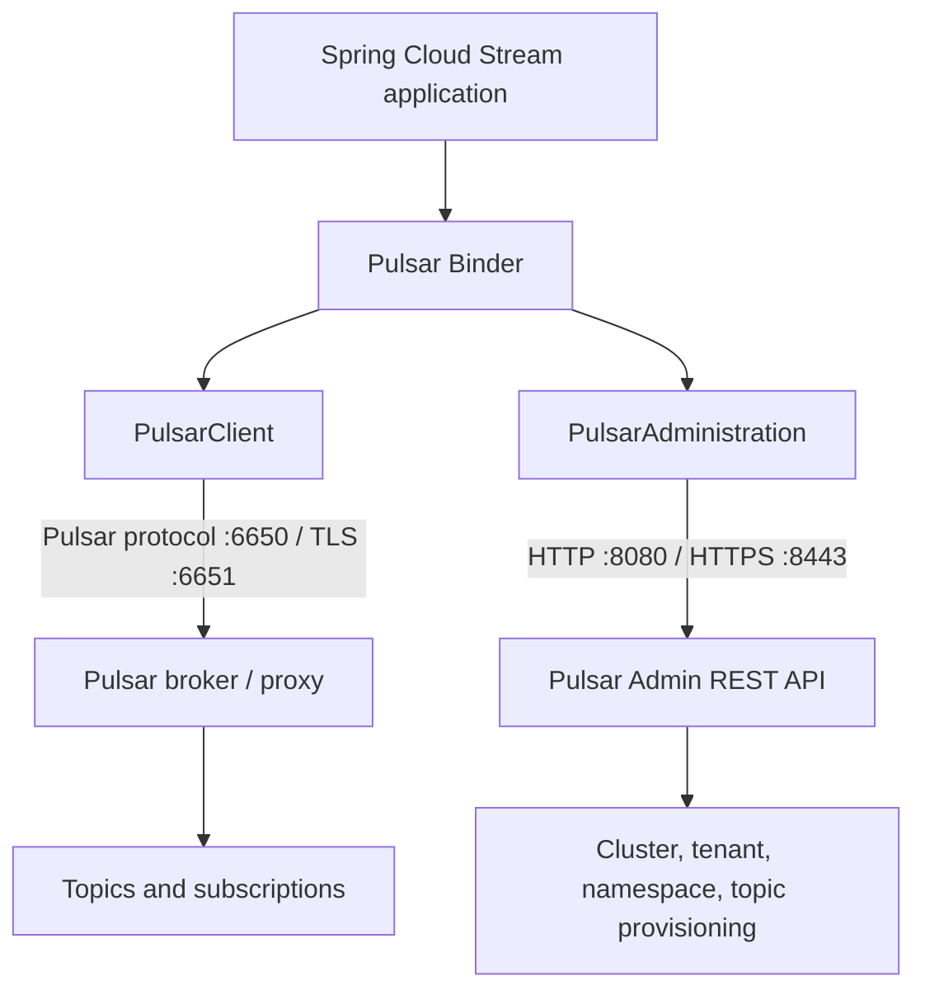

# Connecting to Pulsar Service URL and Administration URL

Spring Cloud Stream Pulsar Binder uses Apache Pulsar through two clients with distinct responsibilities. `PulsarClient` connects to the broker to publish and consume messages using the Pulsar protocol. `PulsarAdministration` calls the HTTP API to inspect or modify cluster, tenant, namespace, and topic metadata; the binder uses this client when provisioning destinations.

Therefore, an application typically needs to configure two separate addresses:

- **Service URL**: the Pulsar protocol address, usually in the form `pulsar://host:6650` or `pulsar+ssl://host:6651`.
- **Administration URL**: the HTTP API address, usually in the form `http://host:8080` or `https://host:8443`.

The two addresses may point to the same Pulsar cluster while using different listeners, ports, protocols, access permissions, and network paths. Configuring the service URL correctly does not prove the admin API is reachable; conversely, a working admin URL does not mean producers and consumers can connect to the broker.

## 1. Distinguishing the Two Endpoints

| Endpoint | Client used | Protocol | Primary responsibility |
|---|---|---|---|
| Pulsar service URL | `PulsarClient` | Pulsar binary protocol over TCP | Broker lookup, creating producers/consumers, sending and receiving messages |
| Pulsar administration URL | `PulsarAdministration` / `PulsarAdmin` | HTTP or HTTPS REST API | Reading metadata and managing clusters, tenants, namespaces, topics, partitions, permissions |



The service URL is not the Pulsar Manager UI URL. The administration URL is also not the binary broker address. Do not swap the two values simply because they point to the same hostname.

## 2. Configuring the Service URL

Spring for Apache Pulsar auto-configures `PulsarClient` when the application includes the appropriate starter/binder. The standard Spring Boot property is `spring.pulsar.client.service-url`.

Example running local Pulsar without TLS enabled:

```yaml
spring:
  pulsar:
    client:
      service-url: pulsar://localhost:6650
```

The default value commonly used in local environments is `pulsar://localhost:6650`. In container or Kubernetes environments, `localhost` points only to the application's own container/pod. Use a DNS/service name that the workload can resolve, such as `pulsar-broker.messaging.svc.cluster.local:6650`, or the proxy/load balancer address provided by the platform.

### 2.1. Choosing Scheme and Port

| Scheme | Purpose | Common port |
|---|---|---:|
| `pulsar://` | Broker connection without TLS encryption | `6650` |
| `pulsar+ssl://` | Broker connection with TLS | `6651` |

The ports are common conventions, not mandatory rules. A cluster may change ports or expose TLS only. The scheme must match the broker/proxy listener. If using `pulsar+ssl://`, the broker must enable TLS and the client must trust the certificate according to the environment's policy.

Example:

```yaml
spring:
  pulsar:
    client:
      service-url: pulsar+ssl://pulsar.example.internal:6651
```

The Pulsar client obtains the initial address from the service URL and then performs a lookup to connect to the broker owning the topic. Thus, in a multi-broker cluster, checking only the port of the initial URL is not enough; the broker addresses advertised by the cluster (`advertised listeners`) must also be resolvable and reachable from the application's network. A Pulsar proxy can help provide a stable entry point, though it must be configured appropriately for the cluster architecture.

## 3. Configuring the Administration URL

The administration client calls Pulsar's REST API. In current Spring Boot/Spring for Apache Pulsar versions, the standard property is `spring.pulsar.admin.service-url`:

```yaml
spring:
  pulsar:
    admin:
      service-url: http://localhost:8080
```

The administration URL commonly uses `http://localhost:8080` in local environments. In deployments with TLS, use `https://` and the TLS web port exposed by the cluster, commonly `8443`:

```yaml
spring:
  pulsar:
    admin:
      service-url: https://pulsar.example.internal:8443
```

**Version compatibility note:** Some older Spring Cloud Stream Pulsar Binder and Spring for Apache Pulsar documentation uses the `spring.pulsar.administration.service-url` prefix. Newer Spring Boot/Spring Pulsar versions publish the shortened prefix `spring.pulsar.admin.service-url`. Use the exact property name supported by the dependency version managed by your project's Spring Cloud BOM; do not set both prefixes to guess which one takes effect. Check the configuration metadata and documentation for the exact release train before deploying.

The administration URL is the REST API address, not a web management portal address. For example, `http://pulsar.example:8080` is the API base URL; the Pulsar Manager UI, if present, is a separate service.

## 4. Configuring Both URLs in One Application

Local example with an orders topic:

```yaml
spring:
  pulsar:
    client:
      service-url: pulsar://localhost:6650
    admin:
      service-url: http://localhost:8080
  cloud:
    function:
      definition: processOrder
    stream:
      bindings:
        processOrder-in-0:
          destination: persistent://public/default/orders.created
          group: inventory-service
          content-type: application/json
```

`processOrder-in-0` is the input binding of the `processOrder` function. The destination in this example uses a full topic name in the form `persistent://tenant/namespace/topic`. The service URL is used for receiving messages; the administration URL is used when the binder needs to provision the topic. `group` is the Spring Cloud Stream/Pulsar Binder consumer setting; the actual subscription name and subscription type should be verified against the corresponding binder configuration.

In Spring Cloud Stream, Pulsar connection properties live under Spring Boot/Spring Pulsar auto-configuration. Binder properties such as producer, consumer, or partition count can be set at the binder or binding level. Do not confuse `spring.cloud.stream.pulsar.binder.*` with `spring.pulsar.client.service-url`: they have different scopes.

## 5. When Is the Administration URL Used?

The Pulsar Binder includes a topic provisioner. When the application initializes a binding, the provisioner checks the destination and can create the topic if it does not yet exist. The binder uses `PulsarAdministration` to perform these administrative operations. Therefore, the administration URL must be accurate if the application needs to provision topics and is not running on the default endpoint.

The provisioner can create basic non-partitioned topics when a topic does not exist. When a partitioned topic is needed, the partition count can be set at the binder level:

```yaml
spring:
  cloud:
    stream:
      pulsar:
        binder:
          partition-count: 6
```

Or configured per binding:

```yaml
spring:
  cloud:
    stream:
      pulsar:
        bindings:
          publishOrder-out-0:
            producer:
              partition-count: 6
```

Property prefixes and binding locations must match the Pulsar Binder version in use. Binder-level configuration applies to topics provisioned by the application by default; extended binding configuration allows each binding to have its own partition count. If the topic has been pre-created by the platform, verify the actual partition count and required admin permissions; do not rely on the service URL to infer that the topic already exists.

The administration client may need permissions to read metadata and create topics/partitions. If the service URL connects successfully but the admin URL is wrong or the admin principal lacks permissions, the application may fail during binding initialization even though the broker is running. Conversely, if only existing topics are used and the deployment configuration does not require provisioning, admin API call requirements may differ; check the logs and provisioner behavior of the version in use.

## 6. Setting URLs per Environment

Do not hard-code production addresses into source code. Use environment variables, profiles, or a config store to supply endpoints per environment.

Example `application-prod.yml`:

```yaml
spring:
  pulsar:
    client:
      service-url: ${PULSAR_SERVICE_URL}
    admin:
      service-url: ${PULSAR_ADMIN_URL}
```

Environment values might be:

```text
PULSAR_SERVICE_URL=pulsar+ssl://pulsar-broker.prod.internal:6651
PULSAR_ADMIN_URL=https://pulsar-admin.prod.internal:8443
```

Hostnames and ports are illustrative only. Obtain actual endpoints from your platform team, and verify DNS, routing, firewalls, network policies, and the TLS trust chain from the exact environment where the application runs.

| Environment | Example Service URL | Example Administration URL |
|---|---|---|
| Local standalone | `pulsar://localhost:6650` | `http://localhost:8080` |
| Docker Compose | `pulsar://pulsar:6650` | `http://pulsar:8080` |
| Kubernetes | `pulsar://pulsar-broker.messaging.svc:6650` | `http://pulsar-broker.messaging.svc:8080` |
| Production TLS | `pulsar+ssl://broker.example:6651` | `https://admin.example:8443` |

In Docker Compose/Kubernetes, use the service hostname within the appropriate network/namespace. Do not use `localhost` from an application container to connect to another Pulsar container.

## 7. Security and Authentication

Both the service client and the admin client may require authentication. Distinguish publish/consume permissions from administrative permissions:

- The runtime client needs produce permissions on output topics and consume permissions on input topics/subscriptions.
- The admin client needs permissions to read metadata and manage topics/namespaces if the binder provisions resources.
- Do not grant superuser access to an application just to avoid provisioning errors; use roles/service accounts with least privilege.
- If the platform issues separate credentials for admin and client, configure each client properly according to the Spring Pulsar version.

Example token authentication for the client:

```yaml
spring:
  pulsar:
    client:
      service-url: pulsar+ssl://pulsar.example.internal:6651
      authentication:
        plugin-class-name: org.apache.pulsar.client.impl.auth.AuthenticationToken
        param:
          token: ${PULSAR_CLIENT_TOKEN}
```

If the admin client requires a separate token or OAuth credentials, configure authentication under the admin/administration namespace corresponding to the version in use. In current Spring Boot releases, the property group is typically `spring.pulsar.admin.authentication`; older releases may use `spring.pulsar.administration.authentication`. Do not commit tokens directly to Git, logs, or shared configuration files.

### 7.1. TLS for Both Connections

When TLS is enabled, verify both clients:

| Client | Scheme | What to verify |
|---|---|---|
| Pulsar client | `pulsar+ssl://` | TLS broker listener, server certificate, trust chain, and client builder configuration |
| Pulsar admin | `https://` | HTTPS web listener, REST endpoint certificate, trust chain, and admin builder configuration |

Changing the scheme alone is not enough if the JVM does not trust the CA or the hostname does not match the certificate. Some Spring Boot/Spring Pulsar versions require `PulsarClientBuilderCustomizer` or `PulsarAdminBuilderCustomizer` for detailed TLS configuration. Do not disable certificate verification in production as a quick fix for connection errors.

## 8. Separating Configuration by Scope

Spring Cloud Stream Pulsar Binder uses Spring Boot auto-configuration from Spring for Apache Pulsar. As a result, certain Pulsar properties can be set at multiple levels:

| Configuration level | Example prefix | Scope |
|---|---|---|
| Spring Boot client/admin | `spring.pulsar.client.*`, `spring.pulsar.admin.*` | Shared application client configuration |
| Binder | `spring.cloud.stream.pulsar.binder.producer.*`, `...consumer.*` | Shared across the binder's bindings |
| Extended binding | `spring.cloud.stream.pulsar.bindings.<binding-name>.producer.*` or `.consumer.*` | Specific to an individual output/input binding |

When the same property is set at multiple levels, extended binding takes precedence over binder-level, and binder-level takes precedence over Spring Boot properties according to Pulsar Binder rules. Service URL and administration URL are typically shared connection settings; do not vary them per binding if the application has only one Pulsar client/admin context. If connecting to multiple clusters is required, design separate binder/client contexts and clearly specify which binding uses which cluster.

## 9. Multiple Clusters or Multiple Binders

An application may need to connect to multiple middleware systems or clusters. In that case, setting a single global `spring.pulsar.client.service-url` is insufficient to describe multiple independent Pulsar clusters. You must declare separate binder configurations using Spring Cloud Stream's multi-binder mechanism, each with its own environment/context and corresponding Spring Pulsar configuration.

Before deploying multi-cluster setups, determine:

- Which binding publishes/consumes on which cluster.
- The service URL and administration URL for each cluster.
- Separate credentials and TLS trust settings for each cluster.
- Corresponding topics, tenants, namespaces, and subscriptions.
- Provisioning permissions and ownership for each cluster.
- Retry, failover, and reconciliation policies when one cluster loses connectivity.

Do not reuse a single broad-privilege admin credential across all clusters when separate credentials can be issued. Multi-binder configurations must be tested to prevent bindings from inadvertently falling back to the default binder.

## 10. Testing Connectivity from the Application Environment

Testing endpoints from a laptop is insufficient if the application runs in containers or Kubernetes. Run checks within the same network namespace or from a diagnostic pod with an equivalent network policy.

Recommended steps:

1. Verify the service URL uses a valid Pulsar scheme and the hostname resolves.
2. Test TCP connectivity to the service port (typically 6650 or 6651).
3. Send an HTTP(S) request to the administration base URL; a `401` or `403` response still confirms the HTTP server was reached, though credentials/permissions are not yet valid.
4. Verify the admin API can read clusters/tenants/namespaces with the application's permissions.
5. Initialize a test binding against an existing topic to verify client lookup and consume/produce.
6. If the binder must create topics, check admin permissions and provisioning logs.
7. Verify that broker advertised addresses returned from lookup are also reachable from the application.

Example TCP and HTTP checks in an environment with the relevant tools installed:

```bash
nc -vz pulsar-broker.example.internal 6650
curl -i https://pulsar-admin.example.internal:8443/admin/v2/clusters
```

The `curl` command may return `401`/`403` if no credentials are sent; that differs from a timeout or DNS error. Do not place tokens into command history or share outputs containing authentication details.

## 11. Common Errors

| Symptom | Possible cause | Resolution |
|---|---|---|
| `PulsarClient` times out on startup or sending messages | Wrong service URL, blocked broker port, TLS scheme mismatch, or DNS resolution failure | Check `spring.pulsar.client.service-url`, port, routing, and broker listener |
| Admin provisioner cannot create topic | Wrong administration URL, unreachable REST port, or admin credential lacks permissions | Check `spring.pulsar.admin.service-url`/version-appropriate prefix, HTTP(S), ACLs, and provisioner logs |
| Client connects but binding startup fails | Admin API is unreachable while the binder provisions the destination | Check admin endpoint and permissions to create/read topics, tenants, and namespaces |
| Admin API works but publish/consume fails | Pulsar binary service port or advertised broker address is unreachable | Check service URL, lookup response, and network path between application and broker |
| `UnknownHostException` error | Hostname exists only in another network or wrong DNS suffix | Use the environment-appropriate DNS/service name and check network policies |
| TLS handshake failure | Untrusted CA, hostname mismatch, wrong port, or missing client TLS config | Verify certificate chain, scheme, listener, and builder customizer |
| Authentication failed | Incorrect token/plugin/parameter or credential placed under wrong prefix | Verify client and admin auth configs separately; confirm secret injection |
| Topic is not created | Admin principal lacks permission or namespace/tenant does not exist | Grant least-privilege permissions and provision tenant/namespace via platform workflow |
| Topic partition count is not as expected | Only basic auto-create used or `partition-count` missing | Set partition count at binder/binding level and verify actual topic via admin API |
| Works locally, fails in Kubernetes | Configuration uses `localhost` or host-only exposed ports | Use service DNS and test from inside the application pod |

When diagnosing, isolate errors by layer: DNS/network, TLS, authentication, Pulsar binary protocol, admin REST API, tenant/namespace permissions, and binder provisioning. Do not change both URLs simultaneously, as that makes it harder to identify which layer failed.

## 12. Pre-Deployment Checklist

- [ ] Service URL uses `pulsar://` or `pulsar+ssl://` with the correct broker/proxy port.
- [ ] Administration URL uses `http://` or `https://` with the correct REST/web port.
- [ ] Service endpoint is distinguished from the admin API and Pulsar Manager UI.
- [ ] Admin property prefix matches the Spring Boot/Spring Pulsar version managed by the BOM.
- [ ] DNS, firewall, network policy, and advertised broker addresses are reachable from the application.
- [ ] TLS certificates, hostname validation, and trust chains are valid for both clients.
- [ ] Client and admin authentication/authorization follow the principle of least privilege.
- [ ] Tenant, namespace, topic, and partition count match the binding's destination.
- [ ] It is clear when the binder topic provisioner calls the administration API.
- [ ] URLs and secrets are supplied via profiles/environment/config store, not hard-coded.
- [ ] TCP service port, HTTP admin API, and integration tests through the binder have been verified.
- [ ] Monitoring distinguishes client connection errors from admin provisioning errors.

The service URL is the data connection path for `PulsarClient`; the administration URL is the administrative REST path used by `PulsarAdministration` when the binder needs to provision topics and read metadata. Configuring both properly, using the right scheme/port, version-appropriate property prefixes, and separate permissions per client ensures stable binding initialization. When errors occur, test the broker path and admin path separately from the actual application runtime environment to pinpoint the exact connection layer at fault.

## References

- [Spring Cloud Stream — Pulsar Binder](https://docs.spring.io/spring-cloud-stream/reference/pulsar/pulsar_binder.html)
- [Spring Boot — Apache Pulsar Support](https://docs.spring.io/spring-boot/reference/messaging/pulsar.html)
- [Spring for Apache Pulsar — Pulsar Client](https://docs.spring.io/spring-pulsar/reference/reference/pulsar/pulsar-client.html)
- [Spring for Apache Pulsar — Pulsar Administration](https://docs.spring.io/spring-pulsar/reference/reference/pulsar-admin.html)
- [Apache Pulsar — Concepts and Architecture](https://pulsar.apache.org/docs/next/concepts-architecture-overview/)
