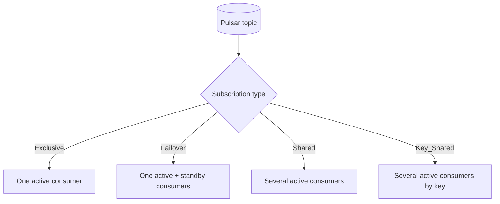
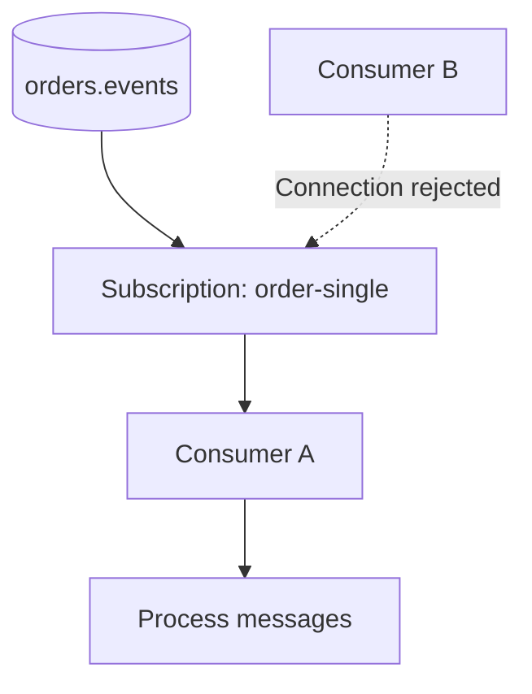
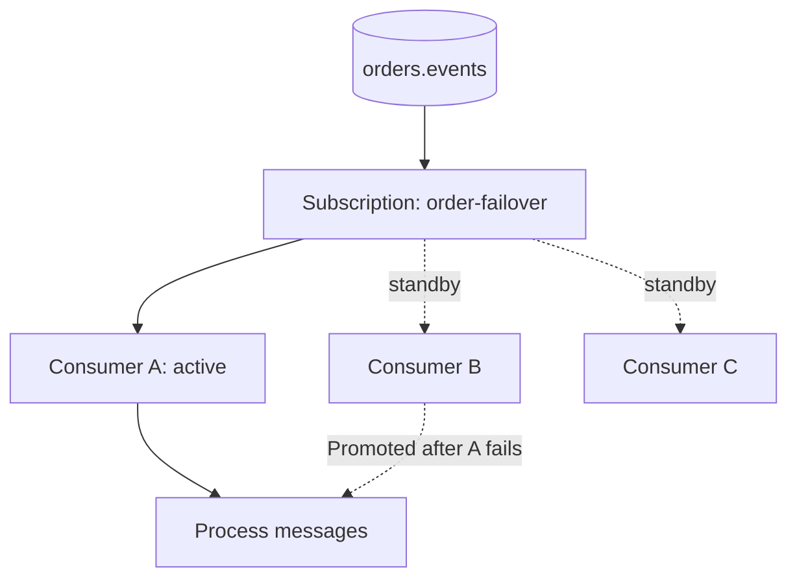
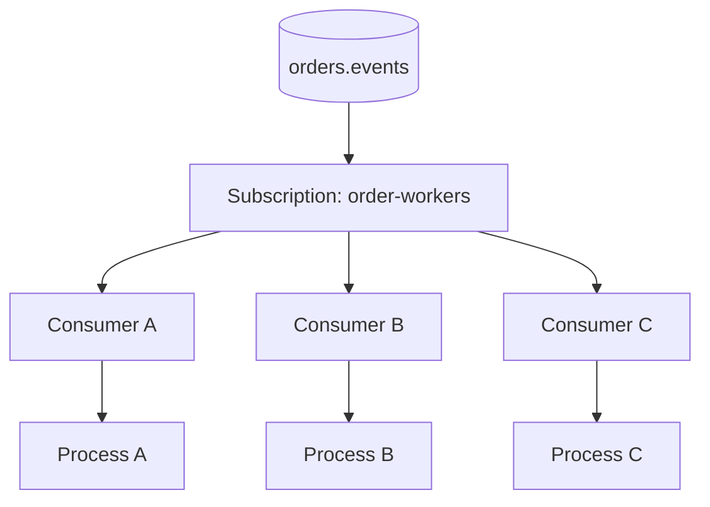
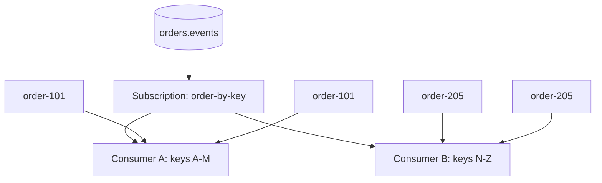

# Subscription Types and Their Impact on Load Sharing and Ordering

## 1. Subscriptions Determine How Consumers Share Messages

In Apache Pulsar, producers write messages to a topic and consumers receive messages through a subscription. A subscription stores consumption state, acknowledgments, and read position. Multiple consumers can join the same subscription to share load or act as backups for one another, depending on the selected subscription type.

Pulsar has four main subscription types:

- **Exclusive:** only one consumer is allowed to connect to the subscription.
- **Failover:** multiple consumers can connect, but only the active consumer receives messages; other consumers wait as standbys.
- **Shared:** multiple consumers are active simultaneously and share messages, typically in a round-robin dispatch pattern.
- **Key_Shared:** multiple consumers are active simultaneously, but messages with the same key or ordering key are routed to the same consumer under stable assignment conditions.

The subscription type directly affects how many consumers can receive messages concurrently, failover behavior, observed ordering, and how messages are redelivered upon processing errors.



There is no single best subscription type for every workload. Start from business requirements: whether topic-wide or per-key ordering is needed, whether multiple consumers must process in parallel, whether a standby must take over automatically when an instance fails, and whether redelivery is acceptable.

## 2. Subscription Name and Consumer Group in Spring Cloud Stream

Spring Cloud Stream uses the input binding's `group` property to identify a consumer group. With the Pulsar binder, `group` is mapped to the subscription name or participates in generating the subscription name according to binder rules. Instances of the same application must use the same `group` to share consumption progress; applications that need independent copies should use different groups.

Example of an order-processing function:

```java
import java.util.function.Consumer;
import org.springframework.context.annotation.Bean;
import org.springframework.context.annotation.Configuration;

record OrderCreated(String orderId, long totalCents) {}

@Configuration
class OrderFunctions {

    @Bean
    Consumer<OrderCreated> processOrder(OrderService orderService) {
        return event -> orderService.process(event);
    }
}
```

Binding configuration using a stable group:

```yaml
spring:
  cloud:
    function:
      definition: processOrder
    stream:
      bindings:
        processOrder-in-0:
          destination: persistent://commerce/orders/events
          group: order-processor
      pulsar:
        bindings:
          processOrder-in-0:
            consumer:
              subscriptionType: Shared
```

In this example, replicas of `order-processor` join the subscription for that binding and share messages using `Shared` mode. Another application using the `order-audit` group will have its own subscription and receive an independent stream of messages.

Exact Pulsar binder property names should be verified against the Spring Cloud Stream version in use. The example uses the `spring.cloud.stream.pulsar.bindings.<bindingName>.consumer` namespace to configure Pulsar-specific consumer properties. Do not confuse Spring Cloud Stream's `group` with `subscriptionType`: `group` identifies the logical subscription, whereas `subscriptionType` determines how consumers within that subscription coordinate.

## 3. Exclusive: A Single Consumer

With `Exclusive`, a subscription allows only one active consumer. If another consumer attempts to connect to the same subscription, the broker rejects the second connection until the current consumer leaves.



### Characteristics

- Only one consumer receives messages on the subscription.
- Simple operational model, easy to reason about ordering on a non-partitioned topic.
- No parallel load sharing across multiple consumers in the same subscription.
- If the consumer stops, the subscription waits for another consumer to reconnect; meanwhile, backlog can grow.
- When a replacement consumer connects, unacknowledged messages may be redelivered.

`Exclusive` fits workloads requiring a single consumer, low traffic, or sequential processing at the subscription level. For partitioned topics, distinguish per-partition ordering; a single consumer receiving from multiple partitions still does not produce a strict global order across partitions.

### When Not to Use It

Do not choose `Exclusive` if you need multiple replicas processing a logical queue in parallel or need to scale consumption capacity by adding consumers to the same subscription. In those cases, `Shared` or `Key_Shared` is more appropriate depending on ordering requirements.

## 4. Failover: One Active Consumer, Remaining Consumers on Standby

With `Failover`, multiple consumers can subscribe to the same subscription, but the broker selects one active consumer to receive messages. The remaining consumers stay on standby. When the active consumer disconnects or is removed from the subscription, the broker transfers message delivery to a standby consumer.



### Characteristics

- Only the active consumer receives messages at any point in time within the corresponding distribution scope.
- Standby consumers do not share normal load; they wait to take over.
- When the active consumer fails, a standby consumer is promoted to active.
- Unacknowledged messages may be redelivered after failover.
- Suitable when ordering and high availability take priority over parallel throughput.

With a non-partitioned topic, one active consumer processes the subscription. With a partitioned topic, active consumer selection happens per partition; one consumer can be active for some partitions and standby for others. Thus, multiple consumers can receive data simultaneously across different partitions, while each partition still has only one active consumer at a time.

`Failover` does not guarantee that unacknowledged messages are processed exactly once. If the active consumer performed side effects before failing without acknowledging, the message may be redelivered to the consumer taking over. Consumers still require idempotency.

## 5. Shared: Multiple Consumers Splitting Messages

With `Shared`, multiple consumers are active simultaneously on one subscription. The broker distributes messages across consumers, typically round-robin or according to consumer capacity.



### Characteristics

- Multiple consumers can process messages concurrently.
- Adding consumers can increase throughput if the broker, network, and downstream systems have sufficient capacity.
- Messages are not guaranteed to maintain original order when distributed across multiple consumers.
- Redelivery after failures can alter observed ordering.
- Cumulative acknowledgment is not supported; consumers must acknowledge messages individually.

For example, suppose a topic receives `A`, `B`, `C` in sequence. The broker may dispatch `A` to Consumer 1, `B` to Consumer 2, and `C` to Consumer 3. If Consumer 2 finishes faster, `B` may complete before `A`. Therefore, `Shared` fits independent events that do not require subscription-wide ordering.

### When to Use Shared

`Shared` generally suits parallelizable background tasks such as sending emails, generating thumbnails, processing webhooks, or handling independent order-by-ID jobs. If multiple messages for the same aggregate must be processed strictly in order, `Shared` is not the default choice.

## 6. Key_Shared: Load Sharing by Key

`Key_Shared` allows multiple active consumers while having the broker route messages based on message key or ordering key. Messages with the same key are assigned to the same consumer during a stable assignment, helping preserve per-key ordering under normal delivery conditions.



For example, events for `order-101` go to Consumer A, while events for `order-205` go to Consumer B. Both consumers can process two different orders in parallel, while events for the same order are funneled to one consumer.

### Characteristics

- Multiple active consumers.
- Messages with the same key or ordering key are routed to the same consumer via hash/range assignment.
- Can scale throughput across keys while preserving per-key processing order under normal conditions.
- When consumers join or leave the subscription, key ranges may be reassigned.
- Redelivery, negative acknowledgments, and failover can still cause duplicate processing; does not replace idempotency.
- Does not support cumulative acknowledgment.

`Key_Shared` fits business domains requiring per-entity ordering—such as orders, accounts, or devices—while still needing parallel processing across entities.

## 7. Producer Batching with Key_Shared

`Key_Shared` relies on the message key to route to the right consumer. If a producer packs messages belonging to multiple keys into a regular batch, the broker may be unable to dispatch individual messages within the batch by key as intended.

When using `Key_Shared`, producers must disable batching or use Pulsar's key-based batching mode. Key-based batching ensures messages with the same key are batched in a way compatible with `Key_Shared` delivery.

Example with the Pulsar Java client:

```java
import org.apache.pulsar.client.api.BatcherBuilder;
import org.apache.pulsar.client.api.PulsarClient;
import org.apache.pulsar.client.api.Producer;
import org.apache.pulsar.client.api.Schema;

Producer<OrderEvent> producer = pulsarClient.newProducer(Schema.JSON(OrderEvent.class))
    .topic("persistent://commerce/orders/events")
    .batcherBuilder(BatcherBuilder.KEY_BASED)
    .create();

producer.newMessage()
    .key("order-101")
    .value(new OrderEvent("order-101", "CREATED"))
    .send();
```

This snippet illustrates native producer configuration. If the producer is managed by the Spring Cloud Stream Pulsar binder, configure the corresponding batcher using the producer properties supported by your binder version. Do not assume Pulsar Java client properties share the exact same names across all binder versions.

If using an ordering key instead of the regular key, producer and consumer must agree on routing semantics. Do not change the key across events of the same aggregate if you want them to follow the same processing lane.

## 8. Comparing the Four Subscription Types

| Criterion | Exclusive | Failover | Shared | Key_Shared |
|---|---|---|---|---|
| Active consumers | One | One per partition/assignment scope | Multiple | Multiple |
| Standby consumers | No | Yes | No | No |
| Parallel load sharing | Not within the same subscription | Across partitions, not within the same partition | Yes | Yes, across keys |
| Ordering | Follows stream/partition order | Per partition when redelivery does not alter observation | Not guaranteed | Per key under normal dispatch conditions |
| Failover | Another consumer connects after active leaves | Standby is promoted | Remaining consumers continue receiving | Remaining consumers continue; key ranges may shift |
| Cumulative ack | Usable within Pulsar limits | Usable within Pulsar limits | Not supported | Not supported |
| Best fit | Single sequential consumer | Prioritizes standby and failover | Independent events, high throughput | Per-key ordering with cross-key parallelism |

Ordering in the table must be understood within the scope of a partition/key and normal processing conditions. Redeliveries, retries, consumer failures, and multiple partitions can cause completion order to differ from publish order. No subscription type provides global ordering across all partitions of a partitioned topic.

## 9. Subscription Types and Partitioned Topics

A Pulsar partitioned topic is composed of multiple internal partition topics. Producers select a partition based on routing mode and key. Consumers subscribe to the logical topic name, and the client/broker manages reading from the partitions.

Subscription types still apply, though behavior must be viewed per partition:

- With `Exclusive`, a single consumer owns the subscription; it can read from multiple partitions.
- With `Failover`, one consumer is active per partition, and other consumers act as standbys for those partitions.
- With `Shared`, multiple consumers receive messages from the subscription and may receive messages from different partitions.
- With `Key_Shared`, key ranges are distributed among consumers; producer key routing and partition routing must be compatible to preserve key affinity.

Do not infer that an 8-partition topic limits `Shared` to at most 8 consumers or that `Key_Shared` always assigns one consumer per partition. Useful consumer concurrency also depends on subscription mode, partition count, key distribution, receiver capacity, and actual load.

### Partitioning and Ordering

Both Kafka and Pulsar guarantee ordering only within a defined partition/stream scope, with no natural global order across multiple partitions. If business logic requires all events of the same aggregate to be ordered, use stable keys and consistent routing so those events flow through the appropriate partition/consumer lane.

## 10. Configuring Subscription Type in Spring Cloud Stream

With the Pulsar binder, subscription type is configured per input binding. Example using `Key_Shared` for order events:

```yaml
spring:
  cloud:
    function:
      definition: processOrder
    stream:
      bindings:
        processOrder-in-0:
          destination: persistent://commerce/orders/events
          group: order-processor
      pulsar:
        bindings:
          processOrder-in-0:
            consumer:
              subscriptionType: Key_Shared
```

If you want load sharing without per-key ordering, change `subscriptionType` to `Shared`. If you want one active consumer with standby instances, choose `Failover`. If only a single consumer is allowed to connect, choose `Exclusive`.

Enum values are typically written as `Exclusive`, `Failover`, `Shared`, `Key_Shared`; the binder's configuration metadata for your version may also support alternative spellings via relaxed binding. Verify that the configuration bound cleanly on startup and confirm the actual subscription type in Pulsar admin/monitoring.

## 11. Different Groups Create Independent Receive Streams

Subscription type determines how consumers within one subscription coordinate. `group` determines which subscription a consumer belongs to.

Example of two applications reading the same `orders.events` topic:

```yaml
spring:
  cloud:
    function:
      definition: processOrder
    stream:
      bindings:
        processOrder-in-0:
          destination: persistent://commerce/orders/events
          group: order-processor
        auditOrder-in-0:
          destination: persistent://commerce/orders/events
          group: order-audit
```

`order-processor` and `order-audit` are two independent subscriptions. Each subscription has its own acknowledgment progress. One application can use `Shared` for load sharing while the other uses `Failover` for redundancy. Subscription types do not need to match across groups.

If `group` is omitted, Spring Cloud Stream typically creates an anonymous/unique subscription per the binder. Anonymous subscriptions fit temporary consumers or one-off experiments; they are unsuitable when durable progress must survive restarts and be shared across replicas. Declare a stable `group` for production workloads.

## 12. How Acknowledgments Affect Redelivery and Ordering

Pulsar considers a message complete only once the consumer acknowledges it. If a consumer fails before acking, the message can be redelivered via negative acknowledgment, acknowledgment timeout, or subscription recovery mechanisms.

Behavior depends on subscription type:

- With `Exclusive`/`Failover`, redelivery can cause the consumer to receive unacknowledged messages again; failover can also cause messages to be reprocessed.
- With `Shared`, multiple consumers process concurrently, so a redelivered message may reach a different consumer and finish after newer messages.
- With `Key_Shared`, key affinity sends the same key to the same consumer when assignments are stable; during redeliveries or consumer membership changes, the application must still enforce ordering checks and idempotency.

Do not conclude that "since the broker delivers the same key to the same consumer, side effects happen only once." Lost acks or process crashes after a side effect but before acking can still produce duplicates.

### Cumulative Acknowledgment

Pulsar supports individual acknowledgment and cumulative acknowledgment on subscription types with matching semantics. `Shared` and `Key_Shared` do not support cumulative acknowledgment because multiple consumers process messages concurrently; acknowledging a higher position could accidentally acknowledge other messages not yet processed.

With `Shared`/`Key_Shared`, use per-message acknowledgment. Do not design consumers that rely on cumulative ack to confirm a range of offsets/sequences.

## 13. Redelivery, Retry, and Dead-Letter Policy

When processing fails, a consumer can negative-acknowledge a message to request redelivery. Pulsar can delay redelivery per configuration and supports a dead-letter policy to route failing messages after a configured number of redelivery attempts.

Conceptual configuration example in the binder:

```yaml
spring:
  cloud:
    stream:
      bindings:
        processOrder-in-0:
          destination: persistent://commerce/orders/events
          group: order-processor
      pulsar:
        bindings:
          processOrder-in-0:
            consumer:
              subscriptionType: Shared
              deadLetterPolicy:
                maxRedeliverCount: 5
                deadLetterTopic: persistent://commerce/orders/events-DLQ
```

Property names and nested dead-letter policy representation depend on the Spring Cloud Stream Pulsar binder version. Verify the configuration metadata for the binder in use; if the binder accepts a Pulsar `DeadLetterPolicy` object, configuration must map to the exact fields supported by that version.

With `Shared`, redeliveries may be dispatched to a different consumer; do not assume retries run on the same instance that originally failed. With `Key_Shared`, test redelivery and ordering behavior on your specific broker/client version. Regardless of type, handlers must be safe when receiving the same event multiple times.

## 14. Receiver Queue Size and Subscription Type Are Distinct Settings

A Pulsar consumer uses a receiver queue on the client to buffer messages received from the broker before the application processes them. `receiverQueueSize` affects how many messages sit ready in client memory and the latency to fetch subsequent messages.

Receiver queue size does not decide which consumer receives a message; that is the role of the subscription type. However, it affects actual load and distribution:

- An overly large queue can cause one consumer to hoard many messages in memory.
- A tiny queue can cause a consumer to frequently wait on the broker for more messages.
- For partitioned topics, total queue limits and per-partition queue limits must be considered together.
- During slow processing, buffered messages still consume memory and can affect processing/ack timing.

Example consumer property configuration (verify property name against your binder version):

```yaml
spring:
  cloud:
    stream:
      pulsar:
        bindings:
          processOrder-in-0:
            consumer:
              receiverQueueSize: 100
```

Do not increase receiver queue size as a substitute for scaling out consumers. Choose queue size based on payload size, memory budget, and processing speed.

## 15. Choosing a Subscription Type for Business Requirements

| Requirement | Suitable type to consider | Reason |
|---|---|---|
| Single consumer, no load sharing needed | Exclusive | Simple; only one consumer allowed |
| Need one active consumer and automatic standby takeover | Failover | Multiple consumers register, but only the active consumer receives messages per partition |
| Independent events, throughput priority | Shared | Multiple consumers process in parallel |
| Multiple aggregates, per-key ordering needed | Key_Shared | Load sharing across keys while preserving per-key affinity |
| Need global ordering across multiple partitions | None provides this automatically | Must design a single sequential stream/partition or change the data model |

Practical examples:

- Sending notification emails: `Shared`, because each email is independent and topic-wide ordering is unnecessary.
- Processing order state transitions: `Key_Shared` by `orderId`, because events for the same order need the same processing lane.
- A single job updating a snapshot file: `Exclusive`, if only one consumer is allowed to run.
- Critical consumer requiring hot standby: `Failover`, if the throughput of one active consumer per partition is sufficient.

## 16. Experimenting with Message Distribution

You can create a test topic and run multiple consumers on the same subscription to observe semantics:

1. Create topic `subscription-lab`.
2. Send a sequence of messages with keys `A`, `B`, `A`, `B`, `C`.
3. Run two consumers on the same subscription with `Exclusive`; verify the second consumer cannot become active concurrently.
4. Switch to `Failover`; observe one active consumer and one standby consumer, then stop the active one to watch promotion.
5. Switch to `Shared`; observe messages split across the two consumers and notice completion order can differ from send order.
6. Switch to `Key_Shared`; send multiple messages with the same key and observe them routing to the same consumer while assignments are stable.
7. Enable standard batching and compare with key-based batching to see the effect on `Key_Shared`.
8. Negative-ack a message and observe redelivery.
9. Stop a consumer while messages remain unacked and observe redelivery.
10. Record message ID, key, consumer name, receive timestamp, and ack timestamp.

Test with the same broker/client versions used in production. Do not draw conclusions about ordering from a brief observation when retries, redeliveries, or consumer membership changes occur.

## 17. Monitoring Subscriptions in Production

Metrics to monitor include:

- Number of connected consumers per subscription.
- Active/standby consumers for `Failover`.
- Backlog and message age.
- Count of unacknowledged or pending-acknowledgment messages.
- Redelivery rate and negative acknowledgment rate.
- DLQ message count and age of the oldest message.
- Throughput per consumer and per partition.
- Receiver queue utilization, memory, and processing latency.
- Failover duration when an active consumer stops.
- Consumer churn and key-range reassignment duration with `Key_Shared`.

When backlog grows:

1. Identify which subscription type is in use.
2. Check the actual number of active consumers.
3. Check whether consumers are slowed down by a database or external API.
4. Check whether redeliveries or retries are amplifying load.
5. With `Shared`/`Key_Shared`, scale consumers if partition/key distribution and downstream systems allow.
6. With `Failover`, adding standbys does not increase concurrent processing consumers; evaluate partitioning or change the model if higher throughput is needed.

## 18. Common Configuration Mistakes

| Symptom | Possible cause | Resolution |
|---|---|---|
| Second consumer fails to connect | Subscription is `Exclusive` and already has an active consumer | Choose `Failover`, `Shared`, or `Key_Shared` if multiple consumers are needed |
| Multiple consumers connect, only one receives | Using `Failover`; remaining consumers are standbys | Use `Shared`/`Key_Shared` if load sharing is the goal |
| Processing order is inverted | `Shared` dispatches in parallel or side effects finish out of order | Use `Key_Shared` by key or serialize processing |
| Same key appears on multiple consumers | Incompatible producer key/batching or assignment changed | Check key, ordering key, and key-based batching |
| Consumer receives duplicate messages | Ack not recorded by broker, negative ack, or timeout | Check ack flow and make consumers idempotent |
| Poor `Key_Shared` throughput | Skewed key distribution, hot key, or too few active keys | Check key skew and useful consumer count |
| Adding standbys does not reduce backlog | `Failover` has only one active consumer per partition | Evaluate `Shared`/`Key_Shared` or increase partitions if appropriate |
| Memory rises after increasing consumer queue | Receiver queue too large or large payloads | Reduce queue size, measure memory, and limit payload size |

## 19. Workflow for Choosing a Subscription in Spring Cloud Stream

1. Determine whether the topic is partitioned or non-partitioned and how keys are generated.
2. Choose a stable `group` for workloads that share progress; use a different `group` for independent consumers.
3. Decide whether you need a single consumer, active/standby, free load sharing, or per-key load sharing.
4. Choose `Exclusive`, `Failover`, `Shared`, or `Key_Shared` accordingly.
5. If using `Key_Shared`, ensure producers emit stable keys/ordering keys and use key-based batching or disable batching.
6. Verify acknowledgment semantics; `Shared` and `Key_Shared` require individual acks.
7. Configure redelivery, retry, and DLQ according to failure categories.
8. Tune receiver queue size for payload size and memory budget.
9. Test multiple consumers, failover, redelivery, and ordering against a real broker.
10. Monitor backlog, active consumers, redeliveries, key skew, and DLQ after deployment.

Pulsar's subscription type is a critical decision governing how consumers share workload. `Exclusive` restricts to one consumer, `Failover` provides active/standby redundancy, `Shared` optimizes load sharing for independent events, and `Key_Shared` shards load by key to preserve per-entity affinity. Spring Cloud Stream Pulsar binder allows selecting the subscription type per input binding; combine group, partitioning, producer key/batching, acknowledgment, and retry configuration to achieve the needed throughput while preserving required business ordering.

## References

- [Apache Pulsar — Messaging concepts: subscriptions](https://pulsar.apache.org/docs/concepts-messaging/#subscriptions)
- [Apache Pulsar — Consumer](https://pulsar.apache.org/docs/client-libraries-java/#consumer)
- [Spring Cloud Stream Pulsar Binder](https://docs.spring.io/spring-cloud-stream/reference/pulsar/pulsar-binder.html)
