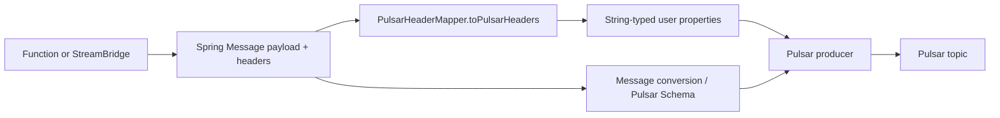

# Header Mapping and Customizing `PulsarHeaderMapper`

A message flowing through Spring Cloud Stream typically carries both a payload and metadata such as `correlationId`, `eventType`, `tenantId`, message ID, or publish timestamp. Spring represents metadata using `MessageHeaders`; Apache Pulsar provides message metadata and a user properties map for application-defined attributes. The Pulsar binder must translate between these two models when sending messages to a topic and when receiving messages from a topic.

`PulsarHeaderMapper` is the strategy responsible for that conversion. The binder supplies a default mapper and allows replacing it with an application-declared `PulsarHeaderMapper` bean. When customizing the mapper, you must decide which headers are allowed outbound to Pulsar, which headers are brought inbound into Spring, which Java types may be reconstructed from JSON, and how to handle values that cannot be serialized directly.

## 1. Headers in Spring vs. Metadata in Pulsar

Spring Messaging provides `Message<T>` consisting of a payload and `MessageHeaders`. For example, an order message might carry:

```java
public record OrderCreated(String orderId, String tenantId, long totalCents) {}

Message<OrderCreated> message = MessageBuilder
        .withPayload(new OrderCreated("ORD-1001", "tenant-a", 125000))
        .setHeader("x-correlation-id", "corr-2026-001")
        .setHeader("x-event-type", "OrderCreated")
        .setHeader("x-tenant-id", "tenant-a")
        .build();
```

Pulsar does not have an identical header structure to Spring. Instead, a Pulsar message has broker/client-managed metadata and a key/value user properties map for applications to pass custom attributes. Because of this, Spring for Apache Pulsar documentation often uses the terms *message header* and *message metadata* almost interchangeably.

| Information group | Examples | Stored in Pulsar | Can application set freely? |
| --- | --- | --- | --- |
| User properties | `x-correlation-id`, `x-event-type`, `x-tenant-id` | Message's custom properties map | Yes |
| Pulsar-managed metadata | Message ID, topic name, publish time, sequence ID, producer name, redelivery count | Message metadata fields | No; mostly read-only |
| Spring framework headers | `id`, `timestamp`, internal Spring headers | `MessageHeaders` | Generated or managed by Spring; not all should be sent over the broker |

`PulsarHeaderMapper` translates between Spring headers and their Pulsar counterparts. On send, the mapper produces a `Map<String, String>` for user properties. On receive, the mapper builds `MessageHeaders` from the Pulsar message, including metadata exposed by the framework as Spring headers.

## 2. Two Mapping Directions

The `PulsarHeaderMapper` contract has two primary methods:

```java
public interface PulsarHeaderMapper {

    Map<String, String> toPulsarHeaders(MessageHeaders springHeaders);

    MessageHeaders toSpringHeaders(
            org.apache.pulsar.client.api.Message<?> pulsarMessage);
}
```

| Method | Direction | Responsibility |
| --- | --- | --- |
| `toPulsarHeaders(...)` | Spring → Pulsar | Selects allowed Spring headers and converts values to strings for writing into user properties |
| `toSpringHeaders(...)` | Pulsar → Spring | Reads Pulsar user properties and metadata, converting them into `MessageHeaders` for business functions |

Outbound flow in Spring Cloud Stream:



The inbound flow runs in reverse: the Pulsar consumer fetches the message, the binder uses the mapper to create Spring headers, converts the payload via framework message conversion or native decoding, and passes `Message<T>` to the `Function`/`Consumer`.

The mapper handles metadata. It does not replace the serializer or Pulsar Schema used for the payload. Choosing `application/json`, Avro, Protobuf, or native Pulsar schemas is a separate decision from mapping `correlationId` or `tenantId`.

## 3. How Does the Binder Use the Default Mapper?

The Pulsar binder includes a default header mapper. Spring for Apache Pulsar provides two common implementations:

- `JsonPulsarHeaderMapper`: converts header values to JSON to support rich data types. This is the default choice when Jackson JSON is on the classpath.
- `ToStringPulsarHeaderMapper`: converts values via `Object.toString()` and serves as a fallback when no suitable JSON mapper is available.

`JsonPulsarHeaderMapper` fits when Spring applications need to restore known header types. `ToStringPulsarHeaderMapper` fits simple metadata contracts where consumers accept every value as a string.

| Criterion | JSON mapper | ToString mapper |
| --- | --- | --- |
| Outbound values | JSON representation of header value | `toString()` |
| Inbound values | Can restore Java type if type metadata is valid and package is trusted | String |
| Complex types | Better supported when Jackson can serialize/deserialize the type | Does not preserve original structure or type |
| Interoperability with non-Java consumers | Consumer must understand how to parse JSON and type metadata to restore types | Easy to read as string, though consumer parses manually if another type is needed |
| Configuration risk | Must govern trusted packages and header schemas | Can lose type information or produce unstable string formats |

Do not rely on Jackson accidentally being on the classpath to determine your production header contract. If headers carry important types, configure the mapper explicitly and test both directions.

## 4. How Does the JSON Mapper Store Type Information?

When `JsonPulsarHeaderMapper` serializes a header value, it writes the JSON value into the Pulsar user property. The mapper also writes a special property named `spring_json_header_types`, containing a map from header name to the Java class name of the JSON-serialized value.

Conceptual example:

```text
Pulsar user properties:
  x-correlation-id       -> "corr-2026-001"
  x-attempt              -> 3
  x-money                -> {"currency":"VND","amount":125000}
  spring_json_header_types -> {
      "x-attempt": "java.lang.Integer",
      "x-money": "com.acme.money.Money"
  }
```

When a message enters Spring, the JSON mapper reads `spring_json_header_types` to determine the original type of each header, then checks whether restoring that type is permitted. This special property is a Spring mapper implementation detail; non-Spring consumers should not rely on it as a business schema.

In polyglot systems, design header contracts around simple, stable types such as strings, numbers, booleans, or explicitly documented JSON. Do not force Python, Go, or Node.js consumers to understand Java class names just to read a header.

## 5. Customizing the Mapper with a `PulsarHeaderMapper` Bean

This is the most common customization approach. The Pulsar binder lets you replace the default mapper by providing a bean of type `PulsarHeaderMapper`.

The example below:

- Drops `top` and `secret` when receiving from Pulsar.
- Drops `id`, `timestamp`, and `userId` when sending to Pulsar.
- Trusts only header classes in the `com.acme` package plus safe default packages.
- Serializes `com.acme.Money` using `toString()`; when received back, it arrives as a string.

```java
import org.springframework.context.annotation.Bean;
import org.springframework.context.annotation.Configuration;
import org.springframework.pulsar.support.header.JsonPulsarHeaderMapper;
import org.springframework.pulsar.support.header.PulsarHeaderMapper;

@Configuration(proxyBeanMethods = false)
public class PulsarHeaderConfiguration {

    @Bean
    public PulsarHeaderMapper customPulsarHeaderMapper() {
        return JsonPulsarHeaderMapper.builder()
                .inboundPatterns("!top", "!secret", "*")
                .outboundPatterns("!id", "!timestamp", "!userId", "*")
                .trustedPackages("com.acme")
                .toStringClasses("com.acme.Money")
                .build();
    }
}
```

When this bean is present in the application context, the Pulsar binder uses it for header mapping. This configuration applies at the mapper-bean level; patterns and serialization/deserialization policies apply to the Pulsar streams served by that mapper. If an application has multiple Pulsar bindings with differing header requirements, design a clear shared policy or separate application/context boundaries rather than assuming an independent per-binding YAML `headerMapper` property exists.

## 6. Inbound Patterns and Outbound Patterns

The mapper allows filtering inbound headers entering Spring separately from outbound headers going to Pulsar:

- `inboundPatterns`: filters header names when translating from Pulsar to Spring.
- `outboundPatterns`: filters header names when translating from Spring to Pulsar.

Patterns are simple matchers. Wildcards can be placed at the start, end, or both, such as `x-trace-*`, `*-id`, or `*.cat.*`. Prefix `!` to negate/exclude a pattern. Patterns are evaluated in order; the first matching pattern decides whether the header is accepted or dropped.

Example:

```java
return JsonPulsarHeaderMapper.builder()
        .inboundPatterns("!secret", "!authorization", "*")
        .outboundPatterns(
                "!id",
                "!timestamp",
                "!secret",
                "!authorization",
                "x-correlation-id",
                "x-event-*",
                "*")
        .build();
```

In this example, `secret` and `authorization` are excluded before the catch-all `*` pattern is evaluated. Headers starting with `x-` are allowed; remaining headers are still allowed by the trailing `*`. If you want a strict allowlist, omit the trailing `*` and list each allowed header or group explicitly.

### When Custom Patterns Are Declared, No Default Wildcard Is Appended

If no patterns are declared, the mapper uses its defaults: inbound accepts everything, and outbound accepts everything except default-excluded headers. However, once you provide a custom pattern list, the mapper does not automatically append `*` at the end. Therefore, if you want "exclude a few headers, keep everything else," you must explicitly add `*` after the negated patterns.

Correct example to exclude `secret` while keeping all other headers:

```java
.inboundPatterns("!secret", "*")
```

If you write only `.inboundPatterns("!secret")`, other headers are not automatically included because no positive pattern matches them.

## 7. Pulsar Metadata and Read-Only Headers

Pulsar provides metadata such as message ID, topic name, publish time, event time, sequence ID, producer name, key, ordering key, redelivery count, and schema version. Spring for Apache Pulsar exposes these via constants in `PulsarHeaders`, for example:

```java
import org.springframework.pulsar.support.PulsarHeaders;

String messageIdHeader = PulsarHeaders.MESSAGE_ID;
String topicHeader = PulsarHeaders.TOPIC_NAME;
String eventTimeHeader = PulsarHeaders.EVENT_TIME;
```

When receiving a message, the application can read metadata via `MessageHeaders` or `@Header`:

```java
import java.util.function.Consumer;

import org.springframework.context.annotation.Bean;
import org.springframework.messaging.Message;
import org.springframework.pulsar.support.PulsarHeaders;

@Bean
public Consumer<Message<OrderCreated>> processOrder() {
    return message -> {
        OrderCreated event = message.getPayload();
        Object messageId = message.getHeaders().get(PulsarHeaders.MESSAGE_ID);
        Object topic = message.getHeaders().get(PulsarHeaders.TOPIC_NAME);

        process(event, messageId, topic);
    };
}
```

Headers reflecting Pulsar-generated metadata make sense only when reading inbound. Do not attempt to send back Spring `Message` `id` or `timestamp`; these are read-only headers in the inbound flow. By default, the outbound mapper also excludes `id`, `timestamp`, and Pulsar metadata headers prefixed with `pulsar_message_`.

If you truly need to include specific Pulsar metadata in the outbound flow, you must add the exact metadata header name to `outboundPatterns`. These metadata headers do not support wildcard patterns; exact names are required. Normally, it is better to send a dedicated business header such as `x-original-message-id` to trace the source message ID rather than attempting to overwrite new broker-generated message ID metadata.

## 8. Header Mapper and Payload Schema Are Two Separate Mechanisms

The Pulsar binder can use Spring Cloud Stream message conversion or Pulsar Schema-based native encoding/decoding. The header mapper still retains its distinct responsibility in both cases.

| Component | Handles | Examples |
| --- | --- | --- |
| Payload conversion | Converts body between Java object and bytes/schema | JSON, Avro, Protobuf, `Schema.JSON` |
| Header mapping | Converts Spring `MessageHeaders` to Pulsar user properties and back | `x-correlation-id`, `x-tenant-id`, `x-event-type` |
| Pulsar message metadata | Information supplied by Pulsar broker/client | Message ID, publish time, topic name |

Native encoding/decoding binding example:

```yaml
spring:
  cloud:
    stream:
      bindings:
        orders-out-0:
          producer:
            use-native-encoding: true
        orders-in-0:
          consumer:
            use-native-decoding: true
      pulsar:
        bindings:
          orders-out-0:
            producer:
              schema-type: JSON
              message-type: com.acme.events.OrderCreated
          orders-in-0:
            consumer:
              schema-type: JSON
              message-type: com.acme.events.OrderCreated
```

Here `schema-type` and `message-type` describe the payload. `PulsarHeaderMapper` continues handling headers such as `x-correlation-id`; `schema-type` is not used to determine the Java type of custom headers.

## 9. JSON Mapper and Trusted Packages

When the JSON mapper receives a header containing type metadata, it restores the Java type only if the class's package is trusted. In current Spring for Apache Pulsar versions, the default trusted packages include:

- `java.lang`
- `java.net`
- `java.util`
- `org.springframework.util`

Package matching is exact. Trusting `com.acme.events` does not automatically trust `com.acme.events.internal`; each package must be added explicitly if genuinely needed.

Adding packages for application header types:

```java
@Bean
public PulsarHeaderMapper customPulsarHeaderMapper() {
    return JsonPulsarHeaderMapper.builder()
            .trustedPackages("com.acme.events", "com.acme.headers")
            .build();
}
```

These packages are added to the default trusted list. If the mapper encounters an untrusted type, it does not deserialize into an arbitrary object; the application receives a `JsonPulsarHeaderMapper.NonTrustedHeaderType` value representing a header whose type is not permitted to be restored.

### Why Should You Avoid `trustedPackages("*")`?

You can pass `"*"` as the sole element to trust every package. This allows the mapper to load and instantiate Java types dictated by header metadata during deserialization. If messages originate from producers outside your control or untrusted sources, trusting all packages expands the deserialization attack surface.

Use wildcard trust only in internal environments where producers and classpaths are fully controlled. For event-driven systems with many producers, prefer a small package allowlist and simple header contracts.

## 10. `toStringClasses` for Types That Should Not Be JSON-Serialized

Some header types fit a string representation better than JSON. `toStringClasses(...)` lets you list fully qualified class names that will be serialized using `Object.toString()` when sent to Pulsar.

Example:

```java
@Bean
public PulsarHeaderMapper customPulsarHeaderMapper() {
    return JsonPulsarHeaderMapper.builder()
            .toStringClasses(
                    "com.acme.money.Money",
                    "com.acme.ids.TenantId")
            .build();
}
```

When received back, these values are mapped as `String`. The mapper does not reconstruct a `Money` or `TenantId` object from that string. If the consumer needs the original object, provide an explicit converter at the business layer or use JSON serialization with an appropriate trusted package.

`toString()` forms a stable contract only if the class guarantees a stable, parseable string format. Do not rely on default `Object.toString()` representations that expose implementation-dependent forms like `ClassName@hashcode`.

## 11. Customizing the Jackson `ObjectMapper`

`JsonPulsarHeaderMapper` uses Jackson to read and write JSON header values. There are two ways to supply a customized mapper:

1. Call `.objectMapper(...)` on the builder when constructing `JsonPulsarHeaderMapper`.
2. Register an `ObjectMapper` bean named exactly `pulsarHeaderObjectMapper` for Spring for Apache Pulsar to pick up.

Example using the framework-recognized bean name:

```java
import com.fasterxml.jackson.databind.ObjectMapper;
import org.springframework.context.annotation.Bean;
import org.springframework.context.annotation.Configuration;

@Configuration(proxyBeanMethods = false)
public class PulsarHeaderJsonConfiguration {

    @Bean(name = "pulsarHeaderObjectMapper")
    ObjectMapper pulsarHeaderObjectMapper() {
        return new ObjectMapper().findAndRegisterModules();
    }
}
```

The bean must be the Jackson `com.fasterxml.jackson.databind.ObjectMapper` used by your Spring for Apache Pulsar version; do not use an `ObjectMapper` shaded/relocated into another package by the Pulsar client. Verify Jackson 2/Jackson 3 compatibility against your Spring Boot, Spring Pulsar, and Pulsar binder release train before adding modules or custom serializers.

Do not register multiple beans named `pulsarHeaderObjectMapper`. If configuring a serializer for a header type, run outbound/inbound round-trip tests to verify consumers can read the values properly.

## 12. When Should You Implement `PulsarHeaderMapper` Yourself?

The `JsonPulsarHeaderMapper` builder covers most needs: header filtering, restricting deserialized packages, selecting types for `toString()`, and supplying an `ObjectMapper`. Implement a custom mapper only when you have specialized conversion rules, such as:

- A business header must be encoded in a custom wire format.
- A Java type must be formatted into a string using a specific canonical rule.
- Certain values must be validated or rejected before sending.
- Contextual logic spanning an entire mapping pass is needed.

You can implement `PulsarHeaderMapper` directly, though then the application must handle both directions, header filtering, metadata, and conversion errors manually. A usually more convenient option is extending `AbstractPulsarHeaderMapper`, which already manages inbound/outbound matchers and the mapping lifecycle.

Example mapper permitting only select scalar headers:

```java
import java.util.List;

import org.springframework.pulsar.support.header.AbstractPulsarHeaderMapper;

public final class ScalarPulsarHeaderMapper
        extends AbstractPulsarHeaderMapper<Object, Object> {

    public ScalarPulsarHeaderMapper() {
        super(
                List.of("x-correlation-id", "x-tenant-id", "x-event-type"),
                List.of("!id", "!timestamp",
                        "x-correlation-id", "x-tenant-id", "x-event-type"));
    }

    @Override
    protected String toPulsarHeaderValue(
            String name, Object value, Object context) {
        if (value == null) {
            return null;
        }
        if (value instanceof String
                || value instanceof Number
                || value instanceof Boolean) {
            return value.toString();
        }
        throw new IllegalArgumentException(
                "Unsupported header type for " + name + ": "
                        + value.getClass().getName());
    }

    @Override
    protected Object toSpringHeaderValue(
            String name, String value, Object context) {
        return value;
    }
}
```

Registering the mapper:

```java
@Bean
public PulsarHeaderMapper customPulsarHeaderMapper() {
    return new ScalarPulsarHeaderMapper();
}
```

This example intentionally supports only three scalar headers and returns them as strings on receive. It is not suitable if the application needs `Integer`, `UUID`, or DTO headers restored to their original Java types; add controlled conversion or use `JsonPulsarHeaderMapper` instead.

`AbstractPulsarHeaderMapper` also provides hooks `toPulsarHeadersOnStarted`, `toPulsarHeadersOnCompleted`, `toSpringHeadersOnStarted`, and `toSpringHeadersOnCompleted`. These hooks allow creating a context for a mapping pass, using it while converting individual headers, and performing end-of-pass processing. If overriding them, keep logic thread-safe, do not store message state in shared fields, and avoid slow I/O during mapping.

## 13. Sending and Receiving Custom Headers in Spring Cloud Stream

Business applications do not need to call `PulsarHeaderMapper` directly. The binder invokes the mapper automatically when converting Spring `Message` to Pulsar messages and vice versa.

Example producer using `StreamBridge`:

```java
import org.springframework.cloud.stream.function.StreamBridge;
import org.springframework.messaging.Message;
import org.springframework.messaging.support.MessageBuilder;
import org.springframework.stereotype.Service;

@Service
public class OrderPublisher {

    private final StreamBridge streamBridge;

    public OrderPublisher(StreamBridge streamBridge) {
        this.streamBridge = streamBridge;
    }

    public boolean publish(OrderCreated event, String correlationId) {
        Message<OrderCreated> message = MessageBuilder
                .withPayload(event)
                .setHeader("x-correlation-id", correlationId)
                .setHeader("x-event-type", "OrderCreated")
                .setHeader("x-tenant-id", event.tenantId())
                .build();

        return streamBridge.send("orders-out-0", message);
    }
}
```

Example consumer reading headers:

```java
import java.util.function.Consumer;

import org.springframework.context.annotation.Bean;
import org.springframework.messaging.Message;

@Bean
public Consumer<Message<OrderCreated>> consumeOrder() {
    return message -> {
        OrderCreated event = message.getPayload();
        String correlationId = message.getHeaders()
                .get("x-correlation-id", String.class);
        String tenantId = message.getHeaders()
                .get("x-tenant-id", String.class);

        handle(event, correlationId, tenantId);
    };
}
```

`OrderCreated` and binding `orders-out-0` are example model and binding names. If a header is excluded by `outboundPatterns`, the consumer will not receive it. If the JSON mapper cannot restore a type because its package is untrusted, the application may receive `NonTrustedHeaderType` instead of the expected DTO. Therefore, verifying mappers and patterns is part of the producer-consumer contract.

## 14. Header Naming, Conventions, and Interoperability

Standardize application-specific header prefixes, such as `x-correlation-id`, `x-event-type`, `x-tenant-id`, or `x-schema-version`. Avoid names likely to collide with Pulsar metadata or internal Spring headers.

A good header contract should define:

- Stable, lowercase names following a clear convention.
- Simple, documented data types.
- Required vs. optional headers.
- Value size limits.
- Versioning rules when changing types or formats.
- Allowlist of headers permitted across each service boundary.

If non-Java consumers need to read headers, prefer plain strings or JSON with a published schema. Do not require polyglot consumers to understand `spring_json_header_types` or Java class names. If using `toStringClasses`, document the string format and parsing rules.

## 15. Security and Sensitive Data in Headers

Headers are not the place for secrets, tokens, passwords, or large business payloads. User properties travel alongside the message and can appear in logs, traces, admin tools, or message copies. Apply least-privilege hygiene:

- Exclude `authorization`, `secret`, access tokens, and credentials using inbound/outbound patterns.
- Trust only necessary packages when the JSON mapper restores Java types.
- Do not use `trustedPackages("*")` for messages from producers outside your trust boundary.
- Do not serialize large objects or objects containing sensitive data into headers.
- Do not log the entirety of `MessageHeaders` if they may contain personal data or tokens.
- Govern topic ACLs and metadata read permissions alongside payload access.
- Validate headers at the business layer; never treat a producer-supplied header as a verified identity.

An `x-tenant-id` header can assist routing or observability, but it does not prove the producer is authorized to act on behalf of that tenant. Enforce authentication, authorization, and tenant validation in the service before executing business logic.

## 16. Value Size and Type Limits

Pulsar user properties are string key/value pairs. Large header values bloat message metadata and can impact network, broker, storage, and serialization costs. Place only short metadata needed for routing, tracing, or interpreting the message into headers.

Avoid putting full order objects, item lists, or huge stack traces into headers. Keep business data in the schema-governed payload; keep only event IDs, correlation IDs, event types, or small flags in headers.

When a mapper cannot serialize a type, do not silently replace the value with an empty string. Fail explicitly or drop the header according to a defined policy and record enough metrics/logs to investigate. A silently dropped required header can cause consumers to misroute messages or break trace correlation.

## 17. Unit Testing the Mapper Independently

With `JsonPulsarHeaderMapper`, you can test outbound behavior without a broker by building `MessageHeaders` and calling `toPulsarHeaders`:

```java
import java.util.Map;

import org.springframework.messaging.MessageHeaders;
import org.springframework.pulsar.support.header.JsonPulsarHeaderMapper;

JsonPulsarHeaderMapper mapper = JsonPulsarHeaderMapper.builder()
        .outboundPatterns("!secret", "*")
        .build();

MessageHeaders headers = new MessageHeaders(Map.of(
        "x-correlation-id", "corr-1",
        "secret", "must-not-leak"));

Map<String, String> pulsarHeaders = mapper.toPulsarHeaders(headers);
```

Verify that `x-correlation-id` is present and `secret` is absent. For inbound, construct a Pulsar message in your test or use Spring for Apache Pulsar test helpers, then call `toSpringHeaders` and assert values, types, and trusted-package behavior.

Important unit test cases:

1. Allowlisted header goes outbound to Pulsar.
2. Denylisted header does not go outbound.
3. Patterns are evaluated in order and trailing `*` retains remaining headers.
4. `id` and `timestamp` are not sent outbound.
5. JSON header whose type belongs to a trusted package is restored properly.
6. Type belonging to an untrusted package becomes `NonTrustedHeaderType`.
7. `toStringClasses` entries come back as `String` inbound.
8. Null headers or unsupported types are handled per policy.
9. Custom `ObjectMapper` serializes and deserializes required types.

## 18. Integration Testing with the Pulsar Binder

Mapper unit tests do not prove the binder actually wired your custom bean. Run integration tests against a Pulsar broker—for example using Testcontainers or a test Pulsar environment:

- Send a Spring `Message` with custom headers through an output binding.
- Read the raw Pulsar message directly and inspect user properties.
- Send a message with user properties from an external Pulsar producer and receive it via an input binding.
- Verify `MessageHeaders` has the expected names, values, and types.
- Confirm `PulsarHeaders.MESSAGE_ID`, `TOPIC_NAME`, and `PUBLISH_TIME` are readable inbound.
- Confirm read-only metadata is not inadvertently sent back outbound.
- Verify sensitive headers are stripped on both inbound and outbound per policy.
- Verify messages using native schemas still receive custom headers.
- Verify producers/consumers in other languages can read headers per the published wire contract.

Test both the default mapper and your custom mapper to catch unexpected changes when upgrading Spring Cloud Stream or Spring for Apache Pulsar.

## 19. Common Errors

| Symptom | Possible cause | Resolution |
| --- | --- | --- |
| Consumer does not see custom header | `outboundPatterns` blocked the header or `inboundPatterns` filtered it out | Check both direction patterns and matching order. |
| Only a few headers are sent after configuring patterns | Custom patterns declared without trailing `*` | Append wildcard if remaining non-excluded headers should pass through. |
| DTO header becomes `NonTrustedHeaderType` | Class package is not in trusted packages | Add the exact required package; do not open wildcards to untrusted sources. |
| `Money` header arrives as `String` | Class is listed in `toStringClasses` | Expected behavior; parse in business logic or use JSON with a trusted package. |
| Non-Java consumer cannot interpret header | Depends on `spring_json_header_types` or Java class names | Use a public string/JSON header contract and document the schema. |
| `id` or `timestamp` rejected outbound | Read-only Spring/Pulsar headers | Use a dedicated business header like `x-original-message-id`. |
| Pulsar metadata not mapped outbound | Metadata headers require exact names in `outboundPatterns` and are mostly read-only | Do not overwrite broker metadata; send audit values via a custom header. |
| Custom mapper drops default headers | Custom mapper bean replaced default mapper with an overly narrow allowlist | Explicitly add needed headers and write integration tests for metadata. |
| Header object fails to serialize | Jackson does not support the type or custom serializer is unregistered | Use a suitable `ObjectMapper`, simpler DTO, or `toStringClasses` with a stable format. |
| Sensitive header appears at consumer | Inbound/outbound patterns too broad or missing denylist | Explicitly exclude secrets/tokens and test both directions. |

## 20. Workflow for Choosing and Implementing a Header Mapper

When designing a Spring Cloud Stream application using the Pulsar binder:

1. List business headers to transmit, Pulsar metadata to read, and internal headers that must not be sent.
2. Determine whether consumers need Java type restoration or plain strings suffice.
3. Use `JsonPulsarHeaderMapper` if JSON/type metadata is needed; use `ToStringPulsarHeaderMapper` if the contract is strings only.
4. Register a `PulsarHeaderMapper` bean if custom policies are required.
5. Configure `inboundPatterns` and `outboundPatterns` per allowlist/denylist; append `*` when keeping everything else.
6. Keep `id`, `timestamp`, and read-only metadata out of outbound streams.
7. Add only required packages to trusted packages.
8. Use `toStringClasses` only for types with a genuinely stable, parseable string format.
9. Configure `pulsarHeaderObjectMapper` if custom Jackson behavior is needed.
10. Keep payload schemas independent from the header mapper.
11. Write both mapping unit tests and Pulsar binder integration tests.
12. Document the header contract so polyglot producers and consumers share the same expectations.

## References

- [Spring Cloud Stream 5.0.4 — Binder for Apache Pulsar, Message Header Conversion](https://docs.spring.io/spring-cloud-stream/reference/pulsar/pulsar_binder.html)
- [Spring for Apache Pulsar 2.0 — Pulsar Headers](https://docs.spring.io/spring-pulsar/reference/reference/pulsar-header.html)
- [Spring for Apache Pulsar — Message Consumption and Header Access](https://docs.spring.io/spring-pulsar/reference/reference/pulsar/message-consumption.html)
- [Spring for Apache Pulsar API — PulsarHeaderMapper](https://docs.spring.io/spring-pulsar/docs/current/api/org/springframework/pulsar/support/header/PulsarHeaderMapper.html)
- [Spring for Apache Pulsar API — JsonPulsarHeaderMapper Builder](https://docs.spring.io/spring-pulsar/docs/current/api/org/springframework/pulsar/support/header/JsonPulsarHeaderMapper.JsonPulsarHeaderMapperBuilder.html)
- [Spring for Apache Pulsar API — PulsarHeaders](https://docs.spring.io/spring-pulsar/docs/current/api/org/springframework/pulsar/support/PulsarHeaders.html)

APIs and defaults may change across Spring Cloud Stream, Spring for Apache Pulsar, and Jackson versions. When upgrading release trains, re-verify class packages, trusted packages, `ObjectMapper` compatibility, and mapper pattern behavior.

## Conclusion

`PulsarHeaderMapper` translates Spring `MessageHeaders` to Pulsar user properties and brings Pulsar user properties and metadata back into Spring headers. The Pulsar binder lets you replace the default mapper with a `PulsarHeaderMapper` bean; `JsonPulsarHeaderMapper` supports JSON and type restoration within trusted packages, whereas `ToStringPulsarHeaderMapper` favors strings. Proper customization requires controlling inbound/outbound patterns separately, keeping read-only metadata out of outbound traffic, restricting trusted packages, selecting `toString()` types with stable formats, and keeping payload schemas independent. Test both directions through the binder to ensure the header contract neither drops data, alters types unexpectedly, nor leaks sensitive information.
