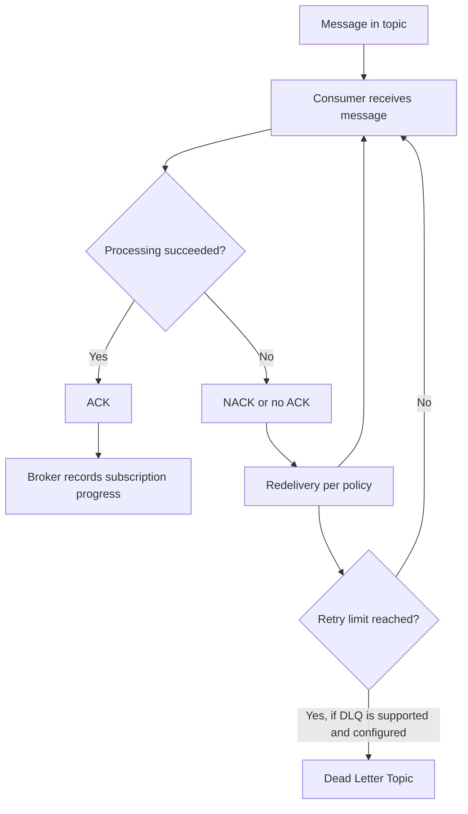

# Verifying Ack, Redelivery, and DLQ Behavior per Binder Version

## Objectives

In Apache Pulsar, a consumer must acknowledge a message after processing it successfully. If a message is not acknowledged, the consumer may have stopped or sent a negative acknowledgment (nack), and the broker may redeliver the message. When a message fails repeatedly, a **Dead Letter Topic (DLT/DLQ)** can isolate it for investigation or controlled reprocessing.

The Spring Cloud Stream Pulsar binder bridges the function and binding model to Pulsar consumers. However, ack, redelivery, and dead-letter behavior are influenced by multiple layers: Spring Cloud Stream, the Pulsar binder, Spring for Apache Pulsar, the Pulsar client, and the Pulsar broker. Property names, defaults, and support scope can change across versions.

This lesson focuses on verifying actual behavior for the binder version you are using. You will distinguish successful ack, nack, and ack timeout; understand how framework retries differ from broker redelivery; configure consumer properties per binding; verify DLQ prerequisites; and write integration tests proving messages are redelivered or quarantined as intended.

After completing this lesson, you will be able to:

- Describe Pulsar's delivery, ack, nack, and redelivery lifecycle.
- Distinguish ack timeout from negative acknowledgment.
- Distinguish Spring for Apache Pulsar ack modes from Spring Cloud Stream binder consumer configuration.
- Place ack, retry, and dead-letter properties in the right namespace and right binding.
- Understand why `maxRedeliverCount` may never be reached when relying solely on negative acknowledgments.
- Choose a subscription type compatible with native dead-letter policy for your Pulsar version.
- Verify DLT naming, retry topics, partitioned topics, and access permissions.
- Test behavior against the exact binder/client/broker versions before deployment.

## 1. Delivery and Acknowledgment Lifecycle

Pulsar stores messages in topics and tracks consumption progress per subscription. When a consumer receives a message, the broker keeps the message in the backlog until the subscription acknowledges successful processing. An ack tells the broker the message has been processed; a nack tells the broker processing failed and requests redelivery.

Simplified flow:



Key terms:

- **ACK:** confirms a message has been processed successfully.
- **NACK:** reports processing failure and requests broker redelivery per redelivery policy.
- **Unacknowledged message:** a delivered message not yet acknowledged by the subscription.
- **Redelivery:** broker re-delivers an unacknowledged or negatively acknowledged message.
- **DLQ/DLT:** topic receiving messages after dead-letter criteria are met.
- **Retry Letter Topic (retry topic):** topic holding messages to be retried after a delay before routing to the DLT if limits are exceeded.

Pulsar removes a message from a subscription's backlog only once that subscription acknowledges it. A message can be delivered multiple times; therefore, consumers need idempotency keyed by event ID or message ID whenever side effects could repeat.

### Individual vs. Cumulative Acknowledgment

Pulsar supports two acknowledgment styles:

- **Individual ack:** acknowledges each message separately.
- **Cumulative ack:** acknowledges the latest message and every prior message in subscription order.

`Shared` and `Key_Shared` use multiple consumers on one subscription, so they require individual acks. Cumulative ack is incompatible with these subscription types. With `Exclusive` or `Failover`, cumulative ack can be used according to subscription semantics.

When processing concurrently, never cumulative-ack a newer message while older messages remain unfinished. Doing so advances progress past incomplete work.

## 2. NACK and Ack Timeout Are Two Different Mechanisms

Pulsar provides two common ways to trigger redelivery:

| Mechanism | When triggered | Key configuration | Important notes |
|---|---|---|---|
| Negative acknowledgment | Application knows message processing failed | `negativeAckRedeliveryDelay` or binder `ack.redelivery-delay` | Suits immediate handler-detected failures |
| Acknowledgment timeout | Message delivered but not acked within configured duration | `ackTimeoutMillis` or binder `ack.timeout` | Safety net; too short a timeout causes unnecessary redeliveries |

### Negative Acknowledgment

When a handler encounters a retryable failure, the consumer can nack the message. Pulsar redelivers it after the configured delay. Without an explicit delay, the Pulsar client typically uses a default delay of one minute.

NACK fits when the application knows right away that processing failed—for instance, a database is temporarily unreachable. Do not nack repeatedly with a very short delay while a downstream dependency is overloaded; that creates a hot retry loop and amplifies load.

### Acknowledgment Timeout

By default, Pulsar's ack timeout is disabled. When the timeout is greater than 0, the client tracks unacknowledged messages. If the timeout elapses before acknowledgment, the client asks the broker to redeliver.

Ack timeout acts as a safety net when a consumer hangs or disconnects. Set the timeout longer than high-percentile normal processing time plus dependency wait time and network latency. If the timeout is shorter than legitimate processing time, the same message may be delivered to another consumer while the first attempt is still running.

When processing failure is detected in code, prefer explicit nack. Ack timeout should guard against stuck executions or failed ack transmission rather than replacing all error handling.

### Backoff

Redelivery delays can increase progressively via backoff. Example with min 1 second, max 60 seconds, and multiplier 2:

| Redelivery attempt | Illustrative delay |
|---:|---:|
| 1 | 1 second |
| 2 | 2 seconds |
| 3 | 4 seconds |
| 4 | 8 seconds |
| 5 | 16 seconds |
| 6 onward | Up to 60 seconds |

Backoff relieves pressure on failing downstream systems. Define a clear retry budget and overall time window; backoff does not make a permanent data error disappear on its own.

## 3. Distinguishing Spring Cloud Stream Binder from `@PulsarListener`

This is a critical distinction when reading versioned documentation.

Spring for Apache Pulsar provides a listener container for `@PulsarListener` endpoints. Spring Pulsar docs describe ack modes:

- `BATCH`: default in the listener container; acknowledges batches per container semantics.
- `RECORD`: acks or nacks each record as individual records are processed.
- `MANUAL`: application calls `Acknowledgment.acknowledge()` or `nack()`.

Example of a Spring Pulsar listener:

```java
@PulsarListener(
        subscriptionName = "orders-subscription",
        topics = "persistent://acme/orders/orders",
        ackMode = AckMode.MANUAL
)
void listen(Message<String> message, Acknowledgment acknowledgment) {
    try {
        orderService.process(message.getValue());
        acknowledgment.acknowledge();
    }
    catch (TransientDataAccessException ex) {
        acknowledgment.nack();
    }
}
```

This is the `@PulsarListener` API. Do not assume that `ackMode` or an `Acknowledgment` parameter is exposed to a `Consumer<OrderEvent>` function running through the Spring Cloud Stream Pulsar binder.

Functional bindings are implemented by the binder's consumer adapter and error infrastructure. The binder provides its own extended consumer properties while inheriting several Spring for Apache Pulsar/Spring Boot consumer properties. Consult the documentation and configuration metadata for your exact binder version to see which properties are actually exposed to bindings.

### Do Not Mix Two Namespaces

| Need | API/namespace to check |
|---|---|
| Function/Consumer input binding | `spring.cloud.stream.bindings.<binding>` |
| Binding-specific Pulsar consumer properties | `spring.cloud.stream.pulsar.bindings.<binding>.consumer` |
| Binder-wide Pulsar properties | `spring.cloud.stream.pulsar.binder.consumer` |
| Application-wide Spring Boot Pulsar consumer properties | `spring.pulsar.consumer` |
| `@PulsarListener` ack mode | `ackMode` on annotation/listener container, if supported by version |

In the current binder, extended binding properties take precedence over binder properties, and binder properties take precedence over Spring Boot properties. This allows one binding to have its own ack/redelivery policy without altering other bindings.

Do not set `spring.pulsar.listener.ack-mode: MANUAL` assuming a functional binding automatically switches to manual ack. If application-level manual ack is required, first confirm whether your binder version provides a matching extension point/API; otherwise, use an appropriate listener model rather than relying on a property the binder does not expose.

## 4. Check Versions Before Configuring

The Pulsar binder has gone through different implementation lines and dependencies. When reading examples, confirm which library family they belong to:

- Current Spring Cloud Stream documentation describes the binder dependency `org.springframework.pulsar:spring-pulsar-spring-cloud-stream-binder`.
- Older or experimental binder releases may use different packages, property classes, and integration mechanics.
- Spring Cloud Stream, Spring Boot, Spring for Apache Pulsar, the Pulsar Java client, and the Pulsar broker must form a compatible version set.
- A property available on the Pulsar Java client is not necessarily exposed as a YAML property in an older binder version.
- A feature available in a newer Pulsar broker is not necessarily supported by the running Pulsar client or Spring Pulsar version.

Spring Cloud Stream documentation publishes multiple active release branches in parallel, such as 4.1.x, 4.2.x, 4.3.x, and 5.0.x. Open the reference docs matching the exact branch your project uses; do not copy properties from a snapshot or latest page directly into an older application.

### Version Verification Checklist

1. Identify the actual binder artifact in the dependency graph.
2. Record the Spring Cloud Stream and Spring Boot versions.
3. Identify the resolved Spring for Apache Pulsar and Pulsar client versions.
4. Identify the broker version and subscription type in use.
5. Open the reference guide/API docs for that exact release.
6. Check property metadata or configuration classes for that release to confirm YAML paths.
7. Run an application context test to catch unbound properties.
8. Run broker integration tests to verify ack/redelivery/DLQ behavior.

Example dependency check with Maven:

```bash
mvn dependency:tree -Dincludes=org.springframework.pulsar,org.springframework.cloud:spring-cloud-stream
```

When versions are managed by the Spring Cloud BOM, let the BOM govern compatible dependencies. Avoid upgrading the Pulsar client or Spring Pulsar independently without checking the compatibility matrix.

## 5. Consumer Properties in the Current Binder

In the current binder, extended consumer properties support configuring Pulsar consumers per binding. Several ack fields map directly to native Pulsar consumer properties:

| Binder property | Native Pulsar property | Meaning |
|---|---|---|
| `consumer.ack.timeout` | `ackTimeoutMillis` | Wait duration for ack before requesting redelivery |
| `consumer.ack.redelivery-delay` | `negativeAckRedeliveryDelayMicros` | Delay after nack |
| `consumer.ack.group-time` | `acknowledgementsGroupTimeMicros` | Groups acks before sending to broker |
| `consumer.ack.timeout-tick-duration` | `tickDurationMillis` | Precision of the ack timeout tracker |
| `consumer.ack.batch-index-enabled` | `batchIndexAckEnabled` | Tracks acks by index within a batch |
| `consumer.retry-enable` | `retryEnable` | Enables Pulsar's retry topic mechanism |
| `consumer.dead-letter-policy` | `deadLetterPolicy` | Native retry/DLQ policy |

In the current codebase, default values for the ack group include: timeout of 0 (disabled), redelivery delay of one minute, group time of 100 ms, and timeout tick of one second. These reflect the current implementation; always verify defaults for your specific release before relying on them in production.

### Per-Binding Configuration Example

Suppose function `processOrders` receives messages from an orders topic:

```yaml
spring:
  cloud:
    function:
      definition: processOrders
    stream:
      bindings:
        processOrders-in-0:
          destination: persistent://acme/orders/orders
          group: inventory-service
      pulsar:
        bindings:
          processOrders-in-0:
            consumer:
              subscription:
                type: Shared
              ack:
                timeout: 90s
                redelivery-delay: 10s
                timeout-tick-duration: 1s
                group-time: 100ms
              retry-enable: true
              dead-letter-policy:
                max-redeliver-count: 5
                retry-letter-topic: persistent://acme/orders/orders-retry
                dead-letter-topic: persistent://acme/orders/orders-dlq
                initial-subscription-name: orders-dlq-reader
```

Explanation:

- `processOrders-in-0` is the input binding name.
- `destination` is the source topic.
- `group` identifies the logical consumer/subscription via the binder's provisioning mechanism.
- `subscription.type` selects the Pulsar subscription type.
- `ack.timeout` is the fallback threshold for unacknowledged messages.
- `ack.redelivery-delay` sets the wait duration when a message is nacked.
- `retry-enable` enables Pulsar's retry topic mechanism.
- `dead-letter-policy` sets the retry limit, retry topic, and DLT.
- `initial-subscription-name` requests creating an initial subscription on the DLT if the broker allows auto subscription creation.

The example uses `Shared` as a broadly compatible baseline for native DLQ. Verify that these properties and subscription type exist in your exact binder/client version. Do not copy YAML verbatim into an older binder without inspecting configuration metadata.

### Binder-Wide vs. Per-Binding Configuration

Setting consumer properties under `spring.cloud.stream.pulsar.binder.consumer` applies them across multiple bindings. If each function requires a different policy, place settings under `spring.cloud.stream.pulsar.bindings.<binding-name>.consumer`.

Example:

```yaml
spring:
  cloud:
    stream:
      pulsar:
        bindings:
          processOrders-in-0:
            consumer:
              ack:
                timeout: 90s
          processPayments-in-0:
            consumer:
              ack:
                timeout: 30s
```

Do not configure the same binding at multiple levels without checking precedence. Values in extended bindings can override binder-wide or Spring Boot defaults.

## 6. ACK in Functional Consumers and Exception Handling

A functional consumer typically processes payloads like this:

```java
@Bean
Consumer<OrderCreated> processOrders(OrderService service) {
    return event -> service.process(event);
}
```

At the application level, maintain these conventions:

- When business processing succeeds, let the handler return normally so the binder/container can acknowledge the message according to that version's mechanism.
- When business processing fails, do not swallow the exception and return normally as if it succeeded.
- For recoverable errors, let binder/broker error handling perform retry/redelivery per configured policy.
- For unrecoverable errors, use verified error handling and dead-letter policies to quarantine the message.
- If a database commit succeeds before the ack reaches the broker, the message may be redelivered; consumers need idempotency.

Do not catch every exception and merely log it. If the function returns normally after a failed side effect, the framework may treat the handler as successful and ack the message. Conversely, throwing an exception does not automatically guarantee the message lands in the DLT; it only enters the error path, while the final outcome depends on retry, binder, and broker configuration.

### Spring Cloud Stream Retry vs. Pulsar Redelivery

These are two separate layers:

| Layer | Mechanism | Scope |
|---|---|---|
| Spring Cloud Stream | Consumer retry/error handling such as `max-attempts` | Retries handler invocation inside the framework's error infrastructure |
| Pulsar client/broker | NACK and ack timeout | Redelivers the message on the subscription |
| Pulsar retry topic | `retryEnable` and retry letter topic | Stores failed messages to retry later |
| Pulsar dead-letter policy | `maxRedeliverCount` and DLT | Quarantines messages after the broker/client-tracked retry limit |

Do not mechanically add retry numbers together. One handler retry by the framework does not necessarily equal one broker redelivery. Measure both handler invocation counts and actual delivery/redelivery counts on the broker.

If an application uses retries in both the framework and the broker, total duration and attempt counts can exceed expectations. Establish an intentional retry budget, decide which layer owns retries, and test exception paths on your exact binder version.

## 7. Retry Letter Topic and Dead Letter Topic

Retry topics and DLTs serve different purposes:

- Retry topics store failed messages so the consumer can retry after a delay.
- DLTs hold messages that exceeded the retry limit for investigation, data correction, or controlled replay.

Pulsar's native `DeadLetterPolicy` has key properties:

| Property | Role |
|---|---|
| `max-redeliver-count` | Maximum number of redeliveries tracked by Pulsar's mechanism |
| `retry-letter-topic` | Topic storing messages to retry later |
| `dead-letter-topic` | Topic receiving messages that exceeded the retry policy |
| `initial-subscription-name` | Initial subscription name created for the DLT, if allowed by the broker |

`max-redeliver-count` must be a positive integer. If no DLT name is specified, Pulsar can generate a default name from the topic and subscription. For partitioned topics, generated default names may include partition suffixes; specify `dead-letter-topic` explicitly for clearer operations and monitoring.

### Important Warning: NACK Counters Are Not Necessarily Durable

In Pulsar 5.0, broker documentation explicitly notes that negative acknowledgment redelivery counters are kept only in memory. When the broker closes a dispatcher due to a restart, bundle unload/rebalance, topic unload, or consumer disconnect, the counter can reset. When that happens, `DeadLetterPolicy.maxRedeliverCount` may never be reached and the message continues redelivering indefinitely.

If you need a reliable retry limit across such operational events, use a retry letter topic with `retryEnable: true`. The retry count is stored in message properties and persists across broker/consumer lifecycles. Verify this behavior on your deployed Pulsar broker/client versions; do not assume older versions share identical semantics.

### Subscription Type Constraints

Documentation varies across versions:

- Spring for Apache Pulsar 1.2.x docs describe native `DeadLetterPolicy` for `Shared` subscriptions.
- Apache Pulsar 5.0.x docs describe DLT support for both `Shared` and `Key_Shared`.
- `Exclusive` and `Failover` have their own ordering semantics; native DLQ may not be supported depending on version.

Therefore, `Shared` is the baseline choice when native DLQ is needed. Choose `Key_Shared` only after verifying your exact Pulsar broker, client, and Spring Pulsar versions. If DLT behavior is needed with `Exclusive`/`Failover`, inspect error handler capabilities in your exact integration API; do not assume native `DeadLetterPolicy` supports them automatically.

### Creating an Initial Subscription on the DLT

Creating a DLT topic does not automatically mean a consumer subscription exists to retain messages on it. Without an appropriate subscription and retention policy, messages on the DLT might not be retained as expected by your recovery workflow. You can use `initial-subscription-name` if supported by your version and the broker enables `allowAutoSubscriptionCreation`. Check namespace/broker policies before relying on it.

## 8. Why NACK Alone May Never Route Messages to the DLQ

A hazardous scenario:

1. Consumer receives a message.
2. Handler fails and sends a NACK.
3. Pulsar redelivers the message.
4. The redelivery counter lives only in memory.
5. Broker restarts or the dispatcher closes, resetting the counter.
6. The message keeps redelivering without ever hitting `maxRedeliverCount`.

If the application needs a durable retry limit, configure a retry topic and enable retry support:

```yaml
spring:
  cloud:
    stream:
      pulsar:
        bindings:
          processOrders-in-0:
            consumer:
              retry-enable: true
              dead-letter-policy:
                max-redeliver-count: 5
                retry-letter-topic: persistent://acme/orders/orders-retry
                dead-letter-topic: persistent://acme/orders/orders-dlq
```

Test by causing the handler to fail repeatedly, restarting the consumer or broker mid-retry, and verifying the message still arrives at the DLT. If you test only within a single uninterrupted process without restarts, you may miss non-durable counter resets.

## 9. Batching, Batch Index Acknowledgment, and Redelivery

Batching can change redelivery scope. If multiple messages arrive inside one batch and batch index acknowledgment is disabled or unsupported, a single failing message can cause other messages in the same batch to be redelivered alongside it. This increases duplicate processing even for records that already succeeded.

Verify:

- Whether the function/binder receives individual records or batches.
- Whether acks are sent per message or per batch.
- Whether the broker/client versions support batch index acknowledgment.
- Whether the binder version exposes `ack.batch-index-enabled`.
- Whether succeeding records get redelivered when one record in a batch fails.

In Spring for Apache Pulsar's listener container, `RECORD` ack mode is disallowed for batch listeners; manual ack can use `MessageId` to acknowledge individual records. That is listener container behavior. For the Spring Cloud Stream binder, apply it only if your binder version actually uses the same API/container and exposes matching configuration.

Do not infer batch semantics solely from a `Consumer<List<T>>` function signature without checking the binder model and consumer adapter. Write an integration test with multiple records in a batch and deliberately fail one record.

## 10. Example Function and Error Classification

Example function classifying errors:

```java
@Bean
Consumer<OrderCreated> processOrders(OrderService service) {
    return event -> {
        try {
            service.process(event);
        }
        catch (TransientDependencyException ex) {
            throw ex;
        }
        catch (InvalidOrderEventException ex) {
            throw ex;
        }
    };
}
```

This example only illustrates letting failures enter error handling. Retry or dead-letter policies must be configured at the right layer. In production, use an error handler to classify errors:

| Error category | Examples | Suggested policy |
|---|---|---|
| Transient | Database timeout, 503 service error | Retry with backoff, move to DLT after limit |
| Permanent data error | Malformed payload, missing required field | Minimize retries; quarantine early if error handler supports it |
| Business state | Order already canceled, invalid state | Emit business outcome or quarantine per contract |
| Infrastructure | Expired credentials, unreachable topic | Alert and restore infrastructure; infinite retries can mask outages |
| Code bug | Null pointer, broken mapper | Cap retries, retain message for investigation and replay after fix |

If the binder provides only uniform retry for all exceptions, check extension points for error classification. Never assume `max-attempts` knows which errors are permanent.

## 11. DLT Consumers, Investigation, and Replay

A DLT is a quarantine area, not a secondary business queue. Each quarantined message needs enough metadata for investigation:

- Event ID and event type.
- Source topic and subscription.
- Message ID and key.
- Publish timestamp and dead-letter timestamp.
- Redelivery/retry count if provided by broker/client.
- Exception class and sanitized error message.
- Schema/version and correlation ID.
- Binder/client/broker versions running when the message failed.

Do not log entire payloads if they contain sensitive data. Bound exception metadata size and mask tokens, credentials, or personal data.

Replay workflow:

1. Identify the root cause that sent messages to the DLT.
2. Fix the code, schema, or downstream dependency bug.
3. Verify the updated consumer can decode historical payloads.
4. Select messages by event ID, time range, or error category.
5. Replay into a controlled topic/stream.
6. Preserve original event IDs so consumers can deduplicate.
7. Rate-limit and batch replays.
8. Record an audit trail and reconcile outcomes.

Never automatically republish every message from the DLT back to the source topic as soon as a DLT consumer receives it. While the underlying bug remains unfixed, messages will loop between retry and DLT and amplify load.

## 12. Checking DLT Behavior with Partitioned Topics

A Pulsar partitioned topic is implemented as multiple internal partition topics. Default DLT names may be generated from individual partition topic names and subscriptions. That can create multiple separate DLTs instead of a single observable topic.

Therefore:

- Configure `dead-letter-topic` explicitly.
- Verify the topic has the right partition count and namespace.
- Verify the consumer has publish permissions on retry/DLT topics.
- Verify the DLT processor has consume permissions.
- Verify initial subscription and retention on the DLT.
- Test one failing message from each partition.

Do not test a single partition and assume every partition behaves identically. Inspect actual topic names in Pulsar Admin or management tooling after the binder provisions them.

## 13. Testing Ack, Redelivery, and DLQ by Version

Test Binder checks wiring and function behavior at the Spring Cloud Stream layer, but it does not prove a real broker actually nacks, redelivers, or routes messages to a DLT. Run integration tests against a Pulsar broker matching your production version.

### Baseline Test Matrix

| Scenario | Test action | Expected verification |
|---|---|---|
| Successful processing | Handler completes normally | Message is acked, not redelivered |
| Handler throws exception | Trigger processing error | Error path triggers; verify framework retry vs. broker nack |
| NACK | Trigger intentional failure | Message is redelivered after configured delay |
| Ack timeout | Hold message unacked longer than timeout | Message redelivers without unintended duplicates |
| Retry topic | Enable `retryEnable` and fail | Message goes to retry topic and retries after delay |
| Retry limit | Fail repeatedly up to `maxRedeliverCount` | Message moves to DLT |
| Broker restart | Restart while message is retrying | Retry count and DLT behavior remain intact |
| Consumer crash | Kill process before ack | Message redelivers when consumer restarts |
| Partitioned topic | Trigger failures across multiple partitions | DLT name/routing is accurate per partition |
| Subscription type | Run `Shared`/`Key_Shared`/`Failover`/`Exclusive` | Native DLQ works only on types supported by version |
| Batch | Fail one record inside a batch | Redelivery scope matches batch ack policy |
| DLQ subscription | Create DLT and inspect subscription | Messages are retained and DLT consumer can read them |

### Testing by Layer

**Unit tests:**

- Error classification logic.
- Stable event IDs.
- Idempotency when messages are redelivered.
- Service-layer retry budget if present.
- Metadata retained during quarantine.

**Application context tests:**

- Binding names, destinations, and groups are correct.
- Extended binding properties bind cleanly.
- YAML properties exist in the version in use.
- No unrecognized property warnings appear.
- Effective consumer configuration contains the intended ack, retry, and DLQ policies.

**Broker integration tests:**

- Verify real ack/nack and redelivery.
- Verify retry counts across broker/consumer restarts.
- Verify the DLT receives the right payload and metadata.
- Verify partitioned topics and subscription types.
- Verify access permissions and initial subscriptions.
- Verify messages are not lost when DLT publishing or the retry topic is temporarily unavailable.

### Recording Versions in Test Reports

Every test run should record:

- Spring Cloud Stream version.
- Pulsar binder artifact/version.
- Spring for Apache Pulsar version.
- Pulsar Java client version.
- Pulsar broker version.
- Subscription type.
- Effective retry/DLQ properties.

If a test report simply states "Pulsar DLQ passed" without versions, results are hard to reproduce after dependency upgrades.

## 14. Production Observability

Monitor these metrics:

| Metric | Meaning | Alert when |
|---|---|---|
| Subscription backlog | Count of unacknowledged messages | Growing continuously or breaching SLA |
| Unacked message count | Delivered messages awaiting ack | Spikes abnormally |
| Redelivery rate | Frequency of message redelivery | Spikes suddenly |
| Retry topic backlog | Messages waiting for retry | Message age exceeds retry SLA |
| DLT depth | Count of dead-lettered messages | New messages arrive or depth grows quickly |
| Oldest DLT message age | Age of oldest failed message | Exceeds incident response window |
| Ack latency | Time from receive to ack | Approaches timeout or breaches SLA |
| Consumer processing latency | Handler execution duration | Approaches or exceeds ack timeout |
| Consumer count | Active consumer count | Drops to 0 while service should be running |
| Error rate | Handler/deserialization/dependency failures | Rises for specific event type or partition |

When backlog grows, distinguish a slow consumer from a poison message. A high redelivery rate repeating the same event ID indicates an unrecoverable error or an overly short retry delay. Rising DLT depth signals a need for investigation rather than simply scaling consumers.

## 15. Common Errors

| Symptom | Possible cause | Resolution |
|---|---|---|
| Handler succeeds yet message still redelivers | Ack failed to send/record or timeout is too short | Inspect ack path, timeout, and processing duration |
| Handler fails yet message disappears | Exception swallowed or execution path treated as success | Let errors reach error handling and check acks |
| Repeated NACKs never reach DLT | Non-durable redelivery counter or unsupported subscription | Use retry topic + `retryEnable` and verify subscription type |
| DLT not created / publish fails | Missing permissions, wrong topic name, or auto-subscription disabled | Check policies, ACLs, topic, and initial subscription |
| DLT splits across multiple topics | Using default names with a partitioned topic | Configure `dead-letter-topic` explicitly |
| Consumer uses `Key_Shared` but DLT fails | Binder/client/broker version lacks support | Use `Shared` or check compatibility matrix |
| Setting `AckMode` does not change binder behavior | Confusing `@PulsarListener` API with functional bindings | Check binder extended consumer properties |
| Long-running message redelivered repeatedly | Ack timeout shorter than processing time | Increase measured timeout or use explicit nack |
| Batch causes duplicate processing of healthy records | Batch index ack disabled/unsupported or unexpected batch semantics | Test batching and configure batch index ack per version |
| Binder upgrade drops a property | Property renamed or no longer exposed | Read config metadata/reference for the new release |
| More retries occur than expected | Both framework and broker retries are active | Establish one primary retry layer and measure delivery counts |
| DLT consumer receives no messages | DLT lacks a subscription or insufficient ACLs | Create initial subscription and grant consume permissions |

## 16. Pre-Release Verification Workflow

Before enabling ack/redelivery/DLQ in production:

1. Pin the Pulsar binder artifact and version.
2. Cross-check Spring Boot, Spring Pulsar, Pulsar client, and broker versions.
3. Inspect extended binding consumer property metadata.
4. Confirm the actual subscription name and subscription type.
5. Choose ack timeout, nack delay, and backoff based on measured processing durations.
6. Decide between retry topics and plain redelivery.
7. If durable retry limits are required, verify `retryEnable` and `retryLetterTopic`.
8. Specify DLT explicitly, especially for partitioned topics.
9. Verify initial subscription, retention, and ACLs on retry/DLT topics.
10. Test handler success, exception, nack, timeout, consumer restart, and broker restart.
11. Verify messages reach the DLT and can be replayed cleanly.
12. Document versions and effective properties in the runbook.

## 17. Versioned Reference Documentation

When upgrading the binder or Pulsar, re-check official docs matching your resolved versions:

- [Spring Cloud Stream Pulsar Binder Reference](https://docs.spring.io/spring-cloud-stream/reference/pulsar/pulsar_binder.html) — dependencies, binding properties, property precedence, and topic configuration.
- [Spring for Apache Pulsar 1.2.x Message Consumption](https://docs.spring.io/spring-pulsar/docs/1.2.x/reference/reference/pulsar/message-consumption.html) — ack modes, manual acknowledgment, timeouts, nack, `DeadLetterPolicy`, and listener container error handlers.
- [Apache Pulsar 5.0.x Messaging](https://pulsar.apache.org/docs/5.0.x/concepts-messaging/) — broker/client semantics for ack, redelivery, retry letter topics, and dead-letter topics.
- [Pulsar binder ConsumerConfigProperties source](https://github.com/spring-cloud/spring-cloud-stream/blob/main/binders/pulsar-binder/spring-cloud-stream-binder-pulsar/src/main/java/org/springframework/cloud/stream/binder/pulsar/properties/ConsumerConfigProperties.java) — mapping of extended consumer properties on the current source branch.

The binder reference page lists multiple stable release lines. Choose documentation matching the binder version in your dependency graph; source on `main` is useful for understanding the current implementation, not as a substitute for the JAR or reference docs of your deployed release.

## Conclusion

Pulsar ACK confirms a message was processed; NACK requests redelivery; ack timeout acts as a safety net for unacknowledged messages; retry topics defer retries; DLTs quarantine messages exceeding limits. Each mechanism has distinct semantics depending on subscription type, Pulsar client/broker versions, and how the Spring Cloud Stream binder integrates Spring for Apache Pulsar.

In functional bindings, configure consumer properties in the Pulsar binder's extended binding namespace. Do not confuse `@PulsarListener` ack modes with properties exposed by the binder. In particular, verify redelivery counter durability: in Pulsar 5.0, NACK counters can reset when a dispatcher closes; if reliable retry limits are required, use a retry topic with retry support enabled. Choose `Shared` as the baseline for native DLQ unless the compatibility matrix confirms another subscription type is supported.

Consider the configuration complete only when integration tests on the exact binder/client/broker versions prove messages are acked on success, redelivered properly on failure, routed to the DLT after the retry limit, and behave reliably across consumer and broker restarts.
