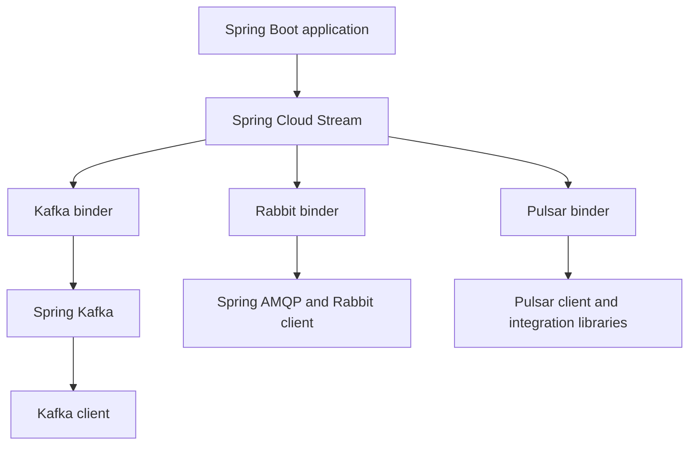

# Inspecting the Dependency Tree and Resolving Library Conflicts

A Spring Cloud Stream application rarely depends on just one library. Spring Boot provides the application foundation; Spring Cloud Stream provides the functional model, bindings, and binder abstraction; the binder connects to Kafka, RabbitMQ, or Pulsar; and each binder pulls in its client and integration libraries. In addition, the application may use databases, serializers, metrics, and other shared libraries. An incompatible version in any link in the chain can cause compile errors or failures only at startup and runtime.

The dependency tree shows which libraries are placed on the classpath, whether a library comes from a direct or transitive dependency, which version was selected, and which dependency path requested it. Knowing how to read the dependency tree helps pinpoint the root cause before changing versions or adding exclusions. The goal is to keep Spring Boot, Spring Cloud, Spring Cloud Stream, the binder, and the broker client compatible within the same application.

## 1. Understanding the Dependency Graph

A dependency is typically identified by coordinates consisting of group, artifact, and version (GAV), for example `org.springframework.cloud:spring-cloud-stream`. Group identifies the publishing group, artifact is the specific library, and version specifies the release in use.

A direct dependency is a library declared in the project. A transitive dependency is a library required by another dependency. For example, an application declares the Kafka binder directly; the binder may pull in Spring Kafka and the Kafka client. The application does not declare the Kafka client, yet the client still appears on the runtime classpath.



Each dependency can appear along multiple paths. For instance, a utility library might pull in a different version of Jackson than the one managed by Spring Boot. When that happens, the build tool must select one version for the classpath configuration under consideration. The requested version is not necessarily the final version selected.

Dependencies are also separated by scope. With Gradle, pay attention to configurations such as `compileClasspath`, `runtimeClasspath`, `testCompileClasspath`, and `testRuntimeClasspath`. With Maven, common scopes are `compile`, `runtime`, `provided`, `test`, and `import`. A library present only on the test classpath can allow tests to pass while the packaged application or production startup lacks a required class. Therefore, always inspect the exact classpath where the error occurs.

## 2. Library Groups to Monitor in Spring Cloud Stream

When inspecting an event-processing application, pay attention to the following groups:

| Group | Role | Examples to monitor |
|---|---|---|
| Spring Boot | Foundation, auto-configuration, and dependency management | Spring Boot, Spring Framework, Jackson, logging |
| Spring Cloud | Integration components belonging to the same release train | Spring Cloud BOM, Spring Cloud Context, and related modules |
| Spring Cloud Stream | Function model, binding, message conversion, and binder abstraction | `spring-cloud-stream` |
| Kafka binder | Connects bindings to Kafka | Kafka binder, Spring Kafka, Kafka client |
| Rabbit binder | Connects bindings to RabbitMQ | Rabbit binder, Spring AMQP, Rabbit client |
| Pulsar binder | Connects bindings to Pulsar | Pulsar binder, Pulsar client, and Spring integration libraries |
| Testing | Testing functions and bindings | Spring Cloud Stream test binder, Spring Boot test libraries |

An application can use multiple binders if it genuinely needs to send or receive across multiple brokers. In that case, each binder may bring an additional client set onto the runtime classpath. This is valid if the binders and clients are compatible, though you must carefully inspect the dependency graph and binder configuration. If the application only uses Kafka but accidentally pulls in the Rabbit or Pulsar binder from a shared module, identify which dependency introduces them before removing them.

Do not assume two libraries with similar names are automatically compatible. For example, Spring Kafka and the Kafka client have separate release cycles; Spring AMQP and the Rabbit client do as well. A binder is released to work with a specific set of platform versions. Merely seeing all dependencies download does not prove runtime compatibility.

## 3. Choosing the Right Platform Versions and BOM

Spring Boot and Spring Cloud have compatible release lines published in the official documentation. Before selecting versions, determine the Java version the project uses, the Spring Boot version, and the matching Spring Cloud release train. Then use the Spring Cloud BOM to manage versions of Spring Cloud components, including Spring Cloud Stream and binders. Spring Boot continues managing foundational libraries within the Boot BOM scope.

Do not arbitrarily pair a new Spring Cloud Stream version with an old binder, or upgrade Spring Framework/Spring Kafka independently without checking the compatibility matrix. Mixing different Spring Framework generations can cause linkage errors, missing APIs, or broken auto-configuration. When upgrading the platform, upgrade as a supported version combination.

### Gradle: Managing Dependencies with the Spring Cloud BOM

Example using the dependency management plugin to import the Spring Cloud BOM. Placeholder values must be replaced with compatible Spring Boot, plugin, and Spring Cloud release train versions according to the project's release matrix:

```groovy
plugins {
    id 'java'
    id 'org.springframework.boot' version '<spring-boot-version>'
    id 'io.spring.dependency-management' version '<dependency-management-plugin-version>'
}

ext {
    set('springCloudVersion', '<compatible-spring-cloud-release-train>')
}

dependencyManagement {
    imports {
        mavenBom "org.springframework.cloud:spring-cloud-dependencies:${springCloudVersion}"
    }
}

dependencies {
    implementation 'org.springframework.cloud:spring-cloud-starter-stream-kafka'
    // Only add the RabbitMQ or Pulsar binder if the application actually uses it.

    testImplementation 'org.springframework.cloud:spring-cloud-stream-test-binder'
}
```

Another approach is declaring the BOM as a Gradle platform:

```groovy
dependencies {
    implementation platform("org.springframework.cloud:spring-cloud-dependencies:${springCloudVersion}")
    implementation 'org.springframework.cloud:spring-cloud-starter-stream-kafka'
}
```

Choose one consistent management style suited to your project's build structure. There is no need to specify separate versions for individual Spring Cloud Stream modules once the BOM manages them. If the project already uses Spring Boot dependency management, keep the roles of the Boot BOM and Cloud BOM clear instead of adding overlapping version-forcing mechanisms.

### Maven: Importing the Spring Cloud BOM

In Maven, declare the Spring Cloud BOM inside `dependencyManagement` with scope `import` and type `pom`:

```xml
<properties>
    <spring-cloud.version>COMPATIBLE_RELEASE_TRAIN</spring-cloud.version>
</properties>

<dependencyManagement>
    <dependencies>
        <dependency>
            <groupId>org.springframework.cloud</groupId>
            <artifactId>spring-cloud-dependencies</artifactId>
            <version>${spring-cloud.version}</version>
            <type>pom</type>
            <scope>import</scope>
        </dependency>
    </dependencies>
</dependencyManagement>

<dependencies>
    <dependency>
        <groupId>org.springframework.cloud</groupId>
        <artifactId>spring-cloud-starter-stream-kafka</artifactId>
    </dependency>
</dependencies>
```

If the project uses the Spring Boot parent, the parent already manages many Boot dependencies. The Spring Cloud BOM adds version management for Spring Cloud modules. Do not arbitrarily set a version directly on a Spring Cloud dependency already managed by the BOM, because a direct version declaration can cause the project to use a version outside the chosen combination.

Starter names and dependency structures can change across release lines. Use the coordinates guided by the documentation for the exact release train in use, especially when choosing a Pulsar binder or upgrading from an older Spring Cloud Stream generation.

## 4. Reading the Dependency Tree with Gradle

The `dependencies` command prints the dependency tree for a configuration. Start with the runtime classpath because that is where missing classes or incompatibilities usually surface:

```bash
./gradlew dependencies --configuration runtimeClasspath
```

On Windows PowerShell, you can invoke the wrapper with:

```powershell
.\gradlew.bat dependencies --configuration runtimeClasspath
```

To inspect the compile classpath or test runtime, swap in the corresponding configuration:

```bash
./gradlew dependencies --configuration compileClasspath
./gradlew dependencies --configuration testRuntimeClasspath
```

When the tree is too large, use `dependencyInsight` to query a specific dependency. For example:

```bash
./gradlew dependencyInsight --dependency spring-cloud-stream --configuration runtimeClasspath
./gradlew dependencyInsight --dependency spring-kafka --configuration runtimeClasspath
./gradlew dependencyInsight --dependency kafka-clients --configuration runtimeClasspath
```

For RabbitMQ or Pulsar, replace the dependency name with the corresponding artifact in your project's tree, such as Spring AMQP, Rabbit client, or Pulsar client libraries.

`dependencyInsight` is useful because it shows every path requesting the dependency, which version won, and why that version was chosen. Gradle usually picks the highest requested version, though constraints, platforms, strict versions, and resolution rules can change the outcome. Do not look only at the highest version number; read the selection reason and dependency paths.

For example, if `spring-kafka` is requested at two versions, the output may show one path coming from the Kafka binder and another from an integration library. If the selected version does not belong to the binder's compatible set, fix the declared dependency or BOM causing that request.

## 5. Reading the Dependency Tree with Maven

Basic command to print the dependency tree:

```bash
mvn dependency:tree
```

Filter by runtime scope or the library groups under investigation:

```bash
mvn dependency:tree -Dscope=runtime
mvn dependency:tree -Dverbose
mvn dependency:tree -Dincludes=org.springframework.cloud:*,org.springframework.kafka:*,org.apache.kafka:*
```

You can expand the filter for `org.springframework.amqp`, `com.rabbitmq`, `org.springframework.pulsar`, or the actual groups appearing in your project. `-Dverbose` helps reveal dependencies omitted from the final result by mediation rules.

Maven normally applies the nearest-definition rule: if the same artifact is requested along multiple branches, the dependency closer to the project usually wins; at equal depth, declaration order can matter. `dependencyManagement` can govern versions of both direct and transitive dependencies. Therefore, when a version appears in the tree but is not selected, check its path and the notes on omitted versions.

To inspect the POM configuration after inheriting a parent and importing BOMs, you can export the effective POM:

```bash
mvn help:effective-pom -Doutput=effective-pom.xml
```

The effective POM shows the final dependency management values after Maven merges configurations. When investigating, focus on entries related to Spring Cloud, Spring Cloud Stream, binders, and broker clients; you do not need to read the entire file if it is very long.

## 6. Recognizing Signs of Conflicts

Common errors and where to investigate:

| Symptom | Possible cause | Where to check |
|---|---|---|
| `NoSuchMethodError` or `NoSuchFieldError` | Class loaded from a different version than the compiled code expected | Runtime versions of Spring Framework, Spring Kafka, broker client, or related libraries |
| `ClassNotFoundException` or `NoClassDefFoundError` | Missing runtime dependency, excluded dependency, or class moved to another package | Runtime dependency tree and packaging configuration |
| `LinkageError` | Two components incompatible at bytecode or classloader level | Library versions and actual JAR sources |
| Application fails to create binder or bean | Missing binder, incompatible binder, or mismatched auto-configuration | Binder artifact, Spring Boot condition evaluation report, and runtime classpath |
| Broker connection error after upgrade | Incompatible client, protocol, TLS, or broker configuration | Client version, security configuration, and connection logs |
| Multiple logging provider warnings | Multiple logging implementations or bindings present simultaneously | Direct and transitive logging dependencies |
| `UnsupportedClassVersionError` | Bytecode compiled with a newer Java version than the running runtime | Java toolchain, `JAVA_HOME`, and the JDK running the application |

Not every startup failure is a version conflict. For instance, `UnsupportedClassVersionError` usually relates to the JDK; timeouts can stem from network or broker issues; authentication errors can stem from credentials. Use the exception type and the first stack trace frame belonging to application code to narrow it down, then cross-check the dependency tree.

If you need to know which JAR the JVM loaded a class from, you can enable class loading logs on modern Java:

```bash
java -Xlog:class+load=info -jar app.jar
```

This information is helpful when the dependency tree looks right yet runtime still loads a different library version due to packaged classpath ordering, launcher behavior, or a custom classloader.

## 7. Controlled Conflict Resolution Workflow

Follow this sequence so every change has a clear rationale:

1. **Record the exact error.** Save the full exception, the failing class or method, when it occurs, and the active classpath. Distinguish compile, test, startup, and message-processing-only errors.
2. **Choose the right configuration.** Inspect `runtimeClasspath` or `testRuntimeClasspath` with Gradle; use the appropriate scope with Maven. Test-scope dependencies do not represent dependencies inside the packaged application.
3. **Locate the relevant artifact.** Use `dependencyInsight` or filter `dependency:tree` by the library name from the stack trace. Find every path bringing that artifact into the project.
4. **Identify where the version is set.** Check the Spring Boot parent/BOM, Spring Cloud BOM, directly declared versions, constraints, and dependency management plugins. Find which dependency pulls in a version outside the expected combination.
5. **Align on a compatible BOM.** Prefer using a Spring Cloud release train compatible with Spring Boot and letting the BOM manage modules in the same ecosystem. Remove unnecessary explicit versions on already managed dependencies.
6. **Use exclusions only when you understand the dependency path.** Excluding a transitive dependency can remove classes the binder needs. If removing an older version, ensure the replacement dependency still satisfies the APIs callers require.
7. **Re-check the tree after changes.** Confirm only the intended version remains in the relevant configuration and no new conflict was introduced in another library.
8. **Test along the real execution path.** Run compilation, unit tests, test binder tests, and integration tests with the appropriate broker. For broker-dependent features such as publish confirmations, offset commits, redelivery, and DLQs, the test binder cannot fully replace a real broker.

Do not start by clearing the Gradle/Maven cache or forcing all dependencies to their latest versions. Caching is rarely the cause of reproducible conflicts in the dependency graph; forcing versions can break compatibility and shift errors to another layer.

## 8. Example: Resolving a Mismatched Spring Kafka Version

Suppose an application uses the Kafka binder. A utility module directly declares Spring Kafka with a custom version, while the binder is released against a version set managed by the Spring Cloud BOM. The dependency tree shows runtime selecting a different Spring Kafka version from the one expected by the release train. The application may compile yet fail with `NoSuchMethodError` when the binder calls an API absent from the loaded JAR.

Resolution steps:

- Use `dependencyInsight` or `mvn dependency:tree -Dverbose` to find the module declaring the Spring Kafka version directly.
- Identify the Spring Boot and Spring Cloud BOM versions the project uses and verify whether that release train supports the current combination.
- If the utility module has no special reason to pin Spring Kafka, remove the direct version and let the BOM manage it.
- If the module genuinely requires an API available only in another version, evaluate upgrading the module or choosing a compatible release train; do not force Spring Kafka alone and assume the binder will work.
- Re-read the dependency tree and run integration tests against a Kafka broker to confirm the binder starts, publishes, consumes, and commits offsets properly.

An exclusion example for a transitive dependency should only be used after confirming it is unwanted and a compatible replacement exists. With Gradle:

```groovy
dependencies {
    implementation('com.example:legacy-integration:1.2.0') {
        exclude group: 'com.example.legacy', module: 'legacy-transport'
    }
}
```

With Maven:

```xml
<dependency>
    <groupId>com.example</groupId>
    <artifactId>legacy-integration</artifactId>
    <version>1.2.0</version>
    <exclusions>
        <exclusion>
            <groupId>com.example.legacy</groupId>
            <artifactId>legacy-transport</artifactId>
        </exclusion>
    </exclusions>
</dependency>
```

This is a syntax example for exclusions. Do not copy an exclusion for `spring-kafka`, Spring AMQP, or the Pulsar client without confirming the binder does not need that dependency. Accidentally excluding a client or foundational library can prevent the application from starting.

## 9. Preventing Conflicts in a Project

Several practices keep the dependency graph stable between developer machines and CI:

- Manage Spring Boot and Spring Cloud versions in one place; import the right BOM and limit scattered version declarations across modules.
- Do not simultaneously declare multiple versions of the same binder or multiple starters the application does not use.
- Inspect the runtime and test dependency graphs when adding a new library, especially one integrating Spring or a broker client.
- Use Gradle dependency locking or the equivalent version management mechanism in your Maven workflow if the project needs exact reproducibility of resolution results.
- You can use Maven Enforcer with the `dependencyConvergence` rule to catch cases where the same artifact appears with multiple requested versions. Read the report carefully and configure intentional exceptions; not every difference can be solved by forcing a single version.
- In CI, capture the dependency tree when upgrading the platform or binder so reviewers can see runtime classpath changes.
- After upgrading Spring Boot or Spring Cloud, re-verify the JDK, build plugins, binder, broker client, serializers, and observability libraries.

Dependency locking fixes resolution outcomes, but it does not prove locked versions are compatible. A BOM selects a set of versions managed together, yet it still does not replace testing the application. Combine both with runtime verification.

## 10. Checklist Before Concluding Resolution

- [ ] Identified whether the error occurs at compile, test, startup, or runtime.
- [ ] Inspected the right `runtimeClasspath` or Maven runtime scope.
- [ ] Found the dependency path introducing the conflicting version into the project.
- [ ] Confirmed Spring Boot and the Spring Cloud release train form a compatible combination.
- [ ] Confirmed Spring Cloud Stream and the binder are managed by the appropriate BOM.
- [ ] Removed unnecessary version overrides on Spring Kafka, Spring AMQP, Kafka client, or Pulsar client.
- [ ] Documented any exclusions and verified replacement dependencies satisfy required APIs.
- [ ] Verified the post-change dependency tree reflects the expected versions.
- [ ] Verified required publish/consume flows via application tests and real-broker integration tests.

When you inspect the dependency tree on the right classpath and let the BOM manage compatible Spring components, conflict resolution becomes explainable and reproducible. This helps your Spring Cloud Stream application start reliably, ensures the binder uses the right broker client, and keeps event flows consistent across development, testing, and production environments.
