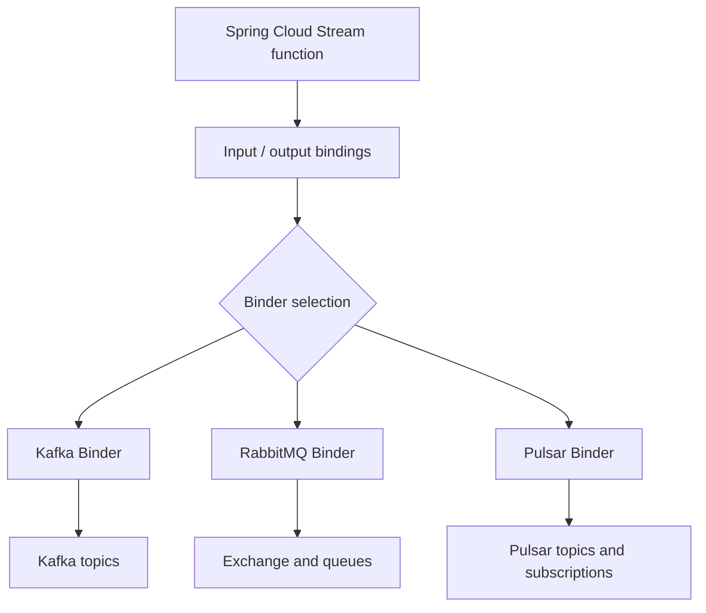

# Multiple Binders on the Classpath and Selecting `defaultBinder`

Spring Cloud Stream uses binders to connect application bindings to middleware such as Kafka, RabbitMQ, or Pulsar. An application may have multiple binder implementations on the classpath, or multiple binder configurations of the same type pointing to different clusters. In that case, you need to determine which binder will serve each binding and which binder is used by default.

The two main mechanisms are `spring.cloud.stream.default-binder` to select the default binder and the `binder` property on each binding to explicitly specify where it connects. When multiple independent connections are needed, declare named binders under `spring.cloud.stream.binders`, each with its own `type` and `environment`.

## 1. The binder as the connection layer between bindings and brokers

Spring Cloud Stream functions work with input/output bindings. The binder is responsible for mapping bindings to a specific messaging system, managing consumers/producers, and translating common properties into native broker configuration.

For example, a function has input `validateOrder-in-0` and output `validateOrder-out-0`. The Kafka Binder can connect these two bindings to Kafka topics; the RabbitMQ Binder can connect them to exchanges/queues. The business function still works with payloads and messages according to the Spring Cloud Stream contract.



A binder is not the name of a topic, exchange, or queue. The binder specifies the technology and connection configuration; `destination` specifies the messaging destination of the binding on that technology.

## 2. Single binder implementation on the classpath

If an application has only one suitable binder implementation on the classpath, Spring Cloud Stream usually automatically selects that binder for bindings that do not specify their own binder. For example, an application that only adds the Kafka Binder dependency will normally use the Kafka Binder for its bindings.

```xml
<dependency>
    <groupId>org.springframework.cloud</groupId>
    <artifactId>spring-cloud-stream-binder-kafka</artifactId>
</dependency>
```

When only the Kafka Binder is present, bindings can be configured as follows:

```yaml
spring:
  cloud:
    function:
      definition: validateOrder
    stream:
      bindings:
        validateOrder-in-0:
          destination: orders.created
          group: order-validation
        validateOrder-out-0:
          destination: orders.validated
```

There is no need to declare `default-binder` when there is only one binder option. However, when adding a RabbitMQ or Pulsar Binder dependency to the classpath, binder selection needs to be reconsidered to avoid ambiguous default selection.

## 3. Multiple binder implementations on the classpath

If an application has multiple binder implementations, Spring Cloud Stream needs to know the default binder for bindings that do not specify one individually. You can set `spring.cloud.stream.default-binder` to the appropriate binder name.

For example, an application has both Kafka Binder and RabbitMQ Binder, choosing Kafka as the default:

```yaml
spring:
  cloud:
    stream:
      default-binder: kafka
      bindings:
        validateOrder-in-0:
          destination: orders.created
          group: order-validation
        validateOrder-out-0:
          destination: orders.validated
```

The name in `default-binder` must match a binder candidate recognized by Spring Cloud Stream or a declared binder configuration name. Do not use a topic name or function name here. If there are multiple binder candidates and a single default cannot be determined, the context may fail to initialize due to ambiguous binder selection.

### 3.1. Specifying a binder per binding

The `binder` property on a binding overrides the default selection for that binding. For example, the application receives orders from Kafka but publishes notifications to RabbitMQ:

```yaml
spring:
  cloud:
    stream:
      default-binder: kafka
      bindings:
        validateOrder-in-0:
          destination: orders.created
          group: order-validation
          binder: kafka
        validateOrder-out-0:
          destination: orders.validated
          binder: rabbit
```

Here, the input uses the Kafka Binder and the output uses the RabbitMQ Binder. `default-binder` is only a fallback for bindings without `binder`; it does not force all bindings to use Kafka.

If a function has multiple inputs or outputs, you can specify a separate binder for each binding. Binding names must follow the function-based binding convention, such as `process-in-0`, `process-in-1`, and `process-out-0`.

## 4. Distinguishing binder type and binder configuration name

When multiple connection configurations are needed, declare named binders in `spring.cloud.stream.binders`. Each configuration has:

- `type`: the binder implementation type, such as `kafka`, `rabbit`, or `pulsar`.
- `environment`: environment properties used to create a dedicated context/configuration for that binder.
- `inheritEnvironment`: determines whether the binder environment inherits the application environment.
- `defaultCandidate`: determines whether the binder configuration participates in default binder selection.

The binder configuration name is an alias chosen by the application, such as `kafka-primary` or `rabbit-events`. `type` indicates which implementation that alias uses. When a binding references `binder: kafka-primary`, it selects the exact named configuration `kafka-primary`, not just any binder of type Kafka.

When `spring.cloud.stream.binders` is explicitly declared, the application switches to explicit binder configuration; the automatic default binder configuration process is replaced. Therefore, you must declare all named binders that the bindings will use. Do not declare one secondary binder and assume other binders on the classpath will still be auto-configured as before.

## 5. Example of multiple binder types with named configurations

The example below uses Kafka as the default binder and routes an output binding to RabbitMQ:

```yaml
spring:
  cloud:
    stream:
      default-binder: kafka-primary
      binders:
        kafka-primary:
          type: kafka
          environment:
            spring:
              cloud:
                stream:
                  kafka:
                    binder:
                      brokers: kafka-primary.internal:9092
        rabbit-events:
          type: rabbit
          environment:
            spring:
              rabbitmq:
                host: rabbit.internal
                port: 5672
      bindings:
        validateOrder-in-0:
          destination: orders.created
          group: order-validation
          binder: kafka-primary
        validateOrder-out-0:
          destination: orders.validated
          binder: rabbit-events
```

In this example, `kafka-primary` and `rabbit-events` are configuration names. Their `type` values are `kafka` and `rabbit`, respectively. The properties inside `environment` are loaded for the corresponding binder. The Kafka broker and Rabbit host are configured in separate environments so each binder can connect to its own endpoint.

Once named binders are defined, use configuration names consistently in `default-binder` and `bindings.<binding>.binder`. Do not use `type` instead of the alias if the alias is named differently, because binder lookup needs to find the exact configuration.

## 6. Multiple configurations of the same binder type

A common case is when a single application needs to connect to two Kafka clusters, such as an internal cluster and a partner cluster. In that case, adding just one Kafka Binder dependency is sufficient; declare two named binders with the same `type: kafka` but different broker configurations.

```yaml
spring:
  cloud:
    stream:
      default-binder: kafka-internal
      binders:
        kafka-internal:
          type: kafka
          environment:
            spring:
              cloud:
                stream:
                  kafka:
                    binder:
                      brokers: kafka-internal:9092
        kafka-partner:
          type: kafka
          default-candidate: false
          environment:
            spring:
              cloud:
                stream:
                  kafka:
                    binder:
                      brokers: kafka-partner:9092
      bindings:
        internalOrders-in-0:
          destination: orders.created
          group: order-service
          binder: kafka-internal
        partnerEvents-out-0:
          destination: partner.orders
          binder: kafka-partner
```

`kafka-internal` and `kafka-partner` share the same type but have different broker endpoints. `default-candidate: false` excludes `kafka-partner` from the default selection set; bindings can still explicitly reference `binder: kafka-partner`. This is useful when a binder should only be used explicitly, preventing it from becoming the default choice unintentionally.

## 7. `defaultBinder` and `defaultCandidate`

These two properties answer two different questions:

| Property | Question | Usage |
|---|---|---|
| `default-binder` | Which binder will a binding without `binder` use? | Choose a default alias, e.g., `kafka-internal` |
| `default-candidate` | Should a named binder participate in the default selection pool? | Set `false` if the binder should only be referenced explicitly |

For example, suppose there are three configurations: an internal Kafka, a partner Kafka, and a RabbitMQ. You can set the internal Kafka as the default, while setting `default-candidate: false` on the other two binders to force bindings to specify them explicitly when used. As a result, adding a new binder will not accidentally change the binder of existing bindings.

If every binding specifies an explicit `binder`, `default-binder` may not be necessary. Even so, choosing a clear default is still helpful for bindings added later and helps readers identify the default connection path.

## 8. `inheritEnvironment` and configuration isolation

A named binder can run in its own environment. By default, the binder environment normally inherits the application's properties; `inherit-environment: false` isolates the binder context to avoid accidentally using global configuration.

Example:

```yaml
spring:
  cloud:
    stream:
      binders:
        kafka-secure:
          type: kafka
          inherit-environment: false
          environment:
            spring:
              cloud:
                stream:
                  kafka:
                    binder:
                      brokers: kafka-secure.internal:9093
                      configuration:
                        security.protocol: SASL_SSL
```

When inheritance is disabled, the properties required by the binder must be provided in its own environment or via a supported configuration mechanism. Do not assume global properties such as credentials, truststore, schema registry, proxy, or customizers automatically appear in an isolated binder context. List all required configuration explicitly and test with the exact deployment profile.

Conversely, if you want to share global configuration such as observability or certain client properties, keeping default inheritance may be simpler. Only enable isolation when you need to separate credentials, endpoints, or security policies between clusters.

## 9. Binder-level properties and binding-level properties

Properties can be set at multiple scopes:

| Scope | Example | Effect |
|---|---|---|
| Common binding | `spring.cloud.stream.bindings.<name>.*` | Destination, group, content type, and common consumer/producer settings |
| Extended binding | `spring.cloud.stream.kafka.bindings.<name>.*`, `spring.cloud.stream.rabbit.bindings.<name>.*` | Broker-specific properties for a single binding |
| Binder configuration | `spring.cloud.stream.binders.<alias>.environment.*` | Endpoints and specific configuration of a named binder |
| Default binder | `spring.cloud.stream.default-binder` | Binder used for bindings without an explicit selection |

For example, `destination` and `group` belong to common binding settings; Kafka `brokers` belong to Kafka Binder configuration; Rabbit `host` belongs to the Rabbit binder environment. Placing a property in the wrong scope may cause it not to be read by the binder or to be applied to all connections unexpectedly.

When the same property is set in both the global environment and the binder environment, the result depends on the context and inheritance rules. Do not assume all properties are merged the same way. Inspect the effective configuration via startup logs or the Actuator environment endpoint in accordance with security policies to avoid exposing secrets.

## 10. Connecting brokers with a function

A common use case is consuming events from Kafka, transforming the payload, and publishing to RabbitMQ or Pulsar:

```java
@Bean
Function<OrderCreated, PartnerOrderEvent> forwardOrder() {
    return event -> new PartnerOrderEvent(
            event.eventId(), event.orderId(), event.customerId());
}
```

```yaml
spring:
  cloud:
    function:
      definition: forwardOrder
    stream:
      bindings:
        forwardOrder-in-0:
          destination: orders.created
          group: partner-forwarder
          binder: kafka-primary
          content-type: application/json
        forwardOrder-out-0:
          destination: partner.orders
          binder: rabbit-events
          content-type: application/json
```

Input and output can use two different binders. However, normal return from the function does not create a distributed transaction between Kafka and RabbitMQ. It is possible for the output publish to succeed while the input offset has not yet been committed, causing the event to be re-read and published again; or the input could be committed under an inappropriate configuration before the output is acknowledged.

For critical cross-broker flows, design idempotency at the target, store event IDs, use bounded retries, and apply an outbox/inbox pattern or appropriate workflow. Do not claim exactly-once semantics across two brokers simply because both binders support their own acknowledgement/transaction mechanisms.

## 11. Dependencies and classpath hygiene

Binder implementations are typically added via their corresponding dependencies:

```xml
<dependency>
    <groupId>org.springframework.cloud</groupId>
    <artifactId>spring-cloud-stream-binder-kafka</artifactId>
</dependency>
<dependency>
    <groupId>org.springframework.cloud</groupId>
    <artifactId>spring-cloud-stream-binder-rabbit</artifactId>
</dependency>
```

If using the Pulsar Binder, add the Pulsar Binder artifact matching the release train. Manage versions with the Spring Cloud BOM so that the binders and Spring Cloud Stream remain compatible. Avoid declaring individual versions per binder if the BOM already manages them.

Only add binders that the application actually uses. Unnecessary dependencies can introduce extra candidates, causing default selection to change or complicating context initialization. When upgrading versions, check compatibility across Spring Boot, the Spring Cloud release train, Spring Cloud Stream, and binder artifacts.

## 12. Testing binder selection

Tests need to verify that bindings are connected to the right broker, not just that the function is invoked:

1. Start the context with a single binder implementation and verify auto-selection.
2. Add a second binder, set `default-binder`, and verify that bindings without an explicit binder use the expected default.
3. Set an explicit binder on an input/output and verify each binding connects to the right cluster.
4. Declare two named binders of the same type with different broker endpoints; send records to each destination and verify they do not go to the wrong cluster.
5. Set `default-candidate: false` and verify the binder still works when explicitly referenced by a binding.
6. Test `inherit-environment: false` and verify that the endpoint, authentication, TLS, and required properties are provided in the isolated context.
7. Intentionally misconfigure an alias or type to verify startup fails with a clear error.
8. Verify content type, Serde/converter, and headers when an event passes through two different brokers.
9. Simulate a successful output publish before the input offset is committed to verify idempotency and duplicate handling.

The Test Binder is useful for testing function logic and certain bindings within the JVM, but it does not prove real broker configuration, credentials, ACLs, TLS, or proper routing. Use Kafka/RabbitMQ/Pulsar integration tests for real connections.

## 13. Common errors

| Symptom | Possible cause | Resolution |
|---|---|---|
| Application fails to start due to ambiguous binder selection | Multiple candidates exist without a clear default | Set `default-binder` or specify `binder` for each binding |
| Binding reports binder not found | The `binder` value does not match any candidate or named configuration | Compare aliases in `binders` with the name referenced on the binding |
| Binding goes to the default cluster instead of the expected cluster | Binding is missing `binder` or `default-binder` points to the wrong alias | Declare `binder` explicitly and check startup logs |
| Two Kafka bindings connect to the same cluster | Both use the same named binder or the environment was inherited unintentionally | Create two aliases, configure separate brokers, and check `inherit-environment` |
| Secondary binder is not selected as default | `default-candidate: false` | Keep false if only explicit selection is desired; to make it default, enable candidate and configure default accordingly |
| Broker property has no effect | Property placed at the wrong level or with the wrong prefix under `environment` | Check the binder type, context, and property path for your version |
| Authentication fails on only one binder | Credentials were not inherited or not declared in the isolated environment | Configure separate credentials/truststore and test from the binder context |
| Event fails to deserialize when crossing to another broker | Incompatible content type, schema, or converter | Standardize the event contract and configure converters/Serdes on both sides |
| Duplicate events published when bridging brokers | No cross-broker transaction; input redelivery after output publish | Use an idempotency key, inbox/outbox, and reconciliation |

## 14. Selection and configuration workflow

1. List the middleware/clusters required by each input/output binding.
2. Verify the corresponding binder dependencies are on the classpath and compatible with the BOM.
3. If there is only one binder candidate, use auto-selection or set an explicit default if documentation is desired.
4. If there are multiple binder types, choose `default-binder` for unspecified bindings.
5. If there are multiple clusters of the same type, declare named binders with separate `type` and `environment`.
6. Attach `binder` explicitly to bindings that require a specific cluster.
7. Use `default-candidate: false` for binders that should not be automatically selected as default.
8. Only disable `inherit-environment` when all required properties have been provided in the isolated context.
9. Verify schemas, content types, keys, headers, and delivery semantics when crossing multiple brokers.
10. Test startup, routing, security, and failure windows against real brokers.

## 15. Pre-deployment checklist

- [ ] Know exactly which binder implementations are on the classpath.
- [ ] If multiple candidates exist, `default-binder` is explicitly selected.
- [ ] Special bindings have `binder` pointing to the right named configuration.
- [ ] Distinguish binder alias names from implementation `type`.
- [ ] Multiple clusters of the same type are configured using separate named binders.
- [ ] `default-candidate` is set intentionally.
- [ ] `inherit-environment` is appropriate and does not drop credential/TLS properties.
- [ ] Each broker's endpoint, authentication, TLS, and ACLs are verified.
- [ ] Binding-level and binder-level properties are placed in the correct scope.
- [ ] Event contracts, Serdes/converters, keys, and headers are compatible across brokers.
- [ ] Cross-broker flows have idempotency and duplicate/failure window handling.
- [ ] Integration tests confirm bindings connect to the right broker/cluster.

When there is only one binder implementation, Spring Cloud Stream can automatically select the binder for bindings. When multiple binder types are present, use `default-binder` to define the overall choice and `binder` to override per binding. When multiple clusters of the same type are needed, declare named binders with separate `type` and `environment`; `default-candidate` controls which binders participate in default selection, while `inherit-environment` controls inheritance of application configuration. Explicit configuration and testing against real brokers prevent connecting to the wrong cluster and clarify delivery boundaries when a function bridges multiple messaging systems.

## References

- [Spring Cloud Stream — Multiple Binders on the Classpath](https://docs.spring.io/spring-cloud-stream/reference/spring-cloud-stream/multiple-binders.html)
- [Spring Cloud Stream — Binding and Binder Configuration](https://docs.spring.io/spring-cloud-stream/reference/spring-cloud-stream/binding-properties.html)
- [Spring Cloud Stream — Function-based Binding Names](https://docs.spring.io/spring-cloud-stream/reference/spring-cloud-stream/functional-binding-names.html)
