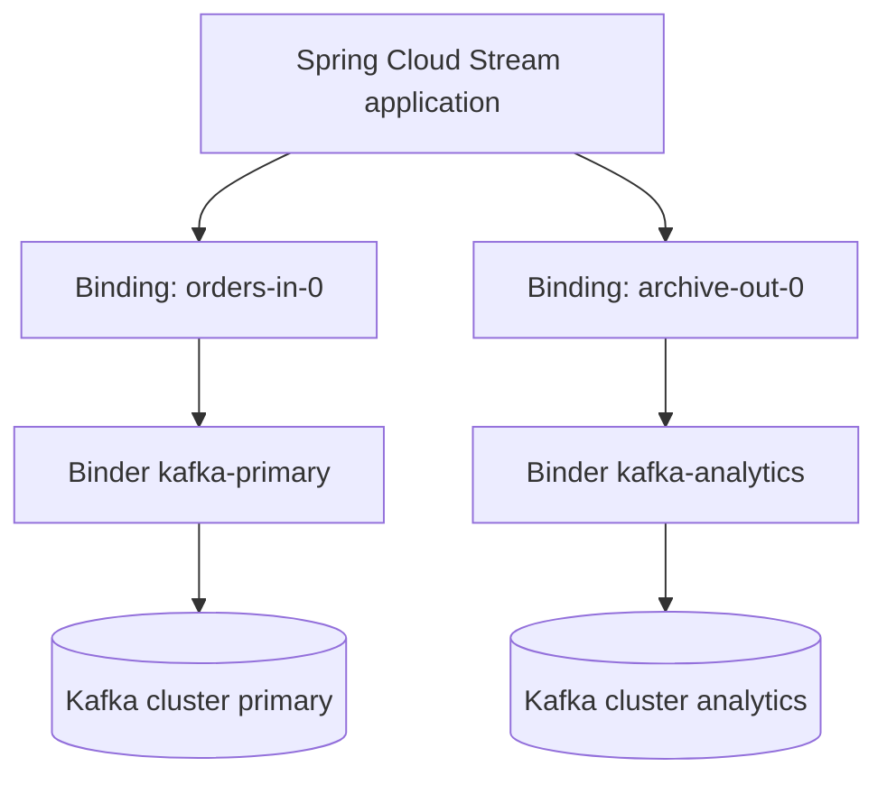
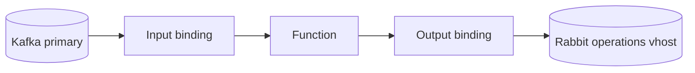

# Multiple Kafka Clusters or Multiple RabbitMQ Virtual Hosts

## 1. When does an application need multiple binders?

Spring Cloud Stream normally connects an application to a single broker through a binder. In some systems, the same application must read from or write to multiple independent messaging infrastructures:

- Read orders from an internal Kafka cluster and write an analytics copy to a data platform Kafka cluster.
- Read events from an orders RabbitMQ virtual host and publish notifications to an operations virtual host.
- Connect to multiple Kafka clusters by geographic region, environment, or security boundary.
- Connect to multiple RabbitMQ virtual hosts with different accounts and access permissions.

Spring Cloud Stream lets you declare multiple named binder instances. Each binder instance can use the same technology type while pointing to a different cluster or virtual host. Then, each input/output binding is assigned to the appropriate binder.

For example, an application can use two Kafka binders:



A binder is the adapter connecting a binding to a messaging system. Having multiple binders in the same application does not turn those brokers into a shared storage system; each broker still has its own topics/queues, consumption progress, security, and availability.

## 2. Distinguishing binder, binding, and broker destination

Three concepts need to be kept separate:

| Concept | Meaning | Example |
|---|---|---|
| Binder instance | A connection configuration targeting a messaging system | `kafka-primary`, `rabbit-orders` |
| Binding | Connection between a function's input/output and a binder | `processOrder-in-0` |
| Destination | The topic, exchange/queue, or logical name used by the binding | `orders.events`, `orders.audit` |

One binder instance can serve multiple bindings. An application can declare multiple binder instances of the same type, such as two Kafka binders or two Rabbit binders. Each binding selects a binder via the `binder` property.

A binder name is a name chosen by the application in configuration, not the name of a topic, queue, exchange, cluster, or virtual host. Name it by purpose and location for easy identification, such as `kafka-primary`, `kafka-analytics`, `rabbit-orders`, `rabbit-operations`.

## 3. Declaring multiple Kafka binders for multiple clusters

Suppose an application needs to read events from an operational Kafka cluster and write results to an analytics Kafka cluster. Declare two binder instances under `spring.cloud.stream.binders`:

```yaml
spring:
  cloud:
    stream:
      binders:
        kafka-primary:
          type: kafka
          environment:
            spring:
              cloud:
                stream:
                  kafka:
                    binder:
                      brokers: kafka-primary.internal:9092
        kafka-analytics:
          type: kafka
          defaultCandidate: false
          environment:
            spring:
              cloud:
                stream:
                  kafka:
                    binder:
                      brokers: kafka-analytics.internal:9092
```

In this configuration:

- `type: kafka` selects the Kafka binder.
- `environment` contains the Spring properties used inside the binder instance's context.
- `brokers` specifies the bootstrap brokers of the corresponding cluster.
- `defaultCandidate: false` excludes `kafka-analytics` from automatic default binder selection.

When there are multiple binders of the same type, assign the binder explicitly for each binding to avoid choosing the wrong cluster. `defaultCandidate: false` is useful for secondary binders that should not be automatically selected as the default. You can declare `defaultBinder` at the stream level if you want to specify a default binder, though critical bindings should still explicitly state `binder` so configuration is easy to audit.

## 4. Assigning input and output bindings to each Kafka cluster

Example function receiving orders from the primary cluster and transforming them into normalized events:

```java
import java.util.function.Function;
import org.springframework.context.annotation.Bean;
import org.springframework.context.annotation.Configuration;

record OrderCreated(String orderId, long totalCents) {}
record OrderAccepted(String orderId, long totalCents, String status) {}

@Configuration
class OrderFunctions {

    @Bean
    Function<OrderCreated, OrderAccepted> acceptOrder() {
        return order -> new OrderAccepted(
            order.orderId(), order.totalCents(), "ACCEPTED"
        );
    }
}
```

Assign the two bindings to two different binders:

```yaml
spring:
  cloud:
    function:
      definition: acceptOrder
    stream:
      bindings:
        acceptOrder-in-0:
          destination: orders.events
          group: order-processor
          binder: kafka-primary
        acceptOrder-out-0:
          destination: orders.accepted
          binder: kafka-analytics
```

Input `acceptOrder-in-0` reads from topic `orders.events` on cluster `kafka-primary`. Output `acceptOrder-out-0` writes to topic `orders.accepted` on cluster `kafka-analytics`.

Destination names can be identical across two clusters while the data remains independent. Topic `orders.events` on cluster A does not automatically synchronize with a topic of the same name on cluster B. If replication is needed, the application or a replication tool must perform it.

## 5. Multiple Kafka binders require separate security configuration

Two clusters may use different authentication mechanisms, TLS, or ACLs. Security configuration should reside in the corresponding binder's environment so credentials and trust material are not mistakenly applied to another cluster.

Example illustrating Kafka clusters using SASL/SCRAM:

```yaml
spring:
  cloud:
    stream:
      binders:
        kafka-primary:
          type: kafka
          environment:
            spring:
              cloud:
                stream:
                  kafka:
                    binder:
                      brokers: kafka-primary.internal:9093
                      configuration:
                        security.protocol: SASL_SSL
                        sasl.mechanism: SCRAM-SHA-512
                        sasl.jaas.config: ${PRIMARY_KAFKA_JAAS}
        kafka-analytics:
          type: kafka
          defaultCandidate: false
          environment:
            spring:
              cloud:
                stream:
                  kafka:
                    binder:
                      brokers: kafka-analytics.internal:9093
                      configuration:
                        security.protocol: SASL_SSL
                        sasl.mechanism: SCRAM-SHA-512
                        sasl.jaas.config: ${ANALYTICS_KAFKA_JAAS}
```

Placeholders must be supplied from a secret manager or deployment environment variables. Do not commit real usernames/passwords or JAAS secrets to Git. ACLs on each cluster must grant the exact topic read, topic write, and consumer group permissions for the corresponding binder.

If two clusters use different truststores or client certificates, configure their paths and passwords in each binder's own environment. Ensure the truststore/keystore files are present inside the container or host running the application.

## 6. Configuring binder environment and environment inheritance

A binder instance runs in its own context. Properties under `environment` are fed into that binder instance's context. By default, a binder can inherit part of the application's shared environment; the `inheritEnvironment` property controls this inheritance behavior as supported by your Spring Cloud Stream version.

Example explicitly disabling inheritance for a binder that needs an isolated connection environment:

```yaml
spring:
  cloud:
    stream:
      binders:
        kafka-isolated:
          type: kafka
          inheritEnvironment: false
          environment:
            spring:
              cloud:
                stream:
                  kafka:
                    binder:
                      brokers: kafka-isolated.internal:9092
```

Only set `inheritEnvironment: false` when you have provided all properties required by the binder in its own environment. If the application relies on shared configuration such as SSL, credentials, schema registry, or custom properties without re-declaring them, the binder may fail to initialize.

When you want to share common configuration and only override brokers/credentials, keeping default inheritance is usually simpler. When strong isolation between two clusters is needed, use a dedicated environment and test the startup configuration as well.

## 7. Declaring multiple Rabbit binders for multiple virtual hosts

A RabbitMQ virtual host is an independent logical namespace within a RabbitMQ broker. Each virtual host has its own exchanges, queues, bindings, permissions, and resources. An exchange or queue with the same name in two different virtual hosts represents two independent resources.

Suppose an application needs to read a queue in virtual host `/orders` and publish messages to virtual host `/operations`. Declare two Rabbit binder instances:

```yaml
spring:
  cloud:
    stream:
      binders:
        rabbit-orders:
          type: rabbit
          environment:
            spring:
              rabbitmq:
                host: rabbit.internal
                port: 5672
                username: orders_app
                password: ${ORDERS_RABBIT_PASSWORD}
                virtual-host: /orders
        rabbit-operations:
          type: rabbit
          defaultCandidate: false
          environment:
            spring:
              rabbitmq:
                host: rabbit.internal
                port: 5672
                username: operations_app
                password: ${OPERATIONS_RABBIT_PASSWORD}
                virtual-host: /operations
```

Both binders have type `rabbit` but connect to two different virtual hosts. Accounts `orders_app` and `operations_app` can have different permissions. If the two virtual hosts live on two different broker hosts, each binder can declare its own host/port.

## 8. Assigning bindings to the corresponding Rabbit virtual host

Example of a function receiving orders from `/orders` and sending operations notices to `/operations`:

```java
import java.util.function.Function;
import org.springframework.context.annotation.Bean;
import org.springframework.context.annotation.Configuration;

record OrderCreated(String orderId, long totalCents) {}
record OperationsNotice(String orderId, String message) {}

@Configuration
class OperationsFunctions {

    @Bean
    Function<OrderCreated, OperationsNotice> notifyOperations() {
        return order -> new OperationsNotice(
            order.orderId(),
            "New order received: " + order.orderId()
        );
    }
}
```

Binding configuration:

```yaml
spring:
  cloud:
    function:
      definition: notifyOperations
    stream:
      bindings:
        notifyOperations-in-0:
          destination: orders.created
          group: operations-bridge
          binder: rabbit-orders
        notifyOperations-out-0:
          destination: operations.notices
          binder: rabbit-operations
```

Binder `rabbit-orders` reads destination `orders.created` in virtual host `/orders`; binder `rabbit-operations` writes destination `operations.notices` in `/operations`.

With the Rabbit binder, `destination` is normally mapped to an exchange; the consumer's queue is provisioned based on `destination` and `group`. Exact resource names also depend on exchange type, queue name, group, and binder provisioning properties. Having the same `orders.created` destination in two virtual hosts does not conflict because the namespaces are separate.

## 9. Virtual hosts as namespace and access-control boundaries

A virtual host is not an independent broker. Multiple virtual hosts can share a single RabbitMQ node/cluster and share underlying infrastructure resources, while keeping separate namespaces and permissions.

| Property | Virtual host `/orders` | Virtual host `/operations` |
|---|---|---|
| Exchange | `orders.created` | `operations.notices` |
| Queue | `operations-bridge` or binder-provisioned queue | Operations consumer queue |
| User | `orders_app` | `operations_app` |
| Permissions | Read/write only granted resources | Read/write only granted resources |
| Progress / queue state | Independent | Independent |

Virtual hosts separate resources and permissions but do not automatically provide physical resource isolation. An overloaded broker can still affect multiple virtual hosts. If you need isolation for capacity, fault domain, or maintenance, consider separate brokers/clusters.

## 10. Using multiple binders of the same type: avoiding wrong default binder selection

When there is only one binder, Spring Cloud Stream can select it automatically for bindings. When multiple binders of the same type or multiple binder candidates are declared, default selection can become unclear.

Practical rules:

1. Name binders after their role, not their class name.
2. Assign `binder` directly on bindings that require a specific cluster/virtual host.
3. Use `defaultCandidate: false` for secondary binders that should not be automatically selected.
4. If there is a default binder, explicitly declare `spring.cloud.stream.defaultBinder` or ensure only one eligible candidate remains.
5. Check startup logs to confirm each binding is attached to the right binder.

Example of explicit binding configuration:

```yaml
spring:
  cloud:
    stream:
      defaultBinder: kafka-primary
      bindings:
        orderInput-in-0:
          destination: orders.events
          group: order-service
          binder: kafka-primary
        auditOutput-out-0:
          destination: audit.events
          binder: kafka-analytics
```

`defaultBinder` is the fallback value for bindings without an explicit binder. A binding that specifies its own `binder` will use the specified one. Do not rely on YAML declaration order to guess which binder will be selected.

## 11. A single function can span two different brokers

Spring Cloud Stream allows input and output bindings of the same function to use different binders. This creates a bridge flow:



The function receives data from one system, processes it inside the application, and sends the result to another system. This is an application-level relay, not a distributed transaction between two brokers.

If the function successfully reads a message but publishing to the target broker fails, you must determine whether the input should be acknowledged/committed. Retry, error handling, DLQ, and idempotency configuration must account for both sides.

Do not assume a Kafka transaction can simultaneously commit a Rabbit publish or that a Rabbit transaction can roll back a Kafka offset. Each binder uses its own protocol and transaction scope.

## 12. Multiple input bindings from multiple clusters

A function can receive multiple inputs, each from a different binder. For example, combining orders from Kafka and customer profile data from RabbitMQ:

```java
import java.util.function.BiFunction;
import org.springframework.context.annotation.Bean;
import org.springframework.context.annotation.Configuration;
import reactor.core.publisher.Flux;

record OrderEvent(String orderId, String customerId) {}
record CustomerProfile(String customerId, String tier) {}
record EnrichedOrder(String orderId, String tier) {}

@Configuration
class EnrichmentFunctions {

    @Bean
    BiFunction<Flux<OrderEvent>, Flux<CustomerProfile>, Flux<EnrichedOrder>>
    enrichOrder() {
        return (orders, customers) -> orders.zipWith(
            customers,
            (order, customer) -> new EnrichedOrder(
                order.orderId(), customer.tier()
            )
        );
    }
}
```

Assign each input binding:

```yaml
spring:
  cloud:
    function:
      definition: enrichOrder
    stream:
      bindings:
        enrichOrder-in-0:
          destination: orders.events
          group: order-enricher
          binder: kafka-primary
        enrichOrder-in-1:
          destination: customer.profiles
          group: order-enricher
          binder: rabbit-orders
        enrichOrder-out-0:
          destination: orders.enriched
          binder: kafka-analytics
```

This example uses a reactive `BiFunction` with two `Flux` inputs. `zipWith` pairs elements strictly by emission order: the first element of stream A is paired with the first element of stream B. This is not a join by `customerId`, timestamp, or event key; if the two streams arrive out of phase or at different rates, the paired data may be business-incorrect. When streaming joins by key/window are needed, use Kafka Streams DSL or an appropriate correlation/state mechanism. Multiple input bindings do not automatically provide join semantics.

## 13. StreamBridge and selecting a binder for dynamic output

`StreamBridge` allows sending messages from application code to an output binding. With multiple binders, pre-declare output bindings and explicitly assign their binders, then send to that binding name.

```yaml
spring:
  cloud:
    stream:
      output-bindings: auditKafka;operationsRabbit
      bindings:
        auditKafka:
          destination: audit.events
          binder: kafka-analytics
        operationsRabbit:
          destination: operations.notices
          binder: rabbit-operations
```

```java
import org.springframework.cloud.stream.function.StreamBridge;
import org.springframework.stereotype.Service;

@Service
class NotificationPublisher {

    private final StreamBridge streamBridge;

    NotificationPublisher(StreamBridge streamBridge) {
        this.streamBridge = streamBridge;
    }

    void publishAudit(Object event) {
        if (!streamBridge.send("auditKafka", event)) {
            throw new IllegalStateException("Audit binding did not accept the message");
        }
    }

    void publishOperationsNotice(Object notice) {
        if (!streamBridge.send("operationsRabbit", notice)) {
            throw new IllegalStateException("Operations binding did not accept the message");
        }
    }
}
```

`send` returning `true` indicates the binding accepted the send operation according to the API semantics; it does not implicitly prove the target consumer has processed the message. For asynchronous sends, configure and monitor binder errors. If you need guaranteed publishing after a database commit, consider a transactional outbox.

## 14. No atomic transaction across multiple binders

A function can read from Kafka primary and write to Rabbit operations. These two operations belong to two different brokers, so there is no single default transaction spanning both.

Possible failure windows:

| Failure timing | Possible consequence |
|---|---|
| Input read, output not yet published | Input may be retried/redelivered if not yet committed/acked |
| Output published successfully, input not yet committed | Input may be redelivered and output published as a duplicate |
| Input committed before output is confirmed | Output may be lost if publishing fails after commit |
| Output broker confirmed but downstream consumer has not processed yet | Message is still waiting in target broker; producer ack is not a business ack |

To design a reliable bridge:

- Keep input unacknowledged/uncommitted until output is confirmed at the required level.
- Use stable event IDs for downstream deduplication.
- Configure bounded retries and a DLQ for unrecoverable errors.
- For database side effects, use outbox/inbox.
- Persist forwarding state if needed for investigation or resuming after failure.
- Avoid claiming exactly-once across Kafka and RabbitMQ without a corresponding coordination protocol.

## 15. Independent consumer groups and subscriptions per binder

Each binder connects to a separate broker, so groups/subscriptions are also scoped to that broker. For example, `group: order-service` on Kafka primary is not the same consumer group as an identically named one on Kafka analytics; they are independent metadata on two clusters.

Similarly, a Rabbit queue in virtual host `/orders` is not the queue in `/operations`, even if the queue names match. Bindings must configure `group` and `destination` according to the right namespace.

When switching a binding's binder from one cluster to another, the application may start against a new topic/queue with fresh consumption progress. Do not assume offsets or acknowledgement state are transferred by binding name.

## 16. Configuring the Kafka binder per binding

In addition to broker endpoints in the binder environment, each binding may need its own configuration such as consumer group, partitioning, producer key, retry, or DLQ. Common Spring Cloud Stream properties go under `spring.cloud.stream.bindings`; Kafka-specific properties go under `spring.cloud.stream.kafka.bindings`.

Example:

```yaml
spring:
  cloud:
    stream:
      bindings:
        ordersInput-in-0:
          destination: orders.events
          group: order-reader
          binder: kafka-primary
      kafka:
        bindings:
          ordersInput-in-0:
            consumer:
              startOffset: earliest
```

If two Kafka binders use different clusters, verify that binder-level and binding-level properties are applied in the right binder context. For separate security or schema registry configuration, place endpoints/credentials in the corresponding environment and do not accidentally share them between clusters.

## 17. Configuring the Rabbit binder per virtual host

The Rabbit binder has consumer/producer-specific properties such as exchange type, queue durability, dead-lettering, acknowledge mode, and provisioning. These properties should be attached to the corresponding binding:

```yaml
spring:
  cloud:
    stream:
      bindings:
        ordersInput-in-0:
          destination: orders.created
          group: order-processor
          binder: rabbit-orders
      rabbit:
        bindings:
          ordersInput-in-0:
            consumer:
              acknowledgeMode: AUTO
              prefetch: 20
              autoBindDlq: true
```

Binder `rabbit-orders` determines the broker connection and virtual host. Binding-specific Rabbit properties determine consumer behavior and queue/exchange provisioning within that virtual host. Confirm that exchanges/queues are provisioned in the right vhost and the user has the required configure/read/write permissions.

## 18. Avoiding configuration leakage between binders

A common mistake is setting `spring.rabbitmq.virtual-host` or `spring.cloud.stream.kafka.binder.brokers` at the root and assuming it will automatically apply differently per binder. The root environment is shared configuration; if multiple binders inherit it, they may unintentionally share values.

To avoid confusion:

1. Place separate endpoints inside `spring.cloud.stream.binders.<name>.environment`.
2. Place separate credentials for each binder instance.
3. Use `inheritEnvironment: false` when a truly isolated context is needed and all required properties are declared.
4. Keep secrets out of committed configuration files.
5. Assign `binder` directly on each binding.
6. Check startup and broker connection logs to confirm the actual host, cluster, or vhost.

If root configuration still holds a default broker for other components in the application, check whether binder child contexts inherit that value or override it with their own environment. Do not infer connection isolation solely from binder names.

## 19. Testing multi-binder applications

Testing should verify not only function logic but also binding routing:

1. Start two test Kafka clusters or two independent Rabbit virtual hosts.
2. Configure distinct binder names and assign each binding explicitly.
3. Send messages into the source topic/queue of the first binder.
4. Verify output appears in the destination of the second binder.
5. Create the same destination name on both clusters/vhosts and verify data does not cross namespaces.
6. Stop one broker or revoke one binder's credentials to confirm errors are isolated and clearly observable.
7. Verify groups/subscriptions and offset/ack state on each broker.
8. Test retries, DLQs, and duplicates when output succeeds before input ack/commit.
9. Verify secrets, TLS, and ACLs are correct for each binder.
10. Check startup logs showing each binding is attached to the right binder.

The Test binder can verify function logic but does not verify connections to multiple real clusters/vhosts. Integration tests should use real brokers or an appropriate container environment to verify provisioning, authentication, routing, and failure behavior.

## 20. Operating and monitoring multiple binders

Each binder has its own connection lifecycle and errors. Dashboards/logs need to correlate events with both binder name and binding name.

Monitor these metrics:

- Connection status, reconnects, and authentication failures per binder.
- Consumer lag or queue backlog per destination/group.
- Producer send rate, error rate, and latency per binding.
- Retries, redeliveries, DLQs, and message age.
- Broker-specific metrics such as Kafka ISR/partitions or Rabbit unacked/consumer counts.
- Input/output bridge success rate and forwarding latency.
- Outbox backlog if a relay exists between database and broker.

When a binder loses connectivity, you must know which functions are affected and which inputs remain held unacknowledged. Do not just log a generic "messaging unavailable" for the entire app; include the binder, binding, destination, and root exception.

## 21. Design workflow for multiple Kafka clusters or RabbitMQ virtual hosts

1. Identify the reason for separating clusters or virtual hosts: security, data ownership, geographic region, or load.
2. Declare a named binder instance for each endpoint to connect to.
3. Choose the right `type` (`kafka` or `rabbit`) and configure a dedicated environment.
4. Externalize credentials, TLS material, and ACLs; do not commit secrets.
5. Decide `defaultCandidate`, `defaultBinder`, and `inheritEnvironment` explicitly.
6. Assign `binder` directly to each important input/output binding.
7. Define destinations, groups, queues/exchanges, or topics in the right namespace.
8. If a function bridges two brokers, design retries, acknowledgements, DLQs, and idempotency for the failure window between brokers.
9. Test routing, security, broker failures, and duplicates in an integration environment.
10. Track metrics per binder/binding to operate each connection independently.

Spring Cloud Stream supports multiple binder instances within the same application. With Kafka, each binder can connect to a different cluster; with RabbitMQ, each binder can connect to a different virtual host or broker. `binder` on input/output bindings determines where data is read/written, while `environment` provides dedicated connection configuration. When forwarding messages between two binders, treat them as two independent systems and design acknowledgements, retries, DLQs, and idempotency for mid-flight failure cases.

## References

- [Spring Cloud Stream — Multiple Binders on the Classpath](https://docs.spring.io/spring-cloud-stream/reference/spring-cloud-stream/multiple-binders.html)
- [Spring Cloud Stream — Binding Properties](https://docs.spring.io/spring-cloud-stream/reference/spring-cloud-stream/binding-properties.html)
- [Spring Cloud Stream Kafka Binder](https://docs.spring.io/spring-cloud-stream/reference/kafka/kafka-binder/overview.html)
- [Spring Cloud Stream Rabbit Binder](https://docs.spring.io/spring-cloud-stream/reference/rabbit/rabbit_overview.html)
