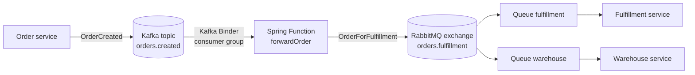
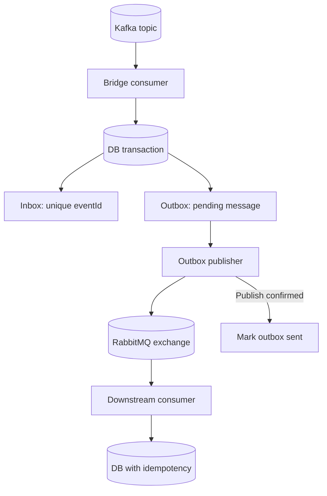

# Consuming from Kafka and Publishing to RabbitMQ

A Spring Cloud Stream application can consume events from Apache Kafka, apply business logic, and publish the results to RabbitMQ. Each input and output is connected via an appropriate binder: the Kafka Binder manages topic reading and consumer groups, while the RabbitMQ Binder manages sending to exchanges and the queues bound to those exchanges.

This is a single application with two bindings belonging to two different message broker systems. The data processing function remains an ordinary Java bean; binding configuration determines where it consumes from and where it publishes to. This design is useful when forwarding events between a Kafka data platform and downstream services consuming RabbitMQ. However, the two brokers do not share an atomic transaction. The application must handle the case where publishing succeeds but the Kafka offset has not yet been committed, causing the event to be redelivered and published twice.

## 1. Kafka-to-RabbitMQ flow architecture

Business example: an order system publishes `OrderCreated` events to Kafka topic `orders.created`. A bridge application reads the event, normalizes the data into `OrderForFulfillment`, and sends it to RabbitMQ destination `orders.fulfillment`. Fulfillment or warehouse services bind queues to that destination to receive orders.



Each component has a distinct responsibility:

- Kafka topic stores source events by partition and offset.
- Kafka consumer group identifies the group of instances sharing topic consumption.
- Function receives the payload, validates, and transforms the data.
- RabbitMQ exchange routes messages according to exchange type, routing key, and bindings.
- Queues belonging to consumer groups receive messages from the exchange.
- Downstream consumers process messages and acknowledge according to the Rabbit binder configuration.

Spring Cloud Stream does not automatically turn a Kafka topic into a RabbitMQ queue. Binders simply connect each binding to the corresponding destination. Transformation logic and deciding message contents belong to the function.

## 2. Adding both binders to the application

The application needs both the Kafka Binder and RabbitMQ Binder on the classpath. With Maven, two starters can be used:

```xml
<dependencies>
    <dependency>
        <groupId>org.springframework.cloud</groupId>
        <artifactId>spring-cloud-starter-stream-kafka</artifactId>
    </dependency>

    <dependency>
        <groupId>org.springframework.cloud</groupId>
        <artifactId>spring-cloud-starter-stream-rabbit</artifactId>
    </dependency>
</dependencies>
```

Manage versions with a Spring Cloud BOM compatible with the project's Spring Boot version. Do not manually mix binder versions from different release trains. If the project already manages these starters through internal dependency management, avoid declaring explicit versions on each dependency.

When only one binder implementation is on the classpath, Spring Cloud Stream can select it automatically. When multiple binder implementations are present, the application needs to specify a binder for each binding or declare a default binder and override on bindings requiring a different binder.

For this flow, the input must use Kafka and the output must use RabbitMQ. Explicitly declaring `binder` on both bindings makes the configuration easier to read and avoids relying on default selection.

## 3. Function and auto-generated binding names

A function with one input and one output generates two bindings by convention:

- `<functionName>-in-0`: input binding.
- `<functionName>-out-0`: output binding.

Example with a function named `forwardOrder`:

```java
import java.math.BigDecimal;
import java.time.Instant;

public record OrderCreated(
    String eventId,
    String orderId,
    String customerId,
    BigDecimal total,
    Instant occurredAt
) {}

public record OrderForFulfillment(
    String eventId,
    String orderId,
    String customerId,
    BigDecimal total,
    Instant createdAt
) {}
```

The function transforms the source event into a message intended for the fulfillment service:

```java
import java.util.function.Function;

import org.springframework.context.annotation.Bean;
import org.springframework.context.annotation.Configuration;

@Configuration
public class OrderBridgeConfiguration {

    @Bean
    Function<OrderCreated, OrderForFulfillment> forwardOrder() {
        return event -> {
            if (event == null
                    || event.eventId() == null
                    || event.orderId() == null
                    || event.customerId() == null
                    || event.total() == null) {
                throw new IllegalArgumentException(
                    "OrderCreated is missing required fields"
                );
            }

            if (event.total().signum() < 0) {
                throw new IllegalArgumentException(
                    "Order total must not be negative"
                );
            }

            return new OrderForFulfillment(
                event.eventId(),
                event.orderId(),
                event.customerId(),
                event.total(),
                event.occurredAt()
            );
        };
    }
}
```

Spring Cloud Function detects the `Function` bean and Spring Cloud Stream creates the input/output bindings. You do not need to manually instantiate `KafkaConsumer`, `KafkaProducer`, RabbitMQ `ConnectionFactory`, or channels to implement the basic flow.

The function only performs validation and transformation. It does not need to know the Kafka topic or RabbitMQ exchange names. Destination names and binders are configured in binding properties.

## 4. Assigning Kafka Binder to input and Rabbit Binder to output

Minimal configuration:

```yaml
spring:
  cloud:
    function:
      definition: forwardOrder
    stream:
      bindings:
        forwardOrder-in-0:
          destination: orders.created
          group: fulfillment-bridge
          binder: kafka
          content-type: application/json
          consumer:
            max-attempts: 3
            back-off-initial-interval: 1000
            back-off-max-interval: 10000
            back-off-multiplier: 2.0

        forwardOrder-out-0:
          destination: orders.fulfillment
          binder: rabbit
          content-type: application/json

      kafka:
        binder:
          brokers:
            - ${KAFKA_BOOTSTRAP_SERVERS:localhost:9092}

  rabbitmq:
    addresses: ${RABBITMQ_ADDRESSES:localhost:5672}
    username: ${RABBITMQ_USERNAME:app}
    password: ${RABBITMQ_PASSWORD}
    virtual-host: ${RABBITMQ_VHOST:/}
```

Meaning of properties:

| Property | Meaning |
|---|---|
| `function.definition` | Selects the `forwardOrder` function bean to activate |
| `forwardOrder-in-0.destination` | Source Kafka topic |
| `forwardOrder-in-0.group` | Stable consumer group for the bridge |
| `forwardOrder-in-0.binder` | Selects the Kafka Binder for input |
| `forwardOrder-out-0.destination` | RabbitMQ destination for publishing messages |
| `forwardOrder-out-0.binder` | Selects the RabbitMQ Binder for output |
| `content-type` | Message format at the binding boundary |
| `consumer.max-attempts` | Maximum processing attempts in the input's retry policy |
| `kafka.binder.brokers` | Kafka bootstrap addresses |
| `spring.rabbitmq.*` | RabbitMQ connection configuration provided by Spring Boot for the Rabbit binder |

The names `kafka` and `rabbit` are default binder types provided by the two binder implementations. If the application defines custom-named binder instances, bindings must reference those aliases rather than the type names.

Environment variables in the example must be supplied when running the application. Default `localhost` values are only suitable for development environments. Do not commit production passwords or credentials into configuration files.

## 5. Kafka topics and consumer groups

The Kafka Binder maps `destination` to a Kafka topic. Consumer `group` maps to Kafka's consumer group concept. In the example, topic `orders.created` is the source and group `fulfillment-bridge` is the bridge application's consumer identity.

The group must remain stable across restarts. If the group changes, Kafka treats it as a new consumer group and may re-read data according to the offset reset policy. If multiple bridge instances share group `fulfillment-bridge`, Kafka distributes partitions among the instances.

Important notes:

- The number of instances processing in parallel is bounded by the number of partitions assigned to the group.
- Instances in the same group split records among themselves; they do not each receive an independent copy of every record.
- If another service also needs to read the entire topic, that service should have its own group.
- Do not use random group names in production if you need to resume from committed offsets.
- The offset reset policy determines the starting position when the group has no valid committed offset.

The Kafka Binder can auto-provision topics depending on configuration and broker permissions. In production, manage topics, partitions, replication factors, retention, and ACLs through explicit infrastructure procedures.

## 6. RabbitMQ destination is an exchange

By default, the RabbitMQ Binder maps a `destination` to a `TopicExchange`. With a named consumer group, the binder creates a queue and binds that queue to the exchange. The bridge's output binding sends messages to the `orders.fulfillment` exchange.

A downstream service declares an input binding:

```yaml
spring:
  cloud:
    function:
      definition: receiveFulfillment
    stream:
      bindings:
        receiveFulfillment-in-0:
          destination: orders.fulfillment
          group: fulfillment-service
          binder: rabbit
          content-type: application/json
```

With group `fulfillment-service`, the Rabbit binder creates a queue for the group and binds it to the exchange. If another service such as warehouse exists, it uses a different group to receive its own copy of messages via a separate queue. Instances of the same service sharing a group compete for messages from the same queue.

If the output exchange has no matching queue binding, messages may not be received by any service. Therefore, provision consumer queues/bindings or verify the topology auto-declared by the binder. The producer's destination is an exchange; downstream queues are normally created when a consumer binding declares a group.

Do not confuse Kafka input `group` with Rabbit consumer `group`. The two share the same property name in the common API but map to different broker mechanisms.

## 7. Why must a binder be assigned per binding?

When both Kafka and Rabbit binders are on the classpath, Spring Cloud Stream needs to know which binder handles which destination. Example:

```yaml
spring:
  cloud:
    stream:
      default-binder: kafka
      bindings:
        forwardOrder-in-0:
          destination: orders.created
          group: fulfillment-bridge
        forwardOrder-out-0:
          destination: orders.fulfillment
          binder: rabbit
```

This configuration selects Kafka as the default binder and specifies Rabbit for output. It is equivalent to explicitly assigning `binder: kafka` for input and `binder: rabbit` for output. For bridge applications with only a few bindings, assigning both explicitly helps readers recognize the data flow faster.

If `default-binder` is set and a binding has no `binder`, that binding uses the default binder. If there is no default and multiple binder implementations are available, specify binders explicitly to avoid ambiguous selection or bindings failing to initialize as expected.

`default-binder` is the default choice for unassigned bindings; it does not override the binder of bindings that already specify one.

## 8. Connecting to multiple brokers of the same type with named binders

When there is one Kafka cluster and one RabbitMQ broker of different types, two binder implementations and per-binding binder assignment suffice. Named binder configuration is useful when connecting to multiple brokers of the same type, such as reading from Kafka cluster A and publishing to Kafka cluster B, or two different RabbitMQ clusters.

Example declaring two Kafka binder instances:

```yaml
spring:
  cloud:
    stream:
      binders:
        kafkaSource:
          type: kafka
          environment:
            spring:
              cloud:
                stream:
                  kafka:
                    binder:
                      brokers: ${KAFKA_SOURCE_BROKERS}
        kafkaArchive:
          type: kafka
          environment:
            spring:
              cloud:
                stream:
                  kafka:
                    binder:
                      brokers: ${KAFKA_ARCHIVE_BROKERS}
          default-candidate: false

      bindings:
        forwardOrder-in-0:
          destination: orders.created
          group: fulfillment-bridge
          binder: kafkaSource
        forwardOrder-out-0:
          destination: orders.archive
          binder: kafkaArchive
```

`kafkaSource` and `kafkaArchive` are application-defined aliases. `type: kafka` selects the Kafka Binder implementation; `environment` supplies dedicated Spring Boot configuration for the binder instance. `default-candidate: false` keeps the archive binder selected only when explicitly referenced by a binding.

When explicit binder configuration is enabled via `spring.cloud.stream.binders.*`, Spring Cloud Stream disables the automatic default binder configuration process. All binders to be used must be declared in the `binders` section. Do not declare a single named binder and assume another default binder will still be created automatically. If the application needs both Kafka and Rabbit in explicit mode, declare both:

```yaml
spring:
  cloud:
    stream:
      binders:
        kafkaSource:
          type: kafka
          environment:
            spring:
              cloud:
                stream:
                  kafka:
                    binder:
                      brokers: ${KAFKA_BOOTSTRAP_SERVERS}
        rabbitTarget:
          type: rabbit
          environment:
            spring:
              rabbitmq:
                addresses: ${RABBITMQ_ADDRESSES}
                username: ${RABBITMQ_USERNAME}
                password: ${RABBITMQ_PASSWORD}
      bindings:
        forwardOrder-in-0:
          destination: orders.created
          group: fulfillment-bridge
          binder: kafkaSource
        forwardOrder-out-0:
          destination: orders.fulfillment
          binder: rabbitTarget
```

Once a dedicated environment is declared for a binder, verify that properties use the right prefix for that binder implementation. The Kafka Binder uses `spring.cloud.stream.kafka.binder.*`; the Rabbit binder uses Spring AMQP/Spring Boot connection properties such as `spring.rabbitmq.*`.

In a multi-binder application, binders can run in separate application contexts. If programmatic customization of a binder object is needed (such as attaching a rebalance listener to the Kafka binder), ordinary configuration beans in the main application context may not be directly visible to the binder context. Spring Cloud Stream provides `BinderCustomizer` to pass customizations to each binder before bindings use them. The customizer receives both the binder instance and the binder name; check the binder type and alias so configuration applies only to the right broker. This mechanism is for programmatic customization and is unnecessary when merely configuring brokers, credentials, or destinations via properties.

## 9. Separating environments and credentials

Local, staging, and production typically use different brokers, credentials, TLS, and virtual hosts. These can be externalized via environment variables, profiles, or a secret manager.

Example production configuration:

```yaml
spring:
  cloud:
    stream:
      kafka:
        binder:
          brokers: ${KAFKA_BOOTSTRAP_SERVERS}
          configuration:
            security.protocol: SASL_SSL
            sasl.mechanism: PLAIN
            sasl.jaas.config: ${KAFKA_SASL_JAAS_CONFIG}
  rabbitmq:
    addresses: ${RABBITMQ_ADDRESSES}
    username: ${RABBITMQ_USERNAME}
    password: ${RABBITMQ_PASSWORD}
    virtual-host: ${RABBITMQ_VHOST}
    ssl:
      enabled: true
```

Kafka and RabbitMQ have separate security mechanisms. Kafka's TLS/SASL settings do not automatically apply to RabbitMQ. RabbitMQ TLS, credentials, and virtual host must be configured through the Rabbit binder's connection factory.

When using named binders, each binder's environment can contain its own profile. Check `inherit-environment` and `environment` to know whether the binder inherits properties from the application context or runs in an isolated context. Prevent a binder from accidentally picking up credentials for another broker due to shared properties.

Do not log the entire environment or connection configuration. Passwords, JAAS strings, tokens, truststore passwords, and private keys must be managed as secrets.

## 10. Payload conversion and message contracts

Kafka and RabbitMQ do not have to use the same wire protocol or schema. Spring Cloud Stream converts payloads at the binding boundary according to `content-type` and message converters. The function receives decoded Java types, and the output binding converts the return value into a message suited to the target binder.

In the example, both bindings use `application/json`. This means the bridge receives JSON convertible into `OrderCreated`, and then emits `OrderForFulfillment` as JSON. The two Java types do not need to be identical; the function performs the mapping.

Downstream contracts should agree on:

- Field names and data types.
- Timestamp format and timezone.
- Currency units and rounding rules.
- Event ID and correlation ID.
- Schema version and compatibility policy.
- Handling of new fields, missing fields, or null values.

If the Kafka producer uses Avro, Protobuf, or a custom serializer, the binder needs an appropriate Serde/converter. Do not set `content-type: application/json` assuming an Avro payload will automatically become JSON. Decode according to the source schema before the function processes it.

RabbitMQ messages should carry a stable event ID so downstream consumers can guard against duplicate processing. You can use a payload field or header per the agreed contract. If the function takes `Message<OrderCreated>` and returns `Message<OrderForFulfillment>`, it can explicitly preserve correlation headers:

This is an alternative variant to the earlier `Function<OrderCreated, OrderForFulfillment>` signature when the application needs to forward business headers:

```java
import java.util.function.Function;

import org.springframework.context.annotation.Bean;
import org.springframework.messaging.Message;
import org.springframework.messaging.support.MessageBuilder;

@Bean
Function<Message<OrderCreated>, Message<OrderForFulfillment>> forwardOrder() {
    return message -> {
        OrderCreated event = message.getPayload();

        OrderForFulfillment output = new OrderForFulfillment(
            event.eventId(),
            event.orderId(),
            event.customerId(),
            event.total(),
            event.occurredAt()
        );

        return MessageBuilder
            .withPayload(output)
            .copyHeaders(message.getHeaders())
            .build();
    };
}
```

This example requires importing `Message` and `MessageBuilder` from Spring Messaging. Avoid blindly copying all headers if they contain internal Kafka or Rabbit headers that are meaningless on the target broker. Select the headers the application needs to preserve, such as `eventId`, `correlationId`, `traceparent`, and schema version.

## 11. Message path and duplicate-publish window

When the function executes synchronously, the application receives a Kafka record, runs its logic, and sends output to RabbitMQ. After successful execution, the listener container can complete acknowledgement/offset commit for the input per binder configuration.

The two brokers do not participate in a single atomic transaction. There is an important failure window:

1. Kafka delivers the `OrderCreated` record.
2. The function runs and the Rabbit binder publishes `OrderForFulfillment`.
3. RabbitMQ receives the message.
4. The application or consumer crashes before the Kafka offset is committed.
5. Kafka redelivers the source record.
6. The function republishes the RabbitMQ message.

As a result, RabbitMQ may receive two messages with the same event ID. This is a common at-least-once scenario when bridging two independent systems. A Kafka transaction cannot wrap a RabbitMQ publish in a way that creates a distributed atomic commit with RabbitMQ.

You must also handle Rabbit publish failures. If the error propagates back to the listener before the input is acknowledged, Kafka can redeliver the record per its retry/error policy. If output sends are configured asynchronously or errors do not propagate to the caller, a dedicated confirmation and state-persistence mechanism is needed; do not assume returning from the function guarantees the message reached the exchange/queue.

## 12. Idempotency on the RabbitMQ consumer side

A simple way to mitigate duplicate publishes is to keep `eventId` stable across all retries and replays. The RabbitMQ consumer persists the processed event ID in the same transaction as the business state change.

Example:

```java
@Service
public class FulfillmentService {

    private final ProcessedEventRepository processedEvents;
    private final ShipmentRepository shipments;

    public FulfillmentService(
            ProcessedEventRepository processedEvents,
            ShipmentRepository shipments) {
        this.processedEvents = processedEvents;
        this.shipments = shipments;
    }

    @Transactional
    public void createShipment(OrderForFulfillment event) {
        if (processedEvents.existsById(event.eventId())) {
            return;
        }

        shipments.createFor(event.orderId(), event.customerId());
        processedEvents.save(new ProcessedEvent(event.eventId()));
    }
}
```

The `processed_event` table needs a unique constraint on `eventId`. Checking existence before inserting does not by itself prevent a race condition if two consumers process the same event concurrently; catch the unique constraint violation or use a conditional insert.

Idempotency in the downstream consumer protects business side effects even when the bridge publishes duplicates. It does not make messages be published only once; it makes repeated processing safe.

## 13. Transactional outbox when high reliability is required

If the bridge must guarantee zero lost events when moving from Kafka to RabbitMQ, a database can act as the state and outbox boundary:

1. Receive the Kafka record containing an event ID.
2. Within a single database transaction, insert an inbox record with the unique event ID and insert an outbox record containing the payload to publish to RabbitMQ.
3. Commit the database transaction.
4. When the function returns successfully, the Kafka input can be acknowledged.
5. A separate outbox publisher reads unsent records and publishes them to RabbitMQ.
6. Mark the outbox entry as sent only after receiving appropriate confirmation from RabbitMQ.
7. If the publisher crashes after publishing but before marking sent, it may publish again; the RabbitMQ consumer still needs idempotency.



This pattern durably persists the intent to publish before acknowledging the input. If Kafka redelivers the record because the bridge crashed after database commit, the unique event ID in the inbox skips duplicate processing and preserves the existing outbox record.

The outbox publisher can still publish duplicates if RabbitMQ received the message but the publisher crashed before marking it sent. Therefore, downstream consumers still require idempotency. Publisher confirms help determine that the broker accepted the publish under RabbitMQ semantics, but do not create a distributed transaction between the database and the broker.

## 14. Retries and DLQ on the Kafka input

Kafka input can use bounded retries for transient errors inside the function:

```yaml
spring:
  cloud:
    stream:
      bindings:
        forwardOrder-in-0:
          destination: orders.created
          group: fulfillment-bridge
          binder: kafka
          consumer:
            max-attempts: 3
            back-off-initial-interval: 1000
            back-off-max-interval: 10000
            back-off-multiplier: 2.0
      kafka:
        bindings:
          forwardOrder-in-0:
            consumer:
              enable-dlq: true
              dlq-name: orders.created.fulfillment-bridge.dlt
```

The Kafka binder supports a dead-letter topic for grouped consumers when configured appropriately. You must provision the DLT topic, partition count, replication, and ACLs so the binder/producer can write to it. When the handler fails permanently or exhausts retries, the record can be routed to the DLT per binder policy.

Distinguish failure types:

- Permanent validation error: do not retry many times; send to DLT for investigation.
- RabbitMQ temporarily unavailable: bounded retries with backoff.
- Wrong RabbitMQ credentials: continuous retries will not fix configuration; alert and fix infrastructure.
- Incompatible payload schema: fix schema/Serde or quarantine rather than blindly replaying.

The Kafka DLT only stores failed input records. It does not automatically record whether the Rabbit output was already published. If there is a chance the output publish succeeded before the input failed, event IDs and idempotency remain essential.

## 15. RabbitMQ publish errors and producer confirmations

When the Rabbit binder sends output, errors can occur because the broker is unavailable, the exchange does not exist, publish permissions are missing, routing reaches no queue, or the connection is closed. Determine whether the application receives publish errors synchronously and which confirmation mechanism the binder uses.

Points to check:

- The destination exchange is declared or the binder has provisioning permissions.
- The RabbitMQ connection factory connects to the right cluster and virtual host.
- The producer has write permissions on the exchange.
- The routing key and exchange type route to the intended queue.
- Message converter and content type are compatible with the consumer.
- Publisher confirm/return settings match delivery requirements.
- Timeouts and retries do not create infinite loops.

Publisher confirm and consumer acknowledgement are two distinct mechanisms. Confirm concerns the publisher and broker; acknowledgement concerns the consumer and received messages. Confirm does not prove the downstream consumer has processed the message.

If the bridge must know a publish was confirmed by the broker before completing input processing, design output sending and error propagation to fit the binder/version in use. For high durability requirements, a transactional outbox defines retry boundaries and persists state better than merely increasing retry counts inside the function.

## 16. Headers and correlation across two brokers

Kafka and RabbitMQ have separate sets of metadata. Some headers can be mapped, while others are internal binder or broker metadata that should not be forwarded verbatim.

Define a stable set of application headers:

| Header | Purpose |
|---|---|
| `eventId` | Event idempotency key |
| `correlationId` | Links messages belonging to the same business flow |
| `causationId` | Identifies the event/message that caused the current event |
| `traceparent` | Propagates trace context if supported by the tracing system |
| `schemaVersion` | Identifies the payload contract version |
| `sourceSystem` | Identifies the originating system |

When forwarding messages, preserve or generate headers per contract. Do not use Kafka offsets or Rabbit delivery tags as event IDs because they are meaningful only within a specific broker/queue and can change on replay or migration.

If using `MessageBuilder.copyHeaders`, strip internal headers that are invalid on the target broker. Do not put credentials, tokens, or security headers into downstream messages unless explicitly required.

## 17. Observing both sides of the bridge

The bridge may successfully read from Kafka yet fail to send to RabbitMQ, or RabbitMQ may operate normally while the Kafka consumer falls behind. Monitoring Spring Boot health status alone is insufficient.

| Metric | Meaning |
|---|---|
| Kafka consumer lag | Whether the bridge is keeping up with the source topic |
| Kafka records consumed | Number of source records received |
| Function success/failure | Validation and mapping outcomes |
| Rabbit publish success/failure | Status of sending to the exchange |
| Retry count and DLT depth | Transient errors and unprocessable records |
| Rabbit exchange/queue depth | Whether downstream consumers are keeping up |
| Duplicate event ID count | Indicator of redeliveries or duplicate publishes |
| End-to-end latency | Time from source event to message availability in Rabbit |
| Outbox pending age | If using outbox, how long messages wait to be published |

Logs should include event ID, input topic, partition, offset, output destination, and correlation ID. Do not log full sensitive payloads or connection details. Set alerts when lag, DLT, or pending outbox grows continuously.

## 18. Integration testing with real Kafka and RabbitMQ

The Test Binder is useful for testing functions and bindings in memory, but does not fully simulate Kafka offsets/partitions or Rabbit exchanges/queues/confirms. A two-broker bridge needs integration tests with both systems.

Testcontainers can be used to spin up isolated Kafka and RabbitMQ instances. Scenarios:

1. Publish an `OrderCreated` message to the Kafka topic.
2. Verify the function is invoked and the Rabbit exchange receives `OrderForFulfillment`.
3. Verify the JSON payload and application headers are preserved accurately.
4. Send multiple events and verify the consumer group distributes partitions.
5. Make RabbitMQ temporarily unavailable; verify input retries and recovery.
6. Misconfigure Rabbit credentials; verify errors are observable and do not retry infinitely.
7. Cause function validation to fail; verify the Kafka DLT receives the record.
8. Succeed in Rabbit publishing, then simulate a bridge crash before Kafka offset commit; verify the event can reappear and the consumer is idempotent.
9. With outbox, crash after publishing but before marking sent; verify duplicates are handled safely.
10. Verify exchanges, queues, routing keys, and consumer groups are provisioned properly.
11. Test restarting the bridge while preserving the group to resume from the committed offset.
12. Verify trace/correlation headers across the two-broker boundary.

Tests should inspect payloads, broker metadata, offsets, and queue depths. Merely verifying the function returns the right object does not prove the message was written to RabbitMQ.

## 19. Common errors

| Symptom | Possible cause | Resolution |
|---|---|---|
| Both input and output connect to Kafka | Binder not assigned or default binder applies to both | Assign `binder: kafka` and `binder: rabbit` per binding |
| Binder `rabbit` not found | Missing Rabbit binder dependency or wrong alias | Add the Rabbit starter and verify the binder type |
| Output does not reach a queue | Destination is an exchange without a consumer queue/binding | Initialize the consumer group and check routing |
| Kafka re-reads all data after restart | Group changed or different offset reset policy | Use a stable group and check offsets |
| Duplicate Rabbit messages | Rabbit publish succeeded before Kafka offset commit | Idempotency via event ID or transactional outbox |
| Kafka DLT has no messages | DLT not enabled, wrong group/ACL/topic | Check Kafka binder DLT config and provisioning |
| Rabbit publish fails but input is still acknowledged | Error propagation or send mode behaves unexpectedly | Test the binder/version and use outbox if durability is needed |
| JSON fails to decode | Incompatible content type, converter, or schema | Standardize contracts and Serdes/converters |
| Named binder fails to initialize | Explicit binder config omitted some binders | Declare all binders in use |
| Binder uses wrong credentials | Environment properties shared or inherited unintentionally | Check binder environment and secret scope |

## 20. Production checklist

- Add Kafka Binder and RabbitMQ Binder from the same Spring Cloud release train.
- Activate the right function using `spring.cloud.function.definition`.
- Assign Kafka to input and Rabbit to output.
- Use a stable Kafka consumer group.
- Provision Kafka topics, partitions, retention, replication, and ACLs.
- Verify the Rabbit destination is an exchange and downstream queues are bound.
- Standardize content type, schema version, event ID, and correlation headers.
- Externalize broker addresses, credentials, TLS, and virtual hosts.
- Use bounded retries and DLT for unprocessable input errors.
- Verify Rabbit publish errors are propagated back or state is durably persisted.
- Do not assume a Kafka transaction covers RabbitMQ.
- Use idempotency downstream; use inbox/outbox when strong guarantees are needed.
- Monitor Kafka lag, Rabbit queue depth, retries, DLT, duplicates, and latency.
- Test against both brokers via integration tests before deployment.

## 21. References

- [Spring Cloud Stream — Multiple Binders on the Classpath](https://docs.spring.io/spring-cloud-stream/reference/spring-cloud-stream/multiple-binders.html), selecting binders per binding and default binder.
- [Spring Cloud Stream — Connecting to Multiple Systems](https://docs.spring.io/spring-cloud-stream/reference/spring-cloud-stream/multiple-systems.html), named binder configuration, isolated environments, and default candidates.
- [Spring Cloud Stream — Functional Binding Names](https://docs.spring.io/spring-cloud-stream/reference/spring-cloud-stream/functional-binding-names.html), function input/output binding naming conventions.
- [Spring Cloud Stream — Customizing Binders in Multi-Binder Applications](https://docs.spring.io/spring-cloud-stream/reference/spring-cloud-stream/binder-customizer.html), customizing binders in separate contexts.
- [Spring Cloud Stream — Apache Kafka Binder](https://docs.spring.io/spring-cloud-stream-binder-kafka/docs/current/reference/html/spring-cloud-stream-binder-kafka.html), configuring Kafka topics, consumer groups, producers, and DLT.
- [Spring Cloud Stream — RabbitMQ Binder](https://docs.spring.io/spring-cloud-stream-binder-rabbit/docs/current/reference/html/spring-cloud-stream-binder-rabbit-aggregate.html), mapping destinations to exchanges, queues, consumer groups, and producers.
- [Spring Cloud Stream — Binder Usage](https://docs.spring.io/spring-cloud-stream/docs/current/reference/html/README.html), starter dependencies for Kafka and RabbitMQ.

A Kafka-to-RabbitMQ flow uses a function as the transformation boundary, a Kafka binder for input, and a Rabbit binder for output. Binding configuration determines the broker, destination, and consumer group; named binders isolate environments when connecting to multiple clusters. Because the two brokers do not share an atomic transaction, stable event IDs, idempotency, retries/DLT, and a transactional outbox are needed when high reliability is required. When both brokers are tested and lag, publish failures, and duplicates are observed, the bridge operates transparently and recovers safely.
