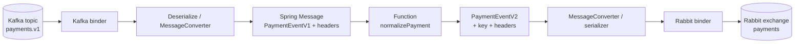

# Converting Formats, Keys, and Headers Between Systems

When a Spring Cloud Stream application reads a message from Kafka and writes it to RabbitMQ or Pulsar, the message passes through multiple representation layers. The payload may be JSON bytes on the source broker, converted into a Java object inside the function, and then serialized again into a format understood by the target broker. Along the way, routing keys and metadata also need to be mapped according to the target system's semantics.

Three parts need to be handled separately:

- **Payload/format:** bytes on the wire, Java type inside the function, content type, serializer/deserializer, and schema.
- **Key:** Kafka record keys, RabbitMQ routing keys, and Pulsar message keys/ordering keys serve different purposes.
- **Headers/metadata:** Spring MessageHeaders, Kafka record headers, AMQP properties/headers, and Pulsar message properties/metadata do not share the same set of data types or mapping rules.

A reliable bridge should convert the message into a stable business data model, then construct the payload, key, and headers suitable for each output binding. Do not blindly copy all metadata from the source broker to the target broker.

## 1. Message path across multiple binders

Spring Cloud Stream represents messages within the application using Spring Messaging `Message<?>`. The binder is responsible for connecting a binding to a specific middleware. When an application has multiple binders on the classpath, each binding can select its own binder.

For example, a function receives a payment event from Kafka, normalizes the data, and publishes it to RabbitMQ:



Input and output can use separate binders, destinations, serializers, and configurations. The function focuses on business logic; binding configuration specifies how data is read and written on each system.

An application with multiple binders must declare the binder for each binding. For example, an input binding uses Kafka and an output binding uses Rabbit:

```yaml
spring:
  cloud:
    stream:
      bindings:
        normalizePayment-in-0:
          binder: kafka
          destination: payments.v1
        normalizePayment-out-0:
          binder: rabbit
          destination: payments
```

If there is only one binder of each type, the binder name is usually the identifier of the binder implementation. When multiple instances of the same binder type or independent connection configurations are needed, declare aliases in `spring.cloud.stream.binders` and point bindings to those aliases.

## 2. Wire payload and function payload

The Kafka and Rabbit binders normally exchange payloads on the wire as `byte[]`. By default, the Pulsar binder can also use `Schema.BYTES` when Spring Cloud Stream performs message conversion. Inside the function, the payload can be a Java record, POJO, String, or byte array depending on the function signature and binding configuration.

For example, the same payment event can be represented in three forms:

| Layer | Example | Role |
|---|---|---|
| Wire payload | JSON bytes | Data transmitted across the broker |
| Spring Message | `Message<byte[]>` | Payload along with metadata |
| Business object | `PaymentEvent` | Data type processed by the function |

Conversion typically happens at two points:

1. **Inbound conversion:** converts the wire payload into the parameter type declared by the function.
2. **Outbound conversion:** converts the value returned by the function into the wire format sent by the binder.

Spring Cloud Stream uses `MessageConverter` for this process. The converter selects the conversion strategy based on content type and target parameter type.

Do not confuse the Java payload with bytes on the broker. One object can be serialized as JSON, Avro, or Protobuf; byte size and structure depend on the serializer and schema.

## 3. Content type and precedence

`contentType` indicates how the payload is formatted so the framework can find an appropriate converter. Spring Cloud Stream resolves content type in the following precedence order:

1. The `contentType` header present in the Spring Message.
2. `spring.cloud.stream.bindings.<binding-name>.content-type`.
3. The default value `application/json`.

Example:

```yaml
spring:
  cloud:
    stream:
      bindings:
        normalizePayment-in-0:
          content-type: application/json
        normalizePayment-out-0:
          content-type: application/json
```

Input and output can use different content types. For example, the source emits Avro, the function transforms it into an object, and the output emits JSON:

```yaml
spring:
  cloud:
    stream:
      bindings:
        normalizePayment-in-0:
          content-type: application/*+avro
        normalizePayment-out-0:
          content-type: application/json
```

When a content type header is present, that header can override the binding value. Therefore, when converting formats, actively specify the output content type. Do not copy the source's content type if the payload has been transformed into another format.

Content type is a hint for the converter, not a complete schema. The framework also needs the function parameter type to know the target object type. If no converter supports the content type and target type pair, conversion will fail.

## 4. Commonly used converters

Spring Cloud Stream provides several common converters:

| Converter | Content type | Behavior |
|---|---|---|
| JSON converter | `application/json` | Converts JSON bytes/String to POJO and vice versa |
| Byte array converter | `application/octet-stream` | Keeps payload as `byte[]` |
| Object/String converter | `text/plain` | Converts String and certain objects to text form |
| Custom converter | Application-chosen MIME type | Handles custom formats or schemas |

Example of a function receiving JSON as a Java record:

```java
public record PaymentEvent(
        String eventId,
        String accountId,
        long amountMinor,
        String currency
) {
}

@Bean
Function<PaymentEvent, PaymentEvent> validatePayment() {
    return event -> {
        if (event.amountMinor() <= 0) {
            throw new IllegalArgumentException("amountMinor must be positive");
        }
        return event;
    };
}
```

When the input binding has `content-type: application/json`, the converter can deserialize the payload into `PaymentEvent` before calling the function. If the output binding also has a JSON content type, the returned object is serialized into JSON bytes.

If a special format is required, you can register a custom `MessageConverter` or use a schema-aware converter. Check whether the converter supports both the required inbound and outbound directions.

## 5. Choosing function parameter types so conversion works

The function parameter type is part of the conversion contract.

- `Function<PaymentEvent, ...>` tells the framework the target type is PaymentEvent.
- `Function<Message<PaymentEvent>, ...>` lets you read the payload along with headers while keeping the target payload type as PaymentEvent.
- `Function<byte[], ...>` receives raw bytes; the application decodes them itself.
- `Function<Object, ...>` or `Function<Message<?>, ...>` does not provide a concrete target payload type and may prevent the framework from performing conversion as expected.

Example when you need to read a correlation ID while still wanting the converter to deserialize JSON:

```java
@Bean
Function<Message<PaymentEvent>, PaymentEvent> inspectPayment() {
    return message -> {
        String correlationId =
                message.getHeaders().get("correlationId", String.class);

        log.info("Processing payment correlationId={}", correlationId);
        return message.getPayload();
    };
}
```

Avoid using `Object` solely to access headers. Use `Message<YourDomainType>` to retain a concrete target type. Only choose raw `byte[]` when the application truly wants to take responsibility for decoding, validation, and schema handling itself.

## 6. Native encoding and native decoding

Spring Cloud Stream has two conversion modes:

- **Framework conversion:** `MessageConverter` converts payloads based on content type and target type.
- **Native encoding/decoding:** the middleware's client library itself serializes/deserializes payloads using its own serializer, deserializer, or schema.

Two properties control native mode:

- `spring.cloud.stream.bindings.<binding>.producer.use-native-encoding`.
- `spring.cloud.stream.bindings.<binding>.consumer.use-native-decoding`.

When native encoding/decoding is enabled:

- The framework does not use content type to decide how to serialize/deserialize the payload.
- The application must configure the corresponding serializer/deserializer or schema on the binder/client.
- `headerMode=embeddedHeaders` is ignored; headers are not embedded into the payload via the embedded headers mechanism.

Example configuring native encoding/decoding:

```yaml
spring:
  cloud:
    stream:
      bindings:
        pulsarInput-in-0:
          consumer:
            use-native-decoding: true
        pulsarOutput-out-0:
          producer:
            use-native-encoding: true
```

Native mode is useful when the system already has broker-specific schemas or serializers. However, when bridging Kafka to RabbitMQ, enabling native encoding on one end and native decoding on the other does not automatically make the two formats compatible. You must convert the payload through a common data type or convert bytes manually with the corresponding serializer/deserializer.

## 7. Normalizing to a canonical domain model

When bridging multiple systems, use a stable intermediate business model. Each binder can have its own DTO reflecting the source or target schema, while the function maps to and from the canonical model.

Example of source v1 and target v2:

```java
public record PaymentEventV1(
        String id,
        String account,
        long amountCents,
        String currency,
        Instant occurredAt
) {
}

public record PaymentEventV2(
        String eventId,
        String accountRef,
        long amountMinor,
        String currency,
        Instant occurredAt
) {
}
```

Conversion function:

```java
PaymentEventV2 toV2(PaymentEventV1 source) {
    return new PaymentEventV2(
            source.id(),
            source.account(),
            source.amountCents(),
            source.currency(),
            source.occurredAt()
    );
}
```

In a real system, `occurredAt` should come from the source event or an explicit business rule. Do not replace the event time with the bridge's processing time if doing so alters the temporal meaning of the event.

A canonical model reduces coupling between systems. When the source schema changes, only the inbound adapter needs updating; when the target format changes, the outbound adapter can be swapped without modifying core business logic.

## 8. Example: Kafka → RabbitMQ with JSON

Suppose Kafka emits payment events as JSON. The application reads them as `PaymentEventV1`, renames fields, and publishes them to RabbitMQ as `PaymentEventV2`.

Function:

```java
@Bean
Function<Message<PaymentEventV1>, Message<PaymentEventV2>> kafkaToRabbit() {
    return input -> {
        PaymentEventV1 source = input.getPayload();

        PaymentEventV2 target = new PaymentEventV2(
                source.id(),
                source.account(),
                source.amountCents(),
                source.currency(),
                source.occurredAt()
        );

        Map<String, Object> headers = new HashMap<>();
        headers.put("eventId", target.eventId());
        copyIfPresent(input, headers, "correlationId");
        copyIfPresent(input, headers, "tenantId");

        Object kafkaKey = input.getHeaders().get("kafka_receivedMessageKey");
        String routeKey = kafkaKey == null
                ? "payments.unkeyed"
                : kafkaKey.toString();

        headers.put("routeKey", routeKey);
        headers.put(MessageHeaders.CONTENT_TYPE, MimeTypeUtils.APPLICATION_JSON);

        return MessageBuilder.withPayload(target)
                .copyHeaders(headers)
                .build();
    };
}

private static void copyIfPresent(
        Message<?> source,
        Map<String, Object> target,
        String headerName) {

    Object value = source.getHeaders().get(headerName);
    if (value != null) {
        target.put(headerName, value);
    }
}
```

Binding configuration:

```yaml
spring:
  cloud:
    function:
      definition: kafkaToRabbit
    stream:
      bindings:
        kafkaToRabbit-in-0:
          binder: kafka
          destination: payments.v1
          content-type: application/json
          consumer:
            use-native-decoding: false
        kafkaToRabbit-out-0:
          binder: rabbit
          destination: payments.exchange
          content-type: application/json
          producer:
            use-native-encoding: false
      rabbit:
        bindings:
          kafkaToRabbit-out-0:
            producer:
              routing-key-expression: headers['routeKey']
```

In this example:

- The Kafka binder deserializes JSON into `PaymentEventV1`.
- The function transforms it into `PaymentEventV2`.
- Only whitelisted business headers are retained.
- The Kafka key is read from the `kafka_receivedMessageKey` header and placed into the `routeKey` header.
- The Rabbit binder serializes `PaymentEventV2` to JSON and uses `routeKey` as the routing key.

This is an intentional business mapping. A Kafka key is used for partition selection and per-key ordering within a topic; a Rabbit routing key is used for routing messages through an exchange to queues. The two values may look identical in content, yet do not share the same semantics.

## 9. Selecting a dedicated binder per binding

When multiple binders are on the classpath, declare the binder for each binding. If there is only one Kafka binder and one Rabbit binder, the identifiers `kafka` and `rabbit` can be used.

When multiple connections or multiple instances of the same binder type need to be configured, create aliases:

```yaml
spring:
  cloud:
    stream:
      binders:
        kafkaSource:
          type: kafka
          environment:
            spring:
              cloud:
                stream:
                  kafka:
                    binder:
                      brokers: ${KAFKA_BROKERS:localhost:9092}
        rabbitTarget:
          type: rabbit
          environment:
            spring:
              rabbitmq:
                host: ${RABBIT_HOST:localhost}
                port: 5672
      bindings:
        kafkaToRabbit-in-0:
          binder: kafkaSource
          destination: payments.v1
        kafkaToRabbit-out-0:
          binder: rabbitTarget
          destination: payments.exchange
```

Aliases allow the two bindings to use separate connection configurations. Do not put a single Kafka cluster's bootstrap servers into a shared producer property if the application needs multiple Kafka binders connecting to different clusters; use multi-binder support and select the binder on the binding.

## 10. Keys in Kafka, RabbitMQ, and Pulsar

The word "key" appears in all three systems, but its purpose is not the same:

| System | Concept | Primary purpose |
|---|---|---|
| Kafka | Record key | Partition selection, per-key ordering within a partition, and compaction |
| RabbitMQ | Routing key | Routing through exchanges and queue bindings |
| Pulsar | Message key | Partition selection/key-based routing; can support per-key ordering |
| Pulsar | Ordering key | Determines per-key processing order in supported subscriptions/modes |

A Kafka record key is usually serialized separately from the value. A Rabbit routing key is a string used by an exchange to match binding keys or patterns. Pulsar message keys and ordering keys are message metadata that can be exposed via Spring headers.

Do not transfer keys between systems without clarifying the purpose. For example, using a Kafka record key as a Rabbit routing key only makes sense if the exchange's routing rules actually rely on that value.

### Key normalization rules

- Choose a stable business identifier, such as accountId or orderId.
- Standardize data type and encoding, typically UTF-8 for strings.
- Do not use `toString()` on arbitrary objects as a key.
- Do not generate random keys on every retry.
- Keep the same key across bridge steps if downstream needs the same ordering or partitioning grouping.
- If changing the key, document the reason and re-test partitioning/routing.

Null or empty keys need an explicit policy. Do not assign a single shared value to all messages if doing so concentrates all traffic onto one partition or queue.

## 11. Preserving the Kafka record key when publishing to Kafka output

The Kafka binder provides `messageKeyExpression` to extract a key from the outgoing Spring Message. For ordinary processors, the `kafka_receivedMessageKey` header can be used to preserve the input key:

```yaml
spring:
  cloud:
    stream:
      kafka:
        bindings:
          transform-out-0:
            producer:
              message-key-expression: headers['kafka_receivedMessageKey']
```

If the function builds a new Message, make sure the key header is copied to the output. You can normalize the key into a dedicated header:

```java
Message<PaymentEvent> output = MessageBuilder
        .withPayload(event)
        .setHeader("paymentKey", event.accountId())
        .build();
```

Then configure:

```yaml
spring:
  cloud:
    stream:
      kafka:
        bindings:
          transform-out-0:
            producer:
              message-key-expression: headers['paymentKey']
```

`messageKeyExpression` only determines the Kafka record key. This header does not automatically become a payload field or a Rabbit routing key. If sending to RabbitMQ, it must be mapped separately to the header used by the Rabbit producer.

## 12. Preserving the Rabbit routing key and converting to a Kafka key

The Rabbit binder allows configuring `routingKeyExpression` to determine the routing key upon publishing. The value can be read from a Spring Message header:

```yaml
spring:
  cloud:
    stream:
      rabbit:
        bindings:
          rabbitOutput-out-0:
            producer:
              routing-key-expression: headers['routeKey']
```

When receiving messages from RabbitMQ, the received routing key is exposed via the `amqp_receivedRoutingKey` header. You can transfer that value into an application header and then use it as a Kafka key:

```java
@Bean
Function<Message<PaymentEvent>, Message<PaymentEvent>> rabbitToKafka() {
    return input -> {
        Object receivedRoutingKey =
                input.getHeaders().get("amqp_receivedRoutingKey");

        Map<String, Object> headers = new HashMap<>();
        if (receivedRoutingKey != null) {
            headers.put("paymentKey", receivedRoutingKey.toString());
        }
        headers.put(MessageHeaders.CONTENT_TYPE, MimeTypeUtils.APPLICATION_JSON);

        return MessageBuilder.withPayload(input.getPayload())
                .copyHeaders(headers)
                .build();
    };
}
```

Kafka output:

```yaml
spring:
  cloud:
    stream:
      kafka:
        bindings:
          rabbitToKafka-out-0:
            producer:
              message-key-expression: headers['paymentKey']
```

Only use this approach if the Rabbit routing key has semantics compatible with a Kafka partition key. If the routing key is merely a queue name or technical route, derive the Kafka key from accountId/orderId in the payload instead of copying the technical route.

## 13. Pulsar message key and ordering key

Pulsar has separate message keys and ordering keys. When the binder or Spring for Apache Pulsar exposes metadata, the application can read the corresponding headers, such as `PulsarHeaders.KEY` and `PulsarHeaders.ORDERING_KEY`.

Concepts to distinguish:

- Message key is typically used for partition routing and key-based processing mechanisms.
- Ordering key allows determining per-key message order in supported subscription/consumer modes.
- User properties are custom metadata; they do not automatically become a message key or ordering key.

When bridging Pulsar to Kafka, if you need to preserve the partition key, read the message key and place it into an application header such as `paymentKey` so the Kafka producer can use `messageKeyExpression`. When bridging Kafka to Pulsar, configure the Pulsar producer according to the message key/ordering key mechanism supported by your binder version; do not assume an arbitrary Spring custom header automatically becomes the Pulsar key.

With native Pulsar schemas, the binder may require `schema-type`, `message-type`, and in cases with separate key/value types may require `message-key-type` and `message-value-type`. Configure producers and consumers to match the actual schema.

## 14. What are headers and why can't all of them be copied?

Headers are metadata accompanying a message, such as:

- `eventId`: event identifier.
- `correlationId`: links messages in the same workflow.
- `tenantId`: tenant owning the data.
- `traceparent`: trace context according to tracing standards.
- `contentType`: payload format.
- `schemaVersion`: data contract version.

Besides business headers, each binder has technical headers:

| Source | Example technical headers |
|---|---|
| Kafka | `kafka_receivedMessageKey`, `kafka_receivedTopic`, `kafka_offset` |
| RabbitMQ | `amqp_receivedRoutingKey`, `amqp_deliveryTag`, `amqp_consumerQueue` |
| Pulsar | `pulsar_messageId`, `pulsar_message_key`, `pulsar_topicName` |

Technical headers describe delivery or the source broker. When moving a message to another broker, some headers lose meaning or cannot be reused. For example, RabbitMQ's delivery tag is tied to the current channel; do not send it to Kafka as business metadata.

Maintain an allowlist of business headers and let the target binder regenerate transport metadata. Do not copy all headers from the source message with `copyHeaders()` without filtering.

## 15. Header mapping per binder

Each binder maps Spring MessageHeaders to broker metadata in its own way:

| Binder | Representation | What to watch out for |
|---|---|---|
| Kafka | Record headers as key/value bytes | Has `headerPatterns` to filter headers; header mapper can serialize complex types |
| RabbitMQ | AMQP properties and headers | Value types must be AMQP-compatible; avoid relying on broker-specific headers |
| Pulsar | Message properties and metadata | `PulsarHeaderMapper` converts Spring headers; JSON mapper may require trusted packages |

### Kafka headerPatterns

The Kafka binder has a `headerPatterns` property to select which Spring headers are sent as Kafka record headers. The default pattern is `*`, excluding the standard `id` and `timestamp` headers.

Whitelist example:

```yaml
spring:
  cloud:
    stream:
      kafka:
        bindings:
          kafkaOutput-out-0:
            producer:
              header-patterns: eventId,correlationId,tenantId,traceparent,paymentKey
```

The Kafka binder also allows configuring a custom `KafkaHeaderMapper` bean via `headerMapperBeanName` if you need to adjust trusted packages or how complex headers are serialized.

### Rabbit headerPatterns

The Rabbit producer has `headerPatterns` to select outgoing headers. Binder documentation sets the default to all headers. For a multi-system bridge, restrict this to the required business headers to avoid accidentally sending transport metadata or internal headers.

### PulsarHeaderMapper

The Pulsar binder uses `PulsarHeaderMapper` to convert Spring MessageHeaders into Pulsar user properties and metadata. The JSON mapper supports complex-typed headers and has a trusted packages mechanism; the toString mapper simply converts values to strings.

Example mapper with a whitelist:

```java
@Bean
PulsarHeaderMapper customPulsarHeaderMapper() {
    return JsonPulsarHeaderMapper.builder()
            .inboundPatterns("!secret", "*")
            .outboundPatterns(
                    "!id",
                    "!timestamp",
                    "eventId",
                    "correlationId",
                    "tenantId",
                    "traceparent"
            )
            .trustedPackages("com.acme.events")
            .build();
}
```

When providing custom patterns, explicitly include the headers you want to keep. Specifying certain patterns can replace the default map-all behavior. Do not add untrusted packages to trusted packages because the mapper may deserialize Java types from headers.

## 16. Standard headers and custom headers

Classify metadata before bridging:

| Category | Example | Handling |
|---|---|---|
| Business metadata | eventId, tenantId, correlationId | Keep if meaningful in the target system |
| Content metadata | contentType, schemaVersion | Update to match the output format/schema |
| Trace metadata | traceparent, tracestate | Keep per tracing policy and header mapper |
| Transport metadata | deliveryTag, partition, offset | Do not copy blindly; let target broker generate new metadata |
| Security metadata | authorization, token, credentials | Do not propagate to another broker without an explicit policy |
| Framework metadata | id, timestamp, internal headers | Usually strip or regenerate |

A header with the same name on two brokers does not mean it has the same semantics. For example, `timestamp` could be message creation time, publish time, or broker receipt time. Use clear business names like `occurredAt`, `publishedAt`, and `receivedAt` when differentiation is needed.

Do not use headers to carry large payloads. Headers should be short, use simple data types, and contain no secrets.

## 17. Schema Registry and schema evolution

When multiple systems exchange data, merely setting content type to JSON or Avro is not enough to guarantee both sides understand the same schema. A schema registry stores schemas by subject, format, and version for producers/consumers to look up.

Spring Cloud Stream supports schema registry and Avro converters. When an output binding uses a content type like `application/*+avro`, the converter can register the schema and attach subject/version information to the content type.

Example content type format:

`application/vnd.payment-event.v2+avro`

When deserializing, the converter retrieves the message's writer schema and resolves it against the receiving application's reader schema. The reader schema can be configured via `spring.cloud.stream.schema.avro.readerSchema`.

### When bridging between two brokers

If the Kafka source uses Avro while the RabbitMQ target uses JSON:

1. The input Kafka binder deserializes Avro into a domain object.
2. The function converts the domain object to the target DTO.
3. The output Rabbit binder serializes the DTO to JSON.
4. The output content type is set to `application/json`.
5. If the target needs the schema version, place the schema reference/version into an agreed business header or contract metadata.

Do not send raw Avro bytes to RabbitMQ and attach a JSON content type. If you want to preserve binary Avro, the output must preserve a compatible schema ID/version and the target consumer must be able to reach the appropriate schema registry.

### Schema compatibility rules

- Adding optional fields with defaults is usually more compatible than changing existing field types.
- Do not change the meaning of a field while keeping the same name and type.
- Avoid deleting fields still used by older consumers.
- Test a new producer schema against an old reader schema and vice versa.
- Version contracts when making incompatible changes.
- Use event schemas independent of internal Java classes to support consumers in other languages.

## 18. Native Pulsar schema and framework conversion

The Pulsar binder supports two main approaches:

**Framework conversion:** Spring Cloud Stream defaults to `application/json`, serializing payloads to bytes and sending over Pulsar with `Schema.BYTES`.

**Native Pulsar schema:** enable native encoding/decoding and declare schema type/message type so the Pulsar client handles serialization.

Example of native JSON schema:

```yaml
spring:
  cloud:
    stream:
      bindings:
        publishPayment-out-0:
          producer:
            use-native-encoding: true
        consumePayment-in-0:
          consumer:
            use-native-decoding: true
      pulsar:
        bindings:
          publishPayment-out-0:
            producer:
              schema-type: JSON
              message-type: com.acme.PaymentEvent
          consumePayment-in-0:
            consumer:
              schema-type: JSON
              message-type: com.acme.PaymentEvent
```

In native mode, schema type and message type must be compatible between producer and consumer. If there are separate key/value types, configure message key/value types per the binder API. Do not set `content-type: application/json` expecting it to replace Pulsar schema while native decoding is enabled.

## 19. Serialization and key/header encoding

Payload serializers and header mappers are two separate components. A message can serialize its payload properly yet lose headers or keys due to mapping configuration.

Guidelines:

- Use UTF-8 for string keys/headers.
- Use JSON/Avro/Protobuf for payloads per the chosen contract.
- Do not use Java native serialization for data exchanged across multiple languages.
- Avoid placing arbitrary objects into headers; use String, numbers, booleans, or `byte[]` with an explicit contract.
- If a header contains bytes, specify the encoding and version.
- If the header mapper uses JSON, configure minimal trusted packages.
- Configure compatible key serializers/deserializers in Kafka when native encoding/decoding is enabled.
- Set matching Pulsar schema/message types when native mode is enabled.

When using Kafka native encoding, the binder does not perform content-type conversion. For example, a producer using a JSON serializer paired with a consumer configured with a String deserializer can read bytes as a string, yet a function expecting a POJO still needs an appropriate decoding step. Test both ends.

## 20. Conversion errors and handling invalid messages

Errors can appear at multiple stages:

| Stage | Example error | Resolution |
|---|---|---|
| Inbound deserialization | Malformed JSON, Avro schema not found | Check schema/serializer, quarantine or send to DLQ per binder |
| Message conversion | No converter matches content type and target type | Fix content type, parameter type, or add a converter |
| Function mapping | Missing required field, unsupported currency | Validate business rules and route errors per policy |
| Outbound serialization | Output DTO incompatible with serializer/schema | Check output binding, Serde, schema, and converter |
| Header mapping | Header object cannot be serialized or is filtered out | Convert header to simple types, adjust header mapper |
| Key mapping | Null key or wrong type | Validate key and configure key serializer/routing expression |

Deserialization errors typically occur before the function is invoked. Do not put business validation inside the function expecting it to catch all byte or schema errors.

For transient errors such as schema registry timeouts, retry with backoff. For incompatible schemas or corrupted payloads, retrying the same bytes rarely resolves the root cause; use DLQ/quarantine and a data remediation workflow.

## 21. Testing bridges across multiple binders

Testing should cover multiple layers.

### Unit tests for mapping

Verify the function receives the source DTO and produces the target DTO accurately:

- Fields are renamed or type-converted properly.
- Event ID and correlation ID are preserved.
- Output content type reflects the new format.
- Keys are normalized according to business rules.
- Transport headers are not copied to the output.

### Conversion tests

Verify:

- JSON bytes deserialize into the right DTO.
- Avro writer schema is compatible with reader schema.
- Output JSON/Avro produces valid bytes.
- Native encoding/decoding uses the right serializer/schema.
- Null/tombstone payloads are handled per rules.

### Integration tests with real brokers or Testcontainers

Build a Kafka → RabbitMQ or RabbitMQ → Kafka topology and verify:

1. Input binding connects to the right broker/topic/queue.
2. Function is invoked with the expected target type.
3. Output binding uses the right binder and destination.
4. Payload can be deserialized by the downstream consumer.
5. Kafka key is preserved or transformed accurately.
6. Rabbit routing key delivers the message to the intended queue.
7. Pulsar key/ordering key is mapped accurately if used.
8. Allowlisted headers are propagated; disallowed headers do not appear.
9. Correlation ID and event ID remain intact across the bridge.
10. Schema/conversion errors are routed to the error channel or DLQ per policy.

Do not only assert that the function was called. Read the message from the target broker and verify the actual raw payload bytes, content type, key, routing, and headers.

## 22. Common troubleshooting

| Symptom | Causes to check |
|---|---|
| Function receives `byte[]` instead of POJO | Native decoding is enabled or content type/target type is incorrect |
| Function receives `Object` with no conversion | Function signature does not provide a concrete target type |
| JSON output is sent as a String | Incompatible content type or converter |
| Output broker does not understand schema | Incompatible serializer/schema type |
| Business headers disappear | Header mapper or `headerPatterns` does not allow them |
| Source technical headers appear at target | Copying all `MessageHeaders` without a whitelist |
| Kafka output has a null key | `messageKeyExpression` points to the wrong header or function did not copy key |
| Kafka key turns into a wrong Rabbit route | Confusing record key with exchange routing key |
| Rabbit message lands in another queue | Incorrect `routingKeyExpression` or exchange binding |
| Pulsar header object turns into a String | `ToString` header mapper is in use |
| Avro consumer cannot read | Writer schema/version or `readerSchema` mismatch |
| Message fails deserialization before function | Wrong serializer/deserializer or native decoding setting |

When debugging, log helpful details: binding name, content type, payload class, key, output destination, and allowed header list. Do not log tokens, authorization headers, or full sensitive payloads.

## 23. Bridge design workflow

1. Identify the binder, destination, and wire format on the input.
2. Identify the domain object type the function needs to receive.
3. Choose between framework conversion and native decoding.
4. Define the canonical model and schema evolution rules.
5. Identify the source key, target key, and purpose of each key.
6. Select the list of business headers to preserve.
7. Strip transport headers, secrets, and unnecessary framework metadata.
8. Set content type separately for input and output.
9. Configure the output binder's serializer/Serde/schema.
10. Configure the appropriate key expression or routing expression.
11. Test conversion and header mappers.
12. Run integration tests against real brokers.
13. Monitor conversion errors, serialization errors, DLQ, and message throughput after deployment.

## 24. Pre-deployment checklist

- Each binding selects the right binder and destination.
- Input content type reflects the actual format of the source payload.
- Output content type reflects the actual serialized format.
- Function has a concrete target type so framework conversion works.
- Native encoding/decoding is only enabled when serializers, deserializers, or schemas are configured.
- Distinguished Kafka record key, Rabbit routing key, and Pulsar message key/ordering key.
- Keys have a stable format matching partitioning/routing semantics.
- Event ID, correlation ID, tenant ID, and trace metadata are preserved per allowlist.
- Delivery tags, offsets, partitions, broker IDs, and technical headers are not copied blindly.
- Kafka `headerPatterns`, Rabbit `headerPatterns`, or `PulsarHeaderMapper` are configured appropriately.
- Complex-typed headers have safe serialization and trusted packages.
- Schema registry has compatible writer and reader schemas.
- Deserialization, conversion, function, and serialization errors have dedicated policies.
- DLQ/quarantine is tested for invalid data.
- Unit tests verify DTO/key/header mapping.
- Integration tests read messages from the target broker and verify actual wire payloads.
- Dashboards track conversion failures, serialization errors, null keys, DLQs, and lag.

Converting between binders is more than serializing a payload into another format. The application must preserve the data contract, re-select keys according to the target broker's semantics, and forward only meaningful headers. Favor a canonical domain model, explicit content types, compatible serializers/schemas, and metadata allowlists; then test real messages on each broker to ensure the bridge operates properly.

## References

- [Spring Cloud Stream 5.0.4 — Multiple Binders on the Classpath](https://docs.spring.io/spring-cloud-stream/reference/spring-cloud-stream/multiple-binders.html)
- [Spring Cloud Stream 5.0.4 — Content Type Negotiation](https://docs.spring.io/spring-cloud-stream/reference/spring-cloud-stream/content-type.html)
- [Spring Cloud Stream — Mechanics and Message Conversion](https://docs.spring.io/spring-cloud-stream/reference/spring-cloud-stream/mechanics.html)
- [Spring Cloud Stream — Binding Properties](https://docs.spring.io/spring-cloud-stream/reference/spring-cloud-stream/binding-properties.html)
- [Spring Cloud Stream — Kafka Binder Configuration Options](https://docs.spring.io/spring-cloud-stream/reference/kafka/kafka-binder/config-options.html)
- [Spring Cloud Stream — RabbitMQ Producer Properties](https://docs.spring.io/spring-cloud-stream/reference/rabbit/rabbit_overview/prod-props.html)
- [Spring Cloud Stream 5.0.4 — Pulsar Binder](https://docs.spring.io/spring-cloud-stream/reference/pulsar/pulsar_binder.html)
- [Spring Cloud Stream 5.0.5 — Schema Registry](https://docs.spring.io/spring-cloud-stream/reference/5.0/schema-registry/spring-cloud-stream-schema-registry.html)
- [Spring for Apache Pulsar — Message Headers](https://docs.spring.io/spring-pulsar/reference/reference/pulsar-header.html)
