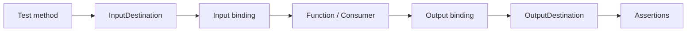

# Feeding Data with `InputDestination`

When testing a Spring Cloud Stream application, we often need to inject a message into an input binding to verify that a function or consumer processes it properly. `InputDestination` is the Test Binder API for sending messages into an in-memory binding without running Kafka, RabbitMQ, or Pulsar for that test.

`InputDestination` is suitable for testing the path from an input binding through message conversion and the function to the output or side effects. For functions with outputs, pair it with `OutputDestination` to receive the emitted messages. For consumers without outputs, send data with `InputDestination` and then verify the collaborator or state updated by the consumer.

## 1. Test Binder and InputDestination

The Spring Cloud Stream Test Binder provides a binder that runs inside the test process. The binder creates in-memory input/output channels and connects them to the functions discovered by Spring Cloud Function. A test can send a message into an input channel and then read the message emitted to an output channel.



Key components:

| Component | Role |
|---|---|
| `spring-cloud-stream-test-binder` | Dependency providing the Test Binder and test utilities |
| `TestChannelBinderConfiguration` | Configures the Test Binder for the Spring test context |
| `InputDestination` | Sends `Message<?>` into an input binding |
| `OutputDestination` | Receives messages from an output binding |
| `Message<?>` | Carries payload and headers across bindings |

The Test Binder helps verify integration logic against Spring Cloud Stream abstractions. It does not fully emulate a real broker: there are no real Kafka partition assignments/offsets, RabbitMQ exchange/queue semantics, or Pulsar subscriptions/acknowledgements.

## 2. Adding the Test Dependency

Add the `spring-cloud-stream-test-binder` artifact with `test` scope. If the project uses the Spring Cloud BOM, let the BOM manage the version instead of setting an explicit version:

```xml
<dependency>
    <groupId>org.springframework.cloud</groupId>
    <artifactId>spring-cloud-stream-test-binder</artifactId>
    <scope>test</scope>
</dependency>
```

With Gradle:

```groovy
dependencies {
    testImplementation 'org.springframework.cloud:spring-cloud-stream-test-binder'
}
```

This dependency is only needed on the test classpath. The production application continues using the real binder matching the deployed middleware. Verify that Spring Boot, the Spring Cloud release train, and Spring Cloud Stream versions are compatible according to your project's BOM.

## 3. Configuring the Test Binder in the Spring Test Context

A common approach is to use `@SpringBootTest` and import `TestChannelBinderConfiguration`:

```java
import org.springframework.boot.test.context.SpringBootTest;
import org.springframework.cloud.stream.binder.test.TestChannelBinderConfiguration;
import org.springframework.context.annotation.Import;

@SpringBootTest
@Import(TestChannelBinderConfiguration.class)
class UppercaseFunctionTest {
}
```

This import brings the Test Binder into the context so Spring Cloud Stream creates in-memory bindings. If the application has multiple binder implementations on the classpath, check the test context's binder selection to ensure bindings use the Test Binder rather than trying to connect to a real broker. You can isolate test configuration or specify the test binder as supported by your version.

In the test, inject both destinations:

```java
import org.springframework.beans.factory.annotation.Autowired;
import org.springframework.cloud.stream.binder.test.InputDestination;
import org.springframework.cloud.stream.binder.test.OutputDestination;

@Autowired
InputDestination input;

@Autowired
OutputDestination output;
```

`InputDestination` and `OutputDestination` are test utilities. Do not inject them into business services or production components.

## 4. Identifying the Right Input Binding Name

With the functional model, default binding names are generated from the function name and data direction:

| Function | Binding | Role |
|---|---|---|
| `uppercase` | `uppercase-in-0` | First input of the function |
| `uppercase` | `uppercase-out-0` | First output of the function |
| `enrichOrder` | `enrichOrder-in-0` | First input |
| `enrichOrder` | `enrichOrder-out-0` | First output |
| `auditOrder` | `auditOrder-in-0` | Input of the consumer |

Example configuration:

```yaml
spring:
  cloud:
    function:
      definition: uppercase
    stream:
      bindings:
        uppercase-in-0:
          destination: raw-orders
          content-type: text/plain
        uppercase-out-0:
          destination: normalized-orders
          content-type: text/plain
```

In the call `input.send(message, "uppercase-in-0")`, the second string is the input binding name managed by the Test Binder. `raw-orders` is the broker destination configured for the binding; these two names can differ. Do not pass a Kafka topic name, RabbitMQ exchange, or Pulsar topic instead of the binding name unless the application configured aliases making them identical.

If the application uses `spring.cloud.stream.function.bindings` to rename default bindings to custom aliases, the test must send to the actual alias used by the binder. When unsure, inspect the binding configuration of that function in the test context.

## 5. Complete Example: Sending a Message into a Function

Suppose the application has a function that converts strings to uppercase:

```java
import java.util.Locale;
import java.util.function.Function;
import org.springframework.context.annotation.Bean;
import org.springframework.context.annotation.Configuration;

@Configuration
class TextFunctions {

    @Bean
    Function<String, String> uppercase() {
        return value -> value.toUpperCase(Locale.ROOT);
    }
}
```

The test sends a message to `uppercase-in-0`, then receives the result from `uppercase-out-0`:

```java
import static org.junit.jupiter.api.Assertions.assertEquals;
import static org.junit.jupiter.api.Assertions.assertNotNull;

import java.nio.charset.StandardCharsets;

import org.junit.jupiter.api.Test;
import org.springframework.beans.factory.annotation.Autowired;
import org.springframework.boot.test.context.SpringBootTest;
import org.springframework.cloud.stream.binder.test.InputDestination;
import org.springframework.cloud.stream.binder.test.OutputDestination;
import org.springframework.cloud.stream.binder.test.TestChannelBinderConfiguration;
import org.springframework.context.annotation.Import;
import org.springframework.messaging.Message;
import org.springframework.messaging.support.GenericMessage;

@SpringBootTest(properties = {
        "spring.cloud.function.definition=uppercase",
        "spring.cloud.stream.bindings.uppercase-in-0.destination=raw-text",
        "spring.cloud.stream.bindings.uppercase-out-0.destination=upper-text",
        "spring.cloud.stream.bindings.uppercase-in-0.content-type=text/plain",
        "spring.cloud.stream.bindings.uppercase-out-0.content-type=text/plain"
})
@Import(TestChannelBinderConfiguration.class)
class UppercaseFunctionTest {

    @Autowired
    InputDestination input;

    @Autowired
    OutputDestination output;

    @Test
    void convertsInputToUppercase() {
        input.send(new GenericMessage<>("hello stream"), "uppercase-in-0");

        Message<byte[]> result = output.receive(2_000, "uppercase-out-0");

        assertNotNull(result, "Function should publish an output message");
        assertEquals("HELLO STREAM",
                new String(result.getPayload(), StandardCharsets.UTF_8));
    }
}
```

In this example:

1. `spring.cloud.function.definition` selects the function to run.
2. `uppercase-in-0` and `uppercase-out-0` are the binding names.
3. `InputDestination.send(...)` sends the payload into the input binding.
4. The function processes the message through the Test Binder.
5. `OutputDestination.receive(...)` waits up to 2 seconds to receive the output message.
6. The test checks that the message exists and has the right payload.

Output is read as `Message<byte[]>` in the example because content passes through message conversion. If a test uses a different content type or converter, the payload type may differ; inspect headers and deserialize appropriately instead of casting arbitrarily.

## 6. Sending a Message with Headers

In event-driven systems, headers commonly carry correlation IDs, event types, tenants, trace context, or routing metadata. `InputDestination` accepts `Message<?>`, so both payloads and headers can be tested.

```java
import org.springframework.messaging.Message;
import org.springframework.messaging.support.MessageBuilder;

Message<OrderCreated> message = MessageBuilder
        .withPayload(new OrderCreated("order-104", "customer-9", 250_000))
        .setHeader("correlationId", "corr-test-104")
        .setHeader("eventType", "OrderCreated")
        .build();

input.send(message, "validateOrder-in-0");
```

If the function accepts `Message<OrderCreated>`, it can inspect headers in its logic:

```java
@Bean
Function<Message<OrderCreated>, Message<OrderValidated>> validateOrder() {
    return message -> MessageBuilder
            .withPayload(validate(message.getPayload()))
            .setHeader("correlationId", message.getHeaders().get("correlationId"))
            .build();
}
```

Headers can be preserved, filtered, or transformed depending on the message converter and binder. Tests should verify that headers belonging to the application contract are actually preserved. Do not assume every binder-internal header will appear identically between the Test Binder and Kafka/RabbitMQ/Pulsar Binders.

## 7. Sending Typed Payloads

For DTOs or records, you can send the object directly as the payload:

```java
OrderCreated event = new OrderCreated(
        "order-104",
        "customer-9",
        250_000);

input.send(new GenericMessage<>(event), "validateOrder-in-0");
```

If the binding declares `content-type: application/json`, Spring Cloud Stream can apply appropriate message conversion. In tests, ensure the DTO class structure is compatible with the converter and function signature. For tests focused on function logic, sending a deserialized object may suffice; for conversion tests, send the payload in wire format (e.g., JSON bytes/String) and check the post-conversion result.

For example, JSON conversion tests should distinguish two goals:

- **Testing the function:** send an `OrderCreated` object, focusing on business logic.
- **Testing conversion:** send a JSON payload per content type, verifying the framework converts it into the expected input type.

Do not use direct object tests to conclude that schema registry, Avro/Protobuf Serdes, or real broker serializers work properly. Those layers require separate integration tests.

## 8. Feeding Data into a Consumer Without Output

A Consumer receives messages without returning an output binding. Still use `InputDestination` to trigger the consumer; then verify side effects such as service calls, state writes, or saved records.

```java
@Bean
Consumer<OrderCreated> auditOrder(OrderAuditService auditService) {
    return auditService::record;
}
```

The test can send an event to `auditOrder-in-0` and verify that `OrderAuditService` recorded the right event. Example using Mockito:

Assume `auditService` is a Mockito mock registered in the Spring test context, and `input` is `InputDestination` injected as before.

```java
@Test
void sendsOrderToAuditService() {
    OrderCreated event = new OrderCreated("order-104", "customer-9", 250_000);

    input.send(new GenericMessage<>(event), "auditOrder-in-0");

    verify(auditService, timeout(2_000)).record(event);
}
```

`timeout` is useful when messages are processed asynchronously over channels. If the application uses transactions or background processing, tests should wait for a specific business condition rather than using a fixed `Thread.sleep`. Use test doubles for external services so tests do not call real APIs or write data outside the test scope.

## 9. Multiple Input Bindings

A Function can have multiple inputs, such as an order stream and a customer profile stream. Each input has its own binding with an index suffix:

```yaml
spring:
  cloud:
    function:
      definition: enrichOrder
    stream:
      bindings:
        enrichOrder-in-0:
          destination: orders.created
        enrichOrder-in-1:
          destination: customers.profile
        enrichOrder-out-0:
          destination: orders.enriched
```

Tests send data to each binding by its corresponding name:

```java
input.send(new GenericMessage<>(order), "enrichOrder-in-0");
input.send(new GenericMessage<>(customer), "enrichOrder-in-1");
```

Sending to two inputs involves two separate operations. If the function combines asynchronous streams, tests must account for arrival timing of each input, join keys, buffering, and timeouts. Do not assume sending the first input synchronously waits for the second input or that the result always appears immediately after the second call.

For multi-input functions, verify the exact function signature and binding indices. If you change parameter order or the function definition, binding names may also change and tests must be updated to match the new configuration.

## 10. Sending Multiple Messages to the Same Input

You can call `send` multiple times to simulate a sequence of events:

```java
input.send(new GenericMessage<>("first"), "uppercase-in-0");
input.send(new GenericMessage<>("second"), "uppercase-in-0");
input.send(new GenericMessage<>("third"), "uppercase-in-0");

Message<byte[]> first = output.receive(2_000, "uppercase-out-0");
Message<byte[]> second = output.receive(2_000, "uppercase-out-0");
Message<byte[]> third = output.receive(2_000, "uppercase-out-0");
```

Each `receive` retrieves one message from the output destination. If ordering is part of the contract, verify ordering under conditions guaranteed by the Test Binder and add integration tests for partition/key-based ordering on a real broker. The Test Binder does not emulate Kafka partition assignment or RabbitMQ competing consumers.

When a test has multiple output bindings, pass the exact output binding name to `receive(timeout, bindingName)` to avoid accidentally reading results from another function.

## 11. Checking Output and Timeouts

`OutputDestination.receive(timeout, bindingName)` waits up to the specified duration to receive a message. If the timeout expires without a message, the result is `null`. Therefore, tests should assert that the message exists before reading the payload.

```java
Message<byte[]> result = output.receive(2_000, "uppercase-out-0");

assertNotNull(result);
assertEquals("HELLO", new String(result.getPayload(), StandardCharsets.UTF_8));
```

A few notes:

- Choose a timeout sufficient for the test context and asynchronous processing; avoid setting it too short, which causes flaky tests.
- Do not use overly long timeouts that mask broken functions or missing bindings.
- If `null` is returned, check the function definition, binding name, exception logs, and content type.
- If the output is bytes, deserialize it according to the converter/schema used by the binding.
- If the function emits multiple messages, receive the full expected count and inspect each message.

## 12. Testing a Supplier Differs from InputDestination

`Supplier<T>` is a data producer without an input binding for tests to send into. Therefore, `InputDestination` is not the tool to trigger a supplier. For suppliers, test output with `OutputDestination`, while configuring a poller or trigger mechanism appropriate to the application.

Example:

```java
@Bean
Supplier<String> heartbeat() {
    return () -> "alive";
}
```

Tests must ensure the supplier is polled as configured and read messages from the corresponding output binding. If you only want to test supplier logic, invoke the bean directly in a unit test; if you want to test binding/polling, use the Test Binder and Spring context. Do not send data into `InputDestination` for a supplier because a supplier has no input binding.

## 13. Distinguishing the Test Binder from Real Broker Testing

The Test Binder checks message flows through Spring Cloud Stream abstractions. It does not replace integration tests for broker-specific behavior.

| Aspect to Verify | Test Binder | Real Broker / Integration Test |
|---|---|---|
| Function receives expected payload | Suitable | Can verify additionally |
| Function and binding name mapping | Suitable | Suitable |
| Basic message conversion | Suitable per configured converter | Additionally verifies actual serializer/deserializer |
| Business headers in messages | Suitable | Verifies broker-specific header mapping |
| Kafka partitions, offsets, and consumer group rebalancing | Does not emulate fully | Requires Kafka |
| Kafka transactions and exactly-once | Does not verify broker semantics | Requires Kafka |
| Rabbit exchanges, queues, routing, and acknowledgements | Does not emulate fully | Requires RabbitMQ |
| Pulsar subscriptions, ack timeouts, and redelivery | Does not emulate fully | Requires Pulsar |
| ACLs, TLS, authentication, and networking | Does not verify | Requires matching broker environment |
| Broker retry/DLQ and provisioning | Only checks application logic where applicable | Requires real broker and binder |

A balanced testing strategy uses the Test Binder for many fast function/binding tests, plus focused integration tests to verify partitions, acks, retries, DLQs, transactions, authentication, and topology on a real broker.

## 14. Common Errors When Using InputDestination

| Symptom | Possible Cause | Resolution |
|---|---|---|
| `InputDestination` is not injected | Missing test-binder dependency or Test Binder configuration not imported | Check test classpath and `TestChannelBinderConfiguration` |
| Message sent but function does not run | Function not selected or wrong binding name | Check `spring.cloud.function.definition` and `<function>-in-0` name |
| Test attempts to connect to Kafka/RabbitMQ/Pulsar | Test context selected a production binder | Configure Test Binder explicitly and check binder selection |
| `OutputDestination.receive` returns `null` | Function threw an error, no output produced, wrong output binding, or timeout too short | Inspect logs, check signature/function definition, and increase timeout reasonably |
| Received payload is `byte[]` | Message converter/binding content type serialized payload | Deserialize per content type or use matching assertions |
| DTO fails to convert | Content type, converter, or payload structure mismatch | Check JSON/schema and write dedicated conversion tests |
| Missing headers | Header not passed, converter/binder filtered header, or wrong header name read | Use `MessageBuilder` and check headers at function input/output |
| Consumer test finishes before side effect | Asynchronous processing has not completed | Wait on condition using Awaitility/Mockito timeout instead of fixed sleep |
| Multiple tests read the wrong output | Used default output destination or shared unclear context/bindings | Pass explicit output binding name to `receive` |
| Tests pass but production broker fails | Test Binder does not emulate topology, security, and delivery semantics | Add integration tests against a real broker |

## 15. Workflow for Writing a Test Using InputDestination

1. Identify the function/consumer to test and the function bean name.
2. Identify the input binding name, usually of the form `<function>-in-0`.
3. Add the Test Binder dependency in `test` scope.
4. Import `TestChannelBinderConfiguration` into the test context.
5. Select the function with `spring.cloud.function.definition` and configure necessary bindings.
6. Inject `InputDestination`.
7. Create a payload or `Message<?>` with appropriate headers.
8. Call `input.send(message, inputBindingName)`.
9. For functions with outputs, receive with `OutputDestination`; for consumers, verify side effects.
10. Assert payloads, headers, message counts, and timeouts.
11. Use separate integration tests for broker-specific behavior.

## 16. Pre-Commit Test Checklist

- [ ] `spring-cloud-stream-test-binder` dependency is present in `test` scope.
- [ ] Test context imports `TestChannelBinderConfiguration`.
- [ ] Right function is selected via `spring.cloud.function.definition`.
- [ ] Name passed to `InputDestination.send` is the actual input binding name.
- [ ] Binding name is distinguished from broker destination.
- [ ] Payload has matching data type and content type.
- [ ] Important headers are explicitly constructed and verified.
- [ ] Function output is read via the right output binding with a finite timeout.
- [ ] Consumer side effects are awaited and verified against concrete conditions.
- [ ] Suppliers are not tested by sending into InputDestination.
- [ ] Multi-input tests send to each binding index properly.
- [ ] Integration tests exist for broker semantics that the Test Binder does not emulate.

`InputDestination` is a convenient entry point for feeding messages into input bindings when testing Spring Cloud Stream with the Test Binder. Send messages to the exact binding name, inspect payloads/headers in the function, and use `OutputDestination` or side-effect assertions to verify outcomes. This tool enables fast testing of function/consumer flows inside a Spring context; characteristics like partitions, offsets, acknowledgements, retries, DLQs, transactions, routing, and security still require integration tests against real Kafka, RabbitMQ, or Pulsar.

## References

- [Spring Cloud Stream — Testing](https://docs.spring.io/spring-cloud-stream/reference/spring-cloud-stream/testing.html)
- [Spring Cloud Stream — Test Binder](https://docs.spring.io/spring-cloud-stream/reference/spring-cloud-stream/spring_integration_test_binder.html)
- [Spring Cloud Stream — Functional Binding Names](https://docs.spring.io/spring-cloud-stream/reference/spring-cloud-stream/functional-binding-names.html)
