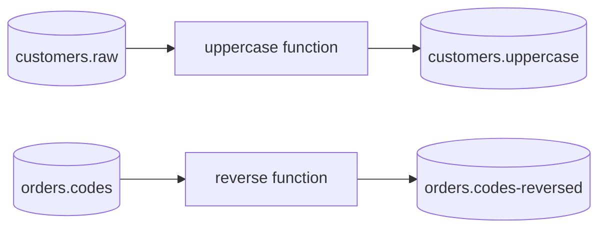

# Specifying Destinations When Testing Multiple Functions or Bindings

## 1. Why Must Destinations Be Specified in Tests?

The Spring Cloud Stream test binder allows testing functions without starting real Kafka, RabbitMQ, or Pulsar brokers. The test binder creates in-memory message channels and provides two objects for tests to send and receive data:

- `InputDestination`: sends messages to the application's input bindings.
- `OutputDestination`: receives messages from the application's output bindings.

For an application with only one input and one output, the default overloads are usually sufficient:

```java
input.send(new GenericMessage<>("hello"));
Message<byte[]> result = output.receive(1_000);
```

When an application has multiple functions, multiple inputs, or multiple outputs, the test needs to specify which destination a message belongs to. Otherwise, the test binder may use the first or default destination by registration order; tests can easily send to the wrong function or read the wrong output.

Overloads accepting a destination parameter let the test pick the exact channel:

```java
input.send(message, "orders.raw");
Message<byte[]> result = output.receive(1_000, "orders.accepted");
```

The name passed in is the destination name managed by the test binder. If the binding explicitly declares `destination`, use that destination value. If not declared, the default destination is typically derived from the binding name, such as `processOrder-in-0` or `processOrder-out-0`.

## 2. Distinguishing Function Name, Binding Name, and Destination

These three names are related but not synonymous:

| Name | Role | Example |
|---|---|---|
| Function bean name | Name of the activated function bean | `acceptOrder` |
| Binding name | Input/output name generated from the function | `acceptOrder-in-0`, `acceptOrder-out-0` |
| Destination | Logical name to which the binding connects | `orders.raw`, `orders.accepted` |

For a function `acceptOrder` with one input and one output, the default binding names are:

- `acceptOrder-in-0`
- `acceptOrder-out-0`

If configured as:

```yaml
spring:
  cloud:
    function:
      definition: acceptOrder
    stream:
      bindings:
        acceptOrder-in-0:
          destination: orders.raw
        acceptOrder-out-0:
          destination: orders.accepted
```

then the test binder receives messages at destination `orders.raw` and emits messages at `orders.accepted`. In the test, pass the configured destinations to `InputDestination.send` and `OutputDestination.receive`.

If `destination` is omitted, Spring Cloud Stream uses the binding name as the default destination. In that case, the test can use `acceptOrder-in-0` and `acceptOrder-out-0`.

## 3. Declaring Multiple Independent Functions

Suppose an application has two independent functions: one normalizes customer names, and the other transforms order codes. Declare both beans:

```java
import java.util.function.Function;
import org.springframework.context.annotation.Bean;
import org.springframework.context.annotation.Configuration;

@Configuration
class TextFunctions {

    @Bean
    Function<String, String> uppercase() {
        return value -> value.toUpperCase();
    }

    @Bean
    Function<String, String> reverse() {
        return value -> new StringBuilder(value).reverse().toString();
    }
}
```

Activate both functions using a semicolon in `spring.cloud.function.definition`:

```yaml
spring:
  cloud:
    function:
      definition: uppercase;reverse
    stream:
      bindings:
        uppercase-in-0:
          destination: customers.raw
          content-type: text/plain
        uppercase-out-0:
          destination: customers.uppercase
          content-type: text/plain
        reverse-in-0:
          destination: orders.codes
          content-type: text/plain
        reverse-out-0:
          destination: orders.codes-reversed
          content-type: text/plain
```

Each function has its own input and output. `uppercase` does not receive messages meant for `reverse` just because both are activated in the same application context.



The semicolon means activating multiple independent functions. The `|` symbol is used for composition, meaning the output of the first function becomes the input of the next function. Do not confuse `uppercase;reverse` with `uppercase|reverse`.

## 4. Testing the Exact Output of Each Function

The test below sends messages to each destination and reads the matching output:

```java
import static org.assertj.core.api.Assertions.assertThat;

import java.nio.charset.StandardCharsets;

import org.junit.jupiter.api.Test;
import org.springframework.beans.factory.annotation.Autowired;
import org.springframework.boot.test.context.SpringBootTest;
import org.springframework.cloud.stream.binder.test.InputDestination;
import org.springframework.cloud.stream.binder.test.OutputDestination;
import org.springframework.cloud.stream.binder.test.TestChannelBinderConfiguration;
import org.springframework.context.annotation.Import;
import org.springframework.messaging.Message;
import org.springframework.messaging.support.GenericMessage;

@SpringBootTest(properties = {
    "spring.cloud.function.definition=uppercase;reverse",
    "spring.cloud.stream.bindings.uppercase-in-0.destination=customers.raw",
    "spring.cloud.stream.bindings.uppercase-out-0.destination=customers.uppercase",
    "spring.cloud.stream.bindings.reverse-in-0.destination=orders.codes",
    "spring.cloud.stream.bindings.reverse-out-0.destination=orders.codes-reversed"
})
@Import(TestChannelBinderConfiguration.class)
class MultipleFunctionsTests {

    @Autowired
    InputDestination input;

    @Autowired
    OutputDestination output;

    @Test
    void routesMessagesToTheSelectedFunction() {
        input.send(new GenericMessage<>("alice"), "customers.raw");
        input.send(new GenericMessage<>("ORD-123"), "orders.codes");

        Message<byte[]> uppercaseResult =
            output.receive(1_000, "customers.uppercase");
        Message<byte[]> reverseResult =
            output.receive(1_000, "orders.codes-reversed");

        assertThat(uppercaseResult).isNotNull();
        assertThat(new String(uppercaseResult.getPayload(), StandardCharsets.UTF_8))
            .isEqualTo("ALICE");

        assertThat(reverseResult).isNotNull();
        assertThat(new String(reverseResult.getPayload(), StandardCharsets.UTF_8))
            .isEqualTo("321-DRO");
    }
}
```

The key point is that both sends specify the input destination and both receives specify the output destination. The test does not depend on the order in which bindings are registered in the application context.

## 5. When Explicit Destinations Are Not Configured

If `destination` is not declared, the binding name becomes the default destination. Example:

```yaml
spring:
  cloud:
    function:
      definition: uppercase;reverse
```

The default names can be used in tests:

```java
input.send(new GenericMessage<>("alice"), "uppercase-in-0");
Message<byte[]> result = output.receive(1_000, "uppercase-out-0");
```

For the `reverse` function, use `reverse-in-0` and `reverse-out-0`. This works well for small tests, but when configuring many bindings, setting domain-specific destinations usually makes tests easier to read and less coupled to function naming conventions.

## 6. Multiple Input Bindings on the Same Function

A function can have multiple input bindings, such as processing orders alongside customer profiles. With the functional model, a reactive function can accept two `Flux` inputs:

```java
import java.util.function.BiFunction;
import reactor.core.publisher.Flux;
import org.springframework.context.annotation.Bean;
import org.springframework.context.annotation.Configuration;

record OrderEvent(String orderId, String customerId) {}
record CustomerProfile(String customerId, String tier) {}
record OrderLabel(String orderId, String customerTier) {}

@Configuration
class OrderEnrichmentFunctions {

    @Bean
    BiFunction<Flux<OrderEvent>, Flux<CustomerProfile>, Flux<OrderLabel>>
    enrichOrder() {
        return (orders, customers) -> orders.zipWith(
            customers,
            (order, customer) -> new OrderLabel(
                order.orderId(), customer.tier()
            )
        );
    }
}
```

Declare destinations for each input:

```yaml
spring:
  cloud:
    function:
      definition: enrichOrder
    stream:
      bindings:
        enrichOrder-in-0:
          destination: orders.events
        enrichOrder-in-1:
          destination: customers.profiles
        enrichOrder-out-0:
          destination: orders.enriched
```

In the test, send data to each corresponding destination:

```java
input.send(orderMessage, "orders.events");
input.send(customerMessage, "customers.profiles");
Message<byte[]> result = output.receive(1_000, "orders.enriched");
```

Do not call `input.send(message)` twice in a multi-input test and assume the binder knows which input each message belongs to. Specifying the destination ensures the test selects the right binding.

Note: `zipWith` pairs elements by emission order, not by joining on `customerId` or timestamp. The example above only illustrates multi-input routing. If the business logic requires joining by key or time window, use the Kafka Streams DSL or an appropriate correlation/state mechanism.

## 7. Multiple Output Bindings on the Same Function

A reactive function can emit multiple outputs, such as splitting valid events from events requiring review. With `Tuple2`, Spring Cloud Function creates two output bindings in tuple order:

```java
import java.util.function.Function;
import reactor.core.publisher.Flux;
import reactor.util.function.Tuple2;
import reactor.util.function.Tuples;
import org.springframework.context.annotation.Bean;

record IncomingEvent(String id, boolean valid) {}

@Bean
Function<Flux<IncomingEvent>, Tuple2<Flux<IncomingEvent>, Flux<IncomingEvent>>>
splitEvents() {
    return events -> Tuples.of(
        events.filter(IncomingEvent::valid),
        events.filter(event -> !event.valid())
    );
}
```

Default bindings:

- `splitEvents-in-0`
- `splitEvents-out-0`
- `splitEvents-out-1`

Configure custom destinations:

```yaml
spring:
  cloud:
    function:
      definition: splitEvents
    stream:
      bindings:
        splitEvents-in-0:
          destination: events.raw
        splitEvents-out-0:
          destination: events.accepted
        splitEvents-out-1:
          destination: events.review
```

Tests must send to `events.raw` and read the two outputs separately:

```java
input.send(validEvent, "events.raw");
input.send(invalidEvent, "events.raw");

Message<byte[]> accepted = output.receive(1_000, "events.accepted");
Message<byte[]> review = output.receive(1_000, "events.review");
```

If you only call `output.receive(1_000)` multiple times, the test may read output from an unintended binding or depend on ordering. Specifying destinations verifies both routing and content.

## 8. Renaming Bindings with Aliases

Spring Cloud Stream allows renaming default binding names via `spring.cloud.stream.function.bindings`. Example:

```yaml
spring:
  cloud:
    function:
      definition: uppercase
    stream:
      function:
        bindings:
          uppercase-in-0: customerInput
          uppercase-out-0: customerOutput
      bindings:
        customerInput:
          destination: customers.raw
        customerOutput:
          destination: customers.uppercase
```

The aliases `customerInput` and `customerOutput` are alternative binding names used in configuration. The actual destinations remain `customers.raw` and `customers.uppercase`.

In the test binder, choose the effective configured destinations:

```java
input.send(new GenericMessage<>("alice"), "customers.raw");
Message<byte[]> result = output.receive(1_000, "customers.uppercase");
```

When debugging, verify all three layers: function bean name, aliased binding name, and destination. Confusing an alias with a destination is a common reason tests fail to locate the expected channel.

## 9. Distinguishing Independent Functions from Function Composition

Spring Cloud Function supports two ways to declare multiple functions:

| Syntax | Meaning | Bindings |
|---|---|---|
| `uppercase;reverse` | Activates two independent functions | Each function has its own inputs/outputs |
| `uppercase|reverse` | Pipes output of `uppercase` into input of `reverse` | One composed pipeline function |

For example, with `uppercase;reverse`, the test sends to two different input destinations and reads from two different output destinations.

With `uppercase|reverse`, the test sends one message to the pipeline's input and reads the final output. Do not send to the input of `reverse` as if it were still an independently bound function.

When testing composition, use the binding name generated by Spring Cloud Function for the composed function or configure explicit aliases and determine the corresponding destinations. Do not guess the composed binding name from the two component function names without checking the runtime configuration.

## 10. Isolating Tests by Destination to Avoid Leftover Messages

The test binder runs inside the test's application context. Messages sent to a destination can remain in the output channel until a test consumes them. If multiple tests share a context and the same destination, messages from an earlier test can cause a later test to read the wrong data.

Ways to keep tests independent:

1. Have each test send messages with distinct payloads/event IDs.
2. Consume all outputs produced by a test from the proper destination.
3. Avoid sharing a single destination across unrelated flows unless necessary.
4. Use separate contexts when tests require significantly different function/binding configurations.
5. Set finite receive timeouts so tests fail clearly when output does not appear.
6. Check for `null` messages before reading payloads.

Do not rely on test execution order or binding initialization order. JUnit may run tests in a different order, and Spring may reuse contexts across test classes.

## 11. Testing Headers and Content Types per Destination

When multiple bindings use different schemas or content types, tests need to send messages with matching headers and read from the right output destination. For example, a function might accept JSON on an order input while outputting text/plain for a monitoring system.

```java
import org.springframework.messaging.support.MessageBuilder;
import org.springframework.messaging.MessageHeaders;
import org.springframework.util.MimeTypeUtils;

input.send(
    MessageBuilder.withPayload("{\"orderId\":\"ORD-1\"}")
        .setHeader(MessageHeaders.CONTENT_TYPE, MimeTypeUtils.APPLICATION_JSON)
        .build(),
    "orders.raw"
);
```

When receiving output, the test can inspect headers:

```java
Message<byte[]> result = output.receive(1_000, "orders.accepted");
assertThat(result).isNotNull();
assertThat(result.getHeaders().get("contentType")).isNotNull();
```

The test binder helps verify routing and conversion inside the application context. It does not verify schema registries, serializers, or broker-side ACLs of real Kafka/Rabbit/Pulsar. Those require separate integration tests.

## 12. Using Timeouts When Receiving Output

`OutputDestination.receive(timeout, destinationName)` waits up to the specified duration to receive a message from the destination. Use a timeout long enough for the function to be invoked and output emitted in the test environment, without extending it unnecessarily.

Example:

```java
Message<byte[]> result = output.receive(2_000, "orders.accepted");
assertThat(result).isNotNull();
```

If the timeout returns `null`, check:

- Was the input sent to the right destination?
- Was the function activated in `spring.cloud.function.definition`?
- Do the binding name and destination mapping match?
- Did the function throw an exception or filter out the message?
- Is the output configured with the right destination?

Avoid using huge timeouts to mask tests sending to the wrong binding. A routing error should fail quickly with a clear message.

## 13. Testing Multiple Destinations with Helper Methods

When a test class exercises multiple functions, helper methods can centralize send/receive logic while still requiring explicit destinations:

```java
private void sendTo(String destination, Object payload) {
    input.send(new GenericMessage<>(payload), destination);
}

private Message<byte[]> receiveFrom(String destination) {
    Message<byte[]> message = output.receive(1_000, destination);
    assertThat(message)
        .as("Expected output from destination %s", destination)
        .isNotNull();
    return message;
}
```

Usage:

```java
sendTo("customers.raw", "alice");
Message<byte[]> result = receiveFrom("customers.uppercase");
assertThat(new String(result.getPayload(), StandardCharsets.UTF_8))
    .isEqualTo("ALICE");
```

Helpers should not infer destinations from the payload or binding order. Passing explicit target names lets the test express the routing contract clearly.

## 14. Verifying Multi-Function Configuration Before Running Tests

When a test fails to receive a message, check the configuration in order:

1. Was the function bean discovered by Spring?
2. Does `spring.cloud.function.definition` contain the right function?
3. Was `;` used for independent functions or `|` for composition intentionally?
4. Do binding names match the `<function>-in-<index>` and `<function>-out-<index>` pattern?
5. Are binding aliases declared?
6. What is the actual `destination`? If omitted, what is the default name?
7. Is `InputDestination.send` sending to the right destination?
8. Is `OutputDestination.receive` reading from the right destination?
9. Do content types and payloads match the function signature?
10. Does the function emit output or end in a filter that produces no record?

With multiple real binders, the test binder only verifies binding logic in the test environment. If production bindings target a specific Kafka cluster or Rabbit virtual host, verify binder routing and credentials with integration tests.

## 15. Distinguishing the Test Binder from Real-Broker Integration Tests

The test binder is suitable for fast testing of functions, message conversion, routing between bindings, and output contents. It does not run a real broker and does not fully emulate:

- Kafka partition assignment, consumer group rebalancing, ISR, or broker acknowledgements.
- Rabbit exchange/queue provisioning, virtual host permissions, prefetch, and redelivery.
- Pulsar subscription types, partition routing, broker acknowledgements, and redelivery.
- Network timeouts, TLS/SASL, ACLs, and broker failures.
- Message durability across process restarts.

A practical testing strategy typically has three layers:

| Layer | Goal | Tools |
|---|---|---|
| Unit test | Verify pure function logic | JUnit, Mockito, or equivalent test framework |
| Test binder | Verify bindings, destinations, message conversion, and in-app routing | `spring-cloud-stream-test-binder` |
| Integration test | Verify broker behavior, binder, security, and delivery semantics | Real Kafka/RabbitMQ/Pulsar or container environment |

Do not use test binder results to conclude that the production broker has provisioned the right topics/queues or consumer groups.

## 16. Test Binder Dependency and Configuration

Add the Spring Cloud Stream test binder in `test` scope per the dependency management of your Spring Cloud release train. Maven example:

```xml
<dependency>
    <groupId>org.springframework.cloud</groupId>
    <artifactId>spring-cloud-stream-test-binder</artifactId>
    <scope>test</scope>
</dependency>
```

Tests can import `TestChannelBinderConfiguration`:

```java
@SpringBootTest
@Import(TestChannelBinderConfiguration.class)
class BindingTests {
    // InputDestination and OutputDestination are injected here
}
```

Do not declare an explicit version if the project already uses a compatible Spring Cloud BOM. If a real binder dependency is also on the test classpath, confirm that the test binder is selected for the test context; do not let tests accidentally connect to a development broker.

## 17. Common Errors When Testing Multiple Bindings

| Symptom | Possible Cause | Resolution |
|---|---|---|
| Received output belongs to another function | Called `receive(timeout)` without specifying destination | Use `receive(timeout, destinationName)` |
| Function does not receive input | Sent to default destination instead of configured destination | Use the input binding's actual destination |
| No output found | Used binding name while binding mapped a custom destination | Check the effective `destination` and read that exact name |
| Tests depend on execution order | Shared destination with leftover messages | Drain all output, or isolate contexts/destinations |
| Only the first function works | Remaining functions not activated in definition | Declare independent functions separated by `;` |
| Function composition does not behave as expected | Used `;` instead of `|` or vice versa | Choose the right activation/composition semantics |
| Second input is not processed | Sent message without destination or wrong input index | Specify each input's destination |
| Payload has wrong type | Incompatible content type/Serde/conversion | Send headers and payload matching the schema |
| Output is `null` | Timeout, function filtered message, or processing error | Check logs, destinations, and function logic |

## 18. Workflow for Writing Tests with Multiple Functions or Bindings

1. List the function beans activated in the test context.
2. List all input/output bindings for each function.
3. Determine default binding names or configured aliases.
4. Record the actual destination of each binding.
5. Configure `spring.cloud.function.definition` with the right semantics.
6. Use `InputDestination.send(message, destinationName)` for each input.
7. Use `OutputDestination.receive(timeout, destinationName)` for each output.
8. Verify payloads, headers, and content types after receiving.
9. Drain leftover messages or isolate destinations/contexts so tests remain independent.
10. Add integration tests against a real broker for behaviors not emulated by the test binder.

When a Spring Cloud Stream application has multiple functions or multiple bindings, specifying destinations ensures tests send to the right inputs and read from the right outputs. Distinguish function bean names, binding names, and destinations; check destination mappings after aliases; and use the destination-named overloads of `InputDestination` and `OutputDestination`. This keeps tests independent of binding registration order, makes routing bugs easy to diagnose, and accurately reflects the application's message flow structure.

## References

- [Spring Cloud Stream — Testing](https://docs.spring.io/spring-cloud-stream/reference/spring-cloud-stream/spring_integration_test_binder.html)
- [Spring Cloud Stream — Functional Binding Names](https://docs.spring.io/spring-cloud-stream/reference/spring-cloud-stream/functional-binding-names.html)
- [Spring Cloud Function — Function Composition](https://docs.spring.io/spring-cloud-function/reference/spring-cloud-function/programming-model.html)
