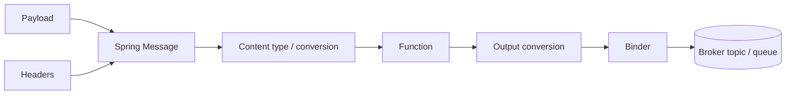

# Testing JSON, contentType, Headers, and Conversion Errors

## Objectives

Spring Cloud Stream receives and sends messages through bindings. Before a function processes a payload, the framework and binder must determine how the content is represented, convert bytes into Java types, process headers, and finally encode the result for sending. A flow may pass with objects in a unit test yet fail when receiving JSON bytes from a broker due to the wrong content type, missing headers, or incompatible serializers/converters.

This lesson establishes how to test message contracts at both the function and binding layers. The focus is on JSON payloads, the `content-type` property, the `contentType` header, custom headers, inbound/outbound conversion, and data errors. Examples use the Spring Cloud Stream functional model and test binder; when you need to verify header mapping or wire formats for Kafka, RabbitMQ, or Pulsar, add broker integration tests.

After this lesson, you will be able to:

- Distinguish JSON payloads, Java objects, and byte arrays along the message path.
- Understand how content type is resolved from message headers and binding configuration.
- Write tests verifying that JSON deserializes into the expected Java type.
- Verify JSON output and custom headers.
- Distinguish Spring Message headers from broker-native headers.
- Test mismatched content types, malformed JSON, and incompatible fields.
- Distinguish inbound conversion errors, in-function errors, and outbound conversion errors.
- Use the test binder for binding/function tests and a real broker for wire behavior tests.
- Avoid tests that rely solely on object-to-object calls while ignoring actual bytes and metadata.

## 1. A Message Consists of Payload and Headers

In Spring Messaging, a message has two main parts:

- **Payload:** the main data, such as `OrderCreated`, a JSON string, or a byte array.
- **Headers:** accompanying metadata, such as content type, correlation ID, tenant ID, or tracing information.

Example creating a message:

```java
Message<String> message = MessageBuilder
        .withPayload("{\"orderId\":\"O-100\",\"amount\":12500}")
        .setHeader("x-correlation-id", "corr-100")
        .setHeader(MessageHeaders.CONTENT_TYPE, MimeTypeUtils.APPLICATION_JSON)
        .build();
```

The payload in the example above is still a Java String containing JSON text. The `contentType` header indicates how to interpret the payload. If the payload is an `OrderCreated` object, it is not yet JSON bytes until encoded by a converter/serializer.

A message flow can be illustrated as follows:



When testing, verify both payload and headers. Comparing only payload objects can miss content type or header mapping bugs that occur when messages pass through the binder.

## 2. Distinguishing Binding `content-type` from Header `contentType`

Spring Cloud Stream allows declaring content type at the binding level:

```yaml
spring:
  cloud:
    function:
      definition: summarizeOrder
    stream:
      bindings:
        summarizeOrder-in-0:
          destination: orders.created
          content-type: application/json
        summarizeOrder-out-0:
          destination: orders.summary
          content-type: application/json
```

`content-type` is a binding configuration property. When the framework processes a message, the `contentType` header in a Spring Message can also carry content format information. Distinguish between:

| Component | Example | Role |
|---|---|---|
| Binding property | `content-type: application/json` | Default format configured for the binding |
| Spring Message header | `contentType = application/json` | Format attached directly to the message |
| HTTP Content-Type | `Content-Type: application/json` | HTTP request/response header; relevant only if an HTTP adapter is involved |
| Kafka/Rabbit/Pulsar metadata | Broker headers/properties | Metadata mapped by the binder per transport capabilities |

In Spring Cloud Stream's content type mechanism, the message `contentType` header can supply the format for a specific message; if absent, the framework uses the binding's content type and then the framework default. When testing, include a case where the binding specifies JSON and a case where the message carries an explicit content type to verify the active behavior.

Do not confuse an HTTP `Content-Type` header with a Spring Message sent directly to a binding. In the test binder, set `MessageHeaders.CONTENT_TYPE` or configure `content-type` on the binding.

## 3. How Are JSON Payloads Converted?

Suppose an input binding receives an event:

```java
public record OrderCreated(
        String eventId,
        String orderId,
        String customerId,
        long amountMinor
) {}
```

The function accepts a Java type:

```java
@Bean
Function<OrderCreated, OrderSummary> summarizeOrder() {
    return order -> new OrderSummary(
            order.eventId(),
            order.orderId(),
            order.amountMinor(),
            "RECEIVED"
    );
}

public record OrderSummary(
        String eventId,
        String orderId,
        long amountMinor,
        String status
) {}
```

Input on the broker is bytes:

```json
{
  "eventId": "evt-100",
  "orderId": "O-100",
  "customerId": "C-20",
  "amountMinor": 12500
}
```

With JSON content type and a matching converter, Spring Cloud Stream converts the JSON payload into `OrderCreated` before calling the function. The function should not parse JSON manually if the framework already recognizes the target type and performs conversion.

On the output side, the `OrderSummary` object is converted per the output binding's content type before the binder sends the message. Tests should verify the actual JSON bytes and re-parsed contents, not just that the function returned an object.

### Content Type Must Match the Wire Format

| Wire Payload | Suggested Content Type | Suitable Target Type |
|---|---|---|
| JSON object bytes | `application/json` | Corresponding POJO/record |
| UTF-8 text | `text/plain` | String |
| Binary bytes | `application/octet-stream` | byte[] |
| JSON but declared text/plain | Mismatch | May receive String instead of POJO |
| Avro/Protobuf bytes | Integration-specific content type/schema | Schema-aware deserializer/Serde |

Declaring `application/json` does not automatically fix a malformed payload. If a producer sends non-JSON bytes, the converter may throw an error. If a producer sends JSON yet the consumer expects an incompatible type, conversion can also fail.

## 4. What Can the Test Binder Verify?

Spring Cloud Stream provides the test binder to test applications without a real broker. The test binder exposes message send/receive points:

- `InputDestination`: sends messages to an input binding.
- `OutputDestination`: receives messages from an output binding.
- `@EnableTestBinder`: enables the test binder for the test context as supported by the version.

Maven dependency:

```xml
<dependency>
    <groupId>org.springframework.cloud</groupId>
    <artifactId>spring-cloud-stream-test-binder</artifactId>
    <scope>test</scope>
</dependency>
```

Let the Spring Cloud BOM manage a version compatible with the Spring Cloud Stream version in use.

The test binder is suitable for verifying:

- The function is bound to the right input/output bindings.
- JSON payloads are converted according to test context configuration.
- The function produces the expected output.
- Headers in in-memory messages pass through the function as expected.
- Logic/conversion errors occur within the application's processing path.

The test binder does not fully simulate a Kafka broker, RabbitMQ exchange/queue, Pulsar subscription, native serializers, header mappers, acknowledgements, partitioning, or network failures. Those behaviors require broker integration tests.

## 5. Testing JSON with InputDestination and OutputDestination

Example testing a function that receives JSON bytes and emits a JSON summary:

```java
@SpringBootTest
@EnableTestBinder
class OrderFlowTest {

    @Autowired
    InputDestination input;

    @Autowired
    OutputDestination output;

    @Autowired
    ObjectMapper objectMapper;

    @Test
    void convertsJsonInputAndOutput() throws Exception {
        byte[] json = """
                {
                  "eventId": "evt-100",
                  "orderId": "O-100",
                  "customerId": "C-20",
                  "amountMinor": 12500
                }
                """.getBytes(StandardCharsets.UTF_8);

        Message<byte[]> message = MessageBuilder
                .withPayload(json)
                .setHeader(
                        MessageHeaders.CONTENT_TYPE,
                        MimeTypeUtils.APPLICATION_JSON
                )
                .build();

        input.send(message, "summarizeOrder-in-0");

        Message<byte[]> result =
                output.receive(1_000, "summarizeOrder-out-0");

        assertThat(result).isNotNull();

        OrderSummary summary = objectMapper.readValue(
                result.getPayload(),
                OrderSummary.class
        );

        assertThat(summary.orderId()).isEqualTo("O-100");
        assertThat(summary.amountMinor()).isEqualTo(12500L);
        assertThat(summary.status()).isEqualTo("RECEIVED");
    }
}
```

The test sends JSON bytes to the exact binding. The content type header specifies that the payload is JSON. The test then receives output bytes and parses them with ObjectMapper to verify the wire representation.

A few notes:

- The binding name must match the actual function input/output name.
- If the test relies on content type configured on the binding, omit the content type header to test fallback behavior.
- If the output binder returns another payload type in a test setup, check the payload type before parsing; the goal is to verify the actual representation of the binding.
- Receive timeouts should be finite so tests fail clearly instead of hanging.
- Do not share a single OutputDestination across parallel tests if those tests compete to read the same binding.

## 6. Testing Binding `content-type` Fallback

You can write another test without attaching a content type header, configuring only the binding:

```yaml
spring:
  cloud:
    stream:
      bindings:
        summarizeOrder-in-0:
          destination: orders.created
          content-type: application/json
        summarizeOrder-out-0:
          destination: orders.summary
          content-type: application/json
```

In the test, send JSON payload bytes without setting `MessageHeaders.CONTENT_TYPE`:

```java
Message<byte[]> message = MessageBuilder
        .withPayload(jsonBytes)
        .setHeader("x-correlation-id", "corr-100")
        .build();

input.send(message, "summarizeOrder-in-0");
```

Expected outcome: the framework uses the content type configured on the binding to convert the payload into the function's input type. This is a useful test to verify that deployment configuration does not depend on producers attaching a Spring contentType header.

Also test the case where neither the binding has a content type nor the message has a header. In that case, the framework's default behavior applies; avoid making tests depend on defaults without documenting the version and configuration. For important JSON contracts, declaring content type explicitly is clearer and more stable.

## 7. Testing Custom Headers

Headers commonly carry metadata for tracing, correlation, tenant, schema version, or routing. Example:

```java
Message<OrderCreated> message = MessageBuilder
        .withPayload(event)
        .setHeader("x-correlation-id", "corr-100")
        .setHeader("x-tenant-id", "tenant-a")
        .setHeader("x-schema-version", "2")
        .build();
```

A function can accept a Spring Message to read and forward metadata intentionally:

```java
@Bean
Function<Message<OrderCreated>, Message<OrderSummary>> summarizeOrder() {
    return input -> {
        OrderCreated order = input.getPayload();

        OrderSummary summary = new OrderSummary(
                order.eventId(),
                order.orderId(),
                order.amountMinor(),
                "RECEIVED"
        );

        return MessageBuilder
                .withPayload(summary)
                .setHeader(
                        "x-correlation-id",
                        input.getHeaders().get("x-correlation-id")
                )
                .setHeader(
                        "x-tenant-id",
                        input.getHeaders().get("x-tenant-id")
                )
                .build();
    };
}
```

The function deliberately selects which headers to forward. Do not blindly copy all input headers to the output, as that can propagate internal metadata, stale information, or headers not permitted to leave the service.

Test:

```java
@Test
void preservesSelectedHeaders() throws Exception {
    Message<byte[]> inputMessage = MessageBuilder
            .withPayload(orderJson)
            .setHeader(
                    MessageHeaders.CONTENT_TYPE,
                    MimeTypeUtils.APPLICATION_JSON
            )
            .setHeader("x-correlation-id", "corr-100")
            .setHeader("x-tenant-id", "tenant-a")
            .build();

    input.send(inputMessage, "summarizeOrder-in-0");

    Message<byte[]> result =
            output.receive(1_000, "summarizeOrder-out-0");

    assertThat(result).isNotNull();
    assertThat(result.getHeaders().get("x-correlation-id"))
            .isEqualTo("corr-100");
    assertThat(result.getHeaders().get("x-tenant-id"))
            .isEqualTo("tenant-a");
}
```

The test binder typically preserves headers in internal messages. When running through a real binder, custom headers may be mapped, filtered, or type-converted by header mappers and transport configuration. Thus, this test verifies the application's message logic; only a broker integration test verifies that headers actually appear on the downstream consumer.

### The `contentType` Header and Custom Headers Have Different Roles

`contentType` governs how the payload is interpreted. Headers like `x-correlation-id` or `x-schema-version` are business/technical metadata defined by the application. Do not use custom headers as a replacement for content type, and do not assume custom headers automatically pass through a broker unless allowed by the binder.

## 8. Testing Missing or Mistyped Headers

A header can be absent, null, or carry an unexpected type. Example of a function requiring a correlation ID:

```java
String correlationId =
        (String) input.getHeaders().get("x-correlation-id");
if (correlationId == null || correlationId.isBlank()) {
    throw new IllegalArgumentException("Missing correlation ID");
}
```

Cases to test:

| Case | Expectation |
|---|---|
| Header has a valid String value | Function processes it |
| Header is missing | Validation/error path is triggered |
| Header is empty | Rejected if the contract requires non-empty |
| Header has an unexpected type | Do not cast blindly; fail in a controlled way |
| Header is not mapped by the binder | Integration test detects metadata loss |
| Unsupported schema version header | Reject or route to error handling per policy |

If a header is required to validate tenant or access permissions, validate it at the application boundary. Do not trust an arbitrary producer-supplied header for access decisions without verifying its source and binding it to security context.

## 9. Testing JSON Schemas and Data Compatibility

JSON can parse into an object yet still violate the contract. For example, a required field is missing, amount is a string instead of a number, or event type is invalid.

You should test:

- Missing required fields.
- Fields with the wrong data type.
- Null values in non-nullable fields.
- Extra fields unknown to the current schema.
- New enum values.
- Malformed timestamps or timezones.
- Out-of-range decimals/amounts.
- Empty or invalid event IDs.
- Empty JSON, empty payloads, or whitespace-only payloads.

Example testing payload parsing with Jackson:

```java
@Test
void rejectsInvalidJsonShape() {
    String invalid = """
            {
              "eventId": "evt-100",
              "orderId": "O-100",
              "customerId": "C-20",
              "amountMinor": "twelve-thousand"
            }
            """;

    assertThatThrownBy(() ->
            objectMapper.readValue(invalid, OrderCreated.class)
    ).isInstanceOf(JsonProcessingException.class);
}
```

This is a unit test for JSON mapping with ObjectMapper. It does not replace Spring Cloud Stream converter tests, but it helps separate contract/JSON bugs from binding or broker bugs.

### Unknown Fields and Compatibility

Jackson can be configured to ignore or reject unknown fields. This behavior affects forward compatibility:

- A consumer that ignores unknown fields can read events from a producer that adds new fields.
- A consumer that rejects unknown fields detects contract drift early but requires coordinated rollouts.
- A new required field can prevent older consumers from processing new events.
- Changing the type of an existing field is usually a breaking change.

Do not use ignore-unknown-fields settings to mask every schema change. Define a compatibility policy and test both new producer with old consumer and new consumer with old producer.

## 10. Testing Inbound Conversion Errors

Inbound conversion happens after the binder passes a message into the framework but before the function receives a typed payload. For instance, the input binding expects `OrderCreated`, but the incoming bytes are not valid JSON.

Common causes:

- Malformed JSON syntax.
- Non-UTF-8 payload or encoding mismatch with the contract.
- Content type declares JSON while bytes are binary or another text format.
- Valid JSON that cannot map to the target type.
- Incorrect or missing content type header.
- Producer serializer and consumer converter use different wire formats.

When inbound conversion fails, the function may never be invoked. This is an important distinction from business errors inside the function.

How to test:

1. Construct intentionally invalid message bytes.
2. Set the content type to match production configuration.
3. Send to the exact input binding.
4. Verify the function emits no business output.
5. Verify actual error handler/retry/DLQ behavior per binder.
6. Check that logs/metrics include binding, topic, message ID, and error type without exposing sensitive payloads.

The test binder can show that an error occurs in the application's processing path, but how exceptions route to error channels or retries can differ from a real binder. For Kafka/RabbitMQ/Pulsar, write integration tests to verify that messages are nacked, retried, rejected, or dead-lettered per your configuration.

## 11. Testing In-Function Errors

These are errors occurring after conversion succeeds and the function has received a Java object.

Example:

```java
@Bean
Consumer<OrderCreated> processOrder(OrderService service) {
    return event -> {
        if (event.amountMinor() <= 0) {
            throw new InvalidOrderException("Amount must be positive");
        }
        service.process(event);
    };
}
```

Test the function logic directly:

```java
@Test
void rejectsNonPositiveAmount() {
    OrderCreated invalid =
            new OrderCreated("evt-1", "O-1", "C-1", 0);

    assertThatThrownBy(() -> orderValidator.validate(invalid))
            .isInstanceOf(InvalidOrderException.class);
}
```

This unit test verifies business validation. It does not verify whether the binder retries or sends the message to a DLQ. Separating the two test types clarifies whether a failure lies in business logic or in transport/error handling.

Do not catch an exception and merely log it if the message was not processed successfully. If the function completes normally, the framework may consider the message successfully processed and acknowledge it. Let failures enter intentional error handling or return explicit business outcomes.

## 12. Testing Outbound Conversion Errors

Outbound conversion occurs after the function returns a result but before the binder sends the message. Possible errors include:

- The output object cannot be serialized by the selected converter.
- Output content type does not match the wire format.
- Jackson encounters circular references or unsupported types.
- A custom serializer throws an exception.
- A required header is missing or cannot be mapped.
- Schema registry is unreachable or schema is incompatible when using a schema-aware serializer.

For example, the output binding declares JSON, yet the function returns a type unsupported by the serializer. Tests must verify that the error surfaces before the message is marked as successfully published and that the error path does not corrupt business state.

With the test binder, you can verify outbound conversion for valid objects. For custom serializers or native binder serializers, write broker integration tests and inspect record bytes. Do not treat a function returning an object as proof that the message was published successfully.

## 13. Distinguishing the Three Error Groups

| Error Group | Timing | Did Function Run? | Examples | Primary Test Location |
|---|---|---|---|---|
| Inbound conversion | Before function | Usually no | Malformed JSON, mismatched content type | Converter/binding + binder integration |
| Function/business | Inside function | Yes | Validation, database exception | Unit tests and function tests |
| Outbound conversion/publish | After function | Yes | Serializer error, header mapping, broker send failure | Output conversion and broker integration |

This distinction ensures errors are routed properly. Malformed JSON should not be treated like a database error. A database timeout should not be quarantined like a schema error. A publish failure after a database commit needs replay capability, such as a transactional outbox.

## 14. Testing `contentType` Mismatches

Create a test matrix:

| Binding Content Type | Message `contentType` Header | Payload | What to Verify |
|---|---|---|---|
| JSON | None | JSON bytes | Binding content type is used |
| JSON | JSON | JSON bytes | Converted to the right type |
| JSON | Text/plain | Text | Message header may alter conversion; verify target type |
| Text/plain | JSON | JSON bytes | Verify effective content type and conversion result |
| Octet-stream | None | Binary bytes | Payload is handled as bytes |
| JSON | JSON | Binary bytes | Conversion error is routed properly |

Do not test only happy-path configurations. Mismatches are a common failure mode when producers and consumers deploy independently or when a producer sends messages from another language.

When testing mismatches, record the effective content type. If headers take precedence over binding properties in your version, the test should demonstrate that; if the framework/binder normalizes headers before the function receives them, inspect the actual message at the boundary.

## 15. Testing Headers Through a Real Binder

The test binder keeps messages in memory and does not reproduce all broker header rules. Kafka, RabbitMQ, and Pulsar have different metadata models:

- Kafka record headers are name/byte-value pairs.
- RabbitMQ has AMQP properties and a headers table with specific data types.
- Pulsar has its own message properties and metadata.
- Binders may filter or transform certain internal headers.
- Some framework headers are added or stripped at the binder boundary.

A broker integration test should:

1. Publish a message through the output binding.
2. Consume the message using a client/binder on the receiving side.
3. Inspect the actual payload bytes and headers.
4. Verify that correlation ID, tenant/schema version, and content type are preserved or mapped per contract.
5. Verify that disallowed headers do not appear.
6. Verify that binary/string headers have compatible types between producer and consumer.

Do not assume that a header preserved by the test binder will pass through every broker. If a header is a required part of the contract, include it in integration tests for every supported binder.

## 16. Testing Conversion Errors and Error Handling with a Broker

An integration test scenario with a broker:

- Create the input topic/queue/subscription.
- Start the application with the exact binder version and content type.
- Publish valid JSON; verify the expected output.
- Publish malformed JSON; verify the function emits no business output and the error path activates.
- Publish valid JSON with wrong field types; verify mapping error handling.
- Publish a valid event where the function throws a transient error; verify retries per policy.
- Publish an event causing a permanent error; verify DLQ if the binder/broker is configured.
- Inspect headers and message IDs in the output/error route.
- Restart the consumer and verify redelivery does not cause duplicate side effects.

Retry/DLQ outcomes depend on the binder and broker. Do not write a generic assertion assuming every conversion error automatically lands in a DLQ. Some binders route errors to an error channel, others require explicit retry/dead-letter configuration, and some producer-side serialization errors never reach a consumer DLQ.

## 17. Testing Required Headers and Schema Versions

If the message contract requires `x-schema-version`, tests should verify:

- The producer attaches the right version.
- The consumer receives the version.
- The consumer supports the current version.
- Unsupported versions are rejected in a controlled way.
- Error messages retain event ID and version for investigation.

Example validator:

```java
static void validateSchemaVersion(Message<?> message) {
    Object value = message.getHeaders().get("x-schema-version");
    if (!(value instanceof String version)
            || !Set.of("1", "2").contains(version)) {
        throw new UnsupportedSchemaVersionException(
                "Unsupported x-schema-version"
        );
    }
}
```

A version header is only useful if producers reliably attach it and consumers validate it. If schema version is business data that must be persisted long-term, consider putting the version inside the event envelope/payload contract instead of relying solely on transport headers that might be lost across bridges.

## 18. Testing with MessageBuilder and MessageHeaders

Spring provides MessageBuilder to construct messages in tests:

```java
Message<OrderCreated> message = MessageBuilder
        .withPayload(new OrderCreated(
                "evt-100", "O-100", "C-20", 12500L
        ))
        .setHeader("x-correlation-id", "corr-100")
        .setHeader("x-schema-version", "2")
        .setHeader(
                MessageHeaders.CONTENT_TYPE,
                MimeTypeUtils.APPLICATION_JSON
        )
        .build();
```

A few notes:

- Message headers are immutable metadata by abstraction; create a new message to modify headers.
- Use `MessageHeaders.CONTENT_TYPE` to avoid typos in header names.
- Use consistent data types for headers; do not send a String in one place and an arbitrary object in another.
- Do not use `id` or `timestamp` as custom business fields; Spring manages these system headers.
- Do not put large payloads into headers.
- Do not put credentials or secrets in headers, as metadata may appear in logs or broker tooling.

## 19. Testing Converters and Functions Separately

A clear testing strategy is organized into layers:

| Layer | What to Test | Tools |
|---|---|---|
| Contract/JSON | JSON parsing, required fields, types, schema versions | ObjectMapper or JSON schema validator |
| Function | Business transformations, validation | Unit tests |
| Message | Payload, contentType, custom headers | MessageBuilder and MessageHeaders |
| Binding | Input/output bindings, conversion in app context | Spring Cloud Stream test binder |
| Broker | Wire bytes, header mapping, retry/DLQ | Kafka/RabbitMQ/Pulsar integration tests |
| End-to-end | Independent producer and independent consumer compatibility | Test environment with a real broker |

There is no need to re-test the exact same thing at every layer. JSON contract unit tests are fast; test binder verifies functions/bindings; broker integration verifies transport-specific behavior. Pick the lowest layer that proves what needs testing and add higher layers for binder-dependent behavior.

## 20. Common Errors

| Symptom | Possible Cause | Resolution |
|---|---|---|
| Function receives String instead of POJO | Content type is text/plain or not resolved to JSON | Check binding content-type and message contentType header |
| JSON bytes fail conversion | Malformed payload/encoding or incompatible target type | Inspect bytes and schema |
| Function is not invoked | Inbound conversion failed before dispatch | Check error path and converter |
| Function runs yet output does not appear | Outbound conversion or publish failed | Check output content type, serializer, and broker send result |
| Custom header lost across broker | Binder header mapper did not map that header | Check binder-specific header mapping and integration tests |
| Test binder passes yet production fails | Test binder does not emulate broker/native serialization | Add broker integration tests |
| `contentType` header behaves unexpectedly | Binding config and message header differ | Determine effective content type at the boundary |
| Unknown JSON field causes error | ObjectMapper policy incompatible with newer producer | Finalize compatibility policy and test versions |
| Retry does not happen | Exception swallowed or binder policy differs from expected | Let errors reach error handling and check retry config |
| Conversion error does not go to DLQ | DLQ applies only to specific error paths or binder configs | Test each error type against a real broker |
| Header has unstable types | Producer sends object/binary types unsupported by mapper | Standardize header contracts to suitable Strings/bytes |
| Flaky tests due to stale output | Shared OutputDestination or undrained messages | Isolate bindings/test contexts and verify message IDs |

## 21. Pre-Release Testing Workflow

Before deploying a function binding that accepts JSON:

1. Finalize the JSON schema, required fields, and version.
2. Finalize input/output binding content types.
3. Clarify whether the producer sends the contentType header or binding config is responsible.
4. List custom headers and their data types.
5. Test valid JSON using InputDestination/OutputDestination.
6. Parse output bytes to verify the wire representation.
7. Test that headers are preserved/filtered properly at the function boundary.
8. Test missing headers, wrong header types, and unsupported schema versions.
9. Test malformed JSON and JSON with incompatible field types.
10. Distinguish inbound conversion errors, function exceptions, and outbound conversion errors.
11. Use broker integration tests to verify header mapping, serializers, retries, and DLQs.
12. Record the binder version and broker version in the test report.

A good test report specifies the binding name, effective content type, payload fixture, header fixture, binder version, and broker version. This makes conversion bugs reproducible when upgrading Spring Cloud Stream or changing producers.

## Conclusion

Message testing in Spring Cloud Stream must verify payloads, content types, and headers as a unified contract. The binding `content-type` property provides the configured format; the `contentType` header can carry a per-message format; custom headers hold metadata such as correlation IDs and schema versions. Converters use this information to transform JSON bytes into Java types and encode outputs.

Use the test binder with `InputDestination` and `OutputDestination` to test functions and bindings, use `MessageBuilder` to construct payloads and headers, and parse output bytes to verify JSON. Distinguish inbound conversion errors, in-function errors, and outbound conversion errors because they occur at different stages. Finally, use broker integration tests for real header mapping, wire formats, and retry/DLQ behavior; the test binder cannot replace guarantees dependent on Kafka, RabbitMQ, or Pulsar.
