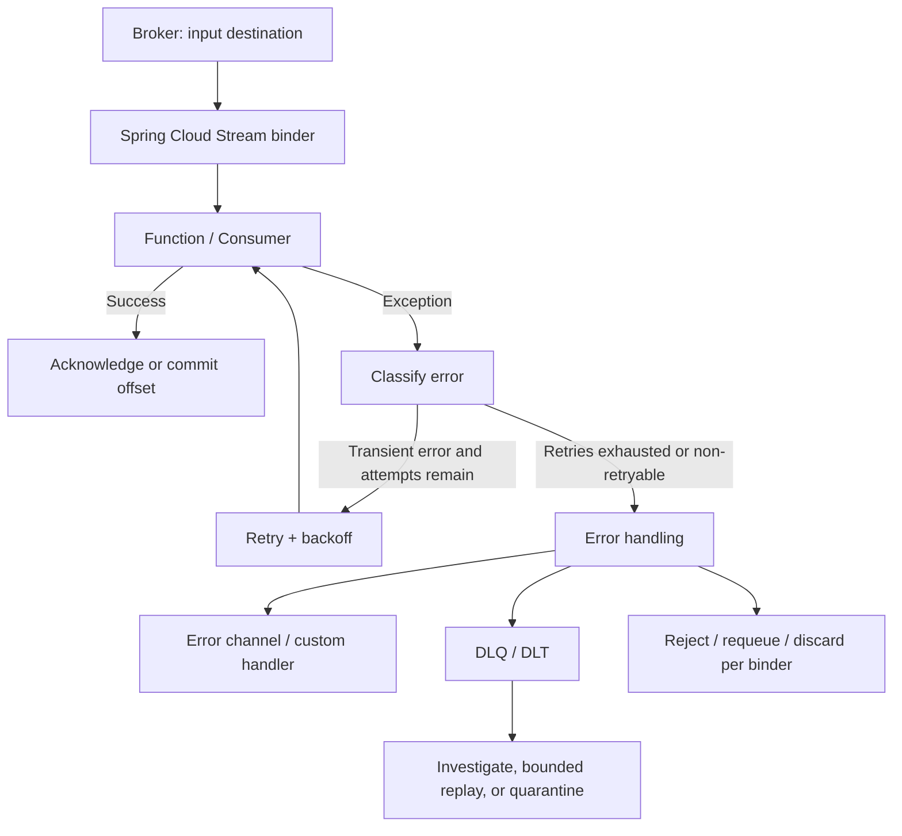
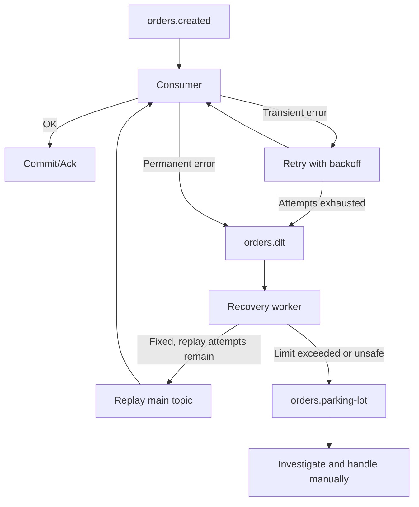

# Testing Retries, Error Handlers, and Dead-Letter Paths

In a Spring Cloud Stream application, a processing function can fail because an external service is temporarily unavailable, input data is invalid, schema conversion fails, or a programming error occurs. How the application reacts to each error type determines whether the message is retried, routed to an error channel, sent to a Dead Letter Queue/Dead Letter Topic (DLQ/DLT), or discarded.

Testing error paths must verify both business logic and the behavior of the binder and broker. A unit test can prove that a function throws the right exception; a test binder test can prove that bindings work and outputs are emitted; however, only integration tests against Kafka, RabbitMQ, or Pulsar verify broker-specific retries, acknowledgements, redelivery, and dead-letter routing.

## 1. End-to-End View of a Failing Message Path

For an imperative-style consumer, the basic flow is:

1. The binder receives a message from the broker and converts it into a Spring `Message` or Java payload.
2. Spring Cloud Function invokes the `Consumer` or the input stage of a `Function`.
3. If the function completes normally, the binder/container acknowledges the message per broker semantics.
4. If the function throws an exception, retry is applied if configured and supported by the binder.
5. Once retries are exhausted, the binder/container or application error handler decides where the message goes.
6. The message may be routed to a DLQ/DLT, an error channel, a retry topic, a parking-lot/quarantine topic, or discarded.



These steps represent a general model. Exact ordering and acknowledgement mechanics depend on the binder, consumer type, transaction mode, and listener container configuration.

## 2. Distinguishing Error Types

Not every exception should be retried. Before configuring retries, classify errors by whether they can resolve on their own:

| Error Category | Examples | Typical Suitable Action |
| --- | --- | --- |
| Transient errors | HTTP 503, payment gateway timeout, database connection reset | Retry with backoff and bounded attempt limit |
| Permanent data errors | Missing `orderId`, negative amount, malformed JSON | Do not retry repeatedly; route to DLQ for investigation or data repair |
| Compatibility errors | Consumer does not recognize new schema version, unsupported enum | Route to DLQ or quarantine; update code/schema then replay in a controlled way |
| Persistent config/infra errors | Wrong credentials, ACL denied, missing topic | Stop or alert per runbook; continuous retries usually just increase load and log noise |
| Programming errors | `NullPointerException`, violated invariant | Alert and retain the message for investigation; do not mask with infinite retries |

Retries are only useful if a subsequent attempt has a chance to succeed. For permanent data errors, repeated retries will never make the message valid.

## 3. Which Functions Do Spring Cloud Stream Retries Apply To?

Spring Cloud Stream supports `RetryTemplate`-based retries for imperative message handlers, such as:

```java
@Bean
public Consumer<OrderCreated> processOrder(OrderService orderService) {
    return event -> orderService.process(event);
}
```

If `orderService.process` throws an exception, the exception propagates back to the binder/container to apply error handling.

Common retry properties are configured under the consumer binding:

```yaml
spring:
  cloud:
    stream:
      bindings:
        processOrder-in-0:
          destination: orders.created
          group: order-service
          consumer:
            maxAttempts: 4
            backOffInitialInterval: 500
            backOffMaxInterval: 5000
            backOffMultiplier: 2.0
```

Meaning:

- `maxAttempts`: total handler invocations, including the initial attempt. `4` means at most one initial attempt and three retries.
- `backOffInitialInterval`: wait time before the first retry, in milliseconds.
- `backOffMultiplier`: multiplier applied to the wait interval after each failure.
- `backOffMaxInterval`: upper cap on the wait interval.

In the example above, expected wait intervals are 500 ms, 1,000 ms, and 2,000 ms; total retry wait time is 3.5 seconds, excluding handler execution time. If the multiplier pushes an interval past 5,000 ms, the value is capped at that maximum.

Common defaults for consumer properties are `maxAttempts=3`, `backOffInitialInterval=1000`, `backOffMaxInterval=10000`, and `backOffMultiplier=2.0`. Configure critical flows explicitly rather than relying on defaults, especially when a binder may add its own retry layer in the listener container.

## 4. Choosing Which Exceptions Are Retried

By default, exceptions from listeners are usually treated as retryable. You can change the policy with `defaultRetryable` and the `retryableExceptions` map:

```yaml
spring:
  cloud:
    stream:
      bindings:
        processOrder-in-0:
          consumer:
            maxAttempts: 4
            defaultRetryable: false
            retryableExceptions:
              com.acme.payment.PaymentGatewayUnavailableException: true
              com.acme.inventory.InventoryTimeoutException: true
              com.acme.orders.InvalidOrderException: false
              org.springframework.dao.DataIntegrityViolationException: false
```

In this example, only the two specified infrastructure exceptions are retried. Invalid data errors and database constraint violations proceed straight to the error route after the first failure. Subclasses of declared exceptions follow the corresponding policy.

When `defaultRetryable: true`, exceptions not listed in the map continue to be retried. When set to `false`, only exceptions marked `true` are retried. Use fully qualified class names and check how exceptions are wrapped across layers; the binder may receive a wrapper exception instead of the root exception.

## 5. Customizing RetryTemplate

When binding properties are not enough, the application can supply a custom `RetryTemplate`. A bean annotated with `@StreamRetryTemplate` is recognized by Spring Cloud Stream as a retry template. You can assign a template by name to a binding via `retry-template-name`.

Example per-binding configuration:

```yaml
spring:
  cloud:
    stream:
      bindings:
        processOrder-in-0:
          consumer:
            retry-template-name: orderRetryTemplate
```

A custom `RetryTemplate` allows defining richer retry policies, backoff policies, listeners, and recovery rules. Because it can replace the framework-created retry template, verify that `maxAttempts`, exception classification, and recovery callbacks behave as intended.

Do not stack two independent retry layers without calculating total attempts. For instance, if the binder retries 3 times and an inner service client also retries 3 times, a single message can trigger up to 9 downstream calls. Designate one primary layer responsible for retries or budget end-to-end retries explicitly.

## 6. Retries for Reactive Functions Differ from Imperative Functions

A reactive function taking `Flux<T>` does not process individual messages like an imperative message handler. Consequently, `RetryTemplate`, `maxAttempts`, DLQ, and error handler properties described for imperative handlers do not automatically apply in the same way to reactive functions.

For reactive functions, use Reactor operators to express per-element or stream-wide retries. To retry an individual event, place retry inside `flatMap`/`concatMap`:

```java
@Bean
public Function<Flux<OrderCreated>, Flux<OrderResult>> processOrdersReactive(
        ReactiveOrderService service) {

    return orders -> orders.flatMap(order ->
            Mono.defer(() -> service.process(order))
                    .retryWhen(Retry.backoff(3, Duration.ofMillis(500))
                            .filter(this::isTransientFailure)));
}
```

This example requires the corresponding Reactor imports and an `isTransientFailure` method. `Mono.defer` ensures the operation is re-executed on retry. Placing `retryWhen` on the outer `Flux` can cause an error to resubscribe upstream and reprocess earlier elements depending on topology. Therefore, decide explicitly between per-message retries and stream-level retries and ensure side effects are idempotent.

## 7. Error Channels and ErrorMessage

Spring Cloud Stream can route errors to an error channel. An error message typically carries the exception as its payload and retains a reference to the original message so the application knows which message failed.

For a consumer with a destination and group, the binding-specific error channel typically has the form:

```text
<destination>.<group>.errors
```

The error channel can also bridge to the Spring Integration `errorChannel`. Binders may provide their own error handlers to perform specific actions such as sending messages to a DLQ.

Without proper error-handling configuration, errors may simply be logged and the message dropped. Therefore, logging an error does not mean the message was saved for later recovery.

### Custom Error Handler via `Consumer<ErrorMessage>`

You can register a function accepting `ErrorMessage` and assign it to an input binding via `error-handler-definition`:

```java
import java.util.function.Consumer;

import org.springframework.context.annotation.Bean;
import org.springframework.messaging.Message;
import org.springframework.messaging.support.ErrorMessage;

@Bean
public Consumer<ErrorMessage> orderErrorHandler(FailureStore failureStore) {
    return error -> {
        Throwable cause = error.getPayload();
        Message<?> original = error.getOriginalMessage();

        if (original == null) {
            failureStore.recordHandlerFailure(cause);
            return;
        }

        String eventId = original.getHeaders()
                .get("eventId", String.class);

        failureStore.saveFailure(eventId, original, cause);
    };
}
```

Declare the handler on the binding:

```yaml
spring:
  cloud:
    stream:
      bindings:
        processOrder-in-0:
          error-handler-definition: orderErrorHandler
```

`FailureStore` is an application-implemented service to persist failure records durably and idempotently. The handler should record the event ID, relevant payload, exception, timestamp, binding/destination, and delivery attempt count if available. Avoid merely logging a stack trace and dropping the message when the business requires recovery.

### Custom Error Handler and DLQ Are Mutually Exclusive Choices

When `error-handler-definition` is specified, the custom handler replaces the framework/binder's default error handlers. As a result, the DLQ mechanism provided by the binder will not run automatically, even if DLQ configuration remains enabled. If the custom handler needs to forward failed messages to a destination, the application must publish them itself, check the send outcome, and handle failures of that publish operation.

Therefore, choose one approach clearly:

- Use the binder's DLQ/DLT when you want the binder/container to manage dead-letter routing.
- Use a custom `ErrorMessage` handler when the application needs custom persistence, alerting, or routing logic.

Do not configure both assuming they will automatically chain together.

## 8. Distinguishing Error Channels from DLQ/DLT

| Mechanism | Purpose | Where Does Data Live? | Who Handles It Next? |
| --- | --- | --- | --- |
| Error channel | Notifies errors inside the Spring application | Message channel in the application runtime | Error handler/service activator or Spring Integration flow |
| DLQ/DLT | Isolates failed messages on the broker | Durable queue/topic configured on the broker | Recovery consumer, operational tooling, or replay workflow |
| Retry topic | Delays and retries later | Intermediate topic/queue | Retry consumer or broker/client |
| Parking lot/quarantine | Holds messages that exceeded limits or need intervention | Dedicated broker destination or storage | Investigation and manual approval workflow |

An error channel does not create durable storage on its own. Nor does a DLQ/DLT resolve errors automatically; it simply holds messages so another system can handle them later.

## 9. Configuring the Kafka Binder: Retries and Dead Letter Topic

The Kafka binder requires an explicit consumer group to enable DLQ. Anonymous consumers cannot use the Kafka binder's DLQ feature.

Example:

```yaml
spring:
  cloud:
    stream:
      bindings:
        processOrder-in-0:
          destination: orders.created
          group: order-service
          consumer:
            maxAttempts: 4
            backOffInitialInterval: 1000
            backOffMaxInterval: 10000
            backOffMultiplier: 2.0
      kafka:
        bindings:
          processOrder-in-0:
            consumer:
              enable-dlq: true
              dlq-name: orders.created.order-service.dlt
```

When retries are exhausted, the binder sends the failed record to the DLT. If `dlq-name` is omitted, the default name typically follows the pattern `error.<destination>.<group>`. By default, the DLT uses the same partition as the original record, so the DLT topic must have enough partitions or use a different partition selection strategy.

The Kafka binder adds useful headers such as original topic, exception message, and stack trace. Exact header names and value types depend on the binder version.

### An Important Difference When DLQ Is Disabled

In the Kafka binder, retries can be managed by the binder or by the listener container. When DLQ is disabled, retry behavior may fall back to the Spring for Apache Kafka container's default instead of applying `maxAttempts` as a reader might expect. If you need to disable or customize retries when DLQ is off, configure `CommonErrorHandler`/`DefaultErrorHandler` via a version-appropriate `ListenerContainerCustomizer`. Do not infer retry counts from a single property without verifying the actual error handler in effect.

### Delegating Retry/DLQ to the Listener Container

The Kafka binder provides `ListenerContainerWithDlqAndRetryCustomizer` to move retry and DLQ responsibility from the binding to the listener container. This is useful when:

- Total retry/backoff duration might exceed `max.poll.interval.ms` and trigger a rebalance.
- You want to send the DLT to a different Kafka cluster.
- You need to attach a retry listener or use a customized `DeadLetterPublishingRecoverer`.
- You need container-level control over `CommonErrorHandler`.

When delegating to the container, explicitly configure who owns retry/DLQ. Do not let both the binder and a custom container handler process the same record under two independent policies.

### Producer Send Failures Do Not Automatically Become DLT Records

The Kafka binder can send asynchronous publish errors to an error channel when the corresponding support is enabled. The error payload may be a `KafkaSendFailureException`, containing `failedMessage` and `ProducerRecord`. However, producer errors are not automatically routed to a dead-letter topic like consumer errors; the application must handle them via an error channel or a dedicated Spring Integration flow.

## 10. Configuring the RabbitMQ Binder: DLQ, Republish, and Requeue

The Rabbit binder can automatically declare a DLQ and dead-letter exchange using `autoBindDlq`. `republishToDlq` lets the binder republish failed messages with exception metadata.

Example:

```yaml
spring:
  cloud:
    stream:
      bindings:
        processOrder-in-0:
          destination: orders.created
          group: order-service
          consumer:
            maxAttempts: 4
            backOffInitialInterval: 1000
            backOffMaxInterval: 10000
            backOffMultiplier: 2.0
      rabbit:
        bindings:
          processOrder-in-0:
            consumer:
              auto-bind-dlq: true
              republish-to-dlq: true
              requeue-rejected: false
```

With this configuration, the binder creates the DLQ/DLX by convention and republishes the message after retries are exhausted. When `republish-to-dlq` is enabled, DLQ messages can include the exception message and stack trace in headers.

### Avoiding Infinite Requeue Loops

`requeue-rejected: true` can cause RabbitMQ to return the message to the queue and redeliver it continuously, especially when `republish-to-dlq` is disabled or retries are disabled. This can create a hot loop that spikes CPU, network, and logs without resolving the failure.

When retries are disabled (`maxAttempts: 1`), understand `requeueRejected` and dead-letter routing clearly. With DLQ configured, `requeueRejected: false` generally lets the broker move rejected messages to the DLQ. `republishToDlq` can send messages with error headers even when retries are off.

The Rabbit binder does not provide a universal automatic DLQ replay workflow for every application. Build a dedicated recovery consumer or use operational tools to process messages in the DLQ.

## 11. Configuring Pulsar: Redelivery, Retry Letter Topic, and Dead Letter Topic

Pulsar provides redelivery, negative acknowledgements, acknowledgement timeouts, retry letter topics, and dead letter topics at the client/broker level. Exact configuration depends on Spring for Apache Pulsar, Spring Boot, and the Pulsar binder in use.

The Spring Cloud Stream Pulsar binder uses Spring for Apache Pulsar components and supports Spring Boot's Pulsar properties. Example application-level consumer configuration:

```yaml
spring:
  pulsar:
    consumer:
      retry-enable: true
      dead-letter-policy:
        max-redeliver-count: 5
        retry-letter-topic: persistent://public/default/orders-retry
        dead-letter-topic: persistent://public/default/orders-dlt
```

This is a Spring for Apache Pulsar consumer configuration; if an application has multiple bindings with different policies, inspect extended binding properties under `spring.cloud.stream.pulsar.bindings.<binding-name>.consumer` per your binder version. Verify that the binder actually applies that configuration to the created consumer.

Several important Pulsar details:

- The retry letter topic stores failed messages for later retry; consumers can configure delays and attempt counts.
- The dead letter topic stores messages exceeding the redelivery limit for manual handling or reconciliation.
- Retry letter topics currently support the `Shared` subscription type per Pulsar documentation; verify subscription types before use.
- The negative-acknowledgement redelivery counter may only be kept in memory and reset in certain scenarios. For reliable bounded retries, Pulsar recommends using a retry letter topic with `enableRetry(true)` and `reconsumeLater` so the retry count is stored in message properties.
- Dead letter policies only take effect when the subscription type and consumer configuration support them. Do not assume every subscription type behaves identically.

The Pulsar binder does not share Kafka's `enable-dlq` property name. Do not copy Kafka configuration into Pulsar; use Spring Pulsar/Pulsar client properties and run integration tests against the exact broker/client version.

## 12. Routing Failed Messages to a Parking Lot or Quarantine

A DLQ is usually the first stop for messages that exhausted retries. A recovery workflow may also need a parking-lot topic to prevent poisoned messages from cycling endlessly through the main stream.

Example workflow:

1. The primary consumer attempts processing per the retry policy.
2. Once retries are exhausted, the message goes to the DLQ.
3. A recovery worker reads the DLQ and inspects the failure cause.
4. If the issue is fixed and the message still has replay attempts left, the worker sends it back to the original or retry topic.
5. If the message exceeds `MAX_REPLAY_ATTEMPTS`, the worker moves it to `orders.parking-lot`.
6. Operations investigates and decides whether to repair the data, discard the message, or replay after approval.



Each replay should keep the event ID stable, increment the replay count, and record a replay request ID. Once the limit is exceeded, stop sending the message back to the main topic. Without a durable counter, a poisoned message can loop endlessly between DLT → main topic → DLT.

## 13. Idempotency and Duplicates Under Retries

Retries create the possibility that a message is processed multiple times. For instance, a consumer calls a payment API successfully, then crashes before the broker receives the acknowledgement; the broker may redeliver the message and the payment API gets called again.

To reduce risk:

- Give every event a stable `eventId`.
- Record processed events in an inbox table or idempotency store with a unique key.
- Pass `eventId` as an idempotency key to external services if their APIs support it.
- Mark processing complete only after side effects are durably persisted.
- Design database and message broker transactions with a suitable pattern; do not assume acknowledgement automatically makes two systems commit atomically.
- Test crashing after side effects occur but before acknowledgement.

A successful retry does not prove the message was processed only once. Test both duplicates and redeliveries.

## 14. Testing Business Logic with the Test Binder

The Test Binder enables testing functions and bindings without connecting to a real broker. In modern Spring Cloud Stream, use `@EnableTestBinder`, `InputDestination`, and `OutputDestination`.

Example application:

```java
@SpringBootApplication
public class OrderApplication {

    @Bean
    public Function<OrderCreated, OrderAccepted> processOrder(
            OrderService service) {
        return event -> service.accept(event);
    }
}
```

Happy-path test:

```java
@SpringBootTest(classes = OrderApplication.class)
@EnableTestBinder
class OrderFunctionTest {

    @Autowired
    InputDestination input;

    @Autowired
    OutputDestination output;

    @Test
    void publishesAcceptedOrder() {
        OrderCreated event = new OrderCreated("evt-1", "ord-1");
        input.send(new GenericMessage<>(serialize(event)));

        Message<byte[]> result = output.receive();
        assertThat(result).isNotNull();
        assertThat(deserialize(result.getPayload(), OrderAccepted.class)
                .orderId()).isEqualTo("ord-1");
    }
}
```

`serialize` and `deserialize` are example helpers; real projects can use a JSON mapper, `ObjectMapper`, or configured converter. The Test Binder is useful for checking payloads, headers, and outputs, but it does not prove that retries, broker acknowledgements, DLQ provisioning, or redelivery behave like Kafka/RabbitMQ/Pulsar.

## 15. Testing Exception Classification and Custom Error Handlers

You can test exception classification logic independently of the binder:

```java
class OrderRetryPolicyTest {

    @Test
    void partnerTimeoutIsRetryable() {
        assertThat(isRetryable(new PaymentGatewayUnavailableException()))
                .isTrue();
    }

    @Test
    void invalidOrderIsNotRetryable() {
        assertThat(isRetryable(new InvalidOrderException()))
                .isFalse();
    }
}
```

For a custom error handler, invoke the handler with an `ErrorMessage` constructed in the test and verify:

- The handler reads the exception payload properly.
- The handler extracts the original message.
- Event ID and destination are preserved.
- The failure store or error destination is invoked once per idempotency key.
- If persistence/routing fails, the handler does not report success when the storage operation fails.
- Sensitive data is not written to logs or error metadata outside policy.

Do not test solely by verifying that a logger was called. The goal is to prove that failed messages are persisted or routed according to business requirements.

## 16. Integration Testing with a Real Broker

To test retries and dead-letter routing, run a real broker or corresponding Testcontainers. Each binder requires verifying different aspects:

| Binder | Test Environment | Behaviors to Verify |
| --- | --- | --- |
| Kafka | Embedded Kafka or Testcontainers Kafka | Consumer groups, retry counts, offset commits, DLT name/partitions, DLT headers, rebalancing |
| RabbitMQ | Testcontainers RabbitMQ | Queue/DLX/DLQ provisioning, requeue/reject, republish headers, publisher confirms if used |
| Pulsar | Testcontainers Pulsar or test broker | Subscription types, redelivery, retry letter topics, dead letter policies, acknowledgements |

The Test Binder and broker tests have different goals. The Test Binder verifies function logic; broker integration tests verify protocols and delivery semantics. For Kafka, if the Test Binder is active, it replaces the real binder in the test context; you cannot use those results to conclude that DLT or offset commits work properly on Kafka.

## 17. Essential Test Matrix

A retry/error-route test suite should include at least:

| Case | Expectation |
| --- | --- |
| Handler succeeds on first attempt | Processed once, no error route invoked |
| Transient failure then success | Retried per backoff, then acknowledged/committed |
| Transient failure until `maxAttempts` exhausted | Message moves to DLQ/DLT or configured route |
| Exception marked non-retryable | No unnecessary retries; proceeds to error route |
| `maxAttempts: 1` | No retries by the mechanism under test; binder-specific behavior verified |
| Error handler configured | Handler receives expected ErrorMessage and original message |
| Custom handler alongside DLQ config | Verify custom handler replaces binder handler per framework semantics; do not assume DLQ still runs automatically |
| Publish to DLQ fails | Original message is not acknowledged in a way that loses data; verify actual container/broker behavior |
| Consumer restarts after side effect before ack | Duplicates are handled safely via idempotency |
| Replay from DLQ succeeds | Message re-enters the right flow and preserves event ID |
| Replay exceeds limit | Message goes to parking-lot/quarantine, no infinite loop |
| Deserialization error before function invocation | Handled by the appropriate binder/client mechanism; do not assume function retries catch it |

## 18. Testing Deserialization Errors and Pre-Function Failures

Not all errors originate inside a `Consumer` or `Function`. A message can fail before business code is ever called, for example:

- Kafka deserializer cannot read the bytes.
- JSON converter cannot instantiate the DTO.
- Pulsar schema is incompatible with the message.
- Header conversion or type conversion fails.

These errors may be handled by a binder/client/container-level error handler instead of the function's `RetryTemplate`. When testing, send malformed payload bytes or an unsupported schema version and verify that the message is logged, retried, routed to DLT, or quarantined per actual policy.

With the Kafka Streams binder, serde errors have dedicated handlers, such as log-and-fail, log-and-continue, or sending bad records to a DLQ per binder configuration. This is specific to the Kafka Streams binder and is not identical to imperative Spring Cloud Stream consumer retries.

## 19. Testing Timed Retries and Avoiding Flaky Tests

Retries and backoffs make tests take longer. To keep tests reliable:

- Use short backoff intervals in a test profile if the goal is only to verify attempt counts.
- Use `CountDownLatch`, Awaitility, or bounded polling instead of long fixed `Thread.sleep` calls.
- Track invocation counts with thread-safe counters or mocks.
- Wait until the message actually appears in the DLQ rather than only waiting for the consumer function to return.
- Use separate groups and topics per test to prevent stale data from skewing results.
- Set timeouts large enough for broker startup and retry schedules, yet bounded so tests do not hang.
- Delete test topics/queues or append random test-run names when the environment supports it.
- Avoid huge `maxAttempts` values to simulate long retries in unit tests; test policy logic separately.

Example verifying handler invocation count:

```java
AtomicInteger attempts = new AtomicInteger();

Consumer<OrderCreated> handler = event -> {
    int current = attempts.incrementAndGet();
    if (current < 3) {
        throw new PaymentGatewayUnavailableException();
    }
    process(event);
};
```

A unit test can verify that handler logic fails twice and succeeds on the third call. Only an integration test verifies that the binder actually re-invokes the handler the right number of times and handles acknowledgement/DLQ properly.

## 20. Observing Retries and Error Paths in Production

Track the following metrics:

- Retry counts by binding and exception class.
- Messages routed to DLQ/DLT by destination/group.
- Age of the oldest message in DLQ and parking lot.
- Errors classified as retryable vs. non-retryable.
- RabbitMQ/Pulsar redelivery counts or reprocessing counts from metadata.
- Consumer lag and mean/p95/p99 processing latency.
- Failed DLQ publish counts.
- Quarantined message counts and reasons.
- Duplicates filtered out by idempotency checks.

Logs should include event ID, correlation ID, destination, group, exception type, and attempt/replay count when available. Avoid logging full sensitive payloads or repeating full stack traces at ERROR level on every retry; log retries at an appropriate level and alert only when retries are exhausted or messages move to the DLQ.

## 21. Common Errors

| Symptom | Possible Cause | Resolution |
| --- | --- | --- |
| Message reprocessed more times than expected | Retries configured in both binder and HTTP/database client | Budget total end-to-end retries and designate one primary retry layer |
| Message dropped after only a log entry | No DLQ or durable custom error handler configured | Configure a dead-letter route or persist ErrorMessage reliably |
| Custom error handler runs yet DLQ receives no messages | Custom handler replaces the binder's default error handler | Publish/store messages inside custom handler or remove it to use binder DLQ |
| Kafka `maxAttempts` does not behave as expected | DLQ disabled and retries managed by container | Check `CommonErrorHandler` and actual container configuration |
| Rabbit message loops infinitely | `requeueRejected=true` or errors not dead-lettered | Use bounded retries, `requeueRejected=false`, and configure DLQ |
| Pulsar redelivered messages never reach DLQ | Incompatible subscription type or retry policy; NACK counter not durable | Check Shared subscription and retry letter topic/`reconsumeLater` |
| Producer error handler does not run | Async send error channel not enabled or unsupported by binder | Check `errorChannelEnabled` and binder documentation |
| Test Binder passes yet production DLQ fails | Test Binder does not emulate broker semantics | Add integration tests with a real broker |
| Duplicate side effects after retry | Consumer crashed after side effect before ack | Use event IDs and idempotency/inbox pattern |
| Bad-schema messages bypass function retry policy | Error occurs before function invocation | Test and configure deserialization/serde error handlers separately |

## 22. Design and Testing Checklist

Before deploying a consumer to production:

1. Classify transient, data, and configuration errors.
2. Set `maxAttempts` and backoff explicitly per binding.
3. Configure `retryableExceptions` if only specific errors should be retried.
4. Clarify whether retries are managed by the binder or the listener container.
5. Choose between error channel/custom handler and DLQ/DLT; understand how they interact.
6. Configure groups, DLQ destinations, partitions, and publish/consume permissions properly.
7. Design event IDs, idempotency, and replay counts.
8. Include a parking-lot/quarantine for messages exceeding limits.
9. Test function errors, deserialization errors, and publish errors separately.
10. Run integration tests against a real broker for retries, acknowledgements, redelivery, and DLQ.
11. Test crash windows and duplicates.
12. Set up metrics, alerts, and a DLQ handling runbook.

## References

- [Spring Cloud Stream 5.0 — Error Handling](https://docs.spring.io/spring-cloud-stream/reference/5.0/spring-cloud-stream/overview-error-handling.html)
- [Spring Cloud Stream 5.0 — Binding Properties (Retry)](https://docs.spring.io/spring-cloud-stream/reference/5.0/spring-cloud-stream/binding-properties.html)
- [Spring Cloud Stream 5.0 — Kafka Dead-Letter Topic Processing](https://docs.spring.io/spring-cloud-stream/reference/5.0/kafka/kafka-binder/dlq.html)
- [Spring Cloud Stream 5.0 — Kafka Retry and Dead Letter Processing](https://docs.spring.io/spring-cloud-stream/reference/5.0/kafka/kafka-binder/retry-dlq.html)
- [Spring Cloud Stream 5.0 — Kafka Error Channels](https://docs.spring.io/spring-cloud-stream/reference/5.0/kafka/kafka-binder/error-channels.html)
- [Spring Cloud Stream RabbitMQ Binder — Dead Letter Queue and Retry](https://docs.spring.io/spring-cloud-stream-binder-rabbit/docs/current/reference/html/)
- [Spring Cloud Stream 5.0 — Apache Pulsar Binder](https://docs.spring.io/spring-cloud-stream/reference/5.0/pulsar/pulsar_binder.html)
- [Apache Pulsar 5.0 — Retry Letter Topic and Dead Letter Topic](https://pulsar.apache.org/docs/5.0.x/concepts-messaging/)
- [Spring Cloud Stream 5.0 — Testing Applications](https://docs.spring.io/spring-cloud-stream/reference/5.0/spring-cloud-stream.html)

Defaults and property names may vary across release trains and binders. Before deploying, cross-check the documentation for your exact versions of Spring Cloud Stream, Spring Kafka, Spring AMQP, Spring for Apache Pulsar, and the broker in use.

## Conclusion

Retries handle transient errors; error channels route error information to in-application handlers; DLQ/DLT retains failed messages on the broker for investigation or recovery. For imperative functions, Spring Cloud Stream can use `RetryTemplate` and consumer properties such as `maxAttempts`, backoff, and `retryableExceptions`. Reactive functions should use Reactor retry operators. Kafka, RabbitMQ, and Pulsar each have distinct dead-letter/redelivery configurations, so a single configuration cannot be used across all binders. Thorough testing must combine unit tests, the Test Binder, and integration tests against real brokers while verifying acknowledgements, duplicates, idempotency, and dead-letter paths all the way to final storage.
