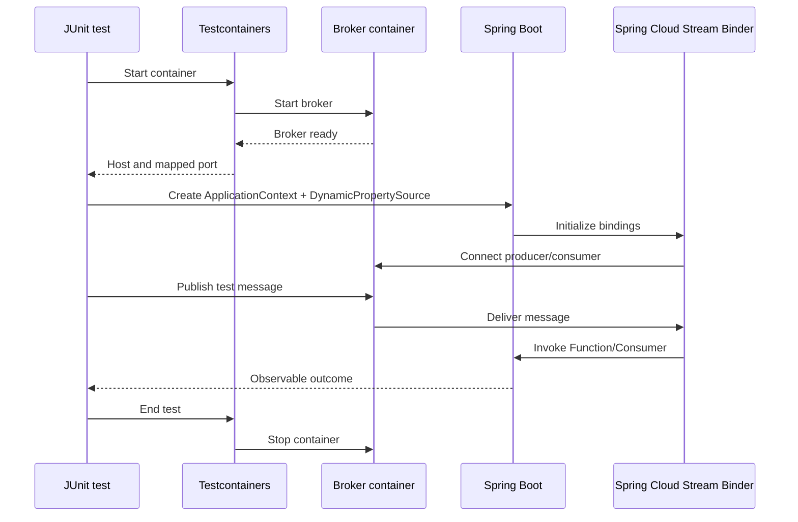

# Integration Testing Kafka, RabbitMQ, or Pulsar with Testcontainers

Spring Cloud Stream enables applications to communicate with brokers through binders and bindings. When testing functions, data mapping, or business rules, you can use unit tests and the Spring Integration Test Binder without starting a broker. However, checks involving protocols, serializers, consumer groups, partitions, acknowledgements, retries, DLQs, and provisioning must run against a real broker.

Testcontainers starts Kafka, RabbitMQ, or Pulsar in Docker right before tests need them, provides dynamic connection addresses, and stops containers upon completion. As a result, integration tests can verify the entire message path through the Spring Cloud Stream Binder in an isolated, reproducible environment closer to deployed system behavior.

## 1. Distinguishing the Testing Layers

Do not use a single test type to prove every behavior of a messaging system. Each layer has its own goals and limits:

| Layer | Component | Tests Well | Cannot Prove |
|---|---|---|---|
| Unit test | Function, service, mapper | Validation, business rules, mapping, idempotency | Bindings, serialization, broker |
| Spring Integration Test Binder | Binder running in-JVM | Function wiring, binding names, basic message conversion, framework-level headers | Kafka offsets, Rabbit exchanges, Pulsar subscriptions, broker acknowledgements |
| Binder integration test | Real binder + Testcontainers | Connectivity, provisioning, serialization, delivery, consumer groups, retries, and broker DLQs | Multi-node production cluster behavior if running a single broker |
| System/acceptance test | Multiple services and brokers | Cross-system business flows, operations, and production-like config | Every real-world infrastructure failure |

For example, a test using `InputDestination` and `OutputDestination` can prove a function transforms `OrderCreated` into `OrderAccepted`. It does not prove the Kafka Binder created the topic, the Rabbit Binder bound the queue to the exchange, or Pulsar created the subscription. To verify those behaviors, the test must connect to the corresponding broker.

A sound strategy tests business logic with unit tests, fast wiring with the Test Binder, and critical flows with a real broker. You do not need to run every test with Docker; only tests that must prove middleware behavior require Testcontainers.

## 2. How Does Testcontainers Work in Tests?

An integration test typically executes these steps:

1. JUnit starts the broker container.
2. Testcontainers waits for the broker to become ready per its wait strategy.
3. Spring creates the application context and binder.
4. The test supplies the broker address and required properties.
5. The binder creates producers/consumers and connects to the broker.
6. The test publishes messages or waits for messages to be received.
7. The test verifies payloads, headers, metadata, and processing outcomes.
8. JUnit stops the container when the test finishes.

Testcontainers automatically maps container ports to available ports on the host machine. Do not assume the broker always runs on `localhost:9092`, `localhost:5672`, or `localhost:6650`. Read the address from the running container and pass it into Spring via `@DynamicPropertySource` or Spring Boot `@ServiceConnection`.

## 3. Preparing Test Dependencies

Core dependencies typically include Spring Boot test, the JUnit Jupiter integration, and the corresponding Testcontainers module. Maven example with Testcontainers 2.x:

~~~xml
<dependencies>
    <dependency>
        <groupId>org.springframework.boot</groupId>
        <artifactId>spring-boot-starter-test</artifactId>
        <scope>test</scope>
    </dependency>

    <dependency>
        <groupId>org.testcontainers</groupId>
        <artifactId>testcontainers-junit-jupiter</artifactId>
        <scope>test</scope>
    </dependency>

    <dependency>
        <groupId>org.testcontainers</groupId>
        <artifactId>testcontainers-kafka</artifactId>
        <scope>test</scope>
    </dependency>

    <dependency>
        <groupId>org.testcontainers</groupId>
        <artifactId>testcontainers-rabbitmq</artifactId>
        <scope>test</scope>
    </dependency>

    <dependency>
        <groupId>org.testcontainers</groupId>
        <artifactId>testcontainers-pulsar</artifactId>
        <scope>test</scope>
    </dependency>
</dependencies>
~~~

Add only the broker module that your tests actually use. For example, a Kafka test does not need to pull RabbitMQ and Pulsar containers onto the classpath if the project separates tests by module or source set. If using Spring Boot `@ServiceConnection`, add `spring-boot-testcontainers` in `test` scope.

Testcontainers versions should be managed consistently via your project's dependency management/BOM or an explicitly chosen version. Do not mix 1.x and 2.x modules in the same test runtime. Starting with Testcontainers 2.x, artifact names and packages of several modules changed:

| Broker | Testcontainers 2.x Module | Container Class |
|---|---|---|
| Kafka | `testcontainers-kafka` | `org.testcontainers.kafka.KafkaContainer` |
| RabbitMQ | `testcontainers-rabbitmq` | `org.testcontainers.rabbitmq.RabbitMQContainer` |
| Pulsar | `testcontainers-pulsar` | `org.testcontainers.pulsar.PulsarContainer` |

In Testcontainers 1.x, many projects used older artifacts such as `kafka`, `rabbitmq`, `pulsar` and the `org.testcontainers.containers.*` package. Use packages matching the exact major version in your dependency tree; do not copy 1.x imports into 2.x.

The application's binder remains the corresponding runtime dependency:

- Kafka: `spring-cloud-starter-stream-kafka`.
- RabbitMQ: `spring-cloud-starter-stream-rabbit`.
- Pulsar: `org.springframework.pulsar:spring-pulsar-spring-cloud-stream-binder`.

Binders and Spring Boot must belong to compatible versions per the Spring Cloud release train. Testcontainers cannot fix dependency compatibility mismatches across binders.

## 4. Creating a Shared Function for Examples

Suppose the application receives order events from a binding and passes payloads to a processing service:

~~~java
public record OrderEvent(
    String eventId,
    String orderId,
    String customerId,
    long total
) {
}
~~~

A `Consumer` bean receives events:

~~~java
import java.util.function.Consumer;

import org.springframework.context.annotation.Bean;
import org.springframework.context.annotation.Configuration;

@Configuration
public class OrderFunctionConfiguration {

    @Bean
    Consumer<OrderEvent> collectOrders(OrderCapture capture) {
        return capture::accept;
    }
}
~~~

In tests, use a queue to store received messages. This avoids inspecting logs or waiting for a fixed duration:

~~~java
import java.time.Duration;
import java.util.concurrent.BlockingQueue;
import java.util.concurrent.LinkedBlockingQueue;
import java.util.concurrent.TimeUnit;

import org.springframework.stereotype.Component;

@Component
public class OrderCapture {

    private final BlockingQueue<OrderEvent> received =
        new LinkedBlockingQueue<>();

    public void accept(OrderEvent event) {
        received.add(event);
    }

    public OrderEvent awaitNext(Duration timeout)
            throws InterruptedException {
        return received.poll(timeout.toMillis(), TimeUnit.MILLISECONDS);
    }
}
~~~

The test calls `awaitNext` with a finite timeout. If no message arrives, the test fails within a bounded time instead of hanging indefinitely. In real test suites, you can use Awaitility to wait for asynchronous conditions such as the consumer receiving enough messages or a record appearing in the DLQ.

Shared configuration for the input binding:

~~~yaml
spring:
  cloud:
    function:
      definition: collectOrders
    stream:
      bindings:
        collectOrders-in-0:
          destination: orders.created.it
          group: orders-integration
          content-type: application/json
~~~

Each broker test selects the binder and supplies the corresponding endpoint. If multiple binder implementations are on the classpath, select the binder for the binding via `binder` or configure `default-binder` appropriately. The examples below assume the test context selects the exact binder under test.

## 5. Testing the Kafka Binder with KafkaContainer

Testcontainers provides a Kafka module to run a Kafka broker in Docker. Supported Kafka images today include Apache Kafka and Confluent Kafka. With Testcontainers 2.x, use `org.testcontainers.kafka.KafkaContainer`; the older `org.testcontainers.containers.KafkaContainer` class is deprecated.

Example container declaration:

~~~java
import org.junit.jupiter.api.Test;
import org.springframework.beans.factory.annotation.Autowired;
import org.springframework.boot.test.context.SpringBootTest;
import org.springframework.test.context.DynamicPropertyRegistry;
import org.springframework.test.context.DynamicPropertySource;
import org.testcontainers.junit.jupiter.Container;
import org.testcontainers.junit.jupiter.Testcontainers;
import org.testcontainers.kafka.KafkaContainer;

@Testcontainers
@SpringBootTest(
    properties = {
        "spring.cloud.function.definition=collectOrders",
        "spring.cloud.stream.default-binder=kafka",
        "spring.cloud.stream.bindings.collectOrders-in-0.destination=orders.created.it",
        "spring.cloud.stream.bindings.collectOrders-in-0.group=orders-it",
        "spring.cloud.stream.bindings.collectOrders-in-0.content-type=application/json",
        "spring.cloud.stream.kafka.binder.auto-create-topics=true"
    }
)
class KafkaBinderIntegrationTest {

    @Container
    static final KafkaContainer kafka =
        new KafkaContainer("apache/kafka-native:3.8.0");

    @Autowired
    OrderCapture capture;

    @DynamicPropertySource
    static void kafkaProperties(DynamicPropertyRegistry registry) {
        registry.add(
            "spring.cloud.stream.kafka.binder.brokers",
            kafka::getBootstrapServers
        );
    }

    @Test
    void consumesMessageFromRealKafka() throws Exception {
        // Send message using Kafka client as shown below.
    }
}
~~~

`getBootstrapServers()` returns the container's broker address and mapped port. The `spring.cloud.stream.kafka.binder.brokers` property configures the Kafka Binder. If the test also uses Spring Boot `KafkaTemplate` or Kafka auto-configuration, supply `spring.kafka.bootstrap-servers` accordingly; do not assume the binder property always overrides Spring Boot client settings.

### Sending Records into Kafka in Tests

You can use a Kafka Producer directly to publish JSON to the topic. The test producer uses the container's same bootstrap server:

~~~java
import java.util.Properties;
import java.util.concurrent.TimeUnit;

import com.fasterxml.jackson.databind.ObjectMapper;
import org.apache.kafka.clients.producer.KafkaProducer;
import org.apache.kafka.clients.producer.Producer;
import org.apache.kafka.clients.producer.ProducerConfig;
import org.apache.kafka.clients.producer.ProducerRecord;
import org.apache.kafka.common.serialization.StringSerializer;

@Test
void consumesMessageFromRealKafka() throws Exception {
    OrderEvent expected =
        new OrderEvent("evt-101", "order-101", "customer-7", 250000L);

    ObjectMapper objectMapper = new ObjectMapper();

    Properties properties = new Properties();
    properties.put(
        ProducerConfig.BOOTSTRAP_SERVERS_CONFIG,
        kafka.getBootstrapServers()
    );
    properties.put(
        ProducerConfig.KEY_SERIALIZER_CLASS_CONFIG,
        StringSerializer.class.getName()
    );
    properties.put(
        ProducerConfig.VALUE_SERIALIZER_CLASS_CONFIG,
        StringSerializer.class.getName()
    );

    try (Producer<String, String> producer =
            new KafkaProducer<>(properties)) {

        String json = objectMapper.writeValueAsString(expected);

        producer.send(
            new ProducerRecord<>(
                "orders.created.it",
                expected.eventId(),
                json
            )
        ).get(10, TimeUnit.SECONDS);
    }

    OrderEvent actual = capture.awaitNext(Duration.ofSeconds(10));

    assertThat(actual).isEqualTo(expected);
}
~~~

This example tests a real path: the producer writes a record to Kafka, the Kafka Binder reads the topic under the consumer group, Spring Cloud Stream converts JSON into `OrderEvent`, and the function receives the payload. If the test fails to receive the message, check topic, group, content type, Serde/converter, and binder connectivity.

The test producer uses `StringSerializer` because the value is a JSON string. The binder consumer uses message conversion per `application/json`; this is a different conversion path from Kafka native decoding using a custom Serde. If production enables native decoding or Avro/Protobuf, integration tests must use the exact corresponding serializer, schema, and configuration.

## 6. Testing the RabbitMQ Binder with RabbitMQContainer

The RabbitMQ Binder maps destinations to exchanges and consumer groups to queues bound to those exchanges. Testcontainers provides `RabbitMQContainer` to run a real broker.

Example:

~~~java
import org.junit.jupiter.api.Test;
import org.springframework.beans.factory.annotation.Autowired;
import org.springframework.boot.test.context.SpringBootTest;
import org.springframework.test.context.DynamicPropertyRegistry;
import org.springframework.test.context.DynamicPropertySource;
import org.testcontainers.junit.jupiter.Container;
import org.testcontainers.junit.jupiter.Testcontainers;
import org.testcontainers.rabbitmq.RabbitMQContainer;

@Testcontainers
@SpringBootTest(
    properties = {
        "spring.cloud.function.definition=collectOrders",
        "spring.cloud.stream.default-binder=rabbit",
        "spring.cloud.stream.bindings.collectOrders-in-0.destination=orders.created.it",
        "spring.cloud.stream.bindings.collectOrders-in-0.group=orders-it",
        "spring.cloud.stream.bindings.collectOrders-in-0.content-type=application/json"
    }
)
class RabbitBinderIntegrationTest {

    @Container
    static final RabbitMQContainer rabbit =
        new RabbitMQContainer("rabbitmq:4.0-management");

    @Autowired
    OrderCapture capture;

    @DynamicPropertySource
    static void rabbitProperties(DynamicPropertyRegistry registry) {
        registry.add("spring.rabbitmq.host", rabbit::getHost);
        registry.add("spring.rabbitmq.port", rabbit::getAmqpPort);
        registry.add("spring.rabbitmq.username", rabbit::getAdminUsername);
        registry.add("spring.rabbitmq.password", rabbit::getAdminPassword);
    }

    @Test
    void consumesMessageFromRealRabbitMq() throws Exception {
        // Send message through exchange using RabbitMQ client.
    }
}
~~~

The Rabbit Binder uses the Spring AMQP connection factory. Accordingly, the test supplies host, mapped AMQP port, username, and password from the container. Do not hard-code port 5672 on the host; Testcontainers maps to another port.

### Publishing Messages to an Exchange

Example using the RabbitMQ Java client to publish a JSON message with an explicit content type:

~~~java
import com.fasterxml.jackson.databind.ObjectMapper;
import com.rabbitmq.client.AMQP;
import com.rabbitmq.client.Channel;
import com.rabbitmq.client.Connection;
import com.rabbitmq.client.ConnectionFactory;

@Test
void consumesMessageFromRealRabbitMq() throws Exception {
    OrderEvent expected =
        new OrderEvent("evt-201", "order-201", "customer-8", 410000L);

    ConnectionFactory factory = new ConnectionFactory();
    factory.setHost(rabbit.getHost());
    factory.setPort(rabbit.getAmqpPort());
    factory.setUsername(rabbit.getAdminUsername());
    factory.setPassword(rabbit.getAdminPassword());

    byte[] body = new ObjectMapper().writeValueAsBytes(expected);

    try (Connection connection = factory.newConnection();
         Channel channel = connection.createChannel()) {

        AMQP.BasicProperties properties =
            new AMQP.BasicProperties.Builder()
                .contentType("application/json")
                .deliveryMode(2)
                .build();

        channel.basicPublish(
            "orders.created.it",
            "orders.created.it",
            properties,
            body
        );
    }

    OrderEvent actual = capture.awaitNext(Duration.ofSeconds(10));

    assertThat(actual).isEqualTo(expected);
}
~~~

In this example, `orders.created.it` is the exchange destination provisioned by the binder; the routing key must match the consumer queue's binding. The Rabbit binder uses a default routing pattern for consumers per binder configuration. If the application customized the routing key, publish with the matching routing key.

The message is sent as JSON bytes with content type `application/json`. This lets the Spring Cloud Stream message converter transform the payload into `OrderEvent`. If production uses native encoding, custom converters, or header mappers, tests must use that same data contract.

You can additionally inspect the topology using the RabbitMQ Management API or AMQP client: that the exchange exists, the group's queue was created, the queue is bound with the right routing key, and messages land in the expected queue. The function receiving one message only proves a single path; it does not prove every queue attribute such as durable, TTL, DLX, or quorum queue settings is correct.

## 7. Testing the Pulsar Binder with PulsarContainer

Testcontainers provides a module for Apache Pulsar. The container exposes the broker URL and HTTP service URL for client and admin API connections.

Example:

~~~java
import org.junit.jupiter.api.Test;
import org.springframework.beans.factory.annotation.Autowired;
import org.springframework.boot.test.context.SpringBootTest;
import org.springframework.test.context.DynamicPropertyRegistry;
import org.springframework.test.context.DynamicPropertySource;
import org.testcontainers.junit.jupiter.Container;
import org.testcontainers.junit.jupiter.Testcontainers;
import org.testcontainers.pulsar.PulsarContainer;

@Testcontainers
@SpringBootTest(
    properties = {
        "spring.cloud.function.definition=collectOrders",
        "spring.cloud.stream.default-binder=pulsar",
        "spring.cloud.stream.bindings.collectOrders-in-0.destination=orders.created.it",
        "spring.cloud.stream.bindings.collectOrders-in-0.group=orders-it",
        "spring.cloud.stream.bindings.collectOrders-in-0.content-type=application/json"
    }
)
class PulsarBinderIntegrationTest {

    @Container
    static final PulsarContainer pulsar =
        new PulsarContainer("apachepulsar/pulsar:3.0.0");

    @Autowired
    OrderCapture capture;

    @DynamicPropertySource
    static void pulsarProperties(DynamicPropertyRegistry registry) {
        registry.add(
            "spring.pulsar.client.service-url",
            pulsar::getPulsarBrokerUrl
        );
        registry.add(
            "spring.pulsar.administration.service-url",
            pulsar::getHttpServiceUrl
        );
    }

    @Test
    void consumesMessageFromRealPulsar() throws Exception {
        // Send message via Pulsar producer as shown below.
    }
}
~~~

`spring.pulsar.client.service-url` is the broker address for the client. `spring.pulsar.administration.service-url` is the admin address that the Pulsar topic provisioner can use when creating topics. If only testing a pre-provisioned topic, admin needs may differ; for binder auto-provisioning, configure both client and admin endpoints.

### Publishing Messages to a Pulsar Topic

Example using the Pulsar client with `Schema.BYTES` to send JSON bytes:

~~~java
import com.fasterxml.jackson.databind.ObjectMapper;
import org.apache.pulsar.client.api.PulsarClient;
import org.apache.pulsar.client.api.Producer;
import org.apache.pulsar.client.api.Schema;

@Test
void consumesMessageFromRealPulsar() throws Exception {
    OrderEvent expected =
        new OrderEvent("evt-301", "order-301", "customer-9", 530000L);

    String topic =
        "persistent://public/default/orders.created.it";

    try (PulsarClient client = PulsarClient.builder()
            .serviceUrl(pulsar.getPulsarBrokerUrl())
            .build();
         Producer<byte[]> producer = client.newProducer(Schema.BYTES)
            .topic(topic)
            .create()) {

        byte[] json = new ObjectMapper().writeValueAsBytes(expected);
        producer.send(json);
    }

    OrderEvent actual = capture.awaitNext(Duration.ofSeconds(10));

    assertThat(actual).isEqualTo(expected);
}
~~~

In this example, the short destination `orders.created.it` maps to the default `public/default` namespace. If the application uses a custom tenant or namespace, configure the full destination and send to the matching topic. The producer uses `Schema.BYTES`; the Pulsar Binder receives the byte payload and converts it per the JSON content type. If production enables native decoding with JSON/Avro/Protobuf schemas, tests must use the exact schema and message type instead of defaulting to `Schema.BYTES`.

A Pulsar consumer group in Spring Cloud Stream maps to a subscription per the binder's mechanism. Tests should verify the subscription name and subscription type matching your configuration, especially when using Shared, Key_Shared, or Failover.

## 8. Using Spring Boot ServiceConnection When Appropriate

Spring Boot supports `@ServiceConnection` for specific container types. With Spring Boot versions providing the corresponding connection factories, Kafka, RabbitMQ, and Pulsar containers can automatically supply connection details.

Example:

~~~java
import org.springframework.boot.testcontainers.service.connection.ServiceConnection;

@Container
@ServiceConnection
static final KafkaContainer kafka =
    new KafkaContainer("apache/kafka-native:3.8.0");
~~~

To use service connections, add the `spring-boot-testcontainers` dependency in `test` scope. This lets Spring Boot auto-configuration generate connection details, which can take precedence over standard connection properties.

However, the Kafka Binder has its own property group such as `spring.cloud.stream.kafka.binder.brokers`. When testing the binder, verify which properties the binder actually reads. `@DynamicPropertySource` is an explicit choice when you need to map container endpoints to exact binder prefixes. For RabbitMQ and Pulsar, Spring Boot auto-configuration typically consumes connection details directly; still check your project's Spring Boot and binder versions.

Do not use `@ServiceConnection` just because it makes code shorter. Choose one consistent, easily verifiable way to configure endpoints in tests.

## 9. Do Not Mix the Test Binder with Real Broker Binders in the Same Test Runtime

Spring Cloud Stream provides the Spring Integration Test Binder to test functions without a broker. Dependency:

~~~xml
<dependency>
    <groupId>org.springframework.cloud</groupId>
    <artifactId>spring-cloud-stream-test-binder</artifactId>
    <scope>test</scope>
</dependency>
~~~

The Test Binder allows sending messages via `InputDestination` and receiving outputs via `OutputDestination`:

~~~java
import java.nio.charset.StandardCharsets;
import java.util.function.Function;

import org.junit.jupiter.api.Test;
import org.springframework.beans.factory.annotation.Autowired;
import org.springframework.boot.autoconfigure.SpringBootApplication;
import org.springframework.boot.test.context.SpringBootTest;
import org.springframework.cloud.stream.binder.test.EnableTestBinder;
import org.springframework.cloud.stream.binder.test.InputDestination;
import org.springframework.cloud.stream.binder.test.OutputDestination;
import org.springframework.context.annotation.Bean;
import org.springframework.messaging.Message;
import org.springframework.messaging.support.GenericMessage;
import static org.assertj.core.api.Assertions.assertThat;

@SpringBootTest(classes = OrderFunctionTest.TestApplication.class)
class OrderFunctionTest {

    @Autowired
    InputDestination input;

    @Autowired
    OutputDestination output;

    @Test
    void transformsOrder() {
        input.send(
            new GenericMessage<>("hello".getBytes(StandardCharsets.UTF_8)),
            "uppercase-in-0"
        );

        Message<byte[]> message = output.receive(0, "uppercase-out-0");

        assertThat(new String(message.getPayload(), StandardCharsets.UTF_8))
            .isEqualTo("HELLO");
    }

    @SpringBootApplication
    @EnableTestBinder
    static class TestApplication {

        @Bean
        Function<String, String> uppercase() {
            return String::toUpperCase;
        }
    }
}
~~~

The Test Binder runs in the JVM and does not connect to Kafka, RabbitMQ, or Pulsar. It does not verify broker protocols, offsets, acknowledgements, partition assignment, or broker-specific retries/DLQs.

**Do not place the Test Binder and a real middleware binder in the same test runtime expecting to pick one per test.** When the Test Binder is on the test classpath, Spring Cloud Stream may select it for bindings. The Spring Cloud Stream documentation recommends isolating integration tests that use real middleware into a separate module so they connect through the actual binder.

You can organize as:

- Fast module or test source set: function unit tests and Spring Integration Test Binder.
- Integration test module: real Kafka/Rabbit/Pulsar binder with Testcontainers.
- CI pipeline running both groups with separated classpaths and configurations.

Without separating dependencies, a test might pass using the Test Binder without ever hitting the broker. That is why you should verify the test runtime and which binder is selected.

## 10. Testing Message Conversion and Schemas

Brokers carry bytes; functions receive Java types. Integration tests must verify conversion in both directions:

1. Producer uses the right serializer or schema.
2. Record/message is written with matching content type or schema metadata.
3. Binder receives bytes and selects the right converter/Serde.
4. Function receives an object with accurate values.
5. Output binding serializes the payload properly for downstream consumers.

Cases to test:

- Valid JSON with all fields.
- Missing optional fields.
- Newly added fields in the schema.
- Changed enums or data types.
- Timestamps with standard timezone and format.
- Null payloads or tombstones if the broker/topic uses those semantics.
- Malformed byte payloads.
- Incompatible schema versions.
- Correlation ID, event ID, and content type headers.
- Native encoding/decoding if enabled by the application.

Do not only compare raw JSON strings if field ordering or serialization format may vary. Deserialize payloads and assert business values, or explicitly verify the schema contract.

For Kafka, check serializers/Serdes and record headers. For RabbitMQ, check AMQP content types, delivery modes, and headers. For Pulsar, check schema types, schema versions, and subscriptions. A test using the default JSON converter does not replace Avro, Protobuf, or custom schema registry tests.

## 11. Testing Consumer Groups and Partition Distribution

An integration test can verify that a consumer group is created and multiple instances share work. For Kafka:

- Create a topic with multiple partitions.
- Start two application instances in the same group.
- Send records with different keys.
- Verify records are processed by an instance in the group and partitions are distributed per assignment.
- Start/stop an instance to observe rebalancing.
- Check offset commits and redelivery per acknowledgement mode.

Do not assume every instance receives every record. Instances in the same consumer group share partitions. If each service needs to receive all events, that service must use its own group.

For RabbitMQ, multiple consumers in the same group compete for deliveries from a shared queue. For Pulsar, subscription type governs message distribution. Tests should verify subscription names, Shared/Exclusive/Failover/Key_Shared modes, and key-based ordering if required by the business.

Default Testcontainers setups usually start a single broker. That works well for binder integration tests, but it does not prove HA behavior of multi-broker Kafka, multi-node RabbitMQ quorum queues, or multi-broker/bookie Pulsar clusters.

## 12. Testing Acknowledgements, Retries, and Redelivery

One of the key reasons to run a real broker is to verify delivery semantics. Tests need to inject controlled failures and observe whether messages are redelivered.

Example test service that fails transiently on the first attempt and then succeeds:

~~~java
@Component
public class FlakyOrderHandler {

    private final AtomicInteger attempts = new AtomicInteger();

    public void handle(OrderEvent event) {
        if (attempts.incrementAndGet() == 1) {
            throw new TransientOrderException("temporary failure");
        }

        // Succeed on subsequent attempt.
    }

    public int attempts() {
        return attempts.get();
    }
}
~~~

Bounded retry configuration:

~~~yaml
spring:
  cloud:
    stream:
      bindings:
        processOrders-in-0:
          consumer:
            max-attempts: 3
            back-off-initial-interval: 200
            back-off-max-interval: 1000
            back-off-multiplier: 2.0
~~~

Tests should verify:

- The handler is invoked the expected number of times.
- The message is eventually processed successfully or sent to the DLQ.
- Offsets/acknowledgements are not confirmed before handler completion per chosen semantics.
- Redelivery does not cause duplicate side effects.
- Consumer restarts mid-processing do not lose messages.
- Backoff and timeouts fit within test bounds.

Remember that Spring Cloud Stream retries and broker redelivery are two separate layers. Handler invocation counts can exceed `max-attempts` if the broker redelivers after channel/connection or consumer failures. Distinguish internal retries from broker redelivery in assertions.

## 13. Testing DLQ/DLT

A DLQ is part of the operational contract. Tests should verify both the failed record contents and diagnostic metadata:

- Original payload or raw bytes.
- Event ID and correlation ID.
- Source topic/exchange/queue.
- Partition/offset or routing metadata.
- Exception type and error details.
- Retry count if supplied by the binder.
- Consumer group/subscription.
- Timestamp when sent to DLQ.

For Kafka, check the DLT name and partition strategy. For RabbitMQ, check DLX, DLQ, and republish headers. For Pulsar, check dead-letter topics, retry letter topics, and redelivery policy per subscription.

Do not only assert that "the DLQ has one message." Read the record from the DLQ and verify payload, headers, source metadata, and replayability. When using a binder that routes entire batches to a DLT, tests must verify those exact batch semantics.

A DLQ does not fix data by itself. After fixing schemas or code, replays must be controlled, keep event IDs stable, and ensure consumers are idempotent.

## 14. Testing Transactions and Idempotency

A consumer can complete business processing yet fail before the broker records its offset/acknowledgement. When the broker redelivers the message, the handler may run again.

Tests should simulate the failure window:

1. Handler writes database changes.
2. Consumer stops before acknowledgement/offset commit.
3. Broker redelivers the message.
4. Consumer reprocesses it.
5. Unique event IDs or idempotency keys prevent duplicate side effects.

If the application uses a transactional outbox, test these scenarios:

- Database commit succeeds, then process stops before publishing.
- Publish succeeds, then process stops before marking the outbox sent.
- Outbox publisher restarts and resends.
- Downstream consumer receives duplicates.
- DLQ replay does not apply side effects a second time.

Kafka transactions only span Kafka operations enlisted in the transaction. They do not automatically create distributed transactions across RabbitMQ, Pulsar, or external databases. Integration tests must verify the application's actual consistency boundaries.

## 15. Testing Topology and Provisioning

Testcontainers allows checking that binders create destinations according to configuration:

| Broker | Components to Verify |
|---|---|
| Kafka | Topics, partition counts, consumer groups, offsets, ACLs if enabled |
| RabbitMQ | Exchanges, queues, bindings, routing keys, durability, DLX |
| Pulsar | Tenants, namespaces, topics, partitioned topics, subscriptions, schemas |

If the binder auto-provisions topics/queues, verify names and attributes after the application context starts. If production uses externally provisioned infrastructure, integration tests should create topology matching that same contract or disable auto-provisioning to catch missing configuration.

Do not rely on broker state left over from previous test runs. Give each test its own namespace, topic, queue, or group, or perform explicit cleanup. When sharing a broker across a test class, drain messages and reset state between tests.

## 16. Writing Stable Asynchronous Tests

Message brokers process asynchronously. Tests become flaky if they send a message and immediately assert results without waiting for the consumer to finish.

Best practices:

- Use `BlockingQueue.poll(timeout)`, Awaitility, or bounded condition waits.
- Do not use `Thread.sleep(5000)` as the primary synchronization mechanism.
- Create topics/queues and consumers before publishing if tests depend on initialization order.
- Use unique event IDs to distinguish messages.
- Use dedicated groups/subscriptions per test when isolation is needed.
- Set reasonable timeouts for producer sends and consumer receives.
- When tests fail, print selective container and binder logs.
- Clean up consumers, producers, clients, and connections after tests.

Awaitility example:

~~~java
await()
    .atMost(Duration.ofSeconds(10))
    .untilAsserted(() ->
        assertThat(capture.peek()).isEqualTo(expected)
    );
~~~

Timeouts should not be so short that they depend on CI machine speed, nor so long that they slow down the suite on failures. You can configure separate timeouts for broker startup, publishing, and consumer delivery.

## 17. Managing Container Lifecycle and Spring ApplicationContext

JUnit Testcontainers supports static container fields and per-test-method containers:

- `@Container static`: one container shared across test methods in the class.
- Non-static `@Container`: container starts/stops per test method, providing stronger isolation at higher time cost.
- Container declared as a Spring bean: Spring manages its lifecycle alongside the application context.
- `@ImportTestcontainers`: shares container declarations across multiple test classes using Spring-supported mechanisms.

If Spring TestContext caches an application context after a class finishes, a container managed by the JUnit extension may stop while the context remains cached. When multiple test classes share a context, consider managing containers as Spring beans or using `@ImportTestcontainers` so container lifecycles align with the context.

Do not enable reusable containers by default just for speed. Reused containers can retain topics, queues, subscriptions, offsets, and old data across runs. If enabling reuse, implement a strict namespace/cleanup strategy and never treat data from prior runs as clean state.

## 18. Broker-Specific Testcontainers Notes

### Kafka

- Use compatible Kafka images and client versions.
- Create topics with partition counts suited to the test.
- Use dedicated consumer groups.
- Check offset reset policy if sending data before the consumer subscribes.
- Verify record keys, partitions, and ordering.
- Test retries/DLTs, rebalancing, and commits.
- Do not infer replication or ISR behavior from a single broker.

### RabbitMQ

- Use an image with the management plugin if tests need to inspect topology.
- Verify exchanges, queues, routing keys, and groups.
- Check acknowledgements, requeues, redelivery, and DLX.
- Test prefetch/concurrency when needed.
- Check publisher confirms if the application relies on them.
- Do not infer quorum queue HA from a single node.

### Pulsar

- Configure both broker URL and admin service URL.
- Verify tenants/namespaces/topics and partitions.
- Check subscription names/types and acknowledgements.
- Check schema types and compatibility.
- Check retry letter/dead-letter topics if used.
- Use a container with transactions enabled if tests actually require Pulsar transactions.
- Do not infer broker/bookkeeper cluster HA from a standalone container.

## 19. Integration Testing Multiple Binders in the Same Application

If an application uses Kafka for input and RabbitMQ or Pulsar for output, tests must start both broker containers and configure each binding to point to its binder.

Example configuration:

~~~yaml
spring:
  cloud:
    function:
      definition: forwardOrder
    stream:
      bindings:
        forwardOrder-in-0:
          destination: orders.created
          group: bridge-it
          binder: kafka
          content-type: application/json
        forwardOrder-out-0:
          destination: orders.fulfillment
          binder: rabbit
          content-type: application/json
~~~

Tests must verify:

1. Input records are received from the right source broker.
2. The function is invoked once in the normal case.
3. Outputs are published to the right target broker.
4. Payloads and event IDs are preserved accurately.
5. Both source and target brokers have proper endpoint configurations.
6. Target publish failures do not falsely acknowledge the input per the delivery contract.
7. Bridge restarts may produce duplicates; target consumers must be idempotent.

Do not assume Kafka transactions cover RabbitMQ or Pulsar. When high reliability is required across two brokers, tests must verify inbox/outbox patterns or durable state-tracking workflows.

## 20. Running Integration Tests in CI

Testcontainers requires a Docker-compatible container runtime. On developer machines, Docker Desktop or Docker Engine must be running. In CI, runners need access to a Docker daemon or a runtime supported by Testcontainers.

Key considerations:

- Pin specific image tags; never use `latest` for reproducible tests.
- Verify the Docker daemon before running the test suite.
- Configure an image registry mirror if CI faces pull rate limits.
- Never hard-code ports; always use mapped ports.
- Limit concurrent containers if runners have constrained RAM/CPU.
- Archive container logs when tests fail.
- Separate fast unit tests from broker integration tests in the pipeline.
- Use test tags or dedicated Maven/Gradle tasks to target integration test groups.
- Do not let tests silently skip Docker in critical CI pipelines without warning.

Illustrative Maven command running an integration test group by naming convention:

~~~bash
./mvnw -Dtest='*BinderIntegrationTest' test
~~~

If using Maven Failsafe, name integration tests with `*IT` and run `verify`. The plugin configuration must be declared in your project's build; the command above is merely a naming-convention example.

## 21. Common Errors When Running Testcontainers

| Symptom | Possible Cause | Resolution |
|---|---|---|
| Docker environment not found | Docker daemon not running or Testcontainers cannot detect runtime | Check Docker Desktop/Engine and runtime configuration |
| Container takes long to start | Large image, slow CPU/IO, or unsuitable readiness strategy | Inspect container logs and startup timeout |
| Spring fails to connect to broker | Wrong dynamic property prefix or mapped port unused | Check container endpoint and properties read by the binder |
| Kafka test receives no records | Wrong topic/group, consumer not subscribed, or incompatible serializer | Check binder logs, topic, group, and content type |
| Rabbit test publishes yet consumer receives nothing | Wrong exchange, routing key, or queue binding | Inspect topology via management API |
| Pulsar topic not created | Missing admin service URL or provisioning permissions | Check client URL, admin URL, and namespace |
| Individual tests pass yet full suite fails | Container/context cache shares state or colliding groups/topics | Use unique names, cleanup, and lifecycle management |
| Test waits forever | Missing timeout while awaiting messages | Use poll/Awaitility with timeouts |
| Message appears twice | Redelivery or retry after side effects occurred | Check acknowledgements and idempotency |
| Test Binder used instead of real broker | Test Binder is on test classpath and took priority | Separate modules/classpaths for integration tests |
| Tests pass yet production fails | Single-node container does not simulate production HA, ACLs, or TLS | Add production-like test environments for those properties |

When a test fails, read broker logs and Spring Cloud Stream Binder logs before increasing timeouts. A longer timeout cannot fix a wrong destination, wrong serializer, or an uninitialized binder.

## 22. Checklist for a Broker Integration Test

- [ ] Test uses the real binder corresponding to the broker.
- [ ] Testcontainers module and image versions are compatible.
- [ ] Container is started before Spring creates bindings.
- [ ] Endpoints are read from the container, never hard-coded ports.
- [ ] Binding destinations and groups/subscriptions are configured explicitly.
- [ ] Topics/queues/exchanges are provisioned properly.
- [ ] Messages are sent with matching serializers/schemas.
- [ ] Function receives expected payloads and headers.
- [ ] Assertions use timeouts and avoid fixed sleeps.
- [ ] Retries, acknowledgements, and DLQs are tested when required.
- [ ] Event IDs and idempotency are verified under redelivery.
- [ ] Containers and test state are cleaned up per lifecycle.
- [ ] CI provides a Docker runtime and archives logs on test failures.

## 23. Broker-Specific Checklist

| Aspect | Kafka | RabbitMQ | Pulsar |
|---|---|---|---|
| Test endpoint | Bootstrap servers | Host + AMQP port | Broker service URL |
| Data target | Topic | Exchange + queue | Topic |
| Consumer identity | Consumer group | Queue/group | Subscription |
| Distribution | Partition assignment | Competing consumers | Subscription type |
| Acknowledgement | Offset commit | Ack/Nack | Ack/Nack |
| Errors | Retry + DLT | Retry + DLX/DLQ | Redelivery + retry/DLQ topic |
| Schema | Serializer/Serde | Converter/headers | Pulsar Schema or bytes |
| Metadata to verify | Key, partition, offset, timestamp | Routing key, headers, delivery tag | Message ID, schema, subscription |

## 24. References

- [Spring Cloud Stream — Testing](https://docs.spring.io/spring-cloud-stream/reference/spring-cloud-stream/spring_integration_test_binder.html), Spring Integration Test Binder, InputDestination, and OutputDestination.
- [Spring Boot — Testcontainers](https://docs.spring.io/spring-boot/reference/testing/testcontainers.html), container lifecycle, `@ServiceConnection`, and connection details.
- [Testcontainers — Kafka Module](https://java.testcontainers.org/modules/kafka/), KafkaContainer, bootstrap servers, and supported images.
- [Testcontainers — RabbitMQ Module](https://java.testcontainers.org/modules/rabbitmq/), RabbitMQ container dependency and usage.
- [Testcontainers — Apache Pulsar Module](https://java.testcontainers.org/modules/pulsar/), PulsarContainer, broker URL, and admin URL.
- [Spring Cloud Stream — Kafka Binder](https://docs.spring.io/spring-cloud-stream/reference/kafka/kafka-binder/index.html), Kafka bindings, consumer, and producer configuration.
- [Spring Cloud Stream — RabbitMQ Binder](https://docs.spring.io/spring-cloud-stream/reference/rabbit/rabbit_overview.html), exchanges, queues, acknowledgements, and DLQ.
- [Spring Cloud Stream — Pulsar Binder](https://docs.spring.io/spring-cloud-stream/reference/pulsar/pulsar_binder.html), Pulsar topics, schemas, client properties, and provisioner.

Integration testing Kafka, RabbitMQ, or Pulsar with Testcontainers verifies that a Spring Cloud Stream application actually communicates with the broker per configuration. The Test Binder remains useful for function wiring and business logic, while Testcontainers proves broker-dependent behaviors such as serialization, topic/queue provisioning, consumer groups/subscriptions, acknowledgements, retries, and DLQs. When tests use dynamic endpoints, isolated data, clear timeouts, idempotency, and container lifecycles aligned with the Spring context, results are far more reliable on developer machines and in CI.
