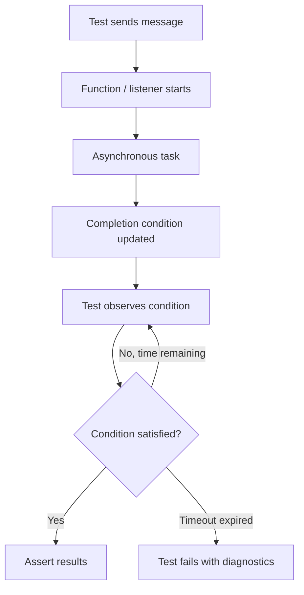

# Synchronizing Asynchronous Tests with Conditions and Finite Timeouts

## 1. Why Are Asynchronous Tests Prone to Flakiness?

In Spring Cloud Stream, a message can pass through multiple steps before producing the outcome a test checks: the binder receives the message, a function is invoked, an executor or scheduler runs a task, a service updates data, and then an output binding emits a message. These steps may run on different threads and complete after the test sends the input.

If a test assumes processing has already finished immediately after `send`, the outcome may depend on machine speed, CI load, thread scheduling, or application context startup time. Tests sometimes pass locally yet fail intermittently in CI.

Two common mistakes:

- **Waiting too little:** the test reads results before asynchronous work completes.
- **Waiting indefinitely:** the test hangs when a message is lost, a function is not activated, or a broker/binding fails.

The solution is synchronizing on a meaningful condition and always setting a finite timeout. The test proceeds only once the condition holds or stops with a clear error when the timeout expires.



There is no need to wait a fixed duration hoping work finishes. Wait on the exact signal showing the work has completed.

## 2. Do Not Use Thread.sleep to Synchronize Tests

Example to avoid:

```java
input.send(message, "orders.raw");
Thread.sleep(1_000);
Message<byte[]> result = output.receive();
assertThat(result).isNotNull();
```

`Thread.sleep` merely pauses the test thread for a duration; it does not prove the function has finished. If processing takes 1.2 seconds, the test still fails; if it takes 20 ms, the test wastes nearly a second. When CI slows down, fixed durations become unreliable.

`Thread.sleep` also obscures the real cause: input sent to the wrong destination, function omitted from `spring.cloud.function.definition`, message filtered out, wrong output binding name, or an asynchronous task threw an error. Waiting longer cannot fix any of these bugs.

Replace it with one of these mechanisms:

- `OutputDestination.receive(timeout, destination)` when awaiting output from the test binder.
- Awaitility when awaiting an eventual state or condition.
- `CountDownLatch` when needing a one-shot completion signal.
- `CompletableFuture.get(timeout, unit)` when a future represents the task.
- Reactor `StepVerifier` with a timeout when testing a publisher.

## 3. Define Completion Conditions Before Writing Tests

The condition must reflect the business outcome the test intends to verify, not merely an incidental thread milestone.

| Task | Condition to Wait For |
|---|---|
| Function emits output | Output appears at the right destination |
| Listener updates database | Expected record or state is persisted |
| Handler processes an event | Completion signal or processing outcome is published |
| Multiple messages processed | Expected count of events with expected IDs received |
| Reactive publisher | Publisher emits expected elements and completes |
| Background task updates cache | Cache value reaches expected state |
| Retries complete | Attempt count or final state meets condition |

Do not use a "started processing" log as the condition for an assertion requiring processing to be complete. Nor should you only wait for a counter increment if the counter increments before the side effect under test.

## 4. Using Finite Timeouts with InputDestination and OutputDestination

The Spring Cloud Stream test binder provides `InputDestination` and `OutputDestination`. When a test targets a specific output, the `receive(timeout, destinationName)` overload both picks the right destination and waits up to the specified milliseconds.

Example function:

```java
import java.util.function.Function;
import org.springframework.context.annotation.Bean;
import org.springframework.context.annotation.Configuration;

record OrderCreated(String orderId, long totalCents) {}
record OrderAccepted(String orderId, String status) {}

@Configuration
class OrderFunctions {

    @Bean
    Function<OrderCreated, OrderAccepted> acceptOrder() {
        return order -> new OrderAccepted(order.orderId(), "ACCEPTED");
    }
}
```

Binding configuration:

```yaml
spring:
  cloud:
    function:
      definition: acceptOrder
    stream:
      bindings:
        acceptOrder-in-0:
          destination: orders.raw
        acceptOrder-out-0:
          destination: orders.accepted
```

Test:

```java
import static org.assertj.core.api.Assertions.assertThat;

import org.junit.jupiter.api.Test;
import org.springframework.beans.factory.annotation.Autowired;
import org.springframework.boot.test.context.SpringBootTest;
import org.springframework.cloud.stream.binder.test.InputDestination;
import org.springframework.cloud.stream.binder.test.OutputDestination;
import org.springframework.cloud.stream.binder.test.TestChannelBinderConfiguration;
import org.springframework.context.annotation.Import;
import org.springframework.messaging.Message;
import org.springframework.messaging.support.GenericMessage;

@SpringBootTest(properties = {
    "spring.cloud.function.definition=acceptOrder",
    "spring.cloud.stream.bindings.acceptOrder-in-0.destination=orders.raw",
    "spring.cloud.stream.bindings.acceptOrder-out-0.destination=orders.accepted"
})
@Import(TestChannelBinderConfiguration.class)
class OrderFunctionTests {

    @Autowired
    InputDestination input;

    @Autowired
    OutputDestination output;

    @Test
    void emitsAcceptedOrderWithinBoundedTime() {
        input.send(new GenericMessage<>(new OrderCreated("ORD-7", 25_000)),
            "orders.raw");

        Message<byte[]> result = output.receive(3_000, "orders.accepted");

        assertThat(result).isNotNull();
        assertThat(result.getPayload()).isNotEmpty();
    }
}
```

If no output arrives within three seconds, `receive` returns `null` and the assertion fails instead of hanging forever. Using the exact destination prevents reading the wrong output when the application has multiple functions or bindings.

With the test binder, the timeout parameter of `receive(timeout, destinationName)` is measured in milliseconds. Pick a timeout sufficient for the test environment yet finite.

## 5. Choosing Timeouts for Each Stage

An asynchronous test can have several timing boundaries:

1. Application context startup.
2. Input sent.
3. Function receives and processes the message.
4. Dependent operations such as database or HTTP complete.
5. Output emitted.

Do not use one massive timeout for every stage. Set timeouts tailored to each condition while keeping overall test runtime reasonable.

Example timeout budget for a locally run integration test:

| Stage | Illustrative Limit |
|---|---:|
| Waiting for output from test binder | 3 seconds |
| Waiting for database state | 5 seconds |
| Waiting for reactive publisher | 5 seconds |
| Overall test limit | 10 seconds |

These numbers are only starting points. CI may need larger timeouts due to load and resource contention, yet timeouts must remain short enough to catch real failures. Measure normal and p95/p99 durations of your test suite to choose appropriate values.

The limits in the table illustrate different kinds of waits, not necessarily additive waits in a single test. If one test performs multiple waits sequentially, the overall test timeout must exceed the sum of maximum waits plus setup/teardown time.

## 6. Using Awaitility to Wait for a Condition

Awaitility is a library that helps tests wait until a condition reaches the expected state. Instead of writing manual loops or sleeps, the test declares the condition, poll interval, and total time bound.

Maven dependency in `test` scope:

```xml
<dependency>
    <groupId>org.awaitility</groupId>
    <artifactId>awaitility</artifactId>
    <scope>test</scope>
</dependency>
```

If the project does not manage Awaitility's version via a BOM, declare a compatible version in your project's dependency management.

Example waiting for a database update:

```java
import static org.awaitility.Awaitility.await;
import static org.assertj.core.api.Assertions.assertThat;

import java.time.Duration;

@Test
void eventuallyPersistsAcceptedOrder() {
    input.send(new GenericMessage<>(new OrderCreated("ORD-8", 31_000)),
        "orders.raw");

    await()
        .pollInterval(Duration.ofMillis(100))
        .atMost(Duration.ofSeconds(5))
        .untilAsserted(() ->
            assertThat(orderRepository.findStatus("ORD-8"))
                .contains("ACCEPTED")
        );
}
```

`untilAsserted` runs the assertion repeatedly until it succeeds or the timeout expires. If the condition is not met, the test fails and Awaitility reports a timeout. Assertions must read current state without executing repeated side effects on every poll.

## 7. Choosing an Appropriate Poll Interval

The poll interval is the gap between condition checks. Polling too frequently creates unnecessary load on the database or service; polling too infrequently slows down detection once the result is ready.

Example:

```java
await()
    .pollInterval(Duration.ofMillis(100))
    .atMost(Duration.ofSeconds(4))
    .until(() -> orderRepository.existsById("ORD-9"));
```

For lightweight in-memory checks, an interval of a few tens of milliseconds can work well. For database or API queries, 100–250 ms is usually a reasonable starting point. Tune according to test load and system latency.

Do not use a poll interval as a substitute for a timeout. A condition might never become true; `atMost` is still necessary for the test to stop.

## 8. Waiting for Multiple Conditions with untilAsserted

An operation may update multiple fields or emit multiple events. Use `untilAsserted` to check all required states within a single attempt:

```java
await()
    .atMost(Duration.ofSeconds(5))
    .untilAsserted(() -> {
        assertThat(orderRepository.findStatus("ORD-10"))
            .contains("ACCEPTED");
        assertThat(auditRepository.existsFor("ORD-10"))
            .isTrue();
    });
```

Do not split into two long waits if two conditions represent one unified business result. A single assertion block checks the final state on the same poll. Still, if two data stores do not share a transaction, observing both true at a given moment does not prove they were updated atomically.

## 9. Using CountDownLatch for a One-Time Completion Signal

`CountDownLatch` fits when an asynchronous task needs to signal the test upon completion. The test creates a latch with a count, the callback decrements the count when finished, and the test calls `await` with a finite timeout.

Example testing a handler running on an executor:

```java
import static org.assertj.core.api.Assertions.assertThat;

import java.util.concurrent.CountDownLatch;
import java.util.concurrent.ExecutorService;
import java.util.concurrent.Executors;
import java.util.concurrent.TimeUnit;
import java.util.concurrent.atomic.AtomicReference;

@Test
void waitsForAsyncHandlerCompletion() throws Exception {
    ExecutorService executor = Executors.newSingleThreadExecutor();
    CountDownLatch completed = new CountDownLatch(1);
    AtomicReference<OrderAccepted> result = new AtomicReference<>();
    AtomicReference<Throwable> failure = new AtomicReference<>();

    try {
        executor.submit(() -> {
            try {
                result.set(orderService.accept(new OrderCreated("ORD-11", 42_000)));
            } catch (Exception error) {
                failure.set(error);
            } finally {
                completed.countDown();
            }
        });

        assertThat(completed.await(5, TimeUnit.SECONDS))
            .as("async handler should complete within five seconds")
            .isTrue();
        assertThat(failure.get()).isNull();
        assertThat(result.get()).isNotNull();
        assertThat(result.get().status()).isEqualTo("ACCEPTED");
    } finally {
        executor.shutdownNow();
    }
}
```

`await` returns `false` when the timeout expires before the latch reaches 0. The test must assert this value; do not ignore the boolean return. Use `finally` to shut down the executor even if assertions fail.

In this example, errors from the callback are passed back to the test via `AtomicReference`. Calling `countDown` in `finally` without capturing errors can let a test pass even though the asynchronous task threw an exception.

## 10. CountDownLatch for Multiple Messages

If the test expects a fixed number of messages, initialize the latch with the expected count:

```java
CountDownLatch received = new CountDownLatch(3);
BlockingQueue<OrderAccepted> results = new LinkedBlockingQueue<>();

void onAccepted(OrderAccepted event) {
    results.add(event);
    received.countDown();
}
```

Test:

```java
assertThat(received.await(5, TimeUnit.SECONDS)).isTrue();
assertThat(results)
    .extracting(OrderAccepted::orderId)
    .containsExactlyInAnyOrder("ORD-21", "ORD-22", "ORD-23");
```

`BlockingQueue` and `java.util.concurrent` classes share data between test threads and worker threads much more safely than an ordinary `ArrayList`. If messages might arrive duplicated or exceed the expected count, assertions should check event IDs and duplicate policy rather than queue size alone.

Do not reuse a `CountDownLatch` that has already reached 0 across multiple tests or retries. A latch only counts down and cannot reset; create a fresh latch per test or experiment.

## 11. Using CompletableFuture with a Timed get

If an asynchronous API returns a `CompletableFuture`, the test can await the result directly with `get(timeout, unit)`:

```java
import java.util.concurrent.CompletableFuture;
import java.util.concurrent.TimeUnit;

@Test
void waitsForAsyncPublication() throws Exception {
    CompletableFuture<PublishResult> future = publisher.publishAsync(
        new OrderCreated("ORD-31", 52_000)
    );

    PublishResult result = future.get(5, TimeUnit.SECONDS);

    assertThat(result.accepted()).isTrue();
    assertThat(result.messageId()).isNotBlank();
}
```

`get` throws `TimeoutException` if the future has not completed within the allowed time, `ExecutionException` if the task completed with an exception, and `InterruptedException` if the test thread is interrupted. These failures should fail the test with a clear cause.

If you need to cancel the task when a test times out, call `future.cancel(true)` in `finally` or when catching `TimeoutException`, provided the API and task support cancellation. `cancel(true)` does not guarantee all underlying I/O or external side effects stop immediately.

## 12. Distinguishing Future Completion from Message Processing Completion

A `CompletableFuture` may represent that the producer's send was accepted by the broker, yet not necessarily that the consumer processed the message or the database committed.

Examples:

- Producer future completes: broker confirmed publish per producer semantics.
- Consumer completion signal: listener finished its callback.
- Database condition: business transaction persisted.
- OutputDestination receives message: function emitted output into the test binder.

Pick the signal matching the test's goal. If you want to verify consumer processing completed, wait for the state created by the consumer or its corresponding output; do not wait solely on the producer future.

## 13. Testing Reactive Publishers with StepVerifier

For functions returning `Flux` or `Mono`, Reactor Test provides `StepVerifier`. You can verify elements, errors, and completion in a timed scenario:

```java
import java.time.Duration;
import reactor.core.publisher.Flux;
import reactor.test.StepVerifier;

@Test
void transformsReactiveOrderEvents() {
    Flux<OrderAccepted> result = acceptOrders.apply(
        Flux.just(new OrderCreated("ORD-41", 12_000))
    );

    StepVerifier.create(result)
        .assertNext(event -> {
            assertThat(event.orderId()).isEqualTo("ORD-41");
            assertThat(event.status()).isEqualTo("ACCEPTED");
        })
        .expectComplete()
        .verify(Duration.ofSeconds(5));
}
```

`verify(Duration)` bounds total verification time. If the publisher fails to emit elements or never terminates, the test fails on timeout. For infinite publishers, do not call `expectComplete`; use `thenCancel` or assert a specific number of elements and end verification per scenario.

If the function uses an asynchronous scheduler, StepVerifier still waits on reactive signals. Avoid falling back to unbounded `block()` calls in tests.

## 14. Using Virtual Time for Delayed Publishers

For publishers using time operators such as `delayElements`, virtual time allows fast testing without waiting wall-clock time:

```java
import java.time.Duration;
import reactor.core.publisher.Flux;
import reactor.test.StepVerifier;

@Test
void verifiesDelayedEventsWithVirtualTime() {
    StepVerifier.withVirtualTime(() ->
            Flux.just("A", "B")
                .delayElements(Duration.ofSeconds(10)))
        .thenAwait(Duration.ofSeconds(20))
        .expectNext("A", "B")
        .expectComplete()
        .verify(Duration.ofSeconds(2));
}
```

Virtual time only controls schedulers compatible with Reactor virtual time. If code spawns its own threads, uses an unreplaced scheduler, or calls external services, virtual time does not speed up those operations.

## 15. Waiting for Database State After Receiving a Message

In some architectures, a function invokes an asynchronous service that updates a database. Tests should wait for durable state, not merely that the thread started:

```java
input.send(new GenericMessage<>(
    new OrderCreated("ORD-51", 75_000)
), "orders.raw");

await()
    .pollInterval(Duration.ofMillis(100))
    .atMost(Duration.ofSeconds(5))
    .untilAsserted(() -> {
        OrderEntity order = orderRepository.findByOrderId("ORD-51")
            .orElseThrow();
        assertThat(order.getStatus()).isEqualTo("ACCEPTED");
    });
```

Queries inside the condition must be read-only operations. Never call `save`, send messages, or increment counters inside an Awaitility lambda because the lambda can execute many times.

If a repository returns cached values or a persistence context holds stale entities, use an appropriate fresh read query or clear the persistence context before checking. In transactional tests, remember that asynchronous threads do not participate in the transaction bound to the test thread.

## 16. Waiting for Multiple Messages Without Depending on Order

With parallel processing, outputs may arrive in a different order than inputs. When order is not a business requirement, assert by ID rather than receive order:

```java
Set<String> expected = Set.of("ORD-61", "ORD-62", "ORD-63");
Set<String> received = ConcurrentHashMap.newKeySet();

await()
    .atMost(Duration.ofSeconds(5))
    .untilAsserted(() -> assertThat(received).containsAll(expected));
```

Ensure callbacks add IDs to a thread-safe collection. If you need to detect extra or duplicate messages, record a list or per-ID counts and assert separately. `containsAll` only proves the expected elements are present, not that duplicates are absent.

If business rules require ordering, assert that order explicitly and configure partitioning/concurrency accordingly. Do not use `containsExactly` for parallel flows where completion order is not guaranteed.

## 17. Test Timeouts and Messaging Timeouts Are Different

Several kinds of timeouts exist in the system:

| Timeout | Scope | Purpose |
|---|---|---|
| Test wait timeout | A single wait in a test | Prevents test from hanging when condition never occurs |
| JUnit test timeout | Entire test method | Bounds total test duration |
| `OutputDestination.receive` timeout | Waiting for message in test binder | Returns when output arrives or time expires |
| Producer send timeout | Sending message to broker | Bounds waiting for publish confirmation |
| Consumer acknowledgement timeout | Broker/binder waiting for consumer ack | Triggers redelivery or broker timeout handling |
| HTTP/database timeout | Dependent service calls | Bounds I/O duration |

Do not use test wait timeouts as substitutes for producer or consumer timeouts. A test might wait 5 seconds while the producer already timed out after 1 second; or the producer succeeded while the consumer has not finished processing.

## 18. Using JUnit `@Timeout` as an Overall Test Limit

JUnit Jupiter provides `@Timeout` to protect a test method from running too long:

```java
import java.util.concurrent.TimeUnit;
import org.junit.jupiter.api.Test;
import org.junit.jupiter.api.Timeout;

class AsyncOrderTests {

    @Test
    @Timeout(value = 10, unit = TimeUnit.SECONDS)
    void processesOrderWithinTestBudget() {
        // bounded waits for each asynchronous condition
    }
}
```

`@Timeout` is an overall bound; it does not replace timeouts on individual wait operations. If a wait operation hangs, the overall test timeout still lets JUnit abort the test per engine policy.

For tests with transactions, security contexts, or thread-bound data, pay attention to how JUnit enforces timeouts. `assertTimeoutPreemptively` executes the code under test on another thread and can alter behavior relying on ThreadLocals. Do not use preemptive timeouts mechanically for tests dependent on thread-bound transactions or contexts.

## 19. Do Not Swallow Exceptions in Asynchronous Callbacks

A common bug is a callback catching an exception without propagating it back to the test:

```java
executor.submit(() -> {
    try {
        orderService.process(event);
    } catch (Exception ignored) {
        // test does not know the task failed
    }
    completed.countDown();
});
```

The latch still reaches 0, misleading the test into thinking processing succeeded. Store the exception, complete a future exceptionally, or push errors into a queue inspected by the test.

Example with a future:

```java
CompletableFuture<OrderAccepted> future = CompletableFuture.supplyAsync(
    () -> orderService.accept(event), executor
);

OrderAccepted accepted = future.get(5, TimeUnit.SECONDS);
assertThat(accepted.status()).isEqualTo("ACCEPTED");
```

If the service throws an exception, `get` throws `ExecutionException`; the test cannot silently treat the callback as successful.

## 20. Configuring Awaitility Timeouts and Intentional Error Handling

Awaitility should be configured with per-condition timeouts:

```java
await()
    .pollInterval(Duration.ofMillis(100))
    .atMost(Duration.ofSeconds(4))
    .until(() -> orderRepository.existsById("ORD-71"));
```

If a condition might throw transient exceptions during application startup, consider how Awaitility handles exceptions or use `untilAsserted` where appropriate. Do not configure ignoring all exceptions, as that can hide real bugs such as database connection failures or broken queries.

Failure messages should include the event ID, destination, condition being awaited, and timeout used. You can add AssertJ's `as(...)` to make the final assertion easier to read.

## 21. Synchronizing with Multiple Consumers and Concurrency

When a binding has multiple consumers or a function processes on an executor, do not assume the first message finishes before the second message. Tests should rely on event IDs and count/state conditions.

Example waiting for all three orders to finish:

```java
Set<String> completedIds = ConcurrentHashMap.newKeySet();

await()
    .atMost(Duration.ofSeconds(8))
    .untilAsserted(() ->
        assertThat(completedIds)
            .contains("ORD-81", "ORD-82", "ORD-83")
    );
```

If a test needs to prove events are processed in parallel, record start/end timestamps and use barriers or latches to create controlled conditions. Do not use short timeouts to infer concurrency from a single lucky run.

## 22. Avoiding Race Conditions in Test Data

Test threads and worker threads can access the same variable. An unprotected `ArrayList` or `HashMap` can cause race conditions or stale visibility.

Prefer thread-safe structures:

- `AtomicReference` for a single result.
- `AtomicInteger`/`LongAdder` for suitable counters.
- `BlockingQueue` for data passed from producer/worker threads to the test thread.
- `ConcurrentHashMap` or concurrent key sets for result sets.
- `CountDownLatch`/`Semaphore` for synchronization signals.
- `CompletableFuture` for task results and exceptions.

Do not treat `volatile` as a solution for every data structure. `volatile` guarantees visibility of the marked reference/primitive variable, but it does not make compound operations like `list.add` thread-safe.

## 23. Cleaning Up Executors and Resources After Tests

Tests that create their own executors, schedulers, listeners, or subscriptions must clean them up after completion. If worker threads stay alive, subsequent tests may be affected or the JVM may fail to exit.

Example:

```java
ExecutorService executor = Executors.newFixedThreadPool(2);
try {
    // submit tasks and wait with finite timeouts
} finally {
    executor.shutdownNow();
    if (!executor.awaitTermination(2, TimeUnit.SECONDS)) {
        throw new IllegalStateException("Executor did not stop in time");
    }
}
```

In a Spring test context, you can use container-managed executor beans and let the context close them according to lifecycle. Never shut down a singleton executor shared across other tests. Create isolated instances or use clear lifecycles to prevent cross-test coupling.

## 24. Testing Asynchronous Retries

Retries make completion time non-deterministic. When a test needs to verify retries, wait for a final state and observe invocation counts with a thread-safe counter:

```java
import static org.mockito.ArgumentMatchers.any;
import static org.mockito.Mockito.doAnswer;

import java.util.concurrent.atomic.AtomicInteger;

AtomicInteger attempts = new AtomicInteger();

doAnswer(invocation -> {
    int current = attempts.incrementAndGet();
    if (current < 3) {
        throw new TransientOrderException("temporary failure");
    }
    return null;
}).when(orderService).process(any(OrderCreated.class));

input.send(new GenericMessage<>(new OrderCreated("ORD-91", 19_000)),
    "orders.raw");

await()
    .atMost(Duration.ofSeconds(5))
    .untilAsserted(() -> assertThat(attempts.get()).isEqualTo(3));
```

This example illustrates awaiting a retry counter. In real tests, configure the retry mechanism used by the binder/function and also verify the final outcome or DLQ. Do not assume all binders share identical retry semantics.

If retries use backoff, the total timeout must cover all attempts plus backoff intervals. Calculate maximum duration from actual configuration; do not set a timeout shorter than total backoff and then conclude retries failed.

## 25. Test Binder vs. Real Brokers Have Different Wait Times

The test binder runs inside the application context and typically responds quickly. Integration tests with Kafka, RabbitMQ, or Pulsar also involve connection setup, provisioning, authentication, consumer assignment, broker acknowledgements, and retries.

Therefore:

- Use short, deterministic timeouts for logic tests with the test binder.
- Use timeouts matching broker startup and delivery semantics in integration tests.
- Wait for broker readiness before sending messages.
- Wait for consumer groups/subscriptions to be created when tests depend on assignment.
- Do not use `Thread.sleep` to wait until a broker "should be ready"; use health/readiness conditions or check specific resources.
- On timeout, log the destination, binder, event ID, and broker state for diagnostics.

## 26. Complete Testing Example with Test Binder and Awaitility

The following example tests a function emitting output alongside an asynchronous task persisting state. The function confirms order receipt to continue processing; an application-managed writer persists state on an executor. `OrderStatusRepository` is assumed to be a test repository capable of reading persisted status.

```java
import java.util.concurrent.CompletableFuture;
import java.util.function.Function;
import org.springframework.context.annotation.Bean;
import org.springframework.context.annotation.Configuration;

interface AsyncOrderWriter {
    CompletableFuture<Void> persistAcceptedAsync(OrderCreated order);
}

@Configuration
class AsyncOrderFunctions {

    @Bean
    Function<OrderCreated, OrderAccepted> acceptOrder(AsyncOrderWriter writer) {
        return order -> {
            writer.persistAcceptedAsync(order);
            return new OrderAccepted(order.orderId(), "ACCEPTED");
        };
    }
}
```

In production, `AsyncOrderWriter` must handle future errors, executor failures, and database transactions. The function snippet only illustrates a case where output is emitted before asynchronous side effects finish; therefore, the test waits for both signals.

```java
import static org.assertj.core.api.Assertions.assertThat;
import static org.awaitility.Awaitility.await;

import java.time.Duration;
import org.junit.jupiter.api.Test;
import org.springframework.beans.factory.annotation.Autowired;
import org.springframework.boot.test.context.SpringBootTest;
import org.springframework.cloud.stream.binder.test.InputDestination;
import org.springframework.cloud.stream.binder.test.OutputDestination;
import org.springframework.cloud.stream.binder.test.TestChannelBinderConfiguration;
import org.springframework.context.annotation.Import;
import org.springframework.messaging.Message;
import org.springframework.messaging.support.GenericMessage;

@SpringBootTest(properties = {
    "spring.cloud.function.definition=acceptOrder",
    "spring.cloud.stream.bindings.acceptOrder-in-0.destination=orders.raw",
    "spring.cloud.stream.bindings.acceptOrder-out-0.destination=orders.accepted"
})
@Import(TestChannelBinderConfiguration.class)
class AsyncOrderFlowTests {

    @Autowired
    InputDestination input;

    @Autowired
    OutputDestination output;

    @Autowired
    OrderStatusRepository orderStatusRepository;

    @Test
    void waitsForOutputAndPersistedStatus() {
        String orderId = "ORD-101";
        input.send(new GenericMessage<>(new OrderCreated(orderId, 88_000)),
            "orders.raw");

        Message<byte[]> accepted = output.receive(3_000, "orders.accepted");
        assertThat(accepted).isNotNull();

        await()
            .pollInterval(Duration.ofMillis(100))
            .atMost(Duration.ofSeconds(5))
            .untilAsserted(() ->
                assertThat(orderStatusRepository.findStatus(orderId))
                    .contains("ACCEPTED")
            );
    }
}
```

Here there are two independent conditions: the output binding emitted a message, and the repository holds the final status. If output is emitted before the database commits, the test keeps waiting for the repository. If output never appears, `receive` fails within three seconds without wasting time waiting on the database.

In real applications, define the ordering between side effects and outputs per function semantics. Never assume emitting output means the database transaction committed.

## 27. Diagnosing Test Timeouts

When a wait expires, check in order:

1. Was input sent to the right destination?
2. Is the function included in `spring.cloud.function.definition`?
3. Are binding names and destination mappings correct?
4. Did the function filter out the message or return an empty publisher?
5. Was an exception thrown in the listener, function, or executor?
6. Is the task blocked on a database call, HTTP call, or lock?
7. Is the awaited condition updated after the side effect?
8. Is shared state across threads thread-safe with proper visibility?
9. Is the timeout shorter than actual retry/backoff or startup duration?
10. Was the executor/scheduler shut down too early?

Timeout messages should clarify what the test was waiting for. For example: "Expected order ORD-101 to reach ACCEPTED within 5 seconds" is far more helpful than an assertion simply reporting `false`.

## 28. Workflow for Writing Stable Asynchronous Tests

1. Identify the final business condition to verify.
2. Choose the right synchronization signal: output receive, Awaitility, latch, future, or StepVerifier.
3. Set finite timeouts for each wait operation.
4. Choose a poll interval suited to the cost of reading the condition.
5. Use thread-safe collections/atomic primitives for shared data.
6. Propagate exceptions from worker threads back to the test.
7. Specify destinations explicitly when the application has multiple bindings.
8. Separate test timeouts from producer, consumer, and dependent-service timeouts.
9. Clean up executors, schedulers, and subscriptions in the test lifecycle.
10. On timeout, report event ID, destination, condition, and observed state.

Asynchronous testing in Spring Cloud Stream should wait on completion signals instead of guessing durations with `Thread.sleep`. Use `OutputDestination.receive` for outputs, Awaitility for eventual conditions, `CountDownLatch` for one-time signals, `CompletableFuture` for task results, and `StepVerifier` for reactive publishers. Every wait must have a finite timeout, shared data must be thread-safe, and exceptions from worker threads must reach the test. This keeps tests reliable, catches failures quickly, and clearly distinguishes an uninvoked function, an in-progress task, and an unmet business outcome.

## References

- [Spring Cloud Stream — Testing](https://docs.spring.io/spring-cloud-stream/reference/spring-cloud-stream/spring_integration_test_binder.html)
- [Awaitility — Usage](https://github.com/awaitility/awaitility/wiki/Usage)
- [JUnit 5 User Guide — Timeouts](https://junit.org/junit5/docs/current/user-guide/#writing-tests-timeouts)
- [Project Reactor — Testing](https://projectreactor.io/docs/core/release/reference/testing.html)
