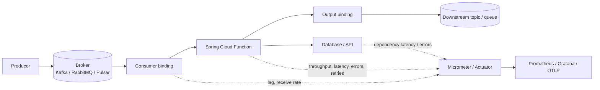

# Measuring Throughput, Processing Latency, Errors, and Retries

A Spring Cloud Stream application can still report an UP status while consumers process slowly, backlogs grow, dependencies fail repeatedly, or messages are retried many times. Application observability requires measuring processing throughput, processing duration, errors, and retries, while correlating them with broker state.

Four core signals:

- **Throughput:** number of messages received, processed successfully, or emitted per unit of time.
- **Processing latency:** time a function takes to process a message; distinguish single-attempt time from total time including backoff.
- **Error rate:** proportion of messages or processing attempts ending in failure.
- **Retry rate:** number of times a function must retry due to transient errors.

Beyond these four signals, monitor **consumer lag/backlog**. Lag indicates how far behind the data source a consumer is falling; it is not the processing time of a single message. Combining these signals helps determine whether the system is slow due to processing capacity, inbound load, dependencies, or the broker.

## 1. Observability picture of an event pipeline

A Spring Cloud Stream pipeline typically consists of a producer, broker, consumer function, and downstream systems. Each component can be its own bottleneck:



Do not measure only inside the function. If the consumer receives no messages because the broker or binding failed, a timer inside the function records nothing; dashboards may look error-free even though the pipeline has stopped making progress. Combine metrics from the application, binder, broker, and dependencies.

## 2. Four signals to measure

| Signal | Question to answer | Appropriate meter |
|---|---|---|
| Throughput | How many messages succeed per second? | Counter |
| Processing latency | How long does a message take to process? | Timer |
| Error rate | How many messages end in failure? | Counter |
| Retry rate | How many re-executions occur after errors? | Counter |

You can also add:

- **In-flight:** number of messages currently being processed; use a gauge or LongTaskTimer depending on how it is measured.
- **Payload size:** size of messages; use a DistributionSummary.
- **Lag/backlog:** number of unconsumed offsets or messages waiting in a queue; taken from the binder/broker.
- **End-to-end age:** elapsed time from when the event was created to when the consumer finishes; computed from an event timestamp with clear rules or from distributed traces.

A metric is only meaningful when its unit and recording point are clearly defined. For example, `messages.received` increments when the function starts, whereas `messages.succeeded` increments only when processing finishes successfully.

## 3. Throughput: measuring message flow through the system

Throughput is commonly expressed in messages/second. Separately measure messages received by the function, messages processed successfully, messages ending in failure, and messages emitted to the output binding.

Counter example:

```java
Counter.builder("stream.messages.succeeded")
        .description("Number of messages processed successfully")
        .tag("function", "processPayment")
        .register(meterRegistry)
        .increment();
```

Counters only increase and never decrease. To compute a rate over a time window, the monitoring backend computes the counter's rate of increase—for example, Prometheus uses `rate()` or `increase()`.

Do not compare raw cumulative counter totals directly across two instances with different uptimes. Compute rates over a time window and aggregate appropriately by function, binding, or instance.

### Inbound and outbound throughput can differ

A function may filter messages, aggregate multiple messages into one result, or emit multiple outputs. Therefore:

- Higher input rate than output rate may be expected behavior if the function filters data.
- Lower output rate than input rate may indicate slow processing if the logic requires one output per input.
- The number of function invocations does not necessarily equal the number of published records when using batching, reactive streams, or a Kafka Streams topology.

Define throughput according to each function's business contract.

## 4. Processing latency: measuring execution time

Message latency should be measured with a Micrometer `Timer`. A Timer records durations and completion counts, and can provide total time, maximum time, and histograms/percentiles when configured.

Distinguish two kinds of duration:

1. **Attempt latency:** duration of a single execution of the processing logic.
2. **Message processing latency:** total time from the start of processing a message until final success or failure, including backoff intervals between attempts.

For example, a single service call takes 80 ms, but a message retries twice with 500 ms backoff each time. Attempt latency may be around 80 ms, while total processing latency exceeds 1 second.

These two timers answer two different questions: whether the service itself is fast or slow, and how long a message waits to reach a final outcome.

### Why track p50, p95, and p99?

Averages can hide a small group of very slow messages. Observe:

- **p50:** the experience of a typical message.
- **p95:** the slowest 5% of messages begin exceeding this threshold.
- **p99:** catches tail latency caused by locks, GC, downstream timeouts, hot partitions, or retries.

For pipelines with SLAs, define clear SLOs, such as 95% of messages completing within 500 ms and 99% within 2 seconds. These thresholds must be grounded in business requirements and observed data.

## 5. Error rate: counting errors accurately

Not every exception means a message is lost. One attempt may fail while the next retry succeeds. Therefore, separate:

- **Attempt failure:** a single attempt ending with an exception.
- **Retry:** an additional attempt after the first one.
- **Terminal failure:** the message still fails after exhausting retries or being rejected by policy.
- **DLQ count:** number of messages routed to a dead-letter queue/topic.

If you count every exception as a final error, dashboards will exaggerate failed messages. If you only count terminal failures, you will miss a flaky dependency causing high retries.

Use separate counters such as:

| Metric | Increments when |
|---|---|
| `stream.processing.attempts` | Each invocation of processing logic |
| `stream.processing.retries` | Each actual re-execution after the first attempt |
| `stream.processing.attempt.errors` | An attempt throws an exception |
| `stream.messages.succeeded` | A message completes successfully |
| `stream.messages.failed` | A message ends in failure |
| `stream.messages.deadlettered` | A message is confirmed sent to the DLQ |

The final error rate should divide terminal failures by the total number of messages that finished processing within the same time window. The per-attempt error rate detects transient failures even when messages eventually succeed.

## 6. Retry rate: detecting transient errors and retry loops

Spring Cloud Stream uses retries to reprocess a message when a function throws an exception. Common consumer properties include:

| Property | Meaning | Default |
|---|---|---:|
| `max-attempts` | Total attempts, including the first one | 3 |
| `back-off-initial-interval` | Initial wait interval | 1000 ms |
| `back-off-max-interval` | Maximum wait interval | 10000 ms |
| `back-off-multiplier` | Backoff multiplier | 2.0 |
| `default-retryable` | Whether undeclared exceptions are retried by default | true |

Example:

```yaml
spring:
  cloud:
    stream:
      bindings:
        processPayment-in-0:
          destination: payments
          group: payment-service
          consumer:
            max-attempts: 4
            back-off-initial-interval: 200
            back-off-max-interval: 2000
            back-off-multiplier: 2.0
            retryable-exceptions:
              com.acme.PaymentValidationException: false
              com.acme.TransientPaymentException: true
```

In this example, the maximum total number of processing attempts is 4, not 4 retries on top of the initial attempt. Validation errors are not retried; transient dependency errors may be retried with backoff.

### What does a high retry rate indicate?

Rising retries can be an early signal of a slow/flaky downstream database or API, overly short timeouts, external rate limiting, network errors, or messages with data causing repeated failures.

Retrying is not a cure for every error. Schema-invalid payloads or validation errors rarely resolve themselves on retry. Classify exceptions, cap attempts, and route unrecoverable errors to a DLQ/quarantine.

## 7. Measuring retries with RetryTemplate when the application owns retries

If you need an exact count of additional retry attempts, you can let an application-managed RetryTemplate execute retries and record metrics directly in the callback. When using this approach, set binder retries to one to avoid nested retries.

Example configuration:

```yaml
spring:
  cloud:
    stream:
      bindings:
        processPayment-in-0:
          destination: payments
          group: payment-service
          consumer:
            max-attempts: 1
```

RetryTemplate:

```java
@Bean
RetryTemplate paymentRetryTemplate() {
    RetryTemplate template = new RetryTemplate();

    Map<Class<? extends Throwable>, Boolean> retryable =
            Map.of(TransientPaymentException.class, true);

    template.setRetryPolicy(
            new SimpleRetryPolicy(3, retryable, true, false));

    ExponentialBackOffPolicy backOff = new ExponentialBackOffPolicy();
    backOff.setInitialInterval(200);
    backOff.setMultiplier(2.0);
    backOff.setMaxInterval(2000);
    template.setBackOffPolicy(backOff);

    return template;
}
```

Inside the callback, `RetryContext.getRetryCount()` is 0 on the initial attempt and greater than 0 on re-executions. You can increment the retry counter when this value is greater than 0. If using binder-managed retries, instrument the binding's RetryTemplate/error handler or use a binder-appropriate listener; do not add an inner RetryTemplate inside the function without disabling outer retries.

## 8. Creating custom metrics with Micrometer

Spring Boot Actuator auto-configures a `MeterRegistry` when Actuator and a matching registry are on the classpath. You can use Counter and Timer to measure business logic.

Example imperative function with application-managed retries:

```java
@Bean
Function<PaymentEvent, PaymentResult> processPayment(
        PaymentService service,
        RetryTemplate paymentRetryTemplate,
        MeterRegistry registry) {

    Counter received = Counter.builder("stream.messages.received")
            .tag("function", "processPayment")
            .register(registry);

    Counter succeeded = Counter.builder("stream.messages.succeeded")
            .tag("function", "processPayment")
            .register(registry);

    Counter failed = Counter.builder("stream.messages.failed")
            .tag("function", "processPayment")
            .register(registry);

    Counter attempts = Counter.builder("stream.processing.attempts")
            .tag("function", "processPayment")
            .register(registry);

    Counter retries = Counter.builder("stream.processing.retries")
            .tag("function", "processPayment")
            .register(registry);

    Counter attemptErrors = Counter.builder("stream.processing.attempt.errors")
            .tag("function", "processPayment")
            .register(registry);

    Timer messageTimer = Timer.builder("stream.message.processing.duration")
            .tag("function", "processPayment")
            .register(registry);

    Timer attemptTimer = Timer.builder("stream.processing.attempt.duration")
            .tag("function", "processPayment")
            .register(registry);

    return event -> {
        received.increment();
        Timer.Sample messageSample = Timer.start(registry);

        try {
            PaymentResult result = paymentRetryTemplate.execute(context -> {
                attempts.increment();
                if (context.getRetryCount() > 0) {
                    retries.increment();
                }

                Timer.Sample attemptSample = Timer.start(registry);
                try {
                    return service.process(event);
                }
                catch (RuntimeException ex) {
                    attemptErrors.increment();
                    throw ex;
                }
                finally {
                    attemptSample.stop(attemptTimer);
                }
            });

            succeeded.increment();
            return result;
        }
        catch (RuntimeException ex) {
            failed.increment();
            throw ex;
        }
        finally {
            messageSample.stop(messageTimer);
        }
    };
}
```

How to read it:

- `received` increments once when the function begins processing a message.
- `attempts` increments each time the service is actually called.
- `retries` increments only on the second call onward.
- `attemptErrors` increments each time a service call throws an exception, even if a later retry succeeds.
- `attemptTimer` measures each individual service call.
- `messageTimer` measures the total processing duration, including backoff.
- `succeeded` increments only when RetryTemplate returns a result.
- `failed` increments only when retries finish and still throw an exception.

If moving retries back to the binder, do not use this exact example with `max-attempts` greater than 1 because each binder re-invocation of the function creates a new outer invocation. In that case, clearly define which counter counts deliveries, which counts invocations, and which counts retries.

## 9. Configuring Actuator and Prometheus

Add the Actuator dependency and the registry used by your monitoring system. Maven example:

```xml
<dependency>
    <groupId>org.springframework.boot</groupId>
    <artifactId>spring-boot-starter-actuator</artifactId>
</dependency>

<dependency>
    <groupId>io.micrometer</groupId>
    <artifactId>micrometer-registry-prometheus</artifactId>
    <scope>runtime</scope>
</dependency>
```

Endpoint configuration:

```yaml
management:
  endpoints:
    web:
      exposure:
        include: health,info,metrics,prometheus
  endpoint:
    health:
      show-details: when_authorized
  metrics:
    tags:
      application: payment-stream
```

Commonly used endpoints:

- `/actuator/health`: application status and health indicators.
- `/actuator/metrics`: list of meters and details for a specific meter.
- `/actuator/prometheus`: metrics in Prometheus format when the registry has been added.

Metrics endpoints are diagnostic tools. Protect management endpoints with security/network policies and expose only required endpoints externally.

## 10. Viewing metrics via Actuator

You can list meters at:

```http
GET /actuator/metrics
```

Inspect a specific timer:

```http
GET /actuator/metrics/stream.message.processing.duration
```

Filter by tag:

```http
GET /actuator/metrics/stream.message.processing.duration?tag=function:processPayment
```

Actuator meter names use the Micrometer names defined in code. When exported to Prometheus, naming conventions may convert dots to underscores and represent Counters with a `_total` suffix. Therefore, do not take a Prometheus-normalized name and pass it directly as an Actuator selector.

## 11. Histograms, percentiles, and SLOs

To compute p95/p99 on the monitoring backend, configure histograms on timers. Example:

```yaml
management:
  metrics:
    distribution:
      percentiles-histogram:
        stream.message.processing.duration: true
      slo:
        stream.message.processing.duration: 100ms,500ms,1s,2s
```

Histograms export duration buckets so the backend can compute percentiles that aggregate cleanly across instances. SLO buckets represent latency thresholds important to the business.

Micrometer also supports client-side percentiles. However, client-side percentiles are computed independently per meter ID and cannot be accurately aggregated across multiple tags/instances like histograms. With Prometheus, histograms are generally preferred, using `histogram_quantile()` to compute percentiles from aggregated buckets.

Do not enable histograms indiscriminately for every meter. Each tag combination and bucket increases time-series count and memory usage. Enable them only for critical timers, set appropriate min/max expected values, and choose SLO buckets based on real requirements.

## 12. Consumer lag vs. processing latency

Consumer lag is the distance between the latest data position in the broker and the offset committed by the consumer group. Rising lag indicates the consumer is falling behind; it does not tell you how long a single message took inside the function.

Example:

- The input topic receives 1,000 messages/second.
- Consumers process 800 messages/second.
- The backlog grows by about 200 messages/second.

Even if each function invocation takes only 10 ms, the backlog still grows if total consumer capacity is lower than the inbound rate.

Conversely, low lag does not prove good processing latency. A message may sit in a queue for a long time and then be processed quickly. To measure wait time from publish to processing, you need an event timestamp or appropriate trace context.

## 13. Kafka binder: offset lag and metrics

The Kafka binder provides the metric:

`spring.cloud.stream.binder.kafka.offset`

This metric represents the number of messages not yet consumed by a consumer group from a topic, including consumer group, topic, and lag based on committed offsets. It is useful for detecting lagging consumers and as an autoscaling signal.

You can configure how lag is collected:

```yaml
spring:
  cloud:
    stream:
      kafka:
        binder:
          metrics:
            default-offset-lag-metrics-enabled: true
            offset-lag-metrics-interval: 60
```

The default value of `defaultOffsetLagMetricsEnabled` is true; `offsetLagMetricsInterval` defaults to 60 seconds for periodic calculation mode when used. Lag metrics may require querying metadata from Kafka, so consider the overhead when there are many topics and consumer groups.

The Kafka binder also exposes Kafka client metrics, and the Kafka Streams binder can export Kafka Streams metrics via Micrometer `MeterRegistry`. Inspect the actual metrics for your running binder and client versions; do not assume all Kafka metrics share identical names across versions.

## 14. Kafka observation and tracing

The Kafka binder has a property to enable Micrometer Observation for bindings:

```yaml
spring:
  cloud:
    stream:
      kafka:
        binder:
          enable-observation: true
```

This property defaults to false in the Kafka binder. When enabled, the binder integrates Observation Registry on the binder's bindings. Observations can produce metrics and traces depending on the configured registry/handlers.

For imperative functions, Spring Cloud Stream integrates observation at the Spring Cloud Function level. When the required observability dependencies are present, functions are wrapped with an observation wrapper and each invocation creates an observation for the message.

Typically you need `spring-boot-starter-actuator` and a tracer bridge such as `micrometer-tracing-bridge-brave` or the bridge corresponding to your tracing backend. Reactive functions also need `reactor-core-micrometer` to attach observations across processing stages.

Tracing helps connect a message across producer, broker, consumer, and downstream dependencies. Propagate trace context via the mechanism supported by your binder and verify end-to-end traces across the pipeline. Metrics show overall trends; traces pinpoint where a specific message slowed down.

## 15. RabbitMQ: observing listeners and queues

RabbitMQ requires monitoring both the application and the broker. On the broker side, key indicators include:

- `messages_ready`: messages waiting for a consumer.
- `messages_unacknowledged`: messages delivered but not yet acknowledged.
- Publish/deliver/ack rates.
- Consumer count and consumer utilization.
- Redelivery rate.
- DLQ depth and oldest message age.

On the Spring AMQP side, RabbitTemplate and listener containers support Micrometer Observation. When observation is enabled, timers are managed through observation; avoid adding manual timers for the same operation if that would double-count. Exact meter names and tags depend on the Spring AMQP version, listener container, and binder configuration.

Rising queue depth accompanied by high `messages_unacknowledged` can indicate slow consumers or unsuitable prefetch/concurrency settings. Ready messages rising while consumer count is 0 usually points to a binding, connection, or deployment issue.

## 16. Pulsar: observing listeners and subscriptions

Pulsar has several signals to monitor:

- Subscription backlog.
- Message publish/dispatch rates.
- Redelivery count.
- Consumer count and unacked messages.
- End-to-end latency and message age.
- Broker/storage health and throughput.

Spring for Apache Pulsar supports Micrometer Observation for `PulsarTemplate` and `PulsarListener` when an `ObservationRegistry` is present. Metrics documented by Spring Pulsar include `spring.pulsar.listener` and `spring.pulsar.template` as timers, along with corresponding long-task timers for active operations.

When using the Pulsar binder, Spring for Apache Pulsar properties can be applied through the binder since it builds producers/consumers on those foundational components. Still, verify actual metrics for your specific Spring Cloud Stream Pulsar binder and Spring Pulsar versions.

## 17. Reactive functions require manual observation

Spring Cloud Stream automatically wraps imperative functions per invocation. Reactive functions differ: the function is invoked only once when building the pipeline, and Reactor processes the stream afterward. Thus the framework cannot automatically create one observation per message.

You can attach observations per element using `tap`:

```java
@Bean
Function<Flux<PaymentEvent>, Flux<PaymentResult>> processReactive(
        PaymentService service,
        ObservationRegistry observationRegistry) {

    return flux -> flux
            .flatMap(event ->
                    Mono.fromCallable(() -> service.process(event))
                            .tap(Micrometer.observation(observationRegistry)));
}
```

In this example, `Mono.fromCallable` creates a processing segment per event and `tap` attaches the Observation Registry to that segment. You can choose a different observation unit, such as a batch or stream stage, but define it explicitly because reactive pipelines do not have one function invocation per message by default.

If using Reactor metrics, add the `reactor-core-micrometer` dependency according to the Spring Cloud Stream observability guide.

## 18. Error channels and DLQs do not replace error metrics

Spring Cloud Stream can forward exceptions to an error channel; some binders can requeue or send failed messages to a DLQ. However, error channels and DLQs are failure-handling mechanisms and do not automatically provide complete business metrics on retry counts or final error rates.

With the Kafka binder, asynchronous producer send errors can be sent to the error channel as a `KafkaSendFailureException`; error handling and routing must be configured appropriately by the application. Do not assume producer send failures are automatically routed to a DLQ.

Separately record function exceptions, producer send errors, retries, finally rejected messages, and messages actually published to the DLQ.

Cross-check these counters against broker metrics to avoid confusing "an error occurred" with "the message was safely stored in the DLQ".

## 19. Cardinality: avoiding excessive time series

Every combination of metric name and tags creates a meter series. Attaching tags whose values vary per message can make the series count explode rapidly.

Tags should have bounded value sets:

- `function=processPayment`
- `binding=processPayment-in-0`
- `outcome=success|failure`
- `error.type=timeout|validation|dependency`
- `broker=kafka|rabbit|pulsar`

Avoid tagging with eventId, orderId, customerId, raw exception messages or stack traces, URLs with IDs in the path, timestamps, or random values. Tenant ID can also create high cardinality if the number of tenants is unbounded.

If you need to locate a specific message, put trace IDs in logs/traces instead of turning trace IDs into metric tags. High-cardinality tags increase storage and query costs and can overload the monitoring backend.

## 20. Dashboards: organizing around operational questions

A dashboard for a consumer function can be divided into four groups:

| Group | Charts | Purpose |
|---|---|---|
| Throughput | Received/s, succeeded/s, failed/s | View processing capacity and load trends |
| Latency | p50, p95, p99, SLO buckets | Detect slowdowns and tail latency |
| Reliability | Error rate, retry rate, DLQ count | Detect failing dependencies or poison messages |
| Backlog | Kafka lag, Rabbit ready/unacked, Pulsar subscription backlog | See whether consumers are keeping up with the source |

Use the same time range across charts to correlate events. For example, retries rise first, then latency rises, then lag rises: most likely a dependency is flaky and backoffs are holding consumers longer.

Avoid relying on a single aggregate chart for all functions. You can start with an overview dashboard and drill down by function/binding and broker.

## 21. Sample PromQL for throughput, latency, and errors

Prometheus metric names depend on the registry's naming convention. For the meters in our examples, names are typically normalized with underscores.

Success throughput:

```promql
sum by (function) (
  rate(stream_messages_succeeded_total[5m])
)
```

Terminal error rate:

```promql
sum(rate(stream_messages_failed_total[5m]))
/
clamp_min(
  sum(rate(stream_messages_succeeded_total[5m])) +
  sum(rate(stream_messages_failed_total[5m])),
  1
)
```

Retries per second:

```promql
sum by (function) (
  rate(stream_processing_retries_total[5m])
)
```

p95 processing latency from histogram:

```promql
histogram_quantile(
  0.95,
  sum by (le, function) (
    rate(stream_message_processing_duration_seconds_bucket[5m])
  )
)
```

These queries are examples based on the meter names in this lesson. Verify the actual names at `/actuator/prometheus` and adjust tags/labels to match your registry. If histograms are not enabled, bucket metrics will not exist and `histogram_quantile` cannot compute p95 this way.

## 22. Alerting on trends, not just single thresholds

Useful alerts include:

- **Continuously growing consumer lag:** lag increases across consecutive windows and does not drop once inbound load stabilizes.
- **Processing p95 breaching SLO:** p95 stays above the threshold long enough to avoid alerting on brief spikes.
- **Rising terminal error rate:** final failure ratio exceeds the agreed threshold.
- **Sudden retry rate spike:** a dependency may be unstable even if messages still succeed after retries.
- **New messages in DLQ:** errors need classification and a replay/quarantine decision.
- **Success throughput drops to 0:** while input still has data or broker backlog keeps growing.

Initial thresholds might be p95 above 500 ms for 10 minutes, error rate above 1% for 5 minutes, or lag growing continuously for 10 minutes. These are only starting points; tune them to your system's SLOs, traffic, and baseline.

Alerts should point to actions: check dependencies, consumer count, partition assignments, queue depth, retries, and DLQ. Avoid alerting on every isolated exception when the system has retries and recovers normally.

## 23. Distinguishing metrics, logs, and distributed traces

| Tool | Used to answer |
|---|---|
| Metric | Is there a problem in the system? Is it getting better or worse? |
| Log | Which exception occurred during a specific execution? |
| Trace | Which components did the message traverse and which span was slow? |

Logs should include event ID, binding, outcome, and error category when correlation is needed. Traces should propagate context across producers/consumers and dependencies. Metrics should only use low-cardinality, stable tags.

Do not log full payloads or tokens. Use correlation IDs/trace IDs to link logs and traces during investigations.

## 24. Testing metrics and retries

You can test custom metrics using `SimpleMeterRegistry` without needing a broker:

```java
@Test
void recordsSuccessAndLatency() {
    SimpleMeterRegistry registry = new SimpleMeterRegistry();

    Counter succeeded = Counter.builder("stream.messages.succeeded")
            .tag("function", "processPayment")
            .register(registry);

    Timer timer = Timer.builder("stream.message.processing.duration")
            .tag("function", "processPayment")
            .register(registry);

    succeeded.increment();
    timer.record(Duration.ofMillis(40));

    assertThat(registry.get("stream.messages.succeeded")
            .tag("function", "processPayment")
            .counter().count()).isEqualTo(1.0);

    assertThat(registry.get("stream.message.processing.duration")
            .tag("function", "processPayment")
            .timer().count()).isEqualTo(1);
}
```

Beyond unit tests, integration tests should verify:

1. A successful function increments the success counter.
2. A function throwing a transient error increments the retry counter the exact number of times.
3. A successful retry does not increment the terminal failure counter.
4. Exhausting retries increments the terminal failure counter exactly once.
5. The message timer includes backoff, while the attempt timer includes only the service call duration.
6. Messages entering the DLQ increment the DLQ metric or broker count.
7. Kafka lag, Rabbit queue depth, or Pulsar backlog accurately reflect consumer state.
8. Metrics are exported at the monitoring endpoint.
9. Reactive pipelines create observations per message as designed.
10. Tags do not contain event IDs or high-cardinality values.

Metric tests should verify counting semantics, not merely that a meter exists. In particular, test the retry-then-succeed case to distinguish attempt failures from terminal failures.

## 25. Observability rollout workflow

1. List the functions and input/output bindings to observe.
2. Define throughput, latency, error, and retry semantics for each function.
3. Add Actuator and the appropriate registry.
4. Enable observation/tracing according to your binder and programming model.
5. Add custom Counters/Timers for missing business metrics.
6. Choose where retries are managed: binder or application; avoid nested retries.
7. Add lag/backlog metrics from the binder and broker.
8. Configure histograms/SLOs for important timers.
9. Choose low-cardinality tags.
10. Build overview and drill-down dashboards.
11. Set alerts based on SLOs and backlog/error/retry trends.
12. Test metrics, traces, error channels, and DLQs in an integration environment.
13. Monitor post-deployment baselines and tune thresholds.

## 26. Pre-production checklist

- Inbound, success, and failure throughput are measured separately.
- Timers measure both attempt latency and total message processing latency when retries occur.
- Error metrics distinguish attempt failures from terminal failures.
- Retry metrics increment only on actual re-executions.
- Consumer lag/backlog is observed from the broker/binder.
- Kafka offset lag is tracked per topic and consumer group.
- Rabbit ready/unacked and DLQ depth are tracked.
- Pulsar subscription backlog and redeliveries are tracked.
- Actuator metrics/prometheus are exposed in a controlled manner.
- Histograms/SLOs are enabled for key timers.
- Metric tags have low cardinality.
- Imperative and reactive functions are instrumented appropriately for their model.
- Retry policies have limits, backoff, and exception classification.
- DLQ/error channels have metrics and operational runbooks.
- Dashboards show throughput, latency, errors, retries, and lag on the same time range.
- Alerts are driven by SLOs and trends, not just a brief spike.
- Integration tests verify metrics and broker state after success, retry, and failure.

Observing a Spring Cloud Stream pipeline requires combining business metrics with binder and broker metrics. Counters show rate and error counts; Timers show processing duration; retry counters surface transient errors; lag/backlog reveals whether consumers keep up with the source. Measure individual attempts separately from total message time, distinguish transient errors from terminal errors, and link metrics with logs and traces to uncover root causes.

## References

- [Spring Cloud Stream 5.0.4 — Observability](https://docs.spring.io/spring-cloud-stream/reference/observability.html)
- [Spring Cloud Stream — Error Handling and Retry Template](https://docs.spring.io/spring-cloud-stream/reference/spring-cloud-stream/overview-error-handling.html)
- [Spring Cloud Stream 5.0 — Kafka Binder Metrics](https://docs.spring.io/spring-cloud-stream/reference/5.0/kafka/kafka-binder/metrics.html)
- [Spring Cloud Stream — Kafka Binder Configuration Options](https://docs.spring.io/spring-cloud-stream/reference/kafka/kafka-binder/config-options.html)
- [Spring Boot — Actuator Metrics](https://docs.spring.io/spring-boot/reference/actuator/metrics.html)
- [Micrometer — Histograms and Percentiles](https://docs.micrometer.io/micrometer/reference/concepts/histogram-quantiles.html)
- [Micrometer — Timers](https://docs.micrometer.io/micrometer/reference/concepts/timers.html)
- [Spring AMQP — Micrometer Observation](https://docs.spring.io/spring-amqp/reference/amqp/receiving-messages/micrometer-observation.html)
- [Spring for Apache Pulsar — Observability](https://docs.spring.io/spring-pulsar/reference/reference/observability.html)
