# Propagating Trace Context Across Headers and Execution Boundaries

A trace is only useful when it can connect the processing steps of the same request or event, even across multiple applications, brokers, and threads. In Spring Cloud Stream, trace context can travel alongside messages through headers in Kafka, RabbitMQ, or Pulsar; inside an application, context must also be preserved when code switches to another executor or moves through a reactive pipeline.

Micrometer Observation and Micrometer Tracing provide the instrumentation layer for Spring. Spring Cloud Stream can create observations around each imperative function invocation, while the binder/transport is responsible for writing and reading trace context at message boundaries. When switching threads or using reactive functions, the application must configure appropriate context propagation. These three concerns are related but do not substitute for one another: creating spans, propagating headers across a broker, and restoring context on a thread are separate steps.

## 1. What does trace context contain?

Distributed tracing describes work spanning multiple components using a shared `traceId` and multiple `spanId` values representing individual operations. For example, an order creation request might pass through an API Gateway, Order Service, Kafka, Inventory Service, and Payment Service. Each component creates its own span, and all spans are linked within the same trace.

Key concepts:

| Component | Meaning | Example |
| --- | --- | --- |
| `traceId` | Identifier for the entire trace | A 128-bit ID shared across spans in the same trace |
| `spanId` | Identifier for a specific operation | Span receiving an HTTP request or processing one message |
| Parent span | The span that directly triggered the current operation | The message publish span is the parent of the consumer span under a parent-child model |
| `traceparent` | W3C standard header carrying trace ID, parent ID, and trace flags | `00-<trace-id>-<parent-id>-01` |
| `tracestate` | Additional tracing vendor-specific data | Opaque metadata managed by the tracing system |
| `baggage` | Application attributes carried along the trace | `tenant-id`, `region`, `workflow-type` |
| Business correlation ID | ID for linking business records or logs | `orderId`, `eventId`, `correlationId` |

`traceId` is not `orderId`, and `spanId` is not the broker message ID. A single order can spawn multiple traces at different times; a single trace can also process multiple messages. Keep business IDs separate and never use trace IDs as data keys or idempotency keys.

## 2. W3C Trace Context and common headers

W3C Trace Context defines two core headers:

- `traceparent`: the position of the current operation in the trace graph in a format understood across tracing vendors.
- `tracestate`: vendor-specific extension data accompanying `traceparent`.

Example of a version `00` `traceparent`:

```text
traceparent: 00-0af7651916cd43dd8448eb211c80319c-b7ad6b7169203331-01
```

Its parts in order are:

1. `00`: format version.
2. `0af7651916cd43dd8448eb211c80319c`: 32-character hexadecimal trace ID.
3. `b7ad6b7169203331`: 16-character hexadecimal parent/span ID.
4. `01`: trace flags; the sampled bit is enabled in this example.

`tracestate` might look like:

```text
tracestate: acme=opaque-value,other-vendor=opaque-data
```

Business application code should not parse or edit `tracestate` directly. The tracing propagator is responsible for parsing, validating, and updating this value.

`baggage` carries application-defined key/value pairs, for example:

```text
baggage: tenant-id=tenant-a,region=ap-southeast-1,workflow=order-create
```

Trace context answers "which trace does this operation belong to?". Baggage answers "which contextual attributes need to travel along the execution flow?". Never put passwords, access tokens, payment details, or unnecessary personal data into baggage.

## 3. Broker headers and HTTP headers are not the same carrier

The names `traceparent`, `tracestate`, and `baggage` are defined in context-propagation specifications, but when using message brokers, they are normally stored in message metadata/headers rather than HTTP request headers.

| Broker | Where headers are carried | Notes |
| --- | --- | --- |
| Kafka | Native record headers (`org.apache.kafka.common.header.Headers`) | Header values are byte arrays; producer/consumer must agree on string encoding, typically UTF-8 |
| RabbitMQ | AMQP message properties/headers | Headers are AMQP-typed; check Spring AMQP/binder converters and header mappings |
| Pulsar | Message custom user properties and metadata | User properties are string key/value pairs; Pulsar-managed metadata uses separate fields |

Spring Cloud Stream passes messages through Spring `Message<?>` and binders. The binder's header mapper converts Spring `MessageHeaders` into a carrier understood by the broker, and converts back on receipt. If the binder drops a header or the consumer disables reading headers, trace context can be lost even though business code keeps processing messages normally.

For middleware supporting native headers such as Kafka, RabbitMQ, and Pulsar, prefer the binder's native header mechanism. `embeddedHeaders` embeds metadata inside the payload for middleware without native headers; do not use it instead of native headers when the broker already has proper support.

## 4. Two-way injection and extraction of trace context

When sending a message, tracing instrumentation reads the current context, injects it into the header carrier, and the producer sends the message. On receipt, the consumer extracts context from headers, creates an observation/span for receiving or processing, and puts the context into scope while executing code.

```mermaid
flowchart LR
    A[HTTP request or upstream event] --> B[Current observation / span]
    B --> C[Producer instrumentation]
    C --> D[Inject traceparent, tracestate, baggage]
    D --> E[Broker headers + payload]
    E --> F[Consumer instrumentation]
    F --> G[Extract remote trace context]
    G --> H[Consumer observation / child span]
    H --> I[Function / Consumer]
    I --> J[Downstream call or message]
```



Producers and consumers must use compatible propagators. If the producer injects W3C while the consumer only looks for B3 format, the two sides may create two disconnected traces. In polyglot systems, standardize on W3C Trace Context or one shared format set, and verify baggage policies.

### Do not manually copy old traceparent values

When a consumer processes a message and emits a new message, the publish operation needs the current span's context. Tracing instrumentation generates the outbound header with the right parent ID. If application code copies the inbound `traceparent` verbatim onto the outbound message, the parent ID may still point to the earlier span, skipping the current processing span and producing an inaccurate trace tree.

Therefore:

- Let the tracing propagator inject/extract `traceparent`, `tracestate`, and `baggage`.
- When creating a new message, copy only required business headers such as `eventId`, `correlationId`, `tenantId`, or `eventType`.
- Never manually set `traceparent` or `tracestate` to a string read from an old message.
- If integrating a broker client directly outside a binder, use the `TextMapPropagator`/Micrometer Tracing APIs to inject and extract on the carrier instead of parsing strings by hand.

## 5. Configuring the Micrometer Tracing foundation

Spring Cloud Stream uses Micrometer Observation to create observations for operations. When a tracing bridge is present, observations can create spans and ship them to a backend such as Zipkin or an OpenTelemetry Collector.

A Spring Boot application typically needs:

- `spring-boot-starter-actuator` for ObservationRegistry and the observability foundation.
- A tracing bridge, such as `micrometer-tracing-bridge-otel` or `micrometer-tracing-bridge-brave`.
- The corresponding exporter when shipping spans to a backend, such as an OTLP exporter or Zipkin reporter.
- `reactor-core-micrometer` when the application uses reactive observation per the Spring Cloud Stream guide.
- `io.micrometer:context-propagation` when propagating context across certain async boundaries, especially with async `StreamBridge`.

Pick one tracing bridge matching your Spring Boot BOM and tracing backend. Do not pull in multiple bridges simultaneously just for experimentation; propagator and exporter configuration must align with your tracing infrastructure.

Example sampling and baggage configuration in `application.yml`:

```yaml
management:
  tracing:
    sampling:
      probability: 0.10
    baggage:
      remote-fields:
        - tenant-id
        - workflow-type
      correlation:
        fields:
          - tenant-id
```

`probability: 0.10` is an example of 10% sampling, not a mandatory rate. Choose a rate based on traffic, backend costs, and diagnostic needs. `remote-fields` declares baggage allowed to propagate across instrumented transport boundaries; `correlation.fields` puts selected values into the logging context/MDC according to the tracer configuration.

Do not assume declaring baggage is enough for every binder to propagate it automatically. The transport must be instrumented and the propagator must support that carrier. Inspect actual headers at both producer and consumer.

## 6. Spring Cloud Stream auto-observations for imperative functions

Spring Cloud Stream integrates Micrometer Observation at the Spring Cloud Function layer. For imperative functions such as `Consumer<T>`, `Function<T, R>`, or those accepting `Message<T>`, the framework uses `ObservationFunctionAroundWrapper` to create an observation around each function invocation when the required observability dependencies are on the classpath.

Example:

```java
@Configuration(proxyBeanMethods = false)
public class OrderFunctions {

    @Bean
    public Consumer<OrderCreated> processOrder(OrderService service) {
        return event -> service.process(event);
    }
}
```

With an imperative function, each received message triggers one function invocation and one corresponding observation. This fits handlers that process one event at a time. The function observation records processing duration and errors; to connect traces across the broker, producer/consumer transport must also support injecting/extracting context.

You can create child observations for an important business step:

```java
import io.micrometer.observation.Observation;
import io.micrometer.observation.ObservationRegistry;

@Service
public class OrderService {

    private final ObservationRegistry observationRegistry;
    private final InventoryClient inventoryClient;

    public OrderService(
            ObservationRegistry observationRegistry,
            InventoryClient inventoryClient) {
        this.observationRegistry = observationRegistry;
        this.inventoryClient = inventoryClient;
    }

    public void process(OrderCreated event) {
        Observation.createNotStarted("orders.reserve-inventory", observationRegistry)
                .lowCardinalityKeyValue("operation", "reserve-inventory")
                .observe(() -> inventoryClient.reserve(event));
    }
}
```

When a parent observation is active, the new observation can become a child span. Use low-cardinality tags for bounded values such as operation or outcome; never attach `orderId`, `userId`, or message IDs as metric tags because they create very high cardinality.

## 7. Binder transport instrumentation must be enabled and verified separately

An observation around a function does not by itself prove headers are written to the broker. Enable and verify instrumentation at the binder/transport layer for your running version.

For the regular Kafka binder, documentation provides the property:

```yaml
spring:
  cloud:
    stream:
      kafka:
        binder:
          enable-observation: true
```

The `spring.cloud.stream.kafka.binder.enableObservation` property enables Micrometer Observation on the Kafka binder's bindings; its documented default is `false`. Verify the exact namespace for your binder: the Kafka Streams binder has its own configuration namespace and you should not assume every regular Kafka binder property applies to it.

For RabbitMQ, verify observation support in Spring AMQP/Rabbit binder and the corresponding listener/template configuration in your release train. For Pulsar, Spring for Apache Pulsar instruments `PulsarTemplate` and `PulsarListener` when an `ObservationRegistry` is present; if using the Spring Cloud Stream Pulsar binder, verify the actual instrumentation path of your binder version rather than assuming all Spring Pulsar settings apply identically.

Questions to verify in a running environment:

- Is a producer observation created when publishing via an output binding or `StreamBridge`?
- Do trace headers appear in broker record/message properties?
- Does the consumer extract remote context and create a processing span?
- Does the consumer span's trace ID match the upstream trace ID?
- Do parent spans or span links accurately reflect the message flow semantics?
- Does sampling suppress spans while still preserving propagation context?

Do not conclude "tracing is working" just because logs within the same thread show a `traceId`. Verify traces across at least two processes and a broker boundary.

## 8. Preserving business headers when creating new messages

When a function receives `Message<T>` and returns a new message, required business headers can be copied selectively. Example:

```java
@Bean
public Function<Message<OrderCreated>, Message<OrderValidated>> validateOrder(
        OrderValidator validator) {

    return input -> {
        OrderValidated result = validator.validate(input.getPayload());

        return MessageBuilder.withPayload(result)
                .setHeader("eventId", input.getHeaders().get("eventId"))
                .setHeader("correlationId",
                        input.getHeaders().get("correlationId"))
                .setHeader("tenantId", input.getHeaders().get("tenantId"))
                .setHeader("eventType", "OrderValidated")
                .build();
    };
}
```

This example copies only business metadata. Do not blindly copy all headers, because inbound messages may contain internal binder headers, broker metadata, retry info, or trace carriers managed by instrumentation. When the output binding publishes the message, tracing instrumentation injects the current context if configured.

If additional business headers must be kept, define an allowlist. Specifically, business `correlationId` should be preserved per the application contract, while `traceparent` should be generated from the current span.

## 9. StreamBridge and asynchronous sends

`StreamBridge` lets you send messages from code that is not a function bean. By default, sending uses the calling thread and is typically blocking. When async send is enabled, publishing work may run on a different thread; if context propagation is not configured, trace/log correlation can break at that boundary.

Example:

```java
@Service
public class OrderPublisher {

    private final StreamBridge streamBridge;

    public OrderPublisher(StreamBridge streamBridge) {
        this.streamBridge = streamBridge;
    }

    public boolean publish(OrderCreated event, String correlationId) {
        Message<OrderCreated> message = MessageBuilder
                .withPayload(event)
                .setHeader("correlationId", correlationId)
                .build();

        return streamBridge.send("orders-out-0", message);
    }
}
```

When asynchronous sending is not required, keeping the send path blocking keeps the current context on the same call stack. When async is needed:

```java
streamBridge.setAsync(true);
streamBridge.send("orders-out-0", message);
```

Spring Cloud Stream instructs adding the `io.micrometer:context-propagation` dependency when using observability alongside async `StreamBridge`, so context can be captured and restored across thread boundaries. Verify that context actually propagates via integration tests rather than merely checking that async send returns.

## 10. Propagating context across Executors and @Async

Micrometer Tracing typically stores the current scope in a `ThreadLocal` so logging and instrumentation can read `traceId`/`spanId`. `ThreadLocal` does not automatically transfer to another thread. If you call `executor.submit(...)` and run work on a worker thread, trace context can be lost and logs on the new thread will lack correlation IDs.

For an application-configured executor, use `ContextPropagatingTaskDecorator`:

```java
import org.springframework.context.annotation.Bean;
import org.springframework.context.annotation.Configuration;
import org.springframework.core.task.TaskDecorator;
import org.springframework.core.task.support.ContextPropagatingTaskDecorator;
import org.springframework.scheduling.concurrent.ThreadPoolTaskExecutor;

@Configuration(proxyBeanMethods = false)
public class AsyncConfiguration {

    @Bean
    public TaskDecorator contextPropagatingTaskDecorator() {
        return new ContextPropagatingTaskDecorator();
    }

    @Bean
    public ThreadPoolTaskExecutor orderExecutor(TaskDecorator decorator) {
        ThreadPoolTaskExecutor executor = new ThreadPoolTaskExecutor();
        executor.setCorePoolSize(4);
        executor.setMaxPoolSize(8);
        executor.setQueueCapacity(200);
        executor.setThreadNamePrefix("order-worker-");
        executor.setTaskDecorator(decorator);
        executor.initialize();
        return executor;
    }
}
```

The decorator captures context when a task is submitted and restores registered context accessors when the task runs. It also restores the previous state after the task finishes, preventing the trace from an earlier message from leaking into the next task on the same thread pool.

If using Spring Boot's auto-configured executor for `@Async`, some Boot versions offer the opt-in property `spring.task.execution.propagate-context`. For custom-built executors, attach the decorator directly as shown and verify behavior for your Spring Framework/Boot version.

Never stuff a raw `traceId` string into `ThreadLocal` manually and treat that as distributed tracing. Restoration must go through Micrometer Tracing/Observation context accessors so span scope, baggage, and MDC are all managed cleanly.

## 11. Context propagation in Reactor

Reactive pipelines can execute across multiple threads. Reactor uses a `Context` attached to the subscription, while many logging/tracing integrations also need `ThreadLocal` restored in imperative code segments. Micrometer Context Propagation bridges the two models.

In Spring Boot, you can enable automatic context propagation for Reactor via property when supported by your version:

```yaml
spring:
  reactor:
    context-propagation: auto
```

Or use the corresponding Reactor API:

```java
Hooks.enableAutomaticContextPropagation();
```

For reactive functions in Spring Cloud Stream, note an important difference: a reactive function is invoked once at startup to connect the binder-supplied `Flux` to the application's stream logic. It is not wrapped per message by the framework like an imperative function. Therefore, the application must explicitly select an observation unit and attach observations to the pipeline segment to be tracked.

Example creating an observation per element:

```java
import java.util.function.Function;

import io.micrometer.observation.ObservationRegistry;
import io.micrometer.observation.reactor.Micrometer;
import reactor.core.publisher.Flux;
import reactor.core.publisher.Mono;

@Bean
public Function<Flux<OrderCreated>, Flux<OrderValidated>> validateReactive(
        ObservationRegistry registry,
        OrderValidator validator) {

    return orders -> orders.flatMap(order ->
            Mono.just(order)
                    .map(validator::validate)
                    .tap(Micrometer.observation(registry)));
}
```

`tap(Micrometer.observation(registry))` creates an observation for the selected chain segment. Place `tap` inside `flatMap` so each message gets its own observation. Placing an observation around the entire `Flux` measures the subscription/stream instead of individual messages; choose based on your observability goal.

Do not confuse automatic context propagation between operators with propagation across a broker. Reactor Context keeps context inside the pipeline; the binder still must inject/extract trace headers when messages leave the process or arrive from the broker.

## 12. Baggage: controlled propagation of application metadata

Baggage is useful when an attribute is needed across multiple services but does not belong in the business payload, such as `tenant-id`, `region`, or `workflow-type`. Micrometer Tracing provides an API to scope baggage:

```java
import io.micrometer.tracing.BaggageInScope;
import io.micrometer.tracing.Tracer;

@Service
public class TenantAwareOrderService {

    private final Tracer tracer;

    public TenantAwareOrderService(Tracer tracer) {
        this.tracer = tracer;
    }

    public void process(OrderCreated event) {
        try (BaggageInScope ignored =
                     tracer.createBaggageInScope("tenant-id", event.tenantId())) {
            handleOrder(event);
        }
    }
}
```

When the scope closes, baggage reverts to its prior state. Using try-with-resources prevents baggage from one message from leaking into the next message when consumers use thread pools.

In Spring Boot, `management.tracing.baggage.remote-fields` declares baggage fields to propagate across instrumented transports; `management.tracing.baggage.correlation.fields` adds fields to MDC; `management.tracing.baggage.tag-fields` can attach fields as span tags. Verify exact property names and behavior against your tracer bridge version.

Never use baggage to carry large business data or secrets. Baggage typically traverses many services and can surface in trace backends, logs, or telemetry. Allowlist only needed fields, limit sizes, and strip them before crossing trust boundaries.

## 13. Header propagation by binder

Each binder stores headers differently. Tracing instrumentation must interoperate with the corresponding header mapper/carrier.

| Binder | Carrier | What to verify |
| --- | --- | --- |
| Kafka | Record headers | Observation enabled on producer/consumer; header mapper does not filter `traceparent`, `tracestate`, `baggage`; byte values are read properly |
| RabbitMQ | AMQP headers | Spring AMQP/Rabbit binder instrumentation creates sender/receiver observations; properties converter preserves headers and compatible types |
| Pulsar | Message user properties | Pulsar binder/Spring Pulsar instrumentation supports inject/extract; user properties keep trace values as strings |

The regular Kafka binder has `spring.cloud.stream.kafka.binder.enable-observation`; documentation states the default is `false`. For RabbitMQ and Pulsar, check the documentation for your binder and running Spring AMQP/Spring Pulsar versions. Do not apply Kafka properties to Rabbit/Pulsar or assume one global property enables all transports.

### Native headers and header mapping

Kafka, RabbitMQ, and Pulsar all support native metadata/headers. If a configured header mapper uses an allowlist, it must permit the required tracing headers. If a mapper uses a denylist, do not accidentally exclude `traceparent`, `tracestate`, or `baggage`.

If the producer is an application outside Spring Cloud Stream, align on header format and types. For example, Kafka headers are byte arrays, while Pulsar user properties are strings. Producer and consumer must encode/decode compatibly; matching header names with mismatched byte formats can still cause extraction to fail.

## 14. Batch consumers are a special case

In Kafka binder batch mode, tracing propagation is not directly supported the same way as record listeners. A batch may hold records from multiple partitions, topics, or producers; each record may belong to a different trace. The framework cannot assign a single trace ID to the whole batch without distorting semantics.

If a consumer accepts `Message<List<T>>`, Spring Kafka can provide the `kafka_batchConvertedHeaders` header, a list of metadata maps aligned in order and size with the payload list. Each element holds the header map of the corresponding record. The application must iterate over elements, extract trace context, and create separate observations if per-record tracing is needed.

Do not take the `traceparent` of the first message and use it as the context for the entire batch. Doing so merges unrelated traces into one misleading trace. If the batch is processed as a single business unit, create a dedicated batch observation and use span links or per-record metadata to link back to each origin trace per your tracing tooling.

## 15. Correlation ID, event ID, and trace ID

These IDs serve distinct purposes:

| ID | Scope | Used for |
| --- | --- | --- |
| `traceId` | One distributed trace | Finding all spans in a single distributed execution |
| `spanId` | One operation | Locating a specific processing step within a trace |
| `correlationId` | A business flow per application contract | Linking logs, messages, or requests of the same business flow |
| `eventId` | A specific event | Deduplication, idempotency, and audit |
| Broker message ID/offset | One message write on the broker | Locating a message in Kafka/RabbitMQ/Pulsar |

For example, an order event has `eventId=evt-123` and `correlationId=order-456`. On retry, the message retains both business IDs; each attempt may receive a new span and span ID. If the system starts a new trace due to sampling, batching, or a trust boundary, the correlation ID still links the business flow without pretending spans belong to the same trace.

## 16. Sampling and log correlation

Spring Boot uses Micrometer Tracing to populate `traceId` and `spanId` in the logging context/MDC when tracing is configured. Logs can correlate via these two values so operators can locate logs from a trace.

Sampling determines which traces/spans are recorded in the backend. An unsampled request may not appear in the tracing UI, even while context still propagates to downstream services depending on the propagator and sampler. Thus, "no trace visible" does not necessarily mean messages lacked trace context.

In production:

- Choose a sampling rate suited to throughput and backend costs.
- Use 100% sampling in controlled tests to verify propagation paths.
- Log `traceId`, `spanId`, `eventId`, and destination when needed for investigations.
- Never use `traceId` or `spanId` as high-cardinality metric tags.
- Verify MDC is restored/cleared properly when threads return to a pool.

## 17. Security and trust boundaries

Trace headers and baggage arrive from the message carrier. Do not treat them as authoritative sources of identity or access control.

Rules to follow:

- Never place tokens, passwords, session cookies, or payment data into baggage.
- Do not trust `tenant-id` in baggage/headers without verifying producer authorization.
- Bound the length of `traceparent`, `tracestate`, `baggage`, and custom headers.
- Allowlist only baggage fields with a clear purpose.
- Consider stripping sensitive baggage when messages cross trust boundaries or external vendors.
- Never log the entire header map if it may contain sensitive data.
- Do not allow external senders to inject arbitrary high-cardinality span tags/metric tags.
- When resetting a trace for security policy reasons, handle `tracestate` accordingly and record business correlation IDs separately.

Trace context correlates telemetry; it does not replace authentication, authorization, or audit logs.

## 18. Testing trace context across brokers

Unit testing a single function is not enough to prove trace context crosses a broker. Test across each boundary.

### Function unit test

Verify that the function retains required business headers and does not overwrite trace headers itself. You can use `MessageBuilder` to construct input messages and assert output payloads/headers.

### Async executor check

Create a parent observation/span, submit a task through an executor with `ContextPropagatingTaskDecorator`, and verify inside the task:

- Trace ID still matches the parent trace.
- Span ID matches the active span or a child span created inside the task.
- MDC is restored and does not leak to subsequent tasks.

### Integration test with a real broker

With Kafka, RabbitMQ, or Pulsar:

1. Create a trace/observation at the producer.
2. Publish a message via a binding or `StreamBridge`.
3. Inspect the raw broker message or instrumented consumer to confirm trace carriers are written.
4. Consume in an application with tracing enabled.
5. Verify the trace ID is preserved and a consumer span is created per instrumentation parent/link semantics.
6. Publish a follow-up message from the consumer and verify context is re-injected.
7. Repeat with header mapper allowlists, async sends, and retries.
8. Test messages from producers outside Spring Cloud Stream with and without trace headers.

### Testing reactive and batch

- Reactive function: verify observations are created on the intended segment and context is restored across scheduler switches.
- Kafka batch: verify `kafka_batchConvertedHeaders` aligns with each payload element; do not merge traces of distinct records.
- Async StreamBridge: verify context remains accurate after send switches to another thread.

To assert trace backend data, use an in-memory exporter/test reporter or test collector. Under `@SpringBootTest`, some tracing exporters/reporters may not auto-configure the same way as during normal application startup; configure test beans or test exporters explicitly.

## 19. Common issues and troubleshooting

| Symptom | Possible cause | How to resolve |
| --- | --- | --- |
| Producer and consumer have different trace IDs | Producer did not inject headers, consumer did not extract, or incompatible propagators | Check binder observation, actual headers, and W3C/B3 format on both sides |
| Logs in function have trace ID but downstream does not | Function observation exists but transport instrumentation is off | Enable/verify binder observation and header mappers |
| Trace lost after `executor.submit` or `@Async` | ThreadLocal does not transfer to the new thread automatically | Use `ContextPropagatingTaskDecorator` or a context-propagating executor |
| Trace lost with `StreamBridge.setAsync(true)` | Async send switches threads without context propagation | Add Micrometer `context-propagation` and test the async path |
| Trace lost in reactive operators | ThreadLocal not restored from Reactor Context | Enable appropriate context propagation and place observation/tap in the chain |
| Reactive function has only one span at startup | Reactive function runs once to wire the stream, not per message | Create observations explicitly per message or measured segment |
| Custom header mapper drops traces | Allowlist omits `traceparent`/`tracestate`/`baggage` | Add required headers and test round-trip |
| Consumer span lacks expected parent | Old header copied manually or producer/consumer use different sampling/propagators | Let propagators inject/extract current context; never copy raw traceparent |
| Baggage missing downstream | Remote fields not declared or transport lacks baggage instrumentation | Configure baggage fields and verify carrier/binder support |
| Trace backend shows no traces | Sampling dropped spans, exporter unconfigured, or endpoint errors | Check sampler, exporter, and backend; test with 100% sampling in a controlled environment |
| Batch has wrong trace or merges unrelated records | First batch header used for entire payload | Use per-record metadata and create separate observations |
| MDC contains trace ID from an earlier message | Context scope not closed/restored cleanly | Use context propagation APIs, close scopes with try-with-resources, and test thread reuse |

## 20. Implementation workflow

When setting up tracing for a Spring Cloud Stream flow:

1. Choose a tracing bridge and backend matching the Spring Boot BOM.
2. Add Actuator, the tracing bridge, and the required exporter.
3. Agree on a common propagator, preferring W3C when supported across components.
4. Enable instrumentation around imperative functions and transport/binders.
5. Verify native header mappings do not strip trace carriers.
6. Keep business correlation IDs/event IDs separate from trace IDs/span IDs.
7. Configure context propagation for executors, `@Async`, async `StreamBridge`, and Reactor.
8. Define a baggage allowlist and exclude sensitive data.
9. Account for batch consumers and producers outside Spring Cloud Stream.
10. Write integration tests through a real broker and inspect the trace backend.
11. Tune sampling, log correlation, metrics, and alerts for production.

## References

- [Spring Cloud Stream 5.0.4 — Observability](https://docs.spring.io/spring-cloud-stream/reference/observability.html)
- [Spring Cloud Stream — Producing and Consuming Messages (StreamBridge async context propagation)](https://docs.spring.io/spring-cloud-stream/reference/spring-cloud-stream/producing-and-consuming-messages.html)
- [Spring Cloud Stream — Kafka Binder Configuration Options (`enableObservation`)](https://docs.spring.io/spring-cloud-stream/reference/kafka/kafka-binder/config-options.html)
- [Spring Cloud Stream — Kafka Batch Consumption and Observability](https://docs.spring.io/spring-cloud-stream/reference/kafka/kafka-binder/consume-batches.html)
- [Spring Boot — Tracing and Baggage](https://docs.spring.io/spring-boot/reference/actuator/tracing.html)
- [Spring Boot — Observability and Context Propagation](https://docs.spring.io/spring-boot/reference/actuator/observability.html)
- [Micrometer Context Propagation — Purpose and Usage](https://docs.micrometer.io/context-propagation/reference/purpose.html)
- [Spring for Apache Pulsar — Observability](https://docs.spring.io/spring-pulsar/reference/reference/observability.html)
- [W3C Trace Context — Header Format](https://www.w3.org/TR/trace-context/)
- [W3C Baggage — Propagation Format](https://www.w3.org/TR/baggage/)

Property names, dependencies, and support levels can vary across Spring Boot, Spring Cloud Stream, binder, and broker versions. Cross-check the documentation for your exact release train before deploying configuration to production.

## Conclusion

Trace context crosses message brokers when tracing instrumentation injects context into headers at publish time and extracts it upon consumption. Spring Cloud Stream creates observations around imperative functions, while transport instrumentation must still be enabled and verified separately. When code switches threads, use Micrometer Context Propagation; for reactive functions, pick an observation unit and attach it to the pipeline explicitly. Let propagators manage `traceparent`, `tracestate`, and `baggage`, keep them distinct from business IDs, and run end-to-end tests through the broker to verify traces never break across any boundary.
