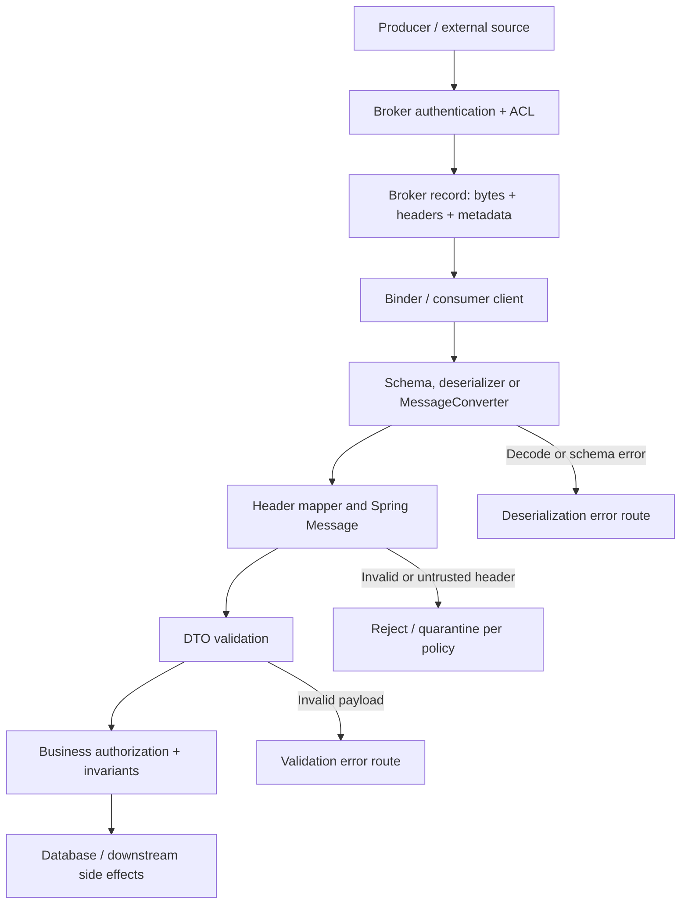

# Controlling Input Data, Deserialization Types, and Trusted Headers

A Spring Cloud Stream consumer receives data from a broker as if receiving data across a network boundary: the producer may be an application from another team, an older version, a program written in a different language, or an untrusted source. Payloads may be malformed, missing fields, oversized, or attempting to control which Java class the consumer instantiates. Headers can also be spoofed, contain oversized values, or declare a class name outside the message contract.

To handle this safely, each layer must be controlled independently: authenticating connections and broker access permissions, checking schema/byte format, choosing constrained deserialization types, inspecting headers, validating DTOs after conversion, and checking business rules before side effects. No single annotation or `trustedPackages` property replaces all of those layers.

## 1. Trust Boundaries of a Message

A message entering the application typically goes through these steps:

1. The broker authenticates the client and checks permissions to read the topic/queue/subscription.
2. The binder receives the record/message along with payload bytes and broker metadata.
3. A serializer/deserializer or message converter turns bytes into application data types.
4. A header mapper converts broker metadata into Spring `MessageHeaders`.
5. The Function/Consumer inspects the structure and data of the payload and headers.
6. The business service checks permissions and invariants before writing to a database or calling other services.



Protection layers solve different problems:

| Layer | Question to Answer | Example Controls |
| --- | --- | --- |
| Broker security | Who is allowed to connect and read the topic? | TLS, SASL, credentials, ACLs, tenant/namespace policies |
| Schema/format | Do the bytes match the published format? | JSON parser, Avro/Protobuf/Pulsar schema, schema compatibility |
| Deserialization | Which type are bytes converted into? | Fixed target type, type mapping allowlist, never trust arbitrary class names |
| Header mapping | Which headers enter Spring and which types are restored? | Header allowlist, trusted packages, size limits |
| DTO validation | Do fields satisfy structural constraints? | Jakarta Bean Validation, required fields, range/length |
| Business validation | Is the sender permitted to perform this action? | Tenant authorization, ownership, state transitions, idempotency |

Broker ACLs do not make payloads valid. A producer with permission to write to a topic can still send malformed JSON or malicious headers due to an application bug or compromise. Similarly, `trustedPackages` does not authenticate the sender and does not replace ACLs.

## 2. Distinguishing Payload, Content Type, Schema, and Headers

Spring Cloud Stream represents a message with a payload and `MessageHeaders`. Brokers have their own wire models. Four concepts must be distinguished:

| Concept | Description | Examples |
| --- | --- | --- |
| Payload | Primary business content | `OrderCreated`, JSON bytes, Avro record |
| Content type | Format hint for Spring to choose a `MessageConverter` | `application/json`, `application/avro` |
| Schema | Structural and data-type contract of the payload | JSON Schema, Avro schema, Protobuf descriptor, Pulsar schema |
| Header | Metadata accompanying the message | `eventId`, `correlationId`, `tenantId`, `traceparent` |

`contentType` is not proof that the payload is actually JSON. A producer can declare `application/json` yet send non-JSON bytes. The consumer must still parse safely and handle errors.

A schema does not replace business checks either. A record can satisfy the schema while containing `totalCents = -1`, an unauthorized `tenantId`, or an invalid order status.

Headers are not payloads. Do not stuff entire DTOs, stack traces, access tokens, or large Java objects into headers just to avoid updating the payload schema.

## 3. Content Type Selection Order in Spring Cloud Stream

Spring Cloud Stream selects the content type in the following precedence order:

1. The message's `contentType` header if present.
2. The `spring.cloud.stream.bindings.<binding>.content-type` configuration.
3. Default `application/json` if neither of the above is specified.

Binding configuration example:

```yaml
spring:
  cloud:
    function:
      definition: processOrder
    stream:
      bindings:
        processOrder-in-0:
          destination: orders.created
          group: order-service
          content-type: application/json
```

Declaring `content-type` helps the consumer select a converter for the binding. However, if a message carries a different `contentType` header, the header takes precedence. With external sources, explicitly control who is allowed to dictate the content type; do not let an arbitrary header trigger an unintended converter.

If an application accepts only JSON for a binding, test cases with a missing header, a wrong header, and a non-JSON payload. When a different wire format is needed, use native encoding/decoding or an explicitly configured converter.

## 4. Deserialization Is a Risk Point Before Business Functions Run

Deserialization converts bytes into objects. It is a necessary step, yet it can become a dangerous boundary if the application allows external data to dictate which class gets instantiated.

Common scenarios:

- JSON with wrong field types or excessively deep nesting.
- Messages carrying a type header declaring a Java class outside the contract.
- Jackson configured with overly broad polymorphic default typing.
- Consumers using Java native serialization on data arriving from external brokers.
- Incompatible schemas or classes between producer and consumer.
- Header mappers attempting to reconstruct objects from untrusted JSON type metadata.

Safe principles:

- Prefer concrete DTOs or `byte[]`/`String` converted by controlled code.
- Never use Java native serialization for cross-service messages.
- Never enable global Jackson default typing on untrusted data.
- Never allow class names in headers to arbitrarily determine which Java types get loaded.
- If multiple payload types are needed, use a token/schema ID allowlist mapped to known classes.
- Limit message size, field count, nesting depth, and string lengths according to the contract.
- Handle parse/deserialization errors at the binder/client layer because the business function may never be invoked.

## 5. Never Use Java Native Deserialization for Untrusted Messages

Java serialization can reconstruct object graphs from a byte stream and execute logic during object instantiation. A crafted payload can trigger gadget chains if matching classes exist on the classpath. Beyond security risks, Java serialization tightly couples producers and consumers to the same class hierarchy, making interoperability with Go, Python, Node.js, or non-Java systems difficult.

RabbitMQ `SimpleMessageConverter` can handle the `application/x-java-serialized-object` content type, yet Spring AMQP documentation advises against relying on this mechanism. With Spring Cloud Stream, prefer JSON, Avro, or Protobuf under managed schemas.

Do not accept a Java-serialized message merely because the producer is an internal service. If legacy compatibility is required, isolate a migration consumer, authenticate the source, apply class filters, and migrate data to a schema-defined format.

## 6. Jackson Polymorphic Typing and Type Metadata

Some serializers attach type information in headers so consumers know which concrete class to instantiate. For Kafka, Spring Kafka JSON serializers/deserializers can transmit type headers. For RabbitMQ, Jackson message converters may use `__TypeId__` and related headers. For Pulsar, schemas and message type mappings have dedicated roles; custom user properties must not become an arbitrary class-loading mechanism.

A type header is data sent by the producer. Never treat it as a trusted source of truth simply because the header has a framework-like name.

For example, a type header might declare `com.acme.events.OrderCreated`. If the consumer trusts every class name, a producer could instruct the consumer to instantiate a class outside the contract. Use one of the following approaches:

- Fixed target type per binding, e.g., the `orders.created` binding decodes only `OrderCreated`.
- Short token mapping to known classes, e.g., `order-created -> OrderCreated`.
- A type resolver checking topic, schema version, and allowlisted discriminators.
- Ignoring type headers from producers and using the consumer-configured type.

Do not enable Jackson default typing for all objects in the system just to handle a few polymorphic payloads. If polymorphism is a business requirement, declare a discriminator such as `eventType` with a finite set of values and validate it before selecting a subtype.

## 7. Validating DTOs After Deserialization

Deserialization only proves the parser could construct an object. Jakarta Bean Validation helps verify constraints on the object before calling the business service.

DTO example:

```java
import jakarta.validation.constraints.NotBlank;
import jakarta.validation.constraints.Positive;
import jakarta.validation.constraints.Size;

public record OrderCreated(
        @NotBlank
        @Size(max = 80)
        String eventId,

        @NotBlank
        @Size(max = 80)
        String orderId,

        @NotBlank
        @Size(max = 80)
        String tenantId,

        @Positive
        long totalCents
) {}
```

The annotations above check required strings, length limits, and positive values. They do not run automatically just because the record is deserialized; the application must invoke a validator or use an explicitly configured validation mechanism.

In Spring Boot, add `spring-boot-starter-validation` to obtain the Jakarta Bean Validation provider and configure `Validator`. When a DTO is invalid, it is usually best to classify `InvalidOrderMessageException` as non-retryable: retrying the same invalid payload will not magically make the data valid. Route it to a DLQ/quarantine according to binder policy.

Imperative function example:

```java
import java.util.Set;
import java.util.function.Consumer;

import jakarta.validation.ConstraintViolation;
import jakarta.validation.Validator;
import org.springframework.context.annotation.Bean;
import org.springframework.context.annotation.Configuration;

@Configuration(proxyBeanMethods = false)
public class OrderFunctions {

    @Bean
    Consumer<OrderCreated> processOrder(
            Validator validator,
            OrderService orderService) {

        return event -> {
            Set<ConstraintViolation<OrderCreated>> violations =
                    validator.validate(event);

            if (!violations.isEmpty()) {
                throw new InvalidOrderMessageException(
                        "OrderCreated payload failed validation: "
                                + violations.size() + " violation(s)");
            }

            orderService.process(event);
        };
    }
}
```

`InvalidOrderMessageException` is an application business exception. Do not include the raw payload or sensitive data in the exception message. The binder/error handler can use the exception to route failed messages to a DLQ per configuration.

### Validating Nested Structures as Well

If a DTO contains nested objects or lists, place `@Valid` on the nested field:

```java
public record CustomerAddress(
        @NotBlank String city,
        @NotBlank String countryCode
) {}

public record CustomerProfile(
        @NotBlank String customerId,
        @jakarta.validation.Valid CustomerAddress address
) {}
```

Without `@Valid`, the validator checks outer fields without descending into nested objects. For collections, enforce a maximum element count and validate every element; never let a single message create an unbounded list that exhausts memory.

## 8. Business Validation Goes Beyond Bean Validation

A payload can satisfy every annotation yet still be invalid in business context. For example:

- `tenantId` exists, but the producer is not authorized to act on that tenant.
- `orderId` is already completed and cannot transition back to new.
- `eventId` has already been processed previously.
- `totalCents` is valid in type and sign, yet exceeds the customer's limit.
- `customerId` belongs to a different account.

These checks must happen in the business service against current data and permissions. Never use headers such as `tenantId`, `userId`, `role`, or `isAdmin` as proof of authorization. Headers are producer-supplied metadata; identity verification must come from trusted security mechanisms.

Recommended sequence:

1. Parse/schema validation.
2. DTO structural validation.
3. Verify source and tenant against verified security identity.
4. Check state transitions and business invariants.
5. Check duplicate/idempotency.
6. Execute side effects inside a transaction or appropriate consistency mechanism.

## 9. Trusted Headers: Accept Only Necessary Metadata

Headers are commonly used for correlation, tracing, tenant routing, event types, schema versions, and retry metadata. However, headers sent by a producer are still untrusted input. A header named `x-tenant-id` does not prove the message belongs to that tenant; a `__TypeId__` header does not prove the class is safe to instantiate; a `contentType` does not prove the bytes match that format.

Define an allowlist for each binding:

| Header | Purpose | Policy |
| --- | --- | --- |
| `eventId` | Deduplication and auditing | Required, length-limited string, format-validated |
| `correlationId` | Linking business flows | Optional, length-limited, never used as access control |
| `tenantId` | Partitioning business data | Check permissions via authenticated identity, never trust header alone |
| `eventType` | Classifying events | Allowlist of known tokens, never map directly to class names |
| `schemaVersion` | Selecting published schema | Check against supported version set |
| `traceparent`/`tracestate`/`baggage` | Distributed tracing | Handled by propagator, size-limited, never used for authorization |
| `__TypeId__` or similar type headers | Java type hint | Ignore or map via allowlist; never trust arbitrary class names |
| `authorization`, `token`, `password` | Authentication credentials | Never forward in message headers; strip and never log |

Do not copy all headers from inbound messages to outbound messages. Build a new message with an approved list of business headers. The framework may attach internal headers for acknowledgment, retry, type mapping, or broker metadata; forwarding them indiscriminately can leak data or alter downstream behavior.

## 10. Header and Payload Limits

Size limits must be enforced across multiple layers:

- Broker/client frame or maximum message size.
- Decompressed payload size if compression is used.
- Total header size and individual header value sizes.
- Number of headers per message.
- JSON nesting depth and collection/string lengths.
- Parsing and validation time.

Do not check only the compressed byte size before decompression. A small compressed payload can expand into massive data. For JSON, configure parser limits appropriate for your Jackson version; for Avro/Protobuf, enforce frame/message limits at broker and client layers; for Pulsar, check broker/client message and schema limits.

Do not use stack traces, large payloads, or long ID lists as headers. Headers travel with messages and can end up in logs, tracing backends, or administrative tools.

## 11. Kafka: Payload Deserialization and Header Mapping Are Two Separate Configurations

A Kafka record has a key, a value, and native record headers. The Spring Cloud Stream Kafka binder can use Spring Cloud Stream message conversion or native Kafka client deserialization. These two paths differ:

| Mode | What Converts Bytes to Objects? | Primary Configuration Location |
| --- | --- | --- |
| Default message conversion | Spring Cloud Stream `MessageConverter` based on target type and content type | `spring.cloud.stream.bindings.<binding>.content-type` |
| Native decoding | Kafka `Deserializer` configured for the consumer | `spring.cloud.stream.kafka.bindings.<binding>.consumer.configuration` and `use-native-decoding` |
| Header mapping | Kafka header mapper converting native headers to Spring `MessageHeaders` | `spring.cloud.stream.kafka.binder.headerMapperBeanName` and `KafkaHeaderMapper` bean |

Do not confuse the trusted packages of the JSON payload deserializer with the trusted packages of the JSON header mapper. Configuring one does not automatically protect the other.

### 11.1. Prefer Fixed Target Types When a Binding Has a Single Event Contract

If topic `orders.created` contains only `OrderCreated`, configure the binding with JSON content type and have the function accept the concrete DTO:

```yaml
spring:
  cloud:
    function:
      definition: processOrder
    stream:
      bindings:
        processOrder-in-0:
          destination: orders.created
          group: order-service
          content-type: application/json
```

```java
@Bean
Consumer<OrderCreated> processOrder(OrderService service) {
    return event -> service.process(event);
}
```

In this setup, Spring Cloud Stream uses the content type and parameter type to select the converter. There is no need to let an arbitrary class name in a header decide the payload type. You must still validate the DTO and handle parse errors.

### 11.2. When Using Native Kafka JSON Deserialization

If the binding enables native decoding and uses the Spring Kafka JSON deserializer, you can configure a fixed target type, ignore producer type headers, and restrict trusted packages. The example below illustrates consumer-specific configuration; deserializer class names must match the Spring Kafka version in your application's BOM:

```yaml
spring:
  cloud:
    stream:
      bindings:
        processOrder-in-0:
          destination: orders.created
          group: order-service
          consumer:
            use-native-decoding: true
      kafka:
        bindings:
          processOrder-in-0:
            consumer:
              configuration:
                value.deserializer: org.springframework.kafka.support.serializer.ErrorHandlingDeserializer
                spring.deserializer.value.delegate.class: org.springframework.kafka.support.serializer.JacksonJsonDeserializer
                spring.json.value.default.type: com.acme.events.OrderCreated
                spring.json.use.type.headers: false
                spring.json.trusted.packages: com.acme.events
```

Meaning:

- `use-native-decoding: true` tells the binder to use the Kafka deserializer instead of Spring Cloud Stream message conversion.
- `ErrorHandlingDeserializer` wraps the delegate so deserialization failures can be routed to Spring Kafka error handling.
- `spring.json.value.default.type` selects the default DTO when type headers are not used.
- `spring.json.use.type.headers: false` ignores type headers sent by the producer.
- `spring.json.trusted.packages` restricts packages allowed to be reconstructed when the deserializer uses type metadata.

This example applies only when your actual binder/version uses the corresponding Spring Kafka JSON deserializer. If using another serializer, Avro/Protobuf, or Schema Registry, configure according to that serializer/deserializer. Do not copy class names from examples into a different BOM without checking that the classes exist.

### 11.3. When Multiple Payload Types Are Truly Needed

If a topic carries multiple event types, prefer an explicit contract:

- Use tokens such as `order-created` or `order-cancelled`.
- Map tokens to known classes on the consumer.
- Verify the token is in an allowlist before selecting a type.
- Maintain schema versioning and compatibility policies.
- Never allow producers to send arbitrary fully-qualified Java class names.

Spring Kafka supports token/class pair type mappings. Producer and consumer can use the same token while keeping classes in different packages, provided the data structures are compatible. This reduces coupling compared to transmitting class names directly.

### 11.4. Trusted Header Mapper in the Kafka Binder

The Kafka header mapper processes native record headers, separately from the payload deserializer. The Kafka binder supports `headerMapperBeanName` to specify the `KafkaHeaderMapper` bean used to map between Spring headers and Kafka headers.

```yaml
spring:
  cloud:
    stream:
      kafka:
        binder:
          header-mapper-bean-name: safeKafkaHeaderMapper
```

The specified bean should be a `BinderHeaderMapper` or `KafkaHeaderMapper` depending on your goal. When using JSON header mapping, configure trusted packages solely for the header DTO packages actually needed, such as `com.acme.messaging.headers`. Do not include the entire application package tree unnecessarily, and never use `*` for headers coming from untrusted producers.

If a header has an untrusted type, the mapper can preserve it as a `NonTrustedHeaderType` instead of instantiating that class. Business code must inspect the received type; never blindly cast to a DTO.

## 12. RabbitMQ: Content Type, TypeId, and Trusted Packages

A RabbitMQ message has body bytes and AMQP properties/headers. Spring AMQP uses a `MessageConverter` to turn the body into an object. `JacksonJsonMessageConverter` can read type information from message properties such as `__TypeId__` and related headers.

Key points to note:

- `contentType` must be JSON-compatible for the Jackson converter to process JSON.
- If the consumer knows the target type, configure a default type or token-to-class mapping.
- Producer-sent type information can influence type selection when the converter lacks a fixed target type.
- `trustedPackages` restricts packages allowed to be instantiated from type metadata; by default the converter trusts only foundational `java.util` and `java.lang` packages.
- Using `*` means trusting all packages; avoid this option on queues receiving messages from outside the trust boundary.

Example mapping tokens to classes:

```java
@Bean
JacksonJsonMessageConverter orderMessageConverter() {
    JacksonJsonMessageConverter converter = new JacksonJsonMessageConverter();
    DefaultClassMapper mapper = new DefaultClassMapper();

    Map<String, Class<?>> types = new HashMap<>();
    types.put("order-created", OrderCreated.class);
    types.put("order-cancelled", OrderCancelled.class);

    mapper.setIdClassMapping(types);
    mapper.setTrustedPackages("com.acme.events");
    converter.setClassMapper(mapper);
    return converter;
}
```

This example uses current Spring AMQP APIs built on Jackson 3; in older release trains, converter/type mapper names may be Jackson 2 variants that are deprecated in Spring AMQP 4.x. Check the packages and APIs in your BOM before using. Explicit token mapping ensures the consumer restores only the two published types.

The `JacksonJsonMessageConverter`/`DefaultClassMapper` example above describes the Spring AMQP mechanism when that converter is actually attached to a `RabbitTemplate` or listener container. With the Spring Cloud Stream Rabbit binder, default payload conversion belongs to Spring Cloud Stream's `MessageConverter` layer. Do not assume merely declaring a `JacksonJsonMessageConverter` bean causes the binder to use it automatically. If you need a custom converter in Spring Cloud Stream, register an `org.springframework.messaging.converter.MessageConverter` via the framework's user-defined converter mechanism and test through the exact binding; if using Spring AMQP directly, configure the converter on the corresponding template/container.

### 12.1. Avoiding Java Serialization on RabbitMQ

`SimpleMessageConverter` can deserialize bodies with content type `application/x-java-serialized-object`. Do not enable or accept this format on queues whose producers are not completely trusted. Use a JSON converter or schema-based format with explicit target type/mapping configuration.

### 12.2. AMQP Headers Still Need an Allowlist

AMQP headers can carry numbers, strings, byte arrays, or other AMQP types. Read only defined business headers, check types before casting, and enforce length limits. Never use `tenantId`, `role`, or `userId` in AMQP headers as an authentication mechanism.

## 13. Pulsar: Schema Validation and Message Properties

Pulsar supports schemas such as JSON, Avro, Protobuf, and KeyValue. Spring for Apache Pulsar can infer schemas for primitives; for complex types, the framework typically uses JSON unless configured otherwise. When using native schemas, producers and consumers must declare compatible schema types.

The Spring Cloud Stream Pulsar binder has two paths:

- Default Spring message conversion: payload is converted to `byte[]` based on content type, the binder sends/receives via `Schema.BYTES`, and then the Spring converter converts to the target type.
- Native encoding/decoding: Pulsar Schema handles encoding/decoding; the binding enables `use-native-encoding` or `use-native-decoding` and configures `schema-type` and `message-type` accordingly.

Native JSON schema example:

```yaml
spring:
  cloud:
    stream:
      bindings:
        orders-out-0:
          producer:
            use-native-encoding: true
        processOrder-in-0:
          consumer:
            use-native-decoding: true
      pulsar:
        bindings:
          orders-out-0:
            producer:
              schema-type: JSON
              message-type: com.acme.events.OrderCreated
          processOrder-in-0:
            consumer:
              schema-type: JSON
              message-type: com.acme.events.OrderCreated
```

Schemas establish wire structure and producer/consumer compatibility. However, a valid schema does not prove business values are valid. After decoding, still perform DTO validation and authorization.

Pulsar message properties are string key/value pairs. Keep them simple: `eventId`, `correlationId`, `tenantId`, `eventType`, `schemaVersion`. Never pass Java class names and dynamically load classes from properties. If using `PulsarHeaderMapper` with JSON typed headers, configure trusted packages using an allowlist and validate header values after mapping.

When a topic's schema is not known ahead of time, Pulsar supports `AUTO_CONSUME`/`GenericRecord` to read records according to the schema attached to the topic. Use this for inspection tools or multi-schema consumers; do not automatically convert arbitrary generic records into arbitrary classes.

## 14. Header Types Are Not Schema IDs

Some systems use headers to carry a schema ID or type token. Those values are merely references. The consumer must look them up in a registry or mapping allowlist, then verify the schema belongs to the allowed set for that topic/binding.

Do not do the following:

- Use a `className` header to call `Class.forName()` directly.
- Allow an arbitrary schema ID to resolve to a schema outside the application's namespace.
- Select arbitrary deserializers based solely on a producer-sent `contentType`.
- Trust `eventType` as a class name or Spring bean name.

Use a schema registry with authentication and ACLs, clear versioning, compatibility policies, and bounded code/token mappings. Consumers should understand only the event types they are registered to support.

## 15. Validating Headers Before Use

When a function receives `Message<T>`, check required headers, types, and lengths before using them:

```java
import java.util.Set;
import java.util.function.Consumer;

import jakarta.validation.ConstraintViolation;
import jakarta.validation.Validator;
import org.springframework.context.annotation.Bean;
import org.springframework.context.annotation.Configuration;
import org.springframework.messaging.Message;

@Configuration(proxyBeanMethods = false)
public class OrderMessageFunctions {

    @Bean
    Consumer<Message<OrderCreated>> processOrderMessage(
            Validator validator,
            OrderService service) {

        return message -> {
            String eventId = requiredHeader(message, "eventId", 80);
            String tenantId = requiredHeader(message, "tenantId", 80);

            OrderCreated event = message.getPayload();
            if (!event.eventId().equals(eventId)) {
                throw new InvalidOrderMessageException(
                        "eventId header does not match payload");
            }

            Set<ConstraintViolation<OrderCreated>> violations =
                    validator.validate(event);
            if (!violations.isEmpty()) {
                throw new InvalidOrderMessageException(
                        "Order payload failed validation");
            }

            service.processForTenant(tenantId, event);
        };
    }

    private static String requiredHeader(
            Message<?> message, String name, int maxLength) {

        Object raw = message.getHeaders().get(name);
        if (!(raw instanceof String value)
                || value.isBlank()
                || value.length() > maxLength) {
            throw new InvalidOrderMessageException(
                    "Missing or invalid header: " + name);
        }
        return value;
    }
}
```

This snippet illustrates consumer-side validation. `service.processForTenant` must still verify the tenant against trusted identity/authorization. Comparing the `eventId` header with the payload detects inconsistent messages, yet does not replace an idempotency store.

Do not pull headers from `MessageHeaders` and cast them directly:

```java
// Unsafe if the header can come from an external producer.
String tenantId = (String) message.getHeaders().get("tenantId");
```

Check `instanceof`, nullability, length, allowed characters, and allowlists before use.

## 16. Restricting Forwarded Header Types

When a function builds a new message, copy only the required business headers. Example:

```java
Message<OrderValidated> output = MessageBuilder
        .withPayload(validated)
        .setHeader("eventId", input.getHeaders().get("eventId"))
        .setHeader("correlationId", input.getHeaders().get("correlationId"))
        .setHeader("eventType", "order-validated")
        .build();
```

Do not copy all inbound headers because they may contain:

- Internal binder or broker metadata.
- Producer type information headers.
- Retry/exception headers.
- Headers containing raw data or sensitive information.
- Headers with value types different from what downstream expects.

Trace headers should be managed by the tracing propagator. Authorization/token headers must be stripped from events. For tenant headers, forward them only after the application has verified the tenant and downstream policy requires them.

## 17. Handling Deserialization Errors Before the Function Is Invoked

A parse error can occur before Spring Cloud Function invokes the `Consumer`/`Function`. Consequently, a `Validator` inside business code cannot catch every bad message.

Errors occurring before the function include:

- Kafka deserializer fails to read key/value.
- Jackson fails to parse JSON or cannot find a class declared in a type header.
- Rabbit converter receives an incompatible content type or cannot map a type ID.
- Pulsar schema is incompatible or native decoding fails.
- Header mapper fails to convert a header value.

For Kafka, Spring Kafka provides `ErrorHandlingDeserializer` to wrap a delegate deserializer. If the delegate fails, the wrapper preserves the raw bytes and exception metadata so the error handler/recoverer can process it instead of dropping the record before the listener receives it.

Example configuration at the Kafka consumer client level:

```java
props.put(ConsumerConfig.VALUE_DESERIALIZER_CLASS_CONFIG,
        ErrorHandlingDeserializer.class);
props.put(ErrorHandlingDeserializer.VALUE_DESERIALIZER_CLASS,
        JacksonJsonDeserializer.class);
props.put(JacksonJsonDeserializer.VALUE_DEFAULT_TYPE,
        "com.acme.events.OrderCreated");
props.put(JacksonJsonDeserializer.TRUSTED_PACKAGES,
        "com.acme.events");
```

When using the Spring Cloud Stream Kafka binder, place consumer properties in the input binding configuration or create a consumer/container customizer per binder guidelines. Do not put Kafka consumer properties in the shared binder namespace used by both producers and consumers if they are not shared properties.

If the error handler publishes failed records to a DLT, the DLT producer's serializer must support raw `byte[]` for records that failed to deserialize. Do not attempt to re-serialize raw bytes as a successfully parsed DTO.

## 18. Schema Compatibility and Versioning

Schema changes must be evaluated across both producers and consumers running concurrently. A change valid for new code can break older consumers.

Guidelines:

- Prefer adding optional fields with sensible defaults when evolving schemas.
- Do not change existing field types without a migration plan.
- Do not change a field's meaning while keeping the same name and type.
- Keep enums prepared for new values if consumers require forward compatibility.
- Check compatibility policies in Schema Registry or Pulsar schema registry before publishing new schemas.
- Test new producers with old consumers and old producers with new consumers.
- Record `schemaVersion`/event version per contract; never use versions to load arbitrary classes.

For JSON without a registry, publish JSON Schema/OpenAPI/event contracts, validate them in CI, and run contract tests. A successful JSON parse does not mean a message complies with the agreed schema.

## 19. Common Errors

| Symptom | Possible Cause | Resolution |
| --- | --- | --- |
| JSON parses into `Map` instead of DTO | Missing target type or generic type not inferred | Use concrete function signatures, content type, and matching converter |
| Consumer instantiates unexpected class | Trusting type headers or overly broad polymorphic typing | Use fixed target types, token mapping allowlists, and small trusted packages |
| Header object becomes `NonTrustedHeaderType` | Header class package is not trusted | Inspect received type; add only necessary packages after review |
| Spoofed tenant header | Using header as identity/authorization | Verify tenant from trusted identity and enforce permissions in service |
| Function does not receive malformed message | Deserialization fails before function runs | Configure error handling in deserializer/container/binder and DLQ |
| Content type says JSON but payload is not JSON | Producer misconfigured or spoofed | Inspect raw bytes, handle conversion exceptions, and route to error path |
| Payload matches schema yet violates business rules | Only schema checked, invariants unchecked | Use Bean Validation and business authorization |
| Malformed message retried endlessly | Non-transient parse/schema error treated as transient | Classify as non-retryable and route to DLQ/quarantine |
| DLT cannot store parse-failed records | DLT producer only serializes DTOs without raw byte support | Use a serializer supporting both DTOs and `byte[]` |
| Oversized headers cause broker errors or high cost | Unbounded header count/length | Use allowlists, size limits, and keep large payloads in body |
| Producer/consumer schema version mismatch | Missing compatibility checks or out-of-order rollout | Contract tests, schema registry, and compatible rollout strategy |

## 20. Testing Input and Header Security

A solid test suite should include valid payloads, malformed payloads, and malicious metadata:

| Test Case | Expectation |
| --- | --- |
| Valid JSON payload with all fields | Deserializes, validates, and processes successfully |
| Missing required field | Validation fails before side effects |
| String exceeding limit | Rejected per DTO/header size policy |
| Negative or out-of-range number | Bean Validation/business validation fails |
| Malformed JSON syntax | Deserialization error route invoked; function does not run |
| Unsupported `contentType` | Conversion rejected or raw bytes handled per defined policy |
| Type header declaring class outside allowlist | Class not instantiated; error handler or mapper returns non-trusted marker |
| Unknown type token | Rejected without falling back to arbitrary classes |
| Unauthorized `tenantId` header | Authorization fails with no side effects |
| Sensitive headers | Not forwarded and never appear in logs |
| Oversized payload/headers | Bounded before consuming excessive memory |
| Unsupported schema version | Routed to error handling/DLQ per policy |
| Duplicate message | Idempotency prevents repeated side effects |

Unit tests verify DTO validators, allowlists, and header logic. Integration tests against real brokers verify deserializers, converters, header mappers, schemas, and dead-letter behavior. The Test Binder does not simulate all semantics of Kafka/RabbitMQ/Pulsar.

## 21. Never Log Sensitive Input Data

When a message fails, logs should include enough information to diagnose the issue without exposing payloads or secrets:

- Destination/topic/queue and consumer group/subscription.
- Validated event ID or correlation ID.
- Exception class and high-level validation reason.
- Schema version and allowlisted event type.
- Broker offset/message ID when available.
- Trace ID if tracing is configured.

Avoid logging full bodies, full `MessageHeaders`, access tokens, cookies, addresses, or payment details. If raw bytes must be stored for investigation, place them in an error store with dedicated ACLs, encryption, retention, and access procedures; never embed raw payloads in exception messages.

## 22. Production Deployment Checklist

Before opening a consumer to a new producer or topic:

- Identify producer sources and trust boundaries.
- Configure TLS/SASL/ACLs for the broker; grant least-privilege permissions only.
- Publish schemas and content types; verify compatibility before deployment.
- Use concrete DTOs/target types; avoid Java native serialization.
- Never allow type headers to dictate arbitrary classes.
- Restrict trusted packages and header allowlists.
- Keep payload schemas separate from header mappers.
- Validate required headers, types, lengths, and values.
- Run Jakarta Bean Validation before side effects.
- Verify authorization and tenant from trusted identity sources.
- Enforce size limits on messages, headers, nesting, and collections.
- Configure deserialization error handling and DLQ/quarantine.
- Ensure the DLT producer preserves raw bytes when decoding fails.
- Use idempotency for retries/redeliveries.
- Write unit, contract, and broker integration tests.
- Never log raw payloads or secrets.
- Monitor validation failures, deserialization failures, unknown types/headers, and DLQ growth.

## References

- [Spring Cloud Stream — Content Type Negotiation and Message Conversion](https://docs.spring.io/spring-cloud-stream/reference/content-type.html)
- [Spring Cloud Stream Kafka Binder — Configuration Options and Header Mapper](https://docs.spring.io/spring-cloud-stream/reference/kafka/kafka-binder/config-options.html)
- [Spring Cloud Stream Kafka Binder — Consumer Configuration](https://docs.spring.io/spring-cloud-stream/reference/kafka/kafka-binder/config-options.html)
- [Spring for Apache Kafka — Serialization, Deserialization and Message Conversion](https://docs.spring.io/spring-kafka/reference/kafka/serdes.html)
- [Spring for Apache Kafka — ErrorHandlingDeserializer](https://docs.spring.io/spring-kafka/reference/kafka/serdes.html#serdes-error-handling-deserializer)
- [Spring AMQP — Message Converters and Trusted Packages](https://docs.spring.io/spring-amqp/reference/amqp/message-converters.html)
- [Spring Cloud Stream Pulsar Binder — Message Conversion and Native Schema](https://docs.spring.io/spring-cloud-stream/reference/pulsar/pulsar_binder.html)
- [Spring for Apache Pulsar — Message Consumption and Schema Information](https://docs.spring.io/spring-pulsar/reference/reference/pulsar/message-consumption.html)
- [Jakarta Bean Validation — Specification](https://jakarta.ee/specifications/bean-validation/)

Class names, Jackson packages, and properties may vary across Spring Boot, Spring Cloud Stream, Spring Kafka, Spring AMQP, and Spring for Apache Pulsar release trains. Verify the exact APIs against your application's BOM before applying configurations.

## Conclusion

Safe input control requires multiple layers. Schemas and deserializers dictate which payload types bytes can become; content type is only a hint to the message converter; trusted packages and type mappings restrict which Java types can be reconstructed; header allowlists restrict trusted metadata; Bean Validation validates DTOs; and business services verify permissions and invariants before side effects. Kafka, RabbitMQ, and Pulsar have different schema, header, and deserialization mechanisms, so configure each binder individually and test against real brokers. Never trust a class name, tenant ID, or content type merely because it appears in a message header.
