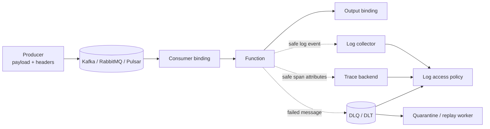

# Masking Sensitive Data in Payload Logs, Traces, and DLQs

A Spring Cloud Stream message may traverse producers, brokers, consumer functions, log collectors, tracing backends, and dead-letter destinations. Payloads and headers can be copied at multiple points. If even one location logs the entire message or exception, sensitive data can outlive its business lifecycle and become visible to numerous systems, operations teams, or analytics tools.

Data protection must be designed separately for three distinct surfaces:

- **Logs:** record operational events sufficient for investigation, without logging payloads, tokens, passwords, or raw personal data.
- **Traces:** include only attributes needed in spans; never turn payloads, HTTP headers, or baggage into default observability data.
- **DLQ:** treat dead-letter topics/queues as data copies with sensitivity equivalent to the original message. Control payloads, headers, exception metadata, read permissions, retention periods, and replay workflows.

The guiding principle is **data minimization**: collect only fields required for a defined purpose. When correlating multiple processing steps, use an event ID free of personal data or a keyed pseudonym; never use logs, traces, or DLQs as payload storage for debugging convenience.

## 1. Identifying Data That Requires Protection

Before writing masking code, classify the data inside events, headers, and exceptions. Fields that commonly require redaction, masking, pseudonymization, or encryption include:

| Category | Examples | Risk If Exposed |
|---|---|---|
| Authentication credentials | Passwords, API keys, access tokens, refresh tokens, cookies, session IDs | Unauthorized access takeover |
| System secrets | Private keys, connection strings, database credentials, configuration secrets | Unauthorized infrastructure access |
| Payment data | Card PAN, CVV, account numbers, cardholder details | Fraud and financial abuse |
| Personal identifiers | Government ID numbers, date of birth, addresses, emails, phone numbers | Individual identification or impersonation |
| Sensitive data | Health, biometrics, precise location, children's data | Privacy violations |
| Business content | Order contents, contracts, transactions, customer details | Exposure of trade secrets |
| Technical metadata | Authorization headers, cookies, internal routing, sensitive queue/topic names | Exposure of credentials or internal topology |

Not every ID is harmless. An email used as an event key, a phone number in a routing key, or a customer ID can constitute personal data. Classify by identifiability and linkability, not merely by field name.

### Distinguishing Techniques

| Technique | Result | When to Use |
|---|---|---|
| Redaction | Original value is not stored | When the value is not needed for processing or investigation |
| Masking | Retains only a portion, e.g., `****1234` | When limited identification such as the last four digits is needed |
| Pseudonymization | Replaces value with a stable code matchable via a key | When linking processing steps without exposing original IDs |
| Keyed hashing (HMAC) | Produces deterministic output from a secret key and input value | When a pseudonym resistant to dictionary guessing is needed |
| Encryption | Original data can be recovered with a key | When original data must be preserved for replay or controlled processing |

Unkeyed hashes over emails or phone numbers can often be reversed via dictionary attacks. When stable pseudonyms are needed, prefer HMAC with keys managed via a secret manager/KMS. Key rotation must be planned because the same ID produces a different code after changing keys.

## 2. Mapping Data Boundaries Through the Pipeline

Spring Cloud Stream uses Spring Messaging `Message<?>` as the in-application message representation. A message consists of payload and headers. Binders transmit messages via Kafka, RabbitMQ, or Pulsar; both the framework and the application can emit additional logs, spans, error messages, or dead-letter records.



A message can appear in the original payload on the broker, the in-memory Spring Message, application logs, span attributes/span events/baggage, error channels and exception metadata, DLQ/DLT along with source and error headers, broker/proxy/collector logs, snapshots, backups, and investigation exports.

Masking data on a dashboard after logs have already been collected is too late. Remove or transform sensitive data before the very first write/export point. Each layer still needs its own controls because binders or brokers can create copies invisible to functions.

## 3. Never Log Raw Payloads or Entire Messages

The easiest leak happens when logging objects or messages directly:

```java
// Avoid: toString() may include every field of the payload.
log.info("Received payment: {}", paymentEvent);

// Avoid: Message.toString() may print both payload and headers.
log.debug("Incoming message: {}", message);

// Avoid: exception message may contain queries, tokens, or input data.
log.error("Processing failed: {}", ex.getMessage());
```

Do not rely on a record or POJO currently having a short `toString()`. A future model change can add a sensitive field and automatically push that field into logs.

Instead, construct a dedicated log event with a field allowlist:

```java
public record PaymentLogEvent(
        String eventRef,
        String accountRef,
        String operation,
        String outcome,
        String errorCode
) {
}

void logPaymentFailure(
        PaymentEvent event,
        String accountRef,
        PaymentProcessingException exception) {

    PaymentLogEvent safe = new PaymentLogEvent(
            event.eventId(),
            accountRef,
            "authorize",
            "failure",
            exception.getCode()
    );

    log.warn(
            "payment_processing_failed eventRef={} accountRef={} operation={} outcome={} errorCode={}",
            safe.eventRef(),
            safe.accountRef(),
            safe.operation(),
            safe.outcome(),
            safe.errorCode()
    );
}
```

This example logs only an event reference, an account pseudonym, the operation, the outcome, and a stable error code. It never logs payloads, PANs, emails, access tokens, or raw exception messages.

### Allowlists Are Safer Than Denylists

A denylist masks only fields already known to be sensitive. When a schema adds `bankAccount`, `identityNumber`, or `authorizationToken`, new fields can slip through until added to the blocklist.

An allowlist logs only explicitly approved fields. When schemas evolve, new fields do not appear in logs automatically. Apply the same principle to trace attributes and metadata sent to DLQs.

## 4. Masking Data Before Writing Logs

A redaction helper should have a clear contract, dedicated tests, and be invoked at log creation sites. Example:

```java
public final class SafeLogValues {

    private SafeLogValues() {
    }

    public static String maskLastFour(String value) {
        if (value == null || value.isBlank()) {
            return null;
        }

        String normalized = value.replaceAll("\\s+", "");
        if (normalized.length() <= 4) {
            return "****";
        }

        return "****" + normalized.substring(normalized.length() - 4);
    }

    public static String safeErrorCode(String code) {
        if (code == null) {
            return "UNKNOWN";
        }

        String normalized = code.replaceAll("[^A-Z0-9_]", "_");
        return normalized.substring(0, Math.min(normalized.length(), 64));
    }

    public static String safeLogText(String value) {
        if (value == null) {
            return null;
        }

        String sanitized = value.replaceAll("[\\r\\n\\p{Cntrl}]", "_");
        return sanitized.substring(0, Math.min(sanitized.length(), 128));
    }
}
```

`maskLastFour` is suitable only when policy permits keeping the last four characters. Never apply it to CVVs, passwords, tokens, or secrets. `safeLogText` strips control characters to mitigate log injection and caps the length of user-controlled fields.

Do not rely on a single generic regex function at the end of the pipeline to mask arbitrary JSON payloads. JSON can contain nesting, escaped characters, binary fragments, or invalid syntax. Masking via schemas/domain models at application boundaries is far more reliable.

## 5. Pseudonymizing Identifiers with HMAC

When you need to correlate multiple processing attempts for the same account without logging the original account ID, use HMAC:

```java
public final class AccountPseudonymizer {

    private final SecretKeySpec key;

    public AccountPseudonymizer(byte[] keyMaterial) {
        this.key = new SecretKeySpec(keyMaterial, "HmacSHA256");
    }

    public String pseudonym(String accountId) {
        if (accountId == null || accountId.isBlank()) {
            return "missing";
        }

        try {
            Mac mac = Mac.getInstance("HmacSHA256");
            mac.init(key);

            byte[] digest = mac.doFinal(
                    accountId.getBytes(StandardCharsets.UTF_8));

            return HexFormat.of().formatHex(digest, 0, 8);
        }
        catch (GeneralSecurityException ex) {
            throw new IllegalStateException("Cannot pseudonymize account", ex);
        }
    }
}
```

The HMAC key must come from a secret manager/KMS or the platform's secret management mechanism. Never hardcode keys in source code, logs, or committed repository configs.

HMAC produces stable codes under the same key, yet remains linkable data. Restrict access to pseudonyms, avoid exposing them to unnecessary parties, and plan key rotation. Never use plain SHA-256 over emails, phone numbers, or low-entropy IDs.

## 6. Prevent Exceptions from Leaking Data

Exception messages are often constructed from input data, SQL statements, URLs, HTTP responses, or credentials. Stack traces can reveal internal hostnames, file paths, queries, and class names. Therefore, do not log full exceptions by default into logs or traces.

Unsafe example:

```java
catch (Exception ex) {
    log.error("Cannot process payload {}", event, ex);
    throw ex;
}
```

Example using stable error codes:

```java
catch (PaymentGatewayTimeoutException ex) {
    log.warn(
            "payment_gateway_timeout eventRef={} dependency={} errorCode={}",
            event.eventId(),
            "payment-gateway",
            "GATEWAY_TIMEOUT"
    );

    throw new PaymentDependencyException(
            "Payment dependency unavailable",
            ex
    );
}
```

The new exception message contains no payloads or credentials. However, the original cause remains in the exception chain; an error handler or framework logger might still print that cause's stack trace. If you must keep the cause for diagnostics, ensure log/error/DLQ paths apply redaction and restricted access. Never assume data is safe simply because the log level is DEBUG or ERROR.

Also audit HTTP client logging, SQL logging, framework debug logs, broker client logs, and exception handlers. An application may avoid logging payloads directly while a library or interceptor still logs request/response bodies.

## 7. Structured Logging and Field Allowlists

Structured logging allows querying logs by field without recording payloads. Example JSON log event:

```json
{
  "event": "payment_processing_failed",
  "event_ref": "evt_01J9M8K7",
  "account_ref": "5f8d9a12c6b4e311",
  "messaging_system": "kafka",
  "destination": "payments.authorize",
  "operation": "authorize",
  "outcome": "failure",
  "error_code": "GATEWAY_TIMEOUT",
  "trace_id": "4bf92f3577b34da6a3ce929d0e0e4736"
}
```

This example uses a non-personal event reference, a pseudonymized account reference, and a stable error code. Never put payloads, authorization headers, cookies, sessions, cardNumbers, or raw exception messages into log schemas.

Define an approved log schema per event type. Code reviews and automated tests should catch any new field added to log events without a data classification decision.

## 8. Protecting Trace Attributes and Span Events

Spring Cloud Stream integrates Micrometer Observation at the Spring Cloud Function layer. Observation can produce both metrics and traces. Enabling observation does not automatically mask payloads. Data placed by the application into span attributes or span events can still be exported to tracing backends.

Include only diagnostic attributes:

```java
observation.highCardinalityKeyValue("app.event.type", "payment.authorized");
observation.lowCardinalityKeyValue("messaging.system", "kafka");
observation.lowCardinalityKeyValue("app.outcome", "failure");
observation.lowCardinalityKeyValue("app.error.code", "GATEWAY_TIMEOUT");
```

Never add full payloads, access tokens, cookies, passwords, emails, phone numbers, ID numbers, account numbers, raw exception messages, or request/response bodies to spans.

A high-cardinality attribute does not mean safe data. Spans can hold richer attributes than metrics, yet tracing backends are still data stores requiring governance. Use non-sensitive event references or trace IDs for correlation; never attach raw customer IDs to spans just because spans allow high cardinality.

## 9. Baggage and Trace Context

Trace context such as `traceparent` links spans between producers and consumers. Baggage is a set of key/value pairs propagated along requests and can be automatically injected by instrumentation into HTTP headers when calling downstream services.

Never put PII, tokens, or secrets into baggage. A value attached early in a pipeline can be forwarded to services outside the intended boundary. If tenant or account context must propagate, use pseudonyms or non-sensitive classifications and propagate only across approved boundaries.

More suitable metadata examples:

| Acceptable to Consider | Do Not Propagate |
|---|---|
| `tenant_tier=standard` | Email or phone number |
| `region=ap-southeast` | Access token |
| `event_type=payment.authorized` | Session cookie |
| Non-sensitive `correlation_ref` | Account number or ID document number |
| `workflow=settlement` | Transaction content |

Trace IDs and span IDs are technical identifiers; they do not replace access control. Never share trace URLs or trace exports with anyone lacking permission to view the underlying data.

## 10. Auditing Auto-Instrumentation and Header Capture

HTTP client, server, messaging, and database instrumentation can generate spans automatically. Depending on libraries and settings, spans may include URLs, query strings, exception events, or captured headers.

Before enabling instrumentation in production:

1. Inspect the actual list of emitted span attributes.
2. Check whether request/response headers are captured.
3. If header capture is needed, allowlist only non-sensitive headers.
4. Never capture Authorization, Cookie, Set-Cookie, X-Api-Key, or token-bearing headers.
5. Strip query parameters that may contain emails, tokens, or identifiers.
6. Check exception events and whether SQL statements include bind values.
7. Inspect data at the collector and backend, not solely inside the application.

Sampling only reduces how many traces are retained; it is not a redaction mechanism. Any sampled trace can still contain every sensitive attribute attached by the application or instrumentation.

## 11. Treat the DLQ as a Highly Sensitive Data Copy

Dead-letter queues/topics store messages that failed processing after retries or unrecoverable errors. A DLQ can hold unparsed or unvalidated original payloads, business and transport headers, routing keys, topics, partitions, offsets, queues, subscriptions, exception classes/messages/stack traces, delivery/retry counts, and failure timestamps.

If the original payload contains card details, tokens, emails, or personal data, the DLQ holds that same data. Renaming a topic to `*.dlq` does not make it less sensitive.

### Two DLQ Storage Approaches

**DLQ for replay:** must retain enough data to reprocess messages. Protect original payloads with strict ACLs, encryption, short retention, and controlled replay workflows.

**Quarantine for investigation:** needs only sanitized metadata, error codes, event references, and a pointer to the encrypted original record in a separate store. This reduces sensitive data inside broker DLQs while requiring a secure replay store if business recovery is needed.

Do not delete payloads blindly if replay workflows depend on them. Explicitly choose the destination's purpose and design its format accordingly.

## 12. Error Data in Kafka DLQs

The Spring Cloud Stream Kafka binder can attach headers such as `x-original-topic`, `x-exception-message`, and `x-exception-stacktrace` when publishing failed records to a DLQ. Spring Kafka's `DeadLetterPublishingRecoverer` can also preserve all original headers and add exception class, cause, message, stack trace, topic, partition, offset, timestamp, and consumer group.

This has two consequences:

1. Sensitive headers from the source record can persist into the DLT.
2. Stack traces or exception messages can contain queries, URLs, input data, or credentials.

Do not assume the binder filters these headers automatically. If headers must be stripped, customize the recoverer/container error handler or build a custom error flow. In Spring Kafka, the recoverer has standard header-exclusion APIs and supports overriding `createProducerRecord()` to remove original headers before publishing.

Illustrative example stripping sensitive original headers and excluding stack traces from the DLT:

```java
@Bean
DeadLetterPublishingRecoverer safeRecoverer(
        KafkaTemplate<Object, Object> template) {

    DeadLetterPublishingRecoverer recoverer =
            new DeadLetterPublishingRecoverer(template) {

        @Override
        protected ProducerRecord<Object, Object> createProducerRecord(
                ConsumerRecord<?, ?> record,
                TopicPartition topicPartition,
                Headers headers,
                byte[] key,
                byte[] value) {

            headers.remove("authorization");
            headers.remove("cookie");
            headers.remove("x-api-key");
            headers.remove("customer-email");
            headers.remove("session-token");

            return super.createProducerRecord(
                    record, topicPartition, headers, key, value);
        }
    };

    recoverer.excludeHeader(HeaderNames.HeadersToAdd.EX_STACKTRACE);
    return recoverer;
}
```

This is a Spring Kafka example; verify exact method signatures and header-exclusion APIs against your Spring Kafka version. The header list shown is illustrative and must be replaced with your system's classified allowlist/denylist. Stripping headers does not mask the original payload. If payloads contain sensitive data, establish a dedicated DLT payload policy: tokenization before publishing, encrypting originals, or moving originals to a restricted replay store.

For binder-managed Kafka DLQs, locate the customization hook appropriate for your binder version. You can delegate retry/DLQ to the listener container via customizers and supply a custom recoverer. Do not assume regular producer `header-patterns` properties filter every header generated on the dead-letter path.

## 13. Kafka Streams Deserialization DLQ

The Kafka Streams binder has its own mechanism for deserialization errors. You can choose `logAndFail`, `logAndContinue`, or `sendToDlq` handlers for records that fail to deserialize.

Deserialization errors are especially sensitive because the function has not yet received a domain object to mask individual fields. The failed record may consist only of raw bytes plus exception metadata. When sending poison pills to a DLQ:

- Restrict read permissions on the DLQ topic.
- Never log raw bytes or exception headers containing failing content.
- Use separate topics per sensitive data domain if needed.
- Set appropriate retention and audit backups.
- Replay only after schemas/deserializers are fixed and data is validated.

For unparseable raw bytes, you cannot rely on a JSON redactor inside the function to sanitize them. Handle this at the recoverer/ingress layer or place originals in an encrypted, access-controlled quarantine store.

## 14. RabbitMQ DLX/DLQ and x-death Metadata

RabbitMQ can dead-letter messages via a dead-letter exchange. The broker routes messages along with body and metadata to a DLQ according to policies/queue arguments. The `x-death` header records dead-letter history such as queue, reason, exchange, routing key, timestamp, and count.

The Spring Cloud Stream Rabbit binder can use `auto-bind-dlq` and `republish-to-dlq`. When republishing, the binder may add the `x-exception-stacktrace` header; stack traces may be truncated by frame headroom limits. Truncation is not redaction.

Configuration example:

```yaml
spring:
  cloud:
    stream:
      bindings:
        processPayment-in-0:
          destination: payments
          group: payment-service
      rabbit:
        bindings:
          processPayment-in-0:
            consumer:
              auto-bind-dlq: true
              republish-to-dlq: true
              dlq-ttl: 86400000
              dlq-max-length: 10000
```

TTL and max-length control lifecycle and capacity only; they do not mask data. With broker-native dead-lettering, the body usually remains the original message. When republishing, inspect added exception headers and strip sensitive data before writing.

The Rabbit binder provides `headerPatterns` for outbound binding headers, yet do not assume that property automatically applies to messages dead-lettered by the broker via DLX. Verify the exact message path and inspect headers in the destination queue.

## 15. Pulsar Dead Letter Topics

Pulsar supports dead-letter topics via consumer dead-letter policies. Once a message exceeds the allowed redelivery count, the consumer moves it to the DLT. Default naming usually follows `<topic>-<subscription>-DLQ`, or a custom name can be set.

According to current Pulsar documentation, dead-letter policies are supported for `Shared` and `Key_Shared` subscription types. Verify your consumer's subscription type and exact client/binder behavior before relying on DLTs in production.

Because DLTs store failed messages, treat their payloads and properties with the same sensitivity as original messages. Never assume the Pulsar binder automatically redacts bodies or properties.

Required controls:

- Create DLQ namespaces/topics within restricted-access boundaries.
- Grant DLT consume permissions only to error-handling workers and authorized operators.
- Enable authentication, authorization, and TLS on broker connections.
- Protect DLT storage, backups, and exports per data policy.
- Bound retention and redelivery counts.
- Never place secrets in message properties or consumer logs.
- Test replay with idempotent consumers.

Pulsar includes encryption, authentication, and authorization features; default cluster settings must be reviewed because environments lacking those protections allow unencrypted or unauthenticated client access unless isolated at the network layer.

## 16. Preserving Replay Payloads Without Expanding Exposure

Some situations require original payloads for replay, such as schema mismatches or transient dependency outages. Avoid destroying recovery data via irreversible masking inside the sole copy of the message.

A two-part pattern can be used:

1. Encrypt the original payload using a data encryption key (DEK).
2. Store the ciphertext in a dedicated replay store with narrow ACLs and clear retention.
3. Write a sanitized envelope to the DLQ containing event reference, error code, topic/partition/offset, and a pointer to the ciphertext.
4. Keep the DEK wrapped by a key-encryption key (KEK) inside KMS.
5. Allow only authorized replay workers to decrypt payloads.
6. Emit audit events for read, decrypt, and replay actions.

DLQ envelope example:

```json
{
  "eventRef": "evt_01J9M8K7",
  "source": {
    "system": "kafka",
    "destination": "payments",
    "partition": 4,
    "offset": 91821
  },
  "failure": {
    "code": "SCHEMA_VERSION_UNSUPPORTED",
    "type": "DeserializationException"
  },
  "payloadRef": "vault://replay/payments/evt_01J9M8K7",
  "attempt": 3,
  "occurredAt": "2026-11-24T08:30:00Z"
}
```

The envelope contains no tokens, bodies, raw exception messages, or stack traces. `payloadRef` is a pointer, not a credential; the replay store must still check caller permissions before returning ciphertext or plaintext.

Never use a guessable pointer such as an email or account number. Event references should be random, carry no personal information, and grant no access merely by knowing the ID.

## 17. Access Permissions and Retention for Logs, Traces, and DLQs

Each storage layer needs its own policy:

| Store | Who Needs Access? | Key Controls |
|---|---|---|
| Application logs | Duty-scoped SRE/on-call | RBAC, field allowlists, retention, auditing |
| Trace backend | Authorized Developers/SREs | Tenant isolation, sampling, redaction, export limits |
| Kafka DLT | Recovery consumers and error-handling teams | Topic ACLs, TLS, encrypted storage, retention |
| Rabbit DLQ | Recovery consumers and error-handling teams | Vhost/user permissions, TLS, queue policies, TTL |
| Pulsar DLT | Error-handling subscriptions | Namespace/topic permissions, TLS, storage protection |
| Replay vault | Task-authorized workers | KMS, auditing, approvals, short-lived access |

Retention must serve error resolution and defined compliance requirements. Do not keep DLQs indefinitely just because nobody cleans them up; likewise, do not purge them before recovery workflows finish.

Encryption does not replace authorization. An encrypted DLQ can still be read if service accounts hold broad privileges or keys are shared improperly. Use TLS in transit, encryption at rest for storage/backups as supported by the platform, key rotation, and separation between key management and message read privileges.

## 18. Safe DLQ Replay

Replaying can reintroduce sensitive data into logs, traces, and downstream systems. Before replaying:

1. Confirm the root cause of the failure is fixed.
2. Confirm the target destination and consumer group.
3. Verify payload/schema validity and access permissions.
4. Preserve stable event IDs so idempotency works.
5. Never log payloads during replay.
6. Cap message counts, replay rate, and time windows.
7. Record audit metadata: requesting user/worker, timestamp, message count, and outcome.
8. Move unrecoverable messages to a dedicated quarantine.
9. After replay, enforce retention and purge temporary copies per policy.

Never replay an entire DLQ directly into a production topic without triaging first. A message failing due to an incompatible schema may loop endlessly; a message with payment side effects may execute twice if the consumer is not idempotent.

## 19. Redaction at Ingress and Egress

A sound strategy spans multiple layers:

- **Ingress:** validate schemas, classify fields, strip unnecessary credentials, and produce canonical events.
- **Function:** pass only fields needed by business logic.
- **Logs:** construct dedicated safe log DTOs.
- **Traces:** attach only allowlisted attributes, omitting bodies and sensitive baggage.
- **Egress:** serialize strictly to contract and strip internal/credential headers.
- **Error path:** sanitize exception metadata, headers, and payloads per DLQ policy.
- **Storage:** enforce ACLs, encryption, retention, and auditing.
- **Replay:** dedicated worker authorized to decrypt only when required.

Downstream redaction at a log collector can serve as defense-in-depth, yet never replaces in-application redaction. Data may already have traversed stdout, sidecars, container runtimes, or buffers before reaching the collector.

## 20. Testing Against Data Leaks

Tests should use realistic synthetic values shaped like sensitive data, such as token `test-secret-abc`, email `alice@example.invalid`, or fake account numbers. After running functions and error flows, assert they never appear in logs, trace exports, or DLQ envelopes.

Redactor test example:

```java
@Test
void masksAccountNumber() {
    assertThat(SafeLogValues.maskLastFour("1234567890123456"))
            .isEqualTo("****3456");
}

@Test
void removesControlCharactersFromUntrustedLogText() {
    assertThat(SafeLogValues.safeLogText("bad\r\nfield"))
            .isEqualTo("bad__field");
}
```

Integration tests should verify:

- Logs contain only allowlisted fields.
- `Message.toString()` and raw exceptions are never logged directly.
- Tokens, cookies, and sensitive payloads never appear in structured logs.
- Spans contain no bodies, tokens, or sensitive baggage.
- HTTP instrumentation does not capture secret headers.
- Kafka DLTs contain no prohibited sensitive headers.
- Exception stack traces/messages are stripped or handled per policy.
- Rabbit DLQs are verified across both broker-native DLX and republish flows.
- Pulsar DLTs enforce proper ACLs and block unauthorized consumers.
- Replay vaults return plaintext only to authorized identities.
- Retention/TTL and auditing behave as designed.

Do not test only redaction helpers. Inject a real failing message in a test broker environment and inspect the data arriving at the final destination.

## 21. Pre-Deployment Checklist

- Sensitive fields in payloads and headers are classified.
- Raw payloads and `Message<?>` are never written to logs.
- Log events use field allowlists.
- Exception messages/stack traces are not automatically logged when they may contain input data.
- Linkable identifiers are pseudonymized with HMAC using securely managed keys.
- No PII or secrets are placed into trace attributes, span events, or baggage.
- HTTP instrumentation captures only approved headers.
- Sampling is not treated as a redaction control.
- Kafka DLTs are verified for payloads, original headers, and exception metadata.
- Rabbit DLQs are verified for bodies, `x-death`, and exception headers.
- Pulsar DLTs are protected with namespace/topic permissions.
- Stack traces and exception messages in DLQs are stripped or bounded.
- DLQs enforce ACLs, TLS, encrypted storage, retention, and auditing.
- When original payloads are needed for replay, originals are encrypted and stored separately.
- Replay workers have least-privilege permissions, rate limits, and idempotency.
- Log collectors, trace backends, backups, and exports have matching permissions/retention.
- Integration tests verify zero data leakage across logs, traces, and DLQs.

Masking sensitive data must start where data is produced. Logs should record only operational events; traces should carry only context needed to link steps; DLQs should hold only data needed for recovery and be protected like copies of original messages. When replay is required, store original payloads in an encrypted, tightly scoped vault and place pointers plus sanitized metadata in the DLQ.

## References

- [OWASP Logging Cheat Sheet](https://cheatsheetseries.owasp.org/cheatsheets/Logging_Cheat_Sheet.html)
- [Spring Cloud Stream — Observability](https://docs.spring.io/spring-cloud-stream/reference/observability.html)
- [Spring Cloud Stream — Kafka Binder DLQ](https://docs.spring.io/spring-cloud-stream/reference/kafka/kafka-binder/dlq.html)
- [Spring Kafka — Handling Exceptions and Dead-letter Records](https://docs.spring.io/spring-kafka/reference/kafka/annotation-error-handling.html)
- [Spring Cloud Stream — RabbitMQ Binder](https://docs.spring.io/spring-cloud-stream/reference/rabbit/rabbit_overview.html)
- [Apache Pulsar — Messaging and Dead Letter Topics](https://pulsar.apache.org/docs/5.0.x/concepts-messaging/)
- [Apache Pulsar — Security Overview](https://pulsar.apache.org/docs/next/security-overview/)
- [OpenTelemetry — Baggage and Security Considerations](https://opentelemetry.io/docs/concepts/signals/baggage/)
