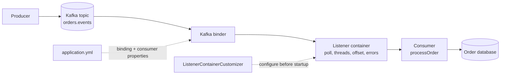
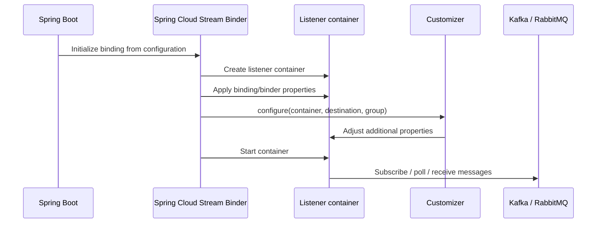
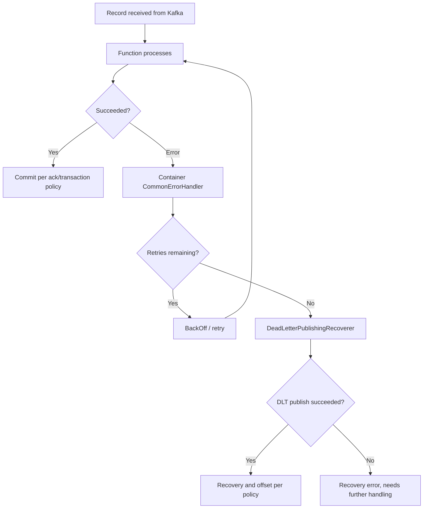

# Customizing Listener Containers with ListenerContainerCustomizer

In Spring Cloud Stream, `Supplier`, `Function`, and `Consumer` functions describe business processing, while the **binder** connects the function to Kafka, RabbitMQ, or Pulsar. For message-driven consumers (where messages are pushed by the broker), the binder typically creates a **listener container** to manage message reception, dispatching to the function, progress acknowledgment, error handling, and consumer lifecycle.

When standard binding properties are not enough, `ListenerContainerCustomizer` allows intervening in the listener container **after the binder has applied its configuration** and before the container starts receiving messages. This is a useful extension point for fine-tuning listener behavior, especially in systems that need to scale by partition, queue, or instance count, or apply specialized error handling.

This lesson belongs to the **Scaling** group, focusing on the container customization API, proper usage with the Spring Cloud Stream Kafka binder and RabbitMQ binder, impact on concurrency, acknowledgment, retry/DLQ, observability, testing, and limitations with Kafka Streams/Pulsar.

## 1. Where does the listener container sit?

For example, a service receiving order events from Kafka:



The layers have different responsibilities:

| Component | Role |
|---|---|
| Spring Cloud Function bean | Processes a payload/message according to business logic |
| Binding | Maps function input/output names to broker destination and group |
| Binder | Creates adapters/containers and converts messages to fit the middleware |
| Listener container | Manages consumer threads, message reception, acknowledgment, errors, and lifecycle |
| `ListenerContainerCustomizer` | Further adjusts container characteristics that standard bindings do not expose |
| Broker | Manages partitions/queues, stores messages, distributes them to consumers |

`ListenerContainerCustomizer` does not build Kafka Streams topologies and does not change message formats. It adjusts the behavior of the **message-receiving container** created by the binder.

## 2. When is customization needed?

Prioritize official properties first because they are explicit, easy to operate, and usually already validated by the binder:

```yaml
spring:
  cloud:
    function:
      definition: processOrder
    stream:
      bindings:
        processOrder-in-0:
          binder: kafka
          destination: orders.events
          group: order-workers
          consumer:
            concurrency: 3
            max-attempts: 3
```

A customizer is needed when:

- You want to set advanced container attributes that do not have a corresponding binding property.
- You need logic applied specifically to a `destinationName` and `group` pair.
- You want to configure listener/idle behavior, container configuration logging, or a specialized error handler.
- You need to fine-tune different container types, such as Kafka `ConcurrentMessageListenerContainer` and Rabbit `SimpleMessageListenerContainer`.
- You need to move retry/DLQ to the listener container layer when the binder default is unsuitable.

Do not use a customizer merely to replace every available property. For example, `concurrency`, Kafka `ackMode`, or Rabbit `prefetch` usually have appropriate binding/binder configurations; use properties unless programmatic per-container policies are genuinely needed.

## 3. The ListenerContainerCustomizer Interface

The generic Spring Cloud Stream interface:

```java
@FunctionalInterface
public interface ListenerContainerCustomizer<C> {

    void configure(
            C container,
            String destinationName,
            String group);
}
```

Three parameters:

1. `container`: the listener container instance created by the binder; the concrete type depends on the binder.
2. `destinationName`: the destination name used by the binder, such as the Kafka topic or the queue name of the Rabbit binder.
3. `group`: the logical consumer group of the binding; may be empty/`null` for anonymous consumers depending on the binder and configuration.

The customizer bean is invoked **after** configuration from `application.yml` has been applied. Therefore, values set in the customizer can override values set by the binder. This is useful but can easily cause configuration drift: dashboards and YAML show one value, while runtime runs another.

It is best to have **one customizer suited for the binder**, containing clear conditional branches, rather than declaring multiple beans interfering with the same container without controlling order.

## 4. Container Creation Cycle and Application Order



This order explains three principles:

- Do not create a new container using `new ConcurrentMessageListenerContainer(...)` inside the customizer; the binder already owns the container.
- Do not call `container.start()` or `stop()` inside the customizer because the binder manages the lifecycle.
- Inspect the final configuration after customization, not just the YAML values.

A listener container is usually created once per consumer binding in an application instance. With Kafka, a `ConcurrentMessageListenerContainer` can manage multiple child containers/consumer threads according to `concurrency`.

## 5. Basic Kafka Example: Listener Container Customization

Given a simple function:

```java
@Configuration
public class OrderConsumerConfiguration {

    @Bean
    public Consumer<OrderEvent> processOrder(OrderService service) {
        return service::process;
    }
}
```

Binding configuration:

```yaml
spring:
  cloud:
    function:
      definition: processOrder
    stream:
      bindings:
        processOrder-in-0:
          binder: kafka
          destination: orders.events
          group: order-workers
          consumer:
            concurrency: 3
```

Customizer bean:

```java
import org.springframework.cloud.stream.config.ListenerContainerCustomizer;
import org.springframework.context.annotation.Bean;
import org.springframework.context.annotation.Configuration;
import org.springframework.kafka.listener.AbstractMessageListenerContainer;

@Configuration
public class KafkaListenerTuning {

    @Bean
    ListenerContainerCustomizer<AbstractMessageListenerContainer<?, ?>>
            orderContainerCustomizer() {

        return (container, destinationName, group) -> {
            if (!"orders.events".equals(destinationName)
                    || !"order-workers".equals(group)) {
                return;
            }

            // Emit an event when the listener receives no records for long enough.
            container.getContainerProperties()
                    .setIdleEventInterval(60_000L);

            // Log a summary of container configuration at startup.
            container.getContainerProperties()
                    .setLogContainerConfig(true);
        };
    }
}
```

Here, the customizer only affects the consumer with the exact required destination/group. When adding consumers for other topics, they will not accidentally receive the wrong timeout or logging policy.

`setIdleEventInterval(60_000L)` asks Spring Kafka to emit a `ListenerContainerIdleEvent` if the listener does not receive records within that interval. It **does not auto-retry**, **does not auto-restart the consumer**, and **does not mean the consumer is failing**: idle may simply mean the topic has no new events.

`setLogContainerConfig(true)` helps observe listener configuration at startup. Assess the sensitivity of configuration details before enabling broad logging; do not log credentials or raw payloads.

## 6. Reacting to Idle Events

You can observe events emitted by the Kafka container:

```java
import org.springframework.context.event.EventListener;
import org.springframework.kafka.event.ListenerContainerIdleEvent;
import org.springframework.stereotype.Component;

@Component
public class KafkaIdleObserver {

    @EventListener
    public void onIdle(ListenerContainerIdleEvent event) {
        // Only log controlled metadata, do not log raw Consumer.
        String listenerId = event.getListenerId();
        System.out.println("Idle listener: " + listenerId);
    }
}
```

In production, use a structured logger and an appropriate `idle event count` metric. Idle events do not tell you how much consumer group lag exists; correlate with Kafka consumer lag, partition assignment, and input throughput.

If the binder property `idleEventInterval` is already available for the Kafka input binding, prefer setting it in YAML. Use a customizer when you need selective logic or want to combine a customization that lacks an official property.

## 7. Customizing Concurrency for Kafka

The Kafka binder has the `spring.cloud.stream.bindings.<binding>.consumer.concurrency` property. If you truly need to adjust it based on container type, you can check the type and call `setConcurrency`:

```java
@Bean
ListenerContainerCustomizer<AbstractMessageListenerContainer<?, ?>>
        concurrencyCustomizer() {

    return (container, destination, group) -> {
        if (!"orders.events".equals(destination)
                || !"order-workers".equals(group)) {
            return;
        }

        if (container instanceof ConcurrentMessageListenerContainer<?, ?> concurrent) {
            concurrent.setConcurrency(4);
        }
    };
}
```

This snippet is an **alternative** to the customizer in section 5; do not declare both beans simultaneously without merging the logic.

### Concurrency Cannot Exceed the Useful Partition Limit

With Kafka, each partition within a consumer group is handled by only one consumer instance at a time. If a topic has 12 partitions and the service runs 3 pods, each pod with concurrency=4, a total of 12 consumer threads can be assigned the 12 partitions.

| Pod | Concurrency | Consumer threads |
|---|---:|---:|
| order-worker-1 | 4 | 4 |
| order-worker-2 | 4 | 4 |
| order-worker-3 | 4 | 4 |
| **Total** | | **12** |

If increased to 6 threads/pod, 18 threads compete for 12 partitions; some threads will not be assigned any partitions. Increasing concurrency at that point can increase overhead without increasing throughput.

Initial estimation formula:

**Group consumer threads = number of instances × concurrency per instance.**

**Maximum useful active consumers is typically capped by the number of partitions assigned to the group.**

When subscribing to multiple topics, the assignment strategy and partition count per topic also affect distribution; do not assume every thread always gets an equal workload.

## 8. Message Ordering and Scaling

Kafka preserves record order **within a partition**. If the same order ID is always used as the record key and the partitioner routes them to the same partition, records for that order are read in partition order.

Increasing concurrency does not create global ordering. A consumer group can process multiple partitions in parallel; database writes or API calls also depend on the completion time of each function invocation.

When scaling:

- Choose a stable Kafka key matching the unit that requires ordering, e.g. `orderId`.
- Do not process asynchronously and return control too early if offsets are committed before side effects complete.
- Use idempotency/version checks if replays, rebalances, or retries can occur.
- Monitor lag per partition, not just total lag.
- If one partition is hot, inspect key distribution; adding threads cannot split a single hot partition across multiple consumers in the same group.

## 9. Kafka Ack Mode and Impact When Customizing

The Kafka binder allows setting the ack mode via property:

```yaml
spring:
  cloud:
    stream:
      kafka:
        bindings:
          processOrder-in-0:
            consumer:
              ack-mode: MANUAL
```

With `MANUAL` or `MANUAL_IMMEDIATE`, messages can carry `KafkaHeaders.ACKNOWLEDGMENT`. A function accepting `Message<T>` can acknowledge after completing a processing step.

```java
@Bean
Consumer<Message<OrderEvent>> processOrder(OrderService service) {
    return message -> {
        service.process(message.getPayload());

        Acknowledgment ack = message.getHeaders()
                .get(KafkaHeaders.ACKNOWLEDGMENT, Acknowledgment.class);

        if (ack == null) {
            throw new IllegalStateException("Expected Kafka acknowledgment");
        }

        ack.acknowledge();
    };
}
```

`MANUAL` and `MANUAL_IMMEDIATE` have different commit timings according to the Spring Kafka container. You must understand ack semantics and consumer threads, especially when processing asynchronously.

Ack mode can be set directly via `container.getContainerProperties().setAckMode(...)`, but prefer binding `ack-mode` to avoid conflicts with the binder, batch mode, and transaction/retry settings. Acknowledgment **does not automatically turn external databases/APIs into exactly-once**; idempotency or transactional outbox/inbox is still required when business rules demand it.

## 10. Kafka Client Configuration vs. Container Configuration

A common mistake is putting Kafka consumer client properties into the listener container without checking which layer is responsible.

| Configuration | Appropriate place to configure |
|---|---|
| `group.id` | Binding `group` or binder management |
| `bootstrap.servers` | Kafka binder/broker configuration |
| `max.poll.records` | Kafka consumer `configuration` map |
| `max.poll.interval.ms` | Kafka consumer `configuration` map |
| `concurrency` | Binding `consumer.concurrency` |
| `ackMode` | Kafka binding consumer `ack-mode` |
| `idleEventInterval` | Kafka binder consumer property or container customization |
| Specialized `CommonErrorHandler` | Kafka container customizer/bean per binder API |
| Listener advice chain | Rabbit listener container customization |

Kafka client config example:

```yaml
spring:
  cloud:
    stream:
      kafka:
        bindings:
          processOrder-in-0:
            consumer:
              configuration:
                max.poll.records: 250
                max.poll.interval.ms: 300000
```

`max.poll.records` is not the thread count and does not cap total backlog. It limits how many records are returned in a single `poll`. Setting it too high can prolong a processing cycle, increasing the risk of exceeding `max.poll.interval.ms` if the function blocks for a long time.

Do not mutate the Kafka consumer object from arbitrary threads; `KafkaConsumer` is not thread-safe. Use the container/binding lifecycle APIs and supported properties.

## 11. Customizers Do Not Replace Retry Policies

When a function throws an exception, identify which layer is responsible for retrying:

- Retry in the Spring Cloud Stream binder.
- Retry in the Spring Kafka listener container error handler.
- Retry performed by the function/service itself.
- Retry/republish at the broker or another retry topic.

Do not stack multiple retry layers without counting total attempts. For example, 3 binder attempts plus 4 custom error handler attempts can multiply business calls and latency unexpectedly.

Decision table:

| Scenario | Approach |
|---|---|
| Simple retry fully supported by binder | Use binding properties |
| Need to change Kafka container's common error handler | `ListenerContainerCustomizer` or appropriate extension |
| Have DLQ and want to move retry/DLQ out of binder | `ListenerContainerWithDlqAndRetryCustomizer` |
| Need per-binding error handling without broad container customization | Check `commonErrorHandlerBeanName` on Kafka binding |
| Function has side effects outside Kafka | Combine retry with idempotency/DLQ and delivery guarantees |

## 12. Kafka: Example Disabling Container Retry Without DLQ

According to the Kafka binder documentation, when DLQ is **not** enabled, `max-attempts: 1` does not necessarily disable retries performed by the listener container. Spring Kafka may still use the default error handler.

If a single attempt followed by stopping container retries is required, you can use:

```java
@Bean
ListenerContainerCustomizer<AbstractMessageListenerContainer<?, ?>>
        noRetryCustomizer() {

    return (container, destination, group) -> {
        if (!"audit.events".equals(destination)
                || !"audit-workers".equals(group)) {
            return;
        }

        DefaultErrorHandler errorHandler =
                new DefaultErrorHandler(new FixedBackOff(0L, 0L));

        container.setCommonErrorHandler(errorHandler);
    };
}
```

`FixedBackOff(0L, 0L)` does not retry after the first failure in Spring Kafka. **Note:** the default recoverer of `DefaultErrorHandler` may log and treat the record as handled, allowing the offset to advance per container policy. If messages must not be lost, configure a recoverer that safely writes to DLT or actively stop the pipeline; do not just disable retries and hope the record remains somewhere else.

This example is only suitable when the failed-record handling policy is clearly defined. Scope it to the specific `audit.events` binding rather than applying it broadly to all consumers.

## 13. DLQ Can Change Precedence

When enabling Kafka binder DLQ:

```yaml
spring:
  cloud:
    stream:
      bindings:
        processOrder-in-0:
          destination: orders.events
          group: order-workers
          consumer:
            max-attempts: 3
      kafka:
        bindings:
          processOrder-in-0:
            consumer:
              enable-dlq: true
```

The binder normally manages retries and DLT publishing according to these properties. A `CommonErrorHandler` set via a generic customizer does not automatically replace all binder logic; binder-managed retry/DLQ may take precedence.

To move retry/DLQ responsibility down to the listener container, use the `ListenerContainerWithDlqAndRetryCustomizer` extension and explicitly decide `retryAndDlqInBinding(destination, group)` for each binding.

**Do not configure binder-managed DLQ and custom container DLQ simultaneously as two independent mechanisms**, as this can cause duplicate behavior, inconsistent recoverers, or skewed retry counts.

## 14. Three Kafka Customization Interfaces to Distinguish

The Spring Cloud Stream Kafka binder has three related interfaces:

| Interface | Callback | Purpose |
|---|---|---|
| `ListenerContainerCustomizer<C>` | `configure(container, destination, group)` | General listener container customization |
| `KafkaListenerContainerCustomizer` | Includes `ExtendedConsumerProperties<KafkaConsumerProperties>` | Kafka customization with binding properties |
| `ListenerContainerWithDlqAndRetryCustomizer` | Has DLQ resolver, backoff, and depending on version, extended properties | Controls retry/DLQ strategy in the listener container |

Example using the Kafka-specific customizer when extended consumer properties are needed:

```java
@Bean
KafkaListenerContainerCustomizer kafkaSpecificCustomizer() {
    return (container, destination, group, extendedProperties) -> {
        if ("orders.events".equals(destination)
                && "order-workers".equals(group)) {
            // Can read extendedProperties to decide customization.
            container.getContainerProperties()
                    .setIdleEventInterval(60_000L);
        }
    };
}
```

This is an **alternative**; do not automatically declare an extra one if a generic customizer is already doing the same job. Kafka extensions have signature changes across some Spring Cloud Stream lines; verify the interface in the exact imported version rather than copying a lambda from another version.

## 15. Retry/DLQ Customizer: Responsibilities and Flow

A typical listener-container-managed Kafka retry/DLT flow:



When using `ListenerContainerWithDlqAndRetryCustomizer`:

1. Match the exact destination and group.
2. Return `false` from `retryAndDlqInBinding(...)` for the binding delegating retry/DLQ to the container.
3. Inside `configure(...)`, receive the DLQ destination resolver and BackOff provided by the binder, if present.
4. Create `DeadLetterPublishingRecoverer` with a DLT-compatible producer/KafkaTemplate.
5. Create `DefaultErrorHandler(recoverer, backOff)` and set it on the container.
6. Verify DLT topic/partitions, serializers, ACLs, and when offsets are committed.
7. Test exceptions, retries, recovery, restarts, and transactions.

Spring Cloud Stream docs provide complete examples for this extension. **Version note:** the "Kafka Binder Listener Container Customizers" section describes a callback variant with extended properties; the "Retry and Dead Letter Processing" documentation shows a callback example with fewer parameters. When implementing, use the actual signature of the Spring Cloud Stream dependency pinned in the application and verify compilation.

An illustrative example using the callback variant with `dlqDestinationResolver` and `backOff`:

```java
// Outline of logic inside configure(...) of
// ListenerContainerWithDlqAndRetryCustomizer
if ("orders.events".equals(destinationName)
        && "order-workers".equals(group)) {

    if (dlqDestinationResolver == null) {
        throw new IllegalStateException("DLQ resolver is required");
    }

    var recoverer = new DeadLetterPublishingRecoverer(
            kafkaTemplate,
            dlqDestinationResolver
    );

    var retryBackOff = backOff != null
            ? backOff
            : new FixedBackOff(1_000L, 2L);

    container.setCommonErrorHandler(
            new DefaultErrorHandler(recoverer, retryBackOff));
}
```

This is a **logic snippet used inside the callback**, not a complete bean to copy verbatim. The parameters come from the binder callback; do not fabricate a resolver by guessing topic names. In particular, if the DLT resides on a different cluster, the `KafkaTemplate` must be configured with the DLT cluster's bootstrap servers/security and appropriate serializers.

## 16. RabbitMQ: Listener Containers Can Also Be Customized

The RabbitMQ binder uses Spring AMQP listener containers. For consumers using `SimpleMessageListenerContainer` or `DirectMessageListenerContainer`, different properties can apply.

Spring Cloud Stream guides using:

```java
@Bean
ListenerContainerCustomizer<
        org.springframework.amqp.rabbit.listener.AbstractMessageListenerContainer>
        rabbitCustomizer(Advice tracingAdvice) {

    return (container, destination, group) -> {
        if ("orders.exchange".equals(destination)
                && "order-workers".equals(group)) {
            container.setAdviceChain(tracingAdvice);
        }
    };
}
```

In this example, `tracingAdvice` is an existing Spring AOP `Advice` bean provided by the application. The advice is attached to the listener container to apply observability logic or policy around invocations.

**Caution:** `setAdviceChain(...)` can replace the advice chain currently in use. If the binder/container already has advice for retry, transactions, or instrumentation, check before replacing it; attaching new advice must preserve required behavior. Do not use a generic advice to inadvertently alter ack/retry semantics.

### Customizing by Rabbit Container Type

```java
@Bean
ListenerContainerCustomizer<
        org.springframework.amqp.rabbit.listener.AbstractMessageListenerContainer>
        rabbitScalingCustomizer() {

    return (container, destination, group) -> {
        if (!"notifications".equals(destination)
                || !"email-workers".equals(group)) {
            return;
        }

        if (container instanceof SimpleMessageListenerContainer simple) {
            simple.setConcurrentConsumers(2);
            simple.setMaxConcurrentConsumers(5);
        }
    };
}
```

Here, `setConcurrentConsumers` / `setMaxConcurrentConsumers` belong to the Simple container and do not apply to the Direct container. This example should only be chosen when the application needs to control a specific container type directly; for ordinary scaling, start with Rabbit consumer binding properties such as `concurrency` and `maxConcurrency`.

## 17. Rabbit Prefetch, Ack, and Scaling Limits

Rabbit does not distribute messages by Kafka partitions. A queue can have multiple consumers, and prefetch along with ack mode affects how many messages are in flight before acknowledgment.

| Property | Impact |
|---|---|
| `concurrency` | Number of listener container consumers per binder configuration |
| `maxConcurrency` | Dynamic scaling ceiling for Simple container when supported |
| `prefetch` | Number of unacknowledged messages that can be pre-delivered to each consumer |
| `acknowledgeMode` | Automatic/manual message acknowledgment per Spring AMQP |
| `requeueRejected` | Determines whether to requeue on rejection under error conditions |
| `autoBindDlq` and `republishToDlq` | Dead-letter handling configuration of the Rabbit binder |

A queue with multiple consumers can raise throughput but causes completion order to diverge from publish order. If business logic requires strict ordering by a key, consider queue design, routing, and single-active-consumer or idempotency/version checks before increasing concurrency.

An overly large prefetch can leave many messages stuck on a slow consumer and increase `messages_unacknowledged`. Do not bump prefetch/concurrency by intuition; measure throughput, queue ready/unacked counts, processing latency, and memory before and after.

## 18. Distinguishing Simple, Direct, and Stream Rabbit Containers

The RabbitMQ binder can use several consumer container types:

| Type | Processing model | Notes |
|---|---|---|
| `SimpleMessageListenerContainer` | Consumers process messages through Simple container | Supports `concurrentConsumers` and `maxConcurrentConsumers` |
| `DirectMessageListenerContainer` | Consumers directly on the queue | Use properties suited for Direct container; do not call Simple-only setters |
| `StreamListenerContainer` | RabbitMQ Stream Plugin | Consumer and concurrency mechanics differ; some queue consumer properties do not apply |

When the Rabbit Stream Plugin is enabled, Spring Cloud Stream can use `ListenerContainerCustomizer<MessageListenerContainer>` and cast to `StreamListenerContainer` per binder guidance. Always check the exact type before calling methods, because applying AMQP queue container setters to a Stream container can fail immediately at startup.

Do not confuse Rabbit Stream with Kafka Streams; they are completely different APIs and processing models.

## 19. Pollable Consumers Use a Different Mechanism

`ListenerContainerCustomizer` is meant for message-driven consumers where the binder creates a listener container.

With `PollableMessageSource`, the application actively invokes `poll(...)` in a loop or schedule. Spring Cloud Stream provides `MessageSourceCustomizer` for this case. For example, a Rabbit polled source can use `MessageSourceCustomizer<AmqpMessageSource>` to customize converters or message source properties.

The difference:

| Consumer style | Who actively pulls messages? | Customization point |
|---|---|---|
| Message-driven Kafka/Rabbit | Listener container | `ListenerContainerCustomizer` |
| Pollable consumer | Application poll loop | `MessageSourceCustomizer` |
| Kafka Streams DSL | Kafka Streams runtime/tasks | Kafka Streams binder configuration / `StreamsConfig` |
| Pulsar listener | Spring Pulsar container/binder | Pulsar-specific configuration and binder-supported customizers |

Do not expect Kafka's `ListenerContainerCustomizer<AbstractMessageListenerContainer<?, ?>>` to automatically affect a Kafka Streams topology. Kafka Streams has its own consumer/task runtime and transaction/processing guarantees.

## 20. Customizing in Multi-Binder Applications

In applications with multiple binders (e.g., Kafka + Rabbit or multiple Kafka clusters), each binder can live in its **own application context**. A customizer bean in the main context is not necessarily visible directly to every named binder.

Spring Cloud Stream provides `BinderCustomizer` to configure binders before they start operating. For example:

```java
@Bean
BinderCustomizer kafkaBinderCustomizer(
        ListenerContainerCustomizer<AbstractMessageListenerContainer<?, ?>> customizer) {

    return (binder, binderName) -> {
        if (!"kafkaOrders".equals(binderName)) {
            return;
        }

        if (binder instanceof KafkaMessageChannelBinder kafkaBinder) {
            kafkaBinder.setContainerCustomizer(customizer);
        }
    };
}
```

Meaning:

- `binderName` allows scoping customization to a named binder instance.
- `instanceof KafkaMessageChannelBinder` avoids mistakenly casting a Rabbit binder.
- `setContainerCustomizer(...)` forwards the customizer to the appropriate binder instance.
- Bindings on that binder can still be filtered further by destination and group.

If the application only has one binder, `BinderCustomizer` is usually unnecessary. With multiple binders/named binders, read the `BinderCustomizer` documentation carefully and verify the bean was actually applied; avoid assuming beans in the main application context automatically reach child binder contexts.

## 21. Callback Idempotency and Startup Configuration

A well-behaved configuration callback should:

- Only modify containers within the exact destination/group scope.
- Only set configuration values, without creating new consumers or subscribing manually.
- Avoid slow network calls or long blocking operations during startup.
- Never call `start()`, `stop()`, or `poll()` inside the callback.
- Avoid storing references to raw `KafkaConsumer` instances for cross-thread calls.
- Perform no business side effects.
- Log configuration safely at an appropriate level, avoiding secrets.
- Be safe to re-invoke if bindings/containers are recreated without creating extra state.

Example of an exact condition:

```java
private static boolean isOrdersBinding(String destination, String group) {
    return "orders.events".equals(destination)
            && "order-workers".equals(group);
}
```

Avoid conditions like `destination.contains("orders")`, which can mistakenly match `orders.audit`, `orders.retry`, and `orders.private`.

## 22. Testing Customizers Across Layers

### Unit Testing the Callback

Configuration logic can be tested independently without a broker. For example, with Mockito and AssertJ:

```java
@Test
void customizesOnlyOrdersBinding() {
    var config = new KafkaListenerTuning();
    var customizer = config.orderContainerCustomizer();

    var ordersContainer =
            mock(AbstractMessageListenerContainer.class);
    var ordersProperties = new ContainerProperties("orders.events");
    when(ordersContainer.getContainerProperties())
            .thenReturn(ordersProperties);

    customizer.configure(
            ordersContainer, "orders.events", "order-workers");

    assertThat(ordersProperties.getIdleEventInterval())
            .isEqualTo(60_000L);
}
```

For another binding, call the callback with a different destination/group and verify values remain untouched. This test verifies the matching condition and effect on container properties; it does not prove that the Kafka consumer operates successfully.

### Integration Testing with Kafka/Rabbit

Use Testcontainers or an appropriate integrated broker to verify:

1. The binder initializes the container and the callback is invoked.
2. Only the intended binding is customized.
3. The container has the right effective concurrency/ack/error handler.
4. Messages are received and the function processes them as expected.
5. Retry, DLT/DLQ, and offset/ack work properly when the function fails.
6. Consumer restarts do not skip messages outside policy.
7. Concurrency exceeding partition count is not assumed to increase throughput.
8. Rabbit Simple/Direct containers do not suffer `ClassCastException`.
9. With multi-binder setups, the customizer is passed properly to the named binder.
10. Logs and metrics reflect runtime configuration rather than just YAML.

Do not simulate crashes/rebalances by sleeping for long periods inside the callback. Construct retry, idle, partition rebalance, and shutdown scenarios using test fixtures or controlled broker doubles.

## 23. Monitoring After Changing the Container

After rollout, monitor these signals:

- **Kafka:** consumer lag per partition/group, poll rate, rebalance count, processing latency, error handler/recovery count, and DLT rate.
- **RabbitMQ:** `messages_ready`, `messages_unacknowledged`, consumer count, ack/nack, redelivery, DLQ rate, and connection/channel health.
- **Application:** successful throughput, retry counts, terminal failures, CPU, heap, and thread count.
- **Lifecycle:** container started/stopped/idle/non-responsive events, assignment changes, startup errors.

Example: after raising Kafka concurrency from 2 to 4, throughput rises briefly, yet lag keeps growing. Check partition count, downstream latency, and retries; the bottleneck might be the database rather than the number of consumer threads.

If Rabbit prefetch increases alongside concurrency, unacked messages spike, and heap pressure grows, lower prefetch or cap in-flight processing instead of adding more threads.

## 24. Common Pitfalls

| Symptom | Possible cause |
|---|---|
| Customizer is not called | Wrong bean type, bean in a different binder context, or binding does not use a listener container |
| `ClassCastException` at startup | Casting a Kafka container to a Rabbit container or confusing Rabbit Simple/Direct |
| YAML `concurrency=3` but running 4 | Customizer overwrote configuration after the binder |
| Increasing Kafka concurrency leaves throughput unchanged | Insufficient active partitions or downstream bottleneck |
| Manual ack behaves unexpectedly on offsets | Conflict across ack mode, batch/retry/transaction, or calling ack from the wrong thread |
| Set `DefaultErrorHandler` yet DLQ still follows binder | Binder-managed retry/DLQ takes precedence |
| Retry not disabled when `max-attempts=1` | Kafka container handles retries by default when DLQ is disabled |
| Named binder does not see customizer | Need `BinderCustomizer` to attach customizer to the binder instance |
| Idle events never arrive | Interval not configured, duration not elapsed, or listener is not truly idle |
| Rabbit custom advice alters retry | `setAdviceChain` replaced the required advice chain |
| Kafka Streams function unaffected | That is the Kafka Streams runtime, not a Spring Kafka listener container |
| Pollable input unaffected | Needs `MessageSourceCustomizer` |

### Diagnostic Flow

1. Confirm binding name, destination, group, and binder type.
2. Inspect the actual container class when the callback runs.
3. Verify the customizer bean exists in the binder application context.
4. Read effective container properties after customization.
5. Check whether binder retry/DLQ policy overrides it.
6. Check partition/queue counts, consumer threads, and assignments.
7. Send success/failure messages to verify processing, ack, and recovery.
8. Correlate broker metrics with application metrics.

## 25. Production Customizer Design Rules

A safe customizer in an event-driven system should satisfy:

- **Proper scope:** destination and group are matched accurately.
- **Proper binder:** Kafka/Rabbit/Pulsar use the right container type and API.
- **No conflicts:** YAML properties and customizer do not silently overwrite one another.
- **No data loss:** ack/retry/DLQ are verified under failure scenarios.
- **Preserved ordering:** concurrency/async processing complies with ordering rules.
- **Observable:** metrics and logs expose effective configuration.
- **Tested:** unit tests for callbacks, integration tests for brokers.
- **Version-compatible:** verify Spring Cloud Stream, Spring Kafka/Spring AMQP, and customizer signatures compile against actual dependencies.

If multiple customizers or complex branching logic are required, consider consolidating policies into a single configuration class, extracting binding-matching helpers, and writing dedicated tests. Avoid putting business logic or database access inside startup callbacks.

## 26. Deployment Checklist

- Confirmed `menuLevel2` and the consumer binder that the lesson applies to.
- Tried configuring via binding properties before using a customizer.
- Understood the order in which listener containers are created and configured.
- Selected the right `ListenerContainerCustomizer<C>` for the actual container.
- Filtered by destination and group.
- No manual start/stop/poll calls inside callbacks.
- No duplicate consumers created alongside the binder.
- Kafka concurrency accounts for partition count and pod count.
- Kafka key/partition ordering is preserved as required.
- Ack mode does not conflict with manual commit, batch, or transactions.
- Retry/DLQ has one clear owning layer.
- If container-managed DLQ is needed, verified extension and version.
- For Rabbit, distinguished Simple/Direct/Stream containers.
- Prefetch, concurrency, and unacked counts are measured after scaling.
- For multi-binder setups, `BinderCustomizer` passes the customizer properly.
- Pollable consumers use `MessageSourceCustomizer`; Kafka Streams uses its own configuration.
- Unit tests verify the callback matches the intended binding.
- Integration tests verify effective behavior, retry, ack, DLT, and restart.
- Dashboards track lag/backlog, throughput, errors, and threads.
- Rollback plan exists if consumers rebalance, spike retries, or lose throughput.

`ListenerContainerCustomizer` is a powerful extension point in Spring Cloud Stream for message-driven consumers, especially when container fine-tuning goes beyond binding properties. Its strength comes from running after binder configuration, which is also its risk because it can inadvertently override concurrency, ack, or error handling. Apply it conditionally by binding, distinguish Kafka/Rabbit/Kafka Streams, and test against a real broker before broad rollout.

## References

- [Spring Cloud Stream — Kafka Binder Listener Container Customizers](https://docs.spring.io/spring-cloud-stream/reference/kafka/kafka-binder/container-cust-kafka-binder.html)
- [Spring Cloud Stream — Binding Properties and Advanced Consumer Configuration](https://docs.spring.io/spring-cloud-stream/reference/spring-cloud-stream/binding-properties.html)
- [Spring Cloud Stream — Kafka Retry and Dead Letter Processing](https://docs.spring.io/spring-cloud-stream/reference/kafka/kafka-binder/retry-dlq.html)
- [Spring Cloud Stream — Kafka Dead-Letter Topic Processing](https://docs.spring.io/spring-cloud-stream/reference/kafka/kafka-binder/dlq.html)
- [Spring Cloud Stream — Kafka Binder Configuration Options](https://docs.spring.io/spring-cloud-stream/reference/kafka/kafka-binder/config-options.html)
- [Spring Cloud Stream — Rabbit Advanced Listener Container Configuration](https://docs.spring.io/spring-cloud-stream/reference/rabbit/rabbit_overview/advanced-listener-container-configuration.html)
- [Spring Cloud Stream — Rabbit Consumer Properties](https://docs.spring.io/spring-cloud-stream/reference/rabbit/rabbit_overview/cons-props.html)
- [Spring Cloud Stream — Customizing Binders in Multi Binder Applications](https://docs.spring.io/spring-cloud-stream/reference/spring-cloud-stream/binder-customizer.html)
- [Spring Kafka — Message Listener Containers](https://docs.spring.io/spring-kafka/reference/kafka/receiving-messages/message-listener-container.html)
- [Spring Kafka — Application Events and Idle Containers](https://docs.spring.io/spring-kafka/reference/kafka/events.html)
- [Spring Cloud Stream — RabbitMQ Stream Consumer](https://docs.spring.io/spring-cloud-stream/reference/rabbit/rabbit_overview/rabbitmq-stream-consumer.html)
