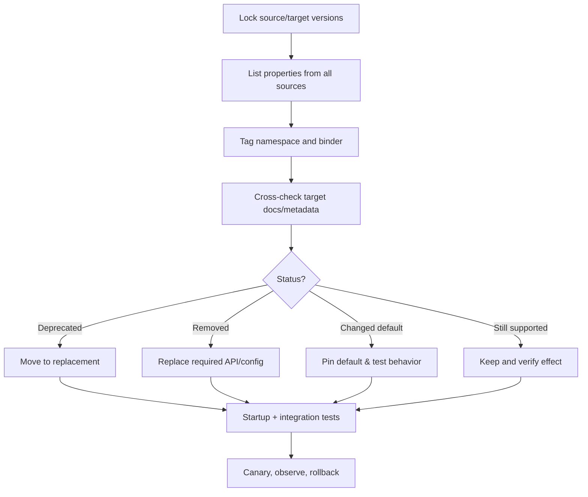

# Cross-Checking Renamed, Deprecated, and Removed Properties

Upgrading Spring Cloud Stream is not merely changing a version number in `pom.xml` or `build.gradle`. An event-driven application also has a **configuration contract** spanning function/binding names, destinations, consumer groups, Kafka/RabbitMQ/Pulsar binder properties, serialization, retry/DLQ, Kafka Streams state, and options provided by Spring Boot or Apache Kafka clients. A renamed, deprecated, or removed property can allow the application to start while silently **reading the wrong topic, creating a new group, losing DLQ routing, changing payload types, or reprocessing data**.

This lesson explains how to **cross-check properties across versions** for a `SPRING_CLOUD_STREAM` project, distinguishing evidenced changes from official documentation from changes that are merely recommendations. The scope covers the `Supplier/Function/Consumer` functional model, Kafka message-channel binder, Kafka Streams binder, RabbitMQ/Pulsar, native encoding configuration, retries, schemas, observability, and pre-deployment testing.

> **Version boundary:** The examples below compare Spring Cloud Stream 2.x/3.x/4.x documentation with the 5.0/5.1 lines and modern Apache Kafka Streams. Final status must be confirmed against **the exact dependency versions locked in your project**; do not apply a generic migration table as proof that a given property has been removed across every version.

## 1. Learning objectives

After this lesson, you can:

1. Distinguish **renamed** properties, **deprecated** properties, **removed** properties, **behavior changes**, and **binding name changes caused by programming model changes**.
2. Map specific Kafka binder properties such as `admin.configuration`, `admin.replicas-assignment`, and `admin.replication-factor` to the `topic.*` group.
3. Convert `input/output` binding configuration from the annotation model to default functional binding names such as `normalize-in-0` and `normalize-out-0`.
4. Identify differences among Spring Cloud Stream, Spring Boot, Kafka Streams client, and Rabbit/Pulsar binder properties.
5. Build a migration checklist with source/target versions, evidence, actions, and tests.
6. Use startup diagnostics, integration tests, and canary rollouts to catch ineffective properties before upgrading production.

## 2. Terminology: do not lump every change into "removed"

| Status | Meaning | Typical action |
|---|---|---|
| **Renamed / replaced** | A new name or alternative way to configure the same purpose exists | Switch to the new name, check semantics and defaults |
| **Deprecated** | The old approach is no longer recommended but may still work | Plan to move off the old approach; do not claim it is removed |
| **Removed** | The target version no longer supports that API/property or behavior | Fix code/config and verify startup |
| **Changed default** | Same name, but default value or effect changed | Pin the value intentionally, test behavior |
| **Semantic migration** | Changing programming model/binder alters the property path even though the property name did not change | Update binding name/prefix and test with data |
| **Legacy compatibility** | Property still exists for compatibility with older producers/consumers | Keep only if a counterpart still genuinely requires it |
| **No-op / ignored** | Property is still recognized or set, but has no effect in the active context | Replace with the right mechanism for the binder/mode |

For example, Kafka binder's `admin.replication-factor` is documented as **deprecated since 2.1.1**, replaced by `topic.replication-factor`. Do not label it "removed" merely because you want to drop it in new code.

Conversely, when switching from `@StreamListener` to `Function`, `spring.cloud.stream.bindings.input.destination` may **still be a valid property**; what changed is that the active binding defaults to `normalize-in-0`, not that the framework deleted the `destination` property.

## 3. Locating configuration before cross-checking

A full property spans multiple layers:

```text
spring.cloud.stream.bindings.<bindingName>.<commonProperty>
spring.cloud.stream.bindings.<bindingName>.consumer.<consumerProperty>
spring.cloud.stream.bindings.<bindingName>.producer.<producerProperty>

spring.cloud.stream.kafka.binder.<kafkaBinderProperty>
spring.cloud.stream.kafka.bindings.<bindingName>.consumer.<kafkaConsumerProperty>
spring.cloud.stream.kafka.bindings.<bindingName>.producer.<kafkaProducerProperty>

spring.cloud.stream.rabbit.bindings.<bindingName>.consumer.<rabbitConsumerProperty>
spring.cloud.stream.rabbit.bindings.<bindingName>.producer.<rabbitProducerProperty>

spring.cloud.stream.kafka.streams.binder.<streamsBinderProperty>
spring.cloud.stream.kafka.streams.bindings.<bindingName>.consumer.<streamsConsumerProperty>
spring.cloud.stream.kafka.streams.binder.functions.<functionName>.configuration.<streamsConfigKey>
```

Where:

- **Common binding**: destination, group, contentType, concurrency, maxAttempts, etc.
- **Binder-wide**: brokers, replication defaults, broker connection/security, etc.
- **Extended binding**: key expressions, topic provisioning, specific retry/DLQ settings, etc.
- **Kafka Streams `StreamsConfig`**: `processing.guarantee`, `commit.interval.ms`, `default.value.serde`, etc.
- **Spring Boot/Spring Kafka/Spring AMQP/Spring Pulsar**: properties outside the Spring Cloud Stream namespace with their own lifecycles.

Do not swap a property simply because its name looks similar. `replicationFactor` at the Kafka binder level, `topic.replication-factor` at the binding level, and `replication.factor` for Kafka Streams internal topics are not interchangeable options.

## 4. Version-based cross-checking workflow

A controlled migration follows these steps:



Before editing code, record:

- Source/target versions of Spring Boot, Spring Cloud release train, Spring Cloud Stream, Spring Kafka/AMQP/Pulsar, and Kafka clients.
- Binders present on the classpath; whether **named binders** or multiple Kafka clusters are used.
- Function names, binding names, destinations, consumer groups, and application IDs.
- Effective configuration from `application.yml`, profiles, environment variables, command-line arguments, Config Server, Helm/Secrets, and deploy-time overrides.
- Critical Kafka topics, Rabbit queues/exchanges, Pulsar subscriptions, and schema contracts.
- Properties directly affecting acknowledgements, offsets, DLQs, transactions, and state restoration.

**In this lesson**, the example tables are compiled from documentation; they do not replace auditing your specific repository and runtime.

## 5. Evidenced change matrix

| Area | Legacy | Modern / new approach | Classification |
|---|---|---|---|
| Kafka topic provisioning | `admin.configuration` | `topic.properties` | Deprecated → replacement since 2.1.1 |
| Kafka topic provisioning | `admin.replicas-assignment` | `topic.replicas-assignment` | Deprecated → replacement since 2.1.1 |
| Kafka topic provisioning | `admin.replication-factor` | `topic.replication-factor` | Deprecated → replacement since 2.1.1 |
| Kafka Streams exception | `serdeError` (older generation docs) | `deserializationExceptionHandler` | Different names across API/binder generations; verify by version |
| Kafka Streams processing guarantee | `exactly_once` value | `exactly_once_v2` | Old value deprecated; conditional migration |
| Kafka Streams processing guarantee | `exactly_once_beta` value | `exactly_once_v2` | Old value deprecated; replacement |
| Programming model | `@EnableBinding`, `@StreamListener` | `Supplier/Function/Consumer` beans | Annotation model deprecated; programming model change |
| Test support | `spring-cloud-stream-test-support` / `MessageCollector` | `spring-cloud-stream-test-binder` with `InputDestination` / `OutputDestination` | Legacy module/API no longer recommended |
| Reactive module | `spring-cloud-stream-reactive` | Spring Cloud Function + Reactor | Old module discontinued |
| Dedicated Kafka reactive binder | `spring-cloud-stream-binder-kafka-reactive` | Kafka message-channel binder + explicit reactive handling | Dedicated binder deprecated since 4.3.0 |
| Annotation-based binding | `bindings.input` / `bindings.output` by channel name | `bindings.<function>-in-0` / `bindings.<function>-out-0` | Binding renamed due to model, **not** `destination` removed |

The first three rows are documented in Spring Cloud Stream 5.0 Kafka binder docs as **deprecated since version 2.1.1**, with direct mappings on both consumer and producer sides. The annotation/test/reactive group comes from the "Notable Deprecations" section of Spring Cloud Stream 4.0 documentation. The `processing.guarantee` group is published by Apache Kafka Streams independently of Spring Cloud Stream.

Do not use this table to guess exact removal dates. To know whether an old key is still accepted in the target version, inspect the artifact metadata or run the target version and verify actual behavior.

## 6. Kafka binder: admin.configuration → topic.properties

Previously, some topic provisioning configuration used the `admin.*` branch inside extended Kafka bindings. Modern documentation replaces it with the `topic.*` branch.

**Old configuration (consumer):**

```yaml
spring:
  cloud:
    stream:
      kafka:
        bindings:
          processOrder-in-0:
            consumer:
              admin:
                configuration:
                  cleanup.policy: delete
```

**New configuration:**

```yaml
spring:
  cloud:
    stream:
      kafka:
        bindings:
          processOrder-in-0:
            consumer:
              topic:
                properties:
                  cleanup.policy: delete
```

Corresponding full paths:

```text
spring.cloud.stream.kafka.bindings.processOrder-in-0.consumer.admin.configuration
spring.cloud.stream.kafka.bindings.processOrder-in-0.consumer.topic.properties
```

`topic.properties` is a **topic provisioning** configuration map, not a KafkaConsumer configuration map. For example, `cleanup.policy` is a topic property, whereas `max.poll.records` belongs under consumer `configuration` or an appropriate client property scope.

**Note:** provisioning properties normally only take effect when the binder creates a new topic or manages topic topology within binder capabilities. Changing a property in YAML does not necessarily update an already existing topic. For production topics, inspect actual state with Kafka admin tools/AdminClient rather than assuming the broker modifies topic config automatically.

## 7. Kafka binder: admin.replicas-assignment → topic.replicas-assignment

Published documentation mapping:

```text
...consumer.admin.replicas-assignment
  -> ...consumer.topic.replicas-assignment

...producer.admin.replicas-assignment
  -> ...producer.topic.replicas-assignment
```

`topic.replicas-assignment` represents a map from partition → list of broker replicas when **provisioning a topic**. Illustrative configuration example:

```yaml
spring:
  cloud:
    stream:
      kafka:
        bindings:
          produceOrder-out-0:
            producer:
              topic:
                replicas-assignment:
                  0: [1, 2, 3]
                  1: [2, 3, 1]
```

This example assumes the cluster actually has broker IDs 1, 2, 3; replica order matters for leader/preferred replica selection. Do not copy this configuration verbatim to another cluster without verifying broker IDs and partition counts.

When explicit replica assignment is provided, some separate replication factor settings may be ignored. Check precedence rules in the target version's Kafka binder documentation.

## 8. Kafka binder: admin.replication-factor → topic.replication-factor

Direct mapping:

```text
...consumer.admin.replication-factor
  -> ...consumer.topic.replication-factor

...producer.admin.replication-factor
  -> ...producer.topic.replication-factor
```

Producer example:

```yaml
spring:
  cloud:
    stream:
      kafka:
        bindings:
          produceOrder-out-0:
            producer:
              topic:
                replication-factor: 3
```

Checks during upgrade:

- `topic.replication-factor` applies to **topic provisioning for that binding**.
- `spring.cloud.stream.kafka.binder.replication-factor` is the binder-level default, which can be overridden.
- Kafka Streams `replication.factor` applies to **changelog/repartition topics created by Streams**, and is not a replacement for `admin.replication-factor`.
- If a topic already exists, changing application configuration does not automatically increase topic replication; corresponding administrative action is required.
- Starting with Spring Cloud Stream Kafka binder 3.0.8, the default `replicationFactor=-1` means use the broker's default replication factor; therefore do not copy an old default without checking the version.

## 9. Complete migration example: topic provisioning

Suppose a `Function<String, String> normalize()` reads topic `orders.raw` and writes topic `orders.normalized`.

**Legacy provisioning config:**

```yaml
spring:
  cloud:
    stream:
      kafka:
        bindings:
          normalize-in-0:
            consumer:
              admin:
                replication-factor: 3
                configuration:
                  cleanup.policy: delete
          normalize-out-0:
            producer:
              admin:
                replication-factor: 3
```

**Replacement form:**

```yaml
spring:
  cloud:
    stream:
      kafka:
        bindings:
          normalize-in-0:
            consumer:
              topic:
                replication-factor: 3
                properties:
                  cleanup.policy: delete
          normalize-out-0:
            producer:
              topic:
                replication-factor: 3
```

During migration, do not arbitrarily change destinations or groups. Only switch property namespaces confirmed as deprecated. Then verify topic existence, partition count/replication factor, cleanup policy, and service account topic-creation permissions.

If the cluster does not allow applications to create topics, manage topics via infrastructure-as-code/AdminClient and set binder `autoCreateTopics=false`, while ensuring topics are provisioned before deployment.

## 10. Annotation model → functional model: changing effective binding names

This is the most common migration error: the property itself remains valid, but it points to a binding that **is no longer created**.

Legacy application code might use:

```java
@EnableBinding(Processor.class)
public class LegacyProcessor {

    @StreamListener(Processor.INPUT)
    @SendTo(Processor.OUTPUT)
    public String normalize(String value) {
        return value.trim();
    }
}
```

Legacy configuration uses channel names `input` and `output`:

```yaml
spring:
  cloud:
    stream:
      bindings:
        input:
          destination: orders.raw
          group: normalization-workers
        output:
          destination: orders.normalized
```

After migrating to a function:

```java
@Configuration
public class OrderFunctions {

    @Bean
    public Function<String, String> normalize() {
        return String::trim;
    }
}
```

Default binding names are `normalize-in-0` and `normalize-out-0`. Configuration must point to those names:

```yaml
spring:
  cloud:
    function:
      definition: normalize
    stream:
      bindings:
        normalize-in-0:
          destination: orders.raw
          group: normalization-workers
        normalize-out-0:
          destination: orders.normalized
```

**There is no "global rename" from `input` to `normalize-in-0` for every project.** Names depend on the actual function bean, composition, and input/output indices.

Important: `destination` and `group` remain active properties. If you forget to carry over `group` when changing the binding name, the new consumer may become an **anonymous consumer** or join a different group and reprocess/read unexpected data.

## 11. Option to keep old binding names when migrating to functions

Spring Cloud Stream still supports explicit binding name mapping:

```yaml
spring:
  cloud:
    function:
      definition: normalize
    stream:
      function:
        bindings:
          normalize-in-0: input
          normalize-out-0: output
      bindings:
        input:
          destination: orders.raw
          group: normalization-workers
        output:
          destination: orders.normalized
```

Via `spring.cloud.stream.function.bindings.<implicit-name>`, the function's implicit binding maps back to the legacy config name.

This helps when many deployment configs depend on `bindings.input` / `bindings.output`. However, Spring Cloud Stream documentation advises avoiding mapping unless necessary because it introduces an extra indirection layer that is harder to trace. In new code, prefer default function names whenever possible.

Commit to **one** strategy: default functional binding names or explicit mapping. Do not mix both styles across configuration files without tests confirming the right bindings are created.

## 12. Kafka Streams: serdeError → deserializationExceptionHandler

In some older Kafka Streams binder documentation, the binder-level deserialization handler appeared as `serdeError`. Newer Kafka Streams binder documentation presents `deserializationExceptionHandler` at both binder and consumer binding levels.

Historical example (do not apply automatically to newer versions):

```properties
spring.cloud.stream.kafka.streams.binder.serdeError=logAndFail
```

Configuration form in modern documentation:

```yaml
spring:
  cloud:
    stream:
      kafka:
        streams:
          binder:
            deserialization-exception-handler: logAndFail
          bindings:
            enrich-in-0:
              consumer:
                deserialization-exception-handler: sendToDlq
```

Common handler values include `logAndFail`, `logAndContinue`, and `sendToDlq`; some versions also document `skipAndContinue`.

**Classify carefully:** this is an example of **different property paths across documentation generations**. Do not claim every version automatically maps `serdeError` to the new key. Check the target version's schema/metadata and test startup empirically. If the old key is no longer recognized, remove it and use `deserializationExceptionHandler` in the appropriate scope.

Also check DLQ topics, serializers, ACLs, and replayability of failed records, because changing a handler from fail-fast to continue/DLQ is a **semantic** change, not just a rename.

## 13. Kafka Streams: deprecated processing.guarantee values

`processing.guarantee` is an **Apache Kafka Streams** configuration passed through the Spring Cloud Stream Kafka Streams binder. The **values** of this property themselves changed across Kafka generations:

| Value | Status in modern Kafka docs | Action |
|---|---|---|
| `at_least_once` | Supported default value | Keep if duplicates are acceptable |
| `exactly_once` | Deprecated EOS v1 value | Plan migration to `exactly_once_v2` |
| `exactly_once_beta` | Deprecated old EOS v2 value | Replace with `exactly_once_v2` |
| `exactly_once_v2` | Current EOS v2 value | Verify broker 2.5+, transaction config, and tests |

Example functional Kafka Streams processor named `enrich`:

```yaml
spring:
  cloud:
    function:
      definition: enrich
    stream:
      kafka:
        streams:
          binder:
            functions:
              enrich:
                applicationId: orders-enrichment-v1
                configuration:
                  processing.guarantee: exactly_once_v2
```

This is a `StreamsConfig` entry under `binder.functions.<function>.configuration`; do not confuse it with Kafka message-channel binder properties.

**Upgrading from EOS v1 requires a dedicated plan.** The Kafka Streams upgrade guide prescribes a two-phase rolling upgrade for legacy EOS apps, because upgrading the client version and switching processing guarantees simultaneously can cause compatibility issues. For production stateful/transactional apps, read the Kafka Streams upgrade guide for your exact source/target versions before changing the value.

## 14. Kafka Streams: per-function applicationId is not a renamed property

Kafka Streams binder documentation supports `applicationId` at multiple scopes:

- `spring.cloud.stream.kafka.streams.binder.applicationId` for simple cases.
- `spring.cloud.stream.kafka.streams.binder.functions.<function>.applicationId` for a specific function.
- `spring.cloud.stream.kafka.streams.bindings.<binding>.consumer.applicationId` in some configurations, especially legacy `StreamListener`.

With multiple independent functions, set `applicationId` per function:

```yaml
spring:
  cloud:
    stream:
      kafka:
        streams:
          binder:
            functions:
              fraudScore:
                applicationId: fraud-score-v1
              inventoryProjection:
                applicationId: inventory-projection-v1
```

This is a **recommended scope change**, with no evidence that all older forms were removed.

Do not change `applicationId` just to "clean up names" during an upgrade. Kafka Streams uses it for consumer groups, internal topics, and local state. Changing the application ID can create a brand-new logical application, replaying inputs or rebuilding state. If changing it is unavoidable, prepare an independent offset/state migration plan.

## 15. Annotation/test/reactive modules: API changes vs. properties

Several changes documented by Spring Cloud Stream are **API or module deprecations/discontinuations**, not config key renames:

| Legacy component | New direction | Notes |
|---|---|---|
| `@EnableBinding`, `@StreamListener`, `@Input`, `@Output` | Function beans | Requires code and binding name updates |
| `@StreamMessageConverter` | Custom converter in functional architecture if needed | Annotation deprecated |
| `spring-cloud-stream-reactive` | Spring Cloud Function + Project Reactor | Old module no longer distributed |
| `spring-cloud-stream-test-support` and `MessageCollector` | `spring-cloud-stream-test-binder` + `InputDestination/OutputDestination` | Write new function tests |
| Dedicated Reactive Kafka binder | Kafka message-channel binder with explicit Reactor code | Deprecated since Spring Cloud Stream 4.3.0 |

Do not assume that `spring.cloud.stream.bindings.*.consumer.max-attempts`, `group`, `destination`, or `content-type` were also removed simply because the annotation API was deprecated.

For reactive code, switching binders can alter backpressure, error propagation, and acknowledgements. Treat this as a **functional/behavioral migration**, not just a dependency swap.

## 16. Test binder: updating how tests are written

In modern Spring Cloud Stream code, the test binder uses `InputDestination` and `OutputDestination`. The 5.1 documentation instructs using `@EnableTestBinder`.

Test dependency:

```xml
<dependency>
    <groupId>org.springframework.cloud</groupId>
    <artifactId>spring-cloud-stream-test-binder</artifactId>
    <scope>test</scope>
</dependency>
```

Function test example:

```java
@SpringBootTest
class NormalizeStreamTest {

    @Autowired
    InputDestination input;

    @Autowired
    OutputDestination output;

    @Test
    void normalizesOrder() {
        input.send(new GenericMessage<>(" order-42 ".getBytes(
                StandardCharsets.UTF_8)), "normalize-in-0");

        Message<byte[]> result = output.receive(5_000, "normalize-out-0");

        assertThat(result).isNotNull();
        assertThat(new String(result.getPayload(), StandardCharsets.UTF_8))
                .isEqualTo("order-42");
    }

    @SpringBootApplication
    @EnableTestBinder
    static class TestApplication {

        @Bean
        Function<String, String> normalize() {
            return String::trim;
        }
    }
}
```

The test binder verifies functions, conversions, and binding names in-JVM; it **does not prove** that Kafka partitions/ACLs/DLQs, Rabbit queues/exchanges, or Pulsar subscriptions actually work. After changing properties, run integration tests with a real broker or corresponding Testcontainers.

Earlier Spring Cloud Stream lines used `@Import(TestChannelBinderConfiguration.class)` in test examples. Pick the annotation/configuration matching your target version rather than mixing snippets across release lines.

## 17. Legacy Kafka binder headers: still present, not for new apps

The Kafka binder has the property `spring.cloud.stream.kafka.binder.headers` to specify custom headers in a way compatible with very old applications (≤1.3.x and Kafka clients prior to 0.11). Modern documentation clearly states this property is **only needed for legacy compatibility** because newer Kafka clients support native record headers.

This is a good example of **legacy compatibility**, not evidence that the property was removed.

When upgrading:

- If all producers/consumers use modern Kafka clients, evaluate removing unnecessary legacy config.
- If legacy apps remain, check wire format/header mapping before removing it.
- Do not use `headerMode=embeddedHeaders` as a default solution for modern Kafka.
- When native encoding/decoding is enabled, note that framework conversion by `contentType` does not run and embedded headers may be ignored.

Changing header encoding can cause downstream consumers to stop seeing `correlationId`, `schemaVersion`, or keys. Inspect record headers directly on the broker.

## 18. Kafka Streams resetOffsets: key exists, has no effect

Kafka Streams binder documentation notes that the consumer setting `resetOffsets` **has no effect** with the Kafka Streams binder; unlike the Kafka message-channel binder, Kafka Streams does not seek-to-beginning/end on demand via that setting.

This falls under **contextual no-op**, not a rename.

To control the starting position when **no committed offset exists yet**, Kafka Streams consumer bindings have `startOffset` (such as `earliest`/`latest`). Once offsets are committed for an application ID, changing `startOffset` does not automatically reset prior progress.

Do not arbitrarily replace this by deleting internal topics or changing the application ID. Stateful Kafka Streams topologies require proper reset tools, stopping the application, backing up state, and an appropriate replay plan.

## 19. RabbitMQ and Pulsar: properties must be cross-checked per binder

Kafka's `topic.replication-factor` cannot configure a RabbitMQ queue. The Rabbit binder has extended consumer/producer properties for exchanges, queues, DLQs, prefetch, concurrency, and acknowledgements. The Pulsar binder has its own properties for topics, subscriptions, schemas, and clients.

Rules:

| Area | Where to check? | Risk if misused |
|---|---|---|
| Rabbit `prefetch`/`autoBindDlq`/`republishToDlq` | Rabbit binder consumer docs | Unexpected unacked messages, retry/DLQ behavior |
| Rabbit exchange/queue provisioning | Rabbit binder producer/consumer docs | Creates wrong queue or routing |
| Pulsar `schema-type`/`message-type` | Pulsar binder schema docs | Broken deserialization/serialization |
| Pulsar subscription type/name | Pulsar consumer docs | Altered subscription or redelivery |
| Kafka `topic.*` | Kafka message-channel binder docs | Does not apply to Rabbit/Pulsar |
| Kafka Streams `StreamsConfig` | Kafka Streams binder + Kafka client docs | Key ignored or wrong scope |

Do not label a Rabbit/Pulsar property "renamed" or "removed" without version-matched changelog or deprecation metadata. If no evidence exists, mark it **unverified** and do not rewrite it automatically.

### Non-interchangeable scope example

```yaml
spring:
  cloud:
    stream:
      bindings:
        orders-in-0:
          binder: rabbit
          destination: orders
      rabbit:
        bindings:
          orders-in-0:
            consumer:
              prefetch: 20
```

`prefetch` here does not replace Kafka's `max.poll.records`. Both affect throughput, but their semantics and APIs differ.

## 20. Spring Boot relaxed binding is not a property rename

Spring Boot supports relaxed binding for many properties:

```text
spring.cloud.stream.kafka.binder.replicationFactor
spring.cloud.stream.kafka.binder.replication-factor
SPRING_CLOUD_STREAM_KAFKA_BINDER_REPLICATIONFACTOR
```

Kebab-case in YAML is a readable style, while metadata may display camelCase. Do not log two separate entries in a migration matrix just because of hyphens and capitalization.

**Do not apply relaxed binding to arbitrary client map keys.** Maps like `configuration.max.poll.records` or `configuration.processing.guarantee` are forwarded verbatim to Kafka client/StreamsConfig. Preserve exact Kafka property names—avoid changing them to `max-poll-records` or `processing-guarantee` without proof that the serializer/binder remaps them.

Similarly, env vars can be uppercased/underscored differently than expected. Inspect actual effective configuration at runtime rather than relying purely on name appearance.

## 21. Spring Boot properties migrator: helpful, with limits

Spring Boot provides `spring-boot-properties-migrator` to detect and temporarily migrate some deprecated Boot properties at startup:

```xml
<dependency>
    <groupId>org.springframework.boot</groupId>
    <artifactId>spring-boot-properties-migrator</artifactId>
    <scope>runtime</scope>
</dependency>
```

Running the application once with this dependency prints diagnostics and temporarily migrates Spring Boot properties it knows about.

**Do not treat it as a complete tool for all Kafka/Rabbit/Pulsar binder properties.** Properties inside nested Kafka client maps or binder-specific property metadata may not be recognized like Boot core properties.

After resolving warnings, **remove the migrator dependency**. Do not leave it in permanently to rely on automatic translation of old properties.

## 22. Finding old properties across multiple configuration sources

An inventory must inspect more than `application.yml`:

- `application.yml`, `application.properties`, and profiles (`application-prod.yml`).
- Environment variables, Helm values, Kubernetes ConfigMaps/Secrets.
- Command-line args and Java system properties.
- Spring Cloud Config or remote config sources.
- Properties embedded in named binder definitions.
- CI/CD templates, Terraform, Ansible, Docker Compose.
- Test properties and code using `@Value`/`@ConfigurationProperties`.
- Dependency-specific configs for Kafka client, Spring Kafka, AMQP/Pulsar.

Sample inventory table:

| Current property | Source | Binder/binding | Documented version | Conclusion | Action |
|---|---|---|---|---|---|
| `...consumer.admin.replication-factor` | Prod YAML | Kafka process-in-0 | legacy | Deprecated | Move to `topic.replication-factor` |
| `bindings.input.group` | Helm values | annotation input | legacy | Binding name mismatch | Point to `process-in-0` or explicit mapping |
| `...configuration.processing.guarantee=exactly_once` | Config Server | Streams enrich | Kafka EOS v1 | Deprecated value | Plan EOS v2 |
| `...binder.headers` | Shared YAML | Kafka binder | legacy compatibility | Verify counterpart | Keep/drop per wire contract |

Do not delete a key merely because you do not see it in local files. Production runtime values may be overridden by a higher-precedence source.

## 23. Verifying properties are bound properly

Spring Boot provides metadata and Actuator to help diagnose configuration:

- Target dependency `META-INF/spring-configuration-metadata.json`: check names/types/deprecations/replacements when declared.
- `/actuator/configprops`: inspect bound `@ConfigurationProperties` with proper security and sanitization.
- `/actuator/env`: compare property sources and effective values; never expose publicly as it can leak secrets.
- Startup logs: look for deprecated property warnings, created binders/bindings, broker connections, and function selection.
- Dependency tree: inspect actual Kafka clients/Streams/AMQP/Pulsar versions, not just intended BOM versions.

Metadata does not cover every arbitrary `Map<String, Object>`: a Kafka key placed in `configuration` can be valid for the Kafka client without appearing in Spring Boot's property list. Conversely, a misspelled property might still fail to trigger fail-fast startup failure.

You can add a test with `ApplicationContextRunner` or `@SpringBootTest` to assert binding properties hold expected values. Still, asserting startup alone is not enough; send and receive real messages.

## 24. Functional verification after migration

| Check | What to verify |
|---|---|
| Function discovery | `spring.cloud.function.definition` points to the right function; no unintended function bound |
| Binding resolution | Runtime input/output names match YAML/aliases |
| Destination/group | Topic/queue/subscription and consumer group did not change unexpectedly |
| Serialization | `contentType`, native Serdes/schemas, headers, and keys preserve contract |
| Partitioning | Key → partition, topic partition count, ordering |
| Retry/DLQ | Attempt count, backoff, DLQ/DLT name, offset/ack after recovery |
| Kafka topic provisioning | Replicas/partitions/topic configs match real infrastructure |
| Kafka Streams | Application ID, state restoration, changelog/repartition, EOS |
| Observability | Lag, metrics, traces, error counts after startup |
| Security | SASL/SSL/TLS, ACLs, schema registry connectivity, no leaked secrets |
| Replay/rollback | No unintended duplicate or lost records |

**Test binder** verifies function logic and binding names, but does not fully test Kafka transactions, Rabbit DLX, or Pulsar subscriptions. Use Testcontainers or an integration environment with a real broker for critical paths.

## 25. Failure scenario: property exists but has no effect

A classic example:

```yaml
spring:
  cloud:
    function:
      definition: normalize
    stream:
      bindings:
        input:
          destination: orders.raw
          group: normalization-workers
```

Without `spring.cloud.stream.function.bindings.normalize-in-0=input`, the function's actual binding may still be named `normalize-in-0`. The framework is not guaranteed to fail on an unused `bindings.input` entry.

Possible consequences include:

- The consumer subscribes to a different default destination than expected.
- The consumer uses an anonymous group if no group config is found.
- A new topic is accidentally auto-created.
- Concurrency, retry, or DLQ settings attached to the old binding stop applying.

How to diagnose: log the actual list of bindings, inspect broker subscriptions/groups, verify destinations, and send a test event with expected keys, headers, and payload.

## 26. Detecting changed defaults

Do not look only for the word "deprecated". New defaults can be riskier than renames:

- Kafka binder `replicationFactor` since 3.0.8 defaults to `-1` to use the broker default instead of the old fixed default.
- Kafka Streams `processing.guarantee` defaults to `at_least_once`; when enabling `exactly_once_v2`, the default commit interval can change to 100 ms.
- Framework default content type `application/json` can affect legacy apps using plain text/raw byte payloads.
- Test binder activation differs across lines; old test code may still compile without wiring the right binder.
- Dedicated reactive Kafka binder is deprecated; switching to the regular binder can alter flow/backpressure without changing message names.

When a default carries business or reliability significance, **pin the property intentionally** and document why. Still, do not blindly pin every default; prioritize defaults affecting delivery, transactions, partitioning, schemas, or security.

## 27. Safe canary and rollback

Roll out property migrations incrementally:

1. **Baseline:** capture consumer lag metrics, throughput, error rates, DLQ counts, and a snapshot of effective config.
2. **Shadow/test:** run the new version against a separate test topic/group to avoid contending for production offsets.
3. **Preflight:** confirm broker/client compatibility, topic provisioning, schemas, and TLS/ACL.
4. **Canary:** deploy an instance or pilot tenant matching the consumer group model.
5. **Observe:** lag, rebalances, retries, DLT, processing latency, and state restoration.
6. **Roll forward/back:** assess whether binaries and properties can be rolled back per the compatibility matrix.
7. **Cleanup:** remove deprecated properties from source and deployment manifests; do not keep both old and new names forever.

**Kafka Streams stateful upgrades:** rollback can be difficult if topologies, state stores, changelogs, or processing guarantees changed. Never assume reverting the image tag alone is safe. Plan state compatibility, consumer offsets, and internal topics per the Kafka Streams upgrade guide.

**Do not change application ID or group ID just to "reset so it runs"** without deciding on replay/deduplication. That alters processing state rather than fixing a property.

## 28. Migration troubleshooting table

| Symptom | First hypothesis | How to check |
|---|---|---|
| Application UP but not consuming | Old binding name, wrong group/destination | List runtime bindings and broker subscriptions |
| Unexpected topic created | Default destination from unmapped config | Compare `<function>-in-0` and aliases |
| Topic replication unchanged | `topic.replication-factor` only applies at provisioning | Inspect actual topic and Kafka admin |
| Warning about `admin.*` | Property deprecated since 2.1.1 | Switch to `topic.*` |
| Kafka Streams ignores `serdeError` | Target binder version changed namespace | Check `deserializationExceptionHandler` |
| Exactly-once startup failure | Incompatible EOS value/client or broker transaction config | Compare Kafka upgrade guide and broker 2.5+ |
| Sudden state replay | `applicationId` changed | Check group, internal topics, state dir |
| DLQ stops receiving messages | Retry/DLQ property tied to old binding name | Check effective binder config and exception tests |
| `MessageCollector` test fails to compile | Legacy test-support API | Migrate to test binder and `InputDestination` |
| Reactive pipeline stalls | Binder/module/API model changed | Inspect subscription and error propagation |
| Unknown property throws no error | Unbound property or inside arbitrary config map | Check metadata, Actuator, and behavioral tests |

## 29. Practice: building an upgrade matrix for a service

Given a hypothetical service `order-normalizer`:

- Before upgrade it used annotation-based `input/output`, and Kafka producer/consumer used `admin.replication-factor`.
- A Kafka Streams processor `fraudScore` still uses `processing.guarantee=exactly_once_beta`.
- Tests still use `MessageCollector`.
- Production pipeline requires keeping consumer group `normalization-workers` unchanged.

Create a table:

| Priority | Change | Required verification |
|---|---|---|
| P0 | `input/output` bindings → functional names or explicit mapping | Consumer still uses `normalization-workers` and old topics |
| P0 | `exactly_once_beta` → `exactly_once_v2` | Kafka Streams transaction commit/abort, state restore |
| P1 | `admin.replication-factor` → `topic.replication-factor` | New topic provisioning and retention/replication policies |
| P1 | `MessageCollector` → `InputDestination/OutputDestination` | Function tests and binding resolution |
| P2 | Remove `binder.headers` compatibility config if unused | Kafka header interoperability |

The deliverable of this exercise should be a **migration manifest** containing full paths, versions, evidence sources, changes, owners, tests, and rollout status. Not every layer needs to change simultaneously; divide into observable, rollback-safe steps.

## 30. Checklist before completing an upgrade

- Locked source/target versions of Spring Boot, Spring Cloud Stream, binders, and Kafka clients.
- Audited every config source, including Helm/env/Config Server/tests.
- Accurately classified deprecated, removed, semantic migration, changed default, and no-op items.
- Reviewed Kafka `admin.*` properties for migration to `topic.*` per version.
- Verified binding names after migrating to the functional model.
- Preserved consumer groups, destinations, and application IDs, or prepared a migration plan.
- Aligned Kafka Streams EOS values with client/broker versions and the rolling upgrade guide.
- Checked legacy `serdeError` against `deserializationExceptionHandler` for the target version.
- Changed Rabbit/Pulsar properties only with evidence for the same binder/version.
- Did not confuse relaxed-binding spelling with API renames.
- Did not confuse topic provisioning properties with KafkaConsumer/producer client configs.
- Matched test-support APIs to version; executed unit and integration tests.
- Confirmed actual bindings, consumer groups, topics, DLQs, and lag via logs/metrics.
- Removed `spring-boot-properties-migrator` from dependencies after migration if used.
- Prepared canary and rollback plans, including for stateful Kafka Streams.
- Did not declare migration complete solely because the application started up successfully.

**Conclusion:** Safe Spring Cloud Stream upgrades are an exercise in **cross-checking the configuration contract by version**. `admin.* → topic.*` are deprecations with clear replacements; `serdeError → deserializationExceptionHandler` is a difference across binder generations; `exactly_once / exactly_once_beta → exactly_once_v2` is a Kafka Streams value change; and `input/output → function-in-0/function-out-0` is a binding name migration driven by switching programming models. Verify every change against target dependencies and real broker behavior before deploying to production.

## References

1. [Spring Cloud Stream — Kafka Binder Configuration Options (5.0)](https://docs.spring.io/spring-cloud-stream/reference/5.0/kafka/kafka-binder/config-options.html) — deprecation of `admin.*`, `topic.*` replacements, binder replication defaults.
2. [Spring Cloud Stream — Functional Binding Names](https://docs.spring.io/spring-cloud-stream/reference/spring-cloud-stream/functional-binding-names.html) — naming conventions and explicit mapping.
3. [Spring Cloud Stream 4.0 — Notable Deprecations](https://docs.spring.io/spring-cloud-stream/docs/4.0.0-M5/reference/html/spring-cloud-stream.html) — annotations, reactive module, test support, and converters.
4. [Spring Cloud Stream — Kafka Streams Binder Configuration Options](https://docs.spring.io/spring-cloud-stream/reference/kafka/kafka-streams-binder/configuration-options.html) — `deserializationExceptionHandler` and per-function `applicationId`.
5. [Spring Cloud Stream — Kafka Streams Binder Reference (historical)](https://docs.spring.io/spring-cloud-stream/docs/current-snapshot/reference/htmlsingle/index.html) — historical `serdeError` example (check context/version of older docs).
6. [Apache Kafka 4.4 — Kafka Streams Configuration](https://kafka.apache.org/44/streams/developer-guide/config-streams/) — `processing.guarantee` and EOS value status.
7. [Apache Kafka 4.4 — Streams Upgrade Guide](https://kafka.apache.org/44/streams/upgrade-guide/) — rolling upgrades, EOS, and compatibility.
8. [Spring Cloud Stream — Reactive Kafka Binder Overview](https://docs.spring.io/spring-cloud-stream/reference/kafka/kafka-reactive-binder/overview.html) — deprecation since 4.3.0.
9. [Spring Cloud Stream 5.1 — Spring Integration Test Binder](https://docs.spring.io/spring-cloud-stream/reference/5.1/spring-cloud-stream/spring_integration_test_binder.html) — `@EnableTestBinder`, `InputDestination`/`OutputDestination`.
10. [Spring Cloud Stream — Common Binding Properties](https://docs.spring.io/spring-cloud-stream/reference/spring-cloud-stream/binding-properties.html) — distinguishing common and extended properties.
11. [Spring Cloud Stream — Polling Configuration](https://docs.spring.io/spring-cloud-stream/reference/spring-cloud-stream/producing-and-consuming-messages.html) — current `spring.integration.poller.*` properties.
12. [Spring Boot — Deprecated Application Properties](https://docs.spring.io/spring-boot/appendix/deprecated-application-properties/index.html) — `spring-boot-properties-migrator` and scope limits.
