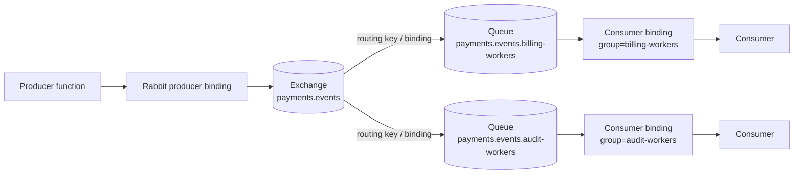
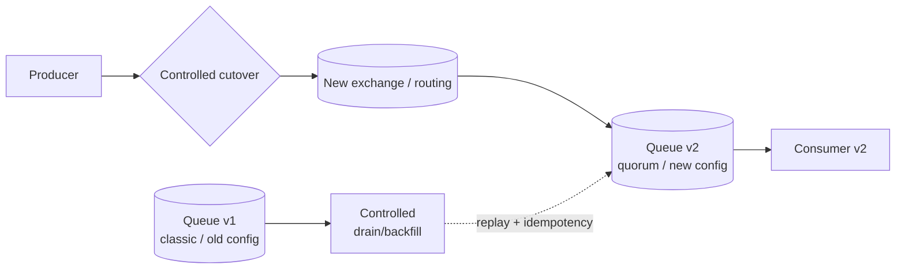

# RabbitMQ Queue, Exchange, or Resource Property Declaration Conflicts

Spring Cloud Stream enables event-driven programming with `Supplier`, `Function`, and `Consumer`, connecting functions to Kafka, RabbitMQ, or Pulsar via binders. In the **RabbitMQ binder**, initializing bindings typically includes declaring exchanges, queues, bindings, and potentially dead-letter exchanges/queues (DLX/DLQ). If a resource with the same name already exists with different properties, RabbitMQ rejects the declaration and closes the AMQP channel.

The hallmark symptom is **`406 PRECONDITION_FAILED - inequivalent arg`**: the issue is not "unable to connect to the broker," but rather that the broker detected the new declaration **is not equivalent** to the existing resource. An application can run cleanly in an empty environment yet fail when deployed into an environment where queues/exchanges were created earlier by another app, infrastructure, or an older version.

This lesson aims to diagnose the exact root cause, compare effective configuration between the app and the broker, fix the issue **without losing messages**, and establish resource ownership to prevent recurring conflicts.

## 1. Learning Objectives

After this lesson, you will be able to:

1. Distinguish exchanges, queues, and bindings, and know which properties are checked on redeclaration.
2. Read `PRECONDITION_FAILED` logs to extract **vhost, resource, argument, received, and current**.
3. Identify conflicts across `durable`, `auto-delete`, `exclusive`, `x-queue-type`, `x-message-ttl`, `x-dead-letter-exchange`, and exchange type.
4. Understand how the RabbitMQ binder names exchanges/queues from `destination`, `group`, `prefix`, and `queueNameGroupOnly`.
5. Distinguish broker policies from client-supplied `x-arguments` and immutable declaration-time properties.
6. Choose safe remediation paths: aligning config, using pre-provisioned infrastructure, or migrating to new resources.
7. Test declaration conflicts in an integration environment before deploying to production.

## 2. Understanding the RabbitMQ Model in Spring Cloud Stream

In Kafka, `destination` is usually a topic. In the **RabbitMQ binder**, `destination` typically maps to an **exchange**; consumer queues are created and bound to that exchange.



Example configuration:

```yaml
spring:
  cloud:
    function:
      definition: processPayment
    stream:
      bindings:
        processPayment-in-0:
          binder: rabbit
          destination: payments.events
          group: billing-workers
```

With common Rabbit consumer binder defaults, the exchange is `payments.events` and the durable queue is named `payments.events.billing-workers`. Different consumer groups use separate queues so each can receive copies of messages per matching routing/bindings; multiple instances in the same group compete on **the same queue**.

Important: a 406 error comes from **resource declaration**, which can happen **before the function is ever invoked**. Editing business code inside `processPayment` will not fix this error.

## 3. Redeclaration Rules and Property Equivalence

AMQP `queue.declare` / `exchange.declare` has two kinds of outcomes:

- Resource does not exist yet and the app has permissions: the broker creates the resource.
- Resource already exists with equivalent properties: the broker accepts redeclaration, essentially idempotently.
- Resource already exists with inequivalent properties: the broker returns **`406 PRECONDITION_FAILED`**, typically closing the **affected channel**.

Example of two apps declaring the same queue:

```text
Application A:
queue = payments.events.billing-workers
durable = true
autoDelete = false
arguments = {"x-message-ttl": 60000}

Application B:
queue = payments.events.billing-workers
durable = true
autoDelete = false
arguments = {"x-message-ttl": 120000}

Result: conflict on x-message-ttl (assuming no special rule
makes the two declarations equivalent).
```

Sharing the same **name** is not enough to share a resource. Applications in the same vhost declaring the same exchange/queue must agree on the **resource contract**.

**Notable exception:** modern RabbitMQ supports a default queue type (DQT) and options relaxing certain `x-queue-type` checks during migrations. Do not treat that as a universal escape hatch for `durable`, `exclusive`, TTL, DLX, or other properties, nor does it convert an existing queue to a new type.

## 4. Reading a 406 Error Message Accurately

Typical error message (illustrative):

```text
ShutdownSignalException:
channel error;
reply-code=406,
reply-text=PRECONDITION_FAILED - inequivalent arg
'x-dead-letter-exchange' for queue 'payments.events.billing-workers'
in vhost '/':
received 'payments.retry' but current is 'payments.dlx'
```

Break down five fields:

| Error Field | How to Interpret |
|---|---|
| `reply-code=406` | Declaration precondition failed; not a network error by default |
| `inequivalent arg` | A declared property/argument does not match |
| `queue` or `exchange` | Type of resource in conflict |
| Resource name and `vhost` | Exact object to inspect on the broker |
| `received` / `current` | Value sent by the app on declaration vs value currently stored by the broker |

**`received` is the value sent in the failing declaration**, while `current` is what the broker already has. Do not flip them backward. When the broker reports `received '120000' but current is '60000'`, decide which side represents the intended contract before changing anything.

Java logs may wrap this inside `AmqpIOException`, `ShutdownSignalException`, `BeanCreationException`, or errors from `RabbitAdmin` / the listener container. Look for the **root error near `channel.close`** instead of reading only the outermost exception.

## 5. Distinguishing 406 from Commonly Confused Errors

| Code / Symptom | Key Difference | Verification Step |
|---|---|---|
| **406 PRECONDITION_FAILED** | Inequivalent declaration or violated precondition | Resource name, `received`/`current` fields, args |
| **404 NOT_FOUND** | Using/checking a nonexistent resource (e.g., passive declare or binding to missing exchange) | Does the resource/vhost exist? |
| **403 ACCESS_REFUSED** | Permissions, forbidden resource name, or disallowed action | User/vhost/ACLs, reserved names |
| **405 RESOURCE_LOCKED** | Exclusive queue already owned by another connection | Exclusive queue, owning connection |
| **530 NOT_ALLOWED** or plugin errors | Operation or broker capability unsupported | Plugins, broker version, exchange type |
| Connection refused/TLS/SASL | Cannot establish connection | Host/port, credentials, TLS, network |

Non-406 codes can appear in many contexts; always read the full `reply-text` before concluding.

**Do not fix 406 by raising `connection-timeout` or retrying infinitely.** On every reconnect, the binder keeps declaring the same incompatible properties and failing repeatedly.

## 6. Matrix of Properties That Commonly Conflict

| Resource | Property / Argument | Meaning | Notes When Fixing |
|---|---|---|---|
| Exchange | `type`: topic/direct/fanout/headers | Routing rules | Cannot change an existing exchange's type via redeclare |
| Exchange | `durable` | Exchange survives broker restarts | Align with original declaration |
| Exchange | `autoDelete` | Deleted when auto-delete conditions are met | Binder default may differ from infra |
| Exchange | `arguments`, e.g. alternate exchange | Optional exchange settings | Compare policies and x-args |
| Queue | `durable` | Queue metadata durability | Cannot change in-place via redeclare |
| Queue | `exclusive` | Queue tied to owning connection | Do not confuse with exclusive consumer |
| Queue | `autoDelete` | Deleted on auto-delete condition | Never use temp queues for shared durable groups |
| Queue | `x-queue-type` | Classic/quorum/stream | Fixed at creation; cannot convert type in-place |
| Queue | `x-message-ttl` | Default per-message TTL | Prefer policies when possible |
| Queue | `x-expires` | Unused queue expiration time | Check impact on group queues |
| Queue | `x-dead-letter-exchange` | Exchange receiving dead-lettered messages | Avoid hardcoded x-arg if updating via policy |
| Queue | `x-dead-letter-routing-key` | Routing key when dead-lettering | Must match DLX topology |
| Queue | `x-max-length`, `x-max-length-bytes` | Message/byte capacity limits | Consider overflow policy |
| Queue | `x-max-priority` | Classic queue priority levels | Hard to change because fixed at declaration |
| Queue | `x-single-active-consumer` | Only one consumer active at a time | Not an app thread-count setting |
| Binding | Routing/binding key, arguments | Connects exchange → queue | Wrong keys usually drop routing, not 406 |

The final row is critical: **queue exists and declaration succeeds, yet wrong routing key** prevents messages from reaching the consumer; that is a **topology mismatch**, not a queue declaration conflict.

## 7. Exchange Type Conflicts

Two services share destination `payments.events` but configure:

Application A (type topic):

```yaml
spring:
  cloud:
    stream:
      rabbit:
        bindings:
          processPayment-in-0:
            consumer:
              exchange-type: topic
```

Application B (type direct):

```yaml
spring:
  cloud:
    stream:
      rabbit:
        bindings:
          publishPayment-out-0:
            producer:
              exchange-type: direct
```

If both declare exchange `payments.events` in the same vhost, the second app to start receives:

```text
406 PRECONDITION_FAILED - inequivalent arg 'type'
for exchange 'payments.events':
received 'direct' but current is 'topic'
```

Safe fix: agree on **one exchange type** and align routing/binding keys accordingly. If the business genuinely needs an independent `direct` exchange, create an **exchange with a new name** rather than forcing the broker to alter the existing exchange's type.

**Never set `declare-exchange: false` just to suppress the error and keep publishing to an exchange of the wrong type.** The app may start, yet messages will route wrongly or become unroutable.

## 8. Exchange `durable` and `auto-delete` Conflicts

An easy-to-miss case: by default, the Rabbit binder may declare exchanges with:

- `exchangeDurable=true`.
- `exchangeAutoDelete=true`.
- `exchangeType=topic`.

Infrastructure teams often pre-create exchanges with `durable=true` and `auto_delete=false`. Even when both use `type=topic`, redeclaring triggers a 406.

Example consumer using an infrastructure-provisioned exchange per contract:

```yaml
spring:
  cloud:
    stream:
      rabbit:
        bindings:
          processPayment-in-0:
            consumer:
              exchange-type: topic
              exchange-durable: true
              exchange-auto-delete: false
```

Check `exchangeDurable` and `exchangeAutoDelete` on **both producer and consumer bindings**. If both producer and consumer declare the exchange, fixing only one side is not enough: the other service will re-trigger the conflict on its next deploy/restart.

Auto-delete does not mean "the exchange disappears immediately when the app stops." RabbitMQ deletes an auto-delete exchange only when conditions regarding its **last binding** are met; inspect actual lifecycle behavior.

## 9. Queue `durable`, `exclusive`, and `auto-delete` Conflicts

Queues have mandatory properties independent of exchanges. For example, two apps use the same queue name while one asks for transient settings:

```text
Existing queue: orders.events.order-workers
durable=true, exclusive=false, auto_delete=false

New queue declaration asks for:
durable=false, exclusive=false, auto_delete=true
```

RabbitMQ will not "edit" the queue to match the new request. Find out why two apps share that queue name:

- One app uses a durable `group`, while the other omits `group` and expects a temporary queue.
- Two apps collide on `group`/prefix names with different intentions.
- Queue was created via `QueueBuilder` or IaC with a different lifecycle.
- `dev` and `prod` profiles accidentally connect to the same vhost and resource name.

**Exclusive queue** (a queue attribute) differs from **exclusive consumer** (a mechanism allowing only one consumer on a queue at a time). Never assume setting `exclusive` on the Rabbit consumer binder means the queue itself was declared `exclusive=true`.

Never turn a durable queue into auto-delete just to let a startup pass if the queue holds backlog or must preserve messages across restarts.

## 10. Classic, Quorum, and Stream Queue Conflicts

RabbitMQ supports queue types with distinct semantics:

- **Classic queue:** fits some traditional workloads; lacks quorum Raft replication.
- **Quorum queue:** Raft-backed; requires attention to cluster topology, resources, and delivery limits.
- **Stream:** different storage and consumption model from traditional queues.

Queue type is fixed at creation, typically via `x-queue-type` or the vhost/node default queue type. Thus:

```text
Existing queue: orders.events.order-workers
x-queue-type = classic

New app requests:
x-queue-type = quorum
```

will mismatch whenever strict property equivalence is enforced. Spring Cloud Stream Rabbit binder config:

```yaml
spring:
  cloud:
    stream:
      rabbit:
        bindings:
          processOrder-in-0:
            consumer:
              quorum:
                enabled: true
```

**Never treat `quorum.enabled=true` as an in-place upgrade for an existing classic queue.** To move to quorum, create a new queue, plan backlog draining/consumption, update bindings, handle deduplication, and cut over producers/consumers.

RabbitMQ provides an option relaxing some `x-queue-type` checks during migrations (`quorum_queue.property_equivalence.relaxed_checks_on_redeclaration`), but it **does not convert queue types** and should not be turned on merely to hide resource drift. Verify your broker version and cluster operational policy.

## 11. Default Queue Type (DQT) and Subtle Conditions

RabbitMQ can configure a **default queue type** at the virtual host or node level. When a client omits `x-queue-type`, queues may be created using the DQT instead of assuming classic.

Situations that arise:

- Environment A uses classic DQT while environment B uses quorum DQT.
- Infrastructure upgraded the vhost DQT while the app still tries to declare the old type.
- Some apps set `quorum.enabled` while others rely on defaults.
- Queues created before a DQT change retain their original type.

Verification steps:

1. Check the queue's **actual type** in the Management UI/CLI.
2. Check whether `arguments` contains `x-queue-type`.
3. Check the DQT of that exact vhost/node.
4. Check whether the app/binder explicitly sends `x-queue-type`.
5. Plan an explicit migration; do not change DQT assuming existing queues convert automatically.

## 12. Optional Arguments and Data Types

Queue `x-arguments` are a key/value map sent at declaration time:

```java
@Bean
Queue orderQueue() {
    return QueueBuilder.durable("orders.events.order-workers")
            .ttl(60_000)
            .deadLetterExchange("orders.dlx")
            .build();
}
```

If a queue of the same name already has a different `x-message-ttl`, Spring AMQP `RabbitAdmin` or the Rabbit binder will be rejected by the broker.

Check argument data types as well, not only their string representations:

- `60000` (integer) and a value of another AMQP numeric/string type may fail equivalence depending on broker checks.
- `x-queue-type` is a semantic enum string; do not confuse it with an arbitrary "quorum" boolean.
- `x-dead-letter-exchange` is an **exchange name**, not a queue name.
- `x-expires` is idle queue expiration time, distinct from per-message expiration (`x-message-ttl`).

Do not tweak arguments via redeclaration expecting the broker to "sync" them like an HTTP PUT. Declaration asserts or creates a resource matching an exact contract—it is not an arbitrary property patch.

## 13. Policies vs. Operator Policies: A Critical Distinction

RabbitMQ has two policy layers:

- **User policy:** applied dynamically at runtime to matching queues/exchanges by regex, supporting many optional arguments like TTL, DLX, and length limits.
- **Operator policy:** guardrails set by operations to cap resources; follows specific precedence rules where numeric limits typically take the lower bound.

If the same key appears in client-supplied `x-arguments` and a **user policy**, the client's direct declaration value normally **takes precedence** over the policy. Therefore, adding a policy `message-ttl=60000` will not override `x-message-ttl=120000` hardcoded in the app.

Example policy managing TTL (admin operation; run only in authorized environments):

```bash
rabbitmqctl -p / set_policy --apply-to queues --priority 5 \
  orders-ttl '^orders[.]events[.]order-workers$' \
  '{"message-ttl":60000}'
```

This command illustrates vhost `/` and a specific queue. Before running in production, verify `rabbitmqctl` syntax for your broker version, existing policies, priority rules, and effects on queued messages. **Never run this just to silence a 406 without checking existing `x-args` first.**

Some properties **cannot** be changed via policies, such as queue type and classic queue max priority. Those require resource migration rather than trying to bypass immutable rules with policies.

## 14. Spring Cloud Stream Rabbit Binder: Understanding Resource Naming

Key properties:

| Consumer Binding Property | Default / Role |
|---|---|
| `destination` | Logical exchange name for the binding |
| `group` | Consumer group, typically defining the durable queue |
| `prefix` | Prefix prepended to exchange/queue names |
| `queueNameGroupOnly` | false: queue is `destination.group`; true: queue equals `group` |
| `declareExchange` | true: binder declares the destination exchange |
| `bindQueue` | true: binder declares the queue and binds it to the exchange |
| `exchangeType` | Defaults to `topic` |
| `exchangeDurable` | Defaults to true |
| `exchangeAutoDelete` | Defaults to true |
| `durableSubscription` | Defaults to true when `group` is set |
| `autoBindDlq` | Defaults to false |
| `quorum.enabled` | Defaults to false for binder-created queues |

Rabbit consumer configuration namespace:

```text
spring.cloud.stream.rabbit.bindings.<bindingName>.consumer.<property>
```

For a function named `processOrder`, the binding name is normally `processOrder-in-0`, not `input`, unless an explicit binding mapping exists.

If a deployment sets properties under `spring.cloud.stream.rabbit.bindings.input.consumer` while runtime only binds `processOrder-in-0`, those settings are ignored and the binder falls back to unexpected defaults.

## 15. A Recurring Culprit: Producer and Consumer Both Declare the Exchange

Producers and consumers each have their own extended properties:

```yaml
spring:
  cloud:
    stream:
      bindings:
        publishOrder-out-0:
          binder: rabbit
          destination: orders.events
        processOrder-in-0:
          binder: rabbit
          destination: orders.events
          group: order-workers
      rabbit:
        bindings:
          publishOrder-out-0:
            producer:
              exchange-type: topic
              exchange-durable: true
              exchange-auto-delete: false
          processOrder-in-0:
            consumer:
              exchange-type: topic
              exchange-durable: true
              exchange-auto-delete: false
```

If only the producer sets `exchange-auto-delete: false` while the consumer leaves the default `true`, the same exchange is declared inconsistently, triggering a 406.

The fix is **one shared exchange contract** for every app in the vhost:

- Name, type, durable, auto-delete, and arguments.
- Who owns permission to declare/alter the exchange.
- Whether other producers/consumers redeclare it.
- Expected binding keys and queue groups.
- Change review and pre-deploy testing rules.

## 16. Producer `requiredGroups` Can Also Create Queues

The Spring Cloud Stream Rabbit producer supports `requiredGroups`. When configured, the producer not only declares the exchange, it can also provision queues and bindings for the listed groups.

```yaml
spring:
  cloud:
    stream:
      bindings:
        publishOrder-out-0:
          binder: rabbit
          destination: orders.events
          producer:
            required-groups: order-workers
```

When both producer and consumer create queue `orders.events.order-workers`, queue and DLQ properties on both sides must align. Producers expose extended properties for `requiredGroups` such as `queueNameGroupOnly`, `autoBindDlq`, `quorum.enabled`, and TTL/length limits depending on version.

Scenario:

- Producer starts first and creates a classic queue.
- Consumer deploys later with `quorum.enabled=true`.
- Consumer redeclares the same queue name with a different type → error.

Do not read only the consumer's YAML when investigating. Check every producer or provisioning job using `requiredGroups`; it may be the actor that created the resource first.

## 17. Reproducing 406 from Exchange Settings

Suppose existing topology already has exchange `orders.events`:

```text
name=orders.events
type=topic
durable=true
auto_delete=false
```

An older app declared:

```yaml
spring:
  cloud:
    stream:
      rabbit:
        bindings:
          consumeOrder-in-0:
            consumer:
              exchange-type: topic
              exchange-durable: true
              exchange-auto-delete: false
```

A new app forgets `exchange-auto-delete` and defaults to `true`. On binding startup, the broker reports:

```text
406 PRECONDITION_FAILED - inequivalent arg 'auto_delete'
for exchange 'orders.events' in vhost '/':
received 'true' but current is 'false'
```

**Non-destructive fix:** add `exchange-auto-delete: false` to the new consumer and every app sharing that exchange. Never delete the exchange so the broker "accepts the new config": deleting an exchange destroys routes/bindings, causing messages published during the gap to fail delivery.

## 18. Reproducing 406 from Queue TTL / DLX

Existing queue:

```text
name=orders.events.order-workers
durable=true
arguments:
  x-message-ttl: 60000
  x-dead-letter-exchange: orders.dlx
```

New service configures:

```yaml
spring:
  cloud:
    stream:
      rabbit:
        bindings:
          processOrder-in-0:
            consumer:
              ttl: 120000
              auto-bind-dlq: true
              dead-letter-exchange: orders.retry-dlx
```

If the binder declares the queue with arguments differing from the existing queue, the broker may fail on `x-message-ttl` or `x-dead-letter-exchange` first. There is no guarantee the broker reports all mismatched fields at once.

Fix procedure:

1. Inspect actual queue arguments and matching policies.
2. Lock down TTL/DLX as a shared **contract** across all producers and consumers.
3. For policy-manageable values, prefer RabbitMQ policies over hardcoded client args.
4. If an existing queue has hardcoded x-args that cannot change safely, plan a queue migration.
5. Confirm DLQ/DLX exist and route properly after fixing.

Changing `ttl` in YAML never modifies an existing queue in-place. Likewise, enabling `auto-bind-dlq` on a queue with a different existing DLX is not an in-place "DLX patch."

## 19. DLQ/DLX Are Resources That Can Conflict Too

When `autoBindDlq=true`, the Rabbit binder may additionally provision:

- Dead-letter exchange (DLX).
- Dead-letter queue (DLQ).
- Binding from DLX to DLQ.
- `x-arguments` on the main queue or on the DLQ.

Properties to compare include `deadLetterQueueName`, `deadLetterExchange`, `deadLetterExchangeType`, `deadLetterRoutingKey`, `declareDlx`, `dlqTtl`, `dlqMaxLength`, `dlqQuorum.enabled`, and `dlqDeadLetterExchange`.

The conflict can happen on the **DLQ** rather than the main queue. Therefore, whenever a stack trace reports `inequivalent arg`, read the **exact queue/exchange name in the log** first rather than assuming it is the input queue.

**Warning:** configuring a DLX or TTL on a DLQ that routes messages back to the main queue can create a loop. Check dead-letter cycles, redelivery counts, retry/backoff, poison messages, and backlogs before modifying settings.

## 20. Inventorying Resources from RabbitMQ Management

The first production step is **read-only evidence gathering**:

- Exact vhost the app connects to.
- Exchange name, type, durable, auto_delete, and arguments.
- Queue name, type, durable, auto_delete, arguments, and message counts.
- Queue bindings: source exchange, destination queue, routing key, and arguments.
- Active matching policies and operator policies.
- Service accounts with declare permissions and services sharing the same names.

In the RabbitMQ Management UI, inspect **Exchanges**, **Queues and Streams**, **Bindings**, and **Policies** inside the right vhost.

Read-only CLI commands (syntax varies by deployment and permissions):

```bash
rabbitmqctl -p / list_exchanges name type durable auto_delete arguments
rabbitmqctl -p / list_queues name durable auto_delete arguments messages_ready messages_unacknowledged
rabbitmqctl -p / list_bindings source_name destination_name destination_kind routing_key
rabbitmqctl -p / list_policies
```

Replace `/` with the service's actual vhost. Never run `delete_queue`, `delete_exchange`, or `purge_queue` just "to test" in production.

Access only authorized environments and never put passwords, tokens, or full payloads into diagnostic logs or screenshots.

## 21. Building an Actual-vs-Declared Table

For each failing resource, fill out a table:

| Property | Actual on Broker | Declared by App | Conclusion |
|---|---|---|---|
| Vhost | `/payments` | `/payments` | Match |
| Exchange | `orders.events` | `orders.events` | Name matches |
| Exchange type | `topic` | `topic` | Match |
| Exchange durable | true | true | Match |
| Exchange auto-delete | false | true | **Conflict** |
| Queue | `orders.events.order-workers` | Same name | Name matches |
| Queue type | quorum | classic | **Conflict if strict redeclare** |
| Queue TTL | 60000 | 120000 | **Conflict** |
| DLX | `orders.dlx` | `orders.retry-dlx` | **Conflict** |

Next identify the **owner of the resource contract**: broker IaC, Spring app A, Spring app B, or a provisioning service. Never choose `received` over `current` merely because one side is "newer"; decide based on operational requirements (durability, retention, retry/DLQ, routing).

## 22. Fix 1: Align Declarations to Existing Resources

This is usually the lowest-risk option when existing resources already serve production correctly:

1. Preserve existing queues/exchanges and messages.
2. Compare broker actuals against app YAML.
3. Align exchange type, durable, auto-delete, queue type, and hardcoded arguments.
4. Update **every** app that can redeclare the same resource (producers, consumers, admin jobs).
5. Deploy one canary app; verify bindings, routing, and consumer health.
6. Roll out the rest; monitor retries/reconnects and backlogs.

Never flip `durable=true` to `false` just to match a test app if doing so breaks delivery guarantees. The true contract dictates which side must change.

## 23. Fix 2: Infrastructure Owns Topology, Binder Only Consumes/Publishes

When exchanges, queues, and bindings are managed by IaC or a Platform team, applications should avoid redeclaring them.

Example **pre-provisioned** setup:

- Exchange `orders.events` of type `topic`.
- Queue `orders.billing-workers`.
- Binding from queue to exchange with routing key `orders.#`.
- Queue TTL/DLX configured and controlled by infrastructure.

Consumer:

```yaml
spring:
  cloud:
    function:
      definition: processOrder
    stream:
      bindings:
        processOrder-in-0:
          binder: rabbit
          destination: orders.events
          group: orders.billing-workers
      rabbit:
        bindings:
          processOrder-in-0:
            consumer:
              queue-name-group-only: true
              declare-exchange: false
              bind-queue: false
```

Producer (if also disallowed from declaring exchanges):

```yaml
spring:
  cloud:
    stream:
      rabbit:
        bindings:
          publishOrder-out-0:
            producer:
              declare-exchange: false
```

Here `queue-name-group-only: true` takes the queue name directly from `group` instead of `destination.group`. `declare-exchange: false` and `bind-queue: false` **work only if the exchange, queue, and binding already exist properly**. If missing, the app may receive nothing or fail to publish.

**Never use this config merely to silence a 406 without checking topology**; test publishing to the exchange and consuming from the pre-provisioned queue.

## 24. Fix 3: Resource Migration for Immutable Property Changes

If you must convert classic → quorum, direct → topic exchange, durable → non-durable, or alter queue arguments that cannot change at runtime, treat it as a **topology migration**, not a one-line YAML tweak.



Recommended procedure:

1. **Freeze configuration**: inventory all apps using the old names, queue depths, and SLAs.
2. **Choose new names** for queues/exchanges changing immutable type or lifecycle if the broker does not support in-place changes.
3. **Provision the new topology** via IaC/management and verify ACLs, DLX, and arguments.
4. **Test parallel routing** with safe test events; assess duplicates if fanning out to both old and new queues.
5. **Cut over producers/consumers in coordination**, ensuring no events drop during transition.
6. **Drain/backfill the old queue** using an idempotent, resumable design.
7. **Monitor** ready/unacked messages, DLQs, throughput, duplicates, and consumer errors.
8. **Delete old resources only** after confirming zero backlog and closing the rollback window.

Never promise global ordering or exactly-once semantics solely from dual routing. During republish/backfill, messages can duplicate or reorder; downstream consumers need idempotency and version guards.

## 25. Situations That Are Not Declaration Conflicts

Some failures are mistaken for queue/exchange conflicts:

| Symptom | Necessarily a 406? | Alternative Hypothesis |
|---|---|---|
| Queue has messages yet consumer receives none | No | Consumer stopped, prefetch/unacked, ACLs, wrong group |
| Producer publishes cleanly yet queue stays empty | No | Wrong binding key, fanout/direct/topic semantics, unroutable |
| Wrong binding name in YAML | No | Config ignored; binder uses defaults |
| Looking at the wrong vhost | No | Same-named topology lives in another vhost |
| `ACCESS_REFUSED` on declare | No | Missing configure/read/write permissions |
| Queue does not exist | No | Disabled binder declaration or wrong `queue-name-group-only` |
| Quorum queue fails to create | Maybe not | Cluster capability, quorum size, disk/resources |
| Delayed exchange fails to create | Not necessarily | `x-delayed-message` plugin not enabled |
| Auto-delete queue vanished | No | Connection/last-binding lifecycle |

Never delete a queue just because you see `AmqpIOException`. First answer "which **command** did the broker reject, on which **resource**, and for what **reason**?" before taking action.

## 26. Distinguish Exclusive Consumer from Single Active Consumer

The Rabbit consumer binder can configure:

- `exclusive`: uses Spring AMQP exclusive consumer support; distinct from `exclusive=true` on the queue itself.
- `singleActiveConsumer`: declares `x-single-active-consumer` on the queue, keeping one consumer active while others stand by.

Enabling `single-active-consumer` on an existing queue that lacks it is a **queue argument change** subject to property equivalence. Increasing `concurrency` cannot fix that.

Systems requiring per-queue ordering should explicitly adopt single consumer or single-active-consumer and test failover; never use a temporary `exclusive queue` in place of a durable queue that must hold backlog across restarts.

## 27. Multi-Binder and Environments: Same Name Does Not Mean Same Resource

With multiple Rabbit binders or multiple environments, a resource is uniquely identified by:

**Rabbit cluster + virtual host + resource type + resource name**.

Two `orders.events` exchanges in two different vhosts are not the same exchange; sharing a name within **the same vhost** requires obeying the same contract.

Check:

- `spring.rabbitmq.addresses` / host/port.
- `spring.rabbitmq.virtual-host`.
- Named binders and `environment.spring.rabbitmq.*` in multi-binder setups.
- Rabbit binder `prefix` and common binding `destination`.
- Whether Kubernetes/Helm/Config Server profiles override these properties.
- User accounts, vhost permissions, and broker policies in that vhost.

Never "resolve" a mismatch by accidentally pointing to a different vhost. The app may "start cleanly" while silently disconnecting from production traffic.

## 28. Declaration Retries and Operational Impact

After a 406 error, Spring AMQP/the Rabbit binder may retry connecting or redeclaring when connections/channels recover. As long as the topology mismatch remains, every retry fails identically.

**Do not:**

- Raise startup retry counts indefinitely.
- Catch and ignore exceptions without verifying queues and routes.
- Globally disable `RabbitAdmin` just to force health to `UP`.
- Delete a non-empty queue to force the broker to accept a new definition.

**Do:**

- Fix the exact mismatched field.
- Curb log spam while preserving error code, vhost, queue/exchange, and property details.
- Distinguish application liveness health from binding/consumer health.
- Pause the rollout when declaration fails rather than inventing ad-hoc topology.
- After fixing, verify consumer counts on the queue and confirm real messages are processed.

## 29. Testing Declaration Conflicts Against a Real Broker

Spring Cloud Stream's in-JVM Test Binder **does not create real RabbitMQ queues or exchanges**, so it cannot test property equivalence. Use real RabbitMQ in integration environments or Testcontainers.

### Test Scenario

1. Start a RabbitMQ test container.
2. Use an AMQP client or Spring AMQP `RabbitAdmin` to create an exchange/queue under contract A.
3. Boot the Spring Cloud Stream Rabbit app with a differing contract B.
4. Assert startup/binding fails with root cause containing `406 PRECONDITION_FAILED`.
5. Update B to match A; restart and assert the consumer receives messages.
6. Test `declare-exchange: false` / `bind-queue: false` against pre-provisioned topology.
7. Test DLX/DLQ and policies; confirm messages are not purged outside test teardown.

Minimal reproduction with the Java Rabbit client (run only against a **test broker**):

```java
try (Connection connection = factory.newConnection();
     Channel channel = connection.createChannel()) {

    Map<String, Object> args = Map.of(
            "x-message-ttl", 60_000
    );

    channel.queueDeclare(
            "demo.orders", true, false, false, args
    );
}

// New connection/channel redeclaring with a different TTL:
try (Connection connection = factory.newConnection();
     Channel channel = connection.createChannel()) {

    Map<String, Object> incompatible = Map.of(
            "x-message-ttl", 120_000
    );

    // Expected: server returns channel-level 406.
    channel.queueDeclare(
            "demo.orders", true, false, false, incompatible
    );
}
```

Never reproduce this against a production queue. Tests can leave behind test resources or close channels with errors; isolate vhosts/containers and clean up safely.

## 30. Reading a Declaration Failure Log Efficiently

Scan logs in this order:

1. `PRECONDITION_FAILED` and code 406.
2. Whether `queue` or `exchange` failed.
3. Resource name and vhost.
4. `inequivalent arg`, `received`, and `current`.
5. Stack trace from `RabbitAdmin` or the binder to identify which binding declared it.
6. Deployment timestamps showing which app declared first.
7. Actual queue/exchange state and policies in Management.
8. Effective config from Helm/env/Config Server, not just `application.yml`.

Sample incident note:

```text
Incident: RabbitMQ 406 on order-workers startup
Cluster/vhost: rabbit-prod /orders
Resource: exchange orders.events
Mismatch: auto_delete received=true, current=false
Owner of topology: messaging IaC
Affected bindings: publishOrder-out-0, processOrder-in-0
Safe action: pin exchange-auto-delete=false in both bindings
Validation: redeclare OK; queue depth stable; publish/consume pass
Rollback: revert app release only if routing/data compatibility preserved
```

Incident notes should never contain message payloads, user tokens, or broker connection passwords.

## 31. Production Incident Runbook

| Step | Question | Decision |
|---|---|---|
| 1. Isolate | Is it genuinely 406, and which resource? | Separate declaration conflict from network/ACL issues |
| 2. Preserve data | Current queue depth, unacked, DLQ? | Never purge/delete without assessment |
| 3. Compare | Actual vs declared on the right vhost? | Pinpoint exact mismatched fields |
| 4. Find owner | Who provisions, which apps redeclare? | Align on one contract |
| 5. Pick path | Align config, disable app declare, or migrate? | Prioritize zero data loss |
| 6. Stage test | Reproducible test ready? | Verify behavior and rollback |
| 7. Roll out | Does canary process messages cleanly? | Watch ready/unacked and retries |
| 8. Close | Docs, alerts, and preflight checks updated? | Prevent recurrence |

**Decision rule:** when first spotting the error, the safest choice is usually to **halt rollout of the conflicting version, keep existing queues/exchanges intact, snapshot effective config, and compare**. Never delete resources impulsively.

## 32. Checklist Before Declaring the Issue Resolved

- Confirmed the exact cluster, vhost, binding, destination, and group.
- Captured verbatim `reply-code`, `reply-text`, `received`, and `current`.
- Distinguished exchange, queue, and DLQ conflicts from ACL/missing-resource errors.
- Compared exchange type, durable, auto-delete, and arguments.
- Compared queue durable, exclusive, auto-delete, type, and `x-arguments`.
- Verified actual queue names from `destination.group` or `queueNameGroupOnly`.
- Checked producer `requiredGroups` and other provisioning jobs.
- Checked broker policies, operator policies, and DQT.
- Avoided expecting YAML edits to modify existing queues in-place.
- If using infra-managed topology, set `declareExchange`/`bindQueue` intentionally.
- If migrating queue/exchange types, used new names, cutover, drain, and idempotency.
- Never deleted/purged a production queue just to let the app boot.
- Real-broker RabbitMQ integration test confirmed declarations and publish/consume.
- DLQ/DLX still route accurately after changes.
- Consumer counts, ready/unacked messages, error/retry rates, and throughput returned to normal.
- Documented resource owner and declaration contract to avoid repeat conflicts.

**Conclusion:** `406 PRECONDITION_FAILED` in RabbitMQ is an important signal that **the resource contract between client and broker has diverged**. With the Spring Cloud Stream Rabbit binder, the cause usually lies in defaults or settings across **multiple apps declaring the same resource**: exchange `type/durable/autoDelete`, queue `durable/type/TTL/DLX`, `destination.group` names, producer `requiredGroups`, or pre-provisioned infrastructure. Diagnose via `received/current`, compare actual-vs-declared in the exact vhost, and favor non-destructive config alignment before resorting to topology migration.

## References

1. [RabbitMQ — Queues: Declaration and Property Equivalence](https://www.rabbitmq.com/docs/queues) — queue redeclaration, 406 errors, DQT, and queue properties.
2. [RabbitMQ — Exchanges](https://www.rabbitmq.com/docs/exchanges) — exchange type, durable, auto-delete, and arguments.
3. [RabbitMQ — Policies](https://www.rabbitmq.com/docs/policies) — client x-args, policy precedence, dynamic properties, and immutables.
4. [RabbitMQ — Dead Letter Exchanges](https://www.rabbitmq.com/docs/dlx) — `x-dead-letter-exchange`, policies vs hardcoded arguments, and DLX permissions.
5. [RabbitMQ — Quorum Queues](https://www.rabbitmq.com/docs/quorum-queues) — queue types, Raft, and property equivalence relaxation.
6. [RabbitMQ — Virtual Hosts](https://www.rabbitmq.com/docs/vhosts) — resource scoping and default queue types.
7. [Spring Cloud Stream 5.0.4 — RabbitMQ Consumer Properties](https://docs.spring.io/spring-cloud-stream/reference/rabbit/rabbit_overview/rabbitmq-consumer-properties.html) — `bindQueue`, `queueNameGroupOnly`, `exchangeAutoDelete`, `quorum.enabled`, and `autoBindDlq`.
8. [Spring Cloud Stream 5.0.4 — RabbitMQ Producer Properties](https://docs.spring.io/spring-cloud-stream/reference/rabbit/rabbit_overview/prod-props.html) — `requiredGroups`, exchange options, and producer-side provisioning.
9. [Spring Cloud Stream — RabbitMQ Binder Reference](https://docs.spring.io/spring-cloud-stream/reference/rabbit/rabbit_overview.html) — binding, queue, and DLQ mechanics.
10. [RabbitMQ — Access Control](https://www.rabbitmq.com/docs/access-control) — configure/read/write permissions per vhost.
