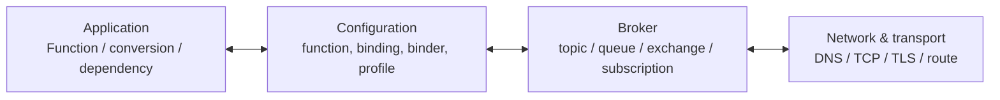
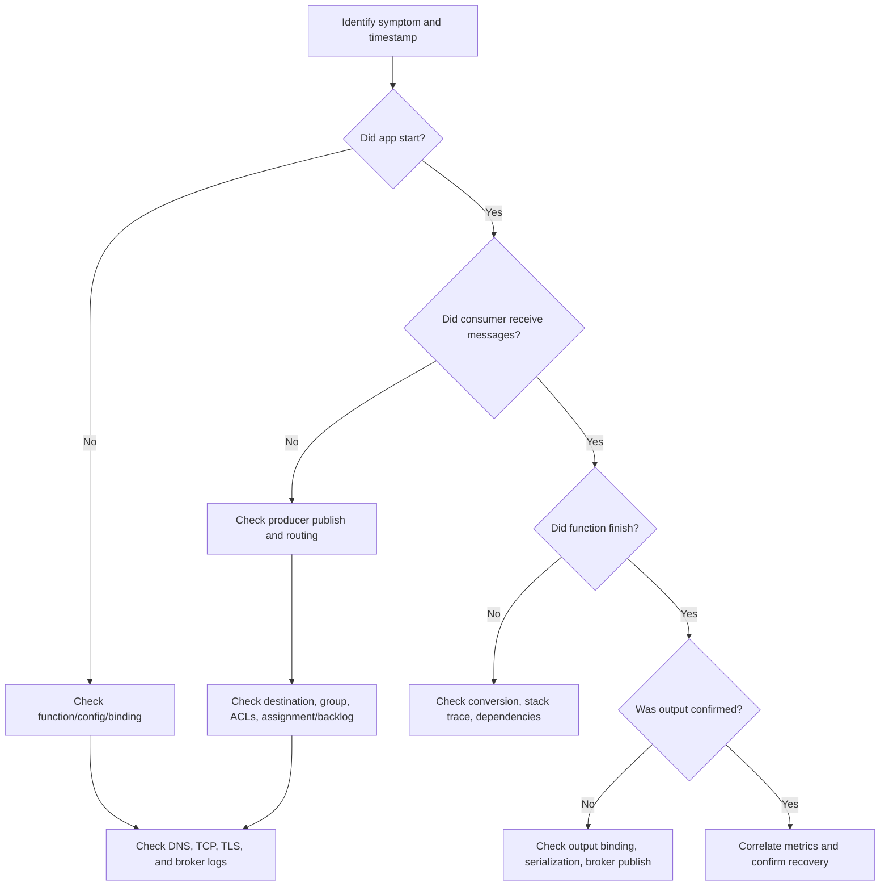
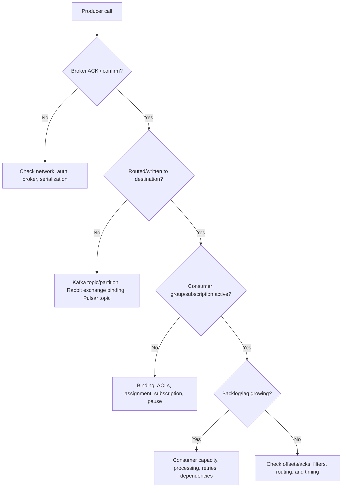

# Distinguishing Application, Configuration, Broker, and Network Errors Using Evidence

When a Spring Cloud Stream pipeline stops receiving messages, sees rising latency, or retries continuously, the exact same symptom can stem from multiple layers: business-logic code, binding/binder configuration, the broker, or the network path. A function never being called could be caused by a binding pointing to the wrong destination, a missing topic, a queue lacking a binding key, missing consumer permissions, broken DNS resolution, or a broker advertising an address unreachable from pods.

The reliable diagnostic method is **gathering evidence along a single shared timeline, identifying exact bindings/resources, and checking each layer outward from the application**. A standalone "connection failed" message or Actuator `UP` status is never enough to conclude the root cause.

This lesson belongs to the **Troubleshooting** group and focuses on separating four categories:

- **Application:** exceptions inside functions, conversion/serialization errors, dependencies, or business logic.
- **Configuration:** wrong function definition, binding name, destination, group, binder, profile, credential reference, or property override.
- **Broker:** resources, ACLs, partitions/leaders, queues/exchanges/bindings, subscriptions, quotas, broker health, or protocol-level rejections.
- **Network/transport:** DNS, routing, firewalls, TCP, TLS, proxies, NAT, idle timeouts, or packet loss.

Categories can overlap. For instance, a misconfigured hostname causes a network error; a bad TLS certificate causes a handshake failure; an overloaded broker can trigger timeouts that look like network failures. The goal is to pinpoint **the first layer showing broken evidence**, then verify with a controlled test.

## 1. The Four-Layer Model to Separate

A Spring Cloud Stream application comprises functions, bindings, binders, and brokers:



Main steps:

1. Spring Boot loads configuration and creates function beans.
2. Spring Cloud Stream discovers functions, creates bindings, and selects binders.
3. The binder connects to the broker and declares or accesses resources.
4. The broker authenticates/authorizes, accepts producers, or assigns consumers.
5. Messages are delivered to the function.
6. The function converts payloads, runs business logic, and calls dependencies.
7. Results are acked/committed or published to output bindings.

Failures in steps 1–2 typically belong to application/configuration; steps 3–4 typically involve broker/network/security; steps 5–7 can involve broker delivery, conversion, application code, or dependencies.

Never assign root cause solely from where an exception was thrown. Identify **the last operation that succeeded** and **the first boundary that failed**.

## 2. Four Error Categories and Characteristic Evidence

| Category | Common Evidence | Confirmatory Check |
|---|---|---|
| Application | Stack trace enters function/service; specific payload reproduces error; dependency returns error | Function unit test, sanitized payload replay, dependency mock/health check |
| Configuration | Function/binding missing; unexpected destination/group; property unbound or overridden by profile | Effective config, binding inventory, startup logs, test context |
| Broker | ACL denial, missing topic/queue, 406/404, leader/partition state, subscription backlog | Broker logs, admin/management API, ACL/resource inspection |
| Network | DNS failure, TCP timeout/refused/reset, TLS handshake, route/firewall | Probe from same runtime, DNS/TCP/TLS tests, network telemetry |

Individual clues are only suggestive until cross-checked. For example, a `TimeoutException` can stem from an overloaded broker, DNS/routing, firewall drops, `max.poll.interval.ms`, or a slow downstream stalling consumer polls.

## 3. Assemble an Evidence Pack Before Making Changes

Before restarting, bumping timeouts, changing groups, or deleting resources, record a unified evidence pack:

| Data | Example | Why Needed |
|---|---|---|
| Time | UTC timestamp with timezone, ±2 minute window | Correlate app, broker, and network logs |
| Deployment | image/tag, commit, pod/host, namespace | Compare healthy vs failing instances |
| Binding | function, binding name, binder, destination, group | Pinpoint exact message path |
| Broker | cluster, vhost/namespace, topic/queue, partition | Avoid inspecting the wrong resource |
| Client | client ID, consumer group, connection name | Locate the right broker-side session |
| Message | authorized event ID / correlation ID | Link producer, consumer, and traces |
| Error | exception chain, root cause, error code | Separate app, config, broker, and transport |
| Metrics | throughput, latency, retries, lag/backlog, connections | Tell when impact started vs baseline |
| Config | profile, property source, version, sanitized values | Catch overrides and misconfigurations |
| Recent changes | releases, config rollouts, broker maintenance, network policies | Narrow cause by timing |

Never put raw payloads, passwords, tokens, private keys, connection strings, or personal data into the evidence pack. Use anonymized IDs or non-sensitive correlation IDs.

**Preserve evidence before changing anything:** snapshot broker state, queue depth/lag, consumer membership, effective config, and relevant logs. Restarting can erase connection state, rebalances, or original exceptions.

## 4. Use One Shared Timeline

Synchronize clocks across apps, nodes, brokers, and logging systems via NTP or platform time sync. Record ISO-8601 UTC timestamps, e.g.:

```text
2026-11-24T09:14:22.381Z
```

Build a timeline:

```text
09:14:20.100Z  Producer starts publish eventRef=evt-7f...
09:14:20.145Z  Broker confirms publish / send result
09:14:22.381Z  Consumer records receive
09:14:22.390Z  Function starts
09:14:22.510Z  Downstream HTTP timeout
09:14:22.515Z  Function throws exception
09:14:23.520Z  Retry attempt 2
```

If broker and app clocks drift, event order can be misread. Record timezone/clock source and estimated skew if any. Trace IDs link spans; event IDs correlate messages; timestamps align logs across components that do not share trace context.

## 5. Start from the Symptom, Not a Guess

Categorize the opening question:

- **App fails to start:** function discovery, binding creation, config binding, dependency injection, DNS/TCP/TLS, broker declarations/auth.
- **App is UP but zero messages arrive:** is the function bound, is the producer publishing, is the broker routing, does the consumer have assignments/subscriptions?
- **Messages arrive but function fails:** conversion, validation, business code, dependencies, timeouts.
- **Function succeeds but output is missing:** output binding, serialization, producer send, routing/ack/transactions.
- **Fails on only one pod:** DNS cache, network policy/node, secret/config drift, different image/version, resource limits.
- **Fails under load or over time:** broker quota/overload, hot partitions, connection churn, idle timeouts, GC, backpressure, or downstream saturation.



This diagram shows an investigative order, not a rigid rule that every incident must step sequentially. If broker logs already reveal an ACL denial, act on that evidence at the right layer immediately.

## 6. Identifying Application Errors

An error belongs to the application when the message was delivered to the process, the binding is active, and the stack trace points to handler logic or a dependency invoked by code.

Example:

```java
@Bean
Consumer<PaymentEvent> processPayment(PaymentService service) {
    return event -> service.authorize(event);
}
```

If logs show:

```text
function=processPayment
eventRef=evt-7f...
exception=PaymentValidationException
code=INVALID_CURRENCY
```

and a unit test with the same payload reproduces the exception without a broker, that is strong evidence of application/domain validation.

Other indicators:

- Stack trace passes through the application's domain classes or mappers.
- Input reached the function with a corresponding event ID or trace span.
- Broker consumer lag does not spike abnormally, or offsets advance per error policy.
- Dependency returns HTTP 4xx/5xx or a database constraint violation tied to a request/transaction ID.
- The exact same payload reproduces identically across healthy pods/versions.

Do not assume an app bug just because the outermost exception is `RuntimeException`. Read `Caused by`, the root error, thread, and preceding span. `SerializationException` can occur ahead of the function; `TimeoutException` can arise in either the Kafka client or an HTTP client.

## 7. Separating Conversion/Serialization from Business Logic

Spring Cloud Stream converts payloads using content types, message converters, target types, or binder native encoding/decoding.

| Failure Point | Symptom | How to Verify |
|---|---|---|
| Binder/client deserialization | Cannot instantiate object; parse/Serde error | Inspect raw bytes, schema, serializer/deserializer |
| Message conversion | `MessageConversionException`, `ConversionFailedException` | Inspect `contentType`, headers, target type |
| Validation | Object constructed yet breaks domain rules | Unit test validator/function |
| Business logic | Function runs and throws domain exception | Stack trace and function test |
| Output serialization | Function completes yet producer cannot encode | Producer error, converter/Serde, output schema |

For instance, valid JSON bytes sent with `text/plain` while the consumer expects `application/json` trigger a conversion failure. That is a contract/configuration/conversion error, not a network failure.

Log allowed content types and schema versions; never dump raw payloads containing sensitive data.

## 8. Identifying Configuration Errors

Misconfigurations often produce systems that **connect cleanly yet do the wrong thing**. Items to compare:

- `spring.cloud.function.definition`: right function bean and composition?
- Binding names: default functional names like `processPayment-in-0`, `processPayment-out-0`, or explicit aliases?
- `binder`: right named binder/cluster?
- `destination`: right logical topic/exchange/queue?
- `group`: consumer group preserving the intended name and semantics?
- `contentType`: matches payload contract?
- Consumer properties: concurrency, partitioning, max attempts, ack mode, DLQ?
- Producer properties: partition key, routing key, required groups, native encoding?
- Broker endpoints, vhost/namespace, security protocol, and credential references?

Example configuration:

```yaml
spring:
  cloud:
    function:
      definition: processPayment
    stream:
      bindings:
        processPayment-in-0:
          binder: kafkaOrders
          destination: payments.authorized
          group: payment-service
          content-type: application/json
```

If deployment configures `bindings.input` while runtime generates `processPayment-in-0`, the old property has no effect. The app can still show UP while subscribing to default destinations or unintended groups.

## 9. Verifying Effective Configuration and Precedence

Reading YAML files alone is insufficient. Spring Boot merges multiple property sources where higher-precedence values override files:

- Command-line arguments and system properties.
- Environment variables.
- Profile-specific configs.
- External configs / Config Server.
- Kubernetes ConfigMaps/Secrets and Helm values.
- Deployment templates or runtime arguments.

Compare **bound values**, property sources, and live bindings. You can inspect Actuator `env`/`configprops` when enabled, secured, and properly sanitized; never expose sensitive endpoints publicly.

Example values to verify (sanitized):

```text
spring.cloud.function.definition = processPayment
spring.cloud.stream.bindings.processPayment-in-0.destination = payments.authorized
spring.cloud.stream.bindings.processPayment-in-0.group = payment-service
spring.cloud.stream.bindings.processPayment-in-0.binder = kafkaOrders
spring.cloud.stream.kafka.binder.brokers = broker-a.internal:9092
```

Never copy secret values into reports. Record only secret reference names, mount/rotation status, or non-sensitive fingerprints when needed.

## 10. Inspecting Binder and Binding Lifecycle

Spring Cloud Stream bindings bridge functions and binders. Verify:

1. Was the function bean discovered?
2. Does `function.definition` pick the right bean?
3. Do runtime binding names match configuration prefixes?
4. Is the binder implementation on the classpath?
5. Does the named binder point to the right cluster/environment?
6. Was the binding created, started, and connected?
7. Was the binding paused/stopped via actuator or operational code?
8. Are consumer groups/destinations accurate on the broker?

Actuator health reflects registered health indicators; it does not prove every binding is actively receiving messages. The binding lifecycle endpoint (when supported and exposed) lets you inspect or control binding state; use administrative endpoints only when secured and after understanding pause/resume impacts.

## 11. Evidence from Application Logs, Metrics, and Traces

All three observability signals complement each other:

| Signal | Provides Evidence Of | Does Not Prove Alone |
|---|---|---|
| Logs | Exceptions, error codes, binding/client IDs, event sequence | Broker durably persisted/published the message |
| Metrics | Throughput, latency, retries, lag, connections, CPU/heap | Where one specific message went |
| Traces | Producer/consumer/dependency spans and durations | Every business invariant succeeded |

Emit structured logs using allowlisted fields:

```java
log.warn(
    "stream_processing_failed binding={} destination={} group={} eventRef={} errorCode={}",
    "processPayment-in-0",
    "payments.authorized",
    "payment-service",
    safeEventRef,
    "DEPENDENCY_TIMEOUT"
);
```

Never log raw payloads, access tokens, passwords, cookies, or full exception messages that might echo input data. Include UTC timestamps, trace/correlation IDs, and pod identities to correlate sources.

Useful metrics:

- `messages.received`, `messages.succeeded`, `messages.failed`.
- Attempt failures, retries, DLQ counts.
- Processing timers p50/p95/p99.
- Consumer lag/backlog per partition, queue, or subscription.
- Broker connection counts, channel counts, consumer counts.
- CPU, heap, GC pauses, thread pool saturation.

## 12. Checking DNS from the Actual Runtime

DNS on a laptop can differ from DNS inside containers/pods, VPNs, or production subnets. Run probes from **the exact same namespace and network path** as the application when authorized.

Linux/container:

```bash
getent hosts broker-a.internal
nslookup broker-a.internal
```

Windows PowerShell:

```powershell
Resolve-DnsName broker-a.internal
```

Verify:

- Does the hostname match the broker endpoint in effective config?
- Are multiple A/AAAA records returned where some IPs are unreachable?
- Do DNS search suffixes or split-horizon DNS differ by namespace?
- Is the pod holding stale DNS cache entries after a broker failover?
- Does the broker return an advertised hostname that clients cannot resolve?

If the hostname fails to resolve, you have evidence at the DNS/endpoint-config layer. If DNS resolves cleanly yet TCP fails to connect, investigate routing, firewalls, and ports next.

## 13. Testing TCP Reachability

A TCP probe only proves a connection to `host:port` succeeded at test time. It does **not** prove protocol health, TLS, authentication, authorization, or publish/consume success.

Linux:

```bash
nc -vz -w 3 broker-a.internal 9092
nc -vz -w 3 rabbit.internal 5672
nc -vz -w 3 pulsar.internal 6650
```

PowerShell:

```powershell
Test-NetConnection broker-a.internal -Port 9092
Test-NetConnection rabbit.internal -Port 5672
Test-NetConnection pulsar.internal -Port 6650
```

Interpretation:

- `succeeded`/`TcpTestSucceeded=True`: TCP handshake completed.
- `Connection refused`: host/route is reachable, but no matching listener is active or a firewall/broker actively rejected it; check endpoints, ports, and services.
- `Timed out`: SYN or response packets were dropped, routes are incomplete, firewalls/security groups block traffic, or the broker is unresponsive; do not blame "the network" without more proof.
- `No route to host`: inspect routing tables, subnets, network policies, or host reachability.

Run probes from the exact pod/host, noting timestamps and resolved IPs. Never open ports or alter firewall rules without network-owner approval.

## 14. Checking TLS and Certificates

TCP succeeding while TLS fails indicates a **transport security or trust configuration** issue. Check:

- Is the client using the right `security.protocol`/TLS mode?
- Is the certificate unexpired, with the client-connected hostname in its SAN?
- Does the truststore contain the exact CA and intermediate certificates?
- Does mutual TLS require a client certificate and key?
- Did certificate rotation update secrets/mounts and reload processes?
- Is a proxy or TLS-inspecting appliance altering the certificate chain?
- Do the broker endpoint and SNI match?

OpenSSL probe (if installed and authorized):

```bash
openssl s_client -connect broker-a.internal:9093 -servername broker-a.internal -showcerts
```

Inspect certificate chains, subject/SANs, expiration dates, and handshake alerts. Never print private keys, keystore passwords, or secrets to a terminal.

`SSLHandshakeException` can stem from truststores, certificates, protocols, ciphers, or client auth; do not dismiss it as a generic network outage. Likewise, a clean TLS handshake does not prove SASL or application authentication succeeded.

## 15. Inspecting the Broker via Broker-Side Telemetry

If the app establishes TCP/TLS yet gets rejected by the broker or receives no messages, inspect the broker side:

- Broker logs at the same timestamp, source IP, client ID, and connection name.
- Authentication/authorization logs and ACLs.
- Do the topic/queue/exchange/subscription exist?
- Are partition/leader/replica/consumer assignments healthy?
- Queue depths, unacked counts, redeliveries, and DLQs.
- Broker memory/disk alarms, connection/channel limits, and quotas.
- Publish/consume rates and throttling.
- Concurrent maintenance, failovers, or rolling restarts.

**Zero connection logs on the broker** while the client times out suggests requests never reached the broker, though log sampling/levels or intermediate proxies can also explain it. Confirm with network flow/firewall telemetry and probes from the exact source.

## 16. Kafka: Separate Bootstrap, Metadata, and Broker Endpoints

Kafka clients connect to bootstrap servers, then receive metadata listing broker endpoints from `advertised.listeners`. Consequently:

- TCP to the bootstrap port succeeding **does not guarantee** the client can reach every partition leader broker.
- Some pods may resolve/reach one broker yet fail to reach another.
- `advertised.listeners` may return hostnames or IPs valid only on another network.

Evidence to gather:

1. Effective `bootstrap.servers`.
2. DNS/IP and TCP probes to **every advertised broker endpoint**.
3. `security.protocol`, SASL mechanism, and truststore/client cert status (without exposing secrets).
4. Topic, partitions, leaders, and ISRs.
5. Consumer group, member assignments, committed offsets, and lag.
6. Broker logs matching client ID and error codes.

Common errors:

| Exception / Error | Investigation Focus |
|---|---|
| `UnknownTopicOrPartitionException` | Topic/partition existence, auto-create, metadata, and permissions |
| `TopicAuthorizationException` | ACLs on topic, group, or cluster |
| `SaslAuthenticationException` | SASL mechanism, credentials, broker auth |
| `SSLHandshakeException` | TLS trust, SANs, client certificates |
| `NotLeaderOrFollowerException` | Metadata, leader elections, broker health |
| `DisconnectException` | Connection closed; correlate broker and network logs |
| `TimeoutException` | Metadata, network, overload, or poll/processing; gather more evidence |
| Continuous rebalancing | Poll intervals, processing time, membership, heartbeats, deploy churn |

Use authorized Kafka admin tools to describe topics/groups and ACLs. Read-only examples:

```bash
kafka-topics.sh --bootstrap-server broker-a:9092 --describe --topic payments.authorized
kafka-consumer-groups.sh --bootstrap-server broker-a:9092 --describe --group payment-service
```

When clusters enforce SASL/TLS, pass secured client config files via approved procedures; never embed inline passwords in shell history or reports.

## 17. RabbitMQ: Separate Connection, Channel, Resources, and Routing

RabbitMQ has distinct diagnostic layers:

1. **Connection:** TCP/TLS, authentication, vhost.
2. **Channel:** protocol operations, preconditions, and channel-level exceptions.
3. **Exchange/queue:** resource declarations and properties.
4. **Binding:** routing keys/arguments connecting exchanges to queues.
5. **Consumer:** consumer count, prefetch, ack/nack, and delivery.
6. **Policy:** TTL, DLX, length limits, queue type constraints.

Common reply codes:

| Reply Code | Common Meaning | Investigation Focus |
|---|---|---|
| `403 ACCESS_REFUSED` | Missing permissions or disallowed action | User, vhost, configure/read/write permissions |
| `404 NOT_FOUND` | Resource missing during operation | Exchange/queue/vhost/name |
| `405 RESOURCE_LOCKED` | Exclusive resource held by another connection | Exclusive queue / connection owner |
| `406 PRECONDITION_FAILED` | Inequivalent declaration or unmet precondition | `received`/`current`, queue/exchange arguments |

Management metrics to inspect:

- `messages_ready`: messages awaiting consumers.
- `messages_unacknowledged`: messages delivered but not yet acked.
- Publish/deliver/ack rates.
- Consumer counts and connection/channel counts.
- Redeliveries and DLQ depth.
- Node memory/disk alarms and file descriptor/socket usage.

If producer publisher confirms succeed while the queue stays empty, inspect binding keys, exchange type, alternate exchanges, and unroutable returns. Publisher confirms prove only that the broker handled the publish per confirm semantics; they do not guarantee routing to the intended queue.

## 18. Pulsar: Separate Service URL, Lookup, and Broker URL

Pulsar clients contact the service URL to look up topics/partitions, then connect directly to the broker endpoint returned in lookup metadata. Therefore check:

- `serviceUrl` and TLS/service ports.
- Lookup responses and advertised broker addresses.
- DNS/TCP reachability to every broker endpoint.
- Authentication plugins/credentials and namespace/topic authorization.
- Tenant, namespace, topic, and partitioned topic names.
- Subscription name/type, cursor/ack positions, backlog, and redeliveries.
- BookKeeper/storage health if persistence slows publishing/consuming.

Symptoms:

| Symptom | Investigation Focus |
|---|---|
| Lookup timeout | Service URL, proxies, DNS, TCP/TLS |
| Authentication failure | Auth plugin, token/certificate, expiration |
| Authorization failure | Tenant/namespace/topic permissions |
| Topic not found | Full `tenant/namespace/topic` name, auto-create policy |
| Consumer receives nothing | Subscription, backlog, redelivery, consumer count |
| Redeliveries spike | Ack timeout, negative ack, processing failures |
| Publish latency rises | Broker load, BookKeeper/storage, batching/backpressure |

Use securely configured Pulsar CLI tools to inspect topic stats, subscriptions, and backlogs. Never expose tokens or credential files in outputs.

## 19. Producer Published but Consumer Sees Nothing: Trace the Path

Never rely on a single "send succeeded" log to declare the pipeline healthy.



Key differences:

- **Kafka:** a producer ack confirms the broker persisted the record per `acks`; the consumer group may not have committed offsets yet or may be reading different partitions.
- **RabbitMQ:** a publisher confirm does not prove routing to a queue. Check mandatory/returned messages or alternate exchanges and verify bindings.
- **Pulsar:** a send ack proves broker persistence per producer semantics; consumer subscriptions, cursors, and authorization still require verification.

## 20. Distinguishing a Slow Broker from a Slow Network

Helpful signals that are inconclusive on their own:

| Observation | May Indicate | Corroborating Evidence |
|---|---|---|
| Rising RTT between pod and broker | Network congestion or slow broker replies | Network flow/RTT + broker CPU/disk/request latency |
| Rising TCP retransmits | Packet loss, congestion, or path issues | Node NIC, firewalls, routes, packet captures |
| Broker request queues/latency rise | Broker overload or storage bottleneck | Broker metrics/logs, disk, GC, throttling |
| Only one AZ/node fails | Network path, DNS, node resources, or broker placement | Compare same-image pods in another AZ |
| All apps on the same cluster fail | Shared broker/cluster/network dependency | Broker health and network telemetry |
| Only one function fails | App, config, or isolated dependency | Compare bindings and downstream traces |

A timeout is a client-side observation, not a root cause. The broker may receive requests yet process slowly; responses may be dropped; clients may fail to resolve advertised hosts; or app threads may block, delaying heartbeats and polls.

## 21. Comparing a Failing Pod Against a Healthy Pod

When failures affect only one instance, collect side-by-side data in the same window:

- Image digest, application version, JVM options.
- ConfigMap/Secret versions or mounted file metadata (never copy secrets into reports).
- Sanitized environment/profiles and binding properties.
- Node, AZ, subnet, network policies, DNS resolution results.
- Resolved broker IPs and TCP/TLS probe outputs.
- Client ID, consumer group member ID, partition assignments.
- CPU throttling, heap, GC pauses, thread counts.
- Restart counts and readiness/liveness probe history.

Identical images/configs resolving different DNS records strongly point to DNS or network-path differences. If DNS and networking match yet only the failing pod hits group/ACL errors, focus on identity, secrets, and config. If both receive the same event yet one pod throws validation errors, focus on app state, inputs, and side effects.

## 22. Health, Readiness, and Liveness Are Not Equivalent

- **Liveness:** must the process be restarted to recover?
- **Readiness:** is the instance ready to serve traffic/messages per policy?
- **Health components:** do dependencies/binders report healthy on their indicators?
- **Functional verification:** did a sample message actually flow through the function and complete?

An app can report `UP` simply because the JVM is alive while bindings are stopped or broker routes are missing. Conversely, a brief broker health check blip does not necessarily mean the process needs restarting.

Do not wire liveness probes directly to flaky dependencies if restarting every pod triggers a reconnect storm. Design readiness and liveness around operational goals and understand health-group impacts.

## 23. Using Tests to Isolate the Application from the Broker

Structure test layers to prove whether failures live in function code:

| Test Type | Isolates | Does Not Prove |
|---|---|---|
| Function/service unit tests | Logic, validation, mapping | Bindings, network, broker |
| Spring Cloud Stream Test Binder | Function wiring, in-JVM conversion/bindings | Real Kafka/Rabbit/Pulsar protocol and ACLs |
| Integration tests with Testcontainers | Broker declarations, protocol, test-env auth/config | Production network, AZs, and firewalls |
| Staging canary | Near-production config/runtime/broker paths | Every production load/failover scenario |
| Production telemetry | Real behavior | Root cause without correlated evidence |

Function test example:

```java
@Test
void rejectsUnsupportedCurrency() {
    PaymentService service = new PaymentService();

    assertThatThrownBy(() -> service.authorize(
            new PaymentEvent("evt-test", "USD", 1200)))
        .isInstanceOf(UnsupportedCurrencyException.class);
}
```

If the unit test reproduces the error, you have application/domain evidence. If tests pass while broker integration fails on bind, inspect configuration, broker, and network. Never conclude from a single isolated test.

## 24. Checking Downstream Dependencies

Functions may consume messages quickly yet stall on databases, REST APIs, schema registries, or object stores.

Use distributed traces to find the slowest span and inspect:

- DNS/TCP/TLS to the dependency.
- HTTP status codes or database SQLState/error codes.
- Connection pool active/idle/pending counts.
- Timeouts, retries, and circuit-breaker states.
- Thread pool or connection pool saturation.
- Dependency server logs matching the trace/request ID.

Example trace:

```text
messaging.receive                         12 ms
  processPayment                          940 ms
    database.getAccount                    15 ms
    paymentGateway.authorize              900 ms
    database.savePayment                   20 ms
```

If `paymentGateway.authorize` takes 900 ms and times out, raising Kafka consumer concurrency only floods the gateway with more concurrent requests without fixing the bottleneck.

## 25. Evidence of Resource Pressure

Either the broker or the application can slow down under resource pressure:

**Application**
- CPU throttling, heap pressure, GC pauses.
- Thread pools, connection pools, file descriptors.
- Disk/ephemeral storage and container restarts.
- Backpressure and blocking calls on reactive event loops.

**Kafka**
- Broker CPU/disk/network, request handler idle %, under-replicated partitions, ISR shrinks, throttling, controller/leader churn.
- Per-partition consumer lag, rebalances, fetch latency.

**RabbitMQ**
- Memory/disk alarms, flow control, connection/channel counts, queue depth, unacked counts, quorum replication.
- File descriptors, socket counts, consumer utilization.

**Pulsar**
- Broker load, BookKeeper ledger/write latency, storage disk, backlogs, namespace quotas, bundle/partition distribution.
- Authentication/authorization provider latency.

Compare metrics before and during the incident; a single high number means little without a baseline and correlation to errors.

## 26. Practice: Classifying a Timeout Error

Suppose a Kafka consumer logs:

```text
org.apache.kafka.common.errors.TimeoutException:
Topic payments.authorized not present in metadata after 60000 ms
```

Do not immediately declare the broker down. Gather:

1. Effective `bootstrap.servers`, DNS, and TCP reachability from the pod.
2. Metadata request logs and advertised broker endpoints.
3. Does the topic exist in that exact cluster?
4. Are topic and cluster metadata ACLs granted?
5. Do broker logs show requests arriving from this client ID?
6. Did any DNS/TLS/SASL exception occur ahead of the timeout?
7. Can other apps on the same network describe the topic?

If DNS/TCP pass and the broker is reachable yet the topic is missing on that cluster, it is a broker resource/configuration issue. If the topic exists yet the user lacks ACLs, check authorization logs. If bootstrap succeeds yet advertised brokers are unreachable, it is a network/advertised-listener configuration issue. If metadata succeeds yet the function later times out on an HTTP span, it is an application dependency issue.

## 27. Practice: Rabbit Connection Succeeds but Queue Has No Messages

Suppose the app logs an open connection and producer publish confirms, yet `messages_ready=0`:

1. Verify the exact cluster and vhost.
2. Check the destination exchange and exchange type.
3. Check whether the queue exists with the right group name.
4. Check binding keys/arguments and alternate exchanges.
5. Check returned/unroutable messages.
6. Check consumer count, queue ready/unacked counts, and DLQ.
7. Check write-exchange, read-queue, and configure ACLs.
8. Correlate publish timestamps against queue metrics.

If the exchange exists without a matching binding, publisher confirms can still succeed while zero messages reach the queue. That is topology/routing evidence, not a TCP network error.

## 28. Practice: Pulsar Consumer Cursor Does Not Advance

Suppose producer sends succeed and the topic has backlog, yet the consumer stalls:

1. Check `serviceUrl` and lookup broker endpoints from the exact pod.
2. Verify the fully qualified `tenant/namespace/topic` name.
3. Check subscription name/type and consumer count.
4. Check namespace/topic authorization.
5. Inspect backlog, unacked counts, redeliveries, and ack timeouts.
6. Cross-check function errors and processing latency.
7. Check broker/BookKeeper storage health.
8. Check partitioned topics and bundle ownership.

If backlog grows while consumers are active and functions throw validation errors, prioritize application evidence. If consumers lack permission to subscribe, prioritize authorization. If broker lookup returns an endpoint unresolvable from pods, prioritize advertised addresses/networking.

## 29. Never Perform Destructive Actions Just to Test

While root cause remains unclear, avoid:

- Deleting topics, queues, exchanges, or subscriptions.
- Purging queues or resetting consumer offsets.
- Changing group/application IDs to force re-reads.
- Disabling TLS/SASL/authorization in production as a quick check.
- Setting infinite retries or huge timeouts.
- Restarting all app or broker nodes simultaneously.
- Altering DNS/firewalls/network policies without a change record.
- Logging full payloads or secrets just to inspect messages.

These actions erase evidence, drop messages, create duplicates, or widen blast radius. Favor read-only diagnostics, isolated test reproductions, and small reversible changes.

## 30. Ordered Investigation Procedure

1. Record symptom, UTC timestamp, deployment, and binding.
2. Collect the exception chain, trace ID, event reference, and metrics.
3. Confirm whether the function was invoked.
4. Verify effective config and binding/destination/group.
5. Test DNS/TCP/TLS from the exact runtime.
6. Inspect broker logs, resources, ACLs, and health.
7. Trace the message path: publish → route/store → consumer assignment → function → ack/output.
8. Use unit tests and Test Binder to isolate logic; broker integration tests to verify protocol behavior.
9. Compare healthy vs failing pods and baselines.
10. State hypotheses, supporting evidence, contradicting evidence, and the next test.
11. Change one controlled variable at a time.
12. Confirm recovery via throughput, lag/backlog, error/retry rates, and business outcomes.

## 31. Evidence-Based Incident Report Template

```text
Incident:
First observed (UTC):
Last known good:
Application/version/pod:
Spring Cloud Stream version:
Function/binding:
Binder/destination/group:
Broker cluster/vhost/namespace:
Symptom:
Root exception / protocol error:
Application evidence:
Configuration evidence:
Broker evidence:
Network/TLS evidence:
Metrics/traces:
Hypotheses supported:
Hypotheses ruled out:
Change applied:
Validation after change:
Remaining uncertainty:
Rollback plan:
```

Never write "network issue" or "broker issue" without evidence at that layer. If all you know is a TCP timeout from one pod, write exactly that and specify the next verification test.

## 32. Root-Cause Conclusion Checklist

- Captured UTC timestamps and a unified app/broker/network timeline.
- Determined whether the function was invoked.
- Read the root cause and full exception chain, not just the outermost exception.
- Verified function definition, binding name, binder, destination, and group.
- Checked profile/env/Config Server/Helm overrides.
- Tested DNS and TCP from the exact pod/network namespace.
- Checked TLS chains/SANs/client auth when TLS is enabled.
- Cross-checked broker logs, ACLs, resources, and protocol error codes.
- For Kafka, verified bootstrap and advertised broker endpoints, topics/partitions/groups/lag.
- For RabbitMQ, verified vhost, exchanges/queues/bindings, ready/unacked counts, confirms, and DLQs.
- For Pulsar, verified service URL, broker lookup, and namespace/topic/subscription/backlog.
- Checked dependency spans, connection pools, and resource pressure.
- Used appropriate tests to isolate application, binder, and broker layers.
- Avoided deleting/purging/resetting offsets or disabling security to test.
- Report cleanly separates facts, hypotheses, and remaining uncertainty.
- Confirmed recovery via metrics and message/business outcomes after applying the fix.

**Conclusion:** distinguish application, configuration, broker, and network failures by pinpointing the first failing boundary and checking evidence on both sides of it. Logs reveal exceptions and event order; effective config reveals what the app actually uses; broker metrics/logs reveal resources and protocol state; DNS/TCP/TLS probes from the real runtime reveal transport reachability. No single isolated signal replaces this chain of evidence.

## References

1. [Spring Cloud Stream — Observability](https://docs.spring.io/spring-cloud-stream/reference/observability.html) — metrics, tracing, and observation.
2. [Spring Cloud Stream — Binding Properties](https://docs.spring.io/spring-cloud-stream/reference/spring-cloud-stream/binding-properties.html) — function bindings, destination, group, and consumer properties.
3. [Spring Cloud Stream — Kafka Binder Configuration](https://docs.spring.io/spring-cloud-stream/reference/kafka/kafka-binder/config-options.html) — Kafka bootstrap, client, and binder settings.
4. [Spring Boot — Actuator Health](https://docs.spring.io/spring-boot/reference/actuator/health.html) — health indicators, liveness, and readiness.
5. [Spring Boot — Actuator Endpoints](https://docs.spring.io/spring-boot/reference/actuator/endpoints.html) — endpoint exposure and protection.
6. [Apache Kafka — Security](https://kafka.apache.org/documentation/#security) — SSL/SASL and authorization.
7. [Apache Kafka — Operations](https://kafka.apache.org/documentation/#operations) — topics, consumer groups, and broker operations.
8. [RabbitMQ — Troubleshooting](https://www.rabbitmq.com/docs/troubleshooting) — connection, channel, and protocol diagnostics.
9. [RabbitMQ — Monitoring](https://www.rabbitmq.com/docs/monitoring) — queue, connection, node, and broker metrics.
10. [RabbitMQ — Access Control](https://www.rabbitmq.com/docs/access-control) — vhost and resource permissions.
11. [Apache Pulsar — Admin CLI](https://pulsar.apache.org/docs/4.0.x/admin-api-cli/) — topic/subscription administration and inspection.
12. [Apache Pulsar — Authorization](https://pulsar.apache.org/docs/4.0.x/security-authorization/) — tenant, namespace, and topic permissions.
