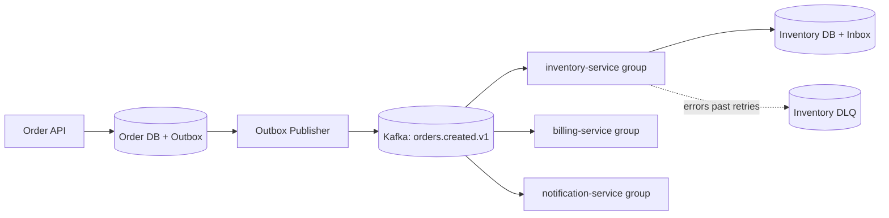

# Evaluating Binder Selection and Delivery Guarantees for a Real-World Problem

## Objectives

In this exercise, you will select a binder for an order processing system, justify your choice against business requirements, and design message handling when the application fails. Your solution should clearly connect the broker, bindings, consumer groups, partitions, retries, dead-letter queues (DLQs), and business idempotency.

Upon completion, you will be able to:

- Distinguish event streaming, routing, and work queue needs when choosing between Kafka, RabbitMQ, or Pulsar.
- Choose destinations, consumer groups, and partition keys aligned with processing order requirements.
- Design safe at-least-once processing using idempotency.
- Classify transient failures versus data errors, and configure bounded retries and DLQs.
- Test the happy path, duplicate messages, prolonged outages, and DLQ recovery.

## Problem Context

An online store emits an `OrderCreated` event after a customer places an order. This event is consumed by three independent business domains:

1. `inventory-service` reserves stock in the warehouse.
2. `billing-service` initiates a payment request.
3. `notification-service` sends an email or notification to the customer.

Assume normal traffic is a few dozen events per second, peaking around 300 events per second. A single order can emit subsequent events such as `OrderPaid`, `OrderCancelled`, or `ShipmentCreated`. Key requirements include:

- Each service receives an independent copy of events; an outage in notification service must never stall inventory reservation.
- Events must be retained for at least seven days so they can be re-read when deploying new consumers or fixing processing bugs.
- Events sharing the same `orderId` must be processed in order within a consumer group.
- A message may be redelivered if a consumer disconnects or fails to complete processing. Redelivery must never reserve stock or record payment twice.
- Transient failures like database timeouts must retry with backoff. Invalid data errors must move to quarantine for investigation.
- Operators must be able to monitor consumer lag, retry counts, DLQ counts, and the age of the oldest message.

These are the baseline assumptions for this exercise. In real projects, replace them with measured numbers for traffic, payload sizes, retention windows, recovery targets, and acceptable data loss.

## Choosing a Binder Based on Problem Characteristics

Spring Cloud Stream provides a programming model built around `Supplier`, `Function`, and `Consumer`. Bindings link function inputs or outputs to destinations, while binders integrate those destinations with a messaging platform. This abstraction keeps flow declarations relatively stable across brokers, yet it does not make brokers share identical semantics for storage, routing, message acknowledgment, or data replay.

| Criterion | Kafka binder | RabbitMQ binder | Pulsar binder |
|---|---|---|---|
| Core model | Partitioned event log; consumers read by offset | Exchanges, queues, and routing keys | Topics, subscriptions, and tiered storage |
| Replaying data | Well-suited via retention and offset resets | Not a strength of standard queues; ACKed messages are typically removed | Supports retention and replay per topic/subscription policies |
| Multi-service fan-out | Each consumer group tracks its own offsets | Route or fan out across multiple queues | Multiple independent subscriptions |
| Ordering | Ordered within one partition; no global order across partitions | Depends on queue, consumers, and config; never assume strict order with multiple consumers or redeliveries | Ordered per subscription mode and topic config; check selected subscription type |
| Routing and work queues | Achievable via topics, keys, and consumer groups | Strong in exchanges, routing keys, queues, ACKs, and work queues | Supports multiple subscription types and topic distribution |
| Best suited when | You need durable event logs, replay, and independent consumers | You need flexible routing, task distribution, and per-message ACKs | You need multi-tenancy, geo-replication, or tiered storage |
| Operational readiness | Managing partitions, offsets, retention, rebalances, and lag | Designing exchanges/queues, TTLs, DLXs, and queue capacity | Mastering tenant/namespace/topic/subscription models and cluster operations |

Given the store's requirements, Kafka is a logical choice because order events are domain records needing retention and replay, all three services must read independently, and keying by `orderId` routes events for the same order to the same partition. RabbitMQ would be preferable if the primary focus were routing tasks by routing key, per-message acknowledgments, and queueing jobs for workers. Pulsar fits when a system explicitly requires multi-tenancy, geo-distribution, or tiered storage and the organization is prepared to operate it.

Never select a binder based solely on advertised throughput. Evaluate retention, replay capabilities, ordering, failure models, monitoring tools, operational expertise, and infrastructure cost. If your organization already runs a well-operated messaging platform, the cost of introducing another broker usually outweighs minor benchmark differences.

## Designing the Event Flow

Events should carry stable identifiers and enough information for consumers to execute domain logic. Example:

```json
{
  "eventId": "evt-01J8M4X2Q7",
  "eventType": "OrderCreated",
  "schemaVersion": 1,
  "orderId": "ORD-2026-1042",
  "occurredAt": "2026-11-24T09:15:30Z",
  "items": [
    { "sku": "BOOK-001", "quantity": 2 },
    { "sku": "PEN-004", "quantity": 1 }
  ]
}
```

`eventId` identifies a single event emission and remains unchanged across retries or replays. `orderId` is the business key used for partitioning. `schemaVersion` tells consumers which message structure version applies. Never use message reception timestamp as an identifier because the same event can arrive multiple times at different timestamps.

The overall flow can be modeled as:



The Order API writes the order and an outbox row inside the same database transaction. A separate publisher reads the outbox and sends events to Kafka. This prevents situations where the database saves an order but the app crashes before sending, or the message sends while the order transaction rolls back. The publisher may resend if broker receipt is uncertain, so consumers still require idempotency.

Each service uses its own consumer group. For example, `inventory-service` and `billing-service` both read `orders.created.v1`, yet their offsets remain independent. Within `inventory-service`, instances split partitions. To preserve per-order ordering, the producer must use `orderId` as the message key, and the topic needs enough partitions for planned capacity. Every event requiring ordering for an order must follow the same key rule.

Ordering is guaranteed only within a single partition. Increasing partition counts can remap keys to different partitions if the hashing/partition count changes; plan ahead before scaling topic partitions. Never rely on global chronological ordering across different orders.

## Delivery Guarantees and Idempotency

In practice, a consumer may finish writing to its database and lose connectivity before its offset is committed. The broker redelivers the message, and the consumer sees the same `eventId` a second time. This is normal under at-least-once delivery.

For stock reservation, the safe pattern is recording the processed event marker and updating inventory within the same database transaction. An inbox table enforces a composite unique key on `consumer_name` and `event_id`, for example:

```sql
CREATE TABLE processed_event (
    consumer_name VARCHAR(100) NOT NULL,
    event_id      VARCHAR(100) NOT NULL,
    processed_at  TIMESTAMP NOT NULL,
    PRIMARY KEY (consumer_name, event_id)
);
```

The repository exposes an atomic `insertIfAbsent` operation backed by the unique constraint. Never implement a separate `exists` check followed by an insert in two independent statements, as two instances could both see the event missing and execute the business logic twice.

Consumer example:

```java
@Bean
Consumer<Message<OrderCreated>> reserveInventory(
        InventoryReservationService service) {
    return message -> service.reserveOnce(message.getPayload());
}
```

Business logic runs inside a Spring transaction:

```java
@Transactional
public void reserveOnce(OrderCreated event) {
    boolean firstDelivery = processedEventRepository.insertIfAbsent(
        "inventory-service", event.eventId());

    if (!firstDelivery) {
        return; // Event already processed; do not reserve stock again.
    }

    inventoryRepository.reserve(event.orderId(), event.items());
}
```

This snippet illustrates the `insertIfAbsent` contract; exact SQL syntax depends on your database engine. Recording the marker and updating inventory must share the same transaction. If inventory reservation fails, the transaction rolls back both so the next delivery can retry. If the transaction committed and the message is redelivered, the unique constraint causes the consumer to skip duplicate work.

This is how you build idempotent business effects atop at-least-once delivery. Never claim end-to-end exactly-once semantics just because the broker supports transactions or producer idempotence is enabled. When a workflow spans a broker, a database, and external HTTP services, those systems do not automatically join a single atomic transaction. When calling payment gateways, pass a stable idempotency key if supported by the provider. When emitting downstream events from a database transaction, write them to an outbox in the same transaction and let a publisher emit them.

## Retries, Backoff, and DLQ

Classify failures before choosing policies:

| Error type | Examples | Appropriate action |
|---|---|---|
| Transient | Database timeout, temporary broker or dependency disconnect | Retry with backoff and bounded attempts |
| Overload | Database under heavy load, API rate-limit errors | Increasing backoff; cap concurrency to avoid worsening load |
| Invalid data | Missing `orderId`, bad schema, negative quantity | Route to DLQ or quarantine for investigation; never retry infinitely |
| Business error needing intervention | Nonexistent SKU or order in disallowed state | Apply clear domain rules; record reason and escalate to manual handling if needed |

Retries must be bounded. An illustrative Kafka binder consumer configuration:

```yaml
spring:
  cloud:
    function:
      definition: reserveInventory
    stream:
      bindings:
        reserveInventory-in-0:
          destination: orders.created.v1
          group: inventory-service
          consumer:
            max-attempts: 3
            back-off-initial-interval: 1000
            back-off-max-interval: 10000
            back-off-multiplier: 2
      kafka:
        binder:
          brokers: ${KAFKA_BROKERS:localhost:9092}
        bindings:
          reserveInventory-in-0:
            consumer:
              enable-dlq: true
              dlq-name: orders.created.v1.inventory.dlq
```

The binding name `reserveInventory-in-0` comes from the function name and input direction. `group` defines shared consumption progress across inventory instances. `max-attempts` caps total attempts per the binding's retry policy, while increasing backoff intervals prevent hammering a struggling dependency. The Kafka binder supports enabling DLQ for consumers with an explicit group. Verify exact property names and behavior for your project's Spring Cloud Stream and Kafka binder versions.

On the producer side, configure business-key partitioning on the matching output binding. The following illustrates the configuration concept; binding names must match the actual function or producer:

```yaml
spring:
  cloud:
    stream:
      bindings:
        orderEvents-out-0:
          destination: orders.created.v1
          producer:
            partition-key-expression: payload.orderId
            partition-count: 12
```

A partition count of `12` is merely an assumption for this exercise. Choose it by measuring per-partition throughput, parallel consumer instance counts, message sizes, and projected growth. Production topics should be provisioned intentionally; align producer config, actual topic config, and infrastructure limits.

A DLQ stores messages that remained unprocessable after retries—it is not a trash bin. Every DLQ message should retain the original payload, key, critical headers, `eventId`, failure timestamp, and error cause. Restrict access because payloads may contain customer data. Configure alerts on DLQ message counts and message age.

Once the root cause is fixed, the replay process needs an accountable owner, explicit selection of messages, schema version checks, preservation of `eventId`, and outcome tracking. If the error was malformed data, replaying as-is will fail again; repair or replace the data through an audited process. Moving a failed message to a DLQ may allow subsequent messages in the same partition to continue depending on configuration. If business rules demand strict per-order blocking, design key-level pausing or quarantine with appropriate compensation; a DLQ alone does not guarantee business ordering.

## Testing and Operations

A test that only proves a function receives a message is insufficient. Verify database boundaries, broker behavior, and error policies too.

| Scenario | How to execute | Expected verification |
|---|---|---|
| Valid message | Send a new `OrderCreated` | Inventory reserved accurately; inbox holds one `eventId` |
| Duplicate message | Resend the same `eventId` multiple times | Inventory changes only once |
| Transient failure | Trigger DB timeouts on initial attempts, then recover | Consumer retries with backoff and eventually succeeds |
| Prolonged failure | Keep dependency down beyond retry limit | Message moves to DLQ; consumer continues per configured policy |
| Invalid data | Send payload missing required fields or wrong schema | Error recorded and quarantined; no partial business mutation |
| Multiple consumers | Run multiple instances in same group across many `orderId`s | Partitions distributed; same-key events preserve per-partition order |
| Restart | Stop consumer mid-processing, then restart | Uncommitted messages redelivered; zero duplicate business effects |

You can use the Spring Cloud Stream test binder for fast unit/integration checks of function logic and bindings. The test binder does not fully emulate real broker partitions, offsets, rebalances, or DLQs. Use Kafka Testcontainers or a test Kafka cluster to verify broker-dependent behaviors.

In production, monitor at minimum:

- Consumer lag by group and partition; alert when lag grows continuously or breaches business latency thresholds.
- Consume rates, successful completion rates, retries, and errors per binding.
- Incoming DLQ rate, total DLQ backlog, and age of the oldest DLQ message.
- Per-message processing duration, database error rates, and external dependency errors.
- Rebalances, active consumer counts, and partition skew.

Runbooks must specify who is authorized to replay DLQs, how to determine root cause, how to select messages, how to avoid duplicate replays, and how to verify post-recovery state. Never reset offsets for an entire group just to resolve a single failing message without evaluating the impact across the whole partition.

## End-to-End Synthesis Practice

Complete the design for `inventory-service` based on the scenario at the beginning of this exercise. Submit a concise technical decision document alongside configuration and test evidence. Include:

1. A quantitative requirements table: average/peak throughput, retention, recovery time objective, consumer count, and ordering requirements.
2. Rationale for choosing the Kafka binder; identify at least two scenarios where RabbitMQ or Pulsar would fit better.
3. Diagram of topic, key, partitions, consumer group, and DLQ, explaining why `orderId` is the partition key.
4. Sample event with `eventId` and `schemaVersion`, plus schema compatibility rules for adding or changing fields.
5. Consumer code with idempotency and database transactions, plus how the publisher uses an outbox.
6. Retry, backoff, and DLQ configuration, clearly specifying which errors are retried and which are quarantined.
7. Test results covering duplicate messages, transient errors, prolonged failures, consumer restarts, and DLQ replays.
8. Monitoring metrics, initial alert thresholds, and recovery runbook steps.

### Self-Evaluation Criteria

| Criterion | Evaluation focus |
|---|---|
| Binder selection | Decision grounded in retention, replay, routing, ordering, and operational readiness |
| Binding design | Destination, group, key, and partitions are clearly justified |
| Delivery guarantees | Accurately states at-least-once bounds; applies idempotency and transactions at DB boundaries |
| Error management | Bounded retries, sensible backoff, and an operational DLQ workflow |
| Verification | Tests against a real broker for broker-dependent behaviors |
| Operations | Metrics, alerts, and a safe replay runbook |

You have completed this exercise when you can trace a message from order creation to stock reservation, explain what happens if a consumer dies at each point, and provide evidence that redeliveries never execute business logic twice. Explicitly list any remaining assumptions that must be measured in a realistic environment before finalizing production settings.
