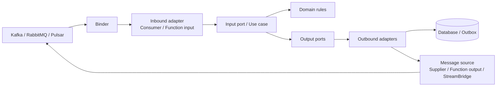

# Separating Business Logic from Messaging Integration Code

## Objectives

An event-driven application often starts with a function that receives a message and executes business logic directly inside it. This approach is quick for prototyping, but over time the business code easily becomes coupled to Kafka, RabbitMQ, Pulsar, Spring Messaging, topic names, headers, and message acknowledgment mechanisms. When the team needs to switch brokers, evolve a schema, or test a business rule, they have to touch many unrelated parts.

This lesson explains how to separate **application business logic** from **messaging integration code** using the ports-and-adapters architecture (also known as hexagonal architecture). Spring Cloud Stream acts as the adapter at the boundary: receiving messages from bindings, converting external data into application commands, invoking use cases, and turning results or events into outbound messages. The domain and use cases do not need to know which broker a message came from.

After this lesson, you will be able to:

- Identify the responsibilities of the domain, application service, and messaging adapter.
- Organize input and output ports so that business logic does not depend on a binder.
- Map message schemas and headers into the application model.
- Use `Supplier`, `Function`, and `Consumer` in the appropriate integration layer.
- Test business logic independently from the broker and test integration behavior separately.

## 1. Problems with Placing Business Logic in a Message Handler

Suppose an inventory service receives an `OrderCreated` event. The handler must read the payload, validate the data, deduct stock, write to the database, publish a `StockReserved` event, handle retries, and acknowledge the message.

If everything lives in a single method, it can simultaneously depend on:

- Spring message types such as `Message<T>` and headers.
- Destination names, consumer groups, partitions, or routing keys.
- Broker-specific APIs for Kafka, RabbitMQ, or Pulsar.
- Mechanisms for acks, offset commits, retries, DLQs, and transactions.
- Business rules such as checking inventory, reserving items, and handling duplicate orders.

These responsibilities change for different reasons. Reservation rules may change due to business requirements; destinations may change due to infrastructure reorganization; schemas may be versioned; the binder may change when migrating brokers. If they live together in one class, a change at the messaging boundary can affect business logic and make testing heavy.

The architectural principle is that **dependencies point inward toward the business core**. Adapters know about use cases and application models; use cases do not know about adapters, brokers, or messaging libraries.

## 2. Dividing Layers and Responsibilities

A common organization consists of four parts:

| Component | Responsibility | Example |
|---|---|---|
| Domain | Core business rules and concepts | Available stock, reservation rules |
| Application | Orchestrates a use case, defines required ports | `ReserveInventory` use case, commands, and results |
| Inbound adapter | Receives external data, validates structure, maps, and invokes use cases | Spring Cloud Stream `Consumer` or `Function` |
| Outbound adapter | Implements ports defined by application/domain | Database repository, outbox relay, API client |

Dependency and data flow diagram:



The arrows show the call and data flow. Adapters can depend on application ports, but the application does not import adapter classes. Port interfaces are contracts defined by the application core; adapters provide implementations of those contracts.

Example package structure:

```text
com.example.inventory
├── domain
│   ├── Inventory.java
│   └── StockReservation.java
├── application
│   ├── port
│   │   ├── in
│   │   │   └── ReserveInventoryUseCase.java
│   │   └── out
│   │       ├── InventoryRepository.java
│   │       ├── ProcessedEventRepository.java
│   │       └── OutboxRepository.java
│   ├── model
│   │   ├── ReserveInventoryCommand.java
│   │   └── StockReserved.java
│   └── service
│       └── ReserveInventoryService.java
└── adapter
    ├── in
    │   └── messaging
    │       ├── OrderCreatedV1.java
    │       ├── OrderCreatedMapper.java
    │       └── OrderCreatedStreamAdapter.java
    └── out
        ├── persistence
        └── messaging
            └── OutboxStreamPublisher.java
```

This is a suggested layout, not a mandatory package structure. Smaller projects can use fewer packages; what matters is keeping dependency boundaries clear.

## 3. Defining Input Ports and Use Cases

An input port describes what the application allows external callers to request. It uses business terminology, not broker terminology.

Example internal command:

```java
public record ReserveInventoryCommand(
        String eventId,
        String orderId,
        List<ReserveLine> lines
) {}

public record ReserveLine(String sku, int quantity) {}
```

Input port:

```java
public interface ReserveInventoryUseCase {
    void handle(ReserveInventoryCommand command);
}
```

Output ports required by the application to access data:

```java
public interface InventoryRepository {
    void reserve(String orderId, List<ReserveLine> lines);
}

public interface ProcessedEventRepository {
    // Record eventId with a UNIQUE constraint; return false if it already exists.
    boolean registerIfAbsent(String eventId);
}

public interface OutboxRepository {
    void append(StockReserved event);
}
```

Application service orchestrating the ports:

```java
public final class ReserveInventoryService
        implements ReserveInventoryUseCase {

    private final ProcessedEventRepository processedEvents;
    private final InventoryRepository inventory;
    private final OutboxRepository outbox;

    public ReserveInventoryService(
            ProcessedEventRepository processedEvents,
            InventoryRepository inventory,
            OutboxRepository outbox) {
        this.processedEvents = processedEvents;
        this.inventory = inventory;
        this.outbox = outbox;
    }

    @Override
    public void handle(ReserveInventoryCommand command) {
        if (!processedEvents.registerIfAbsent(command.eventId())) {
            return;
        }

        inventory.reserve(command.orderId(), command.lines());

        outbox.append(new StockReserved(
                command.eventId(),
                command.orderId()
        ));
    }
}
```

`StockReserved` is an event in the application model, not a Kafka or RabbitMQ DTO:

```java
public record StockReserved(String eventId, String orderId) {}
```

In a real implementation, recording the `eventId`, updating inventory, and inserting the outbox record must occur within the **same database transaction**. The `event_id` column needs a unique constraint so that two concurrent deliveries are not both treated as new. If any operation fails, the transaction rolls back so that redelivery can retry. Transaction boundaries can be managed with Spring at the service layer or in infrastructure configuration; the domain model and use case interface still do not need to import broker APIs.

The application service does not accept `ConsumerRecord`, `MessageHeaders`, `Acknowledgment`, `Channel`, or topic names. It only receives a command and calls business ports.

## 4. Spring Cloud Stream as an Inbound Adapter

Spring Cloud Stream provides a functional model to connect bindings with application code:

- **Consumer** receives input data and does not directly emit output.
- **Function** receives input data, processes it, and produces output data.
- **Supplier** provides output data when the framework pulls data from an application source.

These functions should reside at the integration boundary. They perform format conversion and invoke use cases; rules for reserving stock, calculating charges, or determining order status belong in the application/domain.

### Mapping Messages to Commands

The schema received from the broker is an external contract. For example, version 1 of the order event:

```java
public record OrderCreatedV1(
        String eventId,
        String orderId,
        List<OrderLineV1> lines
) {}

public record OrderLineV1(String sku, int quantity) {}
```

A mapper converts the external DTO into an internal command:

```java
@Component
public class OrderCreatedMapper {

    public ReserveInventoryCommand toCommand(OrderCreatedV1 message) {
        var lines = message.lines().stream()
                .map(line -> new ReserveLine(line.sku(), line.quantity()))
                .toList();

        return new ReserveInventoryCommand(
                message.eventId(),
                message.orderId(),
                lines
        );
    }
}
```

The adapter uses `Consumer` when it only needs to invoke the use case:

```java
@Configuration
public class OrderCreatedStreamAdapter {

    @Bean
    Consumer<OrderCreatedV1> orderCreated(
            ReserveInventoryUseCase useCase,
            OrderCreatedMapper mapper) {
        return message -> useCase.handle(mapper.toCommand(message));
    }
}
```

The adapter layer knows about the DTO types and Spring Cloud Stream. The use case only knows about `ReserveInventoryCommand`. If a payload field is renamed later or a new schema version is added, the DTO and mapper can be updated without changing the inventory reservation rules.

The `Consumer` example above and the `Function` example below are two endpoint options for different flows. Choose the function type that matches the input/output contract of each flow and declare the active function in `spring.cloud.function.definition`.

If metadata such as `correlationId`, `tenantId`, or trace context is needed, the adapter can accept `Message<OrderCreatedV1>` instead of the raw payload and read headers at the boundary. Only pass validated values into the command as explicit fields when the use case genuinely needs them. Do not pass the entire `MessageHeaders` into the domain/application; headers are protocol metadata and can vary across binders.

### Using Function When Output Is Synchronous with Processing

If a single use case invocation directly produces a result that must be emitted downstream, the adapter can use `Function`. For example, a use case port returns an application result model:

```java
public interface ReserveInventoryResultUseCase {
    StockReserved handle(ReserveInventoryCommand command);
}

public record StockReservedV1(String eventId, String orderId) {}
```

The adapter maps in both directions:

```java
@Bean
Function<OrderCreatedV1, StockReservedV1> reserveInventory(
        ReserveInventoryResultUseCase useCase,
        OrderCreatedMapper inputMapper,
        StockReservedMapper outputMapper) {
    return message -> outputMapper.toV1(
            useCase.handle(inputMapper.toCommand(message))
    );
}
```

With the function name `reserveInventory`, Spring Cloud Stream creates the input binding `reserveInventory-in-0` and output binding `reserveInventory-out-0` by default. The application still remains unaware that these bindings exist. For flows requiring asynchronous processing or publishing events after a transaction, consider the outbox pattern in the next section instead of sending messages directly before the business transaction completes.

### Role of Supplier

`Supplier` is suitable when the application is a data source, such as reading an internal event source or generating scheduled messages. A `Supplier` is also an adapter. When it needs to fetch business data, it should call an input port such as `LoadPendingEventsUseCase`; complex queries or business rules should not be placed directly inside the `Supplier` lambda.

The common principle across all three models is: the Spring Cloud Stream function handles conversion and orchestration at the boundary, while the use case executes the business logic.

## 5. Decoupling Event Publishing from Business Transactions with an Outbox

A common issue occurs when an application updates the database and then calls the broker to publish an event. If the database commits but sending the message fails, the system has a new business state without a corresponding event. If sending the message succeeds and the database rolls back, consumers may receive an event for a change that never existed.

Standard transactions do not automatically span both the database and the broker. The **transactional outbox** pattern bridges this gap:

1. Within a single database transaction, the application updates business state and inserts the event into an outbox table.
2. A relay process reads unpublished outbox records.
3. The relay transforms the event into a DTO and sends it via Spring Cloud Stream.
4. Once delivery is confirmed according to the system's policy, the relay marks the record as published.
5. If the relay stops after sending but before marking, the event may be sent again. Downstream consumers must be idempotent using `eventId`.

The outbox port belongs to the application:

```java
public interface OutboxRepository {
    void append(StockReserved event);
}
```

Relay adapter using Spring Cloud Stream:

```java
@Component
public class OutboxStreamPublisher {

    private final StreamBridge streamBridge;
    private final StockReservedMapper mapper;

    public OutboxStreamPublisher(
            StreamBridge streamBridge,
            StockReservedMapper mapper) {
        this.streamBridge = streamBridge;
        this.mapper = mapper;
    }

    public void publish(StockReserved event) {
        boolean accepted = streamBridge.send(
                "stockReserved-out-0",
                mapper.toV1(event)
        );

        if (!accepted) {
            throw new IllegalStateException("Message was not accepted by the output binding");
        }
    }
}
```

Declare the output binding to link the name used by `StreamBridge` with the target destination:

```yaml
spring:
  cloud:
    stream:
      output-bindings: stockReserved-out-0
      bindings:
        stockReserved-out-0:
          destination: inventory.stock-reserved
          content-type: application/json
```

This is an adapter for sending a single outbox record. Orchestrating polling, retries, and marking outbox records as published must be designed around the storage mechanism and broker acknowledgment guarantees in use. A `true` return value from `StreamBridge.send` should not be interpreted as proof that the target consumer has completed its business processing. If durability guarantees are required, use appropriate send confirmations, persist relay state, and accept the possibility of duplicate sends; `eventId` allows downstream services to deduplicate repeated effects.

The outbox keeps business transactions independent of the messaging protocol. The relay adapter can change how messages are sent or switch binders without altering the inventory reservation rules.

## 6. Keeping Bindings and Binders in Integration Configuration

Bindings map functions to destinations. Binders connect bindings to specific brokers. Common Spring Cloud Stream settings can be kept in deployment configuration files:

```yaml
spring:
  cloud:
    function:
      definition: orderCreated
    stream:
      bindings:
        orderCreated-in-0:
          destination: orders.created
          group: inventory-service
          content-type: application/json
```

If using a `Function` with both input and output, configure the output binding as well:

```yaml
spring:
  cloud:
    function:
      definition: reserveInventory
    stream:
      bindings:
        reserveInventory-in-0:
          destination: orders.created
          group: inventory-service
          content-type: application/json
        reserveInventory-out-0:
          destination: inventory.stock-reserved
          content-type: application/json
```

Binding names are tied to the function name and input/output parameter positions. `destination` specifies where messages are received from or sent to; `group` identifies the consumer group according to the binder's model. For business consumers requiring durable subscriptions, explicitly declare a group. How groups, subscriptions, partitions, and offset storage work differs among Kafka, RabbitMQ, and Pulsar.

Shared configuration should hold properties meaningful at the Spring Cloud Stream level. Broker-specific properties should reside in their corresponding binder configuration or deployment profiles. For instance, Kafka offsets and partitions, RabbitMQ queues/exchanges and prefetch, and Pulsar subscriptions and acknowledgments have distinct semantics. Do not assume that changing the binder name automatically makes all operational behaviors equivalent.

One way to organize configuration by environment:

```text
application.yml                 # function names, bindings, destinations per environment
application-kafka.yml           # Kafka binder properties
application-rabbit.yml          # Rabbit binder properties
application-pulsar.yml          # Pulsar binder properties
```

Profile filenames are only examples. Be sure to include the proper binder dependency and verify properties against the Spring Cloud Stream version in use. Avoid putting topic names, queue names, broker URLs, or credentials into domain/application code.

## 7. Maintaining Boundaries for Error Handling and Delivery Guarantees

Decoupling business logic from the broker does not mean ignoring delivery guarantees. Each failure category should be handled at the appropriate layer:

| Issue | Primary Responsible Layer | Example |
|---|---|---|
| Payload missing fields or invalid schema | Inbound adapter / schema boundary | Reject invalid message, log with event ID |
| Business rule not satisfied | Domain / application | Order already canceled, SKU not eligible for reservation |
| Database temporarily unreachable | Outbound persistence adapter and retry policy | Bounded retries, timeouts, circuit breaker where appropriate |
| Broker temporarily unavailable | Messaging adapter / binder | Retry sending, keep outbox record unpublished |
| Message redelivered | Application idempotency + consumer config | Unique event ID, inbox or processed-event store |
| Unprocessable error after retries | Integration boundary | DLQ, alerting, and replay workflow |

Key rules:

- **Idempotency belongs at the business boundary.** Use a stable event ID and record the processed event in the same transaction as the business state change. Do not rely on assuming the broker delivers only once.
- **Retries must be intentional.** Transient failures can be retried; malformed data or business rule violations generally cannot be fixed by infinite retries.
- **DLQ is an operational mechanism at the boundary.** The adapter/binder routes failed messages to a holding destination; operations teams monitor, investigate, and decide whether to replay or handle manually.
- **Do not leak ack APIs into the domain.** Offset or delivery acknowledgment belongs to the framework/binder. The application signals success by completing the use case; the adapter and container coordinate with the binder to acknowledge as configured.
- **Do not assume cross-system exactly-once semantics.** Kafka transactions can coordinate Kafka operations within their supported scope; they do not automatically cover PostgreSQL or REST APIs. Outbox and idempotency help control side effects across those boundaries.

## 8. Testing Across Each Boundary

Layer separation enables fast tests and restricts real brokers to where they are truly needed.

### Unit Tests for Use Cases

Instantiate the service with fakes or mocks for output ports. No need to start a Spring context, Kafka, or RabbitMQ:

```java
@Test
void shouldReserveInventoryAndAppendOutboxEvent() {
    var processedEvents = new InMemoryProcessedEventRepository();
    var inventory = new InMemoryInventoryRepository();
    var outbox = new InMemoryOutboxRepository();

    var useCase = new ReserveInventoryService(
            processedEvents, inventory, outbox
    );

    useCase.handle(new ReserveInventoryCommand(
            "evt-100", "order-42",
            List.of(new ReserveLine("SKU-1", 2))
    ));

    assertTrue(inventory.wasReserved("order-42", "SKU-1", 2));
    assertTrue(outbox.containsEvent("evt-100"));
}
```

This test focuses on business outcomes and port orchestration. The `InMemory` classes are project-defined test doubles; they do not replace testing real database transactions or unique constraints.

### Tests for Inbound Adapters

Verify that the mapper converts external versioned DTOs into commands accurately, including missing or invalid values. You can invoke the `Consumer`/`Function` bean directly with a use case test double to confirm the adapter passes the right data and does not embed business rules inside the mapper.

### Integration Tests for the Binder

Use the Spring Cloud Stream Test Binder or a broker running via Testcontainers to verify behaviors that genuinely depend on infrastructure:

- Bindings are wired to the correct destinations and consumer groups.
- JSON messages are deserialized/serialized with the expected schema.
- Consumers handle errors with the expected retries, acks/offsets, and DLQ behavior.
- The outbox relay can resend after a failure without duplicating effects on the consumer.
- Partitions, subscriptions, or routing behave as expected with the target broker.

The Test Binder is useful for framework-level integration testing, but it does not fully emulate all behaviors of Kafka, RabbitMQ, or Pulsar. Guarantees around transactions, partitions, redelivery, and DLQs should be verified against the respective binder/broker.

### Contract Tests for Schemas

Verify compatibility between producers and consumers when changing message schemas. Adding optional fields with defaults is usually more compatible than renaming or changing types of existing fields. External DTO versioning such as `OrderCreatedV1` keeps the adapter aware of the contract; application commands can remain stable even as external schemas evolve.

## 9. Workflow for Refactoring an Existing Handler

When refactoring a handler that mixes business logic and messaging code, you can proceed in this order:

1. List every operation inside the handler and mark which ones are mapping, which are business rules, and which are I/O.
2. Create commands and input ports expressing the use case in business terms.
3. Move business rules into an application/domain service; define output ports for databases, outbox, or external services.
4. Keep the Spring Cloud Stream handler as an inbound adapter: receive the DTO, convert it to a command, and invoke the input port.
5. Move broker and database access into outbound adapters; use an outbox if database changes must be coordinated with event publishing.
6. Write unit tests for the use cases, mapping tests for adapters, and integration tests for the binder.
7. Run tests with the same schemas and delivery configuration before making any changes to the broker or topology if needed.

During refactoring, there is no need to create an interface for every method. Only create a port at boundaries where the application requires an external capability or where implementations must be swapped for testing. An interface adds no value if it merely mirrors a single class without creating a useful dependency boundary.

## Conclusion

Separating business logic from messaging integration code keeps use cases focused on application goals and lets Spring Cloud Stream handle integration at the boundary. Inbound adapters convert message schemas into commands; the application/domain executes business rules; outbound adapters perform persistence or event publishing through defined ports.

This organization reduces direct coupling to Kafka, RabbitMQ, and Pulsar while making business logic independently testable. However, binders still carry distinct semantics for groups, partitions, acknowledgments, retries, transactions, and DLQs. Keep those decisions in the integration layer, while protecting business correctness such as idempotency and order state within the application core.
