# Message Flow Through Functions, Channels, and Binders

Spring Cloud Stream provides a functional programming model for applications to exchange data with Kafka, RabbitMQ, or Pulsar. In this model, a **function** represents business processing, a **binding** connects a function's input/output to a logical destination, a **channel** serves as the message-exchange boundary inside the application, and a **binder** connects bindings to the broker's messaging mechanism.

Understanding the message path helps determine where data is produced, at which step it is transformed, which destination it passes through, and how it is delivered to the receiving function. It also forms the basis for configuring consumer groups, schemas, partitions, error handling, and latency observability in deployment environments.

## 1. Architectural Components

### Business Functions

Spring Cloud Stream uses the functional model of Spring Cloud Function. Applications declare beans of type `Supplier`, `Function`, or `Consumer`:

- `Supplier<T>` takes no input and produces output data. For example: reading records to publish from a data source or generating events on a schedule.
- `Function<T, R>` takes input of type `T`, transforms it, and returns output of type `R`. For example: validating an order-creation command and producing a result event.
- `Consumer<T>` receives data and performs a business side effect without emitting output through a function binding. For example: updating a read model from an order event.

Functions should focus on business processing. Connecting to the broker, converting transport payloads, and managing binding lifecycles are handled by Spring Cloud Stream and the binder.

### Binding

A binding is the configuration that connects a function's input or output to a logical destination. Binding names are derived from the bean name and data direction:

| Function Type | Binding | Meaning |
|---|---|---|
| `Supplier<T>` named `orderEvents` | `orderEvents-out-0` | Output produced by the supplier. |
| `Function<T, R>` named `processOrder` | `processOrder-in-0`, `processOrder-out-0` | Input and output of the function. |
| `Consumer<T>` named `saveProjection` | `saveProjection-in-0` | Input of the consumer. |

The `-in-0` and `-out-0` suffixes identify the direction and port index. In configuration, bindings can be mapped to a destination, group, content type, and producer/consumer properties. Binding names are identifiers within the application; destination names are logical resource names on the broker.

### Channel

A channel is a boundary through which components in the application pass `Message<?>` instances to each other. In the Spring ecosystem, a message consists of a payload and headers; channels allow sending and receiving components to exchange messages without calling each other directly.

In Spring Cloud Stream's functional model, most applications only need to declare functions and bindings. The framework sets up the required adapters and channels. Therefore, it is not necessary to manually declare a `MessageChannel` for every binding. Channels are part of the internal path, whereas bindings are the configuration linking function endpoints to the messaging infrastructure.

### Binder and Broker

A binder is the integration layer between Spring Cloud Stream and a messaging platform. The binder creates and manages connections, producer/consumer adapters, maps bindings to destinations, and forwards messages using the broker's API.

| Component | Role in the Message Path |
|---|---|
| Kafka binder | Maps bindings to Kafka topics, partitions, and producer/consumer mechanisms. |
| RabbitMQ binder | Maps bindings to RabbitMQ exchanges, queues, routing, and consumers. |
| Pulsar binder | Maps bindings to Pulsar topics, producers, subscriptions, and consumers. |

Binders unify how applications declare data flows, but they do not make all broker characteristics identical. Partitioning, routing, acknowledgment, transactions, retries, and dead-letter handling still follow rules specific to each binder and broker.

## 2. End-to-End Message Flow

A message travels from a producing application to a receiving application through the following stages:

1. **Data source:** data is generated by a `Supplier`, sent from an application component via `StreamBridge`, or received from a destination.
2. **Function and binding:** data enters a function's input or is produced at its output. The binding name identifies the data port.
3. **Internal channel:** Spring passes the `Message` across the corresponding channel boundary.
4. **Binder adapter:** the outbound adapter receives the message to publish, or the inbound adapter receives the message from the broker to pass into the application.
5. **Data conversion:** the payload is serialized when sending and deserialized/converted when receiving according to the content type and related configuration.
6. **Broker destination:** the broker routes and stores the message according to topic, queue, exchange, partition, or subscription configuration.
7. **Receiving binding:** the binder delivers the message to the input binding of a consumer or function.
8. **Business processing:** the function receives the payload and executes the work. If it is a function with an output, the result continues through the output binding.

```mermaid
flowchart LR
    A[Data source] --> B[Supplier or StreamBridge]
    B --> C[Output binding]
    C --> D[Internal channel]
    D --> E[Binder producer adapter]
    E --> F[Serializer and broker protocol]
    F --> G[(Kafka / RabbitMQ / Pulsar)]
    G --> H[Binder consumer adapter]
    H --> I[Deserializer and converter]
    I --> J[Input channel]
    J --> K[Input binding]
    K --> L[Function or Consumer]
    L --> M[Business processing]
    M --> N[Output binding if any]
```



The diagram depicts logical boundaries. Several steps are combined or handled internally by framework adapters; not every box corresponds to a separate process or service.

## 3. Path from Supplier to Broker

A `Supplier` is a source that generates outbound data. For example, a supplier producing inventory state events:

```java
import java.time.Instant;
import java.util.function.Supplier;

import org.springframework.context.annotation.Bean;
import org.springframework.context.annotation.Configuration;

@Configuration
class InventoryEventConfiguration {

    @Bean
    Supplier<InventorySnapshot> inventorySnapshot(
            InventoryService inventoryService) {
        return () -> new InventorySnapshot(
            inventoryService.currentQuantity(),
            Instant.now()
        );
    }
}

record InventorySnapshot(int quantity, Instant capturedAt) {}
```

Because `inventorySnapshot` is a supplier, Spring Cloud Stream creates the output binding `inventorySnapshot-out-0`. Under the default supplier polling mechanism in this model, the framework invokes the supplier on the configured poller schedule to fetch new data. The polling interval should suit the data source and system load; avoid choosing too short an interval if each invocation queries an expensive data source.

Configuration declaring the function and mapping the binding to a destination is placed under `spring.cloud` as follows:

```yaml
spring:
  cloud:
    function:
      definition: inventorySnapshot
    stream:
      bindings:
        inventorySnapshot-out-0:
          destination: inventory.snapshots
          content-type: application/json
```

When the supplier produces an `InventorySnapshot` object, the framework passes the data through the output binding. The binder serializes the payload according to the content type and publishes it to the `inventory.snapshots` destination on the configured broker. The application does not need to call Kafka, RabbitMQ, or Pulsar producer APIs directly inside the business function.

If data is generated by an HTTP request or an internal event rather than polling, `StreamBridge` can be used to send from an application component to an output binding:

```java
import org.springframework.cloud.stream.function.StreamBridge;
import org.springframework.stereotype.Service;

@Service
class OrderEventPublisher {

    private final StreamBridge streamBridge;

    OrderEventPublisher(StreamBridge streamBridge) {
        this.streamBridge = streamBridge;
    }

    boolean publish(OrderCreated event) {
        return streamBridge.send("orderEvents-out-0", event);
    }
}
```

In this example, you can explicitly declare the output binding to map `orderEvents-out-0` to a destination:

```yaml
spring:
  cloud:
    stream:
      output-bindings: orderEvents-out-0
      bindings:
        orderEvents-out-0:
          destination: orders.events
          content-type: application/json
```

`StreamBridge` is suitable when the publishing source is not a polled `Supplier`. The boolean return value indicates that the send operation through the bridge was accepted according to the framework's send API; it should not be interpreted as meaning the final consumer has finished processing. If sending to a name without a configured binding, `StreamBridge` can also create a dynamic binding named after the destination; in that case, dynamic destinations and the corresponding binder must be configured. For critical data, inspect the send result, configure binder/broker confirmations, and consider the outbox pattern if publishing must be tied to a database transaction.

## 4. Path Through Function

`Function<T, R>` has both an input and an output. The input binding receives data from the broker, the channel passes the message to the function, and the function executes business logic and returns a result for the framework to send through the output binding.

For example, a function that normalizes an order-creation command before publishing it to the next processing stage:

```java
import java.util.function.Function;

import org.springframework.context.annotation.Bean;
import org.springframework.context.annotation.Configuration;

@Configuration
class OrderCommandConfiguration {

    @Bean
    Function<CreateOrder, CreateOrder> normalizeOrder() {
        return command -> new CreateOrder(
            command.orderId().trim(),
            command.customerId().trim()
        );
    }
}

record CreateOrder(String orderId, String customerId) {}
```

The bean name `normalizeOrder` creates two bindings:

- `normalizeOrder-in-0`: receives commands from the input destination.
- `normalizeOrder-out-0`: sends normalized results to the output destination.

Configuration can map the two bindings to two different destinations:

```yaml
spring:
  cloud:
    function:
      definition: normalizeOrder
    stream:
      bindings:
        normalizeOrder-in-0:
          destination: orders.commands.raw
          group: order-normalizer
          content-type: application/json
        normalizeOrder-out-0:
          destination: orders.commands.validated
          content-type: application/json
```

When the broker delivers a message from `orders.commands.raw`, the inbound binder receives the data, converts the payload into the type required by the function, and passes the message into the input binding. The function returns `CreateOrder`; the framework sends the result to the output binding, and the binder publishes it to `orders.commands.validated`.

If metadata needs to be preserved or added, the function can accept and return `Message<T>`:

```java
import java.util.function.Function;

import org.springframework.messaging.Message;
import org.springframework.messaging.support.MessageBuilder;

Function<Message<CreateOrder>, Message<CreateOrder>> addTraceHeader = input ->
    MessageBuilder.withPayload(input.getPayload())
        .copyHeaders(input.getHeaders())
        .setHeader("processingStage", "normalized")
        .build();
```

The payload represents business data; headers carry metadata such as `correlationId`, tracing details, or transport properties. Across brokers, header preservation depends on the binder and broker. Mandatory business fields should reside in a payload with an explicit schema.

## 5. Path into Consumer

`Consumer<T>` has only an input. The binder receives a message from the destination and passes the payload into the input binding; the framework invokes the consumer to perform the business side effect.

```java
import java.util.function.Consumer;

import org.springframework.context.annotation.Bean;
import org.springframework.context.annotation.Configuration;

@Configuration
class OrderCreatedConsumerConfiguration {

    @Bean
    Consumer<OrderCreated> updateInventory(InventoryService inventoryService) {
        return event -> inventoryService.reserve(
            event.orderId(), event.items()
        );
    }
}

record OrderCreated(String orderId, java.util.List<String> items) {}
```

The input binding is named `updateInventory-in-0`. A group can be configured so multiple instances of the same application share the workload:

```yaml
spring:
  cloud:
    function:
      definition: updateInventory
    stream:
      bindings:
        updateInventory-in-0:
          destination: orders.events
          group: inventory-service
          content-type: application/json
```

With Kafka, `group` maps to a consumer group and partitions are assigned to members. With RabbitMQ and Pulsar, the binder maps the group/subscription to the corresponding broker model. Specific semantics and behaviors are not completely identical across platforms.

When the consumer finishes, the binder coordinates with the broker for ACKs, offsets, or acknowledgments as configured. If the consumer throws an exception, retry, redelivery, DLQ, and acknowledgment timing depend on the binder and active error policy. Therefore, consumers should process messages idempotently when redelivery occurs.

## 6. Bindings, Destinations, and Binder Configuration

These three terms belong to three distinct layers:

| Concept | Example | Scope |
|---|---|---|
| Function name | `normalizeOrder` | Processing bean inside the application. |
| Binding name | `normalizeOrder-in-0` | Function input port in Spring Cloud Stream configuration. |
| Destination | `orders.commands.raw` | Logical resource mapped by the binder on the broker. |

A binding can be configured with common properties:

- `destination`: name of the corresponding topic, queue, or logical target.
- `group`: logical consumer group for work sharing and subscription identity.
- `content-type`: format of the exchanged payload, such as `application/json`.
- `consumer.concurrency`: number of concurrent consumer threads, as supported by the binder.
- `consumer.max-attempts`: number of processing attempts in the binding's retry mechanism.
- Partitioning, retry, DLQ, and transaction properties: consult the specific binder documentation.

A binder is selected via dependencies and application configuration. For example, Kafka connection settings typically live under the `spring.cloud.stream.kafka.binder` namespace; RabbitMQ and Pulsar have their own configuration namespaces. Do not copy a broker property from one binder to another expecting identical semantics.

When an application uses multiple binders, binder configurations can be given custom names and bindings assigned to their respective binders. This is useful when part of a pipeline uses Kafka and another uses RabbitMQ, though destination, schema, error handling, and operations on each side must be managed carefully.

## 7. Payload Conversion and Message Schemas

Messages inside an application are typically Java objects; on the broker, data is stored as bytes or records according to the broker's protocol. The serializer on the producing side and the converter/deserializer on the receiving side must agree on format and schema.

The conversion flow generally follows these steps:

1. The function produces a Java object or `Message<T>`.
2. The framework inspects the payload type, content type, and matching converter.
3. The binder converts the data into a representation accepted by the broker.
4. On the receiving side, the binder/converter reads the data and constructs a payload matching the type expected by the function.

For JSON, `content-type: application/json` indicates the data format. For Avro or Protobuf, appropriate converters/serializers and schema management must be configured. If producers and consumers use different schema versions, compatibility rules are needed—such as adding optional fields with default values, avoiding changing types of fields in use, or avoiding removing fields still needed by older consumers.

Do not rely on a Java class serializing identically across every binder by default. Define explicit transport schemas, test with realistic data, and maintain compatibility during new version rollouts.

## 8. Partitions, Keys, and Message Ordering

Partitions help distribute processing load. With Kafka, a partition key routes records with the same key to the same partition, preserving ordering within that partition. RabbitMQ commonly uses exchanges and routing keys to route to queues; Pulsar provides subscription modes and key-based distribution mechanisms.

When business logic requires ordering by `orderId`, choose a stable routing key and configure partitioning/routing accordingly. Do not assume messages across multiple partitions or multiple queues are processed in a global order. If consumers process concurrently, completion order may also differ from arrival order.

Consider the following:

- Number of partitions/queues and consumer concurrency.
- How partition keys or routing keys are generated.
- Behavior when increasing partitions, changing instance counts, or rebalancing.
- Retries and redeliveries, which may cause an older message to be processed after a newer one.
- Idempotency and business rules when messages arrive late or duplicated.

## 9. Function Composition and Application Boundaries

Spring Cloud Function supports composing multiple functions in sequence. For example, `validateOrder` can be chained with `enrichOrder` and then `publishOrder`. When a function chain is configured, the output of the preceding function becomes the input of the next within the same application pipeline.

```yaml
spring:
  cloud:
    function:
      definition: validateOrder|enrichOrder|publishOrder
```

With function composition, input and output bindings are created for the composed function. Intermediate steps do not publish to separate brokers by default. This reduces messaging hops when steps only need to execute within the same application. If you need to separate services, scale independently, or persist intermediate events, publish data through separate bindings/destinations instead of composing functions solely in memory.

A broker boundary offers independent scaling and deployment, but also adds latency, serialization overhead, potential duplicate deliveries, and network failure points. Choosing between composing functions or splitting into multiple destinations should be based on business boundaries and operational requirements.

## 10. Observability Checkpoints Along the Path

When a message fails to reach the receiving function, trace each boundary instead of looking only at logs inside the function. Signals to monitor include:

| Stage | Signals to Observe |
|---|---|
| Producer source / Supplier | Poll count, data generation duration, source read errors, and number of messages created. |
| Output binding | Binding name, messages sent, conversion errors, and send failures. |
| Binder / producer | Broker connections, timeouts, publish confirmations, retries, and authentication errors. |
| Broker | Publish/consume rates, queue depth, partition lag, retention, and cluster health. |
| Binder / consumer | Messages received, deserialization errors, redeliveries, ACKs/offsets, and rebalances. |
| Business function | Processing duration, business errors, duplicate-processing count, and data update outcomes. |

Attach `messageId` or `eventId` and `correlationId` to logs/traces to correlate producers and consumers. Avoid logging full sensitive payloads. When troubleshooting, verify step by step: did the function generate data, is the binding active, did the broker receive it, is the consumer group reading it, can the converter decode it, and did the function complete.

## 11. Testing the Path Through Functions, Channels, and Binders

The Spring Cloud Stream Test Binder can test functions and bindings within the application scope without a real broker. It is well suited for verifying that:

- A `Supplier` produces the expected data and sends it to the output binding.
- A `Function` receives the right payload, transforms it properly, and returns the expected output.
- A `Consumer` receives messages and performs the business side effect.
- Headers and payloads are preserved or modified according to the application contract.

The Test Binder does not fully simulate the operational behavior of Kafka, RabbitMQ, or Pulsar such as replication, routing, publisher confirms, partition assignment, ACKs, transactions, and DLQs. Broker-dependent properties should be verified with integration tests against the corresponding binder and broker.

An integration test suite should send/receive payloads using real schemas and verify groups/subscriptions, partition keys, retries, and DLQs, while also testing broker disconnects or consumer shutdowns at critical moments. For flows that update a database, verify the scenario where a consumer finishes processing before ACKing to ensure duplicate processing does not produce duplicate side effects.

## 12. Tracing a Message in Deployment

When rolling out a new flow, you can trace a specific `eventId` through the following questions:

1. Which component creates the event and which function is responsible for publishing it?
2. What is the output binding name and which destination does it map to?
3. Which binder is active, and which broker and cluster does it connect to?
4. Which content type and schema is the payload serialized with?
5. Which topic, queue, or partition does the broker route the message to?
6. Which consumer group/subscription receives the message and which instance processes it?
7. Which function does the input binding invoke, and what payload type does the converter produce?
8. What mechanism does the consumer use to acknowledge after durable business side effects complete?
9. If an error occurs, where is the message retried, redelivered, or routed to a DLQ?

By answering these questions, development teams can clearly define the responsibilities of functions, channels, bindings, and binders; configure the right messaging targets; and pinpoint failure points when data is delayed, redelivered, or left unprocessed.
