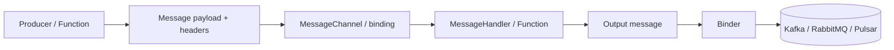

# Role of Spring Messaging and MessageChannel

Spring Cloud Stream builds applications around a message-processing model. To understand how a function receives events, reads metadata, produces output messages, and connects to a broker, you need to understand the Spring Messaging abstractions, especially `Message`, `MessageHeaders`, `MessageChannel`, and `MessageHandler`.

Spring Messaging defines the contract for exchanging messages inside a Spring application. `MessageChannel` represents the point where messages are sent between components. In Spring Cloud Stream, binders connect application bindings to broker resources such as Kafka topics, RabbitMQ exchanges/queues, or Pulsar topics. These abstractions work together but have distinct responsibilities: a channel does not become a broker on its own, and a binder does not replace the business logic of a message handler.

## 1. Where Spring Messaging Fits in the Architecture

Spring Messaging is part of the Spring Framework and provides a shared message model for Spring components. Key types include:

- `Message<T>`: a message containing a payload of type `T` and an accompanying set of headers.
- `MessageHeaders`: message metadata such as ID, timestamp, content type, and business headers.
- `MessageChannel`: the contract for sending a message.
- `SubscribableChannel`: a channel type that allows registering a `MessageHandler`.
- `PollableChannel`: a channel type that allows retrieving messages via a receive operation.
- `MessageHandler`: the contract for handling a received message.
- `MessageBuilder`: a utility for constructing messages and attaching headers.

These abstractions decouple processing code from how a message is delivered to the next component. A service can work with `Message<OrderCreated>` without needing to know whether the message came from an in-process call, a Spring Cloud Stream binding, or a specific broker.

Overview diagram:



The diagram shows the logical roles. Modern Spring Cloud Stream applications typically declare function beans and bindings; the framework manages endpoints and binder connections. Application developers do not necessarily need to declare a `MessageChannel` manually for every binding.

## 2. Message: Payload and Headers

A `Message<T>` consists of two parts:

- **Payload** holds the primary data, such as `OrderCreated`, `PaymentReceived`, or a JSON string.
- **Headers** hold metadata describing the message, such as message ID, creation timestamp, content type, correlation ID, event type, or routing information.

The payload answers "what data does the message carry?". Headers answer "how should the message be interpreted or tracked?". Avoid stuffing operational metadata into the payload if intermediary components need to inspect metadata without deserializing the business content.

Example of creating a message:

```java
OrderCreated event = new OrderCreated("order-42");

Message<OrderCreated> message = MessageBuilder
    .withPayload(event)
    .setHeader("eventId", "evt-10042")
    .setHeader("correlationId", "request-731")
    .setHeader("eventType", "OrderCreated")
    .build();
```

`MessageBuilder` helps construct strongly typed messages and add headers as needed. `MessageHeaders` is exposed as read-only metadata; when creating a new message, use the builder rather than trying to mutate the header map of a received message.

Commonly encountered headers:

| Header | Purpose |
|---|---|
| `id` | Message identifier generated by the framework if not provided |
| `timestamp` | Timestamp when the message was created |
| `contentType` | Payload format hint for conversion, e.g., JSON |
| `correlationId` | Links messages belonging to the same processing flow |
| `eventId` | Business-level event identifier, useful for deduplication |
| `eventType` | Event type name or contract version per application convention |

Custom headers should have stable naming conventions and data types. When a message passes through a broker, the binder may map, filter, or convert headers depending on transport capabilities. Do not assume every Java header passes through Kafka, RabbitMQ, and Pulsar intact. Verify which headers are supported and configure mapping when a header is part of the integration contract.

A message has its own envelope and headers, but the payload may be a mutable object. Creating a new message does not automatically deep-copy the payload object. If multiple components hold references to a mutable payload, control mutation rights or use immutable data types.

## 3. MessageChannel as the Send Contract

`MessageChannel` defines the point for sending messages. The core contract allows sending a `Message<?>` and optionally specifying a timeout:

```java
public interface MessageChannel {
    boolean send(Message<?> message);
    boolean send(Message<?> message, long timeout);
}
```

This is a condensed view of the interface's two key methods. Returning `true` indicates that the channel accepted the send according to the implementation's semantics; `false` may indicate that the message could not be sent within the timeout. Some implementations may also throw an exception when sending fails.

`MessageChannel` does not define a receive operation. Receiving semantics depend on the extended interface and implementation:

- `SubscribableChannel` allows registering one or more `MessageHandler` instances to receive messages as they are sent.
- `PollableChannel` provides `receive()` and `receive(timeout)` for consumers to actively pull messages.

This distinction matters when reading code: a variable of type `MessageChannel` only guarantees the ability to send. To register a handler, you need a `SubscribableChannel`; to read by polling, you need a `PollableChannel`.

### Sending a Message Through a Local Channel

Implementations like `DirectChannel` belong to Spring Integration, implementing Spring Messaging abstractions. Simple example:

```java
DirectChannel orderChannel = new DirectChannel();

orderChannel.subscribe(message -> {
    OrderCreated event = (OrderCreated) message.getPayload();
    System.out.println("Received: " + event.orderId());
});

Message<OrderCreated> message = MessageBuilder
    .withPayload(new OrderCreated("order-42"))
    .setHeader("eventType", "OrderCreated")
    .build();

boolean accepted = orderChannel.send(message);
```

In this example, `DirectChannel` is an in-process local channel. The registered handler processes the message when `send()` is called. With `DirectChannel`'s default configuration, dispatch is synchronous on the sender's thread; if the handler takes a long time to execute, the `send()` call will block accordingly.

This example only illustrates using channels and messages. To use `DirectChannel` in a standalone project, Spring Integration Core must be on the classpath. Spring Messaging supplies the interfaces and message contract; it does not include all Spring Integration channel implementations.

## 4. Channel Types and How to Choose

Spring Messaging defines the channel interfaces, while Spring Integration provides various implementations with different dispatch or storage behaviors. Common types include:

| Implementation | Primary Interface | Behavior | Use Case |
|---|---|---|---|
| `DirectChannel` | SubscribableChannel | Invokes handler synchronously on the sending thread; dispatcher picks a handler per configuration | Simple flows requiring synchronous results/errors |
| `ExecutorChannel` | SubscribableChannel | Offloads dispatch to an `Executor` | Decoupling the sending thread from processing work |
| `PublishSubscribeChannel` | SubscribableChannel | Broadcasts messages to subscribers | Notifying multiple interested components |
| `QueueChannel` | PollableChannel | Buffers messages in a queue for consumers to pull | Decoupling send and receive timing in-process |

Key differences to remember:

**DirectChannel** is typically used when a message goes to one handler in a synchronous flow. When multiple subscribers exist, the dispatcher selects a handler according to its dispatch strategy; do not assume every subscriber receives a copy.

**ExecutorChannel** uses an executor for asynchronous dispatch. The send call can return before the handler completes. Consequently, exceptions thrown inside the handler are not necessarily propagated back to the thread calling `send()`; appropriate error observation and handling strategies are required.

**PublishSubscribeChannel** broadcasts the same message to all registered subscribers. This fits independent reactions such as auditing, metrics updates, and in-process notifications. If backed by an executor, completion timing across subscribers may vary.

**QueueChannel** holds messages in a local queue until a consumer calls `receive()`. It decouples producer and consumer timing, but an in-memory queue does not equate to durable persistence. Unprocessed messages may be lost if the process stops.

Do not choose a channel by name alone. Determine whether you need synchronous or asynchronous execution, a single handler or multiple subscribers, direct push or polling, and who handles failures in the handler.

## 5. MessageHandler Processing Received Content

`MessageHandler` is the contract for processing messages. A handler receives the full message and can therefore read both payload and headers:

```java
public interface MessageHandler {
    void handleMessage(Message<?> message);
}
```

Example handler inspecting a correlation ID before calling a service:

```java
MessageHandler orderHandler = message -> {
    OrderCreated event = (OrderCreated) message.getPayload();

    String correlationId = (String) message.getHeaders()
        .get("correlationId");

    orderService.record(event, correlationId);
};
```

In production code, validate payload types, required headers, and error-handling rules. Avoid arbitrary casts if the same channel might receive multiple message types. You can use a unified payload type, separate channels per event type, or a routing layer based on a standardized header.

Spring Cloud Stream allows writing functions that receive the payload directly or receive the entire message:

```java
@Bean
Consumer<Message<OrderCreated>> recordOrder(OrderService service) {
    return message -> {
        OrderCreated event = message.getPayload();
        String eventId = (String) message.getHeaders().get("eventId");

        service.record(event, eventId);
    };
}
```

Use `Consumer<OrderCreated>` when only business data is needed. Use `Consumer<Message<OrderCreated>>` when logic needs headers such as event ID, correlation ID, or other metadata. For functions producing output, you can return `Message<R>` to explicitly set headers for the next message.

## 6. MessageChannel in Spring Cloud Stream

Spring Cloud Stream adds the binding and binder layers atop Spring's messaging foundation. A binding is a logical connection between an application input/output and a broker destination. The binder implements that connection for a specific broker.

In the functional model, binding names are derived from the function name and input/output position:

- `Function` or `Consumer`: `functionName-in-0`.
- `Function` with output: `functionName-out-0`.
- `Supplier`: `supplierName-out-0`.

Example of a function transforming an order event:

```java
@Bean
Function<Message<OrderCreated>, Message<OrderAccepted>> acceptOrder() {
    return input -> {
        OrderCreated event = input.getPayload();

        OrderAccepted accepted =
            new OrderAccepted(event.orderId());

        return MessageBuilder
            .withPayload(accepted)
            .setHeader("eventId", "accepted-" + event.orderId())
            .setHeader("correlationId",
                input.getHeaders().get("correlationId"))
            .build();
    };
}
```

Binding configuration:

```yaml
spring:
  cloud:
    function:
      definition: acceptOrder
    stream:
      bindings:
        acceptOrder-in-0:
          destination: orders.created
          group: order-service
        acceptOrder-out-0:
          destination: orders.accepted
```

In this configuration, `acceptOrder-in-0` is the input binding and `acceptOrder-out-0` is the output binding. The selected binder connects them to their corresponding destinations. With the Kafka binder, destinations are typically topics and groups map to consumer groups. With the Rabbit binder, destinations and groups map to RabbitMQ's exchange/queue model per binder rules. Exact semantics differ across brokers.

In the older channel-based model, applications declared channels with annotations like `@Input` and `@Output`, and the binder bound those channels. The modern functional model declares `Supplier`, `Function`, or `Consumer`; Spring Cloud Stream manages bindings by function name. Developers generally do not need to declare `MessageChannel` beans for each binding.

## 7. Headers, Payload Conversion, and Broker Boundaries

Spring Messaging lets messages carry Java payloads alongside metadata. When a message crosses a binder, the payload must be serialized on the producer side and deserialized on the consumer side. Content types and converters assist this conversion, but do not replace proper event schema design.

For instance, an application may declare `content-type: application/json` for a binding. The binder and message converters use this information to select an appropriate conversion strategy. For Avro or Protobuf, corresponding serializers/deserializers and schema strategies must be configured; merely adding a content-type header does not provide a schema registry or compatibility checks.

Distinguish between types of metadata:

- Application-processing headers, such as correlation ID or tracing context.
- Framework/binder headers, such as conversion, partitioning, or routing hints.
- Broker-specific metadata, such as Kafka offset, partition, timestamp, or RabbitMQ delivery tag.

Not all broker metadata exists as portable headers across every binder. A Kafka offset is not equivalent to a RabbitMQ delivery tag. When broker-specific metadata is required, consult the binder documentation and let business logic depend on it only when genuinely necessary.

## 8. Local Channels Do Not Replace Broker Delivery Guarantees

An in-process `MessageChannel` primarily defines how components send and receive messages within an application. It does not inherently provide the operational guarantees of a distributed broker:

| Property | Local Channel | Broker via Binder |
|---|---|---|
| Scope | Within a single application process | Across messaging infrastructure |
| Durable persistence | Depends on implementation; `QueueChannel` defaults to in-memory | Depends on broker and storage configuration |
| Consumer group / partition | Not a general `MessageChannel` concept | Mapped by the binder per broker |
| Acknowledgment / offset | No universal broker contract | Per broker and binder |
| Retry / DLQ | Must be built at application/integration layer | Provided per binder/broker features and configuration |
| Multi-instance scaling | Does not distribute load across processes | Supported by broker consumer/subscription models |

Therefore, `send()` returning `true` does not mean a message has been durably persisted in Kafka, RabbitMQ, or Pulsar, nor that a consumer has processed it successfully. Delivery guarantees depend on producer confirmations, acknowledgments, offset commits, transactions, retries, and specific binder/broker settings.

If a handler writes to a database and then fails before the message is acknowledged, the broker may redeliver the message. Consumers need idempotent processing or suitable deduplication mechanisms. When using asynchronous in-process channels, also manage exceptions and observability separately since errors can happen after the sending thread has returned.

## 9. When to Use MessageChannel Directly

In functional Spring Cloud Stream applications, prefer declaring functions and bindings because the framework manages broker connectivity. Use Spring Messaging or Spring Integration channels directly when there is a clear in-process requirement, such as:

- Composing multiple local processing steps before sending an event to a broker.
- Broadcasting a message to multiple internal handlers.
- Decoupling an in-process producer and consumer with a queue or executor.
- Writing an adapter that connects an internal API to a message handler.
- Testing processing components independently from a broker.

Do not create local channels just to replace bindings. If the goal is receiving messages from Kafka or RabbitMQ, configure bindings and a binder. If the goal is orchestrating processing steps within the same process, a Spring Integration channel can be a good fit.

## 10. Message Flow Design Checklist

- Define strongly typed payloads with stable schemas.
- Put only necessary metadata into headers; standardize custom header names and types.
- Decide whether a handler needs only the payload or the full `Message<T>`.
- Choose channels based on synchronous, asynchronous, point-to-point, publish-subscribe, or polling semantics.
- Define where exceptions, retries, and invalid messages are handled.
- Verify which headers the binder propagates across the broker and which are transport-specific.
- Do not treat the return value of `MessageChannel.send()` as proof of broker persistence or consumer completion.
- Test handler logic in isolation, then test bindings and real brokers for broker-dependent behaviors.

Spring Messaging provides message and channel contracts so Spring components can exchange data consistently. Spring Cloud Stream builds on these abstractions in its function and binding model, while binders connect the application to brokers. Keeping clear boundaries among payloads, headers, channels, bindings, and brokers makes event-driven architectures easier to test, scale, and operate.
