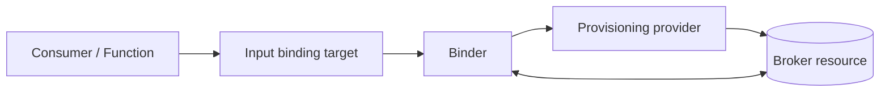
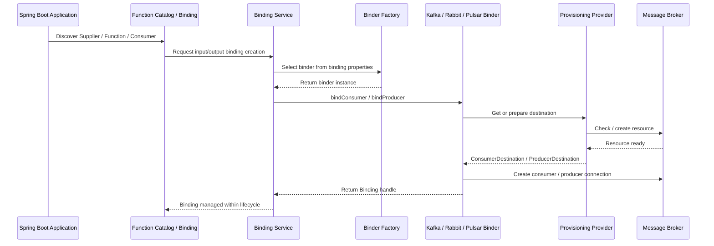

# Binder SPI, Bindings, and Provisioning Providers

Spring Cloud Stream separates business processing from how an application connects to a message broker. Java functions describe receiving, transforming, or emitting events; a **binding** connects a function's input or output to a destination; a **binder** implements connectivity to a type of broker; and a **provisioning provider** prepares the destination and required broker resources. These layers form an architectural boundary enabling an application to use Kafka, RabbitMQ, or Pulsar without coupling most business code to broker-specific APIs.

This lesson explains the role of the Binder SPI, the binding lifecycle, how Spring Cloud Stream selects binders, how provisioners allocate topics/queues/subscriptions, and key considerations when extending or building a custom binder. Examples use the `Supplier`/`Function`/`Consumer` functional model to clarify the relationship between beans, binding names, and destinations.

## 1. Four Concepts to Distinguish

In an event-driven application, the terms binder, binding, destination, and provisioner often appear side by side, yet they represent distinct responsibilities.

| Component | Responsibility | Example |
|---|---|---|
| Binder | Adapter connecting Spring Cloud Stream to a broker type and its delivery semantics | Kafka binder, Rabbit binder, Pulsar binder |
| Binding | Active connection between an application input/output target and a destination | `consumeOrder-in-0` connecting a function to topic `orders` |
| Destination | Logical resource name where messages are sent or received | Kafka topic, Rabbit exchange/queue, Pulsar topic |
| Provisioning provider | Locates, creates, or prepares broker resources per binding configuration | Creating a topic with requested partitions or declaring a queue and exchange |

A consumer flow can be pictured as follows:



The provisioner prepares the resource; the binder uses that resource to connect the corresponding message channel or target. The two components are closely related but not synonymous. The provisioner does not handle message business logic, and the binder should not turn business logic into part of a broker driver.

A helpful mnemonic:

- **A binder is how you connect.**
- **A binding is a specific connection.**
- **A destination is where you connect to.**
- **A provisioner prepares that place so the connection can work.**

## 2. Bindings in the Functional Model

Spring Cloud Stream relies on Spring Cloud Function to discover and link function beans. For a function bean named `consumeOrder`, default bindings are created by naming convention:

- Input: `consumeOrder-in-0`.
- Output of a `Function` or `Supplier`: `consumeOrder-out-0`.

The index `0` identifies the parameter position in the function. For functions with multiple inputs or outputs, indices distinguish each corresponding binding. `Consumer` has an input without an output; `Supplier` has an output without an input; `Function` has both input and output.

Example with three functions:

```java
@Configuration
public class OrderFunctions {

    @Bean
    Consumer<OrderCreated> consumeOrder(OrderHandler handler) {
        return handler::handle;
    }

    @Bean
    Function<OrderCreated, OrderEnriched> enrichOrder(OrderEnricher enricher) {
        return enricher::enrich;
    }

    @Bean
    Supplier<ServiceHeartbeat> heartbeat(HeartbeatFactory factory) {
        return factory::current;
    }
}
```

Configuration selecting functions and bindings:

```yaml
spring:
  cloud:
    function:
      definition: consumeOrder;enrichOrder;heartbeat
    stream:
      bindings:
        consumeOrder-in-0:
          destination: orders
          group: order-handler
          content-type: application/json
        enrichOrder-in-0:
          destination: orders.raw
          group: order-enrichment
          content-type: application/json
        enrichOrder-out-0:
          destination: orders.enriched
          content-type: application/json
        heartbeat-out-0:
          destination: service.heartbeat
          content-type: application/json
```

In this configuration, `consumeOrder-in-0` and `enrichOrder-in-0` are input bindings and can therefore declare `group`. The two output bindings simply send messages to destinations. `heartbeat-out-0` has no consumer group because `Supplier` is a data source.

`spring.cloud.function.definition` specifies which function beans are brought into the binding model. Default binding names are derived from the bean name and input/output position. If you want a friendlier name or want to keep configuration names stable across bean renames, you can map binding names using `spring.cloud.stream.function.bindings`.

Example:

```yaml
spring:
  cloud:
    function:
      definition: consumeOrder
    stream:
      function:
        bindings:
          consumeOrder-in-0: ordersInput
      bindings:
        ordersInput:
          destination: orders
          group: order-handler
```

After mapping, `ordersInput` becomes the binding configuration name used for `destination`, `group`, and consumer properties. Using an alias does not rename the function bean; it simply creates an alternative configuration binding name.

### Binding Name, Destination, and Group

These three values serve different roles:

| Property | Answers the Question | Example |
|---|---|---|
| Binding name | Which application input/output port is being configured? | `consumeOrder-in-0` |
| Destination | Which broker resource do messages flow through? | `orders` |
| Group | Which consumers share a single consumption progress? | `order-handler` |

Two input bindings can point to the same destination with different groups to consume independently. Multiple instances of the same consumer typically share a group to balance load. The binder uses these values together with broker-specific properties to determine resources or how consumers register.

### Binding Properties

Core configuration properties are typically placed under `spring.cloud.stream.bindings.<bindingName>`. A binding can declare:

- `destination`: logical destination name.
- `group`: consumer group or subscription identity for an input binding.
- `content-type`: content type hint for message conversion.
- `binder`: specific binder name when multiple binders exist.
- `consumer`: common consumption settings such as concurrency, partitioning, or retry within core support for the version in use.
- `producer`: common publishing settings such as partitioning or required groups.

Beyond core properties, each binder has its own extended configuration group. For example, Kafka has broker, offset, transaction, and topic settings; Rabbit has exchange, queue, acknowledgment, and dead-letter settings; Pulsar has tenant, namespace, subscription, and subscription type settings. Do not take an extended property name from one binder and apply it verbatim to another.

## 3. Binder and Binder SPI

A binder is the layer that integrates a broker with Spring Cloud Stream's programming model. It knows how to create consumers or producers on the broker, convert messages between infrastructure and binding targets, apply appropriate delivery settings, and provide a lifecycle handle for the created connection.

The Binder SPI is the extension contract allowing binder implementations to be used by Spring Cloud Stream through a uniform model. Conceptually, the `Binder` interface exposes two primary operations:

```java
public interface Binder<T,
        C extends ConsumerProperties,
        P extends ProducerProperties> {

    Binding<T> bindConsumer(
            String name,
            String group,
            T inboundBindTarget,
            C consumerProperties);

    Binding<T> bindProducer(
            String name,
            T outboundBindTarget,
            P producerProperties);
}
```

This is the conceptual shape of the SPI; concrete binders may extend base classes and use specific target types or extended properties depending on the Spring Cloud Stream version.

`bindConsumer` takes a destination name, group, input target, and consumer properties. The binder uses them to register a consumer with the broker and returns a `Binding` managing that connection. `bindProducer` takes a destination, output target, and producer properties to establish the message-publishing path.

### Consumer Properties and Producer Properties

Core provides shared property classes so bindings can be configured consistently. `ConsumerProperties` represents common consumption options; `ProducerProperties` represents common publishing options. Binders can extend them with extended consumer/producer property classes to add broker-specific capabilities.

For example, partitioning can be described at the core level via a partition key expression or selector; the Kafka binder then maps that setting to topic partitions. Concurrency configuration expresses intended consumer parallelism; the concrete binder decides how to realize it with consumer threads, queue consumers, or subscription consumers.

Not every core property has the exact same effect on every broker. A setting is only meaningful if the active binder supports it and can map it to corresponding semantics. Always check binder and version documentation when using extended properties.

### Binding as a Lifecycle Handle

The result of a bind operation is a `Binding` object. It represents an active connection and provides lifecycle management operations such as start, stop, status inspection, or unbind. Spring Cloud Stream manages bindings within the application lifecycle; when the context closes, the corresponding connections are released according to their lifecycle.

Distinguish unbinding from deleting broker resources. Stopping or unbinding a binding usually disconnects the consumer/producer from the application. It does not mean durable topics, exchanges, or queues will be deleted. Deleting persistent resources depends on binder, broker, and administrative policies.

## 4. How Spring Cloud Stream Orchestrates Bindings

An application normally does not call `bindConsumer` or `bindProducer` directly. Orchestration components inside Spring Cloud Stream perform this work based on function beans and configuration.

High-level initialization flow:



Key roles:

1. **Function discovery** finds the selected function beans. From function types and bean names, the framework determines which input/output bindings to create.
2. **Binding configuration** reads `destination`, `group`, `binder`, `content-type`, and consumer/producer properties.
3. **Binder factory** locates and supplies the binder matching the configured binder name or type.
4. **Binding service** orchestrates binding input/output targets using the selected binder and manages the resulting bindings.
5. **Provisioning provider** prepares destinations and broker resources if the binder requires provisioning.
6. **Binder implementation** establishes actual connections, transfers messages, and applies broker semantics.

This is an architectural model for understanding responsibilities. Internal class details and callback ordering may vary across versions, but these functional boundaries remain a useful way to diagnose failures.

### When Initialization Fails

If a binder cannot be found, configuration is invalid, credentials are wrong, or the broker forbids creating resources, binding initialization may fail. The application may fail at startup or bindings may not reach the desired state, depending on lifecycle mechanisms and error configuration.

When diagnosing, isolate the problem by layer:

- Binder not found: check dependencies, binder type, and selection configuration.
- Cannot connect to broker: check host, DNS, TLS, credentials, network policies, and access permissions.
- Cannot create destination: check provisioning permissions, resource name, partition count, queue/exchange, or namespace.
- Binding receives no messages: check destination, group, subscription, routing, offset/cursor, and consumer state.
- Message fails to decode: check content type, serializer/deserializer, schema, and headers.

Pinpointing failures at the right boundary prevents modifying business logic when the true cause lies in broker configuration.

## 5. Provisioning Providers and Resource Allocation

A provisioning provider abstracts looking up or creating broker resources for producers and consumers. In the Binder SPI, the provisioning contract is typically represented by `ProvisioningProvider` with two primary operations:

```java
public interface ProvisioningProvider<
        C extends ConsumerProperties,
        P extends ProducerProperties> {

    ConsumerDestination getConsumerDestination(
            String name,
            String group,
            C consumerProperties);

    ProducerDestination getProducerDestination(
            String name,
            P producerProperties);
}
```

Exact names and types may differ by version or base classes used by a binder; the key point is distinguishing the two provisioning paths:

- Consumer destination typically needs both the destination name and `group` because creating queues/subscriptions can depend on the group.
- Producer destination typically needs the destination name and producer properties to determine the publishing resource, partitions, or routing.

A provisioner may look up existing resources, create missing ones, add partitions, or configure bindings according to broker capabilities and current permissions. Not all binders share the same auto-creation capabilities.

### Resources Differ by Broker

| Broker | Typical Producer Resource | Typical Consumer Resource | Characteristics |
|---|---|---|---|
| Kafka | Topic | Topic with a consumer group and separate offsets | Groups are managed by coordinator/offsets; partitions are the unit of load distribution |
| RabbitMQ | Exchange and matching routing/bindings | Queue tied to destination and group, bound to exchange | Queues store messages; multiple consumers on the same queue compete for delivery |
| Pulsar | Topic | Topic with a subscription maintaining its own cursor | Subscription type governs how consumers coordinate |

This is a logical view; physical names, naming conventions, exchange types, subscriptions, and auxiliary resources are determined by the binder and configuration.

### Provisioning Resources for Kafka

With Kafka, a destination typically maps to a topic. Provisioning can verify an existing topic, create a topic with configured partition count and replication factor, or add partitions when allowed by the binder and configuration.

Key considerations:

- Partition count limits maximum parallelism within a single consumer group.
- Replication factor affects fault tolerance and requires enough brokers.
- Increasing partitions can alter key distribution for new messages; partitions on an active topic cannot arbitrarily be decreased.
- Topic creation requires appropriate ACLs/permissions when broker authorization is enabled.
- Auto-create and auto-add-partition settings must align with operational policy; do not assume the broker will always auto-create topics with desired parameters.

A Kafka consumer group is not a separate queue created per group. Groups read the same topic while maintaining independent offsets per topic-partition.

### Provisioning Resources for RabbitMQ

The Rabbit binder typically works with exchanges, queues, and bindings between them. `destination` generally identifies a logical exchange; `group` distinguishes each subscriber's queue. Multiple instances in the same group share a queue to compete for messages; another group gets its own queue to consume independently.

Provisioning concerns include:

- Exchange type and routing keys.
- Queue names and group-based naming rules.
- Durable queues and message persistence.
- Dead-letter exchanges/queues when configured.
- Queue arguments, TTL, maximum length, and other broker properties.
- Configure, write, and read permissions for the connecting user.

A single exchange can route the same message to multiple queues. Each queue has its own backlog and acknowledgments. This is the mechanism enabling independent subscriber groups.

### Provisioning Resources for Pulsar

Pulsar organizes data by tenant, namespace, and topic. Consumers read a topic through a subscription. A subscription maintains its own cursor/progress; multiple consumers using the same subscription participate in a shared consumption stream. Subscription types such as `Exclusive`, `Failover`, `Shared`, or `Key_Shared` determine how messages are dispatched.

Provisioning and broker concerns may involve:

- Existing tenant and namespace, plus namespace access permissions.
- Non-partitioned or partitioned topics.
- Subscription identity and subscription type.
- Retention, backlog quota, message TTL, and policies.
- Schemas and compatibility policies if using Pulsar's built-in schema registry.

Whether topics or subscriptions are auto-created depends on broker settings, binder behavior, and namespace policies. An application should not assume it can create resources in every namespace merely because connection credentials succeed.

## 6. Auto-Provisioning and Infrastructure Governance

Auto-provisioning lets development environments start up quickly: the application requests a destination and the binder creates the topic or queue if missing. In production, this must be controlled.

### When Is Auto-Provisioning Useful?

- Local development or integration test environments needing fast broker and application startup.
- New services deployed alongside infrastructure with a clear auto-provision policy.
- Simple resource configurations where provisioning permissions are scoped to a namespace or project.
- Ephemeral environments created and torn down per test lifecycle.

### When Should Resources Be Managed Separately?

- Topics require operational standards for replication factor, partition count, retention, or quotas.
- Queues need custom TTL, dead-lettering, priority, or security policies.
- Namespaces have centrally managed quotas, schema policies, or access controls.
- Resources are shared across multiple applications or outlive a single deployment.
- The organization requires infrastructure changes to go through review and audit.

A common approach uses Infrastructure as Code or infrastructure pipelines to provision production resources. Binders are configured to use existing resources only, or runtime credentials are not granted permissions to create/delete out-of-scope resources. Destination and group names stay in application configuration, while infrastructure parameters are governed appropriately.

### Least-Privilege Provisioning Permissions

Provisioners often need metadata read permissions and may need permissions to create or alter resources. Runtime accounts should be granted least privilege according to need:

- Producers only need write permissions on required destinations.
- Consumers only need read permissions and corresponding group/subscription permissions.
- Infrastructure deployment accounts can hold topic/queue creation or policy update permissions, without sharing those credentials with runtime workloads.
- Never store passwords, tokens, or private keys directly in source code or commit them to a repository.

Separating runtime and provisioning permissions limits blast radius if an application is compromised or misconfigured.

## 7. Multiple Binders in the Same Application

An application may need to read from Kafka and publish to RabbitMQ, or connect to two distinct Kafka clusters. Spring Cloud Stream supports configuring multiple binders and selecting a binder per binding. This example uses a `Function` bean that has both input and output:

\`\`\`java
@Bean
Function<OrderCreated, OrderNotification> routeOrder(NotificationMapper mapper) {
    return mapper::toNotification;
}
\`\`\`

The example below illustrates a Kafka binder for input and a Rabbit binder for output:

```yaml
spring:
  cloud:
    function:
      definition: routeOrder
    stream:
      binders:
        kafkaOrders:
          type: kafka
          environment:
            spring:
              cloud:
                stream:
                  kafka:
                    binder:
                      brokers: kafka.internal:9092
        rabbitNotifications:
          type: rabbit
          environment:
            spring:
              rabbitmq:
                host: rabbit.internal
                port: 5672
      bindings:
        routeOrder-in-0:
          destination: orders
          group: order-handler
          binder: kafkaOrders
        routeOrder-out-0:
          destination: order-notifications
          binder: rabbitNotifications
```

`kafkaOrders` and `rabbitNotifications` are binder aliases defined by the application. `type` selects the binder implementation on the classpath; `environment` holds settings specific to that binder instance. The `binder` property on each binding specifies which alias to use. The function's input reads from Kafka; its output is sent to RabbitMQ.

If an application uses multiple binders of the same type, distinct aliases let it connect to different clusters or configurations. When multiple binders exist and a binding does not specify one, explicitly configure a default binder or designate the default candidate according to your version's capabilities. Avoid letting binder selection depend implicitly on dependency ordering.

### Transaction Boundaries Between Two Brokers

A `Function` reading from Kafka and publishing to RabbitMQ creates two independent connections and two independent storage systems. Binder support for transactions on one broker does not automatically create an atomic distributed transaction across both brokers.

For example, an application reads an event from Kafka, updates state, and sends a notification to RabbitMQ. If sending to Rabbit succeeds but committing the Kafka offset fails, the message may be redelivered and the notification sent twice. If the offset commits before Rabbit sending succeeds, the notification may be lost if the application stops.

Design fault-tolerant workflows using idempotency, outbox/inbox, retries, and reconciliation as appropriate. Do not infer cross-broker exactly-once guarantees simply because two bindings live in the same Spring Boot application.

## 8. Building a Custom Binder with the Binder SPI

Only build a custom binder when integrating a broker or protocol unsupported by existing binders, or when an organization needs a dedicated adapter for an internal messaging platform. If a supported binder already exists for your broker, using it generally reduces maintenance cost and compatibility risk.

A custom binder typically needs the following parts:

1. **Module and dependencies**: depend on the matching version of Spring Cloud Stream/Binder SPI and the broker's client library.
2. **Binder implementation**: implement `Binder` or extend the appropriate base class to connect input/output targets.
3. **Provisioning provider**: provide logic to look up or create producer/consumer destinations.
4. **Properties**: declare extended consumer/producer properties with a dedicated prefix.
5. **Auto-configuration**: create beans for the binder, provisioner, connection factory/client, and supporting components.
6. **Binder registration metadata**: expose the binder using the discovery/auto-configuration mechanism required by the Spring Cloud Stream version.
7. **Lifecycle and health**: close connections, threads, clients, and resources when the context stops; expose status for observability.
8. **Tests**: test contracts, provisioning, message conversion, retries, partitioning, and connection failures.

### Module Structure Outline

```text
custom-stream-binder/
  src/main/java/
    com/example/binder/
      ExampleBinder.java
      ExampleProvisioningProvider.java
      ExampleBinderConfiguration.java
      ExampleConsumerProperties.java
      ExampleProducerProperties.java
      ExampleConsumerEndpoint.java
      ExampleProducerHandler.java
  src/main/resources/
    META-INF/
      spring.binders
  src/test/java/
    com/example/binder/
      ExampleBinderTests.java
      ExampleProvisioningTests.java
```

This is an illustrative layout; how auto-configuration and metadata are registered depends on the Spring Boot/Spring Cloud release train in use. When developing a binder, model it after a binder from the same version rather than copying the structure of an older major version.

### Binder Implementation Responsibilities

A production-quality binder must address all of these aspects:

- Create producer or consumer endpoints according to destination and properties.
- Translate messages, payloads, and headers between Spring `Message` and the broker client.
- Map groups, subscriptions, acknowledgments, and offsets/cursors according to the broker.
- Handle partitioning, concurrency, and ordering within the broker's capabilities.
- Classify transient vs. permanent errors; integrate retries or error handling per contract.
- Manage connections, channels, consumer threads, callbacks, and shutdown.
- Return binding handles so the framework can manage lifecycles.
- Provide appropriate metrics, health indicators, and diagnostics.

Avoid cramming all topic/queue creation code into the message-processing class. Separating the provisioner lets you test infrastructure logic independently and keeps the binder focused on connectivity.

### Extended Properties

Binder consumer/producer properties should be bound from external configuration. Example:

```java
@ConfigurationProperties("spring.cloud.stream.example.binder")
public class ExampleBinderProperties {
    private String endpoint;
    private Duration requestTimeout = Duration.ofSeconds(5);

    // getters and setters
}
```

Per-binding extended properties should follow the structure compatible with Spring Cloud Stream's extended binding properties mechanism. Avoid making a property global when it genuinely needs to differ per binding.

### Safe Provisioning

A custom provisioner should behave deterministically and idempotently:

- If the resource already exists and is compatible, reuse it.
- If the resource exists with incompatible settings, fail with a clear error instead of silently breaking configuration.
- If lacking permissions to create the resource, raise an error naming the destination and denied operation.
- Do not delete durable resources just because a binding unbinds.
- Distinguish configuration errors from transient broker errors so retries behave properly.
- Support timeouts and bounded attempts when the broker is not yet ready.

Idempotency in provisioning is vital because applications may restart repeatedly or multiple instances may request the same destination simultaneously. Concurrent creation must handle the case where another instance created the resource while the current request was in flight.

## 9. Testing Bindings and Provisioners

Testing should progress from simple contracts to real brokers.

### Unit Tests for Properties and Mapping

Verify binding configuration onto properties, default values, invalid input checks, and mapping from core properties to broker client options. For instance, a negative partition count or blank destination should be rejected with a clear message.

### Testing the Provisioning Provider

Use a mock client or fake admin API to verify:

- Missing destinations are created with the expected configuration.
- Existing destinations are reused.
- Conflicting existing configuration raises an error.
- Permission errors preserve their root cause.
- Timeouts and transient errors perform bounded retries.
- Concurrent creation requests do not lead to invalid states.

### Testing the Binding Lifecycle

Verify that `bindConsumer` and `bindProducer` create the right endpoints, return binding handles, support start/stop/unbind, and release resources when the context closes. Verify no leaked threads or connections remain after shutdown.

### Integration Tests with the Broker

The Test Binder in the Spring Cloud Stream test suite is useful for verifying function logic, binding names, and message flows at the framework level. It does not prove true broker semantics or provisioner correctness. For a custom binder, run integration tests against a real broker or compatible environment to verify:

- Producers send messages to the expected destination.
- Consumers receive messages under the declared group/subscription.
- Two consumers in the same group share load per broker semantics.
- Two different groups consume independently.
- Partitioning/keys and ordering work as expected.
- Acknowledgments, offsets/cursors, retries, and dead-letter handling behave properly.
- Broker disconnects and recoveries do not leak resources or lose acknowledged state.

If using Testcontainers, create uniquely named resources per test run and tear down containers afterward to avoid stale data skewing results.

## 10. Observability and Operations

The binder sits at the boundary between application and broker, so observe both binding state and resource state.

Metrics and signals to monitor:

- Binding name, binder alias, destination, and group.
- Whether the binding is running, stopped, or errored.
- Active consumer/producer counts and last connection timestamp.
- Consumer lag or backlog per group/subscription.
- Inbound/outbound message rates, send/receive errors, and processing latency.
- Retry counts, redeliveries, and messages routed to DLQ.
- Provisioning failures, resource creation counts, and provisioning duration.
- Rebalances, partition assignments, or consumer reconnects where supported by the broker.

Logs should include binding name, destination, group, event ID, and correlation ID for cross-layer tracing. Avoid logging credentials or full sensitive payloads.

When a binding is not working, inspect in order: binding configuration, selected binder, broker connectivity, provisioned resources, access permissions, consumer assignment/subscription, and finally message conversion. This sequence narrows down the issue faster than reading only business function logs.

## 11. Common Architectural Pitfalls

**Confusing binding with destination.** A binding is an application's logical connection; a destination is a broker resource. One destination can be used by multiple bindings with different groups or binders.

**Confusing a binder with a broker instance.** A binder is an adapter implementation; a binder alias can be configured to connect to a specific cluster. The same Kafka binder type can have multiple configured instances pointing to different clusters.

**Assuming the provisioner always creates resources.** Auto-provisioning depends on the binder, broker, configuration, and permissions. In production, resources may be pre-created by infrastructure pipelines.

**Treating unbind as deleting a queue or topic.** Unbinding releases the application's connection. Durable broker resources have their own lifecycles and need explicit governance policies.

**Applying Kafka extended properties to RabbitMQ or Pulsar.** Binders have distinct semantics and properties. Only share core settings where binders support matching semantics.

**Using multiple binders without specifying which binder a binding uses.** The application may pick the wrong default or fail to start. Explicitly assign binder aliases when connecting to multiple brokers.

**Building a custom binder while neglecting lifecycle.** Unreleased consumer threads, connections, or callbacks can leak resources and prevent tests from terminating.

**Granting runtime credentials permission to create/delete any resource.** Overly broad privileges expand the impact of application bugs or misconfigurations. Separate provisioning privileges from runtime read/write privileges.

## 12. Process for Designing a New Binding

When adding an event flow, follow these steps:

1. Determine whether the function bean is a `Supplier`, `Function`, or `Consumer`, and which inputs/outputs require bindings.
2. Determine the default binding name or a clear alias to keep configuration stable.
3. Choose destination, group, and binder according to delivery requirements.
4. Identify required broker resources: topic, partitions, exchange, queue, namespace, or subscription.
5. Decide whether resources are auto-provisioned or managed via Infrastructure as Code.
6. Configure content type, schema, partitioning, concurrency, retries, and dead-letter handling per binder.
7. Define least-privilege permissions for the provisioner and runtime credentials.
8. Test function logic, binding lifecycle, and broker semantics.
9. Monitor binding state, backlog, errors, and provisioning after deployment.

When a new binder is needed, start by identifying exactly which broker capabilities existing adapters do not support. Then implement the Binder SPI, provisioner, properties, auto-configuration, lifecycle, and tests on the exact Spring Cloud version in use. A well-designed binder keeps business code broker-independent while faithfully representing differences in groups, partitions, acknowledgments, subscriptions, and resources across each system.
