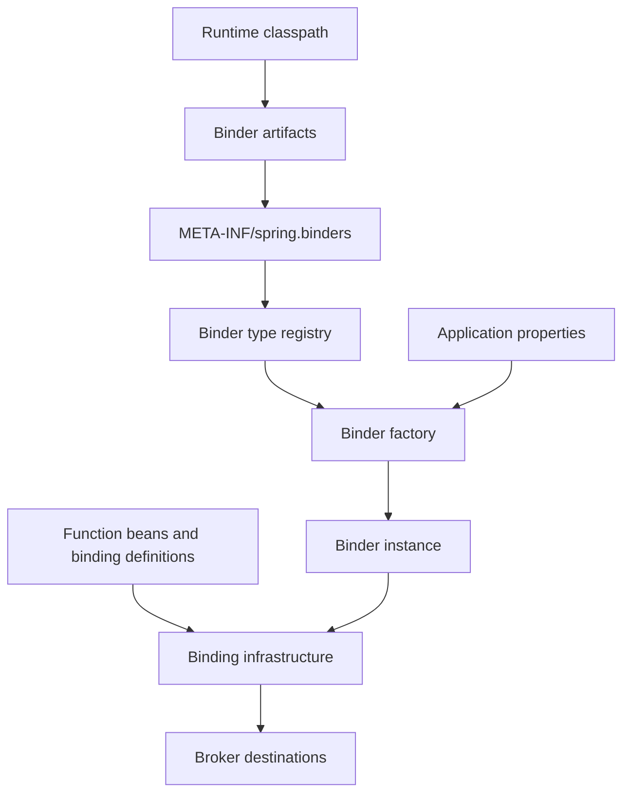

# Auto-Configuration and Classpath Binder Detection

Spring Cloud Stream connects event-processing functions to Kafka, RabbitMQ, or Pulsar through binders. In a Spring Boot application, most of this infrastructure initialization happens automatically based on libraries on the classpath, metadata supplied by binders, and application configuration. Understanding this mechanism helps determine why a binder is selected, why a binding is not created, and how to configure an application that connects to multiple brokers.

Auto-configuration and binder detection are related but distinct processes. Spring Boot decides which configurations qualify for activation. Spring Cloud Stream discovers which binder types the application can use, instantiates the matching binders, and connects function bindings to destinations. Dependencies on the classpath provide integration capabilities; binding and destination configuration determine how those capabilities are used.

## 1. Layers Involved in Initialization

A Spring Cloud Stream application typically involves the following layers:

| Component | Responsibility |
| --- | --- |
| Spring Boot auto-configuration | Detects classes and beans, evaluates configuration conditions, and creates foundational beans at startup. |
| Spring Cloud Function | Discovers and manages `Supplier`, `Function`, or `Consumer` beans in the application. |
| Spring Cloud Stream | Creates bindings, manages stream configuration, and connects functions to binders. |
| Binder registry and binder factory | Registers available binder types, selects the matching type, and creates binder instances per configuration. |
| Binder implementation | Handles communication with a specific broker such as Kafka, RabbitMQ, or Pulsar. |
| Destination | Broker resource that a binding reads from or writes to, such as a topic or exchange. |

The entry point is typically the application class annotated with `@SpringBootApplication`. This annotation enables Spring Boot's auto-configuration mechanism. When the context is created, Spring Boot evaluates auto-configuration classes present on the classpath. Spring Cloud Stream and binder configurations participate in this process when the required dependencies and conditions are satisfied.

There is no need to declare `@EnableBinding` in applications using the modern functional model. The application declares function beans and lets Spring Cloud Stream set up bindings from configuration. `@EnableBinding` belongs to the legacy annotation-based programming model and typically appears in older codebases.

## 2. How Spring Boot Evaluates Auto-Configuration

Auto-configuration is the mechanism Spring Boot provides to create beans suited to the application environment. An auto-configuration is usually applied only when specific conditions are met. Common conditions include:

- **Class present on classpath:** the required library must be included as a dependency. For example, Kafka configuration requires the corresponding Kafka binder or Kafka client classes.
- **Bean presence or absence:** a configuration may create a default bean only when the application has not already declared an equivalent bean. This allows applications to customize certain components.
- **Property enabled or matching a value:** a configuration may depend on a property in `application.yml`, an environment variable, or a runtime argument.
- **Application conditions:** a configuration may depend on the application type, another class, or another auto-configuration already loaded.

Annotations such as `@ConditionalOnClass`, `@ConditionalOnMissingBean`, and `@ConditionalOnProperty` are common Spring Boot mechanisms for expressing these conditions. These illustrate how auto-configuration works; do not assume every Spring Cloud Stream configuration uses the exact same set of conditions.

For example, if the application lacks the Kafka binder dependency, Kafka integration cannot work merely by declaring `destination: orders.in`. If the Kafka binder is on the classpath but the broker address is wrong, auto-configuration can still create the required beans, while connecting or binding fails when the application initializes the stream. Therefore, distinguish missing-library errors from connection-configuration errors.

## 3. How Binders Are Discovered on the Classpath

Each binder implementation provides metadata telling Spring Cloud Stream which binder type it can create and which configuration is responsible for that type. Spring Cloud Stream's traditional binder registration mechanism uses the `META-INF/spring.binders` resource inside the binder artifact.

This resource maps a binder type name to its corresponding binder configuration class. Conceptual example:

```properties
kafka=...KafkaBinderConfiguration
rabbit=...RabbitBinderConfiguration
```

Exact class names depend on the binder artifact and version; the example above merely illustrates the mapping structure. When the Kafka binder or Rabbit binder dependency is placed on the classpath, its metadata comes with the artifact. Spring Cloud Stream reads this registry to learn which binder types are available.

The discovery process can be understood in the following steps:

1. The build tool places the starter or binder dependency on the runtime classpath.
2. The binder artifact supplies the implementation, client library, and binder type registration metadata.
3. Spring Cloud Stream reads the metadata and builds a registry of available binder types.
4. The binder factory uses the registry and application configuration to instantiate the appropriate binder.
5. The binding infrastructure connects input or output bindings to destinations via that binder.



`META-INF/spring.binders` metadata serves Spring Cloud Stream's binder type registry. It plays a different role from Spring Boot's auto-configuration registration mechanism, which varies across Spring Boot generations and may use metadata such as `AutoConfiguration.imports`. Do not confuse the two mechanisms: one helps Boot discover auto-configurations, while the other helps Spring Cloud Stream discover binder types.

## 4. From a Discovered Binder to Function Bindings

Discovering a binder only means the application is capable of using that binder. Spring Cloud Stream still needs to know which functions to connect and which destination each input or output maps to.

For example, an application declares a function:

```java
import java.util.function.Function;

import org.springframework.context.annotation.Bean;
import org.springframework.context.annotation.Configuration;

@Configuration
public class OrderFunctions {

    @Bean
    public Function<String, String> normalizeOrder() {
        return orderId -> orderId.trim().toUpperCase();
    }
}
```

Configuration can select the function and destinations as follows:

```yaml
spring:
  cloud:
    function:
      definition: normalizeOrder
    stream:
      bindings:
        normalizeOrder-in-0:
          destination: orders.raw
          group: order-normalizer
        normalizeOrder-out-0:
          destination: orders.normalized
```

Binding names are derived from the function bean name and Spring Cloud Stream's input/output convention. `normalizeOrder-in-0` is the input port, and `normalizeOrder-out-0` is the output port. Destinations specify the broker resources each binding uses. If only one matching binder exists on the classpath, Spring Cloud Stream can normally use that binder by default. When multiple binders are present, explicit selection configuration is needed.

This process highlights three questions to check separately: is the function recognized by Spring, was the binder discovered and created successfully, and is the binding connected to the desired destination? An application can pass binder discovery yet still fail during binding due to destinations, permissions, or broker settings.

## 5. Selecting a Binder When Only One Binder Is on the Classpath

If the application includes only one binder implementation, configuration is usually straightforward. For example, with the Kafka binder dependency on the classpath and the application connecting only to Kafka:

```yaml
spring:
  cloud:
    function:
      definition: normalizeOrder
    stream:
      bindings:
        normalizeOrder-in-0:
          destination: orders.raw
          group: order-normalizer
        normalizeOrder-out-0:
          destination: orders.normalized
      kafka:
        binder:
          brokers: localhost:9092
```

In this example, the dependency provides the Kafka binder; `spring.cloud.stream.kafka.binder.brokers` supplies the connection address. There is no need to declare an extra named binder instance if the application only needs a single default binder configuration.

However, destination names and broker addresses are two different kinds of configuration. `orders.raw` and `orders.normalized` specify message-exchange resources. `localhost:9092` specifies where the Kafka binder connects. If the broker is unreachable, having the binder on the classpath will not fix network or authentication problems on its own.

## 6. Selecting Binders When Multiple Binders Are on the Classpath

When an application has multiple binder implementations—such as both Kafka and Rabbit binders—avoid relying on implicit selection. There are two common configuration approaches:

- Set a default binder via `spring.cloud.stream.default-binder` if most bindings use the same binder.
- Specify the binder per binding via `spring.cloud.stream.bindings.<bindingName>.binder` when flows use different brokers.

For example, an application can include two binder dependencies and set a default binder:

```yaml
spring:
  cloud:
    stream:
      default-binder: kafka
      bindings:
        normalizeOrder-in-0:
          destination: orders.raw
          group: order-normalizer
        normalizeOrder-out-0:
          destination: orders.normalized
```

Here, bindings that do not specify a dedicated binder use the default `kafka` binder. This value must match a binder name selectable in the runtime configuration.

If a binding needs to use the Rabbit binder, specify it explicitly:

```yaml
spring:
  cloud:
    stream:
      bindings:
        normalizeOrder-in-0:
          destination: orders.raw
          group: order-normalizer
          binder: kafka-east
        notifyOrder-out-0:
          destination: order.notifications
          binder: rabbit-west
```

In a multi-binder setup with named instances `kafka-east` and `rabbit-west`, those names must be defined under `spring.cloud.stream.binders`. A binder type is the implementation kind, whereas an instance name is a specific configuration referenced by bindings. Distinguishing these two concepts is especially helpful when connecting to multiple clusters of the same broker type.

## 7. Defining Multiple Binder Instances

An application may need two independent Kafka clusters, or need to connect to both Kafka and RabbitMQ within the same process. Spring Cloud Stream allows defining named binder configurations, specifying each instance's `type` and dedicated configuration environment.

Example configuration with two binder instances:

```yaml
spring:
  cloud:
    stream:
      binders:
        kafka-east:
          type: kafka
          environment:
            spring:
              cloud:
                stream:
                  kafka:
                    binder:
                      brokers: kafka-east.example:9092
        rabbit-west:
          type: rabbit
          environment:
            spring:
              rabbitmq:
                host: rabbit-west.example
                port: 5672
      bindings:
        ingestOrder-in-0:
          destination: orders.created
          group: order-ingestion
          binder: kafka-east
        publishNotification-out-0:
          destination: order.notifications
          binder: rabbit-west
```

`kafka-east` and `rabbit-west` are application-defined binder instance names. `type` identifies which binder implementation to use. `environment` holds settings passed into that binder instance's isolated environment, such as the Kafka cluster address or RabbitMQ host. Bindings reference the exact instance name in their `binder` property.

When multiple binder instances exist, the `default-candidate` property can control which instances are considered when selecting a default binder. Setting `default-candidate: false` on an instance meant only for explicit use prevents it from unexpectedly becoming the default candidate. Verify how default assignment and binder selection behave in the Spring Cloud Stream version used by your application.

Do not duplicate full broker configuration across multiple places without clearly defining scope. Instance configuration separates connection details per cluster; binding configuration determines which flow uses which instance. In production, sensitive values such as passwords and tokens should be supplied via a secrets manager or appropriate environment variables.

## 8. Configuration Precedence and Scope

Auto-configuration relies on the classpath, while configuration values can come from many sources: config files, profiles, environment variables, command-line arguments, or deployment platforms. Spring Boot applies property sources and relaxed binding to merge these values.

A few principles help prevent confusion:

- Shared configuration under `spring.cloud.stream` applies to stream infrastructure according to each property's scope.
- Per-binding configuration lives under `spring.cloud.stream.bindings.<bindingName>` and can override general choices when supported by that property.
- Specific binder configuration lives under its corresponding namespace, such as `spring.cloud.stream.kafka.binder` or inside a binder instance's `environment`.
- Profiles such as `application-dev.yml` and `application-prod.yml` can supply different broker addresses per environment.
- Deployment arguments or environment variables can override values in config files. When investigating, inspect the effective configuration received by the running process rather than only reading files in the repository.

For example, the base configuration might set `default-binder: kafka`, while a test profile declares a different binder or uses the test binder. If a pipeline environment variable overrides `spring.cloud.stream.default-binder`, runtime behavior may differ from local settings. Record the effective configuration of each environment during troubleshooting.

## 9. Customizing or Excluding Auto-Configuration

Spring Boot lets applications replace certain auto-configured beans with application-declared beans. Many auto-configurations use conditions that create a default bean only when no matching bean already exists. This is the standard extension mechanism when customization is needed.

Spring Boot also supports excluding a specific auto-configuration via `spring.autoconfigure.exclude` or exclusion attributes on annotations. However, do not exclude Spring Cloud Stream or binder auto-configurations merely to mask a connection error. Excluding them can prevent the binder factory, binding infrastructure, or essential beans from being created.

Before customizing, identify which beans are created, which configurations were activated, and which conditions caused another configuration to be skipped. Only exclude an auto-configuration once you understand its impact and provide a complete replacement configuration.

## 10. Diagnosing Binder Discovery and Selection Failures

When an application fails to start or bindings fail to work, inspect layer by layer:

1. **Dependencies:** is the starter or binder artifact on the runtime classpath? Was the dependency accidentally placed in a test-only scope?
2. **Metadata:** does the binder artifact contain the required binder registration resource? Are the binder and Spring Cloud Stream versions compatible?
3. **Auto-configuration:** are auto-configurations being evaluated and applied? Is any property disabling or excluding configuration?
4. **Binder selection:** if multiple binders exist, do `default-binder` or a binding's `binder` property point to valid names?
5. **Binder environment:** are broker addresses, authentication, TLS, and binder-specific properties loaded properly into the instance?
6. **Bindings and destinations:** do binding names match the selected functions? Are destination, group, subscription, or routing correct?
7. **Broker:** can the application connect to the broker and does it have permissions to read/write or create required resources?

Spring Boot supports the `--debug` flag to print the Condition Evaluation Report. This report shows which auto-configurations were applied and which were skipped along with the reasons. You can enable more detailed logging for relevant packages in development:

```yaml
logging:
  level:
    org.springframework.boot.autoconfigure: DEBUG
    org.springframework.cloud.stream: DEBUG
    org.springframework.cloud.function: DEBUG
```

If the application uses Spring Boot Actuator, the `conditions` endpoint can report configuration condition evaluations when enabled and appropriately exposed. Only expose diagnostic information in accordance with environment access policies; do not expose management endpoints publicly without restriction.

Useful dependency inspection commands:

```bash
# Maven: view resolved binders and Spring Cloud libraries
./mvnw dependency:tree -Dincludes=org.springframework.cloud

# Gradle: view dependencies related to Spring Cloud Stream
./gradlew dependencyInsight --dependency spring-cloud-stream --configuration runtimeClasspath
```

On Windows, use `mvnw.cmd` or `gradlew.bat`. When inspecting the dependency tree, verify the binder artifact, `spring-cloud-stream`, and the broker client. Presence of classes on the classpath does not prove the broker is reachable; once dependencies and auto-configuration are verified, inspect connection logs, access permissions, and destination status.

## 11. Testing Auto-Configuration and Binder Selection

Tests should confirm that the application selects the right functions, bindings, and binders in each environment. The Spring Cloud Stream Test Binder can simulate message flows in tests without a real broker. It is useful for verifying function logic and binding wiring at the application level.

However, the test binder does not prove that Kafka, RabbitMQ, or Pulsar are configured properly. Integration tests are still required to verify that the real binder connects to the broker, accesses destinations, handles groups or subscriptions, and performs retries or DLQ routing as required.

For applications with multiple binders, add configuration tests for each critical binding. Tests should verify that each binding is assigned to the intended binder instance and does not accidentally fall back to a default binder. Test profile configurations should also be reviewed to ensure the test binder is not packaged into production runtime builds.

## Conclusion

Spring Boot auto-configuration builds the infrastructure when classpath, bean, and property conditions are met. Spring Cloud Stream uses binder metadata on the classpath to discover binder types, after which the binder factory creates instances and the binding infrastructure connects functions to destinations. When an application has one binder, selection is straightforward; when using multiple binders or multiple clusters, explicitly configure the default binder, per-binding binder assignments, and each instance's isolated environment. Distinguishing auto-configuration, binder discovery, binder selection, and binding makes it much easier to diagnose startup errors and operate event streams reliably.
