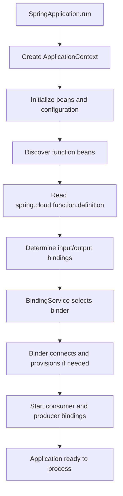
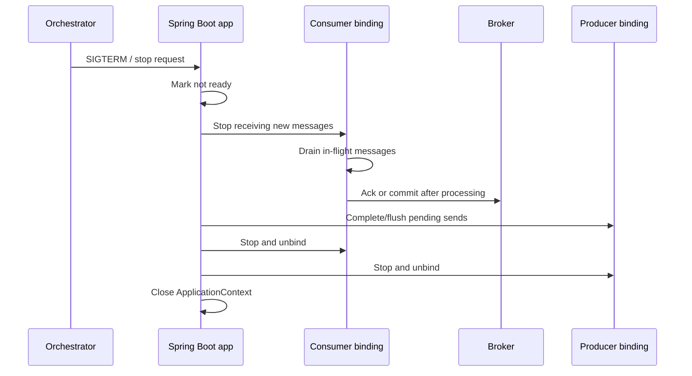

# Lifecycle of Startup, Binding, Unbinding, and Application Shutdown

## 1. Why Understanding the Lifecycle of a Messaging Application Matters

A Spring Cloud Stream application does more than run business functions. At startup, the application must discover which functions to activate, create bindings, select binders, connect to the broker, and start receiving or sending messages. At shutdown, it must stop accepting new work, finish or safely handle in-flight messages, acknowledge progress, and release connection resources.

Focusing only on when a `Function` or `Consumer` is invoked makes it easy to miss critical operational scenarios: the application opens its HTTP port before consumers are ready; a binding is stopped while messages are still being processed; a producer sends a message after its binding has been unbound; or an instance terminates before completing acknowledgment/offset commit.

In Spring Cloud Stream, distinguish three related but non-identical lifecycles:

- **Spring application lifecycle:** creating the `ApplicationContext`, initializing beans, running lifecycle-managed components, and closing the context upon termination.
- **Binding lifecycle:** creating the link between a function and a destination, starting/stopping message flow, and unbinding to release resources.
- **Broker resource lifecycle:** topics, queues, exchanges, subscriptions, consumer groups, and persisted data on Kafka, RabbitMQ, or Pulsar.

Stopping a binding usually only releases the application's link. It does not delete topics, queues, or data on the broker. Conversely, deleting a destination while applications still use it can break multiple producers and consumers.

## 2. Components Participating in Initialization

A Spring Cloud Stream application typically involves the following components:

| Component | Lifecycle Responsibility |
|---|---|
| Spring `ApplicationContext` | Creates beans, manages dependencies, and coordinates application startup/shutdown |
| Spring Cloud Function `FunctionCatalog` | Discovers and supplies `Supplier`, `Function`, and `Consumer` beans |
| Function definition | Specifies which function or function chain is activated in the application |
| Binding | Connects a function's input/output port to a logical destination |
| `BindingService` | Coordinates creating and managing bindings according to configuration |
| Binder | Integrates with a specific broker, creates consumers/producers, and applies broker-specific settings |
| Broker | Stores, routes, and delivers messages according to system semantics |

Spring Cloud Stream provides the abstraction layer for bindings and binders. Creating consumers, producers, channels, subscriptions, or acknowledgment settings is mapped by the binder down to the corresponding broker API.

## 3. Startup Lifecycle from Spring Boot to Bindings

A typical startup sequence can be described as follows:



### Step 1: Create the ApplicationContext

Spring Boot reads configuration, creates the `ApplicationContext`, and initializes beans. Binder configurations present on the classpath are evaluated to provide broker connectivity. If the application uses multiple binders, configuration must explicitly specify the default binder or per-binding binder according to version and configuration rules.

Connection details such as broker addresses, credentials, TLS, and network options are typically supplied per environment. Avoid placing passwords or tokens directly into committed configuration files.

### Step 2: Discover Functions and Resolve the Function Definition

Spring Cloud Stream works with Spring Cloud Function to locate function beans. Example:

```java
import java.util.function.Function;
import org.springframework.context.annotation.Bean;
import org.springframework.context.annotation.Configuration;

record OrderReceived(String orderId, long amount) {}
record OrderValidated(String orderId, long amount) {}

@Configuration
class OrderFunctions {

    @Bean
    Function<OrderReceived, OrderValidated> validateOrder() {
        return order -> {
            if (order.amount() <= 0) {
                throw new IllegalArgumentException("amount must be positive");
            }
            return new OrderValidated(order.orderId(), order.amount());
        };
    }
}
```

When an application has multiple functions, `spring.cloud.function.definition` specifies which functions to activate. For the example above:

```yaml
spring:
  cloud:
    function:
      definition: validateOrder
```

Omitting or misspelling a function name in an application with multiple function beans may prevent expected bindings from being created or activate the wrong function. Always inspect the function definition alongside bean names when investigating startup issues.

### Step 3: Derive Binding Names

Spring Cloud Stream generates binding names from the function name and port position. For `validateOrder`:

- `validateOrder-in-0` is the first input binding.
- `validateOrder-out-0` is the first output binding.

`Function` normally has both input and output; `Consumer` has only input; `Supplier` has only output. Functions with multiple inputs/outputs have additional indices. These names serve as configuration keys for `destination`, `group`, `content-type`, `concurrency`, and producer/consumer properties.

### Step 4: Create Bindings and Select Binders

`BindingService` uses binding configuration to resolve the destination and binder. The corresponding binder creates producers or consumers connected to the broker. Depending on the broker, application permissions, and provisioning settings, the binder may create required topics, queues, or resources if they do not yet exist.

Provisioning behavior depends on the broker and binder. If the application account lacks privileges to create resources, destinations must be pre-created by infrastructure processes. Do not assume every binder auto-creates every resource type in every environment.

### Step 5: Start Receiving and Sending Messages

Consumer bindings start listening or polling for messages. Producer bindings prepare the message-sending path. Once required bindings have started and broker dependencies are ready, the application can process event streams.

Complete example configuration for a transformation function:

```yaml
spring:
  cloud:
    function:
      definition: validateOrder
    stream:
      bindings:
        validateOrder-in-0:
          destination: orders.received
          group: order-validation
          content-type: application/json
        validateOrder-out-0:
          destination: orders.validated
          content-type: application/json
      kafka:
        binder:
          brokers: localhost:9092
```

The input binding receives messages from `orders.received`; the output binding sends results to `orders.validated`. The `group` name defines an isolated consumption scope for the validation service. With Kafka, instances in the same group share partitions; other groups can read the same topic independently.

## 4. When Are Bindings Created?

Most bindings declared via `function.definition` are managed automatically during startup. However, not every output destination must be known at application startup.

### Statically Declared Bindings

Static bindings are declared in application configuration. The framework knows binding names, destinations, and binders ahead of time. This fits fixed business flows, makes deployment validation easy, and supports least-privilege broker permissions.

### Dynamic Output Bindings with StreamBridge

In some applications, the output destination is only known at runtime. `StreamBridge` lets non-function components send messages and can create output bindings on demand:

```java
import org.springframework.cloud.stream.function.StreamBridge;
import org.springframework.stereotype.Service;

record AuditEvent(String eventType, String entityId) {}

@Service
class AuditPublisher {

    private final StreamBridge streamBridge;

    AuditPublisher(StreamBridge streamBridge) {
        this.streamBridge = streamBridge;
    }

    boolean publish(String destination, AuditEvent event) {
        return streamBridge.send(destination, event);
    }
}
```

In this example, `destination` is passed when `publish` is called. When no matching binding exists yet, Spring Cloud Stream can dynamically create an output binding and retain it for reuse. The boolean return value indicates that the send operation was accepted according to `StreamBridge`'s mechanism; do not interpret it as proof that a consumer has received or finished processing the message.

For critical destinations, declare explicit bindings to control the actual destination, content type, and binder. For instance, the binding name passed to `send` can map to a concrete destination:

```yaml
spring:
  cloud:
    stream:
      bindings:
        audit-out:
          destination: audit.events
          content-type: application/json
```

The application calls `streamBridge.send("audit-out", event)` to use the configured binding. When deriving dynamic binding names from external input, restrict allowed destinations so callers cannot arbitrarily create broker resources or route data to unauthorized targets.

## 5. Binding States and Lifecycle Operations

A binding is managed as a lifecycle-aware component. Conceptually, the core operations are:

| Operation | Meaning | When Used |
|---|---|---|
| Create / bind | Establishes the link between an application port and a destination | At startup or when a dynamic output binding is needed |
| Start | Starts message sending/receiving | Once the binding is created and ready to run |
| Stop | Pauses the binding's activity | When temporarily halting consumption/publishing or preparing maintenance |
| Unbind | Tears down the link and releases binding-associated resources | When the binding is no longer needed or at application shutdown |

`stop` and `unbind` serve different purposes. Stopping a binding controls operational state; unbinding releases the connection and resources managed by the binding. Unbinding does not automatically delete topics, queues, exchanges, or broker data. Deleting broker resources is a separate administrative operation requiring impact assessment across all applications using that destination.

### Controlling via Spring Cloud Stream Actuator

When the application includes Spring Boot Actuator and the Spring Cloud Stream version supports the bindings endpoint, that endpoint can list and control binding states. Example configuration exposing the endpoint:

```yaml
management:
  endpoints:
    web:
      exposure:
        include: health,info,bindings
```

You can query the list of bindings at `/actuator/bindings`. For a binding named `validateOrder-in-0`, a POST request can change its state:

```http
POST /actuator/bindings/validateOrder-in-0
Content-Type: application/json

{"state":"STOPPED"}
```

To restart the binding, use state `STARTED` as supported by your running version. Exact endpoint format, supported states, and control capabilities depend on the Spring Cloud Stream version. Consult the documentation for your application's version before automating this operation.

The bindings endpoint can alter message receiving/sending behavior. Expose it only over a trusted management network with proper authentication and authorization. Never expose binding-control endpoints to end users.

### What Can Stopping a Consumer Trigger?

When a consumer binding is stopped, the broker may stop sending new messages to that consumer or stop assigning work to it. Unacknowledged messages may be redelivered per broker semantics. With Kafka, stopping a consumer can trigger a rebalance and reassign partitions to other consumers. With RabbitMQ, canceling a consumer or closing its channel can cause unacked messages to be requeued. With Pulsar, closing a consumer can cause unacked messages to be redelivered according to subscription and acknowledgment timeout rules.

Therefore, `stop` should not be treated as a guarantee that all in-flight messages have completed. Applications must coordinate work draining, acknowledgment/offset commits, and idempotency.

## 6. Unbinding and Resource Cleanup

Unbinding typically occurs when a dynamic binding is no longer used or when the application shuts down. The binder releases client-side resources created by the binding, such as listener containers, consumers, producers, channels, or associated connections depending on the binder implementation.

Cleanup scope may vary:

- Consumers stop receiving messages and close client resources.
- Producers are closed or flushed as supported by the binder before sending resources are released.
- Internal callbacks, listeners, and binding resources are cleaned up.
- Provisioned broker resources generally remain intact unless deleted by a separate administrative action.

Do not arbitrarily delete topics or queues just because an application instance unbinds. Destinations are often shared across multiple instances or services. Broker data lifecycles should be governed by infrastructure procedures and dedicated retention policies.

With dynamic output bindings, avoid creating a new binding per message when messages can share a destination. Reusing bindings per destination avoids creating excessive producers, connections, and metadata. If a system has many dynamic destinations, monitor the number of open bindings and enforce bounds appropriate to your design.

## 7. Shutting Down the Application Safely

A controlled shutdown should proceed in the following operational order:

1. Stop accepting new requests from external sources or mark the instance as not ready.
2. Stop accepting new messages on consumer bindings through the appropriate mechanism.
3. Allow in-flight messages to finish within the allotted timeout.
4. Acknowledge messages or commit offsets only after business side effects complete per delivery policy.
5. Flush or complete pending producer sends if supported by the binder.
6. Stop and unbind bindings, then close binder resources and the `ApplicationContext`.



Actual ordering and draining mechanics depend on the binder, container, and whether the application processes asynchronously. If a function hands work off to a separate executor and returns immediately, the binder may assume the message is complete while the background task is still running. Consumers must keep processing lifecycles aligned with message acknowledgment timing.

### Graceful Shutdown in Spring Boot

Spring manages lifecycle-aware components, including beans implementing `Lifecycle` or `SmartLifecycle`. Spring Cloud Stream uses this lifecycle mechanism to start and stop bindings. You can configure the timeout per Spring lifecycle phase:

```yaml
spring:
  lifecycle:
    timeout-per-shutdown-phase: 30s
```

The application must align this timeout with the container/orchestrator termination grace period. If the orchestrator sends `SIGKILL` before draining finishes, in-flight messages may be redelivered or side effects left in an unclear state.

In web applications, `server.shutdown: graceful` controls graceful shutdown of the web server. That setting alone does not guarantee all message consumers have drained. Independently verify listener/binding lifecycles and how the binder acknowledges messages.

### Readiness Signals and Health Checks

Readiness should reflect whether an instance can accept additional work. Once shutdown begins, the instance should be removed from traffic distribution before termination. Liveness answers whether the process is still running; readiness answers whether the instance should receive new work. These two signals should not be used interchangeably.

Verify application and binder health indicators for your version. A generic health endpoint may report the process as healthy without confirming that every destination can send/receive. For critical systems, add monitoring for connectivity, consumer lag, queue depth, and binding states at the operations layer.

## 8. Shutdown Differences Across Brokers

| Aspect | Kafka Binder | RabbitMQ Binder | Pulsar Binder |
|---|---|---|---|
| Consumer stop | Stops polling; may trigger group rebalance | Cancels consumer or closes channel | Closes consumer on subscription |
| Read progress | Offset commits per config and acknowledgment mode | Ack/nack by delivery tag | Ack per message/subscription |
| Unacknowledged messages | May be re-read from uncommitted offset | May be requeued and redelivered | May redeliver per subscription/ack timeout |
| Broker resources | Topic and log data usually remain | Queue/exchange usually remain | Topic and durable subscription usually remain |
| Risks to watch | Rebalance, commits, and concurrent processing | Message redelivery, prefetch, and unacked deliveries | Subscription type, acknowledgment timeout, and redelivery |

This is a high-level summary. Exact details depend on ack mode configuration, transactions, subscription durability, retries, binder, and broker version. Consumers should be idempotent to tolerate redelivery after crashes or abrupt shutdowns.

## 9. Common Lifecycle Issues

### Function Not Activated

Common causes include an incorrect `spring.cloud.function.definition`, mismatched bean name, or bindings configured under a different name. Check startup logs, the function definition, and `<function>-in-0`/`<function>-out-0` names.

### Application Starts but Receives No Messages

Check destination, consumer group, selected binder, broker permissions, subscription, partition assignment, and binding state. With Kafka, the consumer may be waiting on partition assignment or a group rebalance. With RabbitMQ, the queue may not be bound to the exchange with the expected routing key. With Pulsar, the subscription name and type may not match expected configuration.

### Binding Stopped While Application Still Runs

This can be normal when a single binding is controlled independently. Check status via the management endpoint or binder logs. Do not rely solely on process status to conclude consumers are active.

### Shutdown Hangs or Is Force-Killed

Long-running message processing, unmanaged background tasks, pending retries, or unflushed producers can prolong shutdown. Set appropriate timeouts, bound processing times, support safe cancellation, and ensure incomplete messages are redelivered without duplicating side effects.

### Destination Unexpectedly Deleted

Normal unbinding does not delete a destination. If a topic, queue, or subscription disappears, check provisioning workflows, admin privileges, and resource deletion policies. Do not use unbinding as a mechanism for cleaning up broker data.

## 10. Testing the Lifecycle

Tests should cover states before, during, and after each operation:

1. Start the context and verify that the function definition and expected bindings are created.
2. Verify consumers receive messages and producers send messages to destinations.
3. Stop a binding and verify the application stops receiving new messages through that binding.
4. Restart the binding and verify processing resumes.
5. Stop the application mid-processing; verify unacknowledged messages are redelivered and side effects are not duplicated.
6. Verify broker destinations persist after unbinding when infrastructure policy requires data retention.
7. Test shutdown timeouts, readiness, and logging when the broker is temporarily unavailable.

The test binder is useful for testing function logic and basic bindings. Behaviors around provisioning, rebalancing, acknowledgments, redelivery, transactions, and connection closing require integration tests with a real broker or equivalent test environment.

## 11. Deployment Checklist

Before moving an application into production, clearly establish:

- Exact function definitions and binding names.
- Corresponding binder and destination for each binding.
- Permissions to create or use topics, queues, exchanges, and subscriptions.
- Behavior when a binding fails to start or loses broker connectivity.
- Procedures to pause, restart, and unbind bindings during maintenance.
- Draining, acknowledgment/offset commit, and idempotency policies at shutdown.
- Shutdown timeouts aligned with deployment platform limits.
- Readiness, health, logs, metrics, and alerts for each critical flow.
- Secure access controls for the Actuator bindings endpoint if enabled.

Sound lifecycle management lets Spring Cloud Stream applications start predictably, operate individual bindings independently when needed, and shut down while preserving message correctness. Treat bindings as resources with their own lifecycle, brokers as stateful stores with their own policies, and shutdown as part of delivery design rather than merely terminating a process.
