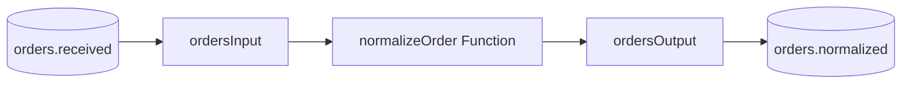

# Mapping Binding Names with spring.cloud.stream.function.bindings

## 1. Default binding names in the functional model

Spring Cloud Stream connects `Supplier`, `Function`, and `Consumer` functions to a broker through bindings. Each input or output port of a function has a default binding name derived from the function bean name and the port position.

For a bean named `normalizeOrder`:

- `normalizeOrder-in-0` is the first input binding.
- `normalizeOrder-out-0` is the first output binding.

The `in` and `out` suffixes indicate the data direction; the index `0` is the first port. Functions with multiple inputs or outputs can have ports `in-1`, `out-1`, and so on according to their index.

Common function types have ports as follows:

| Function type | Default ports | Example with bean |
|---|---|---|
| `Supplier<T>` | `<function>-out-0` | `dailyReport-out-0` |
| `Function<I, O>` | `<function>-in-0`, `<function>-out-0` | `normalizeOrder-in-0`, `normalizeOrder-out-0` |
| `Consumer<T>` | `<function>-in-0` | `recordAudit-in-0` |

The default name acts as the configuration key for destination, group, content type, and producer- or consumer-specific properties. For example, a transformation function configuration can be written as:

```yaml
spring:
  cloud:
    function:
      definition: normalizeOrder
    stream:
      bindings:
        normalizeOrder-in-0:
          destination: orders.received
          group: order-normalizer
          content-type: application/json
        normalizeOrder-out-0:
          destination: orders.normalized
          content-type: application/json
```

The application uses `normalizeOrder-in-0` to receive messages from `orders.received` and `normalizeOrder-out-0` to send results to `orders.normalized`.

## 2. Why map binding names

Auto-generated names are usually clear enough for short functions with few ports. When an application has many functions, long function names, function composition, or multiple inputs/outputs, default binding names can become hard to read and repetitive across many configuration lines.

Spring Cloud Stream lets you map a default binding name to a custom name using the property:

```properties
spring.cloud.stream.function.bindings.<default-binding-name>=<custom-binding-name>
```

For example:

```properties
spring.cloud.stream.function.bindings.normalizeOrder-in-0=ordersInput
spring.cloud.stream.function.bindings.normalizeOrder-out-0=ordersOutput
```

After mapping, `ordersInput` and `ordersOutput` become the binding names used in the corresponding binding configuration properties. You can configure destination, group, content type, and consumer/producer properties using the new names.

Mapping only changes the binding name in configuration. It does not change the Java bean name `normalizeOrder`, does not change the function definition, does not change the payload, and does not change the destination name on the broker. The destination is still specified separately with the `destination` property.

## 3. Configuring mappings in YAML

The full example below renames the two bindings of the `normalizeOrder` function to `ordersInput` and `ordersOutput`:

```yaml
spring:
  cloud:
    function:
      definition: normalizeOrder
    stream:
      function:
        bindings:
          normalizeOrder-in-0: ordersInput
          normalizeOrder-out-0: ordersOutput
      bindings:
        ordersInput:
          destination: orders.received
          group: order-normalizer
          content-type: application/json
        ordersOutput:
          destination: orders.normalized
          content-type: application/json
```

In this configuration:

1. `spring.cloud.function.definition` selects the `normalizeOrder` function bean to activate.
2. `spring.cloud.stream.function.bindings` maps `normalizeOrder-in-0` to `ordersInput` and `normalizeOrder-out-0` to `ordersOutput`.
3. `spring.cloud.stream.bindings.ordersInput` configures the input destination, consumer group, and message format.
4. `spring.cloud.stream.bindings.ordersOutput` configures the output destination and message format.

The same configuration can be written in a `.properties` file:

```properties
spring.cloud.function.definition=normalizeOrder
spring.cloud.stream.function.bindings.normalizeOrder-in-0=ordersInput
spring.cloud.stream.function.bindings.normalizeOrder-out-0=ordersOutput
spring.cloud.stream.bindings.ordersInput.destination=orders.received
spring.cloud.stream.bindings.ordersInput.group=order-normalizer
spring.cloud.stream.bindings.ordersInput.content-type=application/json
spring.cloud.stream.bindings.ordersOutput.destination=orders.normalized
spring.cloud.stream.bindings.ordersOutput.content-type=application/json
```

Both representations have the same meaning. Within a project, choose one consistent configuration style so it is easy to review and override across environment profiles.

## 4. Example with a Java function

The function bean does not need to know the binding alias name. Business logic is still declared using Java functional types:

```java
import java.util.function.Function;
import org.springframework.context.annotation.Bean;
import org.springframework.context.annotation.Configuration;

record OrderReceived(String orderId, long amount) {}
record NormalizedOrder(String orderId, long amount, String currency) {}

@Configuration
class OrderFunctions {

    @Bean
    Function<OrderReceived, NormalizedOrder> normalizeOrder() {
        return order -> new NormalizedOrder(
            order.orderId(),
            order.amount(),
            "VND"
        );
    }
}
```

Spring Cloud Stream still recognizes the function named `normalizeOrder` and creates the default ports `normalizeOrder-in-0` and `normalizeOrder-out-0`. The mapping configuration provides alternate names to reference those ports in the binding configuration section.

The data flow can be visualized as follows:



The aliases `ordersInput` and `ordersOutput` help the configuration express business roles. They are not queue or topic names that must exist on the broker; the actual broker resource name is the corresponding `destination` value.

## 5. Mapping each port of a multi-input or multi-output function

For functions with multiple ports, each default binding is mapped independently. For example, a function combining order information and customer information might have two inputs:

```java
import java.util.function.BiFunction;
import org.springframework.context.annotation.Bean;
import org.springframework.context.annotation.Configuration;

record OrderData(String orderId, String customerId) {}
record CustomerData(String customerId, String displayName) {}
record EnrichedOrder(String orderId, String customerName) {}

@Configuration
class EnrichmentFunctions {

    @Bean
    BiFunction<OrderData, CustomerData, EnrichedOrder> enrichOrder() {
        return (order, customer) -> new EnrichedOrder(
            order.orderId(),
            customer.displayName()
        );
    }
}
```

For a two-input function, the default port names are `enrichOrder-in-0` and `enrichOrder-in-1`; the output is `enrichOrder-out-0`. You can assign aliases to clarify each source's role:

```yaml
spring:
  cloud:
    function:
      definition: enrichOrder
    stream:
      function:
        bindings:
          enrichOrder-in-0: orderInput
          enrichOrder-in-1: customerInput
          enrichOrder-out-0: enrichedOrders
      bindings:
        orderInput:
          destination: orders.received
          group: order-enrichment
        customerInput:
          destination: customers.snapshot
          group: order-enrichment
        enrichedOrders:
          destination: orders.enriched
```

When mapping multiple ports, make sure aliases are unique within the configuration scope. Do not map two different ports to the same alias, as the configuration will become ambiguous and may cause properties of the two bindings to conflict.

With a `Supplier`, map only the output port, for example `dailyReport-out-0: reportOutput`. With a `Consumer`, map only the input port, for example `recordAudit-in-0: auditInput`. There is no need to create aliases for ports that the function type does not have.

## 6. Using aliases in binding properties

Once mappings are declared, use the aliases in properties belonging to those bindings. Common properties include:

| Property group | Example | Purpose |
|---|---|---|
| Destination | `bindings.ordersInput.destination` | Specifies the topic, queue, or logical destination |
| Consumer group | `bindings.ordersInput.group` | Defines an independent consumption scope |
| Content type | `bindings.ordersInput.content-type` | Specifies the payload format |
| Consumer properties | `bindings.ordersInput.consumer.*` | Tunes concurrency, partitioning, or binder-specific consumer behavior |
| Producer properties | `bindings.ordersOutput.producer.*` | Tunes partitioning and binder-specific producer behavior |

Example adding concurrency for the input and a partition key for the output:

```yaml
spring:
  cloud:
    function:
      definition: normalizeOrder
    stream:
      function:
        bindings:
          normalizeOrder-in-0: ordersInput
          normalizeOrder-out-0: ordersOutput
      bindings:
        ordersInput:
          destination: orders.received
          group: order-normalizer
          consumer:
            concurrency: 3
        ordersOutput:
          destination: orders.normalized
          producer:
            partition-key-expression: payload.orderId
            partition-count: 6
```

In this example, `consumer.concurrency` is attached to the `ordersInput` input binding, while `producer.partition-key-expression` is attached to the `ordersOutput` output binding. Exact property names and how the binder interprets them depend on the broker and binder version.

If you continue configuring `destination` under the default name after mapping while the application uses the alias elsewhere, the configuration becomes confusing and may not apply to the intended binding. When switching from default names to aliases, update all related properties at the same time.

## 7. When to use default names vs. when to map

Default names have the advantage of being directly derived from the function name and port. Readers can locate the corresponding Java bean without looking up an extra mapping table. With one or two simple functions, using default names is usually easier to maintain.

Aliases are useful when:

- Long function names or composition expressions make default binding names hard to read.
- A function has multiple ports and needs names that convey the business role of each source/target.
- A team wants to keep configuration names stable while refactoring internal bean names, provided the corresponding mapping is maintained.
- An environment configuration needs to reference bindings with short, clear, and consistent names.

Mapping introduces an extra layer of indirection. When reading configuration, developers must look up both the default name and the alias to know which binding is being configured. Therefore, do not rename every binding out of habit if the default names are already clear.

## 8. Rules for maintainable aliases

A good alias should be short, unique, stable, and reflect the port's role. You can use conventions like `ordersInput`, `ordersOutput`, `customerInput`, or `auditEvents`. Avoid generic names like `input1` or `output2` if you can name them after the business domain.

Follow these guidelines:

1. Map from the exact default binding name, including the function name, `in`/`out` direction, and port index.
2. Assign a unique alias to each binding within the same application.
3. Use consistent casing and naming conventions across the entire project.
4. Update all binding properties to use the alias after mapping.
5. Document mappings where the team can find them when troubleshooting configuration issues.
6. Avoid giving an alias the same name as a destination if the two concepts could be confused.
7. Do not pass untrusted data directly into binding names or dynamic destinations.

Mapping does not alter broker access permissions. Permissions are still determined by the destination and the binder's authentication credentials. If aliases are used in Actuator configuration or administrative tools, verify the binding names exposed by the exact Spring Cloud Stream version you are running.

## 9. Common mistakes when mapping names

### Using the wrong configuration prefix

The mapping property lives under `spring.cloud.stream.function.bindings`. It is distinct from `spring.cloud.function.definition` and distinct from `spring.cloud.stream.bindings`. Check the configuration nesting level and exact spelling of property names.

### Putting the alias on the left-hand side

The left-hand side of the mapping must be the default binding name generated from the function and port, such as `normalizeOrder-in-0`. The right-hand side is the custom alias, such as `ordersInput`. Reversing the two sides will not produce the intended mapping.

### Continuing to configure using default names

After renaming, binding properties should reference the alias. If some profiles still configure properties using the old name, the application may end up with unused config entries or configuration split across two names. Check both base configuration files and environment profiles to prevent drift.

### Mapping the wrong port index

For multi-input functions, `join-in-0` and `join-in-1` are two separate ports. If aliases are swapped, data may be routed into the wrong function parameter. Cross-check the function signature and the meaning of each port.

### Duplicate aliases

Two bindings sharing the same alias make it impossible to tell which destination or consumer/producer properties belong to which port. Give each binding its own name and review the entire mapping table.

### Confusing aliases with destinations

An alias is a binding name in Spring Cloud Stream configuration. A destination is a logical resource name on the broker. For example, `ordersInput` may map to destination `orders.received`; the broker does not necessarily have a topic or queue named `ordersInput`.

## 10. Checklist for verifying configuration after mapping

When adding or changing aliases, walk through these verification steps:

1. Confirm that the function definition points to the right function bean.
2. List the input/output ports required by the function signature.
3. Note the default name of each port based on function name and index.
4. Verify each default name is mapped to a unique alias.
5. Search all `spring.cloud.stream.bindings` properties and confirm they use the corresponding aliases.
6. Start the application with the target deployment profile and check the binding creation logs.
7. Confirm that consumers connect to the right destination and group, and producers send to the right destination.
8. Send a test message to verify data flows through the right port and right function.
9. Verify that other environment profiles do not unexpectedly override mappings or destinations.

If the application has the Actuator bindings endpoint, you can use the secured endpoint to inspect active bindings. Exact names and control capabilities should be verified for your framework version. When errors occur, startup logs, function definition names, default binding names, aliases, and destinations are the first details to cross-check.

## 11. Conclusion

`spring.cloud.stream.function.bindings` provides a mechanism to assign alternate names to bindings generated from the functional model. It makes configuration easier to read when default names are too long or an application has many ports. To use it safely, understand the default names, map each port with the right direction and index, and then use the aliases consistently across binding properties.

Keep conceptual boundaries clear: function definitions select functions; bindings connect function ports to messaging infrastructure; aliases are configuration names for bindings; destinations specify where messages are sent to or received from the broker. When these concepts are not mixed up, Spring Cloud Stream configuration remains readable, operable, and less error-prone as the application grows.
